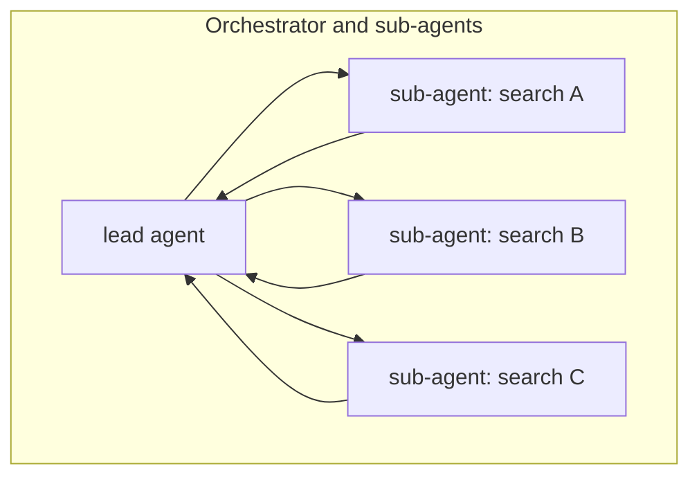

# ReAct, planning, multi-agent systems and frameworks

The previous lesson covered *which* agentic pattern to use. This one opens up the agent loop itself:
how ReAct interleaves reasoning with actions, how agents plan and recover, why "code as action" (the
smolagents approach) works so well, how multi-agent systems are structured, and how today's frameworks
compare.

## 1. ReAct: reason, act, observe

ReAct (Yao et al. 2022) prompts a model to alternate **Thought** (free-text reasoning), **Action** (a
tool call) and **Observation** (the tool result appended by the runtime), until it emits a final answer:

```text
Question: Which is older, the transformer paper or the LoRA paper, and by how many years?
Thought: I need the publication years of both.
Action: search["Attention Is All You Need publication year"]
Observation: Published June 2017 at NeurIPS 2017.
Thought: Now LoRA.
Action: search["LoRA low-rank adaptation paper year"]
Observation: Hu et al., arXiv June 2021.
Thought: 2021 - 2017 = 4.
Final Answer: The transformer paper is older, by 4 years.
```

The thought steps let the model plan, track progress and handle surprises; the observations ground it
in reality and reduce hallucination compared with chain-of-thought alone. Modern APIs make this native:
the model emits text (or hidden "thinking") plus tool-use blocks, and observations come back as tool
results. Reasoning models with **interleaved thinking** can reason between tool calls without you
prompting for "Thought:".

Below is a complete ReAct runtime with a scripted "model", so the parsing and loop logic are real.

```python-run
import re

TOOLS = {
    "search": lambda q: {"transformer": "Published 2017.", "lora": "Published 2021."}.get(
        next((k for k in ["transformer", "lora"] if k in q.lower()), ""), "No results."),
    "calculate": lambda expr: str(eval(expr, {"__builtins__": {}}, {})),   # demo only: never eval untrusted text
}
SCRIPT = iter([
    'Thought: find both years.\nAction: search["transformer paper year"]',
    'Thought: now LoRA.\nAction: search["LoRA paper year"]',
    'Thought: subtract.\nAction: calculate["2021 - 2017"]',
    'Thought: done.\nFinal Answer: The transformer paper is older by 4 years.',
])
def model(transcript):          # stand-in for an LLM call on the whole transcript
    return next(SCRIPT)

def react(question, max_steps=6):
    transcript = f"Question: {question}\n"
    for _ in range(max_steps):
        out = model(transcript)
        transcript += out + "\n"
        if m := re.search(r"Final Answer:\s*(.*)", out):
            return m.group(1), transcript
        m = re.search(r'Action:\s*(\w+)\["(.*)"\]', out)
        if not m or m.group(1) not in TOOLS:
            transcript += "Observation: invalid action, use a listed tool.\n"; continue
        transcript += f"Observation: {TOOLS[m.group(1)](m.group(2))}\n"
    return "gave up", transcript

answer, log = react("Which is older, the transformer paper or LoRA, and by how much?")
print(log); print("ANSWER:", answer)
```

## 2. Planning and recovery

Agent failure modes (also catalogued in the AI Engineering track): invalid tool or arguments, wrong
goal decomposition, getting stuck in loops, premature "done", and **compounding errors** over many
steps. Techniques:

- **Plan-then-execute**: ask for an explicit plan (a to-do list) first, execute steps, re-plan when an
  observation invalidates the plan. Writing the plan to a file or a to-do tool also helps long tasks
  survive context resets (module 9).
- **Reflection / self-critique** (Reflexion): after a failure, have the model write what went wrong and
  keep that note for the next attempt.
- **Verification with ground truth**: tests, linters, type checkers, re-reading the edited file,
  re-running the query. The best agents check their work against the environment, not their own
  opinion.
- **Budgets and guards**: max steps, max tokens, max wall-clock time, loop detection (same call with
  same arguments three times), and escalation to a human.
- **Checkpoints**: snapshot state (git commits, files) so a bad branch can be rolled back.

## 3. Code as action: smolagents

Hugging Face's **smolagents** library offers two agent types:

- `ToolCallingAgent`: classic JSON tool calls, one action per step.
- `CodeAgent`: the model writes **Python code** as its action, which can call tools as functions,
  loop, branch, store intermediate variables and combine several tool calls in one step. Research
  (Wang et al. 2024, "Executable Code Actions") found code actions need fewer steps and achieve higher
  success than JSON, because code is composable and LLMs have seen vast amounts of it.

```python
from smolagents import CodeAgent, ToolCallingAgent, InferenceClientModel, WebSearchTool, tool

@tool
def get_fx_rate(base: str, quote: str) -> float:
    """Return the latest exchange rate from base currency to quote currency.
    Args:
        base: ISO currency code to convert from, e.g. 'EUR'.
        quote: ISO currency code to convert to, e.g. 'JPY'.
    """
    return fetch_rate(base, quote)

model = InferenceClientModel(model_id="Qwen/Qwen3-32B")       # or LiteLLMModel, TransformersModel, OpenAIModel...
agent = CodeAgent(tools=[get_fx_rate, WebSearchTool()], model=model,
                  additional_authorized_imports=["math"], max_steps=8,
                  executor_type="docker")                    # sandbox: local, docker, e2b, modal, wasm...
agent.run("If I convert 250 EUR to JPY and then to USD, how many USD do I get?")
```

Each step, the CodeAgent's code runs, its prints and return values become the observation, and
`final_answer(...)` ends the run. Because the agent executes generated code, **sandboxing** is
essential: the default local executor restricts imports and builtins, but a container or remote
sandbox is the safe choice for anything exposed to untrusted input. smolagents also supports
multi-agent setups (managed agents passed to a manager agent), Hub-shared tools, MCP tools via
`ToolCollection.from_mcp(...)`, and OpenTelemetry tracing.

## 4. Multi-agent systems

Why use several agents? Separate contexts (each sub-agent works in a clean window and returns a
condensed result), parallelism, specialisation (different prompts, tools or models per role) and
security boundaries (a quarantined agent reads untrusted content without access to dangerous tools).

Common topologies:



- **Orchestrator / sub-agents (hierarchical)**: the most proven design. Anthropic's Research feature
  uses a lead agent that plans, spawns parallel sub-agents with explicit task descriptions (objective,
  output format, tools, boundaries), and synthesises; a citation agent attributes claims afterwards.
  Anthropic reported the multi-agent system beat a single agent by about 90 percent on their internal
  research eval, but used roughly 15 times the tokens of a chat interaction; token usage itself
  explained most of the performance variance. Worth it for high-value, parallelisable, breadth-first
  tasks; not for tightly coupled ones such as most coding.
- **Pipeline / handoffs**: agent A completes a stage then hands off to agent B (OpenAI Agents SDK
  "handoffs", triage-to-specialist).
- **Debate / critic**: agents argue or critique each other; a judge decides.
- **Swarm / peer-to-peer**: agents message each other freely; flexible but hard to control and debug.

Lessons reported by teams building these: teach the orchestrator **how to delegate** (vague sub-tasks
cause duplicated or missed work), **scale effort to query complexity** (one agent for simple facts,
many for broad research), give sub-agents **clear output contracts**, let them write large outputs to a
filesystem and return references instead of copying everything through the lead's context, and invest
heavily in **observability** because nondeterministic multi-agent runs are hard to reproduce.

Inter-agent protocols are emerging too: **A2A** (Agent2Agent, originated by Google, now a Linux
Foundation project) standardises how independent agents discover each other (agent cards) and exchange
tasks, complementing **MCP**, which standardises agent-to-tool/data connections (module 8).

## 5. The framework landscape

| framework | style | notes |
|---|---|---|
| **smolagents** (HF) | minimal, code agents | small core, model-agnostic, sandboxed executors, Hub tools |
| **LangGraph** (LangChain) | explicit state graphs | nodes and edges with persisted state, checkpoints, human-in-the-loop, durable execution |
| **LlamaIndex** (Workflows, agents) | data/RAG-centric | strong ingestion and retrieval tooling, event-driven workflows |
| **OpenAI Agents SDK** | agents, handoffs, guardrails, sessions | lightweight, tracing built in, provider-agnostic via LiteLLM |
| **Claude Agent SDK** | the harness behind Claude Code | agent loop, context management/compaction, file and shell tools, subagents, MCP, permissions |
| **Google ADK**, **Microsoft Agent Framework** (AutoGen + Semantic Kernel lineage), **CrewAI**, **Pydantic AI**, **DSPy** | various | role-based crews, typed outputs, programmatic prompt optimisation |

How to choose: start with direct API calls for simple loops (often under 100 lines); adopt a framework
when you need its specific strengths (durable state and checkpoints, multi-agent orchestration,
tracing, sandboxed code execution). Whatever you choose, make sure you can **see the exact prompts and
tool calls**; hidden prompt layers are a top source of agent bugs.

```python
# LangGraph prebuilt ReAct agent, for comparison (static)
from langgraph.prebuilt import create_react_agent
from langgraph.checkpoint.memory import InMemorySaver

def get_weather(city: str) -> str:
    """Get the current weather for a city."""
    return f"Sunny in {city}"

agent = create_react_agent(model="anthropic:claude-sonnet-4-5", tools=[get_weather],
                           checkpointer=InMemorySaver())
cfg = {"configurable": {"thread_id": "user-42"}}
agent.invoke({"messages": [{"role": "user", "content": "Weather in Oslo?"}]}, cfg)
```

## 6. Evaluating agents

- **Outcome metrics**: task success rate on a suite of realistic tasks (with end-state checks, e.g. the
  tests pass, the DB row exists), cost and latency per task, number of steps.
- **Trajectory metrics**: correct tool selection, argument validity rate, redundant calls, recovery
  after errors.
- **pass@k vs pass^k**: succeeding at least once in k tries versus succeeding in all k tries; the second
  matters for reliability (tau-bench popularised it).
- Benchmarks to know: SWE-bench Verified (coding), tau-bench (tool-using customer service), GAIA
  (general assistants), WebArena / OSWorld (web and computer use), Terminal-Bench.

> [!INTERVIEW]
> **"Design a research agent."** Orchestrator-workers: a lead agent plans and spawns parallel search
> sub-agents with precise briefs and output formats, each with search/fetch tools and its own clean
> context, returning condensed findings with sources; the lead synthesises and a citation pass verifies
> attributions. Add budgets, effort scaling by query complexity, tracing of every tool call, an eval set
> with end-state checks and LLM-judge rubrics, and note the token cost (multi-agent is much more
> expensive than single-agent).

## Summary

- ReAct interleaves reasoning, actions and observations; modern tool-use APIs and interleaved thinking
  make it native.
- Robust agents plan explicitly, verify against ground truth, and run under budgets with loop detection.
- Code actions (smolagents `CodeAgent`) compose tools in fewer steps but demand sandboxing.
- Multi-agent orchestrator/sub-agent designs buy parallelism and clean contexts at a high token cost.
- Pick frameworks for specific needs; always keep prompts and tool calls observable.

```quiz
[
  {"q": "What does the Observation step in ReAct contain?",
   "options": ["The result returned by the tool, appended by the runtime", "The model's private reasoning", "The final answer", "The system prompt"], "answer": 0,
   "explain": "Observations ground the next Thought in real environment feedback."},
  {"q": "Why can a CodeAgent solve tasks in fewer steps than a JSON tool-calling agent?",
   "options": ["Code can call several tools, loop and store variables in a single action", "It uses a bigger model", "It needs no tools", "It skips observations"], "answer": 0,
   "explain": "Code actions compose naturally, while JSON calls are one action per step."},
  {"q": "What is the most important safety measure for code-executing agents?",
   "options": ["Run generated code in a sandbox with restricted imports and resources", "Use temperature 0", "Use more tools", "Use a bigger context window"], "answer": 0,
   "explain": "Generated code is untrusted; containers or remote sandboxes contain the damage."},
  {"q": "According to Anthropic's report on its multi-agent research system, what was a major cost?",
   "options": ["About 15x the tokens of a chat interaction", "Lower accuracy than a single agent", "No parallelism", "Inability to use tools"], "answer": 0,
   "explain": "It outperformed a single agent substantially, but at much higher token usage."},
  {"q": "What does pass^k measure for an agent?",
   "options": ["Succeeding on all k independent attempts: reliability", "Succeeding at least once in k attempts", "Average steps per task", "Token cost per task"], "answer": 0,
   "explain": "pass^k drops quickly for inconsistent agents, which matters in production."},
  {"q": "How do A2A and MCP relate?",
   "options": ["A2A connects agents to agents; MCP connects agents to tools and data", "They are the same protocol", "A2A replaces JSON-RPC", "MCP is only for images"], "answer": 0,
   "explain": "They are complementary layers of the agent ecosystem."},
  {"q": "Which is a recommended practice when an orchestrator delegates to sub-agents?",
   "options": ["Give each sub-agent a clear objective, output format, tools and boundaries", "Give all sub-agents the same vague instruction", "Share one context window among all", "Avoid any output format"], "answer": 0,
   "explain": "Vague delegation leads to duplicated or missing work."}
]
```

> **Source:** Yao et al., "ReAct" (2022); Shinn et al., "Reflexion" (2023); Wang et al., "Executable
> Code Actions Elicit Better LLM Agents" (2024); smolagents docs (https://huggingface.co/docs/smolagents)
> and the Hugging Face Agents Course units 1 and 2 (https://huggingface.co/learn/agents-course);
> Anthropic Engineering, "How we built our multi-agent research system" (2025); LangGraph docs; Huyen,
> *AI Engineering*, ch. 6 "Agents" (planning, reflection, tool selection, failure modes and evaluation).
