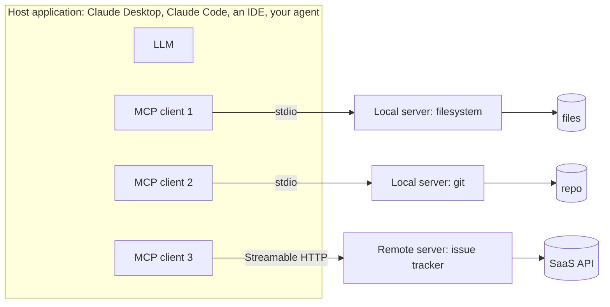
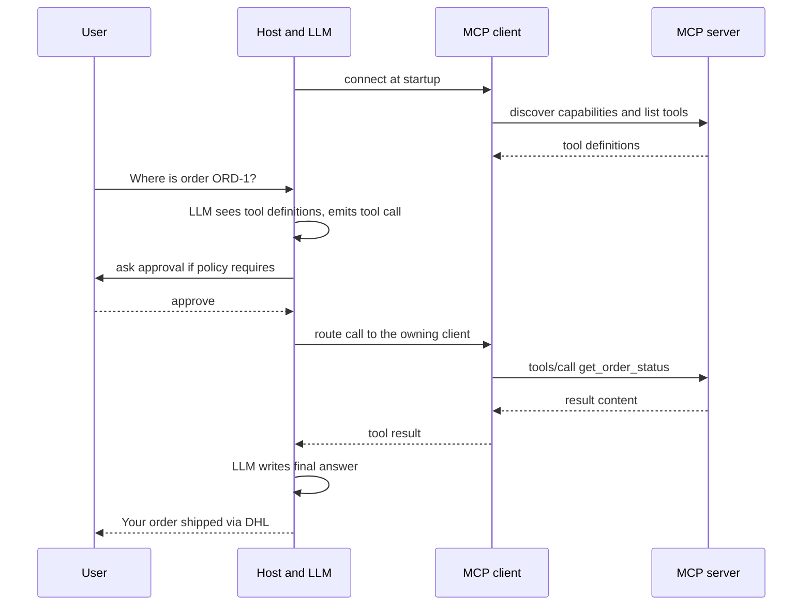

# Why MCP: architecture and primitives

> **Before this lesson:** you should know how function calling works: tool definitions with a name,
> description and JSON Schema, the tool-call loop, and tool results with an error flag
> ([Function calling: schemas, the tool loop and parsing](#/lesson/llm-practice/function-calling)).
> It helps to have seen how agents and frameworks use tools
> ([ReAct, planning, multi-agent systems and frameworks](#/lesson/llm-practice/agent-frameworks)).

## In plain words

Lesson 15 showed how one application can give its model a few tools. The trouble is that every
application wrote its own connection to every outside system: one GitHub connector for this coding
tool, another for that chat app, another for your company's agent. The **Model Context Protocol
(MCP)** is a shared standard for those connections. Anyone can write an MCP **server** that offers
tools and data from one system (GitHub, a database, your files), and any MCP-aware application can
plug it in without custom code.

Think of the power sockets in a building. Before standard plugs, every appliance would need its own
wiring job. With a standard socket, the appliance maker builds one plug and the electrician builds
one socket, and everything fits everything. MCP is the standard socket between AI applications and
the systems they use; people often compare it to USB-C.

Why it matters for a job: MCP was adopted by the major AI vendors and developer tools within
about a year of its release, so engineers building agents are expected to know how it is organised, what its building
blocks are, and where its security risks lie. "What problem does MCP solve and how is it structured?"
is now a routine interview question.

## The integration problem

Function calling (module 7) gives one application a way to offer tools to one model. But every
application had to re-implement every **integration** (the code that connects one system to another):
a GitHub connector for this **IDE** (integrated development environment, the program programmers write
code in), another for that chat app, a third for your in-house agent. With $M$ AI applications and $N$
systems to connect, that is $M \times N$ bespoke integrations. The **Model Context Protocol (MCP)**,
introduced by Anthropic in November 2024 and now an open standard governed under the Linux Foundation
(a non-profit that hosts shared open-source projects), turns it into $M + N$: write a server once, and
any MCP-capable client can use it. A **protocol** is an agreed set of message formats and rules that
lets independently written programs talk to each other. The usual analogy is USB-C for AI
applications; the design inspiration is the Language Server Protocol, which did the same for editors
and programming languages (one language server works in every editor that speaks the protocol).

## 1. Participants: host, client, server

Three roles appear in every MCP setup. The diagram shows one host running three clients, each
connected to one server; two servers run locally and one is reached over the internet.



- **Host**: the AI application the user interacts with. It owns the LLM connection, the conversation,
  the permission prompts and the policy for what reaches the model.
- **Client**: a connector *inside* the host that speaks MCP to exactly **one** server. A host with five
  servers runs five clients.
- **Server**: a program that exposes context and capabilities. It can be **local** (a **subprocess**, a
  program the host starts on your machine, talking over **stdio**, the standard input and output
  streams every program has) or **remote** (a web service talking over **Streamable HTTP**). The
  remote example in the diagram connects to a **SaaS** (software-as-a-service, a product used over
  the web) API.

Three design principles from the **spec** (the specification, the official document defining the
protocol) are worth memorising:

1. **Servers should be easy to build.** Hosts handle the hard orchestration.
2. **Servers are composable and isolated.** A server sees only what the host sends it: it does not see
   the whole conversation, and it cannot see other servers. The host enforces these boundaries.
3. **Features are negotiated through capabilities**, so clients and servers can evolve independently.
   A **capability** is an optional feature; each side announces which ones it supports, and only the
   features both support are used.

Crucially, **the server never talks to the LLM directly**. The host takes the server's tool list and
turns it into the tool definitions of its own model API call; when the model emits a tool call, the
host routes it to the right client, which sends `tools/call` to the server.

The toy host below makes that concrete with two pretend servers. It collects their tool lists,
converts each to the field names its model API expects, and routes a model's tool call back to the
server that owns the tool:

```python-run
# A toy host: two "servers" expose tools; the host merges their tool lists for the model
# and routes each tool call back to the server that owns it.
SERVERS = {
    "orders": {"tools": [{"name": "get_order_status", "description": "Shipping status of an order",
                          "inputSchema": {"type": "object", "properties": {"order_id": {"type": "string"}},
                                          "required": ["order_id"]}}],
               "call": lambda name, args: {"content": [{"type": "text", "text": f"{args['order_id']}: shipped via DHL"}],
                                           "isError": False}},
    "weather": {"tools": [{"name": "get_weather", "description": "Current weather for a city",
                           "inputSchema": {"type": "object", "properties": {"city": {"type": "string"}},
                                           "required": ["city"]}}],
                "call": lambda name, args: {"content": [{"type": "text", "text": f"3 C in {args['city']}"}],
                                            "isError": False}},
}

# 1. At start-up each client lists its server's tools (tools/list); the host builds a routing table.
route, model_tools = {}, []
for server, srv in SERVERS.items():
    for t in srv["tools"]:
        route[t["name"]] = server
        model_tools.append({"name": t["name"], "description": t["description"], "input_schema": t["inputSchema"]})
print("tools offered to the model:", [t["name"] for t in model_tools])

# 2. The model emits a tool call; the host routes it to the owning server (tools/call).
call = {"name": "get_weather", "arguments": {"city": "Oslo"}}
owner = route[call["name"]]
result = SERVERS[owner]["call"](call["name"], call["arguments"])
print(f"routed {call['name']} to the '{owner}' server ->", result["content"][0]["text"])

# 3. The arithmetic behind MCP's value: integrations needed for M apps and N systems.
for M, N in [(3, 5), (10, 40)]:
    print(f"M={M:2d} apps, N={N:2d} systems: {M * N:4d} custom integrations vs {M + N:3d} with MCP")
```

**Reading this code line by line**

- Each entry of `SERVERS` stands for one MCP server: its tool definitions (in MCP's format, with
  `inputSchema`) and a `call` function that plays the part of answering `tools/call`. Results use
  MCP's shape: a list of `content` blocks and an `isError` flag.
- Step 1 is discovery. For every tool, the host records which server owns it in `route` and builds the
  definition its model API wants. Note the renaming from `inputSchema` (MCP) to `input_schema`
  (Anthropic's API): the host translates; the server never knows which model is on the other side.
- Step 2 is routing. The model asked for `get_weather`; `route` says the weather server owns it, so
  the call goes there and the text result comes back: `3 C in Oslo`.
- Step 3 prints the integration count: 3 apps and 5 systems need 15 custom connectors but only 8 MCP
  pieces; 10 apps and 40 systems need 400 against 50.

## 2. Two layers

MCP is described in two layers, a common way of separating *what* is said from *how* it travels:

- **Data layer**: **JSON-RPC 2.0** messages (a small standard for sending "call this method with these
  parameters" requests and their responses as JSON) defining the **lifecycle** (how a connection starts
  and ends), the **primitives** (tools, resources, prompts...) and utilities (progress, cancellation,
  pagination).
- **Transport layer**: how those messages move: **stdio** for local servers, **Streamable HTTP** for
  remote ones (next lesson).

The same JSON-RPC messages flow regardless of transport.

## 3. Server primitives

A **primitive** is one of the basic kinds of thing a server can offer. There are three. In the table,
a **URI** (uniform resource identifier) is an address string such as `file:///repo/README.md`, the
general form of a web link; a **slash command** is a command the user types starting with `/`.

| primitive | controlled by | what it is | example |
|---|---|---|---|
| **Tools** | the **model** | functions the LLM may decide to call | `create_issue`, `run_query` |
| **Resources** | the **application** | read-only data addressed by URI that the host can attach as context | `file:///repo/README.md`, `db://schema/users` |
| **Prompts** | the **user** | reusable message templates, typically surfaced as slash commands | `/review-pr 123` |

The "controlled by" column is the key to the design. Tools are discovered and invoked on the model's
initiative (subject to user approval). Resources are selected by the application or the user (think of
an attach menu or an `@` mention). Prompts are explicitly triggered by the user.

### Tools

A tool has a `name`, optional `title` (a human-friendly display name), a `description`, an
`inputSchema` (JSON Schema), an optional `outputSchema`, and optional `annotations` (hints such as
`readOnlyHint` "this tool changes nothing", `destructiveHint` "this tool may delete or overwrite",
`idempotentHint` "calling twice has the same effect as once", `openWorldHint` "this tool reaches the
outside world, such as the web"). A **method** is the name of a JSON-RPC operation; the two for tools
are `tools/list` (discover the tools) and `tools/call` (run one).

```json
{
  "name": "get_weather",
  "title": "Weather Information Provider",
  "description": "Get current weather information for a location",
  "inputSchema": {
    "type": "object",
    "properties": {"location": {"type": "string", "description": "City name or zip code"}},
    "required": ["location"]
  }
}
```

A call result carries `content` (a list of blocks: `text`, `image`, `audio`, `resource_link`, embedded
`resource`), optionally `structuredContent` (the same result as a JSON object matching the
`outputSchema`, convenient for programs), and `isError`.

**Two kinds of errors**, a favourite interview point:

- **Protocol errors** are JSON-RPC `error` objects, each with a numeric code fixed by the JSON-RPC
  standard: unknown tool, malformed request (`-32602` Invalid params), unknown method (`-32601`),
  server fault (`-32603`). They mean the conversation between the programs went wrong, and the model
  usually cannot fix these.
- **Tool execution errors** are *successful* JSON-RPC responses whose result has `"isError": true` and
  a human-readable message ("departure date must be in the future"). These go back to the model so it
  can self-correct.

Annotations are **hints from the server and must be treated as untrusted** unless the server is
trusted: a malicious server can label a destructive tool `readOnlyHint: true`.

### Resources

Resources expose data identified by URIs. `resources/list` enumerates concrete resources,
`resources/templates/list` returns **URI templates** like `weather://forecast/{city}/{date}` (addresses
with blanks that the client fills in), and `resources/read` returns contents: `text`, or a binary
`blob` written in **base64** (a way of spelling arbitrary bytes with plain letters and digits) with a
`mimeType` (a standard label for the kind of file, such as `image/png`). Clients can be notified when
a resource changes. Resources are how a server offers context *without* the model having to call a
tool.

### Prompts

Prompts are parameterised templates: `prompts/list` returns names, descriptions and arguments;
`prompts/get` with arguments returns a list of messages ready to send to the model. They may embed
resources.

## 4. Client features

Servers sometimes need things from the client side:

- **Elicitation**: the server asks the *user* for input mid-operation (a form defined by a small JSON
  schema, or a URL to visit for sensitive flows such as **OAuth**, the standard "sign in with your
  account and grant this app access" procedure). The host renders the **UI** (user interface); the user
  can accept, decline or cancel.
- **Sampling**: the server asks the host's LLM to generate a completion, so a server can use a model
  without holding API keys, with the user in the loop.
- **Roots**: the client tells the server which directories or URIs it should operate within.
- **Logging**: servers send structured log messages to the client.

> [!NOTE]
> **Version awareness.** The protocol is versioned by date. In revisions up to **2025-11-25**, sampling,
> roots and elicitation were server-initiated JSON-RPC *requests* over a **stateful session** (a
> connection in which both sides remember what was agreed earlier, so every message depends on that
> shared history). The
> **2026-07-28** revision made the protocol stateless, **deprecated sampling, roots and logging**
> (suggested migrations: call LLM provider APIs directly, pass directories as tool parameters or
> configuration, log to stderr or OpenTelemetry), and re-expressed elicitation through "multi round-trip
> requests". Deprecated features keep working during a deprecation window of at least twelve months,
> and many deployed clients and servers still speak the older revisions, so you need to recognise both.
> The next lesson shows the wire differences.

## 5. Utilities and extensions

A **notification** is a one-way JSON-RPC message that expects no reply. The protocol's small helper
features are called utilities:

- **Progress** notifications for long operations (opt in with a `progressToken`), **cancellation**,
  **pagination** with **opaque cursors** on every list method (the server returns a token meaning
  "next page starts here", which the client hands back without interpreting it), **completion**
  (argument autocompletion).
- **List-changed notifications**: a server whose tool set changes can notify subscribed clients, which
  then re-fetch `tools/list`.
- **Caching hints** (2026-07-28): list and read results carry `ttlMs` (a **time to live** in
  milliseconds: how long the client may reuse the answer) and `cacheScope` so clients can cache;
  servers should return tools in a **deterministic order**, which also keeps the host's LLM prompt
  cache stable (module 9).
- **Extensions**, negotiated through capabilities and always opt-in: **Tasks** (durable handles for
  long-running operations with polling), **MCP Apps** (interactive UI rendered inline in the host),
  and others.

## 6. A day in the life of a tool call

Putting the pieces together, here is everything that happens from start-up to answer. Follow the
arrows top to bottom; notice that the approval step happens in the host, and that the server only
ever sees the `tools/call` request, never the user's words.



## 7. MCP versus alternatives

- **Plain function calling**: fine when you own both the application and the tools. MCP adds a process
  boundary, discovery, a standard wire format and reuse across hosts.
- **OpenAPI / REST**: **REST** is the common style of web API built from URLs and HTTP verbs (GET,
  POST...), and **OpenAPI** is the standard file format describing such an API. It describes HTTP APIs
  for developers; MCP describes capabilities *for models*
  (descriptions written as prompts, results shaped for context windows) and adds resources, prompts,
  elicitation and notifications. Wrapping a REST API one-to-one as MCP tools tends to work poorly:
  design task-level tools instead.
- **A2A** (agent-to-agent) addresses agents delegating to other agents; MCP addresses agents reaching
  tools and data.
- **Skills** (folders of instructions and scripts an agent loads on demand) are complementary:
  procedural knowledge in files versus live connections to systems.

A practical cost to remember: every connected server's tool definitions consume context. Dozens of
servers with hundreds of tools can burn tens of thousands of tokens before the user says anything, and
degrade tool selection. Mitigations (tool search / deferred loading, code execution against MCP APIs,
curated tool sets) are covered in modules 9 and in lesson 20.

## 8. The ecosystem

- **Reference servers** (github.com/modelcontextprotocol/servers): Everything (test server),
  Fetch, Filesystem, Git, Memory (knowledge graph), Sequential Thinking, Time. Many earlier reference
  servers (GitHub, Slack, Postgres, Puppeteer...) were archived in favour of vendor-maintained ones.
- **Official SDKs**: TypeScript, Python, Go, Java/Kotlin, C#, Rust, Swift, Ruby, PHP.
- **Registry**: the official MCP Registry (registry.modelcontextprotocol.io) is a metadata catalogue of
  publicly available servers that sub-registries and clients build on.
- **Clients**: Claude (desktop, web connectors, Claude Code), ChatGPT, VS Code and GitHub Copilot,
  Cursor, Windsurf, Zed, Gemini CLI, agent frameworks (smolagents, LangChain, LlamaIndex, OpenAI Agents
  SDK, Pydantic AI), and LLM APIs that accept remote MCP servers directly.
- **MCP Inspector**: an interactive debugging UI for servers (`npx @modelcontextprotocol/inspector`;
  `npx` runs a JavaScript package without installing it permanently).

> [!INTERVIEW]
> **"What problem does MCP solve and how is it structured?"** It standardises how AI applications
> connect to tools and data, collapsing M x N integrations to M + N. A host runs one client per server;
> servers expose tools (model-controlled), resources (application-controlled) and prompts
> (user-controlled) over JSON-RPC 2.0 on stdio or Streamable HTTP; capabilities are negotiated; the host
> mediates everything, so servers never see the full conversation or each other. Mention protocol
> errors versus `isError` tool results, and that the 2026-07-28 revision made the protocol stateless.

## Summary

- MCP is an open JSON-RPC protocol connecting AI hosts to servers through one client per server.
- Tools are model-controlled, resources application-controlled, prompts user-controlled.
- Protocol errors use JSON-RPC error codes; tool failures are results with `isError: true`.
- Client-side features (elicitation, plus the now-deprecated sampling and roots) let servers ask for
  user input, model completions and scope.
- Tool definitions cost context; curate what you connect.

## Glossary

- **MCP (Model Context Protocol)**: the open standard for connecting AI applications to tools and data.
- **Protocol / spec**: agreed message formats and rules / the document that defines them.
- **Integration**: code that connects one system to another.
- **Host / client / server**: the AI application / its connector to one server / the program offering
  tools and data.
- **Local server / remote server**: a subprocess on your machine over stdio / a web service over
  Streamable HTTP.
- **stdio**: a program's standard input and output streams.
- **JSON-RPC 2.0**: a standard for method-call requests and responses written in JSON.
- **Data layer / transport layer**: what the messages say / how they travel.
- **Capability**: an optional feature that each side announces; only shared ones are used.
- **Primitive**: one of the basic things a server offers: tools, resources, prompts.
- **Tool / resource / prompt**: model-controlled function / application-controlled data addressed by
  URI / user-triggered message template.
- **URI / URI template**: an address string / an address with blanks to fill in.
- **Annotation**: a server's self-declared hint about a tool, such as `readOnlyHint`; untrusted.
- **Protocol error / tool execution error**: a JSON-RPC error object / a normal result with
  `isError: true`.
- **Elicitation / sampling / roots**: the server asks the user for input / asks the host's model for a
  completion / learns which directories it may use.
- **Notification**: a one-way message that expects no reply.
- **Stateful session / stateless protocol**: both sides remember earlier messages / each request
  stands alone.
- **Registry**: a catalogue of available MCP servers.

## Check yourself

```quiz
[
  {"q": "In MCP, how many servers does one client connect to?",
   "options": ["Exactly one; a host runs one client per server", "All servers", "At most two", "It depends on the transport"], "answer": 0,
   "explain": "The 1:1 client-server relationship keeps servers isolated from each other."},
  {"q": "Which primitive is model-controlled?",
   "options": ["Tools", "Resources", "Prompts", "Roots"], "answer": 0,
   "explain": "The LLM decides when to call tools; resources are chosen by the application and prompts by the user."},
  {"q": "A tool runs but the upstream API rejects the date argument. How should the server report it?",
   "options": ["A normal result with isError: true and an explanatory message", "A JSON-RPC error with code -32700", "Close the connection", "Return an empty result"], "answer": 0,
   "explain": "Tool execution errors go in the result so the model can read them and self-correct."},
  {"q": "A client calls a tool name that does not exist. What is the appropriate response?",
   "options": ["A JSON-RPC protocol error such as -32602 Unknown tool", "isError: true result", "A notification", "HTTP 200 with empty content"], "answer": 0,
   "explain": "Unknown tools and malformed requests are protocol-level errors."},
  {"q": "Why must clients treat tool annotations like readOnlyHint as untrusted?",
   "options": ["A malicious or buggy server can mislabel a destructive tool", "They are encrypted", "They are deprecated", "They only apply to resources"], "answer": 0,
   "explain": "Annotations are self-declared hints, not guarantees."},
  {"q": "What does MCP mainly reduce?",
   "options": ["M x N custom integrations to M + N", "Model latency", "Tokenizer vocabulary", "GPU memory"], "answer": 0,
   "explain": "One server works with every compliant client, and vice versa."},
  {"q": "Which statement about the server and the LLM is correct?",
   "options": ["The server never talks to the LLM directly; the host mediates", "The server streams tokens from the LLM", "The LLM connects to servers over stdio itself", "Servers see the full conversation"], "answer": 0,
   "explain": "The host converts MCP tools into its model's tool definitions and routes calls."}
]
```

> **Source:** Model Context Protocol docs and specification: Architecture overview, Server concepts,
> Client concepts (https://modelcontextprotocol.io/docs/learn/architecture), specification revisions
> 2025-11-25 and 2026-07-28 with changelog (https://modelcontextprotocol.io/specification/latest);
> reference servers (https://github.com/modelcontextprotocol/servers); Anthropic, "Introducing the Model
> Context Protocol" (2024); Hugging Face MCP Course (https://huggingface.co/learn/mcp-course).
