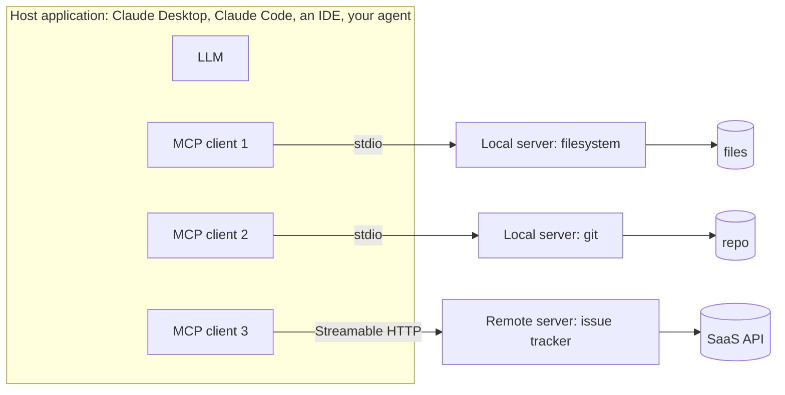
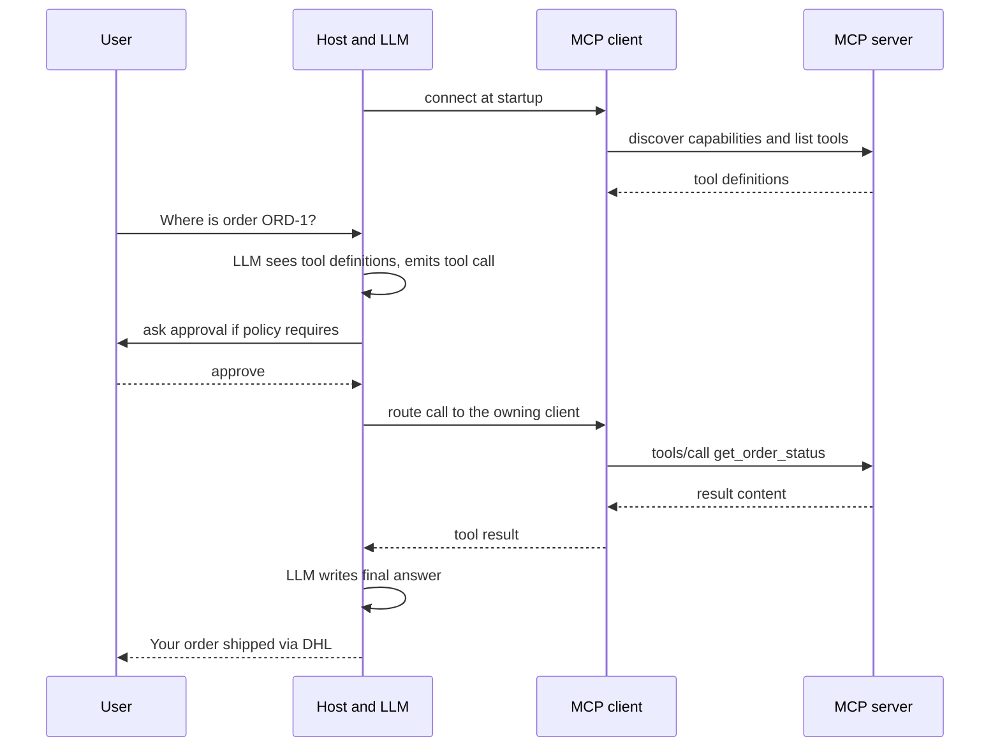

# Why MCP: architecture and primitives

Function calling (module 7) gives one application a way to offer tools to one model. But every
application had to re-implement every integration: a GitHub connector for this IDE, another for that
chat app, a third for your in-house agent. With $M$ AI applications and $N$ systems to connect, that is
$M \times N$ bespoke integrations. The **Model Context Protocol (MCP)**, introduced by Anthropic in
November 2024 and now an open standard governed under the Linux Foundation, turns it into $M + N$:
write a server once, and any MCP-capable client can use it. The usual analogy is USB-C for AI
applications; the design inspiration is the Language Server Protocol, which did the same for editors
and programming languages.

## 1. Participants: host, client, server



- **Host**: the AI application the user interacts with. It owns the LLM connection, the conversation,
  the permission prompts and the policy for what reaches the model.
- **Client**: a connector *inside* the host that speaks MCP to exactly **one** server. A host with five
  servers runs five clients.
- **Server**: a program that exposes context and capabilities. It can be **local** (a subprocess on your
  machine talking over stdio) or **remote** (a web service talking over Streamable HTTP).

Three design principles from the spec's architecture page are worth memorising:

1. **Servers should be easy to build.** Hosts handle the hard orchestration.
2. **Servers are composable and isolated.** A server sees only what the host sends it: it does not see
   the whole conversation, and it cannot see other servers. The host enforces these boundaries.
3. **Features are negotiated through capabilities**, so clients and servers can evolve independently.

Crucially, **the server never talks to the LLM directly**. The host takes the server's tool list and
turns it into the tool definitions of its own model API call; when the model emits a tool call, the
host routes it to the right client, which sends `tools/call` to the server.

## 2. Two layers

- **Data layer**: JSON-RPC 2.0 messages defining lifecycle, primitives (tools, resources, prompts...)
  and utilities (progress, cancellation, pagination).
- **Transport layer**: how those messages move: **stdio** for local servers, **Streamable HTTP** for
  remote ones (next lesson).

The same JSON-RPC messages flow regardless of transport.

## 3. Server primitives

| primitive | controlled by | what it is | example |
|---|---|---|---|
| **Tools** | the **model** | functions the LLM may decide to call | `create_issue`, `run_query` |
| **Resources** | the **application** | read-only data addressed by URI that the host can attach as context | `file:///repo/README.md`, `db://schema/users` |
| **Prompts** | the **user** | reusable message templates, typically surfaced as slash commands | `/review-pr 123` |

The "controlled by" column is the key to the design. Tools are discovered and invoked on the model's
initiative (subject to user approval). Resources are selected by the application or the user (think of
an attach menu or an `@` mention). Prompts are explicitly triggered by the user.

### Tools

A tool has a `name`, optional `title`, a `description`, an `inputSchema` (JSON Schema), an optional
`outputSchema`, and optional `annotations` (hints such as `readOnlyHint`, `destructiveHint`,
`idempotentHint`, `openWorldHint`). Methods: `tools/list` and `tools/call`.

```json
{
  "name": "get_weather",
  "title": "Weather Information Provider",
  "description": "Get current weather information for a location",
  "inputSchema": {
    "type": "object",
    "properties": {"location": {"type": "string", "description": "City name or zip code"}},
    "required": ["location"]
  }
}
```

A call result carries `content` (a list of blocks: `text`, `image`, `audio`, `resource_link`, embedded
`resource`), optionally `structuredContent` conforming to the `outputSchema`, and `isError`.

**Two kinds of errors**, a favourite interview point:

- **Protocol errors** are JSON-RPC `error` objects: unknown tool, malformed request (`-32602` Invalid
  params), unknown method (`-32601`), server fault (`-32603`). The model usually cannot fix these.
- **Tool execution errors** are *successful* JSON-RPC responses whose result has `"isError": true` and
  a human-readable message ("departure date must be in the future"). These go back to the model so it
  can self-correct.

Annotations are **hints from the server and must be treated as untrusted** unless the server is
trusted: a malicious server can label a destructive tool `readOnlyHint: true`.

### Resources

Resources expose data identified by URIs. `resources/list` enumerates concrete resources,
`resources/templates/list` returns **URI templates** like `weather://forecast/{city}/{date}`, and
`resources/read` returns contents (`text` or base64 `blob` with a `mimeType`). Clients can be notified
when a resource changes. Resources are how a server offers context *without* the model having to call
a tool.

### Prompts

Prompts are parameterised templates: `prompts/list` returns names, descriptions and arguments;
`prompts/get` with arguments returns a list of messages ready to send to the model. They may embed
resources.

## 4. Client features

Servers sometimes need things from the client side:

- **Elicitation**: the server asks the *user* for input mid-operation (a form defined by a small JSON
  schema, or a URL to visit for sensitive flows such as OAuth). The host renders the UI; the user can
  accept, decline or cancel.
- **Sampling**: the server asks the host's LLM to generate a completion, so a server can use a model
  without holding API keys, with the user in the loop.
- **Roots**: the client tells the server which directories or URIs it should operate within.
- **Logging**: servers send structured log messages to the client.

> [!NOTE]
> **Version awareness.** The protocol is versioned by date. In revisions up to **2025-11-25**, sampling,
> roots and elicitation were server-initiated JSON-RPC *requests* over a stateful session. The
> **2026-07-28** revision made the protocol stateless, **deprecated sampling, roots and logging**
> (suggested migrations: call LLM provider APIs directly, pass directories as tool parameters or
> configuration, log to stderr or OpenTelemetry), and re-expressed elicitation through "multi round-trip
> requests". Deprecated features keep working during a deprecation window of at least twelve months,
> and many deployed clients and servers still speak the older revisions, so you need to recognise both.
> The next lesson shows the wire differences.

## 5. Utilities and extensions

- **Progress** notifications for long operations (opt in with a `progressToken`), **cancellation**,
  **pagination** with opaque cursors on every list method, **completion** (argument autocompletion).
- **List-changed notifications**: a server whose tool set changes can notify subscribed clients, which
  then re-fetch `tools/list`.
- **Caching hints** (2026-07-28): list and read results carry `ttlMs` and `cacheScope` so clients can
  cache; servers should return tools in a **deterministic order**, which also keeps the host's LLM
  prompt cache stable (module 9).
- **Extensions**, negotiated through capabilities and always opt-in: **Tasks** (durable handles for
  long-running operations with polling), **MCP Apps** (interactive UI rendered inline in the host),
  and others.

## 6. A day in the life of a tool call



## 7. MCP versus alternatives

- **Plain function calling**: fine when you own both the application and the tools. MCP adds a process
  boundary, discovery, a standard wire format and reuse across hosts.
- **OpenAPI / REST**: describes HTTP APIs for developers; MCP describes capabilities *for models*
  (descriptions written as prompts, results shaped for context windows) and adds resources, prompts,
  elicitation and notifications. Wrapping a REST API one-to-one as MCP tools tends to work poorly:
  design task-level tools instead.
- **A2A** (agent-to-agent) addresses agents delegating to other agents; MCP addresses agents reaching
  tools and data.
- **Skills** (folders of instructions and scripts an agent loads on demand) are complementary:
  procedural knowledge in files versus live connections to systems.

A practical cost to remember: every connected server's tool definitions consume context. Dozens of
servers with hundreds of tools can burn tens of thousands of tokens before the user says anything, and
degrade tool selection. Mitigations (tool search / deferred loading, code execution against MCP APIs,
curated tool sets) are covered in modules 9 and in lesson 20.

## 8. The ecosystem

- **Reference servers** (github.com/modelcontextprotocol/servers): Everything (test server),
  Fetch, Filesystem, Git, Memory (knowledge graph), Sequential Thinking, Time. Many earlier reference
  servers (GitHub, Slack, Postgres, Puppeteer...) were archived in favour of vendor-maintained ones.
- **Official SDKs**: TypeScript, Python, Go, Java/Kotlin, C#, Rust, Swift, Ruby, PHP.
- **Registry**: the official MCP Registry (registry.modelcontextprotocol.io) is a metadata catalogue of
  publicly available servers that sub-registries and clients build on.
- **Clients**: Claude (desktop, web connectors, Claude Code), ChatGPT, VS Code and GitHub Copilot,
  Cursor, Windsurf, Zed, Gemini CLI, agent frameworks (smolagents, LangChain, LlamaIndex, OpenAI Agents
  SDK, Pydantic AI), and LLM APIs that accept remote MCP servers directly.
- **MCP Inspector**: an interactive debugging UI for servers (`npx @modelcontextprotocol/inspector`).

> [!INTERVIEW]
> **"What problem does MCP solve and how is it structured?"** It standardises how AI applications
> connect to tools and data, collapsing M x N integrations to M + N. A host runs one client per server;
> servers expose tools (model-controlled), resources (application-controlled) and prompts
> (user-controlled) over JSON-RPC 2.0 on stdio or Streamable HTTP; capabilities are negotiated; the host
> mediates everything, so servers never see the full conversation or each other. Mention protocol
> errors versus `isError` tool results, and that the 2026-07-28 revision made the protocol stateless.

## Summary

- MCP is an open JSON-RPC protocol connecting AI hosts to servers through one client per server.
- Tools are model-controlled, resources application-controlled, prompts user-controlled.
- Protocol errors use JSON-RPC error codes; tool failures are results with `isError: true`.
- Client-side features (elicitation, plus the now-deprecated sampling and roots) let servers ask for
  user input, model completions and scope.
- Tool definitions cost context; curate what you connect.

```quiz
[
  {"q": "In MCP, how many servers does one client connect to?",
   "options": ["Exactly one; a host runs one client per server", "All servers", "At most two", "It depends on the transport"], "answer": 0,
   "explain": "The 1:1 client-server relationship keeps servers isolated from each other."},
  {"q": "Which primitive is model-controlled?",
   "options": ["Tools", "Resources", "Prompts", "Roots"], "answer": 0,
   "explain": "The LLM decides when to call tools; resources are chosen by the application and prompts by the user."},
  {"q": "A tool runs but the upstream API rejects the date argument. How should the server report it?",
   "options": ["A normal result with isError: true and an explanatory message", "A JSON-RPC error with code -32700", "Close the connection", "Return an empty result"], "answer": 0,
   "explain": "Tool execution errors go in the result so the model can read them and self-correct."},
  {"q": "A client calls a tool name that does not exist. What is the appropriate response?",
   "options": ["A JSON-RPC protocol error such as -32602 Unknown tool", "isError: true result", "A notification", "HTTP 200 with empty content"], "answer": 0,
   "explain": "Unknown tools and malformed requests are protocol-level errors."},
  {"q": "Why must clients treat tool annotations like readOnlyHint as untrusted?",
   "options": ["A malicious or buggy server can mislabel a destructive tool", "They are encrypted", "They are deprecated", "They only apply to resources"], "answer": 0,
   "explain": "Annotations are self-declared hints, not guarantees."},
  {"q": "What does MCP mainly reduce?",
   "options": ["M x N custom integrations to M + N", "Model latency", "Tokenizer vocabulary", "GPU memory"], "answer": 0,
   "explain": "One server works with every compliant client, and vice versa."},
  {"q": "Which statement about the server and the LLM is correct?",
   "options": ["The server never talks to the LLM directly; the host mediates", "The server streams tokens from the LLM", "The LLM connects to servers over stdio itself", "Servers see the full conversation"], "answer": 0,
   "explain": "The host converts MCP tools into its model's tool definitions and routes calls."}
]
```

> **Source:** Model Context Protocol docs and specification: Architecture overview, Server concepts,
> Client concepts (https://modelcontextprotocol.io/docs/learn/architecture), specification revisions
> 2025-11-25 and 2026-07-28 with changelog (https://modelcontextprotocol.io/specification/latest);
> reference servers (https://github.com/modelcontextprotocol/servers); Anthropic, "Introducing the Model
> Context Protocol" (2024); Hugging Face MCP Course (https://huggingface.co/learn/mcp-course).
