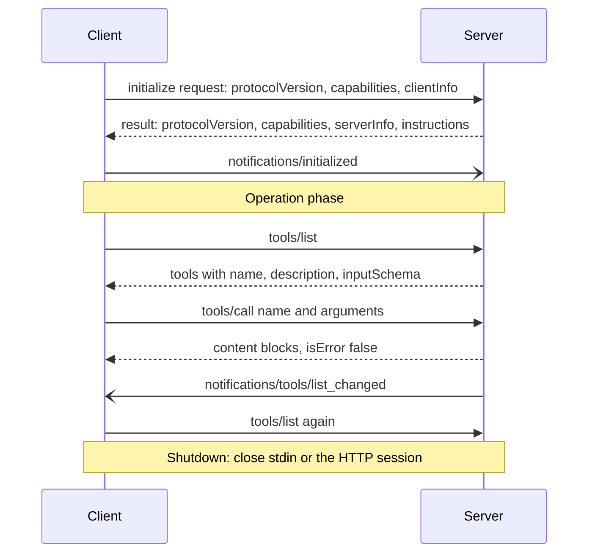
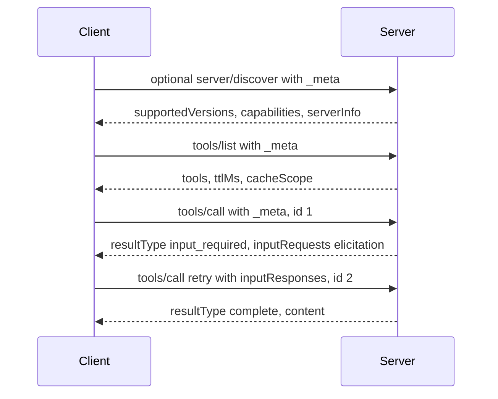

# The wire protocol: JSON-RPC, lifecycle, transports

> **Before this lesson:** you should know MCP's roles (host, client, server), its primitives (tools,
> resources, prompts), and the difference between a protocol error and a tool result with `isError`,
> all from [Why MCP: architecture and primitives](#/lesson/llm-practice/mcp-architecture). JSON and
> JSON Schema were introduced in
> [Function calling](#/lesson/llm-practice/function-calling). The code uses Python's `json` module and
> dictionaries.

## In plain words

The previous lesson described MCP from above: who talks to whom and about what. This lesson zooms in
on the actual messages, what engineers call "the **wire**" (whatever is literally sent between two
programs). Each MCP message is a small JSON object, and there are only four kinds. Around them sit two
sets of rules: how a conversation between client and server starts and proceeds (the **lifecycle**),
and how the messages physically travel (the **transport**: through a pipe on your own machine, or
over the web).

An analogy: sending registered letters. Every letter has a reference number; a reply quotes the
number of the letter it answers; some letters are announcements that expect no reply. Older practice
began every exchange with a formal introduction letter and kept a shared file of past letters
(a "session"); the newer practice makes every letter carry everything needed to understand it, so any
clerk at any branch can answer it.

Why it matters for a job: when an MCP integration breaks, you debug it by reading these messages.
Knowing the four message shapes, the standard error codes, and the classic transport bugs (a stray
`print` corrupting the stream, a local server open to web pages) turns an afternoon of confusion into
five minutes. Interviewers ask "what goes over the wire when a host calls an MCP tool?".

## Two eras of the protocol

MCP looks mysterious until you watch the bytes. It is JSON objects, one per message, with four shapes.
This lesson goes through the message types, the lifecycle in both eras of the protocol (the
`initialize` **handshake**, an opening exchange of messages that sets up a connection, used through
revision 2025-11-25, and the stateless per-request model of 2026-07-28), the two transports, and then
builds a miniature server **dispatcher** (the code that looks at each incoming message and sends it to
the right handler) in Python.

## 1. JSON-RPC 2.0 in four shapes

JSON-RPC is the message standard MCP is built on: "RPC" means **remote procedure call**, asking another
program to run a function and send back the result. Every message carries `"jsonrpc": "2.0"`. The four
shapes follow.

```json
{"jsonrpc": "2.0", "id": 1, "method": "tools/list", "params": {}}
```
**Request**: has `id` (string or integer, never `null` in MCP, unique among **in-flight** requests,
those sent but not yet answered) and `method`; expects exactly one response. The `id` is how the
sender matches a reply to its question when several are outstanding at once.

```json
{"jsonrpc": "2.0", "id": 1, "result": {"tools": []}}
```
**Result response**: same `id`, a `result` object.

```json
{"jsonrpc": "2.0", "id": 1, "error": {"code": -32601, "message": "Method not found"}}
```
**Error response**: same `id`, an `error` with integer `code`, `message`, optional `data`. A response
has `result` **or** `error`, never both.

```json
{"jsonrpc": "2.0", "method": "notifications/progress", "params": {"progressToken": "t1", "progress": 40}}
```
**Notification**: no `id`; the receiver must not reply.

Standard error codes you must know. The first five come from the JSON-RPC standard itself; the range
-32000 to -32099 is left for applications such as MCP to define:

| code | name | typical MCP use |
|---|---|---|
| -32700 | Parse error | body is not valid JSON |
| -32600 | Invalid Request | not a valid JSON-RPC object (missing `jsonrpc`, bad `id`...) |
| -32601 | Method not found | unknown method, or capability not supported |
| -32602 | Invalid params | unknown tool name, missing/ill-typed params, unknown resource (2026-07-28), missing required `_meta` |
| -32603 | Internal error | unexpected server failure |
| -32000 to -32099 | server-defined | 2026-07-28 reserves -32020 to -32099 for the spec: -32020 HeaderMismatch, -32021 MissingRequiredClientCapability, -32022 UnsupportedProtocolVersion |

(Older revisions used -32002 for "resource not found"; clients should still accept it from old
servers.)

The demo classifies six raw messages by shape, the first thing any MCP implementation must do with an
incoming line:

```python-run
import json

def classify(msg):
    if not isinstance(msg, dict) or msg.get("jsonrpc") != "2.0":
        return "invalid"
    if "method" in msg:
        return "request" if "id" in msg else "notification"
    if "id" in msg and ("result" in msg) != ("error" in msg):
        return "error-response" if "error" in msg else "result-response"
    return "invalid"

for raw in ['{"jsonrpc":"2.0","id":7,"method":"tools/call","params":{"name":"add","arguments":{"a":1,"b":2}}}',
            '{"jsonrpc":"2.0","method":"notifications/cancelled","params":{"requestId":7}}',
            '{"jsonrpc":"2.0","id":7,"result":{"content":[{"type":"text","text":"3"}]}}',
            '{"jsonrpc":"2.0","id":7,"error":{"code":-32602,"message":"Unknown tool: ad"}}',
            '{"id":7,"result":{}}',
            '{"jsonrpc":"2.0","id":7,"result":{},"error":{"code":1,"message":"x"}}']:
    print(f"{classify(json.loads(raw)):16} {raw[:70]}")
```

**Reading this code line by line**

- Anything that is not a dictionary with `"jsonrpc": "2.0"` is invalid at once.
- A message with a `method` is a request if it also has an `id`, otherwise a notification.
- A message without `method` must be a response: it needs an `id` and exactly one of `result` and
  `error`. The expression `("result" in msg) != ("error" in msg)` is true only when one is present and
  the other absent (`!=` between two booleans means "exclusive or").
- The output labels the six messages: a `tools/call` request, a cancellation notification, a result,
  an error, and two invalid messages: the fifth lacks `"jsonrpc": "2.0"` and the sixth has both
  `result` and `error`.

## 2. Lifecycle, legacy era: the initialize handshake

Through revision **2025-11-25** (and still what a large share of deployed servers and clients speak), a
connection is a **stateful session** opened by a three-message handshake. In the sequence diagram, a
solid arrow is a request, a dashed arrow its response, and an arrow with an open head a one-way
notification:



```json
{"jsonrpc": "2.0", "id": 1, "method": "initialize", "params": {
   "protocolVersion": "2025-11-25",
   "capabilities": {"roots": {"listChanged": true}, "sampling": {}, "elicitation": {}},
   "clientInfo": {"name": "ExampleClient", "version": "1.0.0"}}}
```
```json
{"jsonrpc": "2.0", "id": 1, "result": {
   "protocolVersion": "2025-11-25",
   "capabilities": {"tools": {"listChanged": true}, "resources": {"subscribe": true}, "prompts": {}},
   "serverInfo": {"name": "ExampleServer", "version": "1.0.0"},
   "instructions": "Optional guidance for the model on using this server."}}
```
```json
{"jsonrpc": "2.0", "method": "notifications/initialized"}
```

Reading the three messages: the client's `initialize` request states the protocol version it would
like, the optional client features it supports (here roots, sampling and elicitation) and its name.
The server's result answers with the version it will use, its own features (tools that can announce
changes, resources that can be subscribed to, prompts), its name, and optional `instructions` the host
may show the model. The client's notification says "ready"; normal work begins.

- **Version negotiation**: the client proposes its latest version; the server echoes it if supported,
  otherwise replies with another version it supports; if the client cannot speak that, it disconnects.
- **Capability negotiation**: each side declares optional features. A server that did not declare
  `tools` must not be sent `tools/list`; a client that did not declare `sampling` must not receive
  `sampling/createMessage`.
- Before `initialized`, only pings (a **ping** is a trivial "are you there?" request) and server logging
  are allowed.
- In this era servers could also *send requests to the client* (`sampling/createMessage`,
  `roots/list`, `elicitation/create`), which is why the transport had to be **bidirectional** (able to
  carry messages started by either side).

## 3. Lifecycle, modern era: stateless requests (2026-07-28)

The 2026-07-28 revision removed the handshake and protocol-level sessions. **Every request is
self-contained**, carrying its protocol version and client capabilities in `params._meta`. (`_meta` is
a reserved field for information about the request rather than its content; its keys are prefixed with
`io.modelcontextprotocol/` so they cannot clash with anyone else's.)

```json
{"jsonrpc": "2.0", "id": 2, "method": "tools/call", "params": {
   "name": "get_weather", "arguments": {"location": "New York"},
   "_meta": {
     "io.modelcontextprotocol/protocolVersion": "2026-07-28",
     "io.modelcontextprotocol/clientInfo": {"name": "ExampleClient", "version": "1.0.0"},
     "io.modelcontextprotocol/clientCapabilities": {}}}}
```
```json
{"jsonrpc": "2.0", "id": 2, "result": {
   "resultType": "complete",
   "content": [{"type": "text", "text": "72F, partly cloudy"}],
   "isError": false,
   "_meta": {"io.modelcontextprotocol/serverInfo": {"name": "ExampleServer", "version": "1.0.0"}}}}
```

What changed and why it matters:

- **`server/discover`** replaces `initialize` as the way to learn `supportedVersions`, `capabilities`,
  `serverInfo` and `instructions`. Servers must implement it; calling it is optional.
- A request with an unsupported version gets **`UnsupportedProtocolVersionError` (-32022)** whose
  `data.supported` lists versions to retry with. A request missing required `_meta` fields is rejected
  with -32602.
- **Every result has `resultType`**: `"complete"`, or `"input_required"` when the server needs
  something from the client. That is the **multi round-trip request (MRTR)** pattern: instead of the
  server sending its own request (elicitation, sampling, roots), it returns `inputRequests` (plus an
  opaque `requestState`), and the client **retries the original request** with `inputResponses`.
  Servers therefore never initiate JSON-RPC requests, and plain request/response HTTP suffices.
- **No sessions**: `Mcp-Session-Id` is gone; `tools/list` must not vary per connection. State that
  spans calls (a cart, a browser context) is modelled with **explicit handles** returned by one tool
  and passed as arguments to the next.
- **`subscriptions/listen`** is one long-lived request whose response stream carries opted-in change
  notifications (`toolsListChanged`, `resourceSubscriptions`...), replacing the standalone GET stream
  and `resources/subscribe`.
- `ping` and `logging/setLevel` were removed; sampling, roots and logging are deprecated.

The payoff is operational: stateless servers sit behind ordinary **load balancers** (machines that
spread incoming requests over many server copies), **scale horizontally** (handle more traffic by
adding copies rather than buying a bigger machine), and run on serverless platforms without **sticky
sessions** (the requirement that every request from one client reach the same server copy, because
only that copy remembers the session). The diagram shows a modern exchange, including one multi
round-trip:



**Interoperability**: a "dual-era" client probes (on stdio, send `server/discover` first; on HTTP, try
a modern request and inspect any 400 body) and falls back to `initialize` for legacy servers. SDKs
handle this; you need to know it exists when debugging "method not found: initialize".

## 4. Transports

A **transport** is the mechanism that carries the bytes. MCP defines two.

### stdio

The host launches the server as a **subprocess**. Every program has three standard streams: `stdin`
(input), `stdout` (output) and `stderr` (a second output stream meant for errors and logs). Messages are
**newline-delimited JSON** on `stdin`/`stdout`: one message per line, no embedded newlines, so the
reader can split the stream at each newline character. `stderr` is free for logs.

> [!WARNING]
> The classic stdio bug: a stray `print("debug")` in a Python server writes to stdout and corrupts the
> protocol stream. Log to **stderr** (`logging` does by default; `print(..., file=sys.stderr)`).

stdio servers are single-client, need no network or **auth** (authentication, proving who is calling;
they inherit the user's operating-system permissions and get credentials from environment variables),
and are ideal for local tools: files, git, local databases. Shutdown: the client closes stdin and
waits, then escalates to SIGTERM/SIGKILL (the operating system's "please stop" and "stop now"
signals).

### Streamable HTTP

For remote, multi-client servers. Some web vocabulary first: an HTTP request has a **method** such as
GET (fetch) or POST (send data), a set of **headers** (name-value lines of extra information, such as
`Accept`, which lists the reply formats the client can handle), and a body. The reply carries a
**status code**: 200 means OK, 400 "bad request", 403 "forbidden". **SSE** (server-sent events) is a
simple format for streaming several messages back over one HTTP reply. The server exposes a **single
MCP endpoint** (e.g. `https://example.com/mcp`):

- Every client message is an HTTP **POST** with `Accept: application/json, text/event-stream`.
- The server answers a request either with one JSON body, or with an **SSE stream scoped to that
  request** carrying progress notifications and then the final response.
- 2026-07-28 additionally requires `MCP-Protocol-Version`, **`Mcp-Method`** and (for `tools/call`,
  `resources/read`, `prompts/get`) **`Mcp-Name`** headers mirroring the body so **gateways** (proxies
  that sit in front of servers) can route and **rate-limit** (cap requests per client) without parsing
  JSON; a mismatch is rejected with 400 and `HeaderMismatch` (-32020). Cancellation is closing the
  response stream.
- Earlier revisions (2025-03-26 to 2025-11-25) also had an optional GET stream for server-initiated
  messages, `Mcp-Session-Id` sessions and resumable streams; all removed in 2026-07-28.
- The older **HTTP+SSE** transport (2024-11-05, two endpoints) is deprecated.

**Security requirements for HTTP servers**: validate the `Origin` header (403 if invalid) to block
**DNS rebinding** attacks from web pages against local servers; bind local servers to `127.0.0.1`,
not `0.0.0.0`; authenticate every connection (OAuth 2.1, next lesson). In plain terms: browsers send an
`Origin` header naming the website that started a request. In a DNS rebinding attack, a malicious
website tricks your browser into sending requests to a server running on your own machine; checking
`Origin` lets the server refuse them. `127.0.0.1` is the address that only programs on the same
computer can reach, whereas `0.0.0.0` means "every network interface", which exposes the server to
the whole network.

## 5. A miniature server

The heart of any MCP server is a dispatcher: parse, validate, route by method, map failures to the
right error shape. Here is one handling `tools/list` and `tools/call` over an in-memory "transport";
the module's problems (`llm-mcp-jsonrpc`, `llm-mcp-dispatcher`) make you write the pieces yourself.

```python-run
import json

TOOLS = {
    "add": {"description": "Add two integers.",
            "inputSchema": {"type": "object", "properties": {"a": {"type": "integer"}, "b": {"type": "integer"}},
                            "required": ["a", "b"]},
            "fn": lambda a, b: a + b},
    "divide": {"description": "Divide a by b.",
               "inputSchema": {"type": "object", "properties": {"a": {"type": "number"}, "b": {"type": "number"}},
                               "required": ["a", "b"]},
               "fn": lambda a, b: a / b},
}

def error(id_, code, message):
    return {"jsonrpc": "2.0", "id": id_, "error": {"code": code, "message": message}}

def handle(line):
    try:
        msg = json.loads(line)
    except json.JSONDecodeError:
        return error(None, -32700, "Parse error")
    if not isinstance(msg, dict) or msg.get("jsonrpc") != "2.0" or not isinstance(msg.get("method"), str):
        return error(msg.get("id") if isinstance(msg, dict) else None, -32600, "Invalid Request")
    if "id" not in msg:
        return None                                   # notification: never answer
    id_, method, params = msg["id"], msg["method"], msg.get("params") or {}
    if method == "tools/list":
        tools = [{"name": n, "description": t["description"], "inputSchema": t["inputSchema"]}
                 for n, t in sorted(TOOLS.items())]   # deterministic order
        return {"jsonrpc": "2.0", "id": id_, "result": {"tools": tools}}
    if method == "tools/call":
        tool = TOOLS.get(params.get("name"))
        if tool is None:
            return error(id_, -32602, f"Unknown tool: {params.get('name')}")
        args = params.get("arguments") or {}
        missing = [r for r in tool["inputSchema"]["required"] if r not in args]
        if missing:
            return error(id_, -32602, f"Missing arguments: {missing}")
        try:
            text, is_err = str(tool["fn"](**args)), False
        except Exception as e:                        # tool execution error -> result, not protocol error
            text, is_err = f"{type(e).__name__}: {e}", True
        return {"jsonrpc": "2.0", "id": id_, "result": {"content": [{"type": "text", "text": text}], "isError": is_err}}
    return error(id_, -32601, f"Method not found: {method}")

for line in ['{"jsonrpc":"2.0","id":1,"method":"tools/list"}',
             '{"jsonrpc":"2.0","id":2,"method":"tools/call","params":{"name":"add","arguments":{"a":2,"b":40}}}',
             '{"jsonrpc":"2.0","id":3,"method":"tools/call","params":{"name":"divide","arguments":{"a":1,"b":0}}}',
             '{"jsonrpc":"2.0","id":4,"method":"tools/call","params":{"name":"mul","arguments":{}}}',
             '{"jsonrpc":"2.0","id":5,"method":"resources/list"}',
             '{"jsonrpc":"2.0","method":"notifications/initialized"}',
             '{oops']:
    out = handle(line)
    print(json.dumps(out)[:150] if out else "(no response: notification)")
```

**Reading this code line by line**

- `TOOLS` is the server's registry: each tool's description, input schema and the Python function that
  runs it.
- `handle(line)` processes one line of input. If it is not valid JSON, the answer is a -32700 error
  with `id` `null` (the id could not be read). If it is JSON but not a proper request, -32600.
- A message without an `id` is a notification, and the function returns `None`: no reply at all.
- `tools/list` returns every tool sorted by name, the deterministic order that keeps clients' caches
  stable.
- `tools/call` looks up the tool (unknown name: -32602), checks the required arguments (missing:
  -32602), then runs the function. If the function raises, the exception becomes a *result* with
  `isError: true`, not a protocol error.
- Any other method gets -32601.
- The output, line by line: the tool list; `42` for `add(2, 40)`; division by zero as an `isError`
  result; `mul` as an unknown-tool error; `resources/list` as method not found (this server offers no
  resources); no response to the notification; and a parse error for `{oops`.

Look at ids 3 and 4: division by zero is a **tool execution error** (`isError: true` inside a result,
so the model can react), while an unknown tool is a **protocol error** (-32602).

> [!INTERVIEW]
> **"Describe what goes over the wire when a host uses an MCP tool."** JSON-RPC 2.0 over stdio
> (newline-delimited, logs on stderr) or Streamable HTTP (POST per message, JSON or SSE response).
> Legacy flow: `initialize` request and response negotiating version and capabilities, the
> `notifications/initialized` notification, then `tools/list` and `tools/call`. Modern (2026-07-28)
> flow: no handshake; each request carries protocol version and client capabilities in `_meta`,
> `server/discover` is optional, results carry `resultType`, and server-to-client needs use
> input-required results and retries. Know the error codes and the `isError` distinction.

## Summary

- Four message shapes: request, result, error, notification; ids pair responses with requests.
- Legacy lifecycle: `initialize` / `initialized` handshake with version and capability negotiation.
- Modern lifecycle: stateless, per-request `_meta`, `server/discover`, `resultType`, MRTR,
  `subscriptions/listen`, explicit state handles.
- stdio: newline-delimited JSON, never write logs to stdout. Streamable HTTP: single POST endpoint, JSON
  or SSE, Origin validation, localhost binding, auth.
- Unknown method -32601, bad params or unknown tool -32602, tool failure = `isError` result.

## Glossary

- **Wire**: the actual bytes sent between two programs.
- **JSON-RPC / RPC**: the JSON message standard MCP uses / a remote procedure call.
- **Request / result / error / notification**: the four message shapes; only requests get responses,
  and notifications have no `id`.
- **In-flight request**: a request sent but not yet answered.
- **Error code**: the integer in a JSON-RPC error, such as -32601 Method not found.
- **Lifecycle**: the rules for starting, running and ending a connection.
- **Handshake (`initialize` / `initialized`)**: the legacy opening exchange that negotiates version and
  capabilities.
- **Version / capability negotiation**: agreeing which protocol version and optional features to use.
- **`_meta`**: the reserved field carrying information about a request, such as its protocol version.
- **`server/discover`**: the modern, optional way to learn a server's versions and capabilities.
- **`resultType` / MRTR**: `complete` or `input_required` / multi round-trip requests, where the client
  retries with the missing input.
- **Explicit handle**: an id returned by one tool and passed to the next to carry state.
- **Transport**: how messages travel: stdio or Streamable HTTP.
- **stdin / stdout / stderr**: a program's input stream, output stream and log stream.
- **Newline-delimited JSON**: one JSON message per line.
- **HTTP method / header / status code**: GET or POST / an extra name-value line / the numeric outcome
  of a request.
- **SSE (server-sent events)**: a format for streaming several messages in one HTTP reply.
- **Load balancer / horizontal scaling / sticky session**: spreads requests over copies / adding
  copies / pinning a client to one copy.
- **DNS rebinding / Origin header**: a web-page attack on local servers / the header that reveals which
  site started a request.

## Check yourself

```quiz
[
  {"q": "What distinguishes a JSON-RPC notification from a request?",
   "options": ["A notification has no id and must not be answered", "A notification has a null result", "A notification uses HTTP GET", "A notification has an error field"], "answer": 0,
   "explain": "The absence of id marks a one-way message."},
  {"q": "Which error code fits a tools/call for a tool name the server does not have?",
   "options": ["-32602 Invalid params", "-32700 Parse error", "-32603 Internal error", "isError: true in the result"], "answer": 0,
   "explain": "The spec's example for an unknown tool is a protocol error with code -32602."},
  {"q": "In the legacy lifecycle, what are the three handshake messages in order?",
   "options": ["initialize request, initialize result, notifications/initialized", "tools/list, tools/call, shutdown", "ping, pong, initialize", "discover, listen, call"], "answer": 0,
   "explain": "The client proposes version and capabilities, the server responds, and the client confirms with a notification."},
  {"q": "In revision 2026-07-28, where does a request state its protocol version and client capabilities?",
   "options": ["In params._meta on every request (mirrored in HTTP headers)", "Only once in initialize", "In a cookie", "In the tool arguments"], "answer": 0,
   "explain": "The protocol became stateless; each request is self-describing."},
  {"q": "Why must a stdio MCP server never print debug text to stdout?",
   "options": ["stdout carries the newline-delimited JSON-RPC stream; extra text corrupts it", "stdout is encrypted", "It slows the model", "stdout is reserved for resources"], "answer": 0,
   "explain": "Logs belong on stderr."},
  {"q": "How does a 2026-07-28 server ask the user for missing information during a tool call?",
   "options": ["Return resultType input_required with inputRequests; the client retries with inputResponses", "Send its own JSON-RPC request on a GET stream", "Close the connection", "Write to stderr"], "answer": 0,
   "explain": "Multi round-trip requests replace server-initiated requests."},
  {"q": "Which defence protects a local HTTP MCP server from DNS rebinding?",
   "options": ["Validating the Origin header and binding to 127.0.0.1", "Using SSE", "Returning tools in sorted order", "Using integer ids"], "answer": 0,
   "explain": "Without it, a malicious web page could reach a server listening on the user's machine."}
]
```

> **Source:** MCP specification 2026-07-28: Base protocol, Versioning and compatibility, Transports
> (stdio, Streamable HTTP), server/discover, Tools, Changelog
> (https://modelcontextprotocol.io/specification/2026-07-28); MCP specification 2025-11-25: Lifecycle
> (https://modelcontextprotocol.io/specification/2025-11-25/basic/lifecycle); JSON-RPC 2.0
> (https://www.jsonrpc.org/specification).
