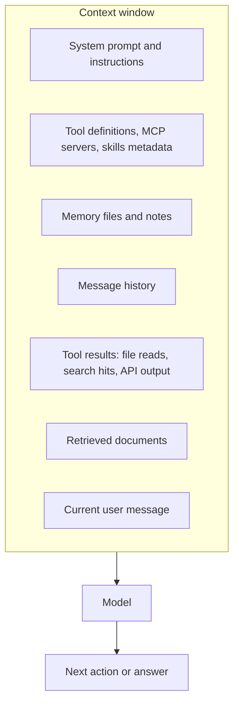

# The context window as a budget: rot, altitude and retrieval

> **Before this lesson:** you should know how attention spreads softmax weights over all tokens
> ([From embeddings to scaled dot-product attention](#/lesson/llm-practice/attention-from-scratch)),
> the "lost in the middle" effect and retrieval
> ([Hybrid retrieval, fusion, reranking and grounded generation](#/lesson/llm-practice/hybrid-retrieval-reranking)),
> and how tools and tool results enter an agent's conversation
> ([Function calling](#/lesson/llm-practice/function-calling)). This is the first lesson of the
> context-engineering module.

## In plain words

A model can only read a limited amount of text at once: its **context window**, measured in tokens.
Everything it knows about the current task (your instructions, the tool descriptions, the
conversation so far, every file it has read) must fit in that window. It is tempting to think a bigger
window solves everything: put it all in and let the model sort it out. It does not. The more you put in, the worse the model
gets at finding and using the parts that matter, and the more each step costs. **Context engineering**
is the craft of deciding what goes in, what stays out, and in what order.

An analogy: a desk. A tidy desk with only the papers for today's job lets you work quickly. Pile every
document you own on it and you will spend your time hunting, misread an old version for the current
one, and still pay rent for the space. A good desk worker keeps a small working set on the desk and
fetches the rest from the filing cabinet when needed.

Why it matters for a job: agents that run for many steps live or die by context management, and the
cost of every model call is proportional to the tokens you send. Interviewers ask "why isn't a
million-token window the answer?" to see whether you understand attention, context rot and cost.

## From prompt engineering to context engineering

**Prompt engineering** asks "what words should I write?". **Context engineering** asks the broader
question: "what should be in the model's context window *at each step*, and what should not?" For an
agent that runs for hundreds of turns, the **system prompt** (the developer's standing instructions)
is a small fraction of what the model sees; tool definitions, tool results, retrieved documents,
message history and notes make up the rest. Anthropic's engineering post on the topic defines the
goal crisply: find the "smallest possible set of high-signal tokens" that maximise the likelihood of
the desired outcome. A **high-signal** token is one that actually helps with the current step.

## 1. What fills a context window

The diagram lists the usual contents, all flowing into one model call. Every box costs tokens, and
the model reads all of them on every step.



Everything in the window competes for the same finite resource. A typical long coding session is
dominated by **tool results**, not by anything a human wrote.

## 2. Why more context is not free: the attention budget

Three reasons, from module 1's internals:

1. **Attention is a normalised distribution.** Softmax weights over all tokens sum to 1. Every extra
   token is another candidate competing for weight; relevant tokens get a smaller share unless the
   model's queries are very sharp. With $n$ tokens there are $n^2$ pairwise interactions to get right.
2. **Training distribution.** Models see far more short sequences than very long ones during training,
   so they have less experience with **long-range dependencies** (facts at one end of the text that
   matter for the other end) at extreme lengths.
3. **Position effects.** Recall is best at the start and end of the context and weaker in the middle
   ("lost in the middle").

The empirical result is **context rot**: as the number of tokens grows, the model's ability to
accurately recall and use information from the context declines. It is a gradient, not a cliff, and it
appears in every model, including ones with million-token windows. Chroma's 2025 "Context Rot" study
found performance degrading with input length even on simple tasks, and that **distractors** (passages
that look relevant but are not) and similar-but-wrong passages hurt more than plain padding.

The demo below is a deliberately crude model of the first reason, **attention dilution**. One relevant
token gets a head start of 4 in its logit; every other token gets random noise. As the number of
distractors grows, watch what share of the softmax weight the relevant token keeps:

```python-run
import numpy as np
# Toy model of attention dilution: one relevant token with a fixed logit advantage among n-1 distractors
rng = np.random.default_rng(0)
def relevant_weight(n, advantage=4.0, noise=1.0, trials=300):
    out = []
    for _ in range(trials):
        logits = rng.normal(0, noise, n); logits[0] += advantage
        p = np.exp(logits - logits.max()); p /= p.sum()
        out.append(p[0])
    return np.mean(out)
for n in [10, 100, 1_000, 10_000, 100_000]:
    print(f"context tokens {n:>7,}: attention on the one relevant token = {relevant_weight(n):.4f}")
```

How it works: `relevant_weight(n)` draws `n` random logits, adds the advantage to token 0, applies a
stable softmax and records token 0's weight, averaged over 300 trials. The output falls steadily: about
0.75 with 10 tokens, 0.29 with 100, 0.05 with 1,000 and 0.0005 with 100,000. The relevant token did
not change at all; only the crowd around it grew.

Real models learn much sharper attention than this toy, but the direction of the effect is the point:
irrelevant tokens are not neutral. Costs also scale: you pay for every input token on every turn, and
latency grows with length.

Named failure modes worth knowing (popularised by the writer Drew Breunig):

- **Context poisoning**: a hallucination or error enters the context and is repeatedly referenced.
- **Context distraction**: the history is so long the model over-focuses on it and repeats old actions.
- **Context confusion**: superfluous content (irrelevant tools, documents) leads to worse responses.
- **Context clash**: parts of the context contradict each other (stale file contents versus new ones).

## 3. System prompts at the right altitude

"Altitude" is a metaphor for level of detail: fly too low and you see every pebble but no route; fly
too high and you see the whole country but no roads. Anthropic describes two failure modes for system
prompts:

- **Too low**: brittle, hard-coded if-else logic crammed into the prompt, trying to script every case.
  Fragile and a maintenance burden.
- **Too high**: vague, high-level guidance that assumes shared context the model does not have
  ("be helpful and accurate").

The **right altitude** is specific enough to guide behaviour and flexible enough to give the model
strong **heuristics** (rules of thumb it can apply to cases you did not foresee). Practical guidance:

- Use plain, direct language, as if briefing a capable new colleague who lacks your context.
- **Organise into sections** with XML tags (labels in angle brackets that open and close a section,
  such as `<instructions>` ... `</instructions>`) or Markdown headers (`<background_information>`,
  `<instructions>`, `## Tool guidance`, `## Output format`).
- Aim for the **minimal** set of information that fully specifies the desired behaviour. Minimal does
  not mean short: an agent needs enough information up front.
- **Start minimal with the best model, test, then add** instructions and examples that address observed
  failure modes, rather than pre-emptively listing every rule.
- Explain **why** a rule exists; models generalise from reasons better than from bare commands.
- **Examples**: curate a few diverse, **canonical** (typical, textbook) ones that show the expected
  behaviour instead of a laundry list of **edge cases** (rare, unusual situations). Examples are, as
  the post puts it, the "pictures" worth a thousand words.

Compare three versions of the same support prompt. The first scripts every case and will break on the
first case it did not foresee; the second gives the model nothing to work with; the third states the
role, the policy with its purpose, the process and the tone:

```text
# Too low
If the user says "refund" and the order is < 30 days old and the item is not "final sale" then say
"Sure, I can help with that!" else if the order is 30-45 days old then ...

# Too high
You are a helpful support agent. Use good judgment.

# Right altitude
## Role
You handle refund requests for ACME's online store.
## Policy
Refunds are allowed within 30 days for unused items; final-sale items are excluded. Between 30 and 45
days offer store credit. The goal is to resolve fairly without escalating simple cases.
## Process
Look up the order with get_order before discussing eligibility. If the policy does not clearly cover the
case, explain what you can offer and escalate with create_ticket.
## Tone
Brief, warm, no apologies for policy.
```

## 4. Just-in-time context

The classic approach **front-loads** context (puts it all in before the model starts): embed the
query, retrieve chunks, paste them in (module 5). The agentic alternative is **just-in-time
retrieval** (the name comes from manufacturing, where parts arrive exactly when needed rather than
being stockpiled): give the agent lightweight **references** (file paths, stored queries, URLs, ids)
and tools to load what it needs when it needs it.

- Claude Code is the canonical example: it does not index your repository into a vector store. It
  navigates with `glob` (list files matching a pattern such as `src/**/*.py`), `grep` (search file
  contents for text), `head`/`tail` (show the first or last lines of a file) and targeted file reads,
  the way an engineer would, and can write a query or script to analyse a large dataset without ever
  loading the data into context.
- **Metadata is signal.** A file named `test_utils.py` in `tests/` means something different from one in
  `src/core/`; folder hierarchies, naming conventions and timestamps help the agent decide what to read.
- **Progressive disclosure**: the agent discovers context layer by layer, each interaction informing
  the next, keeping only what is needed in working memory. Agent **Skills** apply the same idea: only a
  skill's name and description sit in context until the skill is relevant, then its instructions and
  files are loaded.

Trade-off: runtime exploration is slower than precomputed retrieval, and without good tools and
heuristics an agent can waste context chasing dead ends. The practical answer is often **hybrid**: load
a small amount of always-relevant context up front (Claude Code drops `CLAUDE.md` project files into
context at start) and let the agent explore the rest.

The demo counts tokens for one question about a small repository: loading all seven files up front
versus a just-in-time sequence of a directory listing, one search and one focused read:

```python-run
# Up-front vs just-in-time: tokens placed in context for the same question
files = {"README.md": 900, "src/auth.py": 4200, "src/api.py": 6100, "src/db.py": 3800,
         "tests/test_auth.py": 2500, "docs/design.md": 7400, "CHANGELOG.md": 5200}
upfront = sum(files.values())
# JIT: a directory listing (cheap), one grep result, then one targeted read of 60 lines
listing = 12 * len(files)
grep_hits = 180
targeted_read = 700
print("load everything up front:", upfront, "tokens")
print("just-in-time            :", listing + grep_hits + targeted_read, "tokens",
      f"({100 * (listing + grep_hits + targeted_read) / upfront:.1f}%)")
```

`files` maps each file to its size in tokens. The up-front total is about 30,100 tokens. The
just-in-time path costs a listing (about 12 tokens per file name), 180 tokens of search hits and a
700-token read of the relevant lines: 964 tokens, 3.2 percent of the up-front cost. The numbers are
invented but the ratio is typical, and it repeats on every step that would otherwise re-read the
whole pile.

## 5. Ordering and structure inside the window

- Put **long documents near the top** and the question or instructions at the **end**; Anthropic's
  long-context guidance reports this ordering can improve response quality substantially on complex
  multi-document inputs.
- Wrap each document in tags with source metadata so the model can tell them apart and cite them.
- For long-document tasks, ask the model to **extract relevant quotes first**, then answer from them.
- Keep **stable content first** (system prompt, tools, reference documents) and **volatile** content
  (content that changes every turn) last; it is clearer for the model and it is exactly what **prompt
  caching** needs (lesson 23: the provider reuses its work on an unchanged prompt beginning and charges
  less for it).
- Remove contradictions: when a file is re-read after an edit, the stale copy earlier in the history is
  now a liability.

## 6. A budget, literally

Treat the window like memory in a constrained system: allocate, measure, reclaim.

```python-run
window = 200_000
budget = {"system prompt": 3_000, "tool definitions": 14_000, "memory / project notes": 2_500,
          "reserved for output": 16_000}
fixed = sum(budget.values())
print(f"fixed overhead: {fixed:,} tokens ({100*fixed/window:.1f}% of the window)")
per_turn = 6_500          # average tokens added per agent step (tool call + result)
free = window - fixed
print(f"steps until full with no management: {free // per_turn}")
threshold = 0.8
print(f"compaction trigger at {int(threshold*100)}%: after ~{int((window*threshold - fixed) // per_turn)} steps")
```

Reading the budget: a 200,000-token window loses 35,500 tokens (17.8 percent) to fixed overhead before
any work starts; tool definitions are the biggest item, and 16,000 tokens are held back so the model
has room to write its reply. If each agent step adds about 6,500 tokens (a tool call plus its result),
the window fills after 25 steps. A harness that **compacts** (summarises and shrinks the history) at
80 percent full must do so after about 19 steps.

Twenty-odd steps is nothing for a real agent, which is why the next lesson's techniques (compaction,
tool-result clearing, notes, sub-agents) exist. The **harness** is the program around the model that
assembles each context and runs the loop. Instrument your harness to report context usage by
category; you cannot manage what you do not measure.

> [!INTERVIEW]
> **"What is context engineering and why isn't a 1M-token window the answer?"** It is curating what
> occupies the context at each step: instructions, tools, history, tool results, retrieved data.
> Bigger windows do not remove context rot: attention is a finite, normalised budget with $n^2$
> pairwise relationships, long sequences are rarer in training, and distractors actively hurt. So aim
> for the smallest high-signal token set: right-altitude system prompts, few clear tools, just-in-time
> retrieval through references, compaction, external notes and sub-agents. Mention cost and latency
> too.

## Summary

- Context is a finite resource with diminishing returns; context rot degrades recall as tokens grow.
- Irrelevant, stale or contradictory tokens are harmful, not neutral.
- Write system prompts at the right altitude: structured, minimal but sufficient, iterated from observed
  failures, with a few canonical examples.
- Prefer just-in-time retrieval via lightweight references and progressive disclosure, often combined
  with a little up-front context.
- Order for clarity and cacheability, and budget the window explicitly.

## Glossary

- **Context window**: the maximum number of tokens a model can read in one call.
- **Context engineering**: choosing what goes into the context at each step, and in what order.
- **Prompt engineering**: choosing the wording of instructions.
- **System prompt**: the developer's standing instructions at the start of the context.
- **High-signal tokens**: tokens that actually help with the current step.
- **Attention dilution**: relevant tokens getting a smaller share of attention as more tokens are added.
- **Context rot**: the gradual decline in recall and reasoning as context length grows.
- **Distractor**: a passage that looks relevant but is not.
- **Context poisoning / distraction / confusion / clash**: an error that keeps being reused / history
  that crowds out the task / irrelevant material / contradictory material.
- **Altitude**: the level of detail of a system prompt: too low scripts every case, too high says
  nothing.
- **Heuristic**: a rule of thumb the model can apply to unforeseen cases.
- **Canonical example / edge case**: a typical example / a rare, unusual situation.
- **Front-loading**: putting all context in before the model starts.
- **Just-in-time retrieval**: giving references and tools so the agent loads content when needed.
- **Progressive disclosure**: revealing context layer by layer as it becomes relevant.
- **Skill**: a folder of instructions and files whose details load only when relevant.
- **Volatile content**: content that changes every turn; it belongs at the end of the prompt.
- **Harness**: the program around the model that builds each context and runs the loop.
- **Compaction**: summarising and shrinking the history to free context space.

## Check yourself

```quiz
[
  {"q": "What is context rot?",
   "options": ["Declining ability to recall and use context as the number of tokens grows", "Tokenizer drift over time", "Model weights degrading", "Cache expiry"], "answer": 0,
   "explain": "Performance degrades gradually with context length, even well within the window limit."},
  {"q": "Which system prompt is at the right altitude?",
   "options": ["Clear role, policy with reasons, process and tone in labelled sections", "A 300-line if-else decision tree", "'Be helpful and smart.'", "No system prompt at all"], "answer": 0,
   "explain": "Specific enough to guide, flexible enough to rely on the model's judgment."},
  {"q": "What does just-in-time retrieval keep in context instead of full data?",
   "options": ["Lightweight references such as file paths, queries and links", "Embeddings", "The entire corpus", "Only the system prompt"], "answer": 0,
   "explain": "The agent loads content with tools when it becomes relevant."},
  {"q": "Why do irrelevant documents in context hurt rather than merely waste money?",
   "options": ["They compete for attention and can distract or confuse the model", "They change the tokenizer", "They disable tools", "They shorten the output limit only"], "answer": 0,
   "explain": "Distractors measurably lower accuracy; this is context confusion and distraction."},
  {"q": "Where should a long reference document go relative to the question?",
   "options": ["Document first, question at the end", "Question first, document last", "Document in the middle of the conversation", "Split randomly"], "answer": 0,
   "explain": "Placing the query after long material tends to improve results and keeps a stable cacheable prefix."},
  {"q": "What is context poisoning?",
   "options": ["An error or hallucination enters the context and keeps being reused", "Too many tools", "A prompt cache miss", "Using a small model"], "answer": 0,
   "explain": "Once in history, a wrong fact is treated as established and compounds."},
  {"q": "What is the recommended way to develop a system prompt?",
   "options": ["Start minimal, test, and add instructions for observed failure modes", "Write every rule you can imagine up front", "Copy the longest prompt you can find", "Never change it after launch"], "answer": 0,
   "explain": "Iteration against real failures yields the minimal sufficient prompt."}
]
```

> **Source:** Anthropic Engineering, "Effective context engineering for AI agents" (2025,
> https://www.anthropic.com/engineering/effective-context-engineering-for-ai-agents); Anthropic docs,
> long-context prompting tips and prompt-engineering overview (https://docs.claude.com); Chroma
> Research, "Context Rot" (2025); Liu et al., "Lost in the Middle" (2023); Huyen, *AI Engineering*,
> ch. 5 "Prompt Engineering" (context length and context efficiency) and ch. 6.
