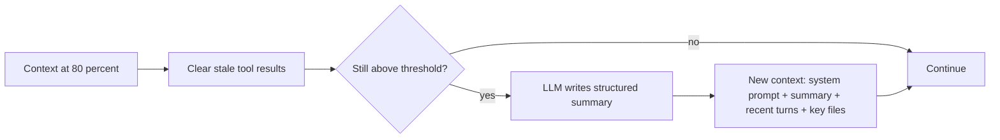

# Long-horizon agents: compaction, notes, memory and sub-agents

A task that takes an agent hours (migrating a codebase, a deep research report) produces far more
tokens than any context window holds. The previous lesson showed that a busy agent fills 200k tokens in
a couple of dozen steps. Three families of techniques let agents keep working coherently past that
limit: **compaction**, **structured note-taking** (memory outside the window) and **sub-agent
architectures**. This lesson implements the first two and analyses the third.

## 1. The cheapest trick first: clear old tool results

Most of a long transcript is **tool output** that mattered once: a file read thirty steps ago, a test
log, a search result. Once the agent has acted on it, the raw output is dead weight. **Tool-result
clearing** replaces old results with a short placeholder while keeping the record that the call
happened:

```text
[tool result cleared to save context: read_file("src/api.py"), 6,104 tokens. Re-read if needed.]
```

Anthropic calls this one of the safest, lightest-touch forms of compaction, and the API offers it as
automatic **context editing** (clear tool uses beyond a threshold, keep the most recent N). Rules of
thumb: keep the last few results intact, never clear a result the model has not yet responded to, keep
tool *calls* (so the model knows what it already did), and clear in **batches** rather than one per
turn, because every edit to earlier history invalidates the prompt cache from that point (lesson 23).

```python-run
def clear_old_tool_results(messages, keep_last=2, min_tokens=200):
    """Replace all but the newest `keep_last` large tool results with placeholders."""
    idx = [i for i, m in enumerate(messages) if m["role"] == "tool" and m["tokens"] >= min_tokens]
    out, saved = [dict(m) for m in messages], 0
    for i in idx[:-keep_last] if keep_last else idx:
        placeholder = f"[cleared: {out[i]['name']} result, {out[i]['tokens']} tokens]"
        saved += out[i]["tokens"] - 12
        out[i].update(content=placeholder, tokens=12)
    return out, saved

history = [
    {"role": "user", "content": "Fix the failing auth test", "tokens": 9},
    {"role": "tool", "name": "read_file(auth.py)", "content": "...", "tokens": 4200},
    {"role": "tool", "name": "run_tests", "content": "...", "tokens": 1800},
    {"role": "assistant", "content": "The token check is inverted.", "tokens": 30},
    {"role": "tool", "name": "edit_file(auth.py)", "content": "ok", "tokens": 5},
    {"role": "tool", "name": "read_file(auth.py)", "content": "...", "tokens": 4250},
    {"role": "tool", "name": "run_tests", "content": "...", "tokens": 600},
]
new, saved = clear_old_tool_results(history)
for m in new:
    print(f"{m['role']:9} {m.get('name', ''):20} {m['tokens']:>5}  {m['content'][:48]}")
print("tokens saved:", saved)
```

## 2. Compaction

**Compaction** takes a conversation nearing the limit, **summarises** it, and starts a fresh context
seeded with the summary. Claude Code does this automatically ("auto-compact") and on demand; the
Claude API and Agent SDK offer server-side and client-side compaction.

What a good compaction summary preserves (from Anthropic's guidance and what coding harnesses do):

- the user's goal and explicit instructions/constraints, verbatim where they matter,
- architectural decisions made and why,
- the current state: what is done, what is in progress, what is next,
- unresolved bugs, open questions and failed approaches (so they are not retried),
- key identifiers: file paths, function names, ids, commands that worked,
- and then, typically, the **most recently accessed files** are re-attached in full.

What it discards: redundant tool outputs, superseded drafts, pleasantries.

**Tuning advice**: the art is choosing what to keep. Over-aggressive compaction loses subtle context
whose importance only shows later. Start by maximising **recall** (capture everything relevant from
real long traces), then iterate to improve **precision** by cutting superfluous content.



A compaction policy in code, with a mock summariser:

```python-run
def count(msgs):
    return sum(m["tokens"] for m in msgs)

def summarise(msgs):                      # stand-in for an LLM call with a structured summary prompt
    facts = [m["content"] for m in msgs if m.get("important")]
    text = "SUMMARY: " + " | ".join(facts) if facts else "SUMMARY: (earlier small talk)"
    return {"role": "user", "content": text, "tokens": 20 + 8 * len(facts)}

def compact(messages, limit, keep_recent=4, trigger=0.8):
    if count(messages) <= trigger * limit:
        return messages, False
    system = [m for m in messages if m["role"] == "system"]
    rest = [m for m in messages if m["role"] != "system"]
    old, recent = rest[:-keep_recent], rest[-keep_recent:]
    return system + [summarise(old)] + recent, True

msgs = [{"role": "system", "content": "You are a coding agent.", "tokens": 400},
        {"role": "user", "content": "Goal: migrate auth to OAuth; never touch billing/", "tokens": 30, "important": True},
        {"role": "tool", "content": "<8k tokens of file listing>", "tokens": 8000},
        {"role": "assistant", "content": "Decision: use PKCE flow, tokens in httpOnly cookies", "tokens": 60, "important": True},
        {"role": "tool", "content": "<test log>", "tokens": 5000},
        {"role": "assistant", "content": "Bug: refresh endpoint 500s when cookie missing (open)", "tokens": 40, "important": True},
        {"role": "tool", "content": "<diff>", "tokens": 3000},
        {"role": "assistant", "content": "Edited auth/refresh.py", "tokens": 20},
        {"role": "user", "content": "now add tests", "tokens": 8},
        {"role": "assistant", "content": "Writing tests/test_refresh.py", "tokens": 25}]
out, did = compact(msgs, limit=20_000)
print("compacted:", did, " tokens:", count(msgs), "->", count(out))
for m in out:
    print(f"  {m['role']:9} {m['content'][:95]}")
```

Sharp edges:

- **Tool-call pairing**: never cut between an assistant tool call and its result; APIs reject
  orphaned tool results. Cut on turn boundaries.
- **Repeated compaction** is lossy on lossy; instructions drift. Keeping the user's original request
  verbatim and re-injecting persistent files helps.
- **Cache**: compaction resets the cached prefix; do it rarely and deliberately.

## 3. Structured note-taking: memory outside the window

Instead of trying to keep everything in context, let the agent **write notes to persistent storage**
and read them back later. Examples:

- **To-do lists**: Claude Code maintains a task list; ticking items off keeps a long task on track and
  survives compaction.
- **`NOTES.md` / progress files**: the agent records decisions, results and next steps. Anthropic's
  example is Claude playing Pokemon: over thousands of game steps it keeps tallies ("for the last
  1,234 steps I've been training my Pokemon on Route 1..."), maps of explored regions and strategy
  notes, and after a context reset reads its own notes and continues multi-hour plans.
- **Project memory files** (`CLAUDE.md`, `AGENTS.md`): human- or agent-maintained instructions and
  conventions loaded at the start of every session.
- **Memory tools**: the Claude API's memory tool gives the model file operations on a client-side
  memory directory that persists across conversations; frameworks offer similar stores.

Memory taxonomies you will see (CoALA and others): **working memory** (the context window),
**episodic** (what happened: past interactions and outcomes), **semantic** (facts about the user and
world), **procedural** (how to do things: skills, instructions). Implementation options range from
plain files (inspectable, versionable, surprisingly strong) to vector stores and knowledge graphs
(Mem0, Zep, Letta/MemGPT's self-editing memory blocks).

Design questions for any memory system:

1. **What gets written?** Decisions, preferences, verified facts, not raw transcripts. Poisoned or
   wrong memories persist, so validate and allow correction.
2. **When is it read?** Always-loaded (small, high value) versus retrieved on demand.
3. **How is it kept fresh?** Timestamps, dedupe, consolidation, expiry; contradictory memories are
   context clash waiting to happen.
4. **Whose is it?** Per-user isolation, privacy, the ability to inspect and delete.

```python-run
import json

class Notes:
    """A tiny file-like memory: the agent writes structured notes and reloads them after a reset."""
    def __init__(self): self.store = {}
    def write(self, key, value): self.store[key] = value
    def render(self):
        return "\n".join(f"## {k}\n{json.dumps(v, indent=1) if not isinstance(v, str) else v}"
                         for k, v in self.store.items())

notes = Notes()
notes.write("goal", "Migrate auth to OAuth 2.1 with PKCE. Do not modify billing/.")
notes.write("todo", [{"task": "refresh endpoint", "done": True}, {"task": "tests for refresh", "done": False},
                     {"task": "update docs", "done": False}])
notes.write("decisions", ["httpOnly cookies for tokens", "PKCE for all clients"])
notes.write("known issues", ["refresh 500s when cookie missing"])

fresh_context = "SYSTEM: You are a coding agent. Read your notes first.\n\n" + notes.render()
print(fresh_context)
print("\ncontext after reset:", len(fresh_context.split()), "words instead of the full transcript")
```

For work spanning **multiple context windows**, Anthropic's guidance for recent models is to treat the
first window differently (set up a framework: tests, setup scripts, a to-do file), have the model track
state in **structured files** (e.g. `tests.json` for test status) plus free-form progress notes, use
**git** as a log and checkpoint mechanism, and note that starting a fresh context that reads those
files can work better than automatic compaction.

## 4. Sub-agent architectures

Rather than one agent holding everything, a **lead agent** delegates focused tasks to **sub-agents**,
each with its **own clean context window**. A sub-agent may burn tens of thousands of tokens exploring
(reading files, running searches), but returns only a **condensed, distilled summary**, often 1,000 to
2,000 tokens. The lead agent's context holds the plan and the distilled results, not the exploration.

```python-run
subtasks = {"search auth code paths": 48_000, "survey OAuth libraries": 61_000, "audit existing tests": 37_000}
summary_tokens = 1_500
single_agent = sum(subtasks.values())
lead_context = len(subtasks) * summary_tokens
print(f"single agent context consumed by exploration: {single_agent:,} tokens")
print(f"lead agent context with sub-agents          : {lead_context:,} tokens")
print(f"total tokens billed with sub-agents          : {single_agent + lead_context:,} (more spend, cleaner contexts)")
```

This is separation of concerns: detailed search context stays isolated in sub-agents while the lead
focuses on synthesis. Benefits: clean contexts, parallelism, specialisation. Costs: more total tokens,
coordination overhead, and information loss at the hand-off (the sub-agent's summary is all the lead
knows). Good delegation briefs specify the objective, the expected output format, which tools and
sources to use, and clear task boundaries; sub-agents can also write detailed artefacts to files and
return references.

## 5. Choosing among them

| technique | best when |
|---|---|
| tool-result clearing | always on; long tool-heavy sessions |
| compaction | long, conversational back-and-forth that needs continuity |
| structured notes / memory | iterative development with clear milestones; work spanning sessions |
| sub-agents | complex research or analysis where parallel exploration pays off |

They combine: a lead agent with a to-do file, sub-agents for exploration, tool-result clearing
throughout and compaction as the last resort. And keep the meta-advice in mind: as models improve they
need less scaffolding, so "do the simplest thing that works".

> [!INTERVIEW]
> **"An agent must work for six hours on one task. How do you manage its context?"** Measure usage by
> category; clear stale tool results first; compact near a threshold with a structured summary that
> keeps goals, decisions, state, open bugs and identifiers, cutting only on turn boundaries; keep
> durable state outside the window (to-do list, progress notes, tests status, git commits) so a fresh
> window can resume; delegate exploration to sub-agents that return 1-2k-token summaries; order context
> for prompt caching and batch edits to preserve it.

## Summary

- Clear old tool results first: cheap, safe, large savings.
- Compaction summarises and restarts; tune for recall, then precision; respect tool-call pairing.
- Notes and memory move state outside the window: to-do lists, progress files, memory tools.
- Sub-agents explore in isolated contexts and return condensed summaries; more tokens overall, cleaner
  lead context.
- Combine techniques according to task shape, and prefer the simplest working design.

```quiz
[
  {"q": "Which is typically the safest first step when context fills up?",
   "options": ["Clearing old tool results while keeping the record of the calls", "Deleting the system prompt", "Dropping the user's original request", "Switching models"], "answer": 0,
   "explain": "Stale raw tool output is the largest and least valuable part of long transcripts."},
  {"q": "What should a compaction summary definitely preserve?",
   "options": ["Goals, decisions, current state, unresolved issues and key identifiers", "Every tool output verbatim", "Only the last message", "Greetings and acknowledgements"], "answer": 0,
   "explain": "Those are what the agent needs to continue coherently; redundant outputs can go."},
  {"q": "When tuning a compaction prompt, what does Anthropic suggest optimising first?",
   "options": ["Recall, then precision", "Precision, then recall", "Latency only", "Summary length only"], "answer": 0,
   "explain": "First make sure nothing important is lost on real traces, then trim the excess."},
  {"q": "Why must compaction not cut between a tool call and its result?",
   "options": ["APIs require each tool result to follow its tool call; orphans are invalid and confusing", "It wastes tokens", "It changes the tokenizer", "It disables caching permanently"], "answer": 0,
   "explain": "Tool use and tool result form a pair; truncate on turn boundaries."},
  {"q": "What do sub-agents typically return to the lead agent?",
   "options": ["A condensed summary, often 1,000 to 2,000 tokens", "Their entire transcript", "Nothing", "Raw embeddings"], "answer": 0,
   "explain": "The lead's context stays clean; the exploration stays in the sub-agent's window."},
  {"q": "Which technique best suits iterative development with clear milestones across sessions?",
   "options": ["Structured note-taking and memory files", "Voting", "Higher temperature", "Larger batch size"], "answer": 0,
   "explain": "Persistent notes let a fresh context pick up the state of the work."},
  {"q": "What is a key risk of persistent agent memory?",
   "options": ["Wrong or malicious entries persist and keep influencing future sessions", "It always exceeds the context window", "It cannot store text", "It disables tools"], "answer": 0,
   "explain": "Memory needs validation, freshness management and the ability to inspect and delete."}
]
```

> **Source:** Anthropic Engineering, "Effective context engineering for AI agents" (2025) and "How we
> built our multi-agent research system" (2025); Anthropic docs on context editing, compaction, the
> memory tool and multi-context-window workflows (https://docs.claude.com); Sumers et al., "Cognitive
> Architectures for Language Agents" (CoALA, 2023); Packer et al., "MemGPT" (2023); Huyen, *AI
> Engineering*, ch. 6 (memory).
