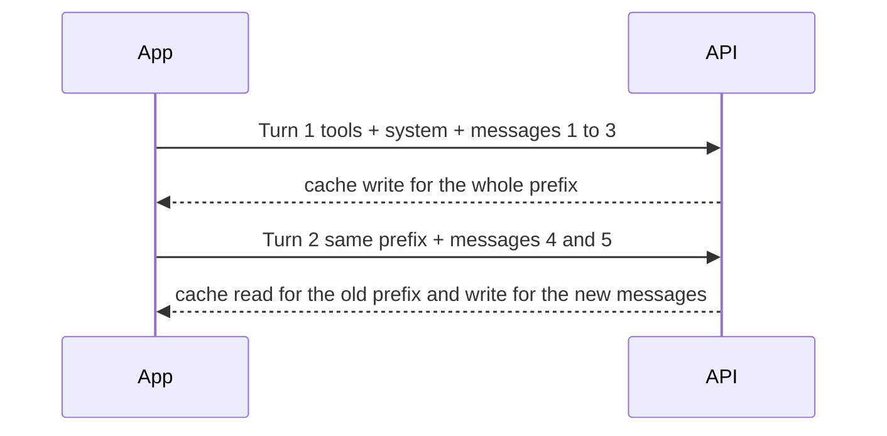
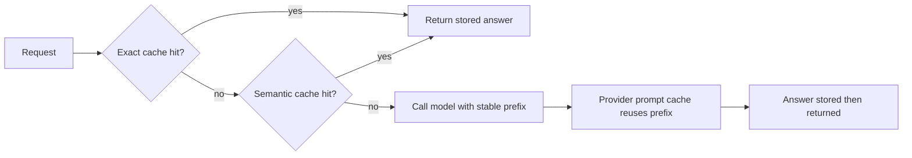

# Designing tools for agents and prompt caching

> **Before this lesson:** you should know how a model calls a tool and how the tool's result is sent
> back to it ([Function calling](#/lesson/llm-practice/function-calling)), why every token in the
> context window costs attention and money
> ([The context window as a budget](#/lesson/llm-practice/context-budget)), and what tool-result
> clearing and compaction are ([Long-horizon agents](#/lesson/llm-practice/long-horizon)). The idea of
> the KV cache from [Positional encodings, RoPE, KV cache and architecture families](#/lesson/llm-practice/positions-and-architectures)
> helps with section 2 but is not required. The code uses Python dictionaries, lists, `json` and
> f-strings.

## In plain words

An **agent** is a program in which a language model repeatedly decides what to do next, calls a
**tool** (a function your code exposes to the model, such as "search the database" or "send an
email"), reads the result, and decides again. This lesson is about two things that decide whether such
an agent is good *and* cheap.

The first is **tool design**. The tools are the agent's hands and eyes: they set what it can see and
what it can change. Every tool's name, description and parameter list is text placed in the model's
context, and every result the tool returns is more text. Badly designed tools flood the context with
noise, confuse the model about which tool to use, and return cryptic errors it cannot recover from.

The second is **prompt caching**. An agent sends the model almost the same long prompt again and again,
once per step, with only a little new text added at the end. Prompt caching lets the model provider
remember the work it did on the unchanged beginning of that prompt, so you pay a small fraction of the
normal price to have it re-read.

An analogy: a restaurant kitchen. Good tools are like well-labelled stations: "grill", "salad",
"desserts", each with a clear job, rather than a hundred unlabelled drawers the chef must search. Prompt
caching is the **mise en place** (French for "everything in its place"), the chopped onions and
measured spices prepared once before service, so each order only needs the final few steps. Move the
station layout around mid-service and all that preparation is wasted, which is exactly what happens to
a cache when the start of a prompt changes.

Why it matters for a job: tool design is now a core skill for anyone building agents or MCP servers,
and caching is usually the single biggest cost lever in an agent product. "How would you cut the cost of
a 100-turn agent session?" is a common interview question, and the answer starts here.

## 1. Tools are a contract with an unpredictable caller

A traditional **API** (application programming interface, the set of functions one program offers to
another) is a contract between **deterministic** programs: given the same input, the caller always does
the same thing. A tool is different. It is a contract between your deterministic code and a
**non-deterministic** caller, the model, which may call it in unexpected ways, misunderstand what it is
for, pass a malformed argument, or never call it at all.

So tools are designed the way you design for people, by watching them use the thing. Anthropic's
engineering post *Writing effective tools for agents* recommends a loop:

1. **Prototype** a few tools quickly.
2. **Evaluate** them with real agents on realistic tasks (an **evaluation**, or eval, is a set of test
   tasks with a way to score the outcome).
3. **Read the transcripts**: where did the agent pick the wrong tool, pass a wrong id, or loop?
4. **Refine** the tools, and repeat. The post even suggests pasting the transcripts into an agent and
   letting it propose better tool descriptions.

The principles below come from that loop.

### Choose the right tools: fewer and higher-level

More tools do not produce better outcomes. A common mistake is to wrap every **endpoint** (each single
operation an existing API offers) as its own tool. Instead, build tools around **tasks**, the units of
work a person would describe in a sentence:

| instead of | build |
|---|---|
| `list_users`, `list_events`, `create_event` | `schedule_event` (finds availability and books) |
| `read_logs` (returns everything) | `search_logs` (returns relevant lines with context) |
| `get_customer_by_id`, `list_transactions`, `list_notes` | `get_customer_context` (compiles the relevant recent info) |

Why this matters: an agent that must page through `list_contacts` reads every contact into its context,
token by token, to find one person. A `search_contacts` tool does that filtering in ordinary code, which
is fast, free and exact, and returns only the match. Each tool should have one clear, distinct purpose.
A useful test: if a human engineer looking at the tool list cannot say which tool applies to a request,
the model cannot either.

### Namespace the names

**Namespacing** means giving related names a shared prefix so they group together, like surnames. With
many servers and many tools, group by service (`asana_search`, `jira_search`) or by service and resource
(`asana_projects_search`, `asana_users_search`). Two different servers that both offer a plain `search`
tool would otherwise be indistinguishable. Anthropic reports that prefix versus suffix naming has a
measurable effect on which tool the model picks, so treat naming as something to test, not a matter of
taste.

### Return meaningful context

- Prefer **natural-language names and meaningful identifiers** over cryptic ones. Fields like `name`,
  `image_url` and `file_type` tell a model more than `uuid`, `256px_image_url` and `mime_type`. A
  **UUID** (universally unique identifier, a long random string such as `c9f1-0042-...`) means nothing to
  a model, and models copying long random strings between calls tend to get a character wrong. Where you
  can, resolve such ids into readable labels, or at least return them only when needed.
- Offer a **`response_format`** parameter with values such as `"concise"` and `"detailed"`. The agent
  asks for the short form while browsing and the detailed form (with ids) only when it needs ids for a
  follow-up call. In Anthropic's Slack example the concise form used about a third of the tokens.
- Choose the output structure (JSON, XML or Markdown) by evaluation; it affects how well the model reads
  the result, and the best choice varies by task.

### Optimise for token efficiency

A tool result can be enormous: a log file, a whole table. Build in **pagination** (returning results one
page at a time), **range selection** (asking for lines 100 to 200), **filtering** and **truncation**
(cutting output at a limit), all with sensible defaults. Claude Code, for example, caps a tool response
at 25,000 tokens by default.

When you truncate, **say so and say how to get more**: "showing 50 of 1,240 matches; narrow the query or
pass `page=2`." A silent cut-off leaves the model believing it has seen everything.

Make **error messages actionable**. "Error 400" or a fifty-line Python **traceback** (the printed chain
of function calls that led to a crash) gives the model nothing to fix. "Unknown plan 'enterprise'. Valid
plans: free, pro, team." tells it exactly what to change on the next attempt.

The demo compares a naive endpoint wrapper with a task-level tool on 400 fake customer records:

```python-run
import json

RECORDS = [{"uuid": f"c9f1-{i:04d}", "name": f"Customer {i}", "plan": ["free", "pro", "team"][i % 3],
            "mrr": 0 if i % 3 == 0 else 49 * (i % 3), "notes": "lorem ipsum " * 30} for i in range(400)]

def search_customers(query="", plan=None, limit=5, response_format="concise"):
    """Task-level tool: filtering, truncation notice, concise vs detailed output, actionable errors."""
    if response_format not in ("concise", "detailed"):
        return "Error: response_format must be 'concise' or 'detailed'. Example: search_customers(plan='pro', limit=5)"
    if plan not in (None, "free", "pro", "team"):
        return f"Error: unknown plan {plan!r}. Valid plans: free, pro, team."
    hits = [r for r in RECORDS if query.lower() in r["name"].lower() and (plan is None or r["plan"] == plan)]
    shown = hits[:limit]
    if response_format == "concise":
        rows = [{"name": r["name"], "plan": r["plan"], "mrr": r["mrr"]} for r in shown]
    else:
        rows = shown
    note = f"Showing {len(shown)} of {len(hits)} matches." + (" Narrow the query or raise limit (max 50)." if len(hits) > len(shown) else "")
    return json.dumps({"results": rows, "note": note})

naive = json.dumps(RECORDS)                       # what a list_customers endpoint wrapper would return
good = search_customers(plan="pro", limit=5)
print("naive list_customers:", len(naive) // 4, "tokens (approx)")
print("search_customers    :", len(good) // 4, "tokens (approx)")
print(good[:230], "...")
print(search_customers(plan="enterprise"))
```

**Reading this code line by line**

- `RECORDS` builds 400 fake customers with a list comprehension. Each has an opaque `uuid`, a `name`, a
  `plan` that cycles through free, pro and team, an `mrr` (monthly recurring revenue, what the customer
  pays each month) and a long `notes` field padded with filler text.
- `search_customers` is the task-level tool. Its first two `if` statements validate the arguments and,
  when something is wrong, return a message that names the problem *and* shows a valid call.
- `hits` filters the records in plain Python: the name must contain the query (case-insensitively) and,
  if a plan was given, the plan must match.
- `shown = hits[:limit]` keeps at most `limit` results. In concise mode each result is cut down to three
  readable fields; the uuid and the long notes are left out.
- `note` reports how many results were shown out of how many matched and, if some were cut, tells the
  model how to see more.
- The comparison divides the length in characters by 4, a rough rule of thumb for English-like text,
  to estimate tokens. The naive dump of every record comes to roughly 45,000 tokens; the search result
  is under 100. The last line shows the actionable error for an invalid plan.

### Prompt-engineer the descriptions

Tool descriptions are loaded into the context on every request and they steer behaviour as strongly as
the system prompt does. Write them the way you would brief a new teammate:

- make implicit conventions explicit: query syntax, id formats, units, time zones;
- name parameters unambiguously: `user_id`, not `user`;
- define any term specific to your domain;
- add a short example where a format is tricky.

Small edits to descriptions can produce large gains. Anthropic credits precise refinements of tool
descriptions with a large part of an improvement in Claude's score on **SWE-bench Verified** (a public
benchmark of real software-engineering bug fixes).

Here is the difference in practice:

```text
Weak:   search(q) - searches stuff.
Strong: search_tickets(query, status="open", limit=10) - Full-text search over support tickets.
        query uses plain words; quote exact phrases ("refund failed"). status is one of
        open | pending | closed. Dates in results are UTC. Returns at most `limit` tickets
        (max 50) with ticket_id, title and last_updated. Use get_ticket(ticket_id) for the body.
```

The strong version answers every question the model would otherwise guess at: what can be searched,
what values are allowed, what comes back, and which tool to call next.

### When there are too many tools

Fifty tools with detailed descriptions can occupy tens of thousands of tokens before the agent has done
anything. Three patterns help:

- **Deferred loading, or tool search**: keep only tool names (or nothing at all) in the context and give
  the agent a tool that searches a catalogue and loads full **schemas** (the formal description of a
  tool's parameters) on demand.
- **Code execution instead of direct tool calls**: expose tools as functions in a **sandbox** (an
  isolated environment where code can run without harming anything else). The agent writes a short
  script that chains several tools and prints only the final answer, so the bulky intermediate data
  never enters the context.
- **Skills**: folders of instructions and scripts that are loaded progressively, a one-line summary
  first and the full content only when the task needs it.

## 2. Prompt caching: how it works

Look at what an agent actually sends. Every request in the loop resends the same long beginning: tool
definitions, system prompt, and the conversation so far. Only the last message or two is new. That
unchanged beginning is called the **prefix**.

Recall from module 1 that while a transformer reads a prompt it computes, for every token, internal
vectors called keys and values, stored in the **KV cache**. Normally that cache is thrown away when the
request ends. **Prompt caching** keeps it on the provider's servers for a short time. When the next
request starts with exactly the same prefix, the provider loads the stored work instead of recomputing
it. You are charged much less for those tokens, and the response starts sooner.

Mechanics, using Anthropic's implementation (other providers are similar in spirit):

- You mark **cache breakpoints** by adding `cache_control: {"type": "ephemeral"}` to a content block,
  up to four per request, or you use automatic caching where it is offered. ("Ephemeral" means
  short-lived.) Everything **up to and including** the marked block forms the cached prefix, read in
  the fixed order **tools, then system, then messages**.
- A later request gets a **cache hit** (the stored work is reused) only if its prefix is
  **byte-for-byte identical** up to a breakpoint. Otherwise it is a **cache miss**. One changed
  character early in the prompt invalidates everything after it, because every later token's keys and
  values depend on all the tokens before it.
- Cache entries have a short **TTL** (time to live, how long an entry is kept before it expires): 5
  minutes by default, refreshed each time the entry is used. A 1-hour option exists and costs more to
  write.
- Pricing shape: **writing to the cache costs a premium** over normal input (about 1.25 times for the
  5-minute TTL); **reading from the cache costs a small fraction** (about 0.1 times). Prompts shorter
  than a model-dependent minimum (on the order of a thousand tokens or more) are not cached at all.
  Prices change, so check the current pricing page; it is the ratios that drive design.
- Every response includes a `usage` object reporting `cache_creation_input_tokens` (tokens written to
  the cache), `cache_read_input_tokens` (tokens read from it) and `input_tokens` (tokens processed
  normally). Log and monitor all three.

OpenAI and Google Gemini apply caching automatically for prompts that are long enough and share a
prefix; Gemini also offers explicit cache objects you create and reference. The design rules in
section 4 apply to all of them.

A sketch of a request with two breakpoints (static code, not runnable here, since the browser has no
network access or API key):

```python
resp = client.messages.create(
    model="claude-sonnet-4-5", max_tokens=1024,
    tools=tools,                                                    # stable, deterministic order
    system=[{"type": "text", "text": LONG_SYSTEM_PROMPT,
             "cache_control": {"type": "ephemeral"}}],              # breakpoint 1: tools + system
    messages=history_with_breakpoint_on_last_block,                 # breakpoint 2: moves forward each turn
)
print(resp.usage.cache_read_input_tokens, resp.usage.cache_creation_input_tokens, resp.usage.input_tokens)
```

What each part does: `tools` comes first in the cached order, so it must not change between requests.
The system prompt is passed as a list of blocks so one block can carry `cache_control`; that breakpoint
caches tools plus system together. The second breakpoint sits on the last block of the conversation and
moves forward each turn, so each request reads the previous turn's prefix from the cache and writes only
the newly added messages. The final line prints the three usage counters.

The diagram shows two consecutive turns of an agent loop:



## 3. The economics

How much does caching save? It depends on how long the loop runs. The demo models an agent whose prefix
starts at 20,000 tokens and grows by 1,500 tokens every turn:

```python-run
def cost(prefix, turns, new_per_turn, price_in=3.0, write_mult=1.25, read_mult=0.10, cached=True):
    """Input cost in dollars for an agent loop; price_in = $ per million input tokens."""
    total, cached_len = 0.0, 0
    for t in range(turns):
        context = prefix + t * new_per_turn            # history grows every turn
        if not cached:
            total += context * price_in
        else:
            read = cached_len                           # everything cached so far is read cheaply
            write = context - cached_len                # the new suffix is written to the cache
            total += read * price_in * read_mult + write * price_in * write_mult
            cached_len = context
    return total / 1e6

for turns in [1, 10, 50, 200]:
    a = cost(20_000, turns, 1_500, cached=False); b = cost(20_000, turns, 1_500)
    print(f"{turns:4d} turns: uncached ${a:8.2f}   cached ${b:7.2f}   saving {100*(1-b/a):5.1f}%")
```

**Reading this code line by line**

- `price_in=3.0` is an illustrative price of 3 dollars per million input tokens; `write_mult` and
  `read_mult` are the cache premium and discount.
- On each turn `t`, the context is the starting prefix plus all the messages added so far.
- Without caching, every token of that context is paid at full price, every turn.
- With caching, the part already cached (`cached_len`) is paid at a tenth of the price, the newly added
  suffix is paid at the write premium, and then the cache covers the whole context.
- Dividing by one million converts "tokens times dollars per million" into dollars.

What the output shows: for a single turn caching is slightly *more* expensive (the 25 percent write
premium with nothing to reuse). From the second request onward it saves money, and for long loops it
removes the large majority of the input cost, around 85 percent or more at 50 and 200 turns.

There is a deeper point. Uncached, the total input cost grows **quadratically** with the number of turns
(roughly with the square of the number of turns), because turn 1 reads one chunk, turn 2 reads two
chunks, turn 3 reads three, and so on; the sum of 1 + 2 + ... + n is about n squared over two. With
caching, each turn pays full price (plus premium) only for its new chunk and a tenth for the rest, so the
total grows much more slowly. This is why caching is the first thing to check in any expensive agent.

## 4. Designing for cache hits

Caching only pays if requests actually hit. Six rules:

1. **Order by volatility.** **Volatility** is how often something changes. Put static content first
   (tool definitions, system prompt, reference documents, **few-shot examples**, which are sample
   inputs and outputs that show the model what you want), then slowly changing content (project memory
   files), then the conversation, with the newest message last.
2. **Never put volatile values in the prefix.** Timestamps, request ids, random **seeds** (numbers that
   initialise a random generator) and user-specific strings inside a shared system prompt all break the
   prefix on every request. Put the current date in a later message, or round it to the day.
3. **Keep tool definitions byte-stable**: the same set, the same order, the same **serialisation** (the
   exact way objects are written out as text; for JSON, sort the keys). This is why the MCP
   specification asks servers to list tools in a deterministic order. Adding or removing a tool
   mid-session invalidates the entire cache, because tools come first; prefer a constant tool set and
   restrict behaviour in other ways.
4. **Keep history append-only.** Editing or deleting an earlier message invalidates everything after the
   edit. So batch context edits (tool-result clearing, compaction) into occasional events rather than
   trimming a little every turn, and weigh each edit's token savings against the cache miss it causes.
5. **Mind the TTL.** Keep requests flowing within the expiry window, or use the longer TTL for bursty
   workloads where gaps exceed five minutes. A cold cache costs a fresh write.
6. **Share prefixes across users** where you can. Put the common system prompt and tools first and
   per-user context after them, so many users hit the same cached prefix.

Here is how a provider decides "same prefix or not", imitated with a **hash** (a function that turns any
text into a short fingerprint; identical text always gives the identical fingerprint, and any change
gives a different one):

```python-run
import hashlib, json

def prefix_key(tools, system):
    blob = json.dumps({"tools": tools, "system": system}, sort_keys=True)
    return hashlib.sha256(blob.encode()).hexdigest()[:12]

tools = [{"name": "search", "description": "Search docs"}, {"name": "read", "description": "Read a doc"}]
base = prefix_key(tools, "You are a support agent.")
print("same content                  :", prefix_key(tools, "You are a support agent.") == base)
print("tools reordered               :", prefix_key(tools[::-1], "You are a support agent.") == base)
print("timestamp in system prompt    :", prefix_key(tools, "You are a support agent. Now: 2026-11-20T10:31:07") == base)
print("date moved to a later message :", prefix_key(tools, "You are a support agent.") == base)
```

How it works: `prefix_key` serialises the tools and system prompt to JSON with sorted keys, so the same
content always produces the same text, then takes the first 12 characters of its SHA-256 hash.
`tools[::-1]` is the same list reversed. The output is `True`, `False`, `False`, `True`: identical
content matches; reordering the tools or adding a timestamp breaks the match; moving the date out of
the prefix and into a later message restores it. Note that `sort_keys` only sorts keys *inside* each
dictionary; it does not reorder the list of tools, which is why tool order must be fixed by you.

## 5. Caching beyond the provider

Provider prompt caching is one layer. Others sit in your own stack:

- **Engine-level prefix caching** does the same job for models you host yourself: vLLM's automatic
  prefix caching, SGLang's radix cache (a tree that shares common prefixes between requests) and
  llama.cpp's slot cache.
- **Exact response caching** stores the full answer to a request and returns it when an identical request
  arrives. It suits repeated classification or FAQ prompts run with deterministic settings, and a
  key-value store such as Redis works well. Unlike prompt caching, this skips the model call entirely.
- **Semantic caching** returns a stored answer when a new question is close in **embedding** space (the
  vector representation from lesson 8) to an old one. It is risky: similar-looking questions can need
  different answers ("cancel my order" and "cancel my subscription"), and personalised or time-sensitive
  answers must never be shared between users. Use conservative similarity thresholds and include the
  user or **tenant** (customer organisation) in the cache key.
- **Batch APIs** let you submit many requests to be processed within hours at a discount. They are the
  other big lever for offline work and can be combined with caching.

The flow below shows where these layers sit in an application:



## 6. Pitfalls a newcomer hits

- **"I enabled caching but my bill did not drop."** Check the `usage` counters. Usually something in the
  prefix changes on every request: a timestamp, a shuffled tool list, a user name in the system prompt,
  or JSON written with unsorted keys.
- **Caching a prompt below the minimum length.** Short prompts are silently not cached; the counters show
  zero cache reads.
- **Breakpoint in the wrong place.** A breakpoint placed before the part that grows each turn caches only
  the static prefix and leaves the growing history uncached.
- **Trimming history every turn** to save tokens can cost more than it saves, because each trim forces a
  new cache write of everything after it.
- **Too many overlapping tools** cause wrong-tool calls that no amount of caching fixes; merge them into
  task-level tools first.

> [!INTERVIEW]
> **"How would you cut the cost of a 100-turn agent session?"** Prompt caching: stable prefix (tools
> then system then history), breakpoints on the system prompt and the latest turn, no volatile values
> early, append-only history, deterministic tool order; monitor cache read/write tokens. Then shrink
> what is sent at all: task-level tools with concise outputs, tool-result clearing in batches,
> compaction, sub-agents, deferred tool loading; route easy steps to a cheaper model. Explain that
> uncached loops cost quadratically in turns and that one early change invalidates the cache.

## Summary

- Tools are a contract with an unpredictable caller: design them by evaluating real agents and reading
  transcripts.
- Build few, task-level, namespaced tools that return meaningful, bounded, optionally concise output
  with actionable errors; treat descriptions as prompts.
- Prompt caching reuses identical prefixes: a premium to write, about a tenth to read, a short TTL.
- Order context by volatility, keep tools and system prompt byte-stable, keep history append-only.
- Context edits trade tokens for cache misses: batch them.
- Add engine prefix caches, exact or semantic response caches and batch APIs where they fit.

## Glossary

- **Agent**: a program in which a model repeatedly chooses and calls tools until a task is done.
- **Tool**: a function your code exposes to the model, described by a name, description and schema.
- **Deterministic / non-deterministic**: always behaving the same for the same input / possibly not.
- **Endpoint**: one operation offered by an existing API.
- **Task-level tool**: a tool built around a unit of work rather than a single endpoint.
- **Namespacing**: shared name prefixes that group related tools.
- **UUID**: a long random identifier, meaningless to a model.
- **Pagination / truncation**: returning results a page at a time / cutting output at a limit.
- **Actionable error**: an error message that says what was wrong and what a valid call looks like.
- **Schema**: the formal description of a tool's parameters.
- **Deferred loading (tool search)**: loading tool schemas on demand instead of all up front.
- **Sandbox**: an isolated environment where code runs safely.
- **Prefix**: the unchanged beginning of a prompt that is resent each request.
- **Prompt caching**: provider-side reuse of the computation for an identical prefix.
- **Cache breakpoint**: a marker saying where the cached prefix ends.
- **Cache hit / miss**: the stored prefix is reused / is not.
- **TTL (time to live)**: how long a cache entry lasts before it expires.
- **Volatility**: how often a piece of context changes.
- **Serialisation**: the exact way an object is written out as text.
- **Hash**: a short fingerprint of text; any change gives a different fingerprint.
- **Exact / semantic response cache**: returning a stored answer for an identical / a similar request.
- **Batch API**: discounted, delayed processing of many requests.

## Check yourself

```quiz
[
  {"q": "Which tool design does Anthropic's guidance prefer?",
   "options": ["A search_contacts tool that filters server-side", "A list_contacts tool returning every contact", "One tool per database table", "A single run_sql tool with no description"], "answer": 0,
   "explain": "Task-level tools avoid pushing bulk data through the context window."},
  {"q": "What should a tool do when it truncates its output?",
   "options": ["Say that it truncated and how to get the rest", "Silently cut off", "Raise an exception", "Return an empty result"], "answer": 0,
   "explain": "Helpful truncation notes steer the agent towards narrower queries or pagination."},
  {"q": "In what order is the cacheable prefix assembled in Anthropic's prompt caching?",
   "options": ["tools, then system, then messages", "messages, system, tools", "system, messages, tools", "Any order; it is content-addressed per block"], "answer": 0,
   "explain": "A change in tools invalidates system and message caches that come after it."},
  {"q": "You add the current timestamp to the top of the system prompt on every request. Effect?",
   "options": ["Every request misses the cache", "No effect", "Caching improves", "Only tool definitions are re-cached"], "answer": 0,
   "explain": "Cache hits require an identical prefix; a changing early value invalidates everything after it."},
  {"q": "With typical pricing (write about 1.25x, read about 0.1x), when does caching start saving money?",
   "options": ["From the second request that reuses the prefix within the TTL", "Only after 100 requests", "On the first request", "Never for agents"], "answer": 0,
   "explain": "The first request pays the write premium; subsequent reads are about a tenth of the price."},
  {"q": "Why should tool-result clearing be done in batches rather than every turn?",
   "options": ["Each edit to earlier history invalidates the cached prefix after that point", "Batches are required by JSON", "It improves recall", "It changes the model's temperature"], "answer": 0,
   "explain": "Frequent small edits cause constant cache misses that can outweigh the token savings."},
  {"q": "What is the main risk of semantic response caching?",
   "options": ["Serving a stored answer to a similar-looking query that needs a different answer", "It uses too much GPU", "It breaks tokenization", "It requires fine-tuning"], "answer": 0,
   "explain": "Similarity is not equivalence; personalised or time-sensitive answers are especially dangerous."},
  {"q": "Without caching, how does the total input cost of an agent loop grow with the number of turns?",
   "options": ["Roughly quadratically, because every turn re-reads the whole growing history", "Linearly", "It stays constant", "Logarithmically"], "answer": 0,
   "explain": "Turn n reads n chunks, and 1 + 2 + ... + n is about n squared over two."}
]
```

> **Source:** Anthropic Engineering, "Writing effective tools for agents — with agents" (2025,
> https://www.anthropic.com/engineering/writing-tools-for-agents), "Code execution with MCP" (2025),
> "Effective context engineering for AI agents" (2025); Anthropic docs, "Prompt caching"
> (https://docs.claude.com/en/docs/build-with-claude/prompt-caching); OpenAI and Gemini caching docs;
> vLLM automatic prefix caching docs; Huyen, *AI Engineering*, ch. 9 (prompt cache, KV cache) and
> ch. 10 (caching in the application architecture: exact and semantic caches).
