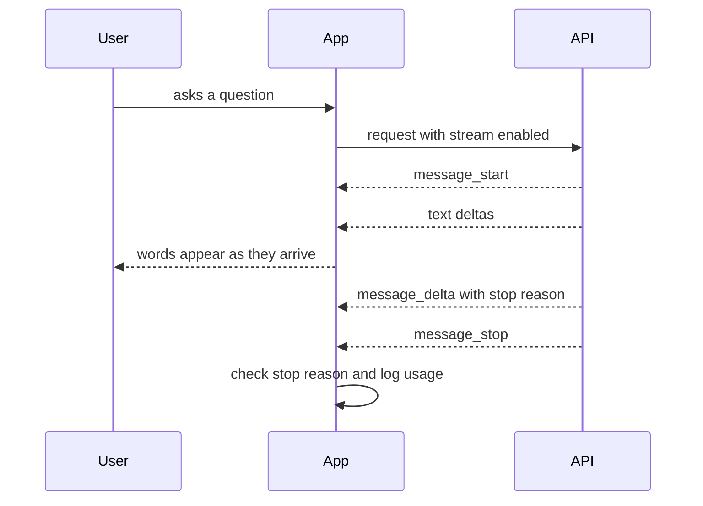

# Structured outputs and streaming

> **Before this lesson:** you should know that a model produces one token at a time by turning
> **logits** (a raw score for every token in the vocabulary) into probabilities and sampling
> ([Hub, pipelines, Auto classes and generate()](#/lesson/llm-practice/hub-pipelines-generate)), and
> how a model asks your code to run a tool
> ([Function calling](#/lesson/llm-practice/function-calling)). Prompt caching from
> [Designing tools for agents and prompt caching](#/lesson/llm-practice/tools-and-caching) appears
> briefly in the latency section. The code uses Python dictionaries, `json`, `try`/`except` and a little
> numpy.

## In plain words

A language model writes free text. That is perfect for a chat window and awkward for a program. If your
code needs to know "which category is this support ticket, and how urgent?", it wants a tidy record such
as `{"category": "billing", "urgency": 4}`, not a friendly paragraph that happens to mention billing
somewhere. Getting the model to produce data your code can read reliably is called **structured
output**.

The second topic is **streaming**: showing the answer word by word as the model writes it, instead of
making the user stare at a spinner for twenty seconds and then dumping the whole reply at once. The
answer does not arrive any sooner in total, but it *feels* far faster, and the user can start reading
immediately.

An analogy: a structured output is a paper form with labelled boxes rather than a blank sheet. A clerk
can process a hundred forms an hour because every answer is in the same place. Streaming is a
newsreader speaking as they read the script, rather than reading silently for a minute and then
speaking.

Why it matters for a job: almost every production LLM feature either feeds a program (extraction,
classification, routing, tool calls) or faces a user (chat, writing help). The first needs structured
output; the second needs streaming. "How do you get reliable JSON from an LLM?" is one of the most
common practical interview questions.

## 1. The structured-output ladder

Before the ladder, two definitions. **JSON** (JavaScript Object Notation) is the standard text format
for data: curly braces hold named fields, square brackets hold lists. A **JSON Schema** is a JSON
document that describes what valid data must look like: which fields exist, their types, which are
required, and which values are allowed.

There are five ways to get JSON out of a model, from the weakest guarantee to the strongest:

1. **Ask nicely.** "Respond with JSON matching this schema" plus an example. With strong models this
   works most of the time. It fails occasionally with chatty text before or after the JSON, Markdown
   code fences around it, missing fields, or output cut off part-way.
2. **Prefill and stop sequences.** **Prefilling** means writing the first characters of the assistant's
   reply yourself, for example `{`, so the model can only continue as JSON. A **stop sequence** is a
   string that makes generation end when it appears, such as a closing tag. Cheap and effective where
   the API supports it; some recent models no longer accept prefilled replies, so check the docs.
3. **JSON mode.** The provider guarantees *syntactically valid JSON* (it will parse), but not that it
   matches *your* schema. Fields can still be missing or misnamed.
4. **Tool calling as a schema carrier.** Define a tool whose input schema is the output you want and
   force the model to call it (with the `tool_choice` setting). The tool's arguments *are* your
   structured result; you never run any tool.
5. **Structured outputs with constrained decoding** (often called strict mode). You supply a JSON
   Schema; the provider turns it into a grammar and blocks invalid tokens at every step, so the output
   **always parses and matches the schema**. OpenAI offers this through `response_format` with a
   `json_schema` and `strict: true`; Anthropic through a JSON-schema output format and strict tool use;
   Gemini through `response_schema`. For open models, serving engines such as vLLM, TGI and llama.cpp
   offer **guided decoding** using libraries like Outlines, XGrammar or llguidance.

Whatever rung you use, **validate in code** and keep a repair path. The standard Python tool for
validation is **Pydantic**, a library where you describe the shape of your data as a Python class and it
checks incoming data against it:

```python
from pydantic import BaseModel, Field
from typing import Literal

class Ticket(BaseModel):
    category: Literal["billing", "bug", "feature_request", "other"]
    urgency: int = Field(ge=1, le=5, description="1 = low, 5 = outage")
    summary: str = Field(max_length=200)
    order_ids: list[str] = []

schema = Ticket.model_json_schema()            # hand this to the API
# OpenAI-style:    client.responses.parse(model=..., input=..., text_format=Ticket)
# Anthropic-style: client.messages.parse(model=..., messages=..., output_format=Ticket)
# Any provider:    force a tool whose input_schema is `schema`, then Ticket.model_validate(tool_input)
ticket = Ticket.model_validate_json(raw_model_output)
```

**Reading this code line by line**

- `class Ticket(BaseModel)` declares the data shape. Each line inside is one field with its type.
- `Literal[...]` restricts `category` to exactly four allowed strings; the generated schema turns this
  into an **enum** (a fixed list of allowed values).
- `Field(ge=1, le=5, ...)` says urgency must be greater than or equal to 1 and less than or equal to 5;
  the `description` is copied into the schema, where the model reads it as an instruction.
- `order_ids: list[str] = []` is a list of strings that defaults to empty.
- `model_json_schema()` produces the JSON Schema to send to the provider.
- The comments show the SDK helpers that accept the class directly (method names change between SDK
  versions, so check the current reference). The last line parses and checks the model's raw text,
  raising a `ValidationError` with a precise message if anything is wrong.

Libraries such as Instructor and Pydantic AI wrap this whole pattern, including automatic retries on
validation errors.

## 2. How constrained decoding works

Recall how generation proceeds. At each step the model outputs logits over its entire vocabulary, the
sampler picks one token, the token is appended, and the loop repeats. Constrained decoding inserts one
extra step before sampling.

A **grammar engine** keeps track of which continuations are still legal given what has been written so
far. For simple, flat structure it can use a **finite-state machine** (a small set of states with rules
for which input moves you from one state to the next). Nested JSON, where braces can contain braces,
needs a **pushdown automaton** (a state machine with a stack that remembers how many brackets are open).
At each step the engine sets the logit of every token that would break the grammar to $-\infty$
(negative infinity). After softmax, those tokens have probability exactly zero, so the sampler cannot
pick them.

Two subtleties. First, tokens are multi-character pieces such as `{"sent` or `ive"`, not single
characters, so for each grammar state the engine precomputes the set of tokens that keep the output
legal; that precomputation is what libraries such as Outlines and XGrammar make fast. Second, providers
support only a subset of JSON Schema in strict mode: for instance no arbitrary regular-expression
look-arounds, limited recursion, and `additionalProperties: false` (no extra fields) required on
objects.

The demo uses a ten-token vocabulary and a three-state grammar for `{"sentiment": "<label>"}`:

```python-run
import numpy as np
rng = np.random.default_rng(0)
vocab = ['{"sentiment": "', 'positive', 'negative', 'neutral', '"}', 'Sure', '!', ' Here', ' is', '\n']
# A tiny grammar as a state machine: state -> allowed token ids -> next state
GRAMMAR = {0: {0: 1}, 1: {1: 2, 2: 2, 3: 2}, 2: {4: 3}}           # 3 = accept

def generate(constrained):
    state, out = 0, []
    for _ in range(6):
        logits = rng.normal(0, 1, len(vocab))
        logits[5] += 3.0                                           # the model "wants" to chat: 'Sure'
        logits[2] += 1.0
        if constrained:
            allowed = GRAMMAR[state]
            mask = np.full(len(vocab), -np.inf); mask[list(allowed)] = 0
            tok = int(np.argmax(logits + mask))                    # greedy over legal tokens only
            state = allowed[tok]
        else:
            tok = int(np.argmax(logits))
        out.append(vocab[tok])
        if constrained and state == 3:
            break
    return "".join(out)

print("unconstrained:", repr(generate(False)))
print("constrained  :", repr(generate(True)))
```

**Reading this code line by line**

- `vocab` is the toy vocabulary. Token 0 is the whole opening `{"sentiment": "`, tokens 1 to 3 are the
  labels, token 4 closes the object, and tokens 5 to 9 are chatty filler.
- `GRAMMAR` maps each state to the tokens allowed in it and the state each one leads to. In state 0
  only the opening is legal; in state 1 any of the three labels; in state 2 only the closing `"}`;
  reaching state 3 means the object is complete.
- Each step draws random logits (a stand-in for the model) and then biases them: `'Sure'` gets +3 so
  the "model" strongly prefers to start chatting, and `'negative'` gets +1.
- In constrained mode, `mask` is negative infinity everywhere except the allowed tokens, which get 0.
  Adding the mask to the logits leaves legal tokens unchanged and makes illegal ones impossible.
  `np.argmax` picks the best remaining token (greedy decoding), and the state advances.
- The output: the unconstrained run prints `'Sure'` six times in a row and never forms JSON. The constrained run produces a complete object such as `{"sentiment": "negative"}` in exactly
  three steps, even though the model "wanted" to chat.

What constrained decoding does **not** do:

- **Semantics**: a perfectly valid `"urgency": 5` can still be the wrong urgency. Evaluate the content,
  not only the shape.
- **Truncation**: if the `max_tokens` limit is hit in the middle of an object, the JSON is incomplete.
  Always check the stop reason (section 3).
- **Refusals**: the model may decline a request; your code needs a path for that.
- **Quality for free**: forcing a strict format can hurt reasoning if the schema leaves no room to
  think. Put a `reasoning` field **first** in the schema (fields are generated in order, so the model
  writes its thinking before committing to an answer), or let the model think in a separate step or
  thinking block and only then emit the structure.

Schema design tips: descriptive field names and descriptions (they are prompt text the model reads);
enums instead of free strings; flat structures rather than deep nesting; required fields that allow an
explicit `null` rather than optional fields with ambiguous meaning; and small schemas overall.

### A repair loop

On the lower rungs of the ladder you need a way to recover from bad output. The pattern: extract the
JSON tolerantly, validate it, and if it fails, send the specific errors back to the model and ask again.

```python-run
import json, re

FENCE = "`" * 3      # a Markdown code fence

def extract_json(text):
    """Tolerant extraction: strip code fences, find the outermost braces, then parse."""
    text = text.strip().replace(FENCE + "json", "").replace(FENCE, "")
    start, end = text.find("{"), text.rfind("}")
    if start == -1 or end <= start:
        raise ValueError("no JSON object found")
    return json.loads(text[start:end + 1])

def validate(obj):
    errs = []
    if obj.get("category") not in ("billing", "bug", "other"): errs.append("category must be billing|bug|other")
    if not isinstance(obj.get("urgency"), int) or not 1 <= obj["urgency"] <= 5: errs.append("urgency must be int 1-5")
    return errs

attempts = iter(['Sure! Here is the JSON:\n' + FENCE + 'json\n{"category": "payment", "urgency": "high"}\n' + FENCE,
                 '{"category": "billing", "urgency": 4}'])
def model(prompt): return next(attempts)

prompt = "Classify the ticket as JSON."
for attempt in range(3):
    raw = model(prompt)
    try:
        obj = extract_json(raw); errs = validate(obj)
    except (ValueError, json.JSONDecodeError) as e:
        obj, errs = None, [str(e)]
    print(f"attempt {attempt + 1}: {errs or 'valid ' + json.dumps(obj)}")
    if not errs: break
    prompt += f"\nYour previous output was invalid: {'; '.join(errs)}. Return only corrected JSON."
```

**Reading this code line by line**

- `FENCE` is three backtick characters built by repeating one backtick, so a literal fence never
  appears in the demo source, where it would end this lesson's own code block.
- `extract_json` removes code fences, finds the first `{` and the last `}`, and parses what lies between,
  which strips chatty text such as "Sure! Here is the JSON:".
- `validate` returns a list of human-readable problems; an empty list means valid.
- `attempts` is a fake model that returns a bad answer first and a good one second; `next(attempts)`
  hands out the next answer on each call.
- The loop tries up to three times. A parse failure and a validation failure are both turned into
  error messages, which are appended to the prompt for the next try.
- The output: attempt 1 parses (the extraction worked) but fails validation with both errors, because
  "payment" is not an allowed category and "high" is not an integer. Attempt 2 is valid.

Feeding the specific errors back usually fixes the output in one retry. Cap the number of retries, and
log every failure: each one is a ready-made test case for your evaluation set.

## 3. Streaming

### How the bytes arrive

LLM APIs stream using **Server-Sent Events (SSE)**: the server keeps one HTTP response open and writes
a series of short text records, each made of `event:` and `data:` lines, as soon as each piece is ready.
The browser or SDK reads them one by one.

Streaming does not make the model generate faster. It changes what the user *perceives*. Two numbers
matter:

- **Time to first token (TTFT)**: how long until the first piece of the answer appears.
- **Tokens per second**: how fast the rest flows once it starts.

A user who sees words after 400 milliseconds feels the system is responsive even if the full answer
takes fifteen seconds.

### The event grammar

Anthropic's Messages API streams events in this order:

```text
message_start                    (message metadata, input token usage)
  content_block_start  index=0   (type: text | tool_use | thinking)
    content_block_delta          (text_delta | input_json_delta | thinking_delta)  ... repeated
  content_block_stop   index=0
  content_block_start  index=1 ...
message_delta                    (stop_reason, cumulative output usage)
message_stop
ping / error                     (may appear at any time)
```

In words: a reply is a **message** made of numbered **content blocks** (a block of text, a tool call, or
a block of model thinking). Each block opens with `content_block_start`, receives many small
**deltas** (increments: a few characters of text, or a fragment of tool arguments), and closes with
`content_block_stop`. Near the end, `message_delta` carries the **stop reason** (why generation ended)
and the output token count; `message_stop` ends the stream. `ping` events keep the connection alive and
an `error` event can arrive at any point.

OpenAI's Chat Completions API streams `chat.completion.chunk` objects with a `choices[0].delta` field
holding text fragments or `tool_calls` fragments keyed by an `index`, and ends with `data: [DONE]`. The
newer Responses API uses named event types such as `response.output_text.delta`. The ideas are the same:
fragments tagged with which part of the answer they belong to.

SDKs hide most of this. With Anthropic's Python SDK (static code; it needs a network and an API key):

```python
with client.messages.stream(model="claude-sonnet-4-5", max_tokens=1024, messages=msgs) as stream:
    for text in stream.text_stream:
        print(text, end="", flush=True)
    final = stream.get_final_message()          # fully assembled message with usage and stop_reason
```

`with ... as stream` opens the stream and guarantees it is closed afterwards. `stream.text_stream`
yields only the text fragments, which are printed without a newline (`end=""`) and pushed to the screen
at once (`flush=True`). `get_final_message()` returns the complete message, assembled from all the
events, with its token usage and stop reason.

### Accumulating a stream by hand

When the model calls a tool while streaming, the tool's arguments arrive as **partial JSON strings**
(`input_json_delta.partial_json`), such as `{"city": "Os` followed later by `lo", "days": 3}`. Neither
piece is valid JSON on its own. You concatenate the fragments for each block index and parse only at
`content_block_stop`. This module's `llm-stream-accumulate` problem asks you to write exactly this
routine; the demo shows a reference version.

```python-run
import json
events = [
  {"type": "message_start"},
  {"type": "content_block_start", "index": 0, "content_block": {"type": "text"}},
  {"type": "content_block_delta", "index": 0, "delta": {"type": "text_delta", "text": "Let me check "}},
  {"type": "content_block_delta", "index": 0, "delta": {"type": "text_delta", "text": "the weather."}},
  {"type": "content_block_stop", "index": 0},
  {"type": "content_block_start", "index": 1, "content_block": {"type": "tool_use", "id": "toolu_1", "name": "get_weather"}},
  {"type": "content_block_delta", "index": 1, "delta": {"type": "input_json_delta", "partial_json": '{"city": "Os'}},
  {"type": "content_block_delta", "index": 1, "delta": {"type": "input_json_delta", "partial_json": 'lo", "days": 3}'}},
  {"type": "content_block_stop", "index": 1},
  {"type": "message_delta", "delta": {"stop_reason": "tool_use"}},
  {"type": "message_stop"},
]
blocks, buf, stop = {}, {}, None
for e in events:
    t = e["type"]
    if t == "content_block_start":
        blocks[e["index"]] = dict(e["content_block"]); buf[e["index"]] = ""
    elif t == "content_block_delta":
        d = e["delta"]; buf[e["index"]] += d.get("text", "") + d.get("partial_json", "")
    elif t == "content_block_stop":
        b = blocks[e["index"]]
        if b["type"] == "text": b["text"] = buf[e["index"]]
        else: b["input"] = json.loads(buf[e["index"]] or "{}")
    elif t == "message_delta":
        stop = e["delta"].get("stop_reason")
print([blocks[i] for i in sorted(blocks)], stop)
```

**Reading this code line by line**

- `events` is a recorded stream: one text block, one tool-use block, then the closing events.
- `blocks` holds each block's metadata by index; `buf` holds the text collected so far for each index.
- On `content_block_start`, the block's metadata is copied and an empty buffer is opened.
- On `content_block_delta`, the fragment is appended to that index's buffer. Text deltas carry `text`
  and tool deltas carry `partial_json`; using `.get(..., "")` for both handles either kind.
- On `content_block_stop`, a text block receives its finished text and a tool block's buffer is parsed
  as JSON (an empty buffer means a tool with no arguments, hence `or "{}"`).
- On `message_delta`, the stop reason is recorded.
- The output is two finished blocks, the text "Let me check the weather." and a `get_weather` call with
  input `{'city': 'Oslo', 'days': 3}`, plus the stop reason `tool_use`, which tells your loop to run
  the tool and send back its result.

The sequence diagram shows the full round trip for a streamed answer:



### Streaming engineering checklist

- **Always read the stop reason.** Common values: `end_turn` (finished naturally), `max_tokens`
  (truncated: continue or raise the limit), `tool_use` (run the tool), `stop_sequence` (a stop string
  appeared), `refusal`, and a pause value that asks you to send the turn back so the model can continue.
- **Errors can arrive mid-stream** after a successful HTTP 200 status, for example when the service is
  overloaded. Decide in advance whether to show partial text, retry from scratch, or resume.
- **Timeouts**: stream long generations so that idle-connection timeouts do not kill the request, and
  set two timers: one for the first byte and one for the gap between chunks.
- **Cancellation**: if the user closes the page or presses stop, abort the request so you stop paying
  for tokens nobody will read.
- **Proxies**: web servers and proxies such as nginx may **buffer** SSE (hold it back and send it in
  one lump), which defeats streaming. Turn buffering off (for nginx, the `X-Accel-Buffering: no`
  header) and avoid compression buffering on that route.
- **Rendering**: half-finished Markdown (an unclosed table or code fence) and half-finished JSON need
  tolerant renderers. For structured data, use a partial-JSON parser, or stream a list of small
  objects, one per line, so each line is complete when it arrives.
- **Guardrails conflict with streaming**: you cannot un-send a token. Either buffer a sentence or chunk
  and check it before release, run a checker in parallel that can abort the stream, or retract the text
  in the interface afterwards (next lesson).
- **Unicode**: tokenizers that work on bytes can split one multi-byte character (an emoji or a Chinese
  character) across two chunks. Decode incrementally rather than chunk by chunk.

## 4. Latency vocabulary

**Latency** is the time a user waits. Three terms describe it for LLMs:

- **TTFT** (time to first token) = time waiting in the provider's queue + **prefill** (processing the
  whole prompt in one pass). It grows with input length; prompt caching cuts it because cached prefix
  tokens skip most of that work.
- **TPOT** (time per output token), or its inverse, tokens per second: the speed of the **decode** phase,
  in which output tokens are produced one at a time.
- **Total latency** $\approx$ TTFT + (number of output tokens) $\times$ TPOT.

A worked example: TTFT of 0.5 seconds and TPOT of 20 milliseconds. A 100-token answer takes about
0.5 + 100 x 0.02 = 2.5 seconds; a 1,000-token answer takes about 20.5 seconds. For long answers **output
length dominates**, so asking for concise output is one of the most effective latency optimisations.

```python-run
def latency(ttft, tpot_ms, out_tokens):
    return ttft + out_tokens * tpot_ms / 1000

for n in [50, 200, 1000, 3000]:
    print(f"{n:5d} output tokens: {latency(0.5, 20, n):6.1f} s total, of which first token 0.5 s")
```

The function adds TTFT to output tokens times TPOT (converted from milliseconds to seconds). The table
shows total time rising from 1.5 seconds at 50 tokens to 60.5 seconds at 3,000 tokens, while the time to
first token, the part streaming makes visible, stays at half a second.

> [!INTERVIEW]
> **"How do you get reliable JSON from an LLM?"** Use schema-constrained structured outputs or a forced
> tool call where available (explain logit masking against a grammar), keep schemas simple with enums
> and descriptions, put reasoning before conclusions, validate with Pydantic, retry with the validation
> error, check stop reasons for truncation and refusals, and evaluate semantic correctness separately
> because constrained decoding only guarantees shape.

## Summary

- Structured output options range from prompting to schema-constrained decoding; always validate and
  keep a repair loop.
- Constrained decoding masks illegal tokens per grammar state: guaranteed shape, not guaranteed truth.
- Streaming is a sequence of SSE events; assemble text and partial-JSON tool arguments per block index.
- Handle stop reasons, mid-stream errors, cancellation, proxy buffering and guardrail timing.
- TTFT depends on queueing and prompt length; total latency is dominated by output length.

## Glossary

- **Structured output**: model output in a fixed, machine-readable shape such as JSON.
- **JSON / JSON Schema**: a text format for data / a document describing what valid data looks like.
- **Prefill**: writing the start of the assistant's reply yourself so the model continues from it.
- **Stop sequence**: a string that ends generation when it appears.
- **JSON mode**: a guarantee of valid JSON syntax, without a schema guarantee.
- **Constrained (guided) decoding**: masking tokens that would break a grammar so output always matches.
- **Enum**: a fixed list of allowed values.
- **Pydantic**: a Python library that validates data against a class definition.
- **Finite-state machine / pushdown automaton**: rule-based state trackers, the second with a stack for
  nesting.
- **Repair loop**: validating output and re-asking the model with the specific errors.
- **SSE (Server-Sent Events)**: one long HTTP response carrying a series of small event records.
- **Content block / delta**: one part of a reply (text, tool call, thinking) / a small increment of it.
- **Stop reason**: why generation ended, such as `end_turn`, `max_tokens` or `tool_use`.
- **Buffering**: holding streamed data back and sending it in a lump.
- **Latency / TTFT / TPOT**: waiting time / time to first token / time per output token.
- **Prefill vs decode phase**: processing the prompt in one pass vs producing output tokens one by one.

## Check yourself

```quiz
[
  {"q": "What does schema-constrained decoding guarantee?",
   "options": ["The output parses and conforms to the schema", "The values are factually correct", "The model never refuses", "Output is never truncated"], "answer": 0,
   "explain": "Masking enforces shape only; semantics, refusals and max_tokens truncation remain your problem."},
  {"q": "How does constrained decoding enforce a grammar?",
   "options": ["It sets logits of tokens that would violate the grammar to -infinity before sampling", "It retries until valid", "It post-edits the text", "It fine-tunes the model on the schema"], "answer": 0,
   "explain": "A state machine tracks legal continuations and masks the rest at each step."},
  {"q": "What does JSON mode guarantee that plain prompting does not?",
   "options": ["Syntactically valid JSON, but not that it matches your schema", "That every field in your schema is present", "That values are correct", "That the reply is streamed"], "answer": 0,
   "explain": "JSON mode guarantees the text parses; only strict schema mode guarantees the shape you asked for."},
  {"q": "Why put a reasoning field before the answer field in a schema?",
   "options": ["Fields are generated in order, so the model can think before committing", "It reduces tokens", "JSON requires alphabetical order", "It disables streaming"], "answer": 0,
   "explain": "Autoregressive generation means earlier fields condition later ones."},
  {"q": "In a streamed tool call, when can you parse the tool's JSON arguments?",
   "options": ["After the content block stops, once all partial_json fragments are concatenated", "After the first delta", "Before message_start", "Never; arguments are not streamed"], "answer": 0,
   "explain": "Fragments are arbitrary string pieces and are only valid JSON once complete."},
  {"q": "A response ends with stop_reason = max_tokens. What does that mean?",
   "options": ["The output was cut off by the token limit and may be incomplete", "The model finished naturally", "A tool must be run", "The prompt was too long"], "answer": 0,
   "explain": "Truncated JSON or answers must be continued or regenerated with a higher limit."},
  {"q": "Which metric does streaming mainly improve for the user?",
   "options": ["Perceived latency via time to first token", "Total tokens generated", "Model accuracy", "Input cost"], "answer": 0,
   "explain": "Generation is not faster, but the user sees output immediately."},
  {"q": "Why do output guardrails conflict with streaming?",
   "options": ["Tokens already sent cannot be unsent, so checks must buffer or run alongside", "Guardrails need GPUs", "SSE cannot carry JSON", "Streaming disables tool use"], "answer": 0,
   "explain": "You must choose between buffering chunks for scanning and risking exposure of content before a check completes."}
]
```

> **Source:** Anthropic docs: "Streaming Messages", "Structured outputs", tool use
> (https://docs.claude.com/en/docs/build-with-claude/streaming); OpenAI docs: Structured Outputs and
> streaming; Willard & Louf, "Efficient Guided Generation for LLMs" (Outlines, 2023); vLLM structured
> outputs docs; Hugging Face TGI guidance docs
> (https://huggingface.co/docs/text-generation-inference/conceptual/guidance); Huyen, *AI Engineering*,
> ch. 2 (structured outputs, constrained sampling) and ch. 9 (latency metrics: TTFT, TPOT).
