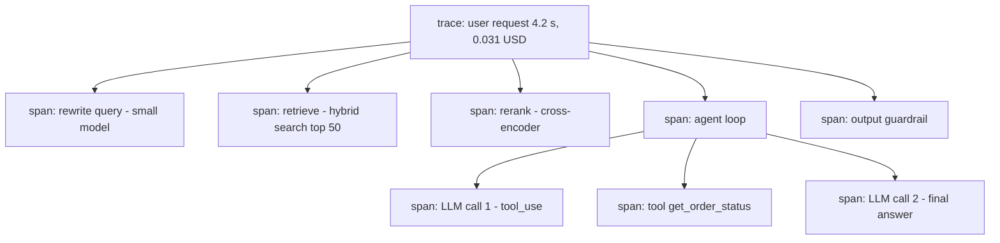

# Observability, evals in CI, cost and latency

The last lesson of the track is about operating what you built. LLM systems fail differently from
ordinary software: they are non-deterministic, they degrade silently (a prompt tweak that helps one
case breaks ten others), their cost scales with usage in ways that surprise finance, and "it returned
200 OK" says nothing about whether the answer was right. The answer is the same discipline as elsewhere
in engineering, adapted: **trace everything, test continuously, and measure cost and latency per
request.**

## 1. Tracing: the unit of observability

A single user request to an agent can fan out into dozens of model calls, retrievals and tool
executions. A **trace** captures the whole tree; each node is a **span** with timing, inputs, outputs
and metadata.



What to record on every LLM span:

- model id and version, provider, parameters (temperature, max tokens), **prompt template version**,
- full input messages and output (subject to privacy policy and redaction),
- token usage: input, output, **cache read / cache write**, reasoning tokens,
- latency: TTFT and total; retries; stop reason; errors,
- tool calls with arguments and results; retrieved document ids and scores,
- user/session/tenant ids, feature flags, experiment arm,
- computed cost.

**OpenTelemetry** is the standard substrate. Its **GenAI semantic conventions** define attribute names
(`gen_ai.request.model`, `gen_ai.usage.input_tokens`, `gen_ai.usage.output_tokens`, operation names
such as `chat` and `execute_tool`), so traces are portable across backends. Tools built on or
compatible with it: Langfuse, Arize Phoenix, LangSmith, Braintrust, Weights & Biases Weave, MLflow
tracing, OpenLLMetry/OpenInference instrumentation, Datadog and Honeycomb LLM views. MCP propagates
trace context through `_meta` (`traceparent`) so a trace can cross from host to server.

```python
from opentelemetry import trace
tracer = trace.get_tracer("support-bot")

def answer(question, user):
    with tracer.start_as_current_span("rag.answer") as root:
        root.set_attribute("user.id", user.id)
        with tracer.start_as_current_span("retrieve") as s:
            docs = retrieve(question); s.set_attribute("retrieval.k", len(docs))
        with tracer.start_as_current_span("chat") as s:
            resp = llm(build_prompt(question, docs))
            s.set_attribute("gen_ai.request.model", resp.model)
            s.set_attribute("gen_ai.usage.input_tokens", resp.usage.input_tokens)
            s.set_attribute("gen_ai.usage.output_tokens", resp.usage.output_tokens)
        return resp
```

A minimal tracer to make the idea concrete:

```python-run
import time, json, contextlib

SPANS, STACK = [], []
@contextlib.contextmanager
def span(name, **attrs):
    s = {"name": name, "parent": STACK[-1]["name"] if STACK else None, "attrs": dict(attrs), "start": time.perf_counter()}
    STACK.append(s)
    try:
        yield s["attrs"]
    finally:
        STACK.pop(); s["ms"] = round((time.perf_counter() - s.pop("start")) * 1000, 1); SPANS.append(s)

PRICE = {"small": (0.25, 1.25), "large": (3.0, 15.0)}          # $ per million input / output tokens (illustrative)
def fake_llm(model, tin, tout):
    time.sleep(0.01)
    return {"input_tokens": tin, "output_tokens": tout, "cost": (tin * PRICE[model][0] + tout * PRICE[model][1]) / 1e6}

with span("request", user="u42"):
    with span("rewrite", model="small") as a: a.update(fake_llm("small", 300, 40))
    with span("retrieve") as a: a["k"] = 50
    with span("generate", model="large") as a: a.update(fake_llm("large", 6200, 350))

for s in SPANS:
    print(f"{s['name']:9} parent={str(s['parent']):8} {s['ms']:6} ms  {json.dumps(s['attrs'])}")
print("total cost: $%.5f" % sum(s["attrs"].get("cost", 0) for s in SPANS))
```

Beyond traces, monitor **aggregates**: latency percentiles (p50/p95/p99, never just the mean), error and
retry rates, token and cost per request and per user, cache hit rate, tool error rate, guardrail
trigger rate, refusal rate, and quality signals: thumbs, edits, regenerations, conversation abandonment,
sampled online LLM-judge scores. Review real traces weekly; error analysis by reading transcripts is
the highest-leverage activity in LLM engineering.

## 2. Evals in CI

The AI Engineering track covers evaluation methodology in depth. Operationally, the goal here is that
**no prompt, model, retrieval or tool change ships without running a test suite**, exactly like code.

**Layers of the suite**

1. **Deterministic unit checks** (fast, every commit): output parses against the schema; required
   fields present; citations refer to provided sources; no forbidden strings; tool-call arguments valid;
   retrieval recall@k on labelled queries.
2. **Model-graded checks** (slower, on PRs or nightly): rubric-based LLM judges for correctness,
   faithfulness, tone; pairwise comparison against the current production version.
3. **End-to-end agent tasks** in a sandbox with end-state assertions (the file exists, the tests pass,
   the ticket was created with the right fields).
4. **Adversarial suite**: jailbreaks and injections with attack success rate (previous lesson).

**Dataset hygiene**: start with 20 to 50 cases drawn from real failures and grow it; every production
bug becomes a regression case; keep slices (by intent, language, difficulty); version the dataset
alongside the prompts.

**Dealing with non-determinism**

- Fix what you can (temperature 0, seeds where supported, pinned model snapshot ids, not floating
  aliases), but expect residual variance.
- Run stochastic cases **k times** and assert on a pass rate, not a single run.
- Gate on **aggregate thresholds with tolerance** ("faithfulness must not drop more than 2 points and
  must stay above 0.85"), and check that differences exceed noise before celebrating or blocking.

```python-run
import math, random
random.seed(0)

def run_suite(pass_prob, n_cases=120):
    return sum(random.random() < pass_prob for _ in range(n_cases)), n_cases

def wilson(p_hat, n, z=1.96):
    den = 1 + z*z/n
    centre = (p_hat + z*z/(2*n)) / den
    half = z * math.sqrt(p_hat*(1-p_hat)/n + z*z/(4*n*n)) / den
    return centre - half, centre + half

base_pass, n = run_suite(0.88)
cand_pass, _ = run_suite(0.84)
for name, k in [("baseline", base_pass), ("candidate", cand_pass)]:
    lo, hi = wilson(k / n, n)
    print(f"{name:9} pass rate {k/n:.3f}  95% CI [{lo:.3f}, {hi:.3f}]")
# two-proportion z-test for the regression gate
p1, p2 = base_pass / n, cand_pass / n
p = (base_pass + cand_pass) / (2 * n)
z = (p1 - p2) / math.sqrt(2 * p * (1 - p) / n)
print(f"difference {p1 - p2:+.3f}, z = {z:.2f} ->", "block merge" if z > 1.64 else "within noise at this sample size")
```

In this simulation the candidate's *true* pass rate is four points lower than the baseline's (0.84
versus 0.88), yet with this seed it scores slightly higher: pure sampling noise. With 120 cases the
confidence intervals are about plus or minus 6 points wide, so small suites cannot detect small
regressions. Either grow the suite, use paired comparisons on the same cases (much more
sensitive), or accept coarser gates.

A CI job looks like any other test job:

```yaml
# .github/workflows/evals.yml (sketch)
on: [pull_request]
jobs:
  evals:
    runs-on: ubuntu-latest
    steps:
      - uses: actions/checkout@v4
      - run: pip install -r requirements.txt
      - run: pytest tests/evals/deterministic -q                 # schema, citations, retrieval recall
      - run: python evals/run.py --suite regression --trials 3 --baseline main --max-drop 0.02
        env: { ANTHROPIC_API_KEY: "${{ secrets.ANTHROPIC_API_KEY }}" }
      - uses: actions/upload-artifact@v4
        with: { name: eval-report, path: evals/report.html }
```

Tools: promptfoo, Braintrust, LangSmith, DeepEval, Inspect (UK AISI), OpenAI Evals, plain pytest. Keep
costs sane by caching model responses keyed on (model, prompt, params) for unchanged cases and using
batch APIs for nightly runs.

**After merge**: ship behind flags, canary a small traffic share, A/B test on product metrics, and keep
online monitors with alerts. Offline evals predict; production confirms.

## 3. Cost engineering

Cost per request $= \sum_{\text{calls}} (\text{input} \times p_{in} + \text{cached} \times p_{cache} +
\text{output} \times p_{out})$. Output tokens typically cost several times more than input tokens, and
agent loops multiply calls. Levers, roughly in order of payoff:

1. **Use the smallest model that passes your evals**, per step: route classification, extraction and
   rewriting to small models; reserve frontier models for hard reasoning. Cascades try the cheap model
   first and escalate on low confidence.
2. **Prompt caching** (lesson 23): order-of-magnitude savings on repeated prefixes.
3. **Send fewer tokens**: tighter retrieval (rerank to 5 chunks, not 30), concise tool outputs,
   tool-result clearing, compaction, trimmed few-shot examples.
4. **Generate fewer tokens**: ask for concise answers, cap `max_tokens`, structured outputs instead of
   prose, tune reasoning/thinking effort to the task.
5. **Batch APIs** for anything not interactive: commonly about half price for asynchronous completion
   within a day.
6. **Response caching** for repeated identical requests.
7. **Fine-tune or distil** a small model for a narrow, high-volume task (module 6), or **self-host**
   when volume is high and steady (remember GPU idle time, ops staffing and the throughput/latency
   trade-offs covered in the AI Engineering track's inference chapter).
8. **Guard the downside**: per-user and per-tenant budgets, rate limits, max agent steps, alerts on
   cost anomalies.

```python-run
def monthly_cost(requests, tin, tout, p_in, p_out, cache_frac=0.0, read_mult=0.1, batch=False):
    c = requests * ((tin * (1 - cache_frac) + tin * cache_frac * read_mult) * p_in + tout * p_out) / 1e6
    return c * (0.5 if batch else 1.0)

R = 2_000_000                                    # requests per month
scenarios = {
  "frontier model, no optimisation      ": monthly_cost(R, 8000, 500, 3.0, 15.0),
  "+ prompt caching (75% of input)      ": monthly_cost(R, 8000, 500, 3.0, 15.0, cache_frac=0.75),
  "+ rerank to fewer chunks (8k -> 4k)  ": monthly_cost(R, 4000, 500, 3.0, 15.0, cache_frac=0.5),
  "+ route 70% to a small model         ": 0.3 * monthly_cost(R, 4000, 500, 3.0, 15.0, cache_frac=0.5)
                                           + 0.7 * monthly_cost(R, 4000, 500, 0.25, 1.25, cache_frac=0.5),
}
for k, v in scenarios.items():
    print(f"{k} ${v:>10,.0f}")
```

(Prices are illustrative; use your provider's current rates.)

## 4. Latency engineering

Total latency $\approx$ queueing + TTFT + output tokens $\times$ time per token, summed over sequential
calls.

- **Stream** to cut perceived latency; show intermediate status for agents ("searching docs...").
- **Shorten output**; it usually dominates.
- **Parallelise** independent calls (retrieval + guardrail + rewrite; parallel tool calls).
- **Cut round trips**: fewer agent steps via better tools; merge chained prompts when quality allows.
- **Cache prefixes** to reduce TTFT; keep prompts lean.
- **Smaller or faster models** for latency-critical steps; provisioned throughput or priority tiers for
  predictable p99; specialised fast-inference providers.
- **Speculate**: start likely-needed work (retrieval) before the model asks for it.
- Track **p95/p99**, not averages; tail latency is what users remember. Set timeouts with fallbacks.

## 5. Reliability patterns

- **Retries with exponential backoff and jitter** for 429 (rate limit), 5xx and overload errors; respect
  `retry-after`; do not retry 4xx validation errors.
- **Idempotency**: make tool side effects safe to retry (idempotency keys).
- **Fallbacks**: secondary model or provider through a gateway (LiteLLM, OpenRouter, cloud gateways);
  degrade gracefully (answer without a tool, or say you cannot).
- **Timeouts and circuit breakers** around tools and providers.
- **Version pinning**: pinned model snapshots, prompt versions in source control, and a re-run of the
  eval suite before any model upgrade (new models need prompt adjustments; treat upgrades as
  migrations).
- **Rate-limit budgeting**: tokens-per-minute limits are shared across features; queue or shed load.

```python-run
import random
random.seed(1)
def call_with_retries(fn, max_attempts=5, base=0.5, cap=8.0):
    for attempt in range(1, max_attempts + 1):
        status = fn()
        if status == 200:
            return f"ok after {attempt} attempt(s)"
        if status not in (429, 500, 529):            # do not retry client errors
            return f"failed permanently with {status}"
        delay = random.uniform(0, min(cap, base * 2 ** (attempt - 1)))   # full jitter
        print(f"  attempt {attempt}: {status}, sleeping {delay:.2f}s (simulated)")
    return "gave up: fall back to secondary model"

responses = iter([529, 429, 200])
print(call_with_retries(lambda: next(responses)))
print(call_with_retries(lambda: 400))
```

## 6. A launch checklist

1. Traces with tokens, cost, latency, prompt version and tool calls for every request.
2. Eval suite in CI: deterministic checks, judge-based regression, adversarial cases, with thresholds.
3. Dashboards and alerts: p95 latency, error rate, cost per request, cache hit rate, quality signals.
4. Budgets, rate limits, step caps, timeouts, retries, fallbacks.
5. Guardrails and least-privilege tools; human approval for consequential actions.
6. Feedback capture wired into the eval dataset; a weekly trace-review habit.
7. Pinned model versions and a tested upgrade path.

> [!INTERVIEW]
> **"How do you know a prompt change is safe to ship?"** It runs through an eval suite in CI:
> deterministic assertions, LLM-judge regressions against the production baseline on a versioned,
> sliced dataset, multiple trials for stochastic cases, and gates on aggregate metrics with tolerance
> sized to the suite's noise; then a canary/A-B rollout with online monitoring of quality, latency and
> cost, with traces to debug regressions. Mention that every production failure becomes a test case.

## Summary

- Trace every request as a tree of spans with tokens, cost, latency, versions and tool calls;
  OpenTelemetry GenAI conventions make it portable.
- Put evals in CI in layers; handle non-determinism with pinned versions, repeated trials and
  statistically sensible gates.
- Cost levers: right-size models, cache, send and generate fewer tokens, batch, budgets.
- Latency levers: stream, shorten output, parallelise, fewer round trips, watch p95/p99.
- Reliability: retries with backoff and jitter, fallbacks, timeouts, pinned versions.

```quiz
[
  {"q": "What is a span in LLM tracing?",
   "options": ["One timed operation, such as a model call or tool execution, within a request's trace", "A whole user session", "A GPU metric", "A prompt template"], "answer": 0,
   "explain": "A trace is a tree of spans; each records inputs, outputs, timing and metadata."},
  {"q": "Why should eval gates use aggregate thresholds with tolerance rather than exact-match on every case?",
   "options": ["LLM outputs vary run to run, so single-case flakiness would block merges randomly", "Aggregates are cheaper to compute", "Exact match is impossible in Python", "CI cannot store text"], "answer": 0,
   "explain": "Non-determinism means you assert on pass rates and tolerances sized to the noise."},
  {"q": "A 120-case suite shows 88% vs 84% pass rate. What should you conclude?",
   "options": ["The gap may be within noise; use paired comparison or more cases before deciding", "The candidate is definitely worse", "The candidate is definitely better", "The suite is broken"], "answer": 0,
   "explain": "Confidence intervals at n=120 are several points wide."},
  {"q": "Which lever usually gives the largest cost reduction for a high-volume classification step?",
   "options": ["Routing it to a small model that passes the evals", "Raising temperature", "Adding more few-shot examples", "Using a larger context window"], "answer": 0,
   "explain": "Per-token prices differ by an order of magnitude or more across model tiers."},
  {"q": "Which requests should be retried with exponential backoff?",
   "options": ["429 and 5xx/overload errors", "400 validation errors", "401 authentication errors", "All responses including 200"], "answer": 0,
   "explain": "Transient capacity errors are retryable; client errors will fail again."},
  {"q": "Why track p95/p99 latency rather than the mean?",
   "options": ["Tail latency is what users notice and the mean hides it", "Percentiles are easier to compute", "The mean is always zero", "Providers bill by p99"], "answer": 0,
   "explain": "A good mean can coexist with a painful tail."},
  {"q": "What should happen to a bug found in production?",
   "options": ["It becomes a regression case in the eval dataset", "It is fixed in the prompt and forgotten", "It is ignored if rare", "The model is fine-tuned immediately"], "answer": 0,
   "explain": "Growing the suite from real failures is how eval coverage tracks reality."}
]
```

> **Source:** OpenTelemetry GenAI semantic conventions (https://opentelemetry.io/docs/specs/semconv/gen-ai/);
> Langfuse, Arize Phoenix and promptfoo docs; Anthropic docs: "Define success criteria and build
> evaluations", rate limits and errors, Message Batches, prompt caching (https://docs.claude.com);
> Anthropic Engineering, "Demystifying evals for AI agents" (2026); Hugging Face docs for `lighteval`
> and `evaluate`; Huyen, *AI Engineering*, ch. 3-4 (evaluation), ch. 9 (latency and cost metrics) and
> ch. 10 (architecture, monitoring and observability, user feedback).
