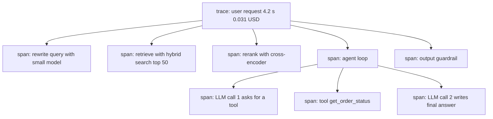
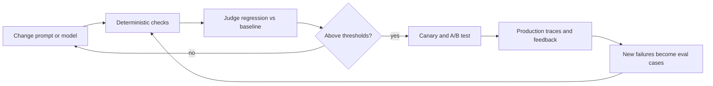

# Observability, evals in CI, cost and latency

> **Before this lesson:** you should know what a model call costs in input and output tokens and how
> prompt caching changes that ([Designing tools for agents and prompt caching](#/lesson/llm-practice/tools-and-caching)),
> the latency terms TTFT and TPOT ([Structured outputs and streaming](#/lesson/llm-practice/structured-streaming)),
> what an attack success rate is ([Guardrails and prompt-injection defence](#/lesson/llm-practice/guardrails-security)),
> and how retrieval quality is measured ([Evaluating RAG; GraphRAG and agentic RAG](#/lesson/llm-practice/rag-eval-advanced)).
> The code uses Python functions, dictionaries, a `with` block and a little arithmetic; a basic idea of
> a percentage and an average is enough for the statistics.

## In plain words

This is the last lesson of the track, and it is about running what you have built. Shipping an LLM
feature is the start, not the end. Once real people use it, you need answers to four questions every
day: *What is it actually doing? Is it still giving good answers? How much is it costing? How long are
people waiting?*

**Observability** is the ability to answer "what is my system doing, and why?" from the data it
records about itself. **Evals** (evaluations) are automated tests of answer quality. **CI** (continuous
integration) is the practice of running tests automatically every time someone proposes a change, so a
broken change cannot be merged unnoticed. Together with careful tracking of **cost** and **latency**
(waiting time), these turn an impressive demo into a dependable product.

LLM systems need this more than ordinary software, for four reasons:

- They are **non-deterministic**: the same question can get different answers on different runs.
- They **degrade silently**: a prompt tweak that fixes one case can quietly break ten others, and
  nothing crashes.
- Their **cost scales with usage** in ways that surprise finance teams, because every token is billed.
- "The server returned **200 OK**" (the HTTP code for success) says nothing about whether the answer
  was *right*.

An analogy: running a restaurant rather than cooking one great meal. A restaurant owner keeps order
tickets showing every dish's journey through the kitchen (traces), tastes dishes before a new recipe
goes on the menu (evals in CI), watches food costs per plate (cost), and times how long tables wait
(latency). The best cooks in the world still go out of business without those habits.

Why it matters for a job: "How do you know a prompt change is safe to ship?" and "How would you halve
the cost of this feature?" are standard interview questions for AI engineers, and the day-to-day work of
an LLM team is mostly reading traces, growing eval sets and tuning cost and latency.

## 1. Tracing: the unit of observability

A single user request to an agent can fan out into dozens of model calls, searches and tool executions.
To understand it you need the whole picture. A **trace** records one request from start to finish as a
tree. Each node in the tree is a **span**: one timed operation (a model call, a retrieval, a tool run)
with its start and end time, its inputs and outputs, and extra details called **attributes**. A span can
contain child spans, which is how the tree forms.



Reading the diagram: the root span is the whole request, 4.2 seconds and 3.1 US cents in total. Beneath
it are the steps in order: rewriting the question with a small model, retrieving 50 candidates, reranking
them, an agent loop that itself contains two model calls and one tool call, and a final output check.
When a user complains, you open their trace and see exactly which step was slow, expensive or wrong.

What to record on every LLM span:

- model id and version, provider, generation parameters (such as maximum tokens), and the **prompt
  template version** (which version of your prompt text was used);
- the full input messages and the output, subject to your privacy policy and redaction (lesson 25);
- token usage: input, output, **cache read and cache write**, and reasoning tokens;
- latency: TTFT and total time; number of retries; stop reason; errors;
- tool calls with their arguments and results; ids and scores of retrieved documents;
- user, session and tenant ids, **feature flags** (switches that turn features on for some users), and
  which **experiment arm** (variant of an A/B test) the request was in;
- the computed cost.

**OpenTelemetry** (often shortened to OTel) is the open standard for recording traces, used across the
software industry. Its **GenAI semantic conventions** fix the attribute names for LLM work, such as
`gen_ai.request.model`, `gen_ai.usage.input_tokens` and `gen_ai.usage.output_tokens`, and operation
names such as `chat` and `execute_tool`. Because the names are standard, the same traces can be sent to
any compatible **backend** (the service that stores and displays them). Tools built on or compatible
with it include Langfuse, Arize Phoenix, LangSmith, Braintrust, Weights & Biases Weave, MLflow tracing,
the OpenLLMetry and OpenInference instrumentation libraries, and the LLM views in Datadog and Honeycomb.
MCP can carry trace context in a request's `_meta` field (a `traceparent` value), so a single trace can
follow a request from the host application into an MCP server.

Instrumenting code with OpenTelemetry looks like this (static code; it needs the OpenTelemetry package
and a configured backend):

```python
from opentelemetry import trace
tracer = trace.get_tracer("support-bot")

def answer(question, user):
    with tracer.start_as_current_span("rag.answer") as root:
        root.set_attribute("user.id", user.id)
        with tracer.start_as_current_span("retrieve") as s:
            docs = retrieve(question); s.set_attribute("retrieval.k", len(docs))
        with tracer.start_as_current_span("chat") as s:
            resp = llm(build_prompt(question, docs))
            s.set_attribute("gen_ai.request.model", resp.model)
            s.set_attribute("gen_ai.usage.input_tokens", resp.usage.input_tokens)
            s.set_attribute("gen_ai.usage.output_tokens", resp.usage.output_tokens)
        return resp
```

What it does: `get_tracer` creates a tracer named after the service. Each `with
tracer.start_as_current_span(...)` block opens a span, times everything inside it, and closes it when
the block ends; spans opened inside another span automatically become its children. `set_attribute`
attaches details, here using the standard GenAI names for model and token counts.

To see there is no magic, here is a minimal tracer written from scratch:

```python-run
import time, json, contextlib

SPANS, STACK = [], []
@contextlib.contextmanager
def span(name, **attrs):
    s = {"name": name, "parent": STACK[-1]["name"] if STACK else None, "attrs": dict(attrs), "start": time.perf_counter()}
    STACK.append(s)
    try:
        yield s["attrs"]
    finally:
        STACK.pop(); s["ms"] = round((time.perf_counter() - s.pop("start")) * 1000, 1); SPANS.append(s)

PRICE = {"small": (0.25, 1.25), "large": (3.0, 15.0)}          # $ per million input / output tokens (illustrative)
def fake_llm(model, tin, tout):
    sum(range(200_000))                                          # stand-in for waiting on the network
    return {"input_tokens": tin, "output_tokens": tout, "cost": (tin * PRICE[model][0] + tout * PRICE[model][1]) / 1e6}

with span("request", user="u42"):
    with span("rewrite", model="small") as a: a.update(fake_llm("small", 300, 40))
    with span("retrieve") as a: a["k"] = 50
    with span("generate", model="large") as a: a.update(fake_llm("large", 6200, 350))

for s in SPANS:
    print(f"{s['name']:9} parent={str(s['parent']):8} {s['ms']:6} ms  {json.dumps(s['attrs'])}")
print("total cost: $%.5f" % sum(s["attrs"].get("cost", 0) for s in SPANS))
```

**Reading this code line by line**

- `SPANS` collects finished spans; `STACK` holds the spans currently open, so the top of the stack is
  the parent of any new span.
- `@contextlib.contextmanager` turns the `span` function into something usable with `with`. The code
  before `yield` runs when the block starts, and the `finally` part runs when it ends, even if an error
  occurs.
- On entry, the span records its name, its parent's name (or `None` for the root), its attributes and a
  start time from `time.perf_counter()`, a high-resolution clock.
- `yield s["attrs"]` hands the attribute dictionary to the block, so code inside can add details such as
  token counts.
- On exit, the span is popped off the stack, its duration in milliseconds is computed, and it is saved.
- `PRICE` holds illustrative prices per million tokens for a small and a large model, and `fake_llm`
  returns token counts plus the cost they imply.
- The output lists the spans in the order they *finished*, so the children (`rewrite`, `retrieve`,
  `generate`) come before their parent `request`. The `generate` span dominates the cost at about
  0.0239 dollars, against well under a tenth of a cent for the small-model rewrite.

### Beyond single traces: aggregates

Traces explain individual requests. Dashboards of **aggregates** (numbers summarised over many
requests) show the health of the whole system:

- latency **percentiles**: **p50** (the median: half of requests are faster), **p95** and **p99** (95 or
  99 percent of requests are faster). Never rely on the mean alone; a handful of very slow requests
  hides inside a good average;
- error and retry rates;
- tokens and cost per request and per user;
- cache hit rate, tool error rate, guardrail trigger rate and refusal rate;
- quality signals: thumbs up or down, users editing the answer, regenerations, abandoned conversations,
  and **online** LLM-judge scores (a model grading a sample of live traffic).

Finally, **read real traces every week.** Error analysis, sitting down and reading transcripts to find
patterns in failures, is widely regarded as the highest-leverage activity in LLM engineering. Dashboards
tell you *that* something is wrong; transcripts tell you *why*.

## 2. Evals in CI

The AI Engineering track covers evaluation methods in depth. Operationally, the rule is simple to state:
**no change to a prompt, model, retrieval setting or tool ships without running a test suite**, exactly
as with ordinary code.

### The layers of the suite

1. **Deterministic unit checks**, fast enough to run on every **commit** (each saved change in version
   control). "Deterministic" here means the check itself always gives the same verdict for the same
   output: the output parses against the schema; required fields are present; citations point to sources
   that were provided; no forbidden strings appear; tool-call arguments are valid; retrieval recall@k
   on labelled queries stays above a threshold.
2. **Model-graded checks**, slower, run on each **pull request** (PR, a proposed change awaiting review)
   or nightly. An **LLM judge** scores outputs against a **rubric** (a written list of grading criteria)
   for correctness, faithfulness to sources and tone, or compares each output **pairwise** with the
   current production version's output and picks the better one.
3. **End-to-end agent tasks** in a sandbox, checked by their end state: the file exists, the tests pass,
   the ticket was created with the right fields.
4. **An adversarial suite**: jailbreaks and injections, scored by attack success rate (lesson 25).

### Dataset hygiene

Start with 20 to 50 cases drawn from real failures and grow from there. Every production bug becomes a
**regression case** (a test that keeps that bug from returning). Keep **slices**, labelled subsets by
intent, language or difficulty, so you can see *where* a change helps or hurts. **Version** the dataset
alongside the prompts, so you always know which data a score was measured on.

### Dealing with non-determinism

- Fix what you can: pin **model snapshot ids** (a dated, frozen model version) instead of floating
  **aliases** that silently move to newer models; use temperature 0 and fixed seeds on models and APIs
  that still accept those settings. Expect some variation to remain anyway.
- Run random-sensitive cases **k times** and assert on a pass rate, not a single run.
- Gate on **aggregate thresholds with tolerance**, for example "faithfulness must not drop more than 2
  points and must stay above 0.85", and check that a difference is bigger than the noise before you
  celebrate or block.

That last point is where newcomers most often go wrong, so here is the statistics, built up slowly.
Suppose your suite has 120 cases and the current prompt passes 88 percent. A new prompt passes 84
percent. Is it worse? Not necessarily. Each run is like flipping 120 slightly weighted coins; the count
of passes wobbles from run to run. A **confidence interval** is a range that, with a stated level of
confidence (95 percent is conventional), contains the true pass rate. The **Wilson interval** is a good
formula for confidence intervals on pass rates. A **z-test** compares two pass rates by dividing their
difference by how much difference you would expect from noise alone; a **z-score** above about 1.64
means the drop is unlikely to be noise (at the usual one-sided 5 percent level).

```python-run
import math, random
random.seed(0)

def run_suite(pass_prob, n_cases=120):
    return sum(random.random() < pass_prob for _ in range(n_cases)), n_cases

def wilson(p_hat, n, z=1.96):
    den = 1 + z*z/n
    centre = (p_hat + z*z/(2*n)) / den
    half = z * math.sqrt(p_hat*(1-p_hat)/n + z*z/(4*n*n)) / den
    return centre - half, centre + half

base_pass, n = run_suite(0.88)
cand_pass, _ = run_suite(0.84)
for name, k in [("baseline", base_pass), ("candidate", cand_pass)]:
    lo, hi = wilson(k / n, n)
    print(f"{name:9} pass rate {k/n:.3f}  95% CI [{lo:.3f}, {hi:.3f}]")
# two-proportion z-test for the regression gate
p1, p2 = base_pass / n, cand_pass / n
p = (base_pass + cand_pass) / (2 * n)
z = (p1 - p2) / math.sqrt(2 * p * (1 - p) / n)
print(f"difference {p1 - p2:+.3f}, z = {z:.2f} ->", "block merge" if z > 1.64 else "within noise at this sample size")
```

**Reading this code line by line**

- `run_suite` simulates one run of a 120-case suite: each case passes with probability `pass_prob`.
  `random.random() < pass_prob` is `True` with that probability, and summing the `True`s counts passes.
- `wilson` computes the 95 percent Wilson interval; `z=1.96` is the multiplier that gives 95 percent
  confidence. You do not need to memorise the formula, only what it returns: a low and a high bound.
- The baseline's *true* pass rate is set to 0.88 and the candidate's to 0.84, so we know the candidate
  really is worse.
- The z-test pools both pass rates to estimate the noise, then measures the observed gap in units of
  that noise.
- The output: with this seed the candidate actually scores slightly *higher* than the baseline, despite
  being four points worse in truth. That is pure sampling noise. Each interval is roughly 13 points wide
  (about plus or minus 6), so the gate correctly reports "within noise".

The lesson: a 120-case suite cannot detect a 4-point regression. Either grow the suite, use **paired
comparisons** (run both versions on the *same* cases and count only the cases where they disagree, which
is far more sensitive), or accept coarser gates.

### Wiring it into CI

An eval job looks like any other test job. A sketch for GitHub Actions:

```yaml
# .github/workflows/evals.yml (sketch)
on: [pull_request]
jobs:
  evals:
    runs-on: ubuntu-latest
    steps:
      - uses: actions/checkout@v4
      - run: pip install -r requirements.txt
      - run: pytest tests/evals/deterministic -q                 # schema, citations, retrieval recall
      - run: python evals/run.py --suite regression --trials 3 --baseline main --max-drop 0.02
        env: { ANTHROPIC_API_KEY: "${{ secrets.ANTHROPIC_API_KEY }}" }
      - uses: actions/upload-artifact@v4
        with: { name: eval-report, path: evals/report.html }
```

Line by line: the job runs on every pull request; it checks out the code and installs dependencies; it
runs the fast deterministic checks with pytest; it runs a regression suite three times per case and
fails if the score drops more than 2 points below the `main` branch; the API key comes from the
repository's encrypted **secrets**, never from the code; and the HTML report is saved so reviewers can
read it.

Eval tools include promptfoo, Braintrust, LangSmith, DeepEval, Inspect (from the UK AI Security
Institute), OpenAI Evals and plain pytest. Keep the bill sane by caching model responses keyed on
(model, prompt, parameters) for unchanged cases, and by using batch APIs for nightly runs.

**After the merge**: ship behind feature flags, send a small share of traffic to the new version first
(a **canary** release), run an **A/B test** (comparing the old and new versions on real users' product
metrics), and keep online monitors with alerts. Offline evals predict; production confirms.

The whole loop fits in one picture:



## 3. Cost engineering

The cost of one request is the sum over every model call it makes:

$$\text{cost} = \sum_{\text{calls}} \left(\text{input} \times p_{in} + \text{cached} \times p_{cache} + \text{output} \times p_{out}\right)$$

Here $p_{in}$, $p_{cache}$ and $p_{out}$ are the prices per token for normal input, cached input and
output. Output tokens typically cost several times more than input tokens, and agent loops multiply the
number of calls. A worked example with illustrative prices of 3 dollars per million input tokens and 15
per million output tokens: a call with 8,000 input and 500 output tokens costs 8,000 x 3 / 1,000,000 +
500 x 15 / 1,000,000 = 0.024 + 0.0075 = about 3.2 cents. Two million such requests a month is about
63,000 dollars.

The levers, roughly in order of payoff:

1. **Use the smallest model that passes your evals**, step by step. Route classification, extraction and
   rewriting to small models and keep frontier models for hard reasoning. A **cascade** tries the cheap
   model first and escalates to the expensive one only when confidence is low.
2. **Prompt caching** (lesson 23): repeated prefixes read at about a tenth of the price.
3. **Send fewer tokens**: tighter retrieval (rerank down to 5 chunks, not 30), concise tool outputs,
   tool-result clearing, compaction, trimmed few-shot examples.
4. **Generate fewer tokens**: ask for concise answers, cap `max_tokens`, use structured outputs instead
   of prose, and match the reasoning or thinking effort to the task.
5. **Batch APIs** for anything not interactive: commonly about half price, with results returned within
   a day.
6. **Response caching** for repeated identical requests.
7. **Fine-tune or distil** a small model for a narrow, high-volume task (module 6). **Distillation**
   trains a small model to imitate a large one. Or **self-host** when volume is high and steady, counting
   the hidden costs: idle GPUs, operations staff, and the throughput versus latency trade-offs covered in
   the AI Engineering track.
8. **Guard the downside**: per-user and per-tenant budgets, rate limits, a maximum number of agent
   steps, and alerts on unusual cost spikes.

The demo applies the first three levers in turn to that two-million-request workload:

```python-run
def monthly_cost(requests, tin, tout, p_in, p_out, cache_frac=0.0, read_mult=0.1, batch=False):
    c = requests * ((tin * (1 - cache_frac) + tin * cache_frac * read_mult) * p_in + tout * p_out) / 1e6
    return c * (0.5 if batch else 1.0)

R = 2_000_000                                    # requests per month
scenarios = {
  "frontier model, no optimisation      ": monthly_cost(R, 8000, 500, 3.0, 15.0),
  "+ prompt caching (75% of input)      ": monthly_cost(R, 8000, 500, 3.0, 15.0, cache_frac=0.75),
  "+ rerank to fewer chunks (8k -> 4k)  ": monthly_cost(R, 4000, 500, 3.0, 15.0, cache_frac=0.5),
  "+ route 70% to a small model         ": 0.3 * monthly_cost(R, 4000, 500, 3.0, 15.0, cache_frac=0.5)
                                           + 0.7 * monthly_cost(R, 4000, 500, 0.25, 1.25, cache_frac=0.5),
}
for k, v in scenarios.items():
    print(f"{k} ${v:>10,.0f}")
```

**Reading this code line by line**

- `monthly_cost` splits input tokens into an uncached part, paid at full price, and a cached part
  (`cache_frac`), paid at a tenth; it adds output tokens at the output price, multiplies by the number of
  requests, and halves the total if batch pricing applies.
- Scenario 1 is the unoptimised baseline. Scenario 2 serves 75 percent of input from the cache. Scenario
  3 halves the input by reranking to fewer chunks (with a smaller cached share, since the shorter prompt
  has proportionally less fixed prefix). Scenario 4 sends 70 percent of requests to a small model priced
  about twelve times lower.
- The output falls from 63,000 dollars a month to about 30,600, then about 28,200, then roughly
  10,100. Notice that once input is cheap, the **output tokens** become the biggest remaining cost on the
  frontier model, which is why lever 4 matters.

(Prices are illustrative; use your provider's current rates.)

## 4. Latency engineering

Total latency is roughly queueing time + TTFT + (output tokens x time per token), **summed over every
call that must happen one after another**. That last phrase matters for agents: five sequential calls of
two seconds each is ten seconds, however fast each one feels.

- **Stream** to cut perceived latency, and show progress for agents ("searching the docs...").
- **Shorten the output**; it usually dominates.
- **Parallelise** independent work: retrieval, a guardrail check and a query rewrite can run at the same
  time, and so can independent tool calls.
- **Cut round trips**: fewer agent steps through better tools; merge chained prompts when quality allows.
- **Cache prefixes** to reduce TTFT, and keep prompts lean.
- **Use smaller or faster models** for latency-critical steps; buy provisioned throughput or priority
  tiers for a predictable p99; consider specialised fast-inference providers.
- **Speculate**: start work that will probably be needed (such as retrieval) before the model asks for it.
- **Track p95 and p99**, not averages: the slow tail is what users remember. Set timeouts with fallbacks.

The demo shows why averages mislead:

```python-run
import random
random.seed(3)
lat = [random.gauss(1.2, 0.2) for _ in range(950)] + [random.uniform(6, 15) for _ in range(50)]
lat.sort()
pct = lambda q: lat[int(q * len(lat)) - 1]
print(f"mean {sum(lat)/len(lat):.2f} s   p50 {pct(0.50):.2f} s   p95 {pct(0.95):.2f} s   p99 {pct(0.99):.2f} s")
```

The list holds 1,000 simulated request times: 950 normal ones around 1.2 seconds and 50 slow ones
between 6 and 15 seconds (perhaps a tool that occasionally times out). After sorting, the percentile
function reads the value at the right position. The output shows a mean of about 1.7 seconds and a
median of about 1.2, both of which look fine, while p99 is above 10 seconds: one user in a hundred waits
ten times longer than the dashboard average suggests.

## 5. Reliability patterns

- **Retries with exponential backoff and jitter** for 429 (rate limited), 5xx (server error) and
  overload errors (Anthropic uses 529 for "overloaded"). **Exponential backoff** doubles the waiting
  time after each failure; **jitter** randomises it, so thousands of clients do not all retry at the
  same instant. Respect the `retry-after` header when the server sends one, and do **not** retry 4xx
  validation errors: a malformed request will fail again.
- **Idempotency**: an operation is **idempotent** if doing it twice has the same effect as doing it
  once. Make tool side effects safe to retry, typically with an **idempotency key**, a unique id sent
  with the request so the server can recognise and ignore a duplicate.
- **Fallbacks**: a secondary model or provider through a **gateway** (a proxy that speaks to many
  providers, such as LiteLLM, OpenRouter or a cloud provider's gateway). Degrade gracefully: answer
  without the tool, or say clearly that you cannot.
- **Timeouts and circuit breakers** around tools and providers. A **circuit breaker** stops calling a
  service that keeps failing for a cooling-off period, instead of piling up doomed requests.
- **Version pinning**: pinned model snapshots, prompt versions in source control, and a full eval run
  before any model upgrade. New models often need prompt adjustments, so treat an upgrade as a migration,
  not a configuration change.
- **Rate-limit budgeting**: tokens-per-minute limits are shared by every feature using the same account;
  queue or shed low-priority load.

```python-run
import random
random.seed(1)
def call_with_retries(fn, max_attempts=5, base=0.5, cap=8.0):
    for attempt in range(1, max_attempts + 1):
        status = fn()
        if status == 200:
            return f"ok after {attempt} attempt(s)"
        if status not in (429, 500, 529):            # do not retry client errors
            return f"failed permanently with {status}"
        delay = random.uniform(0, min(cap, base * 2 ** (attempt - 1)))   # full jitter
        print(f"  attempt {attempt}: {status}, sleeping {delay:.2f}s (simulated)")
    return "gave up: fall back to secondary model"

responses = iter([529, 429, 200])
print(call_with_retries(lambda: next(responses)))
print(call_with_retries(lambda: 400))
```

**Reading this code line by line**

- `call_with_retries` calls `fn` up to five times. `fn` stands in for an API call and returns an HTTP
  status code.
- A 200 returns success immediately, reporting how many attempts it took.
- Any status other than the retryable ones (429, 500, 529) is treated as permanent, because retrying a
  client error cannot help.
- For a retryable error, the maximum delay doubles each attempt (0.5, 1, 2, 4 seconds...) up to `cap`,
  and the actual delay is a random value between zero and that maximum: this is called **full jitter**.
  The sleep is only printed, not performed.
- The first call sees "overloaded", then "rate limited", then success on the third attempt. The second
  call gets a 400 and stops at once.

## 6. A launch checklist

1. Traces with tokens, cost, latency, prompt version and tool calls for every request.
2. An eval suite in CI: deterministic checks, judge-based regression, adversarial cases, with thresholds.
3. Dashboards and alerts: p95 latency, error rate, cost per request, cache hit rate, quality signals.
4. Budgets, rate limits, step caps, timeouts, retries and fallbacks.
5. Guardrails and least-privilege tools; human approval for consequential actions.
6. Feedback capture wired into the eval dataset, and a weekly trace-review habit.
7. Pinned model versions and a tested upgrade path.

> [!INTERVIEW]
> **"How do you know a prompt change is safe to ship?"** It runs through an eval suite in CI:
> deterministic assertions, LLM-judge regressions against the production baseline on a versioned,
> sliced dataset, multiple trials for stochastic cases, and gates on aggregate metrics with tolerance
> sized to the suite's noise; then a canary/A-B rollout with online monitoring of quality, latency and
> cost, with traces to debug regressions. Mention that every production failure becomes a test case.

## Summary

- Trace every request as a tree of spans with tokens, cost, latency, versions and tool calls;
  OpenTelemetry GenAI conventions make it portable. Read real traces weekly.
- Put evals in CI in layers; handle non-determinism with pinned versions, repeated trials and
  statistically sensible gates, and remember that small suites cannot see small regressions.
- Cost levers: right-size models, cache, send and generate fewer tokens, batch, set budgets.
- Latency levers: stream, shorten output, parallelise, fewer round trips, watch p95 and p99.
- Reliability: retries with backoff and jitter, idempotency, fallbacks, timeouts, pinned versions.

## Glossary

- **Observability**: answering "what is the system doing, and why?" from the data it records.
- **Eval**: an automated test of output quality.
- **CI (continuous integration)**: running tests automatically on every proposed change.
- **Trace / span / attribute**: one request's full record / one timed operation in it / a detail
  attached to a span.
- **OpenTelemetry (GenAI semantic conventions)**: the open tracing standard (its standard names for LLM
  attributes).
- **Backend**: the service that stores and displays traces.
- **Feature flag / experiment arm**: a switch turning a feature on for some users / one variant of a test.
- **Percentile (p50, p95, p99)**: the value below which that share of requests falls.
- **Commit / pull request**: a saved change / a proposed change awaiting review.
- **LLM judge / rubric / pairwise comparison**: a model grading outputs / its grading criteria /
  choosing the better of two outputs.
- **Regression case / slice**: a test for a past bug / a labelled subset of the eval data.
- **Model snapshot vs alias**: a frozen dated model version vs a name that can move to a newer model.
- **Confidence interval / Wilson interval / z-test**: a range likely to hold the true value / a formula
  for it on pass rates / a test of whether a difference exceeds noise.
- **Paired comparison**: running both versions on the same cases and comparing case by case.
- **Canary release / A/B test**: sending a small share of traffic first / comparing versions on real
  users.
- **Cascade**: try a cheap model first, escalate to an expensive one when needed.
- **Distillation**: training a small model to imitate a large one.
- **Exponential backoff / jitter**: doubling waits between retries / randomising them.
- **Idempotent / idempotency key**: safe to repeat / a unique id that lets a server ignore duplicates.
- **Gateway**: a proxy that routes calls to multiple model providers.
- **Circuit breaker**: pausing calls to a service that keeps failing.

## Check yourself

```quiz
[
  {"q": "What is a span in LLM tracing?",
   "options": ["One timed operation, such as a model call or tool execution, within a request's trace", "A whole user session", "A GPU metric", "A prompt template"], "answer": 0,
   "explain": "A trace is a tree of spans; each records inputs, outputs, timing and metadata."},
  {"q": "Why should eval gates use aggregate thresholds with tolerance rather than exact-match on every case?",
   "options": ["LLM outputs vary run to run, so single-case flakiness would block merges randomly", "Aggregates are cheaper to compute", "Exact match is impossible in Python", "CI cannot store text"], "answer": 0,
   "explain": "Non-determinism means you assert on pass rates and tolerances sized to the noise."},
  {"q": "A 120-case suite shows 88% vs 84% pass rate. What should you conclude?",
   "options": ["The gap may be within noise; use paired comparison or more cases before deciding", "The candidate is definitely worse", "The candidate is definitely better", "The suite is broken"], "answer": 0,
   "explain": "Confidence intervals at n=120 are several points wide."},
  {"q": "Which lever usually gives the largest cost reduction for a high-volume classification step?",
   "options": ["Routing it to a small model that passes the evals", "Raising temperature", "Adding more few-shot examples", "Using a larger context window"], "answer": 0,
   "explain": "Per-token prices differ by an order of magnitude or more across model tiers."},
  {"q": "Which requests should be retried with exponential backoff?",
   "options": ["429 and 5xx/overload errors", "400 validation errors", "401 authentication errors", "All responses including 200"], "answer": 0,
   "explain": "Transient capacity errors are retryable; client errors will fail again."},
  {"q": "Why track p95/p99 latency rather than the mean?",
   "options": ["Tail latency is what users notice and the mean hides it", "Percentiles are easier to compute", "The mean is always zero", "Providers bill by p99"], "answer": 0,
   "explain": "A good mean can coexist with a painful tail."},
  {"q": "Why should a tool that charges a card use an idempotency key?",
   "options": ["So a retried request after a timeout does not charge the customer twice", "To make the call faster", "To encrypt the card number", "Because models require it"], "answer": 0,
   "explain": "Retries are only safe when repeating an operation has the same effect as doing it once."},
  {"q": "What should happen to a bug found in production?",
   "options": ["It becomes a regression case in the eval dataset", "It is fixed in the prompt and forgotten", "It is ignored if rare", "The model is fine-tuned immediately"], "answer": 0,
   "explain": "Growing the suite from real failures is how eval coverage tracks reality."}
]
```

> **Source:** OpenTelemetry GenAI semantic conventions (https://opentelemetry.io/docs/specs/semconv/gen-ai/);
> Langfuse, Arize Phoenix and promptfoo docs; Anthropic docs: "Define success criteria and build
> evaluations", rate limits and errors, Message Batches, prompt caching (https://docs.claude.com);
> Anthropic Engineering, "Demystifying evals for AI agents" (2026); Hugging Face docs for `lighteval`
> and `evaluate`; Huyen, *AI Engineering*, ch. 3-4 (evaluation), ch. 9 (latency and cost metrics) and
> ch. 10 (architecture, monitoring and observability, user feedback).
