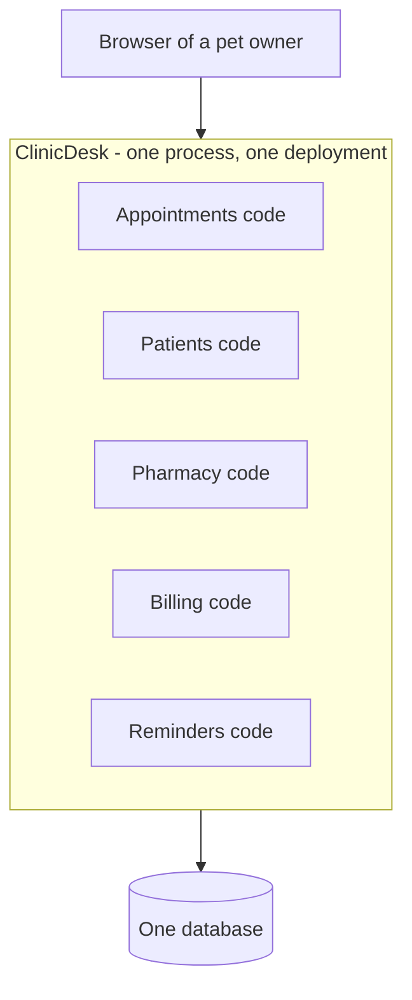
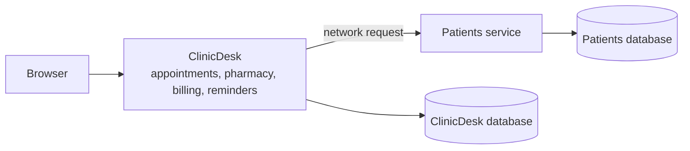
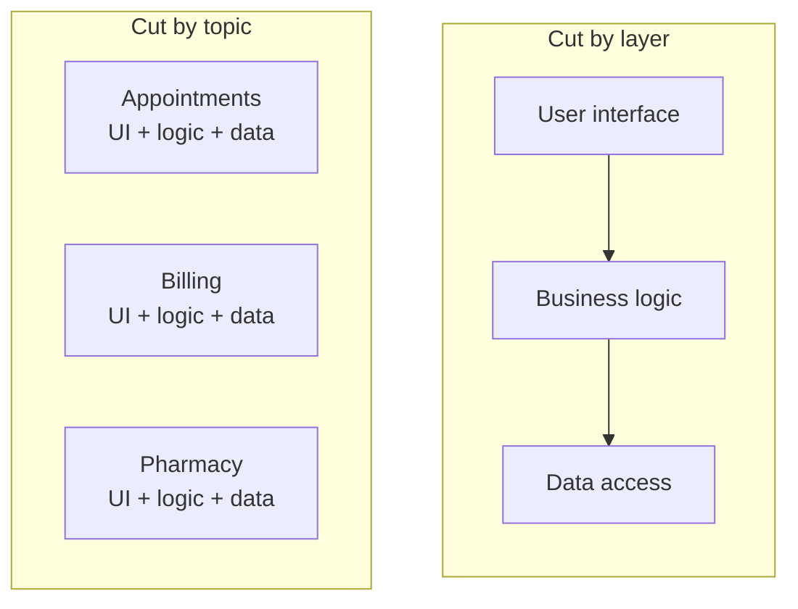

# Monoliths, services and APIs in plain words

## Before this lesson

You need very little. It helps if you have built, or at least seen, one small web application: a program that receives requests from a browser, reads and writes a database, and sends pages or data back. If the words *client*, *server* and *request* are new, read [Clients, servers and requests](#/lesson/system-design/clients-servers-requests) in the System Design track first. You should be able to read a few lines of Python; every code block here is explained line by line.

## In plain words

**Software architecture** is the set of big decisions about how a system is cut into parts, and how those parts talk to each other. They are the decisions that are expensive to change later.

Think of a restaurant kitchen. A tiny café has one cook who takes the order, grills, plates and washes up. Everything happens at one counter, so nothing gets lost between people, and changing the menu is a matter of telling one person. A large hotel kitchen is divided into stations: grill, sauces, pastry, dishwashing. Each station can be staffed, equipped and reorganised on its own, but now orders travel on paper tickets between stations, tickets get lost, and someone has to notice when the grill is waiting for a sauce that never comes.

Neither kitchen is "better". The café layout would collapse under 400 covers a night; the hotel layout would be absurd for a café that sells 40 lunches. Software has the same two shapes:

- a **monolith**: one program that does everything, deployed as one unit;
- a system of **services**: several programs, each doing one part of the job, talking over a network.

**Microservices** are one particular way of building the second shape. This whole track is about when that shape is worth its cost and how to do it well. This first lesson gives you the vocabulary: monolith, service, process, API, deployment. The next lesson looks at what the network between services costs.

Why this matters for a job: almost every company with more than a handful of engineers is somewhere on the road between these two shapes, and interviewers want to hear that you can reason about the trade-offs instead of repeating a fashion.

## 1. The running example: Pawprint Clinics

Every lesson in this track uses the same imaginary company, so that you can watch one system grow.

**Pawprint Clinics** is a chain of veterinary clinics. Pet owners book appointments on a website. Vets record what happened in each visit. The clinic pharmacy dispenses medicine. Owners pay a bill. The system sends reminders ("Miso is due for a vaccination").

At the start, all of that lives in one application called **ClinicDesk**, written by four developers. It has these parts:

| Part | What it does |
|---|---|
| Appointments | Shows free slots, books and cancels visits |
| Patients | Stores each pet's details and medical history |
| Pharmacy | Tracks medicine stock and prescriptions |
| Billing | Creates invoices and takes card payments |
| Reminders | Sends emails and text messages |

Keep this list in mind. By the end of the track, each of these parts will have been pulled out, argued over, and sometimes put back.

## 2. What a program, a process and a deployment are

Three words are used loosely in everyday speech and precisely in architecture.

A **program** is the code you wrote: files on a disk.

A **process** is a program that is running. The operating system gives each process its own private memory. Two processes cannot read each other's variables; if they want to exchange information, they must send it through some channel the operating system provides, such as a network connection or a file.

A **deployment** is the act of putting a new version of a program onto the machines that serve real users (called **production**) and starting it. A **deployable unit** is the smallest thing you can deploy on its own.

These three ideas give you the test that separates the architectures in this track:

> How many deployable units does the system have, and can each one be deployed without touching the others?

ClinicDesk is one program. When it runs, it is one process (or several identical copies of the same process, which is still one deployable unit). To change one line in Reminders, the team deploys all of ClinicDesk.

## 3. The monolith

A **monolith** is a system in which all the functionality is deployed together as a single unit.

The word comes from Greek for "single stone", and people often say it with a sneer. That is unfair. A monolith is the default, sensible way to start, and many successful products never need anything else. Here is ClinicDesk as a picture:



Inside the monolith, the Appointments code needs to know whether a pet exists before booking a visit. It asks the Patients code by calling a function:

```python-run
# Everything below lives in ONE program, so parts call each other directly.

PETS = {7: {"name": "Miso", "owner": "Ada"}}        # stands in for a database table
BOOKINGS = []

def find_pet(pet_id):                                # the "Patients" part
    return PETS.get(pet_id)

def book_visit(pet_id, slot):                        # the "Appointments" part
    pet = find_pet(pet_id)                           # an ordinary function call
    if pet is None:
        return "no such pet"
    BOOKINGS.append((pet_id, slot))
    return f"booked {pet['name']} at {slot}"

print(book_visit(7, "Tue 10:00"))
print(book_visit(99, "Tue 10:30"))
```

Line by line: `PETS` and `BOOKINGS` are plain Python containers standing in for database tables. `find_pet` belongs to the Patients part. `book_visit` belongs to Appointments, and on its first line it calls `find_pet` directly. Run it and you see `booked Miso at Tue 10:00` and then `no such pet`.

That direct call has four properties that you will miss later, so notice them now:

1. **It is fast.** A function call inside one process takes a few nanoseconds (billionths of a second).
2. **It cannot be "half delivered".** Either `find_pet` runs and returns, or the whole program has crashed. There is no state where the question was asked but the answer is lost.
3. **It is checked before the program runs.** If someone renames `find_pet`, the editor, the compiler or the tests complain immediately.
4. **Changes to both sides ship together.** If `find_pet` starts returning the pet's weight as well, and `book_visit` starts using it, both changes go out in the same deployment.

### What is good about a monolith

| Strength | Why |
|---|---|
| One thing to deploy, monitor and back up | Fewer moving parts means fewer ways to fail |
| Easy to follow a request | One log, one debugger, one stack trace |
| Easy to reuse code | Any part can call any other part |
| Easy data consistency | One database can update several tables in one **transaction** (an all-or-nothing group of changes) |
| Cheap to run | One server may be enough |

### What starts to hurt as it grows

| Pain | What it looks like at Pawprint |
|---|---|
| Deployments get risky and rare | A small fix to Reminders has to wait for a half-finished Billing change, because they ship together |
| People get in each other's way | Twenty developers edit the same files and argue over who broke the build |
| Everything scales together | The booking page is busy every Monday morning; to cope, the team must run more copies of the *whole* application, including the rarely used pharmacy screens |
| One technology for everything | The whole program is in one language and one framework version; upgrading it is a company-wide project |
| A bug anywhere can take down everything | A memory leak in report generation crashes the process that also takes bookings |

None of these pains is a law of nature. A well-organised monolith avoids many of them, as you will see in the lesson on the modular monolith. They are the pressures that make teams look for another shape.

> [!TIP]
> When someone says "our monolith is the problem", ask which of these pains they feel. "It is hard to deploy" and "it cannot handle the load" lead to very different remedies, and neither automatically means microservices.

## 4. A service

A **service** is a separately running program that offers some capability to other programs over a network.

Three parts of that sentence matter:

- **Separately running**: it is its own process, with its own memory, usually on its own machine or container.
- **Offers a capability**: it does one job that others need, such as "tell me about a pet" or "take a payment".
- **Over a network**: other programs reach it by sending messages, not by calling its functions.

Suppose Pawprint pulls the Patients part out of ClinicDesk into its own program:



Now there are two deployable units. The Patients team can deploy a fix on Tuesday afternoon without waiting for anyone. That is the gain. The cost is the arrow labelled *network request*: the Appointments code can no longer call `find_pet` directly, because `find_pet` now lives in another process, probably on another computer.

A **microservice** is a service designed so that it can be changed and deployed independently of the others, built around one part of the business, and in charge of its own data. Lesson 3 unpacks that definition carefully. For now, "a small, independently deployable service" is enough.

## 5. An API

When two programs talk, they need an agreement about what can be asked and what the answers look like. That agreement is an **API**, short for **application programming interface**.

An everyday comparison is a restaurant menu. The menu lists what you can order and what you will get. It says nothing about how the kitchen works. The kitchen can change its ovens, its suppliers and its staff, and as long as the menu stays the same, customers notice nothing.

An API for the Patients service might offer:

| Request | Meaning | Answer |
|---|---|---|
| `GET /pets/7` | Give me pet number 7 | `{"id": 7, "name": "Miso", "owner": "Ada"}` |
| `POST /pets` with a body | Register a new pet | The new pet, with its id |
| `GET /pets/7/visits` | List Miso's visits | A list of visits |

Some vocabulary used in that table:

- **HTTP** (Hypertext Transfer Protocol) is the set of rules browsers and servers use to exchange messages. A **protocol** is an agreed format and order of messages.
- `GET` and `POST` are HTTP **methods**: `GET` asks to read something, `POST` asks to create something.
- `/pets/7` is a **path**: the name of the thing being asked about.
- The answer is written in **JSON** (JavaScript Object Notation), a text format for structured data that looks like Python dictionaries and lists.
- A **status code** is a three-digit number in every HTTP answer: `200` means success, `404` means "not found", `500` means "the server failed".

The important idea is the same as the menu: an API has a **public side** (the requests and answers everyone may rely on) and hides a **private side** (the code and the database behind it). You will meet this idea again in lesson 5 under the name **information hiding**, and it is the single most useful idea in the track.

> [!WARNING]
> An API is a promise. Once another team's code depends on `GET /pets/7` returning a field called `owner`, removing or renaming that field breaks their program, even though your own tests still pass. Lesson 12 is about keeping such promises while still changing things.

## 6. The same example, split in two

The next block simulates the split. There is still only one Python program here, because the lesson must run in your browser, but the two halves are written as if they were separate processes: they share **no variables**, and they exchange only text.

```python-run
import json

# ---------------- Patients service (its own process, its own data) ----------------
_PETS = {7: {"id": 7, "name": "Miso", "owner": "Ada"}}       # private: nobody else may touch this

def patients_service(request_text):
    """Receives a request as text, returns an answer as text."""
    method, path = request_text.split(" ")
    if method == "GET" and path.startswith("/pets/"):
        pet = _PETS.get(int(path.split("/")[2]))
        if pet is None:
            return json.dumps({"status": 404})
        return json.dumps({"status": 200, "body": pet})
    return json.dumps({"status": 400})

# ---------------- ClinicDesk (a different process) ----------------
def call_patients(request_text):
    """Stands in for the network. In real life this line can be slow, or fail."""
    return patients_service(request_text)

def book_visit(pet_id, slot):
    answer = json.loads(call_patients(f"GET /pets/{pet_id}"))   # send text, parse text
    if answer["status"] != 200:
        return "no such pet"
    return f"booked {answer['body']['name']} at {slot}"

print(book_visit(7, "Tue 10:00"))
print(book_visit(99, "Tue 10:30"))
```

What changed compared with the monolith version:

- `book_visit` no longer calls `find_pet`. It builds a request as a string, `"GET /pets/7"`, and hands it to `call_patients`.
- The Patients side turns its Python dictionary into JSON text with `json.dumps` (this conversion to bytes or text is called **serialisation**), and the caller turns the text back into a dictionary with `json.loads` (**deserialisation**).
- The caller has to look at a status code, because the answer might be "not found" or some failure.

The output is identical to the monolith's. The amount of code roughly doubled, and one line, `call_patients`, now stands for a trip across a network. In this toy that trip always works. In reality it is the source of most of the difficulty in this whole track, and it is the subject of the next lesson.

## 7. Before and after, side by side

| Question | Monolith ClinicDesk | ClinicDesk + Patients service |
|---|---|---|
| How does Appointments learn about a pet? | Function call | Network request to an API |
| How long does that take? | Nanoseconds | Around a millisecond inside one data centre, sometimes far more |
| Can it fail on its own? | No | Yes: the service can be down, slow, or the answer can be lost |
| Who notices a renamed field? | Compiler or tests, before release | Possibly nobody until production, unless you test the contract |
| How many things to deploy? | 1 | 2 |
| Can Patients ship without Appointments? | No | Yes, if the API stays compatible |
| Where is the data? | One database | Two databases; no single transaction covers both |

Read the right-hand column twice. Each "yes" in favour of services is bought with a "yes" that makes life harder. Architecture is the craft of deciding which of those prices are worth paying for your situation.

## 8. Three words people confuse

**Layer, module and service** are three different ways of cutting up code.

- A **layer** is a horizontal slice by technical job: user interface code, business logic, database access. A "three-tier" application has those three layers.
- A **module** is a slice by topic inside one program: an `appointments` package, a `billing` package. Modules are cut at design time and still deploy together.
- A **service** is a slice by topic that is also its own deployable program.



A change such as "let owners add a note when booking" touches the user interface, the logic and the data. In the layered cut, that one change crosses all three layers, and if three different teams own the layers, three teams must coordinate. In the topic cut, it stays inside Appointments. Most of this track argues for cutting by business topic first. You do not need separate services to do that: a monolith made of well-separated modules gets much of the benefit.

> [!INTERVIEW]
> A common opening question is "What is the difference between a monolith and microservices?" A strong short answer names the unit of deployment: *a monolith is deployed as one unit; microservices are independently deployable services that each own their data and are modelled around a business capability. The monolith trades independence for simplicity; microservices trade simplicity for independence, and pay with the costs of a distributed system.* Then give one example of each cost.

## 9. Pitfalls

- **Thinking "monolith" means "badly written".** A monolith can have clean internal modules. A system of services can be a tangle. The word describes deployment, not quality.
- **Thinking a service is a folder.** Moving code into a folder called `patients_service` inside the same program gives you a module. It becomes a service only when it runs and deploys on its own.
- **Sharing variables or tables across the boundary.** If ClinicDesk reads the Patients database directly "to save time", the two programs are tied together through the table layout, and the Patients team can no longer change it freely.
- **Forgetting that every network call can fail.** Code that was correct as a function call becomes incomplete as a remote call until it handles slowness and failure.
- **Splitting to fix a problem that splitting does not fix.** Messy code split across a network becomes messy code with network problems.

## Summary

- Architecture is about the decisions that are expensive to change: how the system is divided and how the parts communicate.
- A **monolith** is deployed as one unit. Its parts talk through fast, reliable function calls and usually share one database.
- A **service** is a separately running program reached over a network. A **microservice** is a service that can be deployed independently, is built around a part of the business and owns its data.
- An **API** is the published agreement between programs: what can be asked, and what comes back. It hides the implementation behind it.
- Splitting a monolith into services buys independent deployment, and costs speed, reliability of calls, simple consistency and operational simplicity.
- Cutting code by business topic is valuable with or without separate services.

## Glossary

| Term | Meaning |
|---|---|
| Architecture | The hard-to-change decisions about a system's parts and their communication |
| Monolith | A system deployed as a single unit |
| Process | A running program with its own private memory |
| Deployment | Putting a new version into production and starting it |
| Deployable unit | The smallest thing that can be deployed on its own |
| Service | A separately running program offering a capability over a network |
| Microservice | An independently deployable service built around a business capability that owns its data |
| API | Application programming interface: the agreed requests and answers between programs |
| HTTP | The protocol browsers and servers use to exchange messages |
| JSON | A text format for structured data |
| Serialisation | Turning in-memory data into bytes or text for sending or storing |
| Transaction | A group of database changes that succeed or fail together |
| Layer | A slice of code by technical job |
| Module | A slice of code by topic inside one program |

```quiz
[
  {"q": "What makes a system a monolith?", "options": ["It is written in an old language", "All of its functionality is deployed together as one unit", "It has more than a million lines of code", "It uses only one database table"], "answer": 1,
   "explain": "The word describes the unit of deployment. A monolith can be small, modern and well structured; what defines it is that everything ships together."},
  {"q": "Inside ClinicDesk, Appointments calls find_pet directly. After Patients becomes a service, what replaces that call?", "options": ["A faster function call", "A shared global variable", "A request sent over a network to the Patients API", "A database trigger"], "answer": 2,
   "explain": "Separate processes cannot call each other's functions or read each other's memory. They exchange messages over a network according to an API."},
  {"q": "Which statement about an API is the most accurate?", "options": ["It is the source code of a service", "It is a published agreement about requests and answers that hides how the service works inside", "It is the database schema", "It is a kind of web page"], "answer": 1,
   "explain": "Like a menu, an API says what you can ask for and what you get, and deliberately says nothing about the kitchen."},
  {"q": "Pawprint moves the billing code into a folder named billing_service but still builds and deploys one program. What do they have?", "options": ["A microservice", "A module inside a monolith", "A distributed system", "A layer"], "answer": 1,
   "explain": "A folder is a design-time boundary. Without its own process and its own deployment it is a module, which is often a perfectly good thing to have."},
  {"q": "Which of these gets HARDER when a monolith is split into services?", "options": ["Deploying one part without the others", "Letting two teams work without blocking each other", "Updating data in two parts as a single all-or-nothing transaction", "Scaling only the busy part"], "answer": 2,
   "explain": "One database can wrap several changes in one transaction. Two services with two databases cannot, which is why later lessons introduce sagas."},
  {"q": "A team cuts its code into user interface, business logic and data access, owned by three teams. A feature needs a new field on a form. What is the likely effect?", "options": ["Only one team is involved", "All three teams must coordinate for one small change", "No deployment is needed", "The database does not change"], "answer": 1,
   "explain": "A feature usually cuts through every technical layer. Slicing by business topic keeps such a change inside one team."},
  {"q": "What does serialisation mean in this lesson?", "options": ["Running requests one after another", "Turning in-memory data into text or bytes so it can be sent to another process", "Encrypting a message", "Assigning serial numbers to servers"], "answer": 1,
   "explain": "Processes share no memory, so data has to be converted to a transferable form such as JSON and converted back on the other side."}
]
```

> **Source:** Newman, *Building Microservices*, 2nd ed., ch. 1 (used for topic coverage only; the Pawprint Clinics example and all wording are original). See also Martin Fowler, "MonolithFirst", https://martinfowler.com/bliki/MonolithFirst.html
