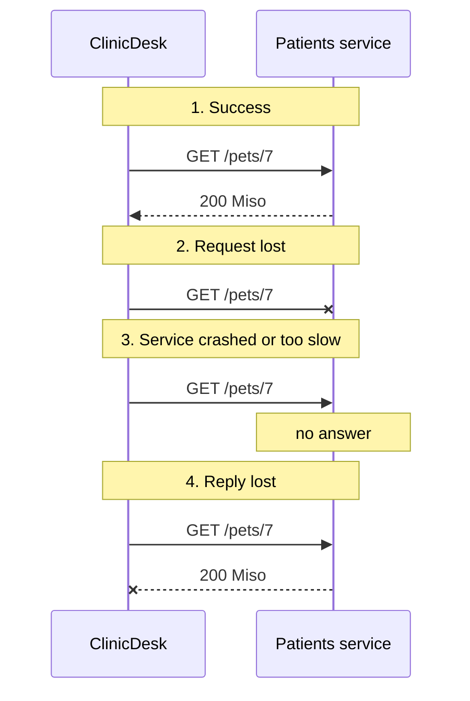
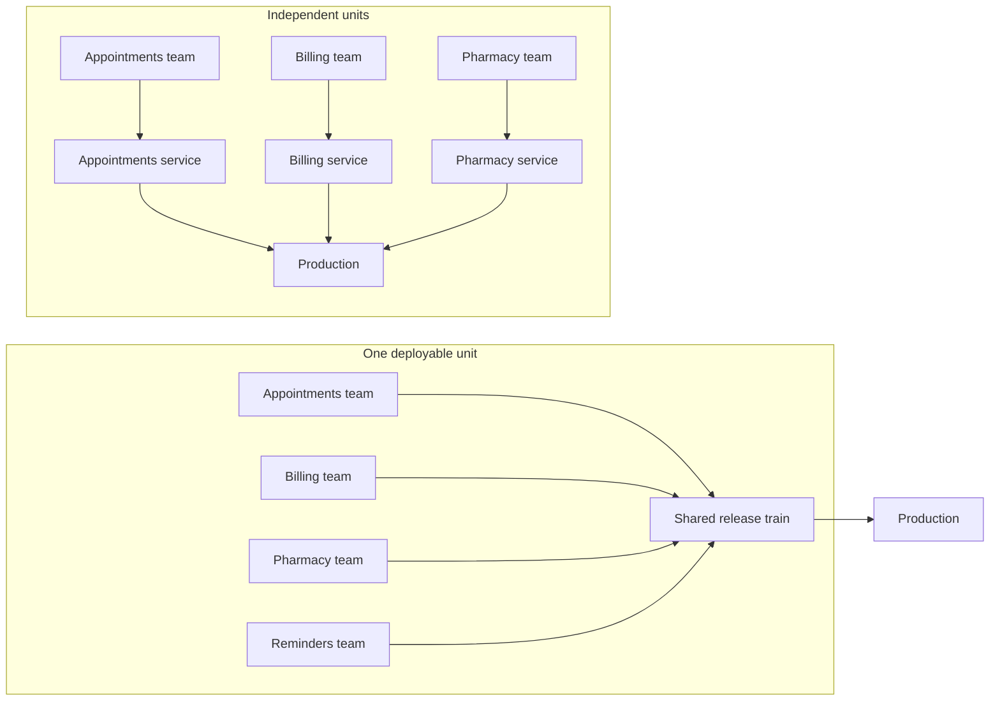

# What a network call costs, why teams split, and why not to start with microservices

## Before this lesson

You should know what a monolith, a service and an API are from [Monoliths, services and APIs in plain words](#/lesson/microservices/monolith-service-api). You should be comfortable multiplying decimals, for example 0.99 × 0.99.

## In plain words

When two parts of a program sit in the same process, one part asks the other a question by calling a function. When they sit in different programs, the question has to travel across a network. That trip is slower, it can fail in ways a function call cannot, and it sometimes fails in a way that leaves you unsure whether the other side did the work.

Compare asking a colleague at the next desk with sending a letter. At the next desk you get the answer at once, and you can see whether they heard you. With a letter you wait, the letter may be lost, the reply may be lost, and if no reply comes you cannot tell which of those happened. You would not replace every conversation in your office with letters unless you gained something large in return.

Teams do accept that cost, for one main reason: **so that many people can change a large system at the same time without waiting for each other.** This lesson explains the cost with numbers, explains the gain honestly, and ends with advice that surprises many newcomers: for a new product, you should probably not start with microservices.

## 1. Cost one: time

**Latency** is the time between sending a request and receiving its answer.

Rough, order-of-magnitude figures (they vary with hardware; what matters is the ratio):

| Operation | Typical time |
|---|---|
| Function call inside one process | a few nanoseconds |
| Read a value from memory | about 100 nanoseconds |
| Network round trip inside one data centre | about 0.5 milliseconds = 500,000 nanoseconds |
| Network round trip between continents | about 100 to 150 milliseconds |

A call inside a data centre is roughly a hundred thousand times slower than a function call. One such call is harmless. The trouble starts when code that used to loop over function calls now loops over network calls.

Suppose ClinicDesk shows the day's schedule: 40 appointments, each with the pet's name. In the monolith, the page calls `find_pet` 40 times: unnoticeable. After Patients becomes a service, the same loop makes 40 network requests one after another.

```python-run
FUNCTION_CALL_MS = 0.00001      # 10 nanoseconds
NETWORK_CALL_MS = 0.5           # one round trip in a data centre
APPOINTMENTS = 40

print("monolith page: ", round(APPOINTMENTS * FUNCTION_CALL_MS, 4), "ms")
print("40 remote calls:", APPOINTMENTS * NETWORK_CALL_MS, "ms")
print("1 batched call: ", 1 * NETWORK_CALL_MS, "ms")
```

The first line computes 40 function calls: 0.0004 ms. The second computes 40 round trips: 20 ms, and that is with a healthy network and before the Patients service has done any work. The third line shows the usual remedy: ask for all 40 pets in **one** request (`GET /pets?ids=1,2,3,...`). Designing APIs that are "chunky" (few, larger requests) instead of "chatty" (many tiny ones) is a direct consequence of latency.

## 2. Cost two: partial failure

In a monolith, if the process is alive, every part of it is alive. In a system of services, one service can be down or slow while the others are fine. This is called **partial failure**, and handling it is the central difficulty of distributed systems. A **distributed system** is any system whose parts run on more than one computer and cooperate over a network.

When ClinicDesk sends `GET /pets/7` to the Patients service, four things can happen:



From ClinicDesk's side, cases 2, 3 and 4 look exactly the same: silence. The only tool it has is a **timeout**: a limit on how long it will wait before giving up.

For a read such as "give me pet 7", silence is annoying but safe: ask again. For a write, it is dangerous. Imagine ClinicDesk asks Billing to "charge Ada 60 euros" and hears nothing. Did the charge happen? In case 2 it did not. In case 4 it did, and only the reply was lost. If ClinicDesk tries again, Ada may be charged twice. If it does not, she may get a free visit.

The remedy has a name you will see throughout this track: **idempotency**. An operation is idempotent if doing it twice has the same effect as doing it once. "Set the invoice status to paid" is idempotent. "Add 60 euros to the charges" is not, unless the request carries a unique identifier, called an **idempotency key**, that lets the receiver recognise a repeat:

```python-run
charges = {}          # idempotency key -> amount: what Billing remembers

def charge(key, amount):
    if key in charges:                 # seen this request before: do nothing new
        return "already done"
    charges[key] = amount
    return "charged"

print(charge("visit-551", 60))   # first attempt; imagine the reply is lost
print(charge("visit-551", 60))   # the caller retries with the SAME key
print("total taken:", sum(charges.values()))
```

`charges` is Billing's memory of requests it has processed. The function first checks whether the key is known; only an unknown key causes a charge. The retry prints `already done`, and the total is 60, not 120. Lesson 26 returns to this pattern in depth.

> [!WARNING]
> "The network is reliable" is the first of the well-known *fallacies of distributed computing*, a list of false assumptions programmers make. Others include "latency is zero" and "the network is secure". Code written with those assumptions works on your laptop and fails in production.

## 3. Cost three: availability multiplies

**Availability** is the fraction of time a system answers correctly. 99.9% availability ("three nines") allows about 8.8 hours of failure per year.

If a request needs service A **and** service B to work, and their failures are independent, the request succeeds only when both are up: multiply the availabilities.

```python-run
def chain(*availabilities):
    result = 1.0
    for a in availabilities:
        result *= a
    return result

for n in (1, 3, 10, 30):
    a = chain(*[0.999] * n)
    hours_down = (1 - a) * 365 * 24
    print(f"{n:2d} services in a chain: {a:.4f} available, about {hours_down:5.1f} hours down per year")
```

The function multiplies the numbers it is given. The loop tries chains of 1, 3, 10 and 30 services that are each 99.9% available. With 30 services the chain is only about 97% available: more than 250 hours of failure per year, built from parts that each fail under 9 hours per year.

So a system of services is, by default, **less** reliable than a monolith made of the same code. It becomes more reliable only when you add deliberate protection: timeouts, fallbacks ("show the schedule without pet photos if the photo service is down"), and avoiding long chains. Those techniques fill module 12.

## 4. Cost four: everything else you now have to run

A monolith needs one deployment pipeline, one set of logs, one dashboard, one database to back up. Ten services need ten of each, plus things a monolith never needed:

| New need | Why it appears |
|---|---|
| Service discovery | Services must find each other's network addresses, which change |
| Distributed tracing | One user click now passes through several programs; you need to follow it |
| Contract testing | A change in one service can break another without any compile error |
| Sagas | A business operation that spans services cannot use one database transaction |
| Many more security checks | Every network hop is a place to eavesdrop or impersonate |

Each of these has its own module later. The point here is only that they are a bill, and it arrives early: you pay most of it with the second or third service, long before you have fifty.

## 5. So why does anyone split?

Because of what happens to a monolith when the organisation grows.

At four developers, ClinicDesk is a joy. Everyone knows the whole code base. A release takes ten minutes.

At forty developers in six teams, the same structure produces queues:

- Every team's change goes into the same release. If Billing's change has a bug, Reminders' finished work waits.
- Tests for the whole application take an hour, so people batch changes, so releases get bigger, so they get riskier.
- The Pharmacy team wants a newer library version, but upgrading it means retesting everything.
- A slow report in Billing uses all the database connections, and the booking page stops responding.



The honest list of reasons to split, in rough order of how often they are the real one:

1. **Team autonomy.** Each team can change, test and release its part on its own schedule. This is the big one.
2. **Independent scaling.** Run twenty copies of the booking service on Monday morning and two copies of everything else.
3. **Fault isolation.** A crash in report generation does not take down booking, *if* the services are designed to tolerate each other's failure.
4. **Technology freedom.** One team can use a different language or database where it truly helps.
5. **Clearer ownership.** A service has a team's name on it; a 500,000-line monolith belongs to everybody and therefore to nobody.

Notice that reason 1 is about people, not machines. A useful rule of thumb: microservices solve an *organisational* scaling problem far more often than a technical one.

### Before and after at Pawprint

| | 4 developers, monolith | 40 developers, monolith | 40 developers, services done well |
|---|---|---|---|
| Time from finished change to production | 10 minutes | 2 weeks (waiting for the release train) | Under an hour for the owning team |
| Who must agree to a release | Nobody | All six teams | The owning team |
| Effect of one bad change | Roll back, quick | Everyone's work is rolled back | One service is rolled back |
| Operational cost | Low | Low | High: many pipelines, dashboards, on-call rotations |
| Following one request | Trivial | Trivial | Needs tracing tools |

The middle column is the situation that pushes companies to split. The first column is where every product starts. Jumping straight to the third column from nothing means paying the high operational cost with none of the organisational benefit.

## 6. Why you probably should not start with microservices

This advice is common among people who have built many such systems. Martin Fowler's short article *MonolithFirst* gives the reasoning, and the argument has three parts.

**You do not yet know the right boundaries.** Splitting well means drawing lines between parts of the business that change independently. In a new product you are still discovering what the product is. A boundary in the wrong place is cheap to move inside a monolith (it is a refactoring: you move code between folders) and expensive to move between services (you change APIs, migrate data between databases, and coordinate deployments).

**Speed of learning matters most early on.** A new product's biggest risk is that nobody wants it. Everything that slows the loop of "build, show users, adjust" is harmful, and the operational bill from section 4 slows that loop.

**You have no organisational problem to solve.** Four developers do not block each other. The main benefit of microservices has nothing to act on.

The usual recommendation is therefore:

1. Start with a monolith.
2. Keep it **modular**: one folder or package per business area, with the areas talking through narrow internal interfaces and, ideally, not reading each other's tables. This is called a **modular monolith**.
3. When a specific pain appears (a team is blocked, one area needs different scaling), extract the service that relieves *that* pain.

> [!TIP]
> A fair counter-argument, which Fowler's article also mentions: keeping a monolith modular takes discipline, and many teams do not manage it, so the later split is harder than promised. The answer is not to start distributed; it is to enforce module boundaries from day one, for example with a rule in the build that the billing package may not import from the pharmacy package's internals.

### A checklist before splitting anything

| Question | If the answer is "no" |
|---|---|
| Can you name the specific problem the split solves? | Do not split yet |
| Could a simpler change solve it (more servers, a module boundary, a faster build)? | Try that first |
| Can you deploy automatically, with one command or on every commit? | Fix this first; ten services with manual deployment are misery |
| Can you see logs and metrics from all services in one place? | Build this before the second service |
| Does a team clearly own the new service, including being woken when it fails? | Decide ownership first |
| Do you understand the business area well enough to draw its boundary? | Wait, and keep it as a module |

> [!INTERVIEW]
> Expect "Would you use microservices for a new startup?" A good answer: *Usually not at first. I would begin with a modular monolith, because early on the domain boundaries are uncertain and a small team gains little from independent deployment while paying the full cost of a distributed system: latency, partial failure, and operations. I would extract services when a concrete pressure appears, such as teams blocking each other on releases or one part needing very different scaling.* Then add the exception: an organisation that already runs microservices well, with the platform in place, can reasonably start a new product that way.

## 7. Pitfalls

- **Counting services as a measure of progress.** "We have 80 microservices" says nothing about whether teams release faster.
- **A chatty design.** Translating every function call into a network call multiplies latency and failure. Design coarser requests.
- **Retrying a write without an idempotency key.** This is how customers get charged twice.
- **Ignoring the availability arithmetic.** A page that needs eight services to all answer will be down far more often than any one of them.
- **Splitting the code but not the database.** If two services still share tables, they still have to be changed and released together. You then have the costs of both shapes. Lesson 4 names this the *distributed monolith*.
- **Starting distributed to "be ready for scale".** Most products never reach the scale that would have required it, and those that do have by then learned where the boundaries belong.

## Summary

- A network call is about a hundred thousand times slower than a function call, so remote interfaces should be few and coarse.
- A remote call can fail partially: the caller often cannot tell whether the work was done. Timeouts detect silence; idempotency makes retries safe.
- Availability multiplies along a chain of services, so a naive split is less reliable than the monolith it replaced.
- Services add an operational bill: discovery, tracing, contract tests, sagas, more security work.
- The main benefit is organisational: teams can change and release their parts independently. Scaling, fault isolation and technology choice come after that.
- For a new product, start with a modular monolith and extract services when a specific pain justifies the cost.

## Glossary

| Term | Meaning |
|---|---|
| Latency | Time from sending a request to receiving the answer |
| Distributed system | A system whose parts run on several computers and cooperate over a network |
| Partial failure | Some parts of a system fail while others keep working |
| Timeout | A limit on how long a caller waits before giving up |
| Idempotent | An operation whose repeated execution has the same effect as one execution |
| Idempotency key | A unique identifier sent with a request so the receiver can recognise repeats |
| Availability | The fraction of time a system answers correctly |
| Chatty interface | An API that needs many small requests to get a job done |
| Fallback | A simpler answer used when the normal one is unavailable |
| Modular monolith | One deployable unit whose code is divided into well-separated modules |
| Team autonomy | A team's ability to change and release its part without waiting for others |

```quiz
[
  {"q": "ClinicDesk sends a payment request to Billing and the timeout expires with no answer. What does ClinicDesk know?", "options": ["The payment definitely failed", "The payment definitely succeeded", "Nothing certain: the request or the reply may have been lost, or Billing may be slow", "Billing has been uninstalled"], "answer": 2,
   "explain": "A lost request, a crashed service and a lost reply all look like silence to the caller. That uncertainty is what makes remote writes hard."},
  {"q": "Which request is naturally idempotent?", "options": ["Add 60 euros to the customer's balance", "Append a line to the visit notes", "Set appointment 551 to status cancelled", "Send a reminder text"], "answer": 2,
   "explain": "Setting a value to a fixed state gives the same result however many times it runs. The others add something on each run unless protected by an idempotency key."},
  {"q": "A page needs five services, each 99% available with independent failures, all to respond. Roughly how available is the page?", "options": ["99%", "About 95%", "About 99.9%", "About 80%"], "answer": 1,
   "explain": "0.99 multiplied by itself five times is about 0.951. Availabilities in series multiply, so the chain is weaker than any link."},
  {"q": "What is the most common real reason organisations move to microservices?", "options": ["Functions calls are too slow", "They want many teams to change and release parts of the system independently", "Monoliths cannot use databases", "Microservices need fewer servers"], "answer": 1,
   "explain": "Independent work by many teams is the main benefit. Scaling and fault isolation are real but secondary for most companies."},
  {"q": "Why is a wrong boundary cheaper to fix in a monolith than between services?", "options": ["Monoliths have no boundaries", "Moving code between modules is a refactoring; moving it between services means changing APIs, migrating data and coordinating deployments", "Services cannot be changed once deployed", "Monoliths do not have tests"], "answer": 1,
   "explain": "Inside one program the tools help you move code safely. Across services the boundary is a published contract with separate data stores behind it."},
  {"q": "A schedule page calls the Patients service once per appointment, 40 times in a row. What is the best first improvement?", "options": ["Increase the timeout", "Offer one request that returns many pets at once", "Add more Patients servers", "Retry each call three times"], "answer": 1,
   "explain": "The cost is 40 sequential round trips. A batched request removes 39 of them. More servers or retries do not shorten a sequential chain."},
  {"q": "A four-person startup asks whether to begin with twelve microservices. What is the usual advice?", "options": ["Yes, to be ready for scale", "Start with a modular monolith and extract services when a specific pain appears", "Use one service per developer", "Avoid databases until later"], "answer": 1,
   "explain": "A small team gains little from independent deployment, does not yet know the right boundaries, and would pay the whole operational bill of a distributed system."}
]
```

> **Source:** Newman, *Building Microservices*, 2nd ed., ch. 1 (topic coverage only; wording and example are original). Martin Fowler, "MonolithFirst", https://martinfowler.com/bliki/MonolithFirst.html
