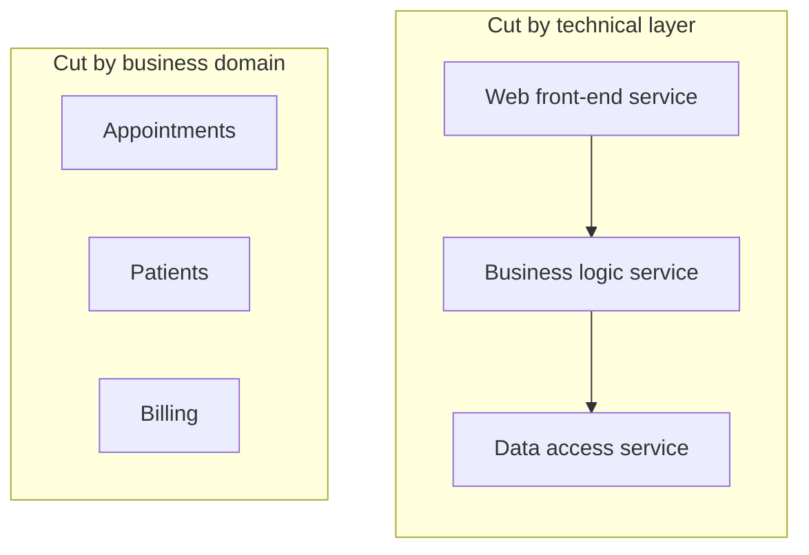
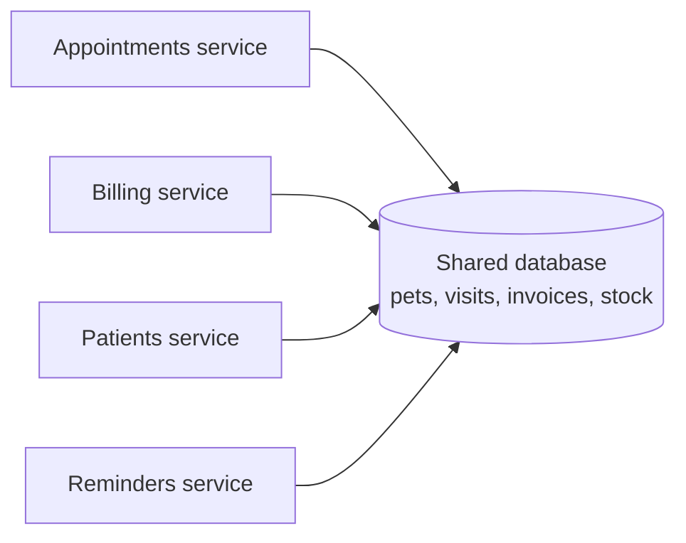
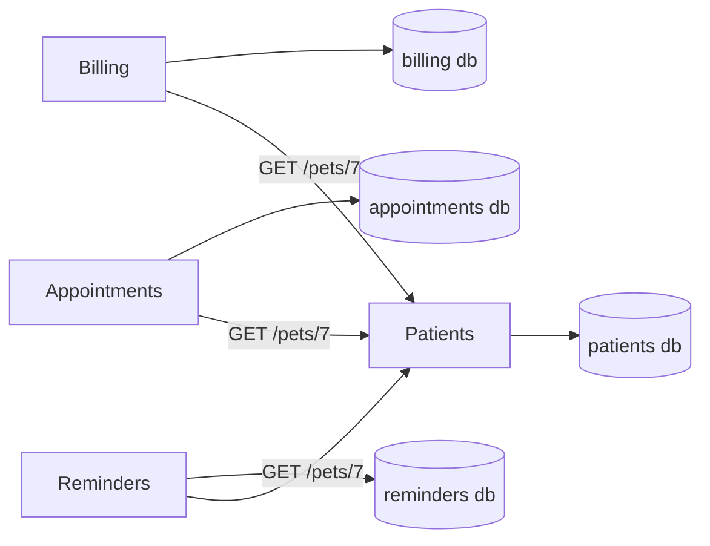

# The key concepts: independent deployability, domain boundaries and owned state

## Before this lesson

Read the two lessons of module 0 first: [Monoliths, services and APIs in plain words](#/lesson/microservices/monolith-service-api) and [What a network call costs](#/lesson/microservices/network-cost-why-split). You should know what a deployment, an API and a database table are.

## In plain words

A **microservice** is a service that you can change and release on its own, that looks after one part of the business, and that keeps its own data private.

Picture a street of small shops: a baker, a pharmacist, a bike repairer. Each shop decides its own opening hours, rearranges its own shelves and keeps its own till. Customers and other shops deal with it only through the counter. If the baker repaints, the pharmacist does not close for the day. Now picture a department store where one manager must approve every shelf change on every floor, and all floors share one stockroom where anybody may move anybody's boxes. The department store is simpler to run when it is small. The street copes better when there are many independent owners.

Microservices aim for the street. This lesson explains the five ideas that make a service a *micro*service in the useful sense. They are the criteria you will use for the rest of the track to judge whether a design is working.

## 1. A definition to carry around

> Microservices are **independently deployable** services **modelled around a business domain**. Each one **owns its own state**, hides it behind a network interface, and is **small enough** to be understood and replaced by its team. Together they give the organisation **flexibility** about how it grows.

The five highlighted ideas are the sections that follow. The first is the one that matters most, and the others exist largely to make it possible.

## 2. Independent deployability

**Independent deployability** means: you can make a change to one microservice, deploy it to production and release it to users, *without having to deploy or change any other service*.

It is a property you can test with a blunt question: *"When did you last have to release two services together?"* If the answer is "most weeks", the services are not independently deployable, whatever the diagram says.

Why it matters so much: it is what turns into team autonomy. If the Reminders team can release at 3 p.m. on a Tuesday without telling anyone, they are free. If they need Billing and Appointments to release in the same window, they are on a shared release train again, with network calls added.

What independent deployability demands:

- **Stable, explicit interfaces.** Other services depend only on your published API, never on your internals.
- **Backward-compatible changes.** You add to the API before you remove from it, so old callers keep working while they catch up.
- **No shared database.** If two services read the same tables, a table change forces both to change together.
- **Loose coupling.** Coupling is the degree to which a change in one thing forces a change in another. Lesson 5 covers it properly.

```python-run
# A tiny check you can run on a release log: how independent are our deployments?
releases = [
    ["reminders"],
    ["billing"],
    ["appointments", "patients"],     # two services had to go out together
    ["reminders"],
    ["appointments", "patients", "billing"],
    ["pharmacy"],
]

solo = sum(1 for r in releases if len(r) == 1)
print(f"{solo} of {len(releases)} releases shipped a single service")
print(f"independent deployment ratio: {solo / len(releases):.0%}")

together = {}
for r in releases:
    for a in r:
        for b in r:
            if a < b:
                together[(a, b)] = together.get((a, b), 0) + 1
print("pairs that ship together:", together)
```

`releases` is a made-up log: each inner list names the services that went out in one release. The first loop counts single-service releases: 4 of 6. The nested loop counts, for every pair of names in a release, how often they travelled together, and shows that `appointments` and `patients` are a pair to investigate. This is the kind of evidence that tells you where hidden coupling lives.

> [!INTERVIEW]
> If asked for the single most important property of microservices, say **independent deployability**, and explain that it forces the good habits: explicit contracts, private data, backward compatibility. Interviewers like hearing a property that can be measured.

## 3. Modelled around a business domain

A **business domain** is the area of real-world activity the software supports. For Pawprint Clinics the domain is running veterinary clinics, and it has natural sub-areas: scheduling visits, keeping medical records, running the pharmacy, taking payments.

"Modelled around a business domain" means the service boundaries follow those sub-areas, not technical layers.

Compare two ways to cut ClinicDesk into three pieces:



Now take a typical request from the business: "Let owners choose a preferred vet when booking."

- In design A, the change needs a new form field (front-end service), a new rule (logic service) and a new column (data access service). Three services change, in order, for one feature. They are not independently deployable for the changes that actually occur.
- In design B, the change lives inside Appointments: its screen, its rule, its table. One service changes.

The reasoning is: *features are requested in business language, so boundaries drawn in business language keep most features inside one boundary.* A service cut this way is a **vertical slice**: it contains whatever user interface, logic and data its piece of the business needs.

Layered cuts were sensible when the scarce skill was "people who know databases" and teams were organised by skill. They optimise for grouping similar *technology*. Domain cuts optimise for making *changes* cheap, which is usually what the company needs more.

## 4. Owning their own state

**State** is the data a service remembers between requests: rows in its database, files, cached values.

The rule is short: **a microservice's database is private.** If Billing needs to know the name of a pet, it asks the Patients service through its API. It does not open a connection to the Patients database and run a query.

This rule feels wasteful the first time you meet it. The data is *right there*; a join would take one line. Here is what the shortcut costs.

### Before: a shared database



Suppose the Patients team wants to split the `owner_name` column into `first_name` and `last_name`. They search their own code and change it. They cannot easily know that Billing's invoice query and Reminders' email template also read `owner_name`. Either the change breaks those services in production, or the Patients team must find and coordinate with every reader first. The table layout has become a public interface that nobody designed, nobody documented and nobody can change.

### After: each service owns its data



Now the Patients team can split the column freely, as long as `GET /pets/7` keeps returning the fields it promised (it can keep returning `owner_name` by joining the two new columns). What other teams depend on is small, deliberate and visible.

| | Shared database | Private database per service |
|---|---|---|
| What others depend on | Every table and column | Only the published API |
| Changing a table | Needs coordination with all readers | A private decision |
| Reading across areas | One SQL join | An API call, or a local copy kept up to date by events |
| Consistency across areas | One transaction | Needs a saga (module 6) |
| Performance tuning | One team's slow query hurts all | Each service tunes for its own load |
| Independent deployability | Lost | Kept |

The right-hand column has real costs in rows three and four. Those costs are the price of row six. This is the single hardest part of moving to microservices, and lesson 8 is devoted to it.

> [!WARNING]
> "Owns its own state" does not require a separate database *server* per service. Several services can share one database server for cost reasons, each with its own schema and its own credentials, as long as no service can read another's tables. The isolation is logical first; physical separation is an operational choice.

## 5. Size

How big should a microservice be? Newcomers ask this first, and it is the least useful question. Lines of code are a poor measure: 500 lines of one language do what 5,000 lines of another do.

More useful ways to think about size:

- **Small enough to hold in your head.** Can one developer understand what the service does and how, without a week of reading?
- **Small enough for one team to own.** A service that needs two teams to change it has a boundary in the wrong place.
- **As small an interface as possible.** What matters to everyone else is not how much code sits inside but how much surface they depend on. A service with a huge internal implementation and three well-chosen operations is easier to live with than a tiny one that exposes thirty.
- **How many can you cope with?** Every additional service is one more thing to deploy, monitor and secure. An organisation with weak automation should have fewer, larger services.

A practical way to hold this: **start with a few large services and split when you feel a reason.** Too few services gives you a slightly awkward monolith, which is a mild problem. Too many gives you a distributed system you cannot operate, which is a severe one.

## 6. Flexibility

The last idea is about what microservices are *for*. They do not make any single thing faster or cheaper today. They buy **options** for the future:

- the option to scale one part of the system differently from the rest;
- the option to give a part to a new team without untangling it first;
- the option to rewrite or replace one part in a new technology;
- the option to make one part more robust or more secure than the rest.

Options cost money to keep open. More services means more options and a larger bill. That is why it helps to treat the architecture as a dial, not a switch: you can turn it up a little, see whether the benefit arrives, and turn it further only if it does.

> [!TIP]
> Think of microservices as buying flexibility at a price, and ask for each split: *which option does this buy, and do we expect to use it?* If nobody can name the option, the split is decoration.

## 7. Worked example: scoring a proposed design

Pawprint's first attempt at a split has four services. Let us score it against the criteria.

| Service | Independently deployable? | Domain-aligned? | Owns its state? | Verdict |
|---|---|---|---|---|
| `web-ui` | No: every feature also changes `core-api` | No: a technical layer | Has none | Layer, not a microservice |
| `core-api` | No: changes with `web-ui` and `db-gateway` | No: all business logic in one | No | A monolith with a new name |
| `db-gateway` | No | No: a technical layer | Holds everyone's data | Shared database with extra steps |
| `reminders` | Yes: it reacts to events and has its own queue of messages to send | Yes: one business capability | Yes | A real microservice |

Three of the four fail the first test. The redesign cuts along business lines instead:

| Service | Owns | Offers | Depends on |
|---|---|---|---|
| Appointments | slots, bookings | book, cancel, list a day's schedule | Patients (does the pet exist?) |
| Patients | pets, owners, visit notes | look up pets and histories | nothing |
| Pharmacy | medicines, stock, prescriptions | check stock, dispense | Patients |
| Billing | invoices, payments | create invoice, take payment | Patients |
| Reminders | reminder schedule, message log | none (reacts to events) | events from the others |

Each row can answer "yes" to the three key questions, provided the teams keep to the rule of talking only through APIs and events. Whether five services is the *right number* for Pawprint depends on how many teams it has; with two teams, two or three larger services would be wiser.

## 8. Three supporting ideas

Three further ideas come up whenever the five above are discussed.

**Encapsulation.** A service bundles its data with the code that understands it, and exposes behaviour ("book a visit") in preference to raw data ("here is the bookings table"). When logic about bookings lives in one place, a rule change is one change.

**Alignment of architecture and organisation.** Because boundaries follow the business, each service can belong to exactly one team, and the team can be responsible for it from idea to production. Module 15 shows that this alignment is not optional: systems tend to copy the communication structure of the organisations that build them.

**Technology is a consequence, not the definition.** Containers, Kubernetes, message brokers and cloud platforms make microservices easier to run. You can have every one of those tools and still have a monolith that is deployed in forty pieces.

## 9. Pitfalls

- **Judging by size.** "It is only 200 lines, so it is a microservice" misses the point. Ask whether it deploys alone.
- **Nano-services.** Splitting so finely that every business operation needs six services to cooperate. Each call adds latency and failure; the team spends its time on plumbing.
- **Entity services.** One service per database table (`pet-service`, `owner-service`, `visit-service`) with only create, read, update and delete operations. The business logic then lives in the callers, and every feature touches several services. Boundaries should follow *capabilities*, not tables.
- **The shared database "for now".** Temporary sharing tends to become permanent because every new reader makes it harder to remove.
- **Independent in theory.** Separate repositories and pipelines, but a spreadsheet that says which versions of the services work together. That spreadsheet is a monolith.

## Summary

- A microservice is independently deployable, modelled around a business domain, and owns its own state.
- Independent deployability is the property to protect; it can be measured from the release history.
- Boundaries drawn in business terms keep most features inside one service, because features are requested in business terms.
- A private database per service is what makes internal change safe; the cost is that cross-service reads and transactions need new techniques.
- Size is best judged by team ownership and by the smallness of the interface, not by lines of code.
- Microservices buy flexibility in the form of options, and every option has a carrying cost.

## Glossary

| Term | Meaning |
|---|---|
| Independent deployability | Being able to change and release one service without changing or releasing others |
| Business domain | The area of real-world activity the software supports |
| Vertical slice | A piece of the system containing the user interface, logic and data for one business capability |
| State | Data a service remembers between requests |
| Shared database | One database whose tables several services read or write directly |
| Coupling | The degree to which a change in one part forces changes in another |
| Encapsulation | Keeping data together with the code that understands it and exposing behaviour, not internals |
| Entity service | A service wrapped around one data table, offering only basic create, read, update and delete |
| Nano-service | A service so small that its overhead outweighs its usefulness |
| Release train | A scheduled release into which many teams' changes are batched |

```quiz
[
  {"q": "Which test best shows whether services are independently deployable?", "options": ["Each has its own repository", "Each is under 1,000 lines", "The release history shows single services going to production without others having to change", "Each uses a different programming language"], "answer": 2,
   "explain": "Independent deployability is a property of how releases really happen. Separate repositories and small size do not guarantee it."},
  {"q": "Why do domain-aligned boundaries make change cheaper than layer-aligned ones?", "options": ["Domain services are always smaller", "Features are requested in business terms, so a boundary in business terms tends to contain the whole feature", "Layers cannot be tested", "Domain services need no database"], "answer": 1,
   "explain": "A typical feature needs screen, rule and data changes. In a layered split that crosses every service; in a domain split it usually stays in one."},
  {"q": "Billing needs the pet's name for an invoice. Under the 'owns its own state' rule, what should it do?", "options": ["Query the patients table directly", "Ask the Patients service through its API, or keep its own copy updated from Patients' events", "Copy the Patients database nightly without telling anyone", "Ask the user to type it again"], "answer": 1,
   "explain": "The Patients database is private. Access goes through the published interface so that Patients can change its internals freely."},
  {"q": "What is the main danger of a shared database between services?", "options": ["Databases are slow", "The table layout becomes an undocumented public interface, so no service can change it without coordinating with every reader", "It costs more disk space", "SQL joins stop working"], "answer": 1,
   "explain": "Hidden dependencies on tables and columns destroy independent deployability, which is the property everything else serves."},
  {"q": "Pawprint proposes pet-service, owner-service and visit-service, each offering only create, read, update and delete. What is the likely problem?", "options": ["Too few services", "They are entity services: the business logic ends up in callers and every feature touches several services", "They cannot use JSON", "They are too large"], "answer": 1,
   "explain": "Boundaries around tables scatter behaviour. Boundaries should surround business capabilities, with data and the rules about it together."},
  {"q": "Which is the most useful way to think about the size of a microservice?", "options": ["Fewer than 100 lines of code", "Exactly one database table", "Small enough for one team to understand and own, with as small an interface as possible", "The same size as every other service"], "answer": 2,
   "explain": "Team ownership and interface size determine how easy a service is to live with. Line counts vary by language and say little."},
  {"q": "In what sense do microservices provide flexibility?", "options": ["They guarantee lower hosting bills", "They keep options open, such as scaling, re-owning or rewriting one part separately, at an ongoing cost", "They remove the need for testing", "They make every request faster"], "answer": 1,
   "explain": "The benefit is future options. Each one has a carrying cost in operations, so it should be bought on purpose."}
]
```

> **Source:** Newman, *Building Microservices*, 2nd ed., ch. 1 (topic coverage only; wording and the Pawprint example are original).
