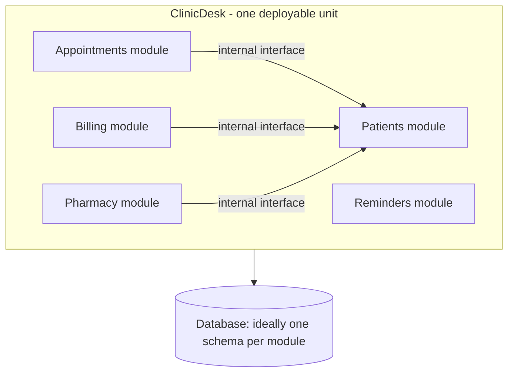

# The monolith in its forms, enabling technology, benefits, pain points and when not to use microservices

## Before this lesson

You should know the five key concepts from [The key concepts](#/lesson/microservices/key-concepts): independent deployability, domain boundaries, owned state, size and flexibility. You should also remember from [What a network call costs](#/lesson/microservices/network-cost-why-split) why remote calls are slower and less reliable than function calls.

## In plain words

"Monolith or microservices?" sounds like a choice between two things. In practice there are at least three kinds of monolith, and one of them, the **distributed monolith**, is what you get when a move to microservices goes wrong.

Think about housing. A studio flat has one room: cheap, easy to clean, cramped for a family. A family house has separate rooms with doors, under one roof and one front door: you can redecorate a bedroom without touching the kitchen. A row of separate cottages gives every household its own front door, at the price of more roofs to maintain and walks in the rain between them. And then there is the worst arrangement: separate cottages that share one kitchen, one fuse box and one set of keys, so that nobody can do anything without everyone else. That last one has all the walking and none of the independence.

This lesson names these shapes, lists the technology that makes microservices workable, and then sets out the benefits and the pain honestly so that you can say when microservices are a bad idea. Being able to say "no, not here, and this is why" is a mark of seniority.

## 1. Three kinds of monolith

Remember the definition: a monolith is a system whose functionality is **deployed together**.

### The single-process monolith

All code runs as one process. This is ClinicDesk as we first met it. You may run several identical copies for capacity, and it is still one deployable unit. Most systems begin here, and it is a good place to begin.

### The modular monolith

Still one process and one deployment, but the code inside is divided into modules with enforced boundaries: Appointments, Patients, Pharmacy, Billing, Reminders. Each module exposes a small internal interface and hides the rest.



Many teams find that this gives them most of what they wanted from microservices: people can work in parallel in separate modules, the code is understandable, and there is still only one thing to deploy and operate. Its weak point is the database. If every module reads every table, the modules are separated in the code and welded together in the data. A disciplined modular monolith gives each module its own tables (often its own schema) and forbids cross-module table access. If you do that, extracting a module into a service later is far easier.

### The distributed monolith

Several services, deployed as separate processes, that nevertheless **have to be released together**. It has the costs of a distributed system (latency, partial failure, operational load) and the costs of a monolith (coordinated releases, everyone blocked by everyone). It is the worst of both.

How teams arrive there:

| Cause | What it looks like |
|---|---|
| Shared database | A column change forces three services to redeploy in the same window |
| Shared library with business logic | Every service must upgrade to the new `clinic-common` version at once |
| Chatty, fine-grained interfaces | A feature always needs matching changes on both sides of a call |
| Breaking API changes | The provider removes a field, so all consumers must ship at the same moment |
| Boundaries by technical layer | Each feature crosses every service |

```python-run
# Detecting lockstep from a release log: which services almost always ship together?
log = [
    {"appointments", "patients", "billing"},
    {"appointments", "patients", "billing"},
    {"reminders"},
    {"appointments", "patients", "billing", "pharmacy"},
    {"reminders"},
    {"appointments", "patients"},
]
services = sorted(set().union(*log))

for i, a in enumerate(services):
    for b in services[i + 1:]:
        both = sum(1 for r in log if a in r and b in r)
        either = sum(1 for r in log if a in r or b in r)
        if either and both / either >= 0.75:
            print(f"{a} and {b} ship together in {both} of {either} releases -> lockstep")
```

`log` holds one set of service names per release. `services` is every name that appears. For each pair, `both` counts releases containing the two, and `either` counts releases containing at least one. A ratio of 75% or more is flagged. The output shows `appointments` with `patients` at 4 of 4, and both with `billing` at 3 of 4. Those three behave as one deployable unit: a distributed monolith inside the system. `reminders` is the only truly independent service.

> [!WARNING]
> A distributed monolith usually looks healthy on an architecture diagram: many boxes, many arrows. Diagnose it from behaviour, not drawings: release notes that list several services, a "compatibility matrix" of versions, or a rule that deployments must happen in a fixed order.

### Third-party black boxes

One more shape deserves a name: software you buy or rent and cannot change, such as a payroll package or a payment provider. From your point of view it is a monolith you do not control. The techniques for splitting systems do not apply; what you can do is wrap it behind your own service so the rest of your system does not depend on its quirks.

### Comparing the shapes

| | Single-process monolith | Modular monolith | Distributed monolith | Microservices |
|---|---|---|---|---|
| Deployable units | 1 | 1 | Many, released together | Many, released separately |
| Internal boundaries | Often weak | Strong, enforced | Present but leaky | Strong, enforced by the network |
| Network between parts | No | No | Yes | Yes |
| Teams can release alone | No | No | No | Yes |
| Operational cost | Low | Low | High | High |
| Sensible when | Small team, new product | Growing team, one product | Never on purpose | Many teams, proven boundaries, good automation |

## 2. Enabling technology

Microservices became practical when certain tools matured. You do not need all of them on day one, and adopting them does not make you "do microservices". But the more services you have, the more of these you will need, and each has a module later in this track or elsewhere on the site.

| Technology | Problem it solves | Where to learn more |
|---|---|---|
| **Log aggregation**: collecting the logs of all services in one searchable place | You cannot log in to thirty machines to find one error | Module 10 |
| **Distributed tracing**: following one request across services | Finding which hop was slow or failed | Module 10 |
| **Containers**: lightweight isolated packages that run the same everywhere | Running many small services cheaply and consistently | [Docker track](#/track/docker) |
| **Container orchestration** such as Kubernetes: software that places, restarts and scales containers across machines | Managing hundreds of containers by hand is impossible | [Kubernetes track](#/track/kubernetes) |
| **Streaming and message brokers**: systems that carry events between services | Letting services react to each other without direct calls | Modules 4 and 5 |
| **Public cloud and serverless**: rented infrastructure and managed services | Avoiding the work of running databases, brokers and clusters yourself | [AWS track](#/track/aws) |
| **Continuous delivery pipelines**: automated build, test and deploy | Releasing many services safely and often | [CI/CD track](#/track/cicd) |

A sensible order of adoption: **log aggregation first** (before the second service exists; it is cheap and you will be blind without it), then automated deployment, then tracing as the call graphs deepen. Kubernetes can wait until you have enough services for it to pay for its own considerable complexity.

> [!TIP]
> If your organisation cannot yet get the logs of two services into one place, treat that as a signal that it is not ready for twenty. The ability to adopt simple supporting tools is a good predictor of the ability to run the architecture.

## 3. The advantages, stated carefully

Each advantage below is real, and each has a condition attached.

**Technology heterogeneity.** Different services can use different languages and databases. Pawprint's Reminders service could use a queue-based design and a document store while Billing uses a relational database with strict transactions. *Condition:* every extra technology is something to hire for, secure and operate. Most organisations allow a short approved list.

**Robustness.** A failure can be contained in one service. If the Pharmacy service is down, owners can still book visits. *Condition:* this only happens if callers are built to tolerate the failure (timeouts, fallbacks). Without that, one failing service drags down its callers, as module 12 shows.

**Scaling.** You can run more copies of the busy services only. Booking traffic peaks on Monday mornings; Billing does not. *Condition:* this saves money only when parts of the system really do have different load profiles.

**Ease of deployment.** A small change to one service is a small, low-risk deployment that is easy to roll back. *Condition:* you need automated pipelines, and the services must be truly independent.

**Organisational alignment.** Small teams own small code bases end to end and need fewer meetings. *Condition:* team boundaries and service boundaries must match (module 15).

**Composability.** The same capability can be reused by the website, the mobile app and a partner integration. *Condition:* the API must be designed for general use, not for one screen.

## 4. The pain points, stated plainly

**Developer experience.** Running the whole system on a laptop becomes impossible beyond a handful of services. Developers need stubs, shared test environments or cloud-based development, all of which take effort to set up.

**Technology overload.** New tools arrive faster than a team can learn them. Adopting a service mesh, a broker, an orchestration platform and three databases at once is a common way to stall.

**Cost.** More processes, more network traffic, more storage, more licences, and a slowdown in the short term while people learn. Microservices are a poor choice if the goal is to cut costs.

**Reporting.** Analysts used to run one query across all tables. With data spread over private databases, reporting needs a separate pipeline that gathers data into a reporting store.

**Monitoring and troubleshooting.** "Is the system healthy?" no longer has a single answer. A problem may show up three services away from its cause.

**Security.** Data that once moved inside one process now travels over the network between many services, each of which must be authenticated, authorised and patched.

**Testing.** End-to-end tests across many services are slow and unreliable. Module 9 explains the alternatives.

**Latency.** Calls that were in-process are now remote, with serialisation and network time added.

**Data consistency.** No single transaction spans services. The system must live with brief disagreement between services, called **eventual consistency**: if no new changes are made, all parts will end up agreeing, but not instantly.


## 5. Should I use microservices?

### Where they are a poor fit

| Situation | Why microservices hurt |
|---|---|
| **Brand-new product or startup** | The domain is still changing, so boundaries will be wrong; a small team gains nothing from independent deployment; speed of learning is everything |
| **Software installed and run by customers** | You would be asking each customer to operate a distributed system. A hospital IT department does not want to run your twenty services |
| **No clear goal** | "Because everyone does it" gives you costs with no way to tell whether they were worth it |
| **A small team with one product** | The coordination problem microservices solve does not exist yet |
| **Weak operational ability** | Without automated deployment and central logging, every extra service multiplies manual work |

### Where they fit well

| Situation | Why they help |
|---|---|
| **Many developers working on one system** | Independent deployment removes the queue |
| **Software offered as a service, running all day** | Parts can be scaled and updated without downtime |
| **Parts with very different needs** | Different scaling, security or technology per part |
| **A platform reached through many channels** | The same services serve web, mobile and partners |
| **An organisation already good at automation** | The bill is affordable |

### Pawprint decides

Pawprint has grown to five teams. Their concrete pains: releases happen every three weeks because everything ships together; the booking pages slow down on Monday mornings; and a reporting job once took down the whole application. Their operational ability is moderate: deployments are scripted, logs are still on each server.

| Option | Addresses release queue | Addresses Monday load | Addresses blast radius | Cost |
|---|---|---|---|---|
| Stay as is, add servers | No | Partly | No | Low |
| Modular monolith with enforced boundaries | Partly (fewer merge conflicts, still one release) | No | No | Low |
| Extract Appointments and Reminders as services, keep the rest as a modular monolith | Yes for those two teams | Yes | Yes for booking | Medium |
| Split everything into twelve services now | Yes | Yes | Yes, in theory | Very high; operational ability is not there |

The third row is the sensible choice: a small number of services aimed at named problems, with the rest kept as a well-structured monolith, and central logging built before the first extraction. That mixed shape is normal and healthy. Very few real systems are "pure" anything.

> [!INTERVIEW]
> When asked "What are the downsides of microservices?", give a structured list instead of a vague "complexity": *distributed-system costs (latency, partial failure), data costs (no cross-service transactions, eventual consistency, harder reporting), delivery costs (testing across services, local development), and operational costs (monitoring, security, more infrastructure).* Then name one mitigation for each. That shows you have operated such a system, not only read about it.

## 6. Pitfalls

- **Skipping the modular monolith.** Going from a tangled monolith straight to services moves the tangle onto the network.
- **Adopting the tools as the goal.** A Kubernetes cluster running one monolith is fine, but it is not a microservice architecture, and it does not need to be.
- **Promising cost savings.** Budget holders who expect a smaller bill will be disappointed.
- **Ignoring installed-software constraints.** If customers operate your product, favour a single deployable unit.
- **Treating the decision as permanent.** Services can be merged again when a boundary proves wrong. Merging two chatty services is often the best fix for a distributed monolith.

## Summary

- A monolith is defined by being deployed as one unit. It comes as a single-process monolith or a modular monolith.
- A modular monolith with private tables per module delivers much of the benefit of microservices at low cost.
- A distributed monolith has separate services that must release together. It has the costs of both shapes and should be diagnosed from release behaviour.
- Log aggregation, tracing, containers, orchestration, brokers, cloud services and delivery pipelines make microservices workable; adopt them as the need grows, starting with log aggregation.
- The benefits are conditional; the pain points are certain. Microservices suit many-team, always-on systems with good automation and suit new products, small teams and customer-installed software poorly.

## Glossary

| Term | Meaning |
|---|---|
| Single-process monolith | All code deployed and run as one process |
| Modular monolith | One deployable unit divided into modules with enforced boundaries |
| Distributed monolith | Several services that must be deployed together |
| Lockstep release | A release in which several services have to ship at the same time |
| Log aggregation | Collecting logs from all services into one searchable store |
| Distributed tracing | Recording the path of one request across services |
| Container | A lightweight, isolated package containing a program and what it needs to run |
| Orchestration | Software that schedules, restarts and scales containers across machines |
| Message broker | Software that carries messages or events between services |
| Technology heterogeneity | Using different languages or data stores in different services |
| Eventual consistency | Parts of a system may briefly disagree but converge if no new changes arrive |
| Blast radius | How much of the system one failure can affect |

```quiz
[
  {"q": "Which description fits a distributed monolith?", "options": ["One process with well-separated modules", "Several separately running services that have to be released together", "A monolith running on several servers behind a load balancer", "A service with no database"], "answer": 1,
   "explain": "It pays the network costs of a distributed system and still has the coordinated releases of a monolith."},
  {"q": "What is the weak point that most often undermines a modular monolith?", "options": ["It cannot be tested", "Modules reading each other's database tables directly", "It needs Kubernetes", "It cannot use more than one server"], "answer": 1,
   "explain": "Code boundaries mean little if the data is shared freely. Giving each module its own tables keeps the modules truly separate and makes later extraction possible."},
  {"q": "Which supporting technology should usually be in place before the second service is built?", "options": ["A service mesh", "Log aggregation", "A multi-region Kubernetes cluster", "A GraphQL gateway"], "answer": 1,
   "explain": "It is cheap, and without it nobody can find an error that spans services. Heavier tools can wait until the number of services justifies them."},
  {"q": "A vendor ships software that customers install and operate in their own data centres. Why are microservices a questionable choice?", "options": ["Customers dislike small programs", "Each customer would have to operate a distributed system with its monitoring, networking and upgrade complexity", "Microservices cannot run on customer hardware", "Licences forbid it"], "answer": 1,
   "explain": "The operational burden falls on whoever runs the software. A single deployable unit is far easier for a customer to manage."},
  {"q": "The robustness benefit of microservices depends on what?", "options": ["Using at least three programming languages", "Callers being designed to tolerate a failing dependency, with timeouts and fallbacks", "Running every service on the same machine", "Sharing one database"], "answer": 1,
   "explain": "Separate processes only contain failure if the callers do not hang or crash when a dependency does."},
  {"q": "Analysts at Pawprint used to run one SQL query across pets, visits and invoices. After the split, what do they need?", "options": ["Direct access to every service's private database", "A reporting pipeline that gathers data from the services into a separate reporting store", "Nothing changes", "To stop producing reports"], "answer": 1,
   "explain": "Private databases remove the cross-area join. Reporting gets its own data flow so analysts do not couple to internal tables."},
  {"q": "Pawprint has five teams, a three-week release train and Monday booking peaks, but logs still live on each server. Which plan is the most reasonable?", "options": ["Split into twelve services immediately", "Centralise logs, then extract one or two services aimed at the named pains while keeping the rest as a modular monolith", "Rewrite everything in a new language", "Do nothing because monoliths are always better"], "answer": 1,
   "explain": "Target specific problems, build the minimum operational ability first, and keep the number of services within what the organisation can run."}
]
```

> **Source:** Newman, *Building Microservices*, 2nd ed., ch. 1 (topic coverage only; wording and the Pawprint example are original). Martin Fowler, "MonolithFirst", https://martinfowler.com/bliki/MonolithFirst.html
