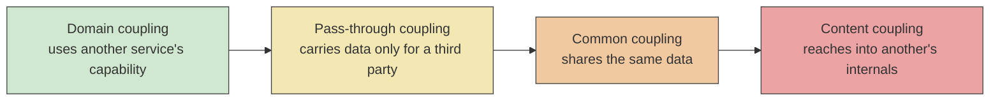
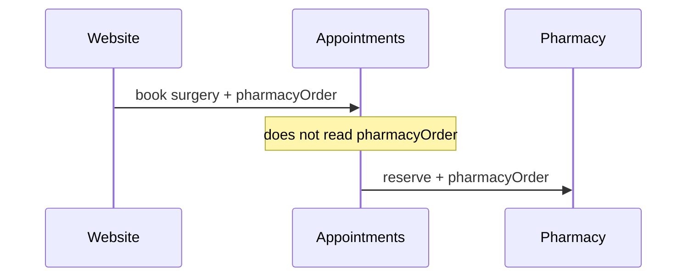

# Information hiding, coupling and cohesion

## Before this lesson

You should know what a microservice is and why independent deployability matters, from [The key concepts](#/lesson/microservices/key-concepts). You should be able to read small Python functions and dictionaries.

## In plain words

Deciding where one service ends and the next begins is the most important design decision in a microservice system. Three old ideas from the 1970s guide that decision better than any newer rule:

- **Information hiding**: keep as much as possible private, and publish only what others truly need.
- **Cohesion**: things that change together should live together.
- **Coupling**: the less a change in one service forces changes in others, the better.

A good comparison is a wall socket. Behind the wall there may be old wiring or new wiring, fuses or circuit breakers, power from the grid or from solar panels. None of that matters to your kettle. The socket is a small, stable shape that hides everything behind it. Because it hides so much, the electrician can rewire the house without replacing your appliances, and you can buy a new kettle without calling the electrician. A good service boundary is a socket.

For a job, this is the vocabulary used in design reviews. When someone says "these two services are too tightly coupled", you need to be able to say *what kind* of coupling it is and what to do about it.

## 1. What makes a good boundary

A microservice boundary is a module boundary with a network in it. The goal is the same as for any module: a boundary that lets the inside change without disturbing the outside.

Two words describe a good boundary. A service should be **stable** in what it exposes (its interface seldom needs to change in ways that hurt callers) and free in what it hides (its implementation can change daily).

## 2. Information hiding

**Information hiding** means concealing as many details as possible behind a module's boundary, so that only a small, deliberate interface is visible.

Whatever you expose, others will depend on. Whatever others depend on, you can no longer change freely. So the rule of thumb is: **expose as little as you can.** It is easy to publish something later. It is very hard to take something back once other teams use it.

What should a service hide?

| Hide | Because |
|---|---|
| The database schema | So tables can be restructured |
| The choice of database and language | So technology can be replaced |
| Internal data formats and identifiers | So they can evolve |
| Algorithms and business rules that only this service applies | So rule changes stay local |
| Which other services it calls | So its dependencies can change |

### Before and after at Pawprint

The Patients service's first API returned its database row as it was:

```json
{"pet_id": 7, "nm": "Miso", "own_id": 31, "sp_cd": 2, "dob": "2019-04-02",
 "last_vax_batch": "RB-7781", "internal_flags": 12, "row_version": 44}
```

Every caller now knows the column names, the numeric species code `2`, an internal flags bitmask and a row version used for database locking. When the team later replaced the species code table with text values, three consuming services broke.

The redesigned API exposes a deliberate shape:

```json
{"id": 7, "name": "Miso", "species": "cat", "ownerId": 31, "birthDate": "2019-04-02"}
```

It is smaller, it uses business words, and it leaves out everything callers have no business knowing. If Reminders needs to know when a vaccination is due, the service offers that as an answer (`GET /pets/7/vaccinations/due`) instead of exposing the raw batch records and letting every caller reimplement the rule.

> [!TIP]
> A practical test for an API field: *can I name a consumer that needs it today?* If not, leave it out. An unused field in a public API is a future constraint with no present benefit.

## 3. Cohesion

**Cohesion** describes how strongly the things inside a boundary belong together. The most practical definition for our purposes: *code that changes together stays together.*

Strong cohesion means that when the business asks for a change, the edits land in one service. Weak cohesion means the related behaviour is scattered, so one change needs coordinated edits in several services.

Take the business rule "an owner may cancel free of charge up to 24 hours before the visit; after that a fee applies". Where should that rule live?

- If the 24-hour check is in Appointments, the fee amount is in Billing, and the wording of the warning is in the website, then changing the policy to 48 hours with a different fee means three teams and three releases.
- If Appointments owns the cancellation policy and tells Billing "charge cancellation fee of X for booking Y", a policy change is one team's work.

You can estimate cohesion from history. The next block scores a proposed split by asking: of all past changes, how many would have stayed inside a single service?

```python-run
proposed = {
    "appointments": ["book", "cancel", "cancel_policy", "list_slots"],
    "billing":      ["create_invoice", "take_payment", "cancel_fee"],
    "reminders":    ["schedule_reminder", "send_text"],
}
history = [                       # functions edited together in past changes
    ["book", "list_slots"],
    ["cancel", "cancel_policy", "cancel_fee"],     # crosses two services
    ["cancel_policy", "cancel_fee"],               # crosses two services
    ["take_payment"],
    ["schedule_reminder", "send_text"],
    ["cancel_policy", "cancel_fee"],               # crosses two services
]

owner = {fn: svc for svc, fns in proposed.items() for fn in fns}
local = 0
for change in history:
    touched = {owner[fn] for fn in change}
    print(sorted(touched), "<-", change)
    local += len(touched) == 1
print(f"cohesion score: {local}/{len(history)} changes stay inside one service")
```

`proposed` maps each service to the functions it would hold. `history` lists which functions were edited together. `owner` inverts the first dictionary so each function points to its service. For each change the code collects the set of services touched; a set of size one is a local change. The score is 3 of 6, and the output shows the culprit: `cancel_policy` and `cancel_fee` always change together and sit in different services. Moving `cancel_fee` into Appointments (which then asks Billing only to "charge this amount") would raise the score to 6 of 6. The practice problem *Cohesion Score of a Proposed Split* asks you to write this as a function.

## 4. Coupling

**Coupling** describes how much a change to one thing requires a change to another. Two services are **loosely coupled** when you can change one without changing the other, and **tightly coupled** when changes ripple.

Cohesion and coupling are two views of one fact, sometimes summed up as: *a structure is stable if cohesion is strong and coupling is low.* If related behaviour is gathered in one place (high cohesion), there is less reason for it to be referred to from many places (low coupling).

Some coupling is unavoidable and fine. Services exist to cooperate; a system with no coupling at all does nothing. The skill is to recognise the *kind* of coupling and keep to the loose end of the scale.

## 5. The four types of coupling, from loose to tight



### Domain coupling (loosest, expected)

One service uses a capability that another provides. Appointments calls Patients to check that a pet exists. Appointments calls Billing to take a deposit.

This is normal. It still deserves attention when one service depends on *many* others: that can mean it is doing too much, or that logic has become centralised in one "god" service. Keep even this coupling narrow by sharing only what is needed. If Appointments sends Billing the whole pet record when Billing needs only an amount and an owner id, Billing has more ways to break.

### Pass-through coupling

One service passes data to another purely because some third service further along needs it. The middle service does not use the data; it only carries it.

Example: when booking surgery, the website sends Appointments a `pharmacyOrder` object describing the anaesthetic to reserve. Appointments does not understand it. It forwards it to the Pharmacy service.



The harm: when Pharmacy changes the format of the order, Appointments may need to change too (to validate, to map fields), although the change has nothing to do with scheduling. Three remedies, from better to worse depending on context:

1. **Bypass the middle.** Let the website call Pharmacy directly. This removes the pass-through but means the website now coordinates two calls.
2. **Hide the detail.** Let Appointments build the pharmacy request itself from information it does understand ("this is a surgery of type X"), so the caller does not supply Pharmacy's format at all.
3. **Treat it as an opaque blob.** Appointments forwards the bytes without parsing them. It then never needs to change when the format changes, but it also cannot validate anything.

### Common coupling

Two or more services use the same shared data. The classic case is a shared database. A change to the structure of that data affects all of them at once.

Sharing read-only reference data that almost never changes, such as a list of country codes, is a mild form and is often acceptable. The dangerous form is when several services **write** to the same data.

At Pawprint, both Appointments and Billing update the `status` column of a shared `visits` table: Appointments sets `BOOKED` and `CANCELLED`, Billing sets `PAID` and `REFUNDED`. Which transitions are legal? `PAID` after `CANCELLED`? Each service holds part of the answer, and neither can enforce the whole. The rules for the life of a visit are smeared across two code bases.

The remedy is to make one service the owner of that state. It exposes operations ("mark as paid") and decides whether a requested transition is allowed. This is a **finite state machine**: a fixed set of states with a fixed set of permitted moves between them.

```python-run
# One owner enforces the legal state transitions of a visit.
ALLOWED = {
    "BOOKED":    {"CANCELLED", "COMPLETED"},
    "COMPLETED": {"PAID"},
    "PAID":      {"REFUNDED"},
    "CANCELLED": set(),
    "REFUNDED":  set(),
}
visits = {551: "BOOKED"}

def request_transition(visit_id, new_state):
    current = visits[visit_id]
    if new_state not in ALLOWED[current]:
        return f"refused: {current} -> {new_state}"
    visits[visit_id] = new_state
    return f"ok: {current} -> {new_state}"

print(request_transition(551, "PAID"))        # Billing asks too early
print(request_transition(551, "COMPLETED"))
print(request_transition(551, "PAID"))
print(request_transition(551, "CANCELLED"))   # too late to cancel
```

`ALLOWED` lists, for each state, the states that may follow. `request_transition` looks up the current state, refuses any move not in the table and applies the rest. The first request is refused because a visit cannot be paid before it is completed; the last is refused because a paid visit cannot be cancelled. With a shared table and no owner, both of those illegal writes would have gone through silently.

Common coupling also causes a resource problem: several services competing for the same database can slow each other down, and an outage of that database stops them all.

### Content coupling (tightest, to be avoided)

One service reaches into another's internals and changes its state directly. The usual form: service A writes straight into service B's database, bypassing B's code.

The difference from common coupling is ownership. With common coupling everyone knows the data is shared. With content coupling the data clearly belongs to B, and A changes it anyway. B's validation is skipped, B's team does not know which of its tables others modify, and any internal change by B may break A.

At Pawprint, a quick fix let the Reminders service update `patients.owners.phone_verified` directly when a text message was delivered. Later the Patients team added a rule that verification must also write an audit record. Reminders kept bypassing that rule. The audit log had holes that took weeks to notice.

The remedy is always the same: go through the owner's interface. Reminders calls `POST /owners/31/phone-verifications`, and Patients applies its own rules.

### Summary table

| Type | What is shared | Typical example | Risk | Usual remedy |
|---|---|---|---|---|
| Domain | A capability via the API | Appointments asks Billing to take a deposit | Low; watch for services that depend on everything | Share the minimum data |
| Pass-through | Data carried for a third service | Appointments forwards a pharmacy order | Medium: middle service changes for reasons not its own | Bypass, hide, or pass opaquely |
| Common | The same data store | Two services write `visits.status` | High: any structural change hits all; unclear rules | One owner, operations instead of raw writes |
| Content | Another service's internals | Reminders writes into the Patients database | Very high: owner cannot change anything safely | Use the owner's API |

> [!INTERVIEW]
> A frequent question: "How do you know if two services are too tightly coupled?" Answer with evidence and a type: *they are released together; a schema change in one breaks the other; one reads or writes the other's tables (content or common coupling).* Then say the remedy: give the data one owner and move the interaction to its API or to events.

## 6. Worked example: reviewing a design

A colleague proposes this for the vaccination-reminder feature:

1. Reminders reads the `vaccinations` table in the Patients database every night.
2. Reminders computes which pets are due using the rule "12 months after the last dose".
3. Reminders writes `reminder_sent = true` back into the same table.

Review it with the vocabulary of this lesson:

| Observation | Concept | Consequence |
|---|---|---|
| Reads another service's table | Common/content coupling, broken information hiding | Patients cannot restructure vaccination records |
| Reimplements the due-date rule | Low cohesion: medical rules now live in two services | When the interval changes for a new vaccine, two teams must change |
| Writes a flag into Patients' table | Content coupling | Patients' validation and audit are bypassed |

A better design: Patients owns the medical rule and publishes an event `VaccinationDue {petId, ownerId, vaccine, dueDate}`. Reminders subscribes, sends the message, and keeps `reminder_sent` in its own database, because "was a reminder sent?" is Reminders' business, not a medical fact. Each service now holds only what it is responsible for, and only domain coupling remains.

## 7. Pitfalls

- **Exposing the database model as the API.** It is the fastest API to write and the most expensive to keep.
- **Sharing a library that contains business rules.** If all services must upgrade the library together to stay correct, you have common coupling through code.
- **Fixing pass-through coupling by making the middle service understand everything.** That replaces one problem with a service that knows too much.
- **Treating all coupling as bad.** Domain coupling is the purpose of having services. Aim for less and looser, not none.
- **Deciding boundaries from the data model alone.** Tables that are joined often are not necessarily one service; behaviour that changes together is the stronger signal.

## Summary

- A boundary is good when the inside can change without the outside noticing.
- Information hiding: expose a small deliberate interface and keep schemas, technology and rules private.
- Cohesion: put together what changes together; measure it with change history.
- Coupling: a change in one forcing a change in another. Types from loose to tight: domain, pass-through, common, content.
- Common coupling is cured by giving shared state one owner that enforces its rules. Content coupling is cured by using the owner's API.
- Aim for strong cohesion and loose coupling; they reinforce each other.

## Glossary

| Term | Meaning |
|---|---|
| Information hiding | Concealing implementation details behind a small, deliberate interface |
| Cohesion | How strongly the contents of a boundary belong together; code that changes together stays together |
| Coupling | How much a change in one part requires a change in another |
| Domain coupling | Using a capability another service offers through its interface |
| Pass-through coupling | Carrying data only because a service further along needs it |
| Common coupling | Several services depending on the same shared data |
| Content coupling | One service reaching into and changing another's internal state |
| Finite state machine | A fixed set of states and the permitted transitions between them |
| Opaque data | Data forwarded without being read or interpreted |
| Reference data | Rarely changing lookup data, such as country codes |

```quiz
[
  {"q": "Why is it safer to expose too little from a service than too much?", "options": ["Small responses are faster to send", "Adding to an interface later is easy, but removing something others depend on is very hard", "Security scanners prefer short APIs", "JSON has a size limit"], "answer": 1,
   "explain": "Anything exposed becomes a dependency for someone. Hidden details can be changed freely; published ones cannot."},
  {"q": "The cancellation deadline is checked in Appointments and the cancellation fee is defined in Billing; they always change together. What does this indicate?", "options": ["High cohesion", "Low cohesion: related behaviour is split across services", "Content coupling", "A missing index"], "answer": 1,
   "explain": "Code that changes together should live together. Splitting it means every policy change needs coordinated work in two services."},
  {"q": "Appointments calls the Billing API to take a deposit. Which type of coupling is this?", "options": ["Content coupling", "Common coupling", "Domain coupling", "Pass-through coupling"], "answer": 2,
   "explain": "Using a capability through a published interface is domain coupling, the loosest and most acceptable kind."},
  {"q": "Appointments receives a pharmacy order object it never reads and forwards it to Pharmacy. What is the risk?", "options": ["None, forwarding is free", "Appointments may have to change when Pharmacy's format changes, for reasons unrelated to scheduling", "Pharmacy cannot read forwarded data", "It doubles the latency of every call in the system"], "answer": 1,
   "explain": "That is pass-through coupling: the middle service is exposed to changes in data it does not use."},
  {"q": "Appointments and Billing both update the status column of a shared visits table. What is the recommended fix?", "options": ["Add a third service that also writes the column", "Give the visit state one owning service that exposes operations and enforces the legal transitions", "Remove the status column", "Let whichever service writes last win"], "answer": 1,
   "explain": "Shared writable data is common coupling. A single owner with a state machine can guarantee the rules and hide the storage."},
  {"q": "Reminders writes directly into a table inside the Patients database. Why is this content coupling worse than a shared table everyone knows about?", "options": ["It uses more disk", "The owner's validation is bypassed and the owner does not know its internals are being changed from outside", "It is slower", "It requires a broker"], "answer": 1,
   "explain": "The owner believes the data is private, so any internal change or new rule can silently break or be bypassed by the intruding service."},
  {"q": "Which statement about coupling is most accurate?", "options": ["All coupling must be removed", "Some coupling is necessary; the aim is to keep it loose and limited to what the domain requires", "Coupling only exists inside monoliths", "Coupling is measured in lines of code"], "answer": 1,
   "explain": "Services cooperate, so domain coupling is expected. The harmful kinds are those that expose internals or shared mutable data."}
]
```

> **Source:** Newman, *Building Microservices*, 2nd ed., ch. 2 (topic coverage only; wording and the Pawprint example are original).
