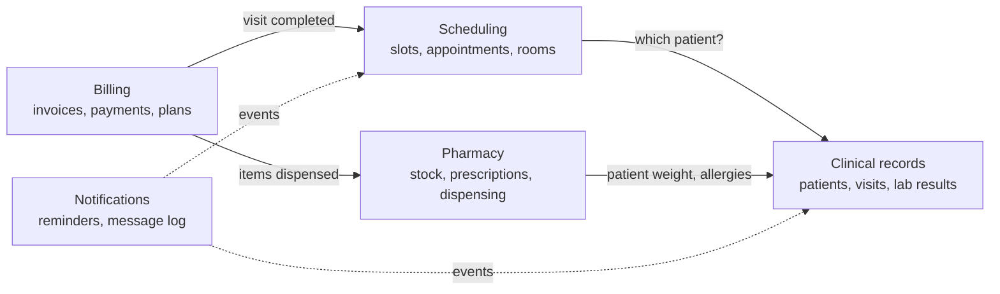
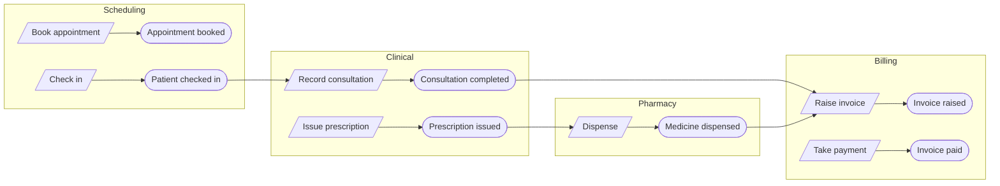

# Domain-driven design: language, aggregates, bounded contexts and event storming

## Before this lesson

You should know information hiding, cohesion and the four types of coupling from [Information hiding, coupling and cohesion](#/lesson/microservices/coupling-cohesion). No earlier knowledge of domain-driven design is assumed.

## In plain words

The last lesson said what a good boundary achieves. This lesson gives a method for *finding* boundaries. The method is **domain-driven design**, usually shortened to **DDD**: an approach to software in which the structure and the vocabulary of the code follow the structure and vocabulary of the business.

Think about a hospital. The word "patient" means different things in different departments. To the admissions desk, a patient is a name, an insurance number and a bed. To a surgeon, a patient is a medical history and a procedure. To the accounts office, a patient is a list of charges. Each department has its own files and its own meaning for the word, and they exchange only small, agreed summaries. Nobody tries to keep one giant folder that satisfies everyone, because it would be enormous and no one could change it.

DDD says: build software the same way. Find the departments (it calls them **bounded contexts**), let each keep its own model, and make the exchanges between them explicit. Those departments turn out to be very good candidates for microservices.

Four ideas from DDD are enough to start with: ubiquitous language, aggregates, bounded contexts, and a workshop technique called event storming.

## 1. Ubiquitous language

A **ubiquitous language** is a shared vocabulary used by the business people *and* in the code. "Ubiquitous" means "found everywhere".

Listen to how vets and receptionists at Pawprint talk: *appointment, walk-in, patient, client, consultation, prescription, dispense, recall.* Now look at the first version of ClinicDesk's code: `Customer`, `Animal`, `Event`, `Order`, `Job`. A receptionist says, "The client wants to move Miso's recall." The developer has to translate: client is `Customer`, Miso is an `Animal`, recall is… an `Event` with type 4? or a `Job`?

Every translation is a chance for a misunderstanding, and the translations live only in developers' heads. When the code uses the business's own words (`Client`, `Patient`, `Recall`), a developer can read a requirement and find the matching code, and a business expert can read a function name such as `reschedule_recall` and say whether it is right.

Practical habits:

- Keep a glossary of domain terms and use those exact words in class names, API paths and events.
- When two words are used for one thing, ask which is right. When one word is used for two things, you have probably found two contexts (section 3).
- Prefer verbs the business uses (`dispense`, `discharge`) to generic ones (`update`, `process`).

> [!TIP]
> A quick health check: read an API's paths to a domain expert. If they nod, the language is shared. If they ask "what is a `job-record`?", the model has drifted from the business.

## 2. Aggregates

An **aggregate** is a cluster of objects that is treated as one unit for the purpose of changes. It has a single entry point, called the **aggregate root**, and it protects a set of rules that must always hold.

Start with the simplest picture. A **prescription** at Pawprint has a header (which patient, which vet, which date) and several lines (medicine, dose, quantity). You never want a line without its prescription, and some rules span the whole thing: "the total dose of a sedative across all lines must not exceed the limit for the animal's weight". So the prescription with its lines is one aggregate. Code outside may hold a reference to the prescription, and may ask it to do things (`add_line`, `cancel`), but may not reach in and edit a line directly, because that would bypass the rule.

Three properties define an aggregate:

1. **It has a life cycle.** An appointment is requested, confirmed, checked in, completed or cancelled. Aggregates are usually real-world concepts with states, which makes them natural state machines.
2. **It is a consistency boundary.** Everything inside is changed together in one transaction, so its rules hold at all times.
3. **It is referred to from outside only by the identity of its root.** Other aggregates store `prescription_id`, not a pointer into its lines.

```python-run
class Prescription:                       # the aggregate root
    MAX_SEDATIVE_MG_PER_KG = 2.0

    def __init__(self, prescription_id, patient_weight_kg):
        self.id = prescription_id
        self.weight = patient_weight_kg
        self._lines = []                  # private: only reachable through the root
        self.status = "DRAFT"

    def add_line(self, medicine, mg, sedative=False):
        if self.status != "DRAFT":
            raise ValueError("cannot change an issued prescription")
        total = sum(l["mg"] for l in self._lines if l["sedative"]) + (mg if sedative else 0)
        if total > self.MAX_SEDATIVE_MG_PER_KG * self.weight:
            raise ValueError(f"sedative limit exceeded: {total} mg for {self.weight} kg")
        self._lines.append({"medicine": medicine, "mg": mg, "sedative": sedative})

    def issue(self):
        if not self._lines:
            raise ValueError("empty prescription")
        self.status = "ISSUED"

p = Prescription("rx-9", patient_weight_kg=4.0)
p.add_line("antibiotic", 50)
p.add_line("sedative-A", 6, sedative=True)
for attempt in [("sedative-B", 3, True)]:
    try:
        p.add_line(*attempt)
    except ValueError as e:
        print("refused:", e)
p.issue()
try:
    p.add_line("vitamin", 10)
except ValueError as e:
    print("refused:", e)
print(p.status, len(p._lines), "lines")
```

The class is the root. `_lines` starts with an underscore, the Python convention for "private". `add_line` checks two rules before changing anything: the prescription must still be a draft, and the sedative total must stay within the weight-based limit. The script adds an antibiotic and 6 mg of sedative to a 4 kg patient (limit 8 mg), then tries 3 mg more: refused, because 9 exceeds 8. After `issue()`, a further line is refused. The final print shows `ISSUED 2 lines`. Because every change passes through the root, the rules cannot be skipped.

### Aggregates and microservices

One microservice manages **one or more aggregates**. The key rule is the other way round: **one aggregate is never split across services.** If part of a prescription lived in the Pharmacy service and part in the Patients service, the sedative rule would need a distributed transaction to enforce. So aggregates give you the smallest sensible unit of a service: you can group several, but you should not cut through one.

Relationships *between* aggregates in different services are held by identifier. The Pharmacy service stores `patient_id = 7`; it does not hold the patient. To make such references understandable across services, some teams use a clear, self-describing form such as a URI (`/patients/7`).

## 3. Bounded contexts

A **bounded context** is a part of the domain inside which a particular model applies and words have one precise meaning. It has an explicit boundary, and it hides its internal model from the outside.

Return to the hospital picture. At Pawprint the word "patient" is used in three places:

| Context | What "patient" means there | Data it holds about the pet |
|---|---|---|
| Clinical records | A medical subject | Species, weight history, allergies, visit notes, lab results |
| Scheduling | Someone who needs a slot | Name, species (to pick a vet and room), behaviour note ("nervous with dogs") |
| Billing | A line on a client's account | Name, plan membership |

Building one `Patient` class with every field from all three columns produces a model that everybody depends on and nobody can change. DDD says to keep three models. Each context keeps its own view, with its own fields. One of them, here Clinical records, is the authority for the pet's identity; the others hold the identifier and the few attributes they need.

Inside a context some concepts are purely internal (the vet's free-text working notes), and some are **shared** with the outside (the patient's name and identifier). The shared part is the context's published interface. This is information hiding again, expressed in domain terms.

### A context map

A **context map** is a diagram of the bounded contexts and the relationships between them.



Each box is a candidate service. Each arrow is a dependency you must design: what exactly is asked for, and in which form. Bounded contexts also nest: Pharmacy may contain a "stock control" context and a "dispensing" context. That gives a sensible path: **start with the coarse context as one service, and split along the nested contexts later if a reason appears.** From outside, callers need not know whether Pharmacy is one service or three behind one interface.

### Before and after

Before, ClinicDesk had a single `animals` table with 64 columns, written by every module. A change to how allergies are stored meant checking scheduling, billing and reminder code.

After, the data is divided by context:

| Context | Owns | Refers to others by |
|---|---|---|
| Clinical records | `patients`, `allergies`, `visits`, `lab_results` | `client_id` |
| Scheduling | `appointments`, `slots`, `rooms`, a small `patient_summary` copy (name, species, behaviour note) | `patient_id` |
| Billing | `invoices`, `payments`, `plans` | `patient_id`, `client_id`, `appointment_id` |

Scheduling's `patient_summary` is a deliberate, small copy kept up to date by events from Clinical records. Duplicating a few fields is the price of not sharing a table, and it is usually worth paying.

## 4. Mapping aggregates and bounded contexts to services

Both aggregates and bounded contexts are units of cohesion with a clear interface, so both can serve as service boundaries.

| | Aggregate | Bounded context |
|---|---|---|
| Size | Small: one concept with its rules | Larger: a whole area of the business with several aggregates |
| Good as a service boundary when | You already understand the domain well and have a reason to go fine-grained | You are starting out; fewer, larger services are safer |
| Must not be | Split across services | Mixed with another context's model |

The usual advice is to begin with services that cover whole bounded contexts and to split further only when needed.

## 5. Event storming

How do you discover the contexts and aggregates of a real business? Reading the old code tells you how it *was* built. Asking each expert separately gives views that do not fit together. **Event storming** is a workshop technique that puts domain experts and developers in one room to build a shared model quickly.

You need a long wall, a roll of paper and sticky notes in several colours. The steps:

1. **Domain events** (traditionally orange notes). Everyone writes things that *happen* in the business, in the past tense: *Appointment booked. Patient checked in. Prescription issued. Medicine dispensed. Invoice paid.* Put them on the wall in rough time order. Do not discuss yet; quantity first.
2. **Commands** (blue). For each event, what decision or action caused it? *Book appointment. Issue prescription.* Note who gives the command: a receptionist, a vet, a timer, another system.
3. **Aggregates** (yellow). Which thing does each command act on and each event describe? *Appointment. Prescription. Invoice.* The nouns in your events are a strong hint.
4. **Group into bounded contexts.** Move the aggregates that belong together into clusters and draw lines around them. Places where the same word is used with two meanings, or where an event is handed from one group of people to another, are likely borders.
5. **Mark hot spots.** Disagreements and unknowns get a bright note. They are the most valuable output, because they are the questions nobody had asked.



The result is not a finished design. It is a shared picture, built in hours instead of weeks, that shows where the natural seams are. The events on the wall often become the real events that services publish (module 4).

> [!INTERVIEW]
> If asked "How would you identify service boundaries for an existing system?", a strong answer combines the business view and the evidence view: *run an event-storming session with domain experts to find bounded contexts and aggregates; check the candidates against the change history (what changes together) and the data (who writes which tables); start with coarse contexts and split later.* Mention that you would not cut through an aggregate.

## 6. Why DDD suits microservices

- **Bounded contexts hide information by design.** A context decides what to share, so a service built on it has a small, stable interface.
- **The language makes APIs understandable.** Endpoints and events named in business terms are easier to use and to discuss with non-developers.
- **Change follows business lines.** A request for change usually comes from one part of the business, and that part maps to one context, one service and one team.
- **It aligns teams.** A team can own a context and become expert in that part of the business.

## 7. Alternatives to domain boundaries

Business domain is the best *default* for drawing boundaries. Other forces sometimes justify cutting differently, and real systems mix them.

| Force | Meaning | Pawprint example | Caution |
|---|---|---|---|
| **Volatility** | Separate the parts that change often from the stable ones | The online booking flow changes weekly; the vaccination schedule rules change yearly | Used alone, it misses problems that are not about speed of change |
| **Data** | Separate by the sensitivity or regulation of the data | Card payment details are isolated in one small service so that only it falls under payment-card audit rules | Can produce boundaries that cut across business flows |
| **Technology** | Separate because a part needs a different runtime or performance profile | Image analysis of X-rays runs on GPU machines with a different language | Easily slides into the layered split (front end, back end, data) that makes every feature cross services |
| **Organisation** | Follow team structure and location | The lab-integration team sits in another country and owns its own service | If the organisation changes, the boundaries may need to follow |

A sensible way to use the table: draw the domain boundaries first, then ask whether any of these forces gives a strong reason to adjust a particular one. "We need to limit which code touches card numbers" is a strong reason. "The front-end developers sit together" is usually not.

> [!WARNING]
> Technology-based splits are the ones to be most suspicious of. A "front-end service", a "business service" and a "data service" look tidy and force three deployments for nearly every feature. Use a technical boundary for a real technical need, not as the main organising idea.

## 8. Pitfalls

- **One shared "canonical" model for the whole company.** A single `Patient` definition that all services must use recreates the giant table in API form.
- **Splitting an aggregate.** If two services must change together in one transaction to keep a rule true, the boundary cuts through an aggregate.
- **Anaemic contexts.** Services that only store and return data, with the rules elsewhere. Rules belong with the data they protect.
- **Doing event storming without domain experts.** Developers alone will reproduce the existing code structure on sticky notes.
- **Treating the first context map as final.** Understanding improves; boundaries drawn early should be cheap to move, which is one more reason to start inside a modular monolith.

## Summary

- Domain-driven design shapes software around the business and its vocabulary.
- A ubiquitous language uses the same terms in conversation, code, APIs and events.
- An aggregate is a cluster changed as a unit through its root, guarding rules that must always hold. Never split one across services.
- A bounded context is an area where one model and one meaning for each word apply. It shares a deliberate subset and hides the rest. Contexts are good first-cut service boundaries and can be split along nested contexts later.
- Event storming is a collaborative workshop that finds events, commands, aggregates and contexts quickly.
- Volatility, data, technology and organisation can adjust domain boundaries, and technology-led splits need the most scrutiny.

## Glossary

| Term | Meaning |
|---|---|
| Domain-driven design (DDD) | Designing software so its structure and vocabulary follow the business domain |
| Ubiquitous language | A shared vocabulary used by domain experts and in the code |
| Aggregate | A cluster of objects treated as one unit for changes, with rules that always hold |
| Aggregate root | The single entry point through which an aggregate is changed |
| Invariant | A rule that must be true at all times, such as a dose limit |
| Bounded context | A part of the domain with its own model and precise meanings, behind an explicit boundary |
| Context map | A diagram of bounded contexts and their relationships |
| Domain event | Something that happened in the business, stated in the past tense |
| Command | A request or decision that causes an event |
| Event storming | A workshop that maps events, commands and aggregates on a wall with domain experts |
| Volatility | How often a part of the system changes |

```quiz
[
  {"q": "What is the purpose of a ubiquitous language?", "options": ["To make code shorter", "To use the same terms in business conversations and in code, so nothing needs translating", "To let services share one database", "To standardise on one programming language"], "answer": 1,
   "explain": "Shared vocabulary removes a whole class of misunderstandings and lets experts and developers check each other's work."},
  {"q": "A prescription and its lines must together respect a dose limit. In DDD terms, the prescription with its lines is:", "options": ["A bounded context", "An aggregate", "A context map", "A command"], "answer": 1,
   "explain": "An aggregate is a cluster changed as one unit through its root, protecting rules that span its parts."},
  {"q": "Why should an aggregate never be split across two microservices?", "options": ["It would use too much memory", "Its rules must hold in one transaction, which is not available across services", "Aggregates cannot be serialised", "It breaks the ubiquitous language"], "answer": 1,
   "explain": "The aggregate is a consistency boundary. Splitting it means its invariants need coordination across the network."},
  {"q": "The word 'patient' means a medical subject to vets, a slot-holder to receptionists and an account line to accounts staff. What does DDD recommend?", "options": ["One shared Patient class with all fields", "Separate models in separate bounded contexts, sharing only an identifier and a few agreed attributes", "Removing the word from the code", "Letting each service write to one patients table"], "answer": 1,
   "explain": "One word with several meanings signals several contexts. Each keeps its own model and exposes a small shared part."},
  {"q": "In an event-storming session, which of these is a domain event?", "options": ["Book appointment", "Appointment", "Appointment booked", "Receptionist"], "answer": 2,
   "explain": "Events are facts in the past tense. 'Book appointment' is a command, 'Appointment' is an aggregate and 'Receptionist' is an actor."},
  {"q": "You are starting to extract services and understand the domain only moderately. Which boundary is the safer first choice?", "options": ["One service per aggregate", "One service per bounded context, splitting further later if needed", "One service per database table", "One service per developer"], "answer": 1,
   "explain": "Coarser services are easier to operate and cheaper to correct. Nested contexts give a path to split later."},
  {"q": "Pawprint isolates card payment handling in its own small service so that only that service is subject to payment-card audits. Which boundary force is this?", "options": ["Volatility", "Data", "Organisation", "Ubiquitous language"], "answer": 1,
   "explain": "The split follows the sensitivity and regulation of the data, a legitimate reason to adjust a domain boundary."}
]
```

> **Source:** Newman, *Building Microservices*, 2nd ed., ch. 2 (topic coverage only; wording and the Pawprint example are original).
