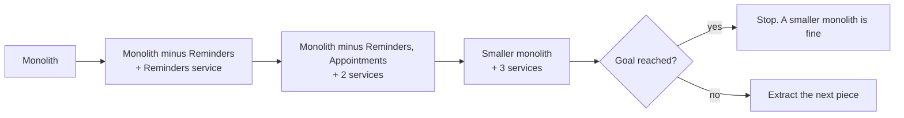
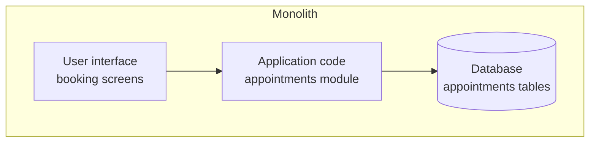

# Planning a migration: goals, increments and what to split first

## Before this lesson

You should know the forms of monolith and the pain points of microservices from [The monolith in its forms](#/lesson/microservices/monolith-forms-tradeoffs), and how to find boundaries from [Domain-driven design](#/lesson/microservices/ddd-boundaries).

## In plain words

Most teams do not build microservices from an empty page. They have a working monolith that earns money, and they want to move parts of it into services without stopping the business. That move is called a **migration**.

Imagine renovating a house while the family still lives in it. You do not knock the whole building down and promise a new one in two years. You pick the room that causes the most trouble, the leaking bathroom perhaps, and you redo that room while the rest stays usable. When it is finished you see what you learned (the pipes were older than expected) and choose the next room. If money runs out after three rooms, the family still has a better house than before.

Migrating a monolith works the same way. This lesson is about the planning: knowing why you are doing it, doing it in small steps, and choosing the first room. The next lesson covers the building techniques.

## 1. Have a goal

**Microservices are not the goal.** They are one possible means to a goal. A migration that starts from "we should have microservices" has no way to tell whether it is succeeding, and no way to decide which part to extract first.

A usable goal names an outcome the business cares about:

| Vague aim | Usable goal | How you would measure it |
|---|---|---|
| "Modernise the platform" | Teams release their own changes without a shared release train | Median time from merged change to production, per team |
| "Be more scalable" | The booking pages stay fast during the Monday peak | 95th percentile page time on Mondays 8–10 a.m. |
| "Improve reliability" | A failure in reporting does not stop bookings | Booking availability during reporting incidents |
| "Use new technology" | (not a goal by itself; ask what it would enable) | |

With the goal written down, ask two honest questions:

1. **Is there an easier way to reach it?** If the problem is the Monday peak, running more copies of the monolith behind a load balancer may solve it in a week. If the problem is merge conflicts, enforcing module boundaries may be enough.
2. **How will we know it is working?** Pick the measure before you start, and look at it after each step.

At Pawprint the goal is: *the Appointments and Reminders teams can release on any working day without waiting for the three-week release, and booking stays available when other parts fail.* Everything in this module is judged against that sentence.

> [!INTERVIEW]
> "How would you migrate a monolith to microservices?" is a classic. Begin your answer with the goal: *"First I would ask what problem we are solving, because that decides what to extract first and when to stop."* Interviewers hear many answers that begin with technology; an answer that begins with the outcome stands out.

## 2. Migrate incrementally

A **big-bang rewrite** means building the complete replacement beside the old system and switching over on one day. It is tempting and it fails often, for the same few reasons:

- The old system keeps changing while you rewrite it, so the target moves.
- Nothing is learned from production until the very end, when everything is new at once.
- The business sees cost for a long time and no benefit.
- When the switch goes wrong, everything is wrong together and it is hard to know why.

The alternative is **incremental migration**: extract one small piece, put it into production, learn, repeat.



Three reasons small steps work better:

**Each step is a small bet.** If the first extracted service turns out to have the wrong boundary, you have lost a few weeks, and you can adjust. With a big bang you find out after a year.

**You pay the fixed costs early and once.** The first service forces you to build a deployment pipeline, central logging and a way for services to authenticate to each other. Doing that with one small, low-risk service is far safer than discovering the gaps with twenty.

**You learn the things that only production teaches.** How long does a call between the monolith and the new service really take? What happens when the service is down? What does on-call for it feel like?

Notice the diamond in the diagram. The migration **ends when the goal is reached**, not when the monolith is gone. Many successful migrations leave a smaller monolith in place for good.

## 3. The monolith is rarely the enemy

It is easy to start talking as though the old system were a mistake. It is the system that pays the salaries. Two attitudes help:

- **Keep the monolith healthy during the migration.** People still have to change it. If quality there is allowed to collapse because "it is going away", the migration gets slower, since every extraction starts from messier code.
- **Do not add to the problem.** New functionality that clearly belongs to a new service should be built there, not in the monolith to be extracted later. At the same time, do not force every new feature into a new service; small additions to an area that is staying put belong where the area lives.

## 4. The danger of premature decomposition

**Premature decomposition** means splitting before you understand the domain well enough to know where the boundaries belong.

A cautionary example from our running system. Before ClinicDesk existed, an earlier project at Pawprint tried to build a clinic system as eight services from the first day. The team guessed the boundaries. Within three months they found that "visit", "consultation" and "treatment plan" were so entangled that every feature needed changes in three services at once; they had cut through what turned out to be a single aggregate. They merged everything back into one application (which became ClinicDesk), ran it for two years, and only then, knowing how the business really behaved, began extracting services with confidence.

The lesson generalises:

| Situation | Risk of wrong boundaries | Advice |
|---|---|---|
| New product, new domain | High | Stay in a (modular) monolith until the domain settles |
| Existing system, well-understood domain | Lower | Extract along proven module boundaries |
| Existing system, tangled code | Medium: the code hides the true boundaries | First create module boundaries inside the monolith, then extract |

Merging services back together is a legitimate move when a boundary proves wrong. It is cheaper than living with a distributed monolith.

## 5. What to split first

You have a list of candidate services from a context map. Which goes first? Two questions pull in different directions:

- **How much benefit** would extracting this piece bring toward the goal?
- **How hard** is the extraction: how tangled is the code, and above all, how tangled is the data?

Plot the candidates on those two axes and start in the corner that is high benefit and low difficulty.

```python-run
# Score candidates: benefit toward the goal (1-5) and difficulty of extraction (1-5).
candidates = {
    #                benefit, difficulty, note
    "reminders":    (3, 1, "reads events only, owns its own tables"),
    "appointments": (5, 3, "central to the goal; shares the visits table"),
    "billing":      (2, 5, "touched by everything; strict consistency"),
    "pharmacy":     (2, 3, "stable, few changes"),
    "reporting":    (4, 2, "isolating it protects booking"),
}

def priority(item):
    name, (benefit, difficulty, _) = item
    return (-(benefit - difficulty), difficulty, name)     # best net value first, easier first on ties

for rank, (name, (b, d, note)) in enumerate(sorted(candidates.items(), key=priority), start=1):
    print(f"{rank}. {name:13s} benefit={b} difficulty={d} net={b - d:+d}  {note}")
```

`candidates` maps each possible service to a benefit score, a difficulty score and a note. `priority` builds a sort key: the largest `benefit - difficulty` first, and among equals the easier one first. The output ranks `reminders`, `reporting` and `appointments` at the top with a net value of +2 each (ordered by ease), and puts `billing` last at −3.

The numbers are judgments, not measurements, and the script only makes the judgment explicit so people can argue about it. Two things it shows are generally true:

- **A first extraction should be easy.** Reminders is not the most valuable piece, but it is nearly independent. It lets the team build the pipeline, logging and on-call habits with little risk. This is sometimes called a *quick win*.
- **The piece everybody depends on should come late.** Billing is called from everywhere and needs strict consistency. Extracting it first would mean solving the hardest data problems with the least experience.

### Signals for benefit and difficulty

| Signal | Suggests |
|---|---|
| The area changes very often | High benefit: independent releases pay off most here |
| The area has a very different load profile | High benefit for scaling |
| A dedicated team already owns it | High benefit, and a clear owner for the new service |
| Few inbound calls from the rest of the code | Low difficulty |
| Its tables are written by other modules | High difficulty: the data must be untangled first |
| It takes part in transactions spanning other areas | High difficulty: you will need a saga |

## 6. Decomposition by layer

A service-to-be inside a monolith is a vertical slice through three layers: user interface, application code (the "back end"), and data. You do not have to move all three at once, and the order matters.



### Code first

Move the application code into a new service, while it **still uses the tables in the monolith's database**. This is the more common order.

- *Advantage:* you get an early, visible result. The new service can be deployed separately and the team gains experience quickly.
- *Risk:* it is easy to stop here. The service works, attention moves elsewhere, and the shared tables stay shared for years. The service is then not independently deployable for any change that touches data. Before you start, check that the data *can* be separated cleanly, even if you do it second.

### Data first

Separate the tables into their own schema or database first, while the code is still inside the monolith.

- *Advantage:* it tackles the hardest and riskiest part first. If the data cannot be untangled (because of joins and transactions that the business truly needs), you find out before investing in a service.
- *Risk:* there is little visible benefit until the code follows, which makes it harder to keep support for the work.

### Do not forget the user interface

Leaving the user interface as one untouched block is a common omission. If every feature still needs a change in a single front-end application owned by another team, the release queue has only moved. Module 14 shows how to split the interface along the same lines as the services.

| Order | Early benefit | Reveals the hard problems early | Main risk |
|---|---|---|---|
| Code first | Yes | No | Data is never split; a distributed monolith remains |
| Data first | No | Yes | Loss of momentum before any visible gain |
| Both together | Late | Late | A large, risky step; avoid for all but tiny pieces |

> [!TIP]
> Whichever order you choose, write down the end state for that slice ("code, data and screens owned by the Appointments team") and do not call the extraction finished until it is reached. "Code extracted, database to follow" should appear on a list of open work, with a date.

## 7. Worked example: Pawprint's plan

**Goal.** Appointments and Reminders release independently; booking survives failures elsewhere.

**Step 0: prepare.** Central log collection. An automated pipeline that can deploy one more unit besides the monolith. Module boundaries enforced inside ClinicDesk so that cross-module calls are visible.

**Step 1: Reminders (quick win).** Few inbound dependencies; it owns its message log. Code and data move together because the data is nearly isolated. The team learns how to deploy, watch and be on call for a service.

**Step 2: Reporting.** Reports are moved to read from a copy of the data, so a heavy report can no longer exhaust the monolith's database connections. This protects booking, part of the goal, without touching booking code.

**Step 3: Appointments.** The central piece. Data first for the `appointments` and `slots` tables (to prove they can be separated from `visits`), then code, then the booking screens.

**Checkpoint.** Measure release time for the two teams and booking availability during incidents. If the goal is met, stop. Billing, Pharmacy and Clinical records remain modules of a smaller, healthier ClinicDesk.

| | Before | After step 3 |
|---|---|---|
| Deployable units | 1 | 4 (monolith, Reminders, Reporting, Appointments) |
| Release wait for the Appointments team | Up to 3 weeks | Same day |
| Effect of a runaway report | Whole site slow | Reporting slow; booking unaffected |
| Services the organisation must operate | 0 | 3, introduced one at a time |

## 8. Pitfalls

- **No stated goal.** Without one, the migration cannot be prioritised and cannot be declared finished.
- **The big-bang rewrite.** Long invisible effort, moving target, all risk at the end.
- **Starting with the hardest, most central piece.** You meet the worst data problems before you have any tooling or experience.
- **Starting with something so trivial it teaches nothing.** A quick win should still go through the real pipeline and carry real traffic.
- **Stopping at "code extracted".** Shared tables keep the release coupling alive.
- **Declaring war on the monolith.** Neglecting it slows every later extraction.
- **Not measuring.** If release times and availability are not tracked, opinions replace evidence.

## Summary

- Decide what outcome you want and how to measure it; microservices are a means.
- Check whether something simpler reaches the outcome.
- Migrate in small steps that each reach production; stop when the goal is met, even if a monolith remains.
- Avoid splitting a domain you do not yet understand; merging back is acceptable when a boundary was wrong.
- Choose what to extract by weighing benefit against difficulty; begin with an easy, useful piece and leave the most entangled one for later.
- A slice has user interface, code and data. Code-first gives quick results and risks leaving data shared; data-first exposes the hard problems early and delays visible benefit.

## Glossary

| Term | Meaning |
|---|---|
| Migration | Moving functionality from an existing system to a new structure while the business keeps running |
| Big-bang rewrite | Replacing a whole system in one switch-over |
| Incremental migration | Moving one small piece at a time, each into production |
| Premature decomposition | Splitting into services before the domain boundaries are understood |
| Quick win | An easy early extraction chosen to build skills and tooling |
| Vertical slice | The user interface, code and data belonging to one business capability |
| Code-first extraction | Moving application code to a service before separating its data |
| Data-first extraction | Separating the data before moving the code |
| Release train | A scheduled shared release that all changes must wait for |
| Percentile | The value below which a given share of measurements fall; the 95th percentile page time is slower than 95% of page loads |

```quiz
[
  {"q": "Why should a migration start from a stated goal instead of 'adopt microservices'?", "options": ["Goals are required by auditors", "The goal decides what to extract first, how to measure progress and when to stop", "Microservices cannot be built without a goal document", "It makes the diagram tidier"], "answer": 1,
   "explain": "Microservices are a means. Without an outcome to aim at, there is no basis for prioritising or for knowing whether the effort is working."},
  {"q": "Which is a weakness of a big-bang rewrite?", "options": ["It delivers value too early", "Nothing is learned from production until the end, while the old system keeps changing", "It needs too few developers", "It cannot use containers"], "answer": 1,
   "explain": "All the risk arrives at the switch-over, and the target moves during the rewrite because the business does not stand still."},
  {"q": "When is an incremental migration finished?", "options": ["When the monolith has zero lines of code", "When the stated goal has been reached, even if a smaller monolith remains", "When there are at least ten services", "When every team uses a different language"], "answer": 1,
   "explain": "The aim is the outcome. Leaving a healthy, smaller monolith in place is a common and reasonable end state."},
  {"q": "A team new to services must pick its first extraction. Which candidate is best?", "options": ["Billing: called by everything, strict consistency", "Reminders: few inbound dependencies and its own data", "The whole user interface", "The shared database"], "answer": 1,
   "explain": "An easy, nearly independent piece lets the team build pipelines, logging and on-call practice at low risk. The most entangled piece should come later."},
  {"q": "What is the main risk of extracting code first and data later?", "options": ["The new service cannot be deployed", "The data is never separated, so the service still shares tables and is not truly independent", "The monolith stops working at once", "It is slower than a rewrite"], "answer": 1,
   "explain": "Code-first gives quick visible progress, which makes it easy to stop before the hard part and remain coupled through the database."},
  {"q": "Why might a team separate the data before the code?", "options": ["It is more fun", "To find out early whether the data can really be untangled, before investing in a new service", "Because databases deploy faster than code", "To avoid writing an API"], "answer": 1,
   "explain": "Data is usually the hardest part. Tackling it first removes the largest uncertainty at the cost of delayed visible benefit."},
  {"q": "An early project split a brand-new clinic system into eight guessed services and later merged them back. Which problem does this illustrate?", "options": ["Premature decomposition", "Content coupling", "Technology heterogeneity", "Semantic versioning"], "answer": 0,
   "explain": "Boundaries were chosen before the domain was understood, so they cut through things that had to change together."}
]
```

> **Source:** Newman, *Building Microservices*, 2nd ed., ch. 3 (topic coverage only; wording and the Pawprint example are original). Martin Fowler, "MonolithFirst", https://martinfowler.com/bliki/MonolithFirst.html
