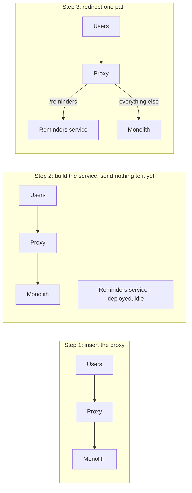
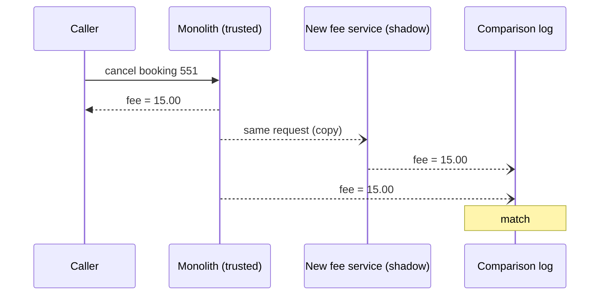
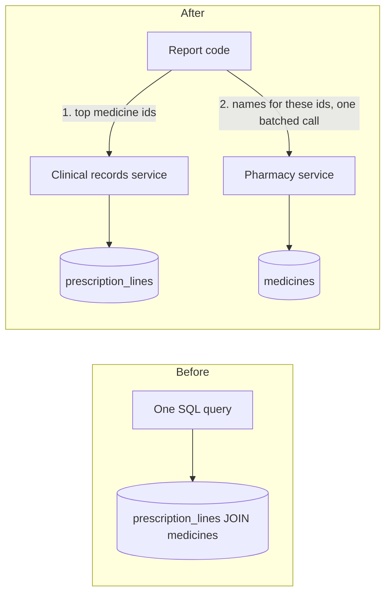
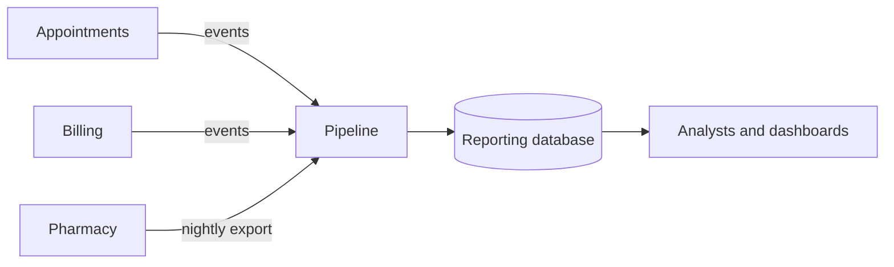

# Migration patterns and splitting the data

## Before this lesson

Read [Planning a migration](#/lesson/microservices/migration-planning) first. You should know what a database table, a foreign key and a join are; if not, the early lessons of the [SQL track](#/track/sql) cover them. You should also know why services must not share tables, from [The key concepts](#/lesson/microservices/key-concepts).

## In plain words

Once you know *which* piece of the monolith to extract, you need a way to move it without an outage and with a way back if something goes wrong. Three patterns give you that: the **strangler fig** (redirect traffic piece by piece), the **parallel run** (run old and new side by side and compare), and the **feature toggle** (a switch that chooses between old and new at run time).

A good picture is replacing a bridge that carries traffic every day. You build the new bridge beside the old one. You open one lane of the new bridge and send a few cars over it while the old bridge still carries the rest. You compare: does the new lane hold? When you are confident, you move more lanes, and only at the end do you close the old bridge. At every moment, a barrier at the junction can send everyone back to the old bridge.

The second half of this lesson is about the hardest part of any migration: the database. Moving code is the easy half. Untangling tables that have been joined together for years raises questions of speed, correctness and transactions that have no free answers.

## 1. The strangler fig pattern

The pattern is named after a kind of fig tree that starts life as a seed in the branches of another tree, grows roots down around the host's trunk, and over years takes its place. Martin Fowler used the image for software: build the new system *around the edges* of the old one, and let it take over gradually until the old one can be removed.

The mechanism is a piece of software placed in front of the monolith that looks at each incoming request and decides where to send it. This is usually an HTTP **proxy**: a program that receives requests on behalf of others and forwards them.



The steps in words:

1. **Insert the proxy** with a single rule: send everything to the monolith. This changes nothing for users, and it proves the proxy works before any logic moves.
2. **Build and deploy the new service** behind the proxy, receiving no traffic. Deployment (putting the software in production) is now separate from release (letting users reach it). That separation is worth remembering; it comes back in module 8.
3. **Redirect** the paths that belong to the new service. If trouble appears, change the rule back: the old code is still there.
4. **Remove the old code** from the monolith once the new service has run long enough to be trusted.

The routing table is small and its behaviour is precise, which makes it a good thing to simulate:

```python-run
def route(table, path):
    """Longest matching prefix wins; default is the old system."""
    best, target = -1, "legacy"
    for prefix, t in table.items():
        on_boundary = path == prefix or path.startswith(prefix + "/")
        if on_boundary and len(prefix) > best:
            best, target = len(prefix), t
    return target

phases = [
    {},                                                        # phase 0: proxy only
    {"/reminders": "new"},                                     # phase 1
    {"/reminders": "new", "/appointments": "new",
     "/appointments/export": "legacy"},                        # phase 2: export not migrated yet
]
requests = ["/reminders/5", "/appointments/9", "/appointments/export", "/pets/7", "/reminders-old"]

for n, table in enumerate(phases):
    print(f"phase {n}:", {p: route(table, p) for p in requests})
```

`route` receives the current table and a request path. For each prefix in the table it checks whether the path equals the prefix or continues it after a slash (so `/reminders-old` does not match `/reminders`), and keeps the longest match. `phases` holds the table at three moments. The output shows traffic moving over: in phase 0 everything is `legacy`; in phase 1 only `/reminders/5` is `new`; in phase 2 appointments move too, except the export path, which a longer rule keeps on the old system. The practice problem *Strangler Fig Routing Table* asks you to build this with rollback entries.

**When the pattern fits.** It needs a place to intercept calls. Requests from outside (web pages, API calls) are easy to intercept. Functionality buried deep in the monolith, called only by other internal code, is harder: you first have to give it a clear internal interface so there is a seam to redirect.

**Its cost.** Fowler's article points out that old and new must coexist, which requires temporary "transitional" code that will be thrown away, such as the proxy rules and any calls from the new service back into the monolith. That code can look like waste. It is the price of never having a risky all-at-once switch.

> [!TIP]
> Keep the proxy dumb. It should route by path, host or header and nothing more. The moment business logic creeps into the proxy, you have built a new shared component that every team must change.

## 2. The parallel run

A redirect answers "does the new service work at all?" It does not answer "does it give the *same answers* as the old code?" For risky logic, such as money or medical dosing, you want that second assurance before switching.

In a **parallel run**, every request is processed by both the old and the new implementation. One of them, at first the old one, is the **source of truth**: its result is the one returned to the user. The other's result is recorded and compared.



```python-run
def old_cancel_fee(hours_before, price):          # logic inside the monolith
    return 0.0 if hours_before >= 24 else round(price * 0.25, 2)

def new_cancel_fee(hours_before, price):          # reimplementation in the new service
    return 0.0 if hours_before > 24 else round(price * 0.25, 2)     # subtle bug: > instead of >=

mismatches = []
cases = [(48, 60.0), (24, 60.0), (3, 60.0), (23, 80.0), (24, 45.0)]
for hours, price in cases:
    trusted = old_cancel_fee(hours, price)        # this answer goes to the user
    shadow = new_cancel_fee(hours, price)         # this answer is only recorded
    if trusted != shadow:
        mismatches.append((hours, price, trusted, shadow))

print(f"{len(cases) - len(mismatches)} of {len(cases)} matched")
for m in mismatches:
    print("MISMATCH hours=%s price=%s old=%s new=%s" % m)
```

Two functions compute the cancellation fee. The new one has a boundary mistake: `>` where the rule says `>=`. The loop runs both on each case, keeps the old answer as the trusted one, and records disagreements. It prints `3 of 5 matched` and two mismatches, both at exactly 24 hours. No customer was charged wrongly, because the shadow result was never used. That is the value of the pattern: real production inputs test the new code with no risk.

Things to watch in a parallel run:

- **Side effects.** If "cancel" also sends an email or takes a payment, the shadow implementation must not do it for real, or the customer gets two emails. Stub out the effects in the shadow.
- **Cost.** Everything runs twice. Use it for the functionality where a wrong answer is expensive, not everywhere.
- **Tolerances.** Decide which differences matter. A timestamp differing by a millisecond is noise.

## 3. Feature toggles

A **feature toggle** (also called a feature flag) is a switch in configuration that turns a piece of behaviour on or off, or chooses between two implementations, without deploying new code.

In a migration, the toggle sits where the monolith would do the work, and chooses between "use the old in-process code" and "call the new service".

```python
def send_reminder(visit):
    if toggles.is_on("reminders-via-service", clinic=visit.clinic):
        reminders_client.schedule(visit)      # new: call the service
    else:
        legacy_reminders.schedule(visit)      # old: in-process code
```

Because the toggle is evaluated per request, it can be turned on for one clinic first, then ten, then all, and turned off in seconds if errors rise. With an HTTP proxy the routing rule is itself the toggle; inside the code, a toggle gives the same control for calls the proxy cannot see.

| Pattern | What it gives you | Best for | Watch out for |
|---|---|---|---|
| Strangler fig | Gradual redirection of whole paths; instant rollback | Functionality reachable from outside | Logic leaking into the proxy; deep internal code with no seam |
| Parallel run | Evidence that new and old agree | High-risk calculations | Duplicate side effects; double cost |
| Feature toggle | Per-request, per-group switching without a deploy | Internal call sites; gradual exposure | Old toggles left in the code for years |

The three combine well: strangle a path, run it in parallel until the comparison is clean, then use a toggle or routing rule to shift real traffic gradually.

## 4. Splitting the data: why it is the hard part

Code is stateless: you can run old and new side by side, and delete either. Data has one current truth and a long memory. In a monolith's database, the tables of different areas are connected by joins, foreign keys and transactions. Giving each service its own database cuts those connections, and each cut costs something. The sections below take the costs one at a time.

### 4.1 Performance: the lost join

A relational database is very good at **joins**: combining rows from two tables in one query. ClinicDesk's "most prescribed medicines this month" report is one query joining `prescription_lines` to `medicines`:

```sql
SELECT m.name, SUM(l.quantity)
FROM prescription_lines l JOIN medicines m ON m.id = l.medicine_id
GROUP BY m.name ORDER BY 2 DESC LIMIT 10;
```

After the split, `prescription_lines` belongs to Clinical records and `medicines` to Pharmacy. The join is now done in application code: fetch the top medicine ids from one service, then ask the other service for their names.



One database round trip became two service calls plus two database queries. It will be slower. Whether that matters depends on the use: for a monthly report, not at all; for something on every page load, perhaps. The mitigations are **batched lookups** (ask for all ids in one request, never one request per row) and **local caching** of data that changes rarely, such as medicine names.

### 4.2 Data integrity: the lost foreign key

A **foreign key** is a database rule that a value in one table must exist in another. In the monolith, the database would refuse to delete a medicine that prescription lines still refer to. Across two databases, nothing enforces that. A medicine can be deleted in Pharmacy while old prescriptions in Clinical records still point at its id.

Ways to cope:

| Option | How | Trade-off |
|---|---|---|
| **Soft delete** | Never remove the row; mark it `discontinued` | Simple; rows accumulate |
| **Copy what you need** | Store the medicine *name* in the prescription line when it is written | The prescription stays readable for ever; the copy does not follow later renames (often what you want for a historical record) |
| **Check before delete** | Pharmacy asks Clinical records "is this id in use?" | Not reliable: a new reference can appear right after the check |
| **React to events** | Pharmacy publishes `MedicineDiscontinued`; others update themselves | Eventual, not instant |

For most cases, soft delete plus copying the few fields a historical record needs is the right answer. A prescription *should* show the name the medicine had on the day it was written.

### 4.3 Transactions

In one database, "create the invoice and reduce the stock" can be one transaction: both happen or neither does. With Billing and Pharmacy in separate databases, that guarantee is gone. If the invoice is created and the stock update fails, the system is left in between.

The answer is not a transaction spanning both databases (module 6 explains why that works badly) but a **saga**: a sequence of local transactions with defined actions to undo earlier steps if a later one fails. Splitting data that takes part in multi-table transactions therefore means redesigning that business operation, and you should budget for it.

### 4.4 Tooling

Changing application code has excellent tools: refactoring editors, compilers, tests. Changing databases has fewer. What exists and helps:

- **Schema migration tools** (Flyway and Liquibase are well-known examples) keep each database change as a versioned script in source control, so a change can be applied in the same way to every environment, in order. Each service should own its migration scripts.
- **Database views.** A view is a stored query presented as a table. During a migration you can give an external reader a view instead of the real tables, so the real tables can change behind it.
- **One step at a time.** Make schema changes and code changes in separate deployments, each of which works with the version on the other side. First add the new structure, then move the readers and writers, then remove the old.

### 4.5 Reporting

Analysts and finance staff often query the monolith's database directly, across every area. Splitting it breaks their queries. Giving them access to each service's private database would recreate the shared-database coupling.

The standard answer is a **dedicated reporting database**: each service publishes the data it is willing to share (by events, or by a scheduled export), and a pipeline loads it into a store designed for analysis. The services stay private; the reporting store is a separate, deliberate interface with its own schema.



### Before and after: the data split at Pawprint

| Concern | In the monolith | After splitting Pharmacy data |
|---|---|---|
| Top-medicines report | One SQL join | Runs on the reporting database |
| Prescription shows medicine name | Join at read time | Name copied into the line at write time |
| Deleting a medicine | Blocked by a foreign key | Soft delete (`discontinued`) |
| Dispense and invoice together | One transaction | A saga with a compensating step |
| Schema changes | One shared set of scripts | Each service owns its migration scripts |

## 5. A safe sequence for moving a table

Putting the pieces together for the `medicines` table:

1. **Find every reader and writer** of the table in the monolith. (Query logs and code search both help.)
2. **Put an interface in front of it** inside the monolith, so all access goes through one module.
3. **Create the new service** with its own database and copy the data across.
4. **Keep both in step** for a while: the monolith writes to both, or the service is fed by change events. Compare them, in the spirit of a parallel run.
5. **Switch reads** to the service behind a toggle. Roll back by flipping the toggle.
6. **Switch writes**, making the service the source of truth.
7. **Remove** the old table once nothing uses it. Keep a backup.

Each step is small, visible and reversible, which is the whole point of the lesson.

> [!WARNING]
> Step 4 is the dangerous one. While two copies exist, be explicit about which is the source of truth at every moment, and switch that role in one deliberate step. "Both are authoritative" is how data gets lost.

> [!INTERVIEW]
> For "How do you split a shared database?", give the costs before the steps: *joins become service calls or local copies; foreign keys become soft deletes and events; cross-table transactions become sagas; reporting moves to its own store.* Then describe the incremental sequence with a toggle for rollback. Naming the lost guarantees shows you understand why it is hard.

## 6. Pitfalls

- **Deleting the old code path too soon.** Keep it until the new service has survived real peaks and incidents.
- **Running a parallel run with live side effects.** Customers get duplicate emails or charges.
- **One service call per row** to replace a join. Always batch.
- **Leaving toggles in place for ever.** Remove a migration toggle once the old path is gone; stale toggles hide dead code and confuse everyone.
- **Letting reports read service databases directly.** That is a shared database by another route.
- **Changing schema and code in the same deployment.** If it fails, you cannot roll back one without the other.

## Summary

- The strangler fig pattern places a proxy in front of the monolith and redirects functionality to new services piece by piece, with rollback by changing a rule.
- A parallel run executes old and new together, returns the trusted result and records differences, giving evidence from real traffic at no risk to users.
- Feature toggles choose between old and new per request and allow gradual exposure.
- Splitting data costs join performance, foreign-key integrity and transactions, and breaks direct reporting. The remedies are batching and caching, soft deletes and copied fields, sagas, and a dedicated reporting store.
- Move data in small reversible steps and always know which copy is the source of truth.

## Glossary

| Term | Meaning |
|---|---|
| Strangler fig pattern | Gradually replacing a system by redirecting functionality to new code around it |
| Proxy | A program that receives requests and forwards them to another program |
| Parallel run | Running old and new implementations together and comparing results |
| Source of truth | The copy or implementation whose answer is authoritative |
| Shadow | The implementation in a parallel run whose results are recorded but not used |
| Feature toggle | A run-time switch that turns behaviour on or off without a deployment |
| Join | A query that combines rows from two tables |
| Foreign key | A database rule that a value must exist in another table |
| Soft delete | Marking a row as inactive instead of removing it |
| Schema migration | A versioned, scripted change to a database structure |
| View | A stored query that can be read like a table |
| Reporting database | A separate store, fed by the services, designed for analysis |

```quiz
[
  {"q": "What is the first step of a strangler fig migration?", "options": ["Delete the old code", "Insert a proxy that at first sends every request to the monolith", "Rewrite the database", "Turn off the monolith for a weekend"], "answer": 1,
   "explain": "Putting the interception point in place with no behaviour change proves it works and creates the seam for later redirection."},
  {"q": "In a parallel run, which result does the user receive?", "options": ["The average of both", "The result of the implementation currently designated as the source of truth", "Whichever arrives first", "Always the new one"], "answer": 1,
   "explain": "One implementation is trusted, at first the old one. The other's output is only recorded and compared."},
  {"q": "The shadow implementation in a parallel run also sends real emails. What goes wrong?", "options": ["Nothing", "Customers receive duplicate emails because both implementations perform the side effect", "The comparison is more accurate", "The proxy crashes"], "answer": 1,
   "explain": "Side effects must be suppressed in the shadow path. Only calculations can be safely duplicated."},
  {"q": "After a split, a report that used a SQL join between two tables now needs data from two services. What is the right way to fetch the second set?", "options": ["One request per row", "One batched request for all the needed ids, or a local copy or reporting store", "Direct access to the other service's database", "Skip the second set"], "answer": 1,
   "explain": "A per-row call multiplies network latency. Batching, caching or a reporting database replace the join without reintroducing shared tables."},
  {"q": "Pharmacy wants to remove a medicine that old prescriptions in another service still reference. Which approach is usually best?", "options": ["Hard delete and hope", "Soft delete the medicine, and store the medicine name in each prescription line when written", "Add a cross-database foreign key", "Delete the prescriptions too"], "answer": 1,
   "explain": "No database enforces references across services. Keeping the row marked inactive and copying the fields a historical record needs preserves meaning."},
  {"q": "Why is a dedicated reporting database preferred over letting analysts query each service's database?", "options": ["Analysts dislike SQL", "Direct queries make private schemas a shared interface again and couple reports to service internals", "Reporting databases are always faster", "Services cannot be queried"], "answer": 1,
   "explain": "The reporting store is a deliberate, separate interface. Services publish what they choose and remain free to change internally."},
  {"q": "What is the main danger while two copies of a table are being kept in step during a move?", "options": ["Disk usage", "Unclear authority: if it is not explicit which copy is the source of truth, updates can be lost or conflict", "The proxy needs more memory", "Toggles stop working"], "answer": 1,
   "explain": "Exactly one copy must be authoritative at any time, and the hand-over should be a single deliberate step."}
]
```

> **Source:** Newman, *Building Microservices*, 2nd ed., ch. 3 (topic coverage only; wording and the Pawprint example are original). Martin Fowler, "StranglerFigApplication", https://martinfowler.com/bliki/StranglerFigApplication.html
