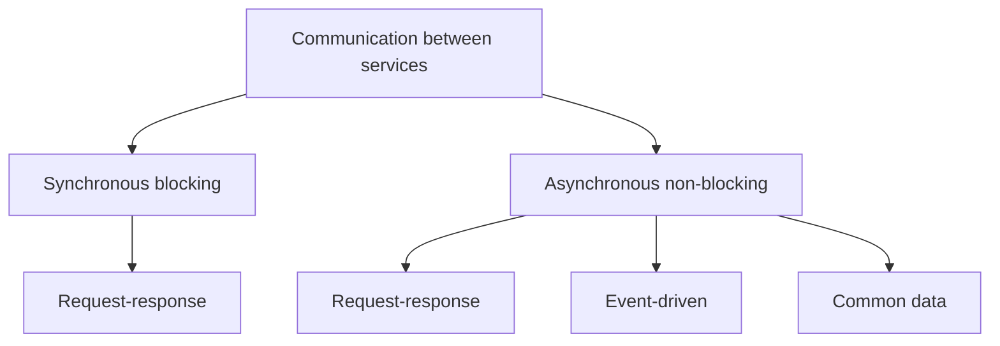
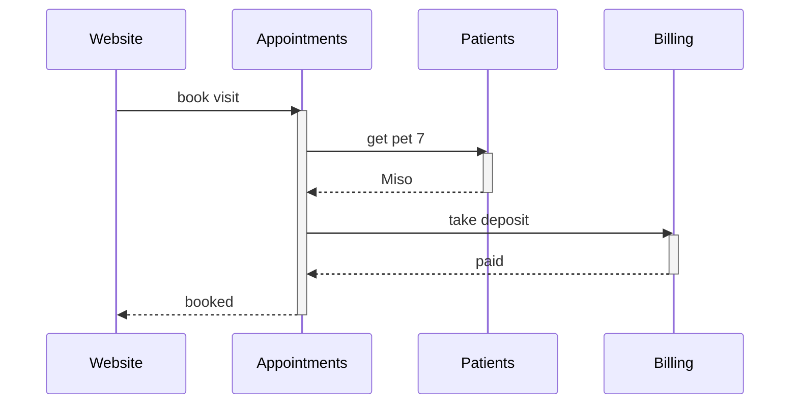
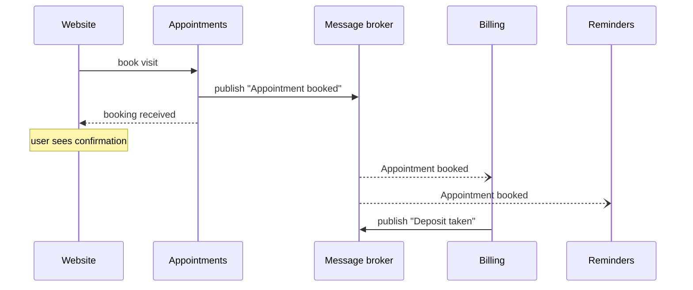

# From in-process to inter-process: synchronous and asynchronous calls

## Before this lesson

You should know what a network call costs (latency, partial failure) from [What a network call costs](#/lesson/microservices/network-cost-why-split), and what an API is from [Monoliths, services and APIs in plain words](#/lesson/microservices/monolith-service-api).

## In plain words

Services have to talk to each other. *How* they talk shapes almost everything about the system: how fast it feels, what happens when one part is down, and how tightly the services are tied together.

There are two basic ways to ask someone for something. You can **phone** them: you wait on the line until they answer, and you can do nothing else in the meantime. Or you can **send a message** and carry on with your day; the reply, if any, arrives later. A phone call is immediate and simple, but it fails if the other person is busy, and it keeps you tied up. A message survives the other person being away, but you have to cope with not knowing yet.

In software the phone call is called **synchronous blocking** communication, and the message is **asynchronous non-blocking** communication. This lesson first explains why a call between processes differs from a call inside one process, then compares the two styles in detail. The next lesson adds the question of *what* is being said: a request, or an announcement of an event.

Getting this choice right matters in real jobs because the wrong default (every service phoning every other service in a long chain) is the most common cause of slow, fragile microservice systems.

## 1. In-process versus inter-process

A call **in-process** is a function calling another function inside the same running program. A call **inter-process** crosses from one running program to another, normally over a network. On a diagram both are an arrow. In reality they differ in four ways.

### Performance

Inside a process, the compiler and runtime can make a call almost free; they may even remove it by copying the function body into the caller. Passing an argument usually means passing a small reference to data that stays where it is.

Between processes, the data itself must travel. The sender **serialises** it (turns it into bytes), sends the bytes, and the receiver **deserialises** them. The cost grows with the size of the data. That changes how you design interfaces: inside a process, a method called a thousand times in a loop is fine; across a network you ask for what you need in one go, and you avoid sending large objects when a few fields will do.

### Changing the interface

Inside one program, changing a function's parameters is a single atomic change: your editor updates all callers, and they ship together. Between services, the provider and its consumers are deployed at different times. Either the change is **backward compatible** (old callers still work), or you must roll it out in careful stages. Lesson 12 is devoted to this.

### Error handling

Inside a process, errors are few and clear: the function returns an error or raises an exception, or the whole process dies. Between processes, new kinds of failure appear. A useful classification for a remote call:

| Failure mode | What happens | Example at Pawprint |
|---|---|---|
| **Crash failure** | The server stops | The Patients service is killed mid-request |
| **Omission failure** | A message is sent and no response comes | The reply packet is dropped |
| **Timing failure** | Something happens too late (or too early) | The answer arrives after the caller gave up |
| **Response failure** | A response comes, and it is wrong or incomplete | The pet record arrives without the allergy list |
| **Arbitrary failure** | Something has gone wrong and the parties cannot agree whether it failed | Two services disagree about whether a payment happened |

Many of these are **transient**: they go away if you try again. Others are permanent (the pet does not exist). A caller needs to tell the two apart, which is why response formats carry rich error information. HTTP does this with status codes: the 400 range means "your request is wrong, do not retry unchanged", and the 500 range means "the server had a problem, a retry may help".

```python-run
def advice(status):
    if 200 <= status < 300:
        return "success"
    if status in (408, 429):
        return "caller-side but temporary: wait, then retry"
    if 400 <= status < 500:
        return "the request is wrong: fix it, do not retry"
    if status in (502, 503, 504):
        return "server temporarily unavailable: retry with backoff"
    if 500 <= status < 600:
        return "server error: a retry may help, alert if it persists"
    return "unexpected"

for s in (200, 201, 404, 409, 429, 500, 503):
    print(s, "->", advice(s))
```

The function turns a status code into a decision. Codes in the 200s are success. `408` (request timeout) and `429` (too many requests) are in the 400 range and still worth retrying after a pause. Other 400s mean the request itself must change. `502`, `503` and `504` say a server or something in front of it is temporarily unable to answer. The printed lines show how a client decides between "try again" and "give up", a decision that does not exist for an in-process call.

> [!WARNING]
> Do not try to make a remote call look exactly like a local one. Tools that hide the network completely encourage code that ignores latency and failure. A remote call should be visibly remote in the code, so that the person reading it thinks about timeouts and errors.

## 2. The styles of communication

Before picking a technology such as REST or a message broker, pick a **style**. The styles form a small family tree:



- **Synchronous blocking**: the caller sends a request and waits, doing nothing else on that task, until the answer arrives.
- **Asynchronous non-blocking**: the caller sends something and continues; it does not wait.
- **Request-response**: one service asks another to do something and expects to learn the result. This can be done in a blocking or a non-blocking way.
- **Event-driven**: a service announces that something happened; whoever is interested reacts. The announcer does not know or care who they are.
- **Common data**: services cooperate through a shared data source, such as a file dropped in an agreed place.

A real system uses a mix. The aim of this module is to know each one's strengths so you pick deliberately.

## 3. Synchronous blocking

In a **synchronous blocking** call, the calling code stops at the call until a response comes back or a timeout fires.



**Advantages.** It is familiar: it reads like ordinary code, one line after another. You know immediately whether the operation succeeded. It is easy to reason about and to debug.

**Disadvantages.** The caller and the callee are tied together in time, a property called **temporal coupling**: both must be up and reachable at the same moment. If Billing is down, the booking fails. If Billing is slow, Appointments is slow too, and the threads waiting inside Appointments pile up.

The danger grows with the length of the chain. In the diagram, the website waits for Appointments, which waits for Patients and then Billing. If Billing called a card provider, which called a fraud checker, the user's request would hold resources in five places, and a slow fraud checker would slow all five. The more links, the more likely that one is slow or down, as the availability arithmetic of lesson 2 showed.

```python-run
# A blocking chain: total time is the SUM, and one slow hop slows everyone.
def blocking_chain(hops, timeout_ms):
    total = 0
    for name, ms in hops:
        if ms > timeout_ms:
            return f"FAILED at {name} after {total + timeout_ms} ms (timeout)"
        total += ms
    return f"ok in {total} ms"

normal = [("patients", 20), ("billing", 60), ("card provider", 150)]
slow   = [("patients", 20), ("billing", 60), ("card provider", 4000)]

print("normal day:", blocking_chain(normal, timeout_ms=1000))
print("slow day:  ", blocking_chain(slow, timeout_ms=1000))
print("no timeout:", blocking_chain(slow, timeout_ms=10**9))
```

`blocking_chain` adds up the time of each hop, and gives up if a hop exceeds the timeout. On a normal day the booking takes 230 ms. On a slow day the card provider takes 4 seconds: with a 1-second timeout the user gets a failure after 1,080 ms; with no timeout, the user (and a thread in each service on the path) waits 4,080 ms. Either way the booking did not happen, because one distant dependency was slow.

**Where it fits.** Short interactions where the caller truly cannot continue without the answer, and short chains. "Does this pet exist?" before saving a booking is a reasonable blocking call.

## 4. Asynchronous non-blocking

In **asynchronous non-blocking** communication, the caller sends its message and carries on. The receiver may handle it a moment later, or in an hour.



Between the two sides sits something that holds the message until the receiver is ready, typically a **message broker**: a piece of infrastructure whose job is to accept messages, store them safely and deliver them.

**Advantages.**

- **No temporal coupling.** Billing can be down for ten minutes. The message waits in the broker; when Billing returns, it processes the backlog. The user's booking was not affected.
- **Long-running work becomes natural.** Some operations take minutes or days (waiting for a lab result). No one can hold a connection open that long; a message can wait.
- **Load levelling.** A burst of 5,000 bookings on Monday morning becomes a queue that Billing works through at its own pace instead of a spike that knocks it over.

**Disadvantages.**

- **More moving parts.** The broker must be run, monitored and understood.
- **You do not know the outcome yet.** The website said "booking received" before the deposit was taken. If the deposit later fails, the system needs a way to tell the user and to undo the booking. This is real design work (module 6).
- **Harder to follow.** There is no single stack trace. To see what happened to one booking you need a **correlation identifier**, a unique id attached to the first message and copied onto every message that results from it, plus tooling to search by it.

```python-run
from collections import deque

broker = deque()                      # the queue that holds messages
billing_up = False
processed = []

def book_visit(visit_id):
    broker.append({"type": "AppointmentBooked", "visit": visit_id, "correlation_id": f"c-{visit_id}"})
    return f"visit {visit_id}: booking received"      # returns at once, whatever Billing's state

def billing_poll():
    while billing_up and broker:
        msg = broker.popleft()
        processed.append(msg["visit"])

print(book_visit(551))
print(book_visit(552))
billing_poll()
print("billing down  -> waiting in broker:", len(broker), "processed:", processed)

billing_up = True                     # Billing recovers
billing_poll()
print("billing back  -> waiting in broker:", len(broker), "processed:", processed)
```

`broker` is a queue. `book_visit` puts a message on it and returns immediately; it never looks at whether Billing is running. `billing_poll` takes messages off the queue only when Billing is up. The first two bookings succeed from the user's point of view although Billing is down: the output shows 2 messages waiting and none processed. After Billing recovers, the queue drains and both visits are processed. No booking was lost and no user waited.

## 5. Comparing the two

| | Synchronous blocking | Asynchronous non-blocking |
|---|---|---|
| Caller waits for the result | Yes | No |
| Both sides must be up at once | Yes (temporal coupling) | No |
| Result known immediately | Yes | No; arrives later or not at all |
| Effect of a slow callee | Caller is slow too; resources held | Messages queue; caller unaffected |
| Infrastructure | Network only | A broker or queue |
| Debugging | One trace, simple | Needs correlation ids and tooling |
| Natural for | Quick lookups, short chains | Long-running work, bursts, fan-out to several receivers |

### Before and after at Pawprint

**Before.** Booking was one blocking chain: Website → Appointments → Patients → Billing → card provider → Reminders. A booking took around 600 ms, and when the text-message provider behind Reminders had an outage, *no one could book*, although sending a reminder has nothing to do with whether a slot is free.

**After.** The team asked of each call: *does the booking need this answer before it can reply to the user?*

| Call | Needed before replying? | New style |
|---|---|---|
| Does the pet exist? | Yes | Blocking request, short timeout, cached |
| Is the slot free? (inside Appointments) | Yes | In-process |
| Take the deposit | Business decision: yes for new clients | Blocking, with a clear failure message |
| Schedule a reminder | No | Asynchronous event |
| Update the reporting store | No | Asynchronous event |

Booking now takes around 200 ms, and an outage at the text-message provider delays reminders without touching bookings.

> [!TIP]
> A simple rule for each proposed call between services: *if the callee were down for ten minutes, should the caller's operation fail?* If the honest answer is "no", the call should not be synchronous.

> [!INTERVIEW]
> For "sync or async?", avoid declaring a winner. Say what each couples: *synchronous calls couple services in time and are right when the caller cannot proceed without the answer and the chain is short; asynchronous messaging decouples them in time, absorbs bursts and outages, and costs a broker, eventual outcomes and harder tracing.* Then apply the ten-minute rule to the interviewer's example.

## 6. Pitfalls

- **Long synchronous chains.** Each added hop multiplies the chance of failure and adds latency. Three hops is already a lot.
- **Blocking calls with no timeout.** One hung dependency can exhaust every worker in the caller.
- **Asynchronous in name only.** Sending a message and then blocking until a reply message arrives recreates temporal coupling with extra machinery.
- **Forgetting the unhappy path of async work.** "Booking received" needs a designed answer for "…and then the deposit failed".
- **No correlation id.** Without one, following a single booking through logs of five services is guesswork.
- **Retrying on every error.** A `404` will be a `404` the second time; retrying a non-idempotent write can duplicate it.

## Summary

- Calls between processes differ from calls within one: data is serialised and sent, interfaces cannot change atomically, and new failure modes appear (crash, omission, timing, response, arbitrary).
- Rich error information lets callers separate transient failures, worth retrying, from permanent ones.
- Synchronous blocking is simple and immediate, and couples caller and callee in time; long chains are slow and fragile.
- Asynchronous non-blocking removes that temporal coupling, handles long-running work and bursts, and costs infrastructure, delayed outcomes and harder tracing.
- Choose per interaction by asking whether the caller can proceed without the answer.

## Glossary

| Term | Meaning |
|---|---|
| In-process call | A function call inside one running program |
| Inter-process call | A call from one running program to another, usually over a network |
| Serialise / deserialise | Convert data to bytes for sending, and back |
| Backward compatible | A change that does not break existing callers |
| Transient failure | A failure that may disappear on a later attempt |
| Synchronous blocking | The caller waits for the response before continuing |
| Asynchronous non-blocking | The caller sends and continues without waiting |
| Temporal coupling | Two parties must be available at the same moment for an interaction to work |
| Message broker | Infrastructure that stores and delivers messages between services |
| Load levelling | Using a queue to turn a burst of work into a steady flow |
| Correlation identifier | An id copied onto all messages caused by one original request, used to follow it |

```quiz
[
  {"q": "Why must data be serialised for an inter-process call but not for an in-process call?", "options": ["Networks only accept JSON", "Separate processes share no memory, so the data itself must be converted to bytes and sent", "Serialisation makes code faster", "In-process calls cannot pass data"], "answer": 1,
   "explain": "Inside one process a reference to the data is enough. Across processes the bytes must travel, and the cost grows with their size."},
  {"q": "A caller receives HTTP status 404 for a pet lookup. What should it do?", "options": ["Retry five times quickly", "Treat it as a permanent answer and not retry the same request", "Restart the Patients service", "Wait an hour"], "answer": 1,
   "explain": "The 400 range says the request cannot succeed as sent. Retrying wastes resources; a 503, by contrast, may succeed later."},
  {"q": "What is temporal coupling?", "options": ["Two services using the same clock", "The requirement that caller and callee both be available at the same moment", "Sharing a database", "Calling a service twice"], "answer": 1,
   "explain": "A blocking call only works if the other side is reachable right now, which ties the availability of the caller to that of the callee."},
  {"q": "The text-message provider is down. In which design can owners still book visits?", "options": ["Booking calls Reminders synchronously and waits", "Booking publishes an event that Reminders handles later", "Booking calls Reminders with no timeout", "None"], "answer": 1,
   "explain": "With an asynchronous event the booking does not depend on Reminders being up. The message waits and is handled after recovery."},
  {"q": "Which is a real cost of asynchronous communication?", "options": ["It cannot handle bursts", "The outcome is not known when the caller continues, so failures must be reported and undone later", "It requires both sides to be up", "It only works inside one process"], "answer": 1,
   "explain": "The caller moves on before the work is done. The design must cover what happens if that later work fails."},
  {"q": "What is a correlation identifier for?", "options": ["Encrypting messages", "Following one original request through all the messages and logs it caused", "Choosing which server handles a request", "Limiting request rates"], "answer": 1,
   "explain": "Asynchronous flows have no single stack trace. A shared id on every related message lets tools reassemble the story."},
  {"q": "A team sends a message to a broker and then blocks until a reply message arrives before answering the user. What have they built?", "options": ["A fully decoupled design", "Synchronous behaviour with extra infrastructure: the temporal coupling is still there", "An event-driven system", "A common-data integration"], "answer": 1,
   "explain": "Waiting for the reply ties the caller to the responder in time again. The broker adds parts without removing the dependency."}
]
```

> **Source:** Newman, *Building Microservices*, 2nd ed., ch. 4 (topic coverage only; wording and the Pawprint example are original).
