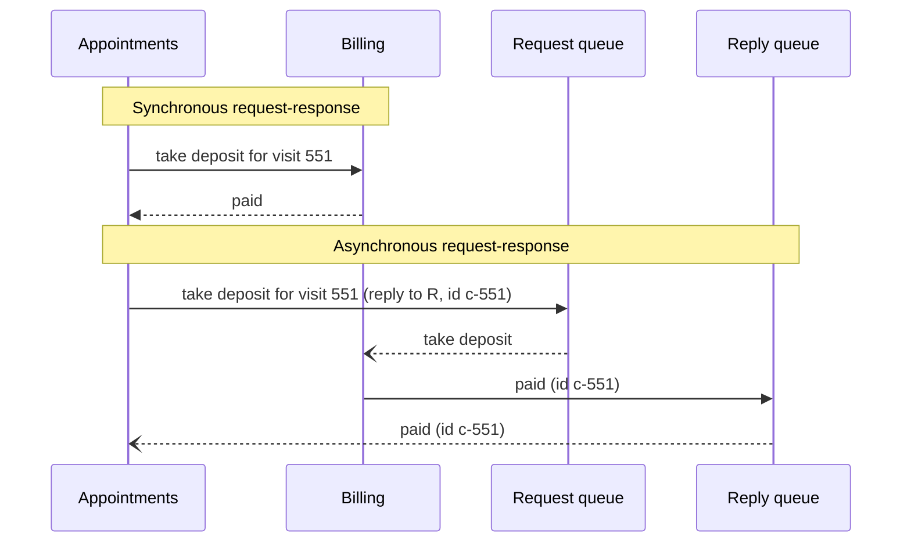
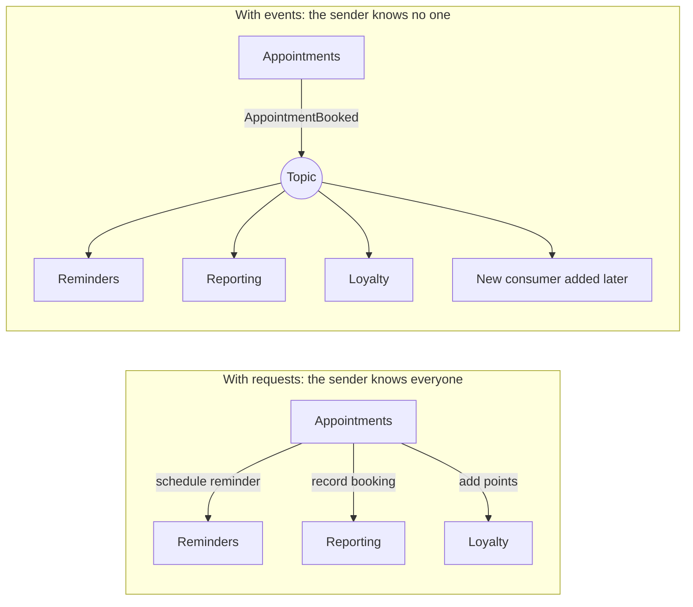
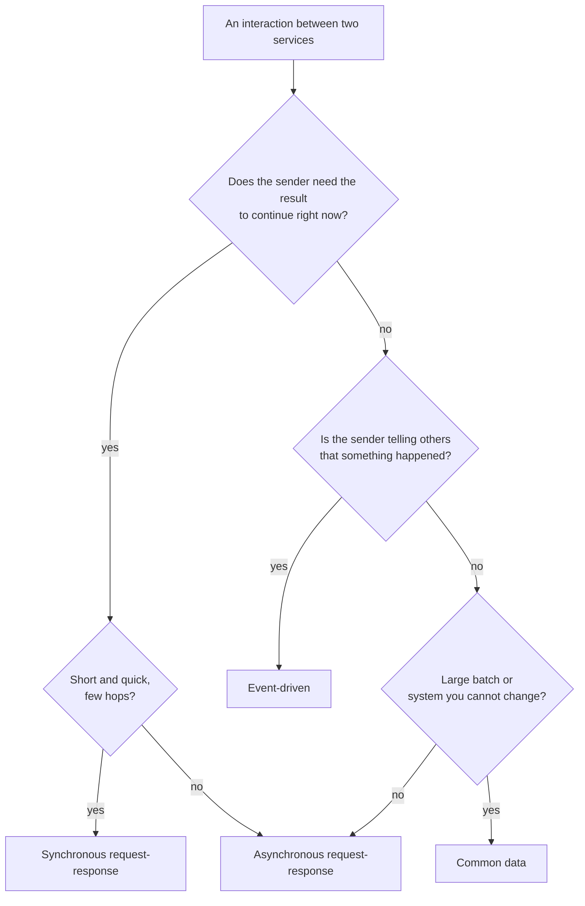

# Request-response, event-driven and common data: choosing a style

## Before this lesson

Read [From in-process to inter-process](#/lesson/microservices/sync-async) first. You should know the difference between synchronous blocking and asynchronous non-blocking communication, what a message broker is, and what temporal coupling means.

## In plain words

The previous lesson was about *waiting*: does the sender wait or not? This lesson is about *what is being said*. There are three things one service can do to cooperate with another:

- **Ask it to do something** and expect to hear how it went. This is **request-response**. It is like placing an order at a counter.
- **Announce that something happened** and let anyone who cares react. This is **event-driven** communication. It is like a station announcement: "The train from the coast has arrived." The announcer does not know who is listening or what they will do; some people walk to the platform, a taxi driver starts the engine, most people ignore it.
- **Leave data in an agreed place** for others to pick up later. This is **common data**. It is like a shared noticeboard or a pigeonhole.

The difference between the first two is about who holds the knowledge of what should happen next. With a request, the sender knows and decides. With an event, each listener decides for itself. That shift of responsibility is what makes event-driven systems loosely coupled, and also what makes them harder to see as a whole.

## 1. Request-response

In **request-response**, a service sends a request asking another service to do something, and expects a response telling it the result.

It can run over either waiting style:



In the synchronous form the response returns on the same connection. In the asynchronous form the request goes onto a queue, and the response comes back later on another queue. The response might be received by a *different copy* of the Appointments service than the one that sent the request, or the original copy may have restarted in between. So the state needed to continue ("which booking was this about?") cannot live in the memory of one process. It must be stored, typically in a database, and found again using the correlation id carried by the reply.

**Where it fits.**

- When the sender needs the answer to decide what to do next ("is this slot still free?").
- When the sender needs to know that the action succeeded, so it can retry or run a compensating step if it did not.
- When there is a clear single owner of the next step.

**What it couples.** The sender must know that the receiver exists, what it offers and what the answers mean. That is domain coupling, which is acceptable, but notice the direction: Appointments knows about Billing.

### Parallel instead of sequential calls

A blocking request does not force one-at-a-time calls. If a page needs data from three services that do not depend on each other, the caller can start all three and wait for all of them. The total time is then the *slowest* call, not the sum.

```python-run
calls = {"patients": 40, "billing": 120, "pharmacy": 70}     # milliseconds each

sequential = sum(calls.values())
parallel = max(calls.values())
print(f"one after another: {sequential} ms")
print(f"all at once:       {parallel} ms (limited by the slowest: "
      f"{max(calls, key=calls.get)})")
```

`calls` gives a latency for each service. Run one after another, the page waits for the sum, 230 ms. Started together, it waits for the maximum, 120 ms. The saving is free in design terms, so look for independent calls before reaching for a more complex style.

## 2. Event-driven communication

An **event** is a statement that something happened: *Appointment booked. Deposit taken. Medicine dispensed.* It is a fact about the past, so its name is in the past tense. In **event-driven** communication a service **emits** (publishes) events, and other services that have **subscribed** receive them and react.

The crucial difference from a request:

| | Request (command) | Event |
|---|---|---|
| Says | "Do this" | "This happened" |
| Sender knows the receiver | Yes | No |
| Who decides what happens next | The sender | Each receiver |
| Expected reply | Yes | None |
| Number of receivers | One | Zero, one or many |

With a request, Appointments would tell Reminders "schedule a reminder for visit 551", tell the reporting store "record a booking", and tell the loyalty system "add ten points". Appointments must know all three and what each should do. Adding a fourth consumer means changing Appointments.

With an event, Appointments announces `AppointmentBooked`. Reminders, reporting and loyalty each subscribe and each know their own job. Adding a fourth consumer changes nothing in Appointments. The dependency arrow has turned round: the consumers know about the event; the publisher knows about nobody.



A small simulation of the publish and subscribe mechanism:

```python-run
subscribers = {}                 # event type -> list of handler functions
log = []

def subscribe(event_type, handler):
    subscribers.setdefault(event_type, []).append(handler)

def publish(event):
    for handler in subscribers.get(event["type"], []):
        handler(event)           # the publisher does not know who these are

# Each consumer registers what it cares about and what it does.
subscribe("AppointmentBooked", lambda e: log.append(f"reminders: text scheduled for visit {e['visit']}"))
subscribe("AppointmentBooked", lambda e: log.append(f"reporting: booking {e['visit']} recorded"))
subscribe("AppointmentCancelled", lambda e: log.append(f"reminders: text cancelled for visit {e['visit']}"))

publish({"type": "AppointmentBooked", "visit": 551, "petId": 7, "slot": "Tue 10:00"})

# A new team adds a consumer. The publishing code above is not touched.
subscribe("AppointmentBooked", lambda e: log.append(f"loyalty: 10 points for pet {e['petId']}"))
publish({"type": "AppointmentBooked", "visit": 552, "petId": 9, "slot": "Tue 10:30"})

print("\n".join(log))
```

`subscribers` maps an event type to the functions that want it. `subscribe` adds a function to the list. `publish` looks up the list for the event's type and calls each function; it has no idea what they do. Two consumers handle the first event. Then a loyalty consumer subscribes, and the second event reaches three consumers. The line that publishes did not change. In a real system `publish` hands the event to a broker and the consumers are separate services, but the shape is the same.

### Topics and queues

Brokers offer two delivery shapes, and the names are used loosely, so here they are precisely:

- A **queue** delivers each message to **one** consumer. If three copies of Billing read the same queue, each message is handled by one of them. Use it for work to be done once.
- A **topic** delivers each message to **every subscribed group**. Reminders, reporting and loyalty each receive every `AppointmentBooked`. Within one group (say, three copies of Reminders), each message goes to one copy. Use it for events.

### What goes inside an event?

There are two schools, and the choice matters.

**An identifier and nothing else.** The event says `AppointmentBooked {visitId: 551}`. Consumers that need more call the Appointments API to fetch it.

- The event is small, and the publisher exposes little.
- But every consumer now calls back to Appointments (domain coupling returns), and when 5,000 events are published in a burst, 15,000 lookups hit Appointments at the same moment. If Appointments is down, the consumers are stuck.

**Fully detailed events.** The event carries what consumers are likely to need: `AppointmentBooked {visitId: 551, petId: 7, petName: "Miso", clientId: 31, slot: "...", vetId: 4}`.

- Consumers can act without calling anyone. They work even when Appointments is down. The stream of events also becomes a useful history.
- But everything in the event is now a published contract that the publisher must keep compatible. And data in an event is visible to every subscriber, so sensitive fields need care: you might publish a detailed event on a restricted topic and a slimmed-down one more widely.

| | Identifier only | Fully detailed |
|---|---|---|
| Event size | Small | Larger |
| Consumer independence | Low: must call back | High |
| Load on the publisher after a burst | High | None |
| Contract surface to maintain | Small | Larger |
| Risk of exposing sensitive data | Low | Needs control |

A sensible default is the detailed event, containing what you would be happy to offer through an API anyway, and nothing more.

> [!TIP]
> Put the facts in the event that were true *at the moment it happened*. `AppointmentBooked` should carry the slot as booked. If a consumer fetches the appointment later, it may see a slot that has since been changed, and act on the wrong information.

### What events demand of consumers

Brokers usually promise **at-least-once delivery**: every message will arrive, and now and then one will arrive twice (for example, when a consumer crashed after doing the work and before telling the broker). So consumers must be **idempotent**: handling the same event twice must have the same effect as handling it once. The usual way is to record the ids of processed events and skip repeats, as in the charging example of lesson 2.

Publishing has its own trap. A service that saves to its database and then publishes can crash between the two, leaving a booking with no event. The **transactional outbox** pattern (described at microservices.io) closes that gap: the service writes the event into an "outbox" table in the same local transaction as the business change, and a separate relay process forwards outbox rows to the broker. The relay may send a row twice after a crash, which is one more reason consumers must be idempotent. The practice problem *Outbox Relay and the Idempotent Consumer* simulates both halves.

Things that will go wrong and need a plan:

- **A message that always fails.** A consumer with a bug rejects a message, the broker redelivers it, and it fails again, for ever, blocking everything behind it. Limit the number of attempts and move such a message to a **dead letter queue**, a holding area for messages that could not be processed, where people can inspect it.
- **Slow consumers.** If events arrive faster than they are handled, the backlog grows. Watch the queue length and add consumer copies.
- **Ordering.** Two events about the same booking may arrive out of order when several consumers work in parallel. Either route all events for one booking to the same consumer, or make handlers tolerate reordering (for example by ignoring an event older than the state already stored).

## 3. Common data

In the **common data** style, one service writes data to a shared location and others read it later. Two common forms:

- A **data lake**: files in raw form (exports, logs) placed in shared storage, for downstream analysis.
- A **data warehouse**: a structured store with a defined schema that sources load into.

The flow is one-directional and slow: data is written, and at some later time something notices and processes it. At Pawprint, the nightly stock export that the wholesaler's system collects as a file is common-data communication. So is the reporting database of lesson 8.

**Advantages.** It is simple and universally supported: every technology can read and write a file. It handles very large volumes well. It is often the only way to integrate with an old or external system.

**Disadvantages.** It is slow to react: consumers find out by polling or by a scheduled job. And the shared location is common coupling: if the format of the file changes, every reader is affected, so the format must be treated as a contract.

**Where it fits.** Large batch transfers, analytics and reporting, and integration with systems you cannot change. It does not fit anything that needs a prompt reaction.

## 4. Choosing a style

There is no single right answer, and almost every system uses all of them. A set of questions helps:



| Style | Coupling in time | Sender knows receiver | Complexity | Typical use |
|---|---|---|---|---|
| Synchronous request-response | Tight | Yes | Low | Lookups, validations, short chains |
| Asynchronous request-response | Loose | Yes | Medium | Long-running tasks, levelling bursts |
| Event-driven | Loose | No | Medium to high | Notifying many interested parties, building local copies of data |
| Common data | None | Indirectly, through the format | Low | Batch, analytics, legacy integration |

### Worked example: the lab result flow

When a blood sample is analysed by an outside laboratory, four things should happen: the result is stored in the patient's record, the vet is notified, an invoice line is added, and if a value is critical the owner gets a text.

**First design (all synchronous requests).** A Lab integration service receives the result and calls Clinical records, then Notifications, then Billing, then Reminders, in order. If Billing is being redeployed at that moment, the whole chain fails and the result is not acknowledged; the lab resends it; Clinical records stores it twice.

**Second design (mixed).**

| Step | Style | Reason |
|---|---|---|
| Lab file arrives nightly from the external laboratory | Common data | The lab only offers file transfer |
| Lab integration stores the result in Clinical records | Synchronous request with an idempotency key | Must be confirmed before acknowledging the lab; safe to retry |
| Clinical records announces `LabResultRecorded` | Event | Several parties care, and more will later |
| Notifications, Billing and Reminders react | Event consumers | None of them should be able to block the others |

Now a Billing redeployment delays an invoice line by a minute and affects nothing else, and a new consumer (say, a research data set) can be added without touching the lab flow.

> [!INTERVIEW]
> A common question is "When would you use events instead of direct calls?" A complete answer: *when the publisher should not need to know who reacts, when several consumers need the same fact, when consumers must keep working if the publisher is down, or when work can happen later. I would keep a direct request where the caller needs the answer to proceed. Events cost a broker, idempotent consumers, attention to ordering, and tooling to trace the flow.*

## 5. Pitfalls

- **Commands disguised as events.** An "event" called `SendReminderRequested` aimed at exactly one consumer is a request. Name things for what they are; the publisher of a true event does not care whether anyone listens.
- **Events with only an id, at scale.** A burst of events becomes a burst of call-backs that takes the publisher down.
- **Leaking sensitive fields in broad events.** Everything in an event is visible to all subscribers of that topic.
- **Non-idempotent consumers.** At-least-once delivery will, sooner or later, deliver twice.
- **No dead letter queue.** One bad message stalls the stream.
- **Losing sight of the whole process.** When a business flow is spread over six subscribers, nobody can say where a stuck booking is. Module 6 (sagas) and module 10 (tracing) address this.
- **Using a shared file drop for something urgent.** Common data is for batch; do not hang interactive behaviour on it.

## Summary

- Request-response asks for an action and expects an outcome; it can be synchronous or asynchronous, and the asynchronous form needs stored state and a correlation id.
- Event-driven communication announces facts. The publisher does not know the consumers, so consumers can be added freely and can keep working when the publisher is down.
- Detailed events make consumers independent at the cost of a larger contract; identifier-only events are small and push load back on the publisher.
- At-least-once delivery requires idempotent consumers; the outbox pattern makes publishing reliable; dead letter queues contain bad messages.
- Common data suits batch and legacy integration and is slow and format-coupled.
- Choose per interaction: need the answer now, announcing a fact, or moving bulk data.

## Glossary

| Term | Meaning |
|---|---|
| Request-response | Asking a service to act and expecting a result |
| Command | A message asking for something to be done |
| Event | A statement that something happened, named in the past tense |
| Publish / subscribe | Emitting events to a broker, and registering to receive them |
| Queue | A channel in which each message goes to one consumer |
| Topic | A channel in which each message goes to every subscribed group |
| Fully detailed event | An event carrying the data consumers need to act |
| At-least-once delivery | A guarantee that every message arrives, possibly more than once |
| Transactional outbox | Storing outgoing messages in the same local transaction as the business change, for a relay to send |
| Dead letter queue | A holding place for messages that repeatedly failed processing |
| Common data | Cooperation through data placed in a shared location |
| Data lake / data warehouse | Shared stores of raw files / structured data for analysis |

```quiz
[
  {"q": "What is the essential difference between a request and an event?", "options": ["Requests use JSON and events use binary", "A request tells a known receiver what to do; an event states what happened and leaves the reaction to whoever listens", "Events are always faster", "Requests cannot fail"], "answer": 1,
   "explain": "The difference is where the knowledge of the next step lives: in the sender for a request, in each consumer for an event."},
  {"q": "A new team wants to react to every booking. In an event-driven design, what must change in the Appointments service?", "options": ["A new outbound call must be added", "Nothing: the new consumer subscribes to the existing event", "The database schema", "Its deployment order"], "answer": 1,
   "explain": "The publisher does not know its consumers, so adding one does not touch it. That is the main coupling benefit of events."},
  {"q": "Events carry only an id, and 5,000 are published in a burst to three consumers. What is the likely effect?", "options": ["Nothing", "Up to 15,000 call-backs hit the publisher at once, and consumers stall if it is down", "The broker deletes the events", "Consumers become idempotent"], "answer": 1,
   "explain": "Identifier-only events push every consumer to fetch details, concentrating load on the publisher and reintroducing a runtime dependency."},
  {"q": "Why must event consumers be idempotent?", "options": ["Brokers deliver each message exactly once", "Brokers typically guarantee at-least-once delivery, so the same event can arrive twice", "Idempotent code is shorter", "Events have no ids"], "answer": 1,
   "explain": "A redelivery after a crash or timeout is normal. Recording processed ids and skipping repeats makes it harmless."},
  {"q": "What problem does the transactional outbox solve?", "options": ["Slow consumers", "A crash between saving business data and publishing the event, which would leave the two out of step", "Large messages", "Sorting events by time"], "answer": 1,
   "explain": "Writing the event to an outbox table in the same local transaction ensures it exists whenever the change does. A relay publishes it afterwards."},
  {"q": "A consumer bug makes one message fail on every attempt. What keeps it from blocking all later messages?", "options": ["A larger broker", "A retry limit and a dead letter queue", "Synchronous calls", "Deleting the topic"], "answer": 1,
   "explain": "After a set number of attempts the message is parked for inspection, and processing of the rest continues."},
  {"q": "An external laboratory can only deliver results as a nightly file. Which style is this?", "options": ["Synchronous request-response", "Event-driven", "Common data", "In-process"], "answer": 2,
   "explain": "Data is left in an agreed place and picked up later. It suits batch transfers and systems you cannot change."},
  {"q": "Three independent lookups take 40, 120 and 70 ms. If the caller starts them together, roughly how long does it wait?", "options": ["230 ms", "120 ms", "40 ms", "77 ms"], "answer": 1,
   "explain": "Parallel independent calls cost as much as the slowest one, not the sum."}
]
```

> **Source:** Newman, *Building Microservices*, 2nd ed., ch. 4 (topic coverage only; wording and the Pawprint example are original). Chris Richardson, "Pattern: Transactional outbox", https://microservices.io/patterns/data/transactional-outbox.html
