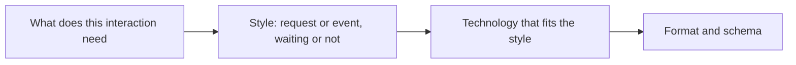
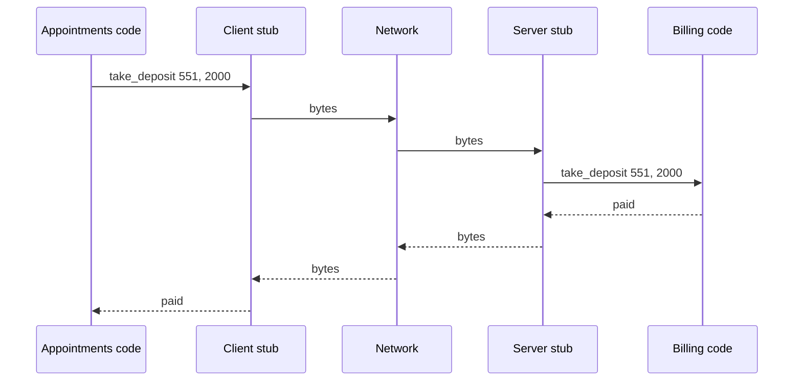

# Technology choices: RPC, REST, GraphQL, brokers, formats and schemas

## Before this lesson

> **Before this lesson:** read [From in-process to inter-process](#/lesson/microservices/sync-async) and [Request-response, event-driven and common data](#/lesson/microservices/request-response-events). You should know what synchronous and asynchronous calls are, what a message broker is, and the difference between a request and an event. You should be able to read short Python.

## In plain words

The last two lessons were about the *style* of a conversation between services: does the caller wait, and is it asking or announcing? This lesson is about the *equipment* used to hold that conversation.

Think about how a clinic orders supplies. It can telephone the wholesaler and read out a fixed script ("order, item 4417, quantity 20"). It can fill in a standard order form that every supplier in the country accepts. It can send a shopping list that says exactly which details it wants back. Or it can drop a note in the wholesaler's letterbox and carry on with the day. Each method works. Each makes some things easy and other things awkward.

Services have the same four families of equipment:

- **RPC** (remote procedure call): calling a function that happens to live in another program.
- **REST** (representational state transfer): working with named "things" over the web's own protocol.
- **GraphQL**: letting the caller describe exactly which data it wants.
- **Message brokers**: middlemen that hold and forward messages.

Under all four sit two more decisions: the **serialisation format** (how data is turned into bytes) and the **schema** (the written description of what a message may contain).

Why this matters for a job: you will be asked "why REST and not gRPC here?" in design interviews and in real design reviews. The good answer starts from what the interaction needs, never from which tool is fashionable.

## 1. Decide the style first, then the tool

A common mistake is to pick a technology and let it decide the design. The order that works is the reverse:



Whatever you pick, five qualities are worth looking for. They will be the yardstick for the rest of the lesson.

| Quality | Plain meaning |
|---|---|
| Backward compatibility is easy | You can add things without breaking existing callers |
| The interface is explicit | A reader can see exactly what the service offers and expects |
| The API is technology-agnostic | Callers are not forced to use the same language or framework as the service |
| The service is easy to consume | A new caller can start using it without weeks of effort |
| Internal detail stays hidden | Callers depend on the contract, not on how the service stores or computes things |

**Backward compatibility** means a new version of a service still works with callers written for the old version. An **interface** (or **contract**) is the set of operations and message shapes a service promises to the outside world.

## 2. Remote procedure calls

A **remote procedure call (RPC)** makes a call to another process look like a call to a local function. You write `billing.take_deposit(visit_id, amount)` and, behind that line, a library packs the arguments into bytes, sends them across the network, waits, and unpacks the answer.

The library pieces have names:

- An **interface definition** describes the functions, their arguments and their results in a neutral language. For gRPC (a popular RPC framework that came out of Google) this is a `.proto` file.
- A **client stub** is generated code that the caller uses. It has the same function names as the real service but contains only packing-and-sending logic.
- A **server stub** (or skeleton) is generated code on the receiving side that unpacks the bytes and calls the real function.



Here is the whole mechanism in miniature. Read it top to bottom; each part is explained underneath.

```python-run
import json

# ---- the real service (lives in the Billing process) ----
def take_deposit(visit_id, cents):
    return {"visit": visit_id, "status": "paid", "cents": cents}

SERVER_FUNCTIONS = {"take_deposit": take_deposit}

def server_stub(raw_bytes):
    call = json.loads(raw_bytes)                       # unpack
    result = SERVER_FUNCTIONS[call["fn"]](*call["args"])
    return json.dumps(result).encode()                 # pack the answer

# ---- the pretend network ----
network_up = True
def network(raw_bytes):
    if not network_up:
        raise ConnectionError("no route to billing")
    return server_stub(raw_bytes)

# ---- the client stub (lives in the Appointments process) ----
class BillingClient:
    def take_deposit(self, visit_id, cents):
        raw = json.dumps({"fn": "take_deposit", "args": [visit_id, cents]}).encode()
        return json.loads(network(raw))

billing = BillingClient()
print("looks local:", billing.take_deposit(551, 2000))

network_up = False
try:
    billing.take_deposit(552, 2000)
except ConnectionError as e:
    print("but it is not local:", e)
```

`take_deposit` is the real work. `server_stub` turns incoming bytes back into a function name and arguments, calls the function, and turns the result into bytes. `network` stands in for the wire. `BillingClient.take_deposit` is the client stub: same name, but all it does is pack and send. The first call prints a result and looks like an ordinary function call. Then the network is switched off and the same line raises an error that an ordinary function call could never raise. That second print is the most important fact about RPC.

### What RPC gives you

- **Little ceremony.** Generated stubs mean a caller is productive in minutes.
- **An explicit interface.** The definition file is the contract, and tools can check it.
- **Speed.** gRPC uses a compact binary format and HTTP/2 (a newer version of the web protocol that can carry many calls over one connection), so it has low overhead and supports streaming.

### What can go wrong

- **Technology coupling.** Some older RPC systems only work when both sides use the same platform. Java RMI is the usual example: caller and service must both run on the Java virtual machine. That removes the freedom to choose technology per service. gRPC and similar modern frameworks support many languages, which avoids this trap.
- **Pretending the network is not there.** A local call takes nanoseconds and either works or throws a clear error. A remote call takes a thousand times longer and can fail halfway (lesson 2). When the code hides the difference, developers write loops with a remote call inside and wonder why a page takes four seconds. Good client libraries keep the remoteness visible: they make you set a timeout and handle a failure.
- **Brittleness.** In some RPC systems, changing the definition forces every client to regenerate its stub and deploy at the same time as the server. That is a lockstep release, the opposite of independent deployability. Frameworks built on Protocol Buffers avoid most of this by identifying fields with numbers, so that fields can be added without disturbing old clients.

**Where it fits.** Service-to-service calls inside one organisation, where you control both ends and want speed and a checked contract. It fits less well when unknown outside parties must call you, because they would all need your stubs.

## 3. REST

**REST** is a style of building APIs around **resources**. A resource is a thing the service knows about that has a name: a pet, an appointment, an invoice. The name is a URL such as `/pets/7`. A client asks for a **representation** of the resource (usually a JSON document) and acts on it with a small fixed set of verbs.

REST is most often used over **HTTP** (hypertext transfer protocol, the protocol browsers use), because HTTP already has the verbs:

| HTTP verb | Meaning on a resource | Safe to repeat? |
|---|---|---|
| GET | Read it | Yes |
| POST | Create a new one under a collection | No, unless you add an idempotency key |
| PUT | Replace it with this version | Yes |
| DELETE | Remove it | Yes |

HTTP also gives **status codes** that every tool understands: 200 for success, 404 when the resource does not exist, 409 for a conflict, 503 when the service is unavailable. And it brings a large ecosystem for free: caching proxies, load balancers, security tooling, and command-line clients such as `curl`.

Because the representation is separate from how the data is stored, the service can change its database without changing what callers see. That is information hiding (lesson 5) applied at the API.

### Hypermedia

Full REST includes a principle with an awkward name, **HATEOAS** (hypermedia as the engine of application state). The idea: responses contain links to what the client can do next, and the client follows links by their meaning instead of hard-coding URLs.

```json
{
  "id": 551,
  "slot": "Tue 10:00",
  "links": {
    "cancel": "/appointments/551/cancellation",
    "pay-deposit": "/billing/deposits?visit=551"
  }
}
```

A person using a website does this all the time: you click "Cancel booking" wherever the designer put it this month. A client that follows the `cancel` link keeps working when the URL behind it moves. The cost is extra round trips and more work in the client, so many teams use resources and verbs but skip the links. That is a reasonable trade for internal APIs.

### What can go wrong

- **Overhead.** Textual JSON over HTTP/1.1 is heavier than a binary RPC call. For most systems this does not matter; for a service called thousands of times per second by a neighbour, it can.
- **Client code is less automatic.** There is no stub by default. **OpenAPI** (a standard format for describing HTTP APIs, formerly called Swagger) fills the gap: from one description file you can produce documentation and client code.
- **Chatty pages.** A mobile screen that needs a pet, its next appointment and its unpaid invoices may need three or more calls. This is the problem the next technology was invented for.

**Where it fits.** APIs used by many kinds of callers, especially outside parties and browsers, and anywhere the web's caching is valuable.

## 4. GraphQL

**GraphQL** is a query language for APIs. The client sends one request that describes the exact shape of the data it wants, and the server returns that shape and nothing else.

Two words describe what it fixes. **Over-fetching** is receiving more fields than you need: the phone app wants a pet's name and gets forty fields. **Under-fetching** is needing several calls to assemble one screen.

```python-run
# Three "services", each with more fields than the screen needs.
PETS     = {7: {"name": "Miso", "species": "cat", "born": "2019-03-02", "chip": "985-112", "notes": "nervous"}}
VISITS   = {7: {"next": "Tue 10:00", "vet": "Dr Lim", "room": 3, "reason": "vaccination"}}
INVOICES = {7: {"unpaid_cents": 4500, "last_paid": "2026-09-01", "currency": "SGD"}}

# REST style: three calls, each returns everything.
rest = [PETS[7], VISITS[7], INVOICES[7]]
rest_fields = sum(len(doc) for doc in rest)
print(f"REST:    {len(rest)} calls, {rest_fields} fields received")

# GraphQL style: the client states the shape; a resolver fills it in.
query = {"pet": ["name"], "visit": ["next"], "invoices": ["unpaid_cents"]}
SOURCES = {"pet": PETS, "visit": VISITS, "invoices": INVOICES}

def resolve(pet_id, query):
    return {part: {f: SOURCES[part][pet_id][f] for f in fields}
            for part, fields in query.items()}

answer = resolve(7, query)
print(f"GraphQL: 1 call,  {sum(len(v) for v in answer.values())} fields received")
print(answer)
```

The three dictionaries stand in for three services. The REST section fetches three whole documents: three calls and 12 fields. `query` lists only the fields the screen shows. `resolve` walks the query and copies only those fields. The result is one call and three fields. On a slow mobile connection, that difference is the whole reason GraphQL exists.

### What it costs

- **Unpredictable load.** The client writes the query, so a client can write an expensive one, such as "every pet, with every visit, with every invoice line". With a database you can inspect a slow query plan; GraphQL tooling for this is thinner. Teams add depth limits and cost limits.
- **Caching is harder.** With REST, `/pets/7` is one address a cache can store. A GraphQL request is a custom query, usually sent as a POST, so standard HTTP caches cannot help without extra machinery.
- **Writes fit less naturally.** GraphQL shines at reading. Changes (called mutations) work, but they are closer to RPC with extra syntax.
- **The thin-wrapper temptation.** It is easy to expose the database tables directly through GraphQL. That couples every client to the storage layout, which is the opposite of information hiding.

**Where it fits.** At the edge of the system, serving user interfaces, particularly mobile ones. It is rarely the right choice for one microservice calling another. Lesson 30 returns to it.

## 5. Message brokers

A **message broker** is a piece of software that sits between services and carries messages for them. The sender hands a message to the broker and moves on. The broker holds it until a receiver takes it. Lesson 10 introduced the two delivery shapes: a **queue** (each message goes to one consumer) and a **topic** (each message goes to every subscribed group).

What you are buying from a broker:

- **Guaranteed delivery.** The broker keeps the message on disk until a consumer confirms it has been handled. If the consumer is down for an hour, the message waits. The sender did not have to do anything special.
- **Decoupling in time.** Sender and receiver do not need to be running at the same moment.
- **Fan-out.** One published event can reach many consumers without the publisher knowing them.

Be careful with one promise. Some brokers advertise **exactly-once delivery**. In practice, a consumer can always crash after doing the work and before confirming it, so design every consumer to be idempotent (safe to run twice), as lesson 10 explained, and treat stronger promises as a bonus.

Two well-known brokers show the range:

| | RabbitMQ and similar queue brokers | Kafka and similar log brokers |
|---|---|---|
| Mental model | A post office: messages are delivered and then removed | A logbook: messages are appended and kept |
| After a consumer reads a message | It is gone | It stays for a configured time, or for ever |
| A new consumer can read old messages | No | Yes, by starting from an earlier position |
| Typical strength | Work queues, flexible routing | Very high volume, replaying history, stream processing |

**Stream processing** means continuously computing over a flow of events, for example "count bookings per clinic in the last five minutes". Cloud providers also sell managed brokers, which save you from running one yourself; running a broker well is real operational work, and it becomes a piece of infrastructure many services depend on.

**Where it fits.** Events, long-running work, and smoothing bursts. It does not fit a caller that must show an answer on screen within 100 ms.

## 6. Serialisation formats

**Serialisation** is turning an in-memory value into a sequence of bytes that can travel; **deserialisation** is the reverse. There are two families.

**Textual formats** are readable by people. **JSON** (JavaScript object notation) is the common choice. **XML** is older and wordier, with strong tooling in some industries.

**Binary formats** are compact and fast to read by machines, and unreadable to people without a tool. **Protocol Buffers** (used by gRPC) and **Avro** (common with Kafka) are examples.

```python-run
import json, struct

visit = {"visit_id": 551, "pet_id": 7, "deposit_cents": 2000, "confirmed": True}

as_text = json.dumps(visit).encode()
# A binary layout agreed in advance: three unsigned 32-bit integers and one boolean.
as_binary = struct.pack("<III?", visit["visit_id"], visit["pet_id"],
                        visit["deposit_cents"], visit["confirmed"])

print("JSON  :", len(as_text), "bytes ->", as_text.decode())
print("binary:", len(as_binary), "bytes ->", as_binary.hex())
print("unpacked:", struct.unpack("<III?", as_binary))
```

`json.dumps` produces text that repeats every field name inside the message. `struct.pack` writes the four values using a layout (`<III?`) that both sides must already know: no names travel, only values. The JSON is around 75 bytes and the binary form is 13. The price is visible in the last line: the binary bytes mean nothing unless you hold the layout. In other words, binary formats depend on a schema.

Start with JSON unless you have measured a problem. It is easy to debug, every language reads it, and the size difference rarely matters until volumes are large.

## 7. Schemas

A **schema** is a formal description of what a message may contain: field names, types, and which fields are required. A `.proto` file is a schema. So is an OpenAPI document or a JSON Schema file.

Schemas matter because of what they catch. There are two ways to break a contract:

- A **structural break** changes the shape: a field is removed or renamed, a type changes, a new required field is added. Old callers can no longer read or write the message.
- A **semantic break** keeps the shape and changes the meaning: `deposit` used to be in cents and is now in dollars. Every message still parses. Every amount is now wrong by a factor of 100.

```python-run
SCHEMA_V1 = {"visit_id": int, "deposit": int}          # deposit in cents

def structurally_valid(message, schema):
    return all(k in message and isinstance(message[k], t) for k, t in schema.items())

ok          = {"visit_id": 551, "deposit": 2000}
renamed     = {"visit_id": 551, "amount": 2000}        # structural break
now_dollars = {"visit_id": 551, "deposit": 20}         # semantic break

for name, msg in [("original", ok), ("field renamed", renamed), ("unit changed", now_dollars)]:
    print(f"{name:14s} passes schema check: {structurally_valid(msg, SCHEMA_V1)}")

# Only a test that knows the meaning catches the last one.
def consumer_test(message):
    return message["deposit"] >= 500                   # a deposit is never under 5.00

print("consumer test on 'unit changed':", consumer_test(now_dollars))
```

`structurally_valid` checks that every field in the schema is present with the right type. The renamed field fails the check, so a schema catches it before production. The message with the unit change passes: an integer is an integer. Only `consumer_test`, which encodes a business expectation, notices. The lesson: schemas catch structural breaks automatically, and you still need tests for semantic ones. Lesson 20 builds this into contract testing, and the practice problems *Breaking or Non-breaking Schema Change* and *Schema Evolution: Read Old Data with a New Schema* let you implement the checker.

Should you bother with schemas when JSON works without one? Yes. Without a schema the contract still exists; it lives in people's heads and in the caller's code, where no tool can check it. A schema makes the interface explicit, which was the second quality in the yardstick table. The more separate teams consume an API, the more that matters.

## 8. Choosing, with a worked example

| Technology | Best at | Weak at | Typical place |
|---|---|---|---|
| gRPC or another modern RPC | Fast, checked, internal request-response | Unknown external callers | Between your own services |
| REST over HTTP | Broad reach, caching, simple tooling | Chatty screens, raw speed | Public and internal APIs |
| GraphQL | Screens that need custom slices of data | Caching, predictable load, service-to-service | The edge, for user interfaces |
| Queue broker | Work to be done once, later | Immediate answers | Background jobs, commands |
| Log broker | Events to many consumers, replay | Small systems that do not need it | Event streams |

Pawprint Clinics now has seven services. Here is how the team assigns equipment:

| Interaction | Need | Choice |
|---|---|---|
| Website shows free slots | Reach browsers, cache popular days | REST with JSON |
| Appointments asks Billing to take a deposit | Fast internal request, checked contract | gRPC with a timeout |
| "Appointment booked" announced to Reminders, Loyalty and Reporting | Many consumers, more later | Topic on a broker, Avro schema |
| Mobile app home screen | One round trip, custom fields | GraphQL at the edge |
| Nightly stock file for the wholesaler | Their system only reads files | Common data, CSV with a documented format |

Notice that one company uses all of them. Mixed technology is normal; what you want to avoid is choosing differently for the same kind of interaction with no reason, because every extra technology is something more to learn, secure and monitor.

> [!INTERVIEW]
> "REST or gRPC?" has a short strong answer: *gRPC for internal service-to-service calls where I control both ends and want a checked contract and low overhead; REST for APIs that browsers or third parties consume, because of its reach and caching. I would add a broker for events, and consider GraphQL only at the edge for user interfaces. Whatever I pick, I want an explicit schema and timeouts on every call.*

## 9. Pitfalls

- **Choosing the tool first.** "We are a Kafka shop" is not a design. Start from what the interaction needs.
- **Hiding the network.** RPC that looks local invites loops of remote calls and code with no timeout.
- **Lockstep stubs.** If a server change forces all clients to redeploy at once, independent deployability is gone.
- **GraphQL over raw tables.** Callers become coupled to your storage layout.
- **Trusting exactly-once.** Build idempotent consumers regardless of what the broker's brochure says.
- **No schema.** The contract exists anyway; without a schema nobody can check it.
- **Believing a schema is enough.** It catches shape, not meaning.
- **Binary formats too early.** You lose the ability to read a message with your eyes, in exchange for a saving you may not need.

## Summary

- Pick the communication style first, then a technology that suits it.
- Judge any option by five qualities: easy backward compatibility, an explicit interface, technology-agnostic APIs, ease of consumption, and hidden internals.
- RPC makes remote calls feel local, which is convenient and dangerous; modern frameworks such as gRPC are fast and multi-language.
- REST models resources over HTTP and inherits the web's tooling and caching.
- GraphQL lets the client choose the fields, which suits user interfaces and brings unpredictable load and harder caching.
- Brokers give guaranteed delivery and fan-out; queue brokers deliver and delete, log brokers keep history.
- Textual formats are easy to inspect; binary formats are smaller and need a schema.
- A schema catches structural breaks; only tests catch semantic breaks.

## Glossary

| Term | Meaning |
|---|---|
| RPC | Remote procedure call: invoking a function in another process as if it were local |
| Stub | Generated code that packs and unpacks calls on the client or server side |
| gRPC | A multi-language RPC framework using Protocol Buffers over HTTP/2 |
| REST | An API style built on named resources, representations and a fixed set of verbs |
| Resource | A named thing a service exposes, such as `/pets/7` |
| HATEOAS | Responses carry links that tell the client what it can do next |
| OpenAPI | A standard file format for describing HTTP APIs |
| GraphQL | A query language in which the client states the shape of the data it wants |
| Over-fetching / under-fetching | Receiving too many fields / needing too many calls |
| Message broker | Middleware that stores and forwards messages between services |
| Serialisation | Turning in-memory data into bytes for transport |
| Schema | A formal description of the fields and types a message may contain |
| Structural break | A contract change that alters the shape of a message |
| Semantic break | A contract change that keeps the shape and alters the meaning |

```quiz
[
  {"q": "What is the main danger of RPC that makes a remote call look like a local one?", "options": ["The code will not compile", "Developers forget the call is slow and can partly fail, so they omit timeouts and call it in loops", "It cannot return values", "It only works with JSON"], "answer": 1,
   "explain": "A network call is far slower than a local one and has failure modes a local call lacks. Hiding that difference leads to chatty, fragile code."},
  {"q": "In REST over HTTP, which verb is NOT safe to repeat without extra care?", "options": ["GET", "PUT", "DELETE", "POST"], "answer": 3,
   "explain": "Repeating a POST can create a second resource. GET, PUT and DELETE leave the same end state when repeated; POST needs an idempotency key to be safe."},
  {"q": "A phone screen needs one field from each of three services. Which problem does GraphQL address here?", "options": ["Guaranteed delivery", "Over-fetching and under-fetching: one request returns exactly the fields named", "Binary encoding", "Service discovery"], "answer": 1,
   "explain": "The client describes the shape it wants, so it makes one round trip and receives only those fields."},
  {"q": "Why is caching harder with GraphQL than with REST?", "options": ["GraphQL responses are encrypted", "Each request is a custom query instead of a stable address such as /pets/7 that a standard HTTP cache can store", "GraphQL cannot return JSON", "Caches only work with XML"], "answer": 1,
   "explain": "HTTP caches key on the URL of a GET. GraphQL queries vary per client and are usually sent as POSTs, so standard caches cannot reuse them."},
  {"q": "What is the practical difference between a queue broker and a log broker such as Kafka?", "options": ["Queue brokers are always faster", "A queue broker removes a message once consumed; a log broker keeps messages so consumers can replay them", "Log brokers cannot have more than one consumer", "Queue brokers do not store messages on disk"], "answer": 1,
   "explain": "A log keeps history, which allows new consumers to read past events and supports stream processing."},
  {"q": "A field named deposit changes from cents to dollars. The JSON still has an integer in that field. What kind of break is this, and what catches it?", "options": ["Structural; a schema catches it", "Semantic; a schema does not catch it, tests that know the meaning do", "No break at all", "Structural; nothing catches it"], "answer": 1,
   "explain": "The shape is unchanged, so a schema check passes. The meaning changed, which only a test encoding the expected behaviour can detect."},
  {"q": "Why does a binary format such as Protocol Buffers depend on a schema?", "options": ["Binary data cannot be sent over HTTP", "Field names and types are not carried in the message, so both sides need the agreed layout to interpret the bytes", "Schemas compress the data", "Only schemas can be encrypted"], "answer": 1,
   "explain": "The bytes hold values only. Without the layout that says which bytes are which field, they cannot be decoded."},
  {"q": "Which statement describes a sound way to choose a communication technology?", "options": ["Use one technology for everything to keep it tidy", "Pick the most popular tool first, then design around it", "Decide what the interaction needs and its style first, then choose the technology that fits", "Always choose the fastest binary protocol"], "answer": 2,
   "explain": "The style (request or event, waiting or not) follows from the need; the technology follows from the style."}
]
```

> **Source:** Newman, *Building Microservices*, 2nd ed., ch. 5 (topic coverage only; wording and the Pawprint example are original). gRPC documentation, https://grpc.io/docs/ ; GraphQL documentation, https://graphql.org/learn/
