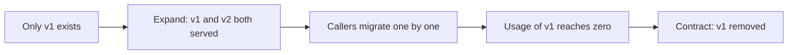
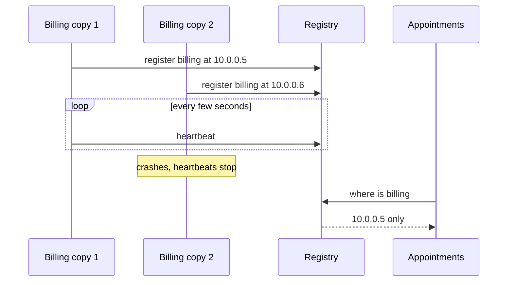
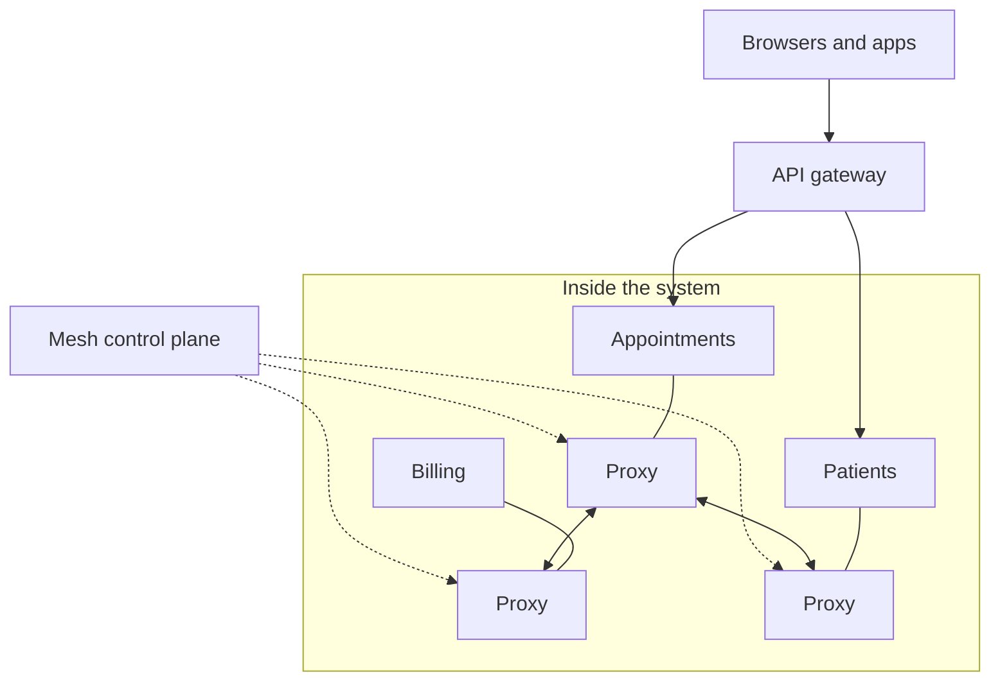

# Handling change: breaking changes, versioning, reuse, discovery, meshes and gateways

## Before this lesson

> **Before this lesson:** read [Technology choices](#/lesson/microservices/technology-choices). You should know what a contract, a schema, a structural break and a semantic break are, and what independent deployability means from [The key concepts](#/lesson/microservices/key-concepts).

## In plain words

A wall socket is a contract between the building and every appliance ever sold. The electricity company can add solar panels, replace cables and build new power stations, and your kettle never notices. But if someone changed the shape of the socket, every appliance in the country would stop working on the same day.

A service's API is a wall socket. Behind it you may change anything. The moment you change the socket itself, you affect every caller, and callers belong to other teams with their own plans. So the first half of this lesson is about changing an API without breaking the people who use it, and what to do in the rare case where you must break it.

The second half covers three pieces of plumbing that appear once there are many services: a **directory** so services can find each other, a **front desk** that receives calls from outside, and a **switchboard** for calls between services inside. And it ends with how to write things down so that other teams can use your service without asking you.

Why this matters for a job: "how would you change this API without downtime?" is one of the most common practical interview questions, and getting it wrong in production is one of the most common causes of outages.

## 1. Avoiding breaking changes

A **breaking change** is a change to a service's contract that makes an existing, unchanged caller fail. The cheapest breaking change is the one you never make. Four habits prevent most of them.

### Expansion changes

Add; do not remove or alter. A new optional field, a new endpoint, a new event type: an old caller that knows nothing about them keeps working. Removing a field, renaming it, changing its type or making a new field compulsory in requests are all breaks.

### The tolerant reader

A **tolerant reader** is a caller written to take only what it needs from a response and ignore everything else. It does not fail when it sees an unknown field, and it does not depend on the order or nesting of parts it does not use.

```python-run
v1 = {"pet": {"name": "Miso", "owner_phone": "9123 4567"}}
# The Patients team restructures the document and adds a field.
v2 = {"pet": {"name": "Miso", "microchip": "985-112",
              "contact": {"phone": "9123 4567", "email": "kai@example.com"}}}

def strict_reader(doc):
    pet = doc["pet"]
    assert set(pet) == {"name", "owner_phone"}, "unexpected shape"   # binds to everything
    return pet["owner_phone"]

def find(doc, key):
    """Search the whole document for a key, wherever it is nested."""
    if isinstance(doc, dict):
        for k, v in doc.items():
            if k == key:
                return v
            hit = find(v, key)
            if hit is not None:
                return hit
    return None

def tolerant_reader(doc):
    return find(doc, "owner_phone") or find(doc, "phone")   # takes one thing, ignores the rest

for name, doc in [("v1", v1), ("v2", v2)]:
    try:
        strict = strict_reader(doc)
    except (AssertionError, KeyError) as e:
        strict = f"BROKEN ({type(e).__name__})"
    print(f"{name}: strict -> {strict:24s} tolerant -> {tolerant_reader(doc)}")
```

`strict_reader` insists that the pet document has exactly two known fields. `tolerant_reader` uses `find`, which walks the nested dictionaries looking for one key. With version 1 both return the phone number. With version 2 the strict reader fails, although the phone number is still in the document. The tolerant reader survives the added field and the regrouping. It would not survive the phone number being deleted, and nothing should: that is a real break.

### The right technology and an explicit interface

Some formats make compatibility easier. Protocol Buffers identify fields by number, so adding field 7 does not disturb a reader that knows fields 1 to 6. And an explicit schema (lesson 11) tells both sides what is promised, so the owner knows which changes are safe.

### Catch accidental breaks early

Most breaking changes are accidents: a developer tidies a field name without realising three other teams read it. Put a check in the build that compares the new schema with the previous one and fails when a field disappears or changes type. The practice problem *Breaking or Non-breaking Schema Change* asks you to write that comparison. Lesson 20 adds consumer-driven contract tests, which catch semantic breaks too.

## 2. Managing a breaking change you cannot avoid

Sometimes the old shape is wrong and must go. There are three ways to handle it, and one is clearly better than the others.

**Lockstep deployment.** Change the service and all its callers, and release them together. This throws away independent deployability, needs a coordinated release across teams, and fails badly if one caller was forgotten. Avoid it except between parts owned by one team.

**Run two versions of the service side by side.** Keep the old service running for old callers and start a new one for new callers. It works, with costs: every bug must be fixed twice, the routing layer must send each caller to the right copy, and if both copies write to the same data they must agree on its shape. It is acceptable for short periods, for example during a canary release (lesson 18).

**Emulate the old interface inside the new service.** One running service offers both the old and the new endpoint. Internally, the old endpoint translates to the new logic. Callers move across when they are ready, and when the last one has moved, the old endpoint is deleted. This is called **expand and contract**: first expand the interface to include both, then contract it by removing the old part. It is the preferred approach.



```python-run
from collections import Counter

usage = Counter()                       # (version, caller) -> number of calls

def _book(pet_id, slot, clinic):        # the single internal implementation
    return {"pet": pet_id, "slot": slot, "clinic": clinic}

def book_v1(caller, pet_id, slot):      # old shape: no clinic, so assume the main one
    usage[("v1", caller)] += 1
    return _book(pet_id, slot, clinic="central")

def book_v2(caller, pet_id, slot, clinic):
    usage[("v2", caller)] += 1
    return _book(pet_id, slot, clinic)

# Week 1: only the website has migrated.
book_v2("website", 7, "Tue 10:00", "east")
book_v1("mobile-app", 9, "Tue 10:30")
book_v1("kiosk", 3, "Tue 11:00")
# Week 5: the mobile app has migrated too.
book_v2("mobile-app", 9, "Wed 09:00", "west")
book_v1("kiosk", 3, "Wed 09:30")

still_on_v1 = sorted({caller for (ver, caller) in usage if ver == "v1"}
                     - {caller for (ver, caller) in usage if ver == "v2"})
print("callers that have only ever used v1:", still_on_v1)
print("safe to remove v1?", not still_on_v1)
```

Both public functions call the same `_book`, so there is one copy of the business logic. `book_v1` supplies a default for the argument the old shape lacks. `usage` counts calls by version and caller, which requires every caller to identify itself (for example with a header naming the client). The last lines compute who has never called version 2: the kiosk. The owner of the service now knows exactly whom to talk to, instead of switching version 1 off and waiting for complaints.

### Version numbers

**Semantic versioning** is a convention for version numbers of the form `MAJOR.MINOR.PATCH`:

| Part | Increase it when | Example |
|---|---|---|
| MAJOR | You made a breaking change | 2.4.1 → 3.0.0 |
| MINOR | You added something backward compatible | 2.4.1 → 2.5.0 |
| PATCH | You fixed a bug without changing the contract | 2.4.1 → 2.4.2 |

A caller written for 2.4 can expect to work with 2.9 and should expect trouble with 3.0. For HTTP APIs the major version usually appears in the address (`/v2/appointments`) or in a header.

### The social contract

A breaking change is a negotiation between teams as much as a technical step. Agree in advance:

- how callers will be told that an endpoint is being retired;
- how long the old version will be kept (a fixed period, such as three months, is easier to plan around than "until everyone has moved");
- how the owner will know who still uses it (the usage tracking above).

When a caller ignores every notice, some organisations add a small artificial delay to the old endpoint, or switch it off for a few minutes at announced times, so that the remaining users notice before the final removal. These are last resorts, used after talking has failed.

## 3. Sharing code between services

Programmers learn the rule **DRY** (do not repeat yourself): each piece of knowledge should live in one place. Inside one service that rule is sound. Across services it can do harm.

Suppose seven services share a library containing the `Appointment` class. A change to that class means rebuilding and redeploying all seven. If they are not all upgraded at once, different services hold different versions of the "same" class and disagree in small ways. The shared library has become a coupling point, exactly like a shared database table.

A workable rule: be strict about duplication inside a service; across services, accept some duplication in exchange for independence. Sharing is fine for code that has nothing to do with the business domain and rarely changes, such as a logging helper.

**Client libraries** deserve a special mention. A team may publish a library that makes its service easy to call. That is helpful when the library contains only transport matters: finding the service, timeouts, retries. It becomes harmful when business logic leaks into it, because the logic then runs inside callers and can only be changed by upgrading every caller. Two safeguards: have the library written by people other than the service's own developers if possible, and always let each caller decide when to upgrade.

## 4. Service discovery

With five services you can keep their addresses in a configuration file. With fifty services, each running several copies that start and stop through the day, you need **service discovery**: a way for a service to find the current network locations of another.

Discovery always has two halves: a way for an instance to **register** ("I am a copy of Billing, at this address"), and a way for callers to **look up** ("where is Billing?").

### DNS

**DNS** (the domain name system) is the internet's phone book: it turns a name such as `billing.pawprint.internal` into a network address. It is universally supported and well understood. Its weakness is staleness. Each DNS answer comes with a **time to live** (TTL), a period during which the caller may reuse the answer without asking again. If a Billing instance dies, callers may keep using its old address until the TTL runs out. A common remedy is to point the name at a **load balancer** (a component that spreads requests over healthy instances), so the name stays stable while the instances behind it change.

### Dynamic registries

A **service registry** is a small, highly available database built for this job. Instances register on start and then send a **heartbeat**, a short "still alive" message, every few seconds. An instance whose heartbeats stop is dropped from the answers. Consul, etcd and ZooKeeper are well-known tools of this kind, and Kubernetes (lesson 18) has discovery built in.



```python-run
class Registry:
    def __init__(self, timeout):
        self.timeout = timeout
        self.last_seen = {}                      # (service, address) -> time of last heartbeat

    def heartbeat(self, service, address, now):  # registering is the first heartbeat
        self.last_seen[(service, address)] = now

    def lookup(self, service, now):
        return sorted(addr for (svc, addr), seen in self.last_seen.items()
                      if svc == service and now - seen <= self.timeout)

reg = Registry(timeout=10)
reg.heartbeat("billing", "10.0.0.5", now=0)
reg.heartbeat("billing", "10.0.0.6", now=0)
print("t=5  ", reg.lookup("billing", now=5))

reg.heartbeat("billing", "10.0.0.5", now=8)      # copy 1 keeps beating; copy 2 has crashed
print("t=12 ", reg.lookup("billing", now=12))
print("t=30 ", reg.lookup("billing", now=30))    # nobody has been heard from for a long time
```

`last_seen` records when each instance last reported in. `lookup` returns the addresses heard from within the timeout. At time 5 both copies are listed. Copy 2 stops sending heartbeats, so at time 12 only copy 1 is returned. At time 30 the list is empty, and the caller must cope with "no instance available". The practice problem *Service Registry with Heartbeats and Round Robin* extends this into a full class.

## 5. API gateways and service meshes

Two directions of traffic are worth naming. **North-south traffic** enters the system from outside: browsers, mobile apps, partners. **East-west traffic** flows between services inside. A different tool handles each.



### API gateway

An **API gateway** is a front desk for north-south traffic. It is a **reverse proxy**: a server that accepts requests on behalf of other servers and forwards them. On top of forwarding it handles concerns that apply to every outside call: checking API keys, limiting how many requests a client may make, logging, and routing `/appointments/...` to one service and `/pets/...` to another.

The danger is letting it grow. If the gateway starts combining calls, rewriting protocols and holding business rules, every team must queue to change one shared component, and you have rebuilt the central "smart pipe" that microservices were meant to escape. A widely quoted rule of thumb is *smart endpoints, dumb pipes*: the services hold the logic, and whatever carries messages between them only carries. The practice problem *API Gateway: Route Matching and Aggregation* shows the routing logic.

### Service mesh

A **service mesh** manages east-west traffic. A small proxy process, called a **sidecar**, runs next to every service instance. All calls in and out of the service pass through its sidecar. The sidecars are configured from one place, the **control plane**.

Because the proxies see every call, they can provide the same behaviour for all services without each team writing it: **mutual TLS** (encryption in which both sides prove their identity, covered in lesson 24), timeouts, retries, discovery, and uniform metrics and traces. Before meshes, the only way to get consistent behaviour was a shared library, which works in one programming language and forces coordinated upgrades. A mesh moves that behaviour out of the code. Istio and Linkerd are well-known meshes.

The cost is real: more moving parts, a small delay on each call, and a new system to learn. A handful of services does not need a mesh. Consider one when you have many services, more than one language, and a platform team able to run it.

| | API gateway | Service mesh |
|---|---|---|
| Traffic | North-south (outside to inside) | East-west (service to service) |
| Sits | At the edge, one logical component | Beside every instance |
| Typical duties | Routing, API keys, rate limits | Mutual TLS, retries, discovery, telemetry |
| Main risk | Becoming a home for business logic | Operational complexity |

## 6. Documenting services

A service nobody understands is a service nobody can reuse. Three layers of documentation help.

- **The contract.** An explicit schema: OpenAPI for HTTP APIs, `.proto` files for gRPC. For events there are equivalents such as AsyncAPI, which describes topics and the messages on them, and CloudEvents, which standardises the envelope around an event.
- **A catalogue.** A searchable list of every service with its owner, its purpose, its API description and how to reach the team. Kubernetes or the registry can tell you what is running; a catalogue tells you what it is *for*. Many companies build this as an internal developer portal.
- **Living information.** The best catalogues pull facts from the running system (health, dependencies seen in traces, last deployment) so they do not rot.

> [!INTERVIEW]
> For "how do you make a breaking API change with zero downtime?", say: *expand and contract. I add the new version beside the old one in the same service, with the old endpoint translating to the new logic. I track which callers still use the old version, give a deadline, help them move, and remove it once usage is zero. I avoid lockstep releases, and I use a schema comparison in the build to stop accidental breaks.*

## 7. Pitfalls

- **Strict readers.** Callers that validate every field break on harmless additions.
- **Renaming for tidiness.** A rename is a removal plus an addition; treat it as a breaking change.
- **Lockstep releases as a habit.** If two services must always deploy together, they are one service with extra network calls.
- **Removing an old version without measuring its use.** Track callers; do not guess.
- **A shared domain library.** It quietly couples every service that imports it.
- **Long DNS TTLs.** Callers keep sending traffic to instances that no longer exist.
- **A clever gateway.** Business logic in shared middleware slows every team.
- **A mesh for six services.** The operational cost exceeds the benefit.
- **A catalogue maintained by hand.** It is wrong within a month.

## Summary

- Prefer changes that only add. Write callers as tolerant readers. Check schemas automatically to catch accidents.
- When a break is unavoidable, use expand and contract: serve old and new together from one service, track usage, then remove the old.
- Semantic versioning signals the kind of change: major for breaking, minor for additions, patch for fixes.
- Retiring an API is an agreement between teams; set notice periods and measure who still uses it.
- Avoid sharing domain code across services; shared client libraries should contain transport concerns only.
- Service discovery needs registration and lookup; DNS is simple and can be stale, registries use heartbeats.
- A gateway handles traffic from outside; a mesh handles traffic between services. Keep business logic out of both.
- Publish explicit contracts and a living service catalogue.

## Glossary

| Term | Meaning |
|---|---|
| Breaking change | A contract change that makes an unchanged caller fail |
| Expansion change | A change that only adds to a contract |
| Tolerant reader | A caller that reads only what it needs and ignores the rest |
| Lockstep deployment | Releasing a service and its callers together |
| Expand and contract | Serving old and new interfaces together, then removing the old |
| Semantic versioning | MAJOR.MINOR.PATCH numbering that signals compatibility |
| DRY | Do not repeat yourself: keep each piece of knowledge in one place |
| Service discovery | Finding the current network locations of a service |
| DNS / TTL | The name-to-address system / how long an answer may be reused |
| Service registry | A store of live instances, kept current by heartbeats |
| Load balancer | A component that spreads requests over healthy instances |
| North-south / east-west | Traffic from outside to inside / traffic between services |
| API gateway | A reverse proxy at the edge handling routing and cross-cutting concerns |
| Service mesh | Sidecar proxies beside every instance, managed by a control plane |
| Sidecar | A helper process deployed next to a service instance |

```quiz
[
  {"q": "Which change to a response is safe for existing callers that are tolerant readers?", "options": ["Renaming a field", "Removing a field", "Adding a new optional field", "Changing a number field to a string"], "answer": 2,
   "explain": "An addition is an expansion change. A tolerant reader ignores what it does not know. Renames, removals and type changes break callers."},
  {"q": "What does expand and contract mean for an API?", "options": ["Scale the service up, then down", "Serve the old and new interfaces together, migrate callers, then remove the old one", "Compress responses", "Deploy all callers at once"], "answer": 1,
   "explain": "The interface is expanded to include both versions so callers can move at their own pace, then contracted once the old version is unused."},
  {"q": "Why is lockstep deployment of a service and all its callers discouraged?", "options": ["It is too fast", "It removes independent deployability and needs a coordinated release that fails if one caller is missed", "It requires GraphQL", "It prevents logging"], "answer": 1,
   "explain": "Coordinated releases across teams are slow and risky, and they are a sign of tight coupling."},
  {"q": "A library goes from 3.2.5 to 4.0.0. Under semantic versioning, what should a user expect?", "options": ["Only bug fixes", "New features that are all backward compatible", "At least one breaking change", "Nothing changed"], "answer": 2,
   "explain": "A change in the first number, MAJOR, signals an incompatible change to the contract."},
  {"q": "What is the risk of a shared library holding domain classes used by many services?", "options": ["It makes services start faster", "A change to it forces many services to rebuild and redeploy, coupling them together", "It prevents service discovery", "It disables TLS"], "answer": 1,
   "explain": "Shared domain code is a coupling point. Some duplication across services is the price of independent change."},
  {"q": "An instance crashes. With a registry that uses heartbeats and a 10 second timeout, what happens?", "options": ["It stays listed for ever", "It disappears from lookups once no heartbeat has arrived within the timeout", "All instances are removed", "Callers are restarted"], "answer": 1,
   "explain": "The registry only returns instances heard from recently. A stopped heartbeat removes the instance after the timeout."},
  {"q": "Which traffic does a service mesh mainly manage?", "options": ["North-south traffic from browsers", "East-west traffic between services, through sidecar proxies", "Database replication", "Email delivery"], "answer": 1,
   "explain": "Sidecars sit beside each instance and handle calls between services. A gateway handles traffic entering from outside."},
  {"q": "What is the main danger of an API gateway that keeps gaining features?", "options": ["It becomes a shared home for business logic that every team must queue to change", "It stops forwarding requests", "It cannot check API keys", "It makes DNS slower"], "answer": 0,
   "explain": "Logic in shared middleware recreates central coupling. Keep the pipe dumb and the endpoints smart."}
]
```

> **Source:** Newman, *Building Microservices*, 2nd ed., ch. 5 (topic coverage only; wording and the Pawprint example are original). Semantic Versioning 2.0.0, https://semver.org/ ; Martin Fowler, "TolerantReader", https://martinfowler.com/bliki/TolerantReader.html
