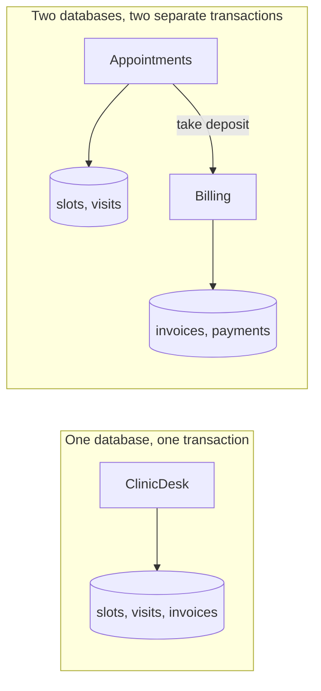
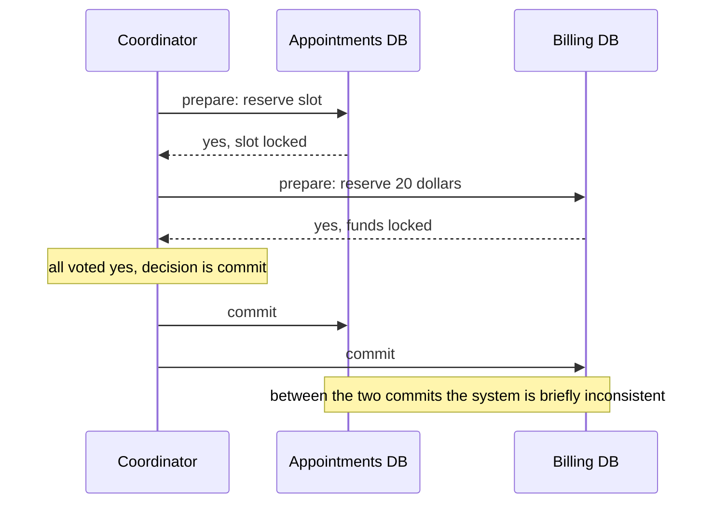

# Transactions, ACID and why distributed transactions hurt

## Before this lesson

> **Before this lesson:** read [Migration patterns and splitting the data](#/lesson/microservices/migration-patterns-data) and [What a network call costs](#/lesson/microservices/network-cost-why-split). You should know that each microservice owns its own database, and that a network call can fail in a way that leaves the caller unsure whether the work was done.

## In plain words

When you move money between two of your own bank accounts, two things must happen: one balance goes down and the other goes up. You would be upset if the first happened and the second did not. A **transaction** is a promise from a database that a group of changes will be treated as one: either all of them happen or none of them do.

Inside one database that promise is cheap and reliable, and programmers lean on it without thinking. The trouble starts when a system is split into services, each with its own database. Now "book the appointment" touches the Appointments database, "take the deposit" touches the Billing database, and no single database can wrap both in one promise.

Picture two people in different cities who must each sign the same contract, with only letters to communicate. Each can sign their own copy in a second. Getting both signatures or neither, when any letter may be lost, is a much harder problem. That is a **distributed transaction**, and the best-known way of attempting it, **two-phase commit**, turns out to be slow and fragile enough that most microservice systems avoid it.

Why this matters for a job: "how do you keep data consistent across services?" is asked in almost every microservices interview. The answer begins here, with what you lose, and continues in the next lesson with sagas, which are what people use instead.

## 1. What a database transaction gives you

A **database transaction** is a group of reads and writes that the database treats as one unit of work. You start it, make changes, and then either **commit** (make all the changes permanent) or **roll back** (discard all of them as if nothing had happened).

The guarantees are remembered by the acronym **ACID**:

| Letter | Name | Plain meaning | Clinic example |
|---|---|---|---|
| A | Atomicity | All the changes happen, or none do | The slot is marked taken and the visit row is created together, never one without the other |
| C | Consistency | The data obeys the declared rules before and after | A visit cannot refer to a pet that does not exist |
| I | Isolation | Transactions running at the same time do not see each other's half-finished work | Two receptionists booking the last slot cannot both succeed |
| D | Durability | Once committed, the change survives a crash | A power cut one second after "booked" does not lose the booking |

Two more terms. A **constraint** is a rule the database enforces, such as "this column must refer to an existing row". **Half-finished work** is called an **intermediate state**: the moment when the slot is marked taken and the visit row is not yet written.

Here is atomicity, using SQLite, a small database engine that ships with Python.

```python-run
import sqlite3

db = sqlite3.connect(":memory:")                      # a throwaway database held in memory
db.execute("CREATE TABLE slots  (id TEXT PRIMARY KEY, taken INTEGER)")
db.execute("CREATE TABLE visits (id INTEGER PRIMARY KEY, slot TEXT, pet INTEGER NOT NULL)")
db.execute("INSERT INTO slots VALUES ('Tue-10:00', 0)")
db.commit()

def book(slot, pet):
    try:
        db.execute("UPDATE slots SET taken = 1 WHERE id = ?", (slot,))
        db.execute("INSERT INTO visits (slot, pet) VALUES (?, ?)", (slot, pet))   # may fail
        db.commit()
        return "booked"
    except sqlite3.Error as e:
        db.rollback()                                  # undo the UPDATE as well
        return f"rolled back ({e})"

print(book("Tue-10:00", None))                         # pet is missing: the INSERT fails
print("slot taken after failure?", db.execute("SELECT taken FROM slots").fetchone()[0])
print(book("Tue-10:00", 7))
print("slot taken after success?", db.execute("SELECT taken FROM slots").fetchone()[0])
```

`book` makes two changes: it marks the slot taken, then inserts a visit. In the first call the pet is `None`, which breaks the `NOT NULL` constraint, so the insert fails. `db.rollback()` then discards the earlier `UPDATE` too. The first check prints `0`: the slot is still free. Nobody had to write code to undo the first step; the database did it. The second call succeeds and the slot shows `1`. Keep this picture in mind, because it is exactly what disappears when the two tables live in two services.

## 2. What changes when the data is split

In the monolith, `slots`, `visits` and `invoices` sit in one database, so one transaction can cover a booking and its deposit. After the split:



Each service still has ACID transactions inside its own database. What is gone is atomicity across the two. Consider the sequence "Appointments commits the visit, then calls Billing to take the deposit":

- If Billing fails, the visit exists with no deposit.
- If the call times out, Appointments does not know whether the card was charged.
- If Appointments crashes between its commit and the call, nobody ever asks Billing.

Reversing the order does not help; it only changes which half can be left dangling. This is the **dual-write problem**: two separate stores must both be changed, and there is no moment at which both changes become real together.

> [!NOTE]
> Before reaching for any cross-service technique, ask whether the data should have been split at all. If two pieces of state must always change together, that is strong evidence they belong inside one service boundary (lesson 6 called such a cluster an aggregate). Keeping them together is by far the cheapest way to get atomicity.

## 3. Two-phase commit

**Two-phase commit (2PC)** is an algorithm for making several separate databases commit or roll back together. One component acts as the **coordinator**; the databases taking part are **participants** (sometimes called workers or cohorts).

It runs in two rounds:

1. **Voting phase (prepare).** The coordinator asks each participant, "can you make this change?" A participant that says yes must do whatever is needed to guarantee it can commit later, which in practice means holding **locks** on the rows involved. A lock is a marker that stops other transactions from changing, and often from reading, the same data.
2. **Commit phase.** If every participant voted yes, the coordinator tells them all to commit. If any voted no, or did not answer, it tells them all to roll back.



Let us simulate it with a clock, so the cost becomes visible.

```python-run
class Participant:
    def __init__(self, name, will_vote_yes=True, prepare_ms=5, commit_ms=5):
        self.name, self.will_vote_yes = name, will_vote_yes
        self.prepare_ms, self.commit_ms = prepare_ms, commit_ms
        self.locked_from = self.locked_until = None
        self.state = "idle"

def two_phase_commit(participants, coordinator_pause_ms=0):
    clock = 0
    votes = []
    for p in participants:                       # phase 1: voting
        clock += p.prepare_ms
        if p.will_vote_yes:
            p.state, p.locked_from = "prepared", clock      # lock taken here
        votes.append(p.will_vote_yes)
    decision = "commit" if all(votes) else "rollback"
    clock += coordinator_pause_ms                # the coordinator is slow, or has crashed
    for p in participants:                       # phase 2: commit or roll back
        if p.state == "prepared":
            clock += p.commit_ms
            p.state, p.locked_until = ("committed" if decision == "commit" else "rolled back"), clock
    return decision, clock

def report(title, participants, **kw):
    decision, total = two_phase_commit(participants, **kw)
    print(f"{title}: {decision} in {total} ms")
    for p in participants:
        held = "-" if p.locked_from is None else f"{p.locked_until - p.locked_from} ms"
        print(f"   {p.name:13s} {p.state:12s} lock held {held}")

report("happy path", [Participant("appointments"), Participant("billing")])
report("billing votes no", [Participant("appointments"), Participant("billing", will_vote_yes=False)])
report("slow participant", [Participant("appointments"), Participant("billing", prepare_ms=400)])
report("coordinator stalls", [Participant("appointments"), Participant("billing")], coordinator_pause_ms=30000)
```

Each `Participant` has a vote and two durations. `two_phase_commit` walks through the voting round, adding time and recording when each lock is taken, makes the decision, optionally pauses, and then walks through the second round recording when each lock is released. `report` prints the outcome and how long each participant held its lock.

Read the four results in order:

- **Happy path.** Commit in 20 ms. Appointments held its lock for 10 ms, and half of that was spent doing nothing except waiting for Billing to vote.
- **Billing votes no.** The decision is rollback. Appointments prepared, held a lock, and then discarded its work. Correct, and wasted effort.
- **Slow participant.** Billing takes 400 ms to prepare. Appointments now holds the slot locked for over 400 ms. During that time no one else can book or even view that slot reliably. One slow participant slows everyone.
- **Coordinator stalls.** Both participants voted yes and are waiting. They may not commit by themselves and may not roll back by themselves, because the other might do the opposite. Their locks are held for the whole 30 seconds. If the coordinator had crashed, they would be stuck until it came back.

That last case is the well-known weakness: a participant that has voted yes is **in doubt** until it hears the decision, and it must keep its locks for as long as that takes.

## 4. Why 2PC fits microservices badly

**Locks are held across network calls.** In a local transaction a lock lasts microseconds to milliseconds. In 2PC it lasts for at least two network round trips to every participant. More participants and more latency mean longer locks, and long locks mean other requests queue up behind them. This is **contention**, and it grows quickly under load.

**Isolation is not truly preserved.** Look at the last note in the sequence diagram. The coordinator sends "commit" to Appointments and then to Billing. Between those two messages, a reader can see the appointment as booked while the payment is not yet visible. So even when everything works, there is a window in which the "all or nothing" view is false. Longer delays widen it.

**Failures leave you stuck.** A participant that votes yes and then loses contact with the coordinator cannot decide alone. Recovering can require a person to inspect each database and resolve the transaction by hand.

**Availability multiplies.** Every participant and the coordinator must be reachable for the transaction to complete. Lesson 2 showed that availabilities in a chain multiply: five components at 99.9% give about 99.5%.

**It couples the services' technology.** All participants must speak the same commit protocol (the common standard is called XA). Many modern data stores and most message brokers do not support it, or support it poorly. Requiring it removes the freedom to choose a store per service.

**It does not suit long work.** Some business processes take minutes or days: waiting for a laboratory result, or for an owner to confirm a quote for surgery. Holding database locks for days is out of the question.

| | Local ACID transaction | Two-phase commit across services |
|---|---|---|
| Atomic | Yes | Mostly, with stuck states after failures |
| Isolated | Yes | Brief inconsistency between commits |
| Lock duration | Very short | Several network round trips, or until the coordinator recovers |
| Fails if one party is down | Only the one database matters | Any participant or the coordinator blocks it |
| Suits work lasting minutes or days | No | No |

The practice problem *Two-phase Commit Outcome with Failures* asks you to compute the final state of each participant under different failure combinations.

## 5. So what do you do instead?

Work down this list and stop at the first option that fits.

1. **Do not split the data.** If two things must change atomically, keep them in one service and one database. A slightly larger service with a real transaction beats two small ones with an invented one.
2. **Rearrange the process so that one local transaction is enough.** For example, Appointments stores "visit 551 is pending deposit" in one local transaction. Billing takes the deposit in its own local transaction. Appointments then marks the visit confirmed in a third. No step needs a lock in another service.
3. **Make each step reliable and repeatable.** The transactional outbox (lesson 10) guarantees that a committed change always leads to a message being sent. Idempotency keys (lesson 2) make it safe to repeat a step when the result is unknown.
4. **Use a saga for multi-step business processes.** A saga is a sequence of local transactions with an explicit plan for undoing completed steps when a later one fails. It is the subject of the next lesson.

Options 2 to 4 accept **eventual consistency**: for a short time the services disagree (the visit is pending while the deposit is being taken), and they converge on a correct state afterwards. The trade is deliberate. You give up the illusion that everything changes at one instant, and you gain services that do not lock each other and keep working when a neighbour is slow.

> [!TIP]
> Make the in-between states honest and visible. A status of `PENDING_DEPOSIT` that the user interface can show ("We are confirming your payment") is much better than pretending the booking is complete and hoping the second step succeeds.

### Worked example: booking with a deposit

**Tempting design.** Wrap "create visit" in Appointments and "charge card" in Billing in a distributed transaction. A slow card network holds a lock on the appointment slot for seconds, the diary page for that vet freezes for other receptionists, and a coordinator restart leaves three bookings in doubt overnight.

**Design without it.**

| Step | Where | Local transaction |
|---|---|---|
| 1 | Appointments | Insert visit with status `PENDING_DEPOSIT`, hold the slot, write "deposit requested" to the outbox |
| 2 | Billing | Charge the card using the visit id as idempotency key, record the payment, write "deposit taken" or "deposit failed" to its outbox |
| 3 | Appointments | On "deposit taken": status `CONFIRMED`. On "deposit failed" or after 10 minutes of silence: status `CANCELLED`, release the slot |

Each row is an ordinary local ACID transaction. No lock spans a network call. If Billing is down for five minutes, bookings wait in `PENDING_DEPOSIT` and complete when it returns. Step 3's cancellation is a small example of a compensating action, which the next lesson generalises.

> [!INTERVIEW]
> When asked "why not use distributed transactions between microservices?", give the mechanism, not a slogan: *two-phase commit holds locks across network round trips, so one slow participant blocks the others; a participant that has voted yes is stuck in doubt if the coordinator fails; every participant must be up and must support the same protocol; and it cannot cover processes lasting minutes or days. I would first try to keep data that must change together in one service, and otherwise use a saga with local transactions, an outbox and idempotent steps.*

## 6. Pitfalls

- **Assuming a call sequence is a transaction.** "Save, then call the other service" has no atomicity. Decide what happens when the second step fails or its result is unknown.
- **Splitting data that must change together.** If you find yourself needing a distributed transaction often, the boundary is probably wrong.
- **Hiding intermediate states.** Showing "confirmed" before the deposit is taken creates support calls when it later fails.
- **Reaching for 2PC because a framework offers it.** It may pass every test on a quiet development machine and still collapse under production load and failures.
- **Forgetting the unknown outcome.** A timeout is neither success nor failure. Without idempotency keys, a retry may charge twice.
- **Thinking eventual consistency means "no rules".** The system must still converge on a correct state; you need to design how.

## Summary

- A database transaction groups changes into one unit with ACID guarantees: atomic, consistent, isolated, durable.
- Splitting a system gives each service its own database, so a single transaction can no longer cover a multi-service operation. This is the dual-write problem.
- Two-phase commit coordinates separate databases with a voting round and a commit round.
- Its costs: locks held across network calls, a window of inconsistency between commits, participants stuck in doubt when the coordinator fails, reduced availability, protocol coupling, and no fit for long-running work.
- Prefer, in order: keeping atomic data in one service; restructuring into single local transactions; reliable, idempotent steps with an outbox; and sagas.
- These alternatives accept eventual consistency and make intermediate states explicit.

## Glossary

| Term | Meaning |
|---|---|
| Transaction | A group of database changes treated as one unit of work |
| Commit / roll back | Make a transaction's changes permanent / discard them all |
| ACID | Atomicity, consistency, isolation, durability |
| Constraint | A rule on the data that the database enforces |
| Intermediate state | The moment when some of a group of changes have been made and others not yet |
| Dual-write problem | Needing to change two separate stores with no way to make both changes atomic |
| Distributed transaction | A transaction intended to span several separate databases or services |
| Two-phase commit | A voting round followed by a commit round, run by a coordinator |
| Coordinator / participant | The component that runs the protocol / a database taking part |
| Lock | A marker preventing other transactions from changing or reading certain data |
| In doubt | A participant that voted yes and has not yet learned the decision |
| Contention | Requests queuing behind locks held by others |
| Eventual consistency | Services may disagree briefly and converge on a correct state later |

```quiz
[
  {"q": "What does atomicity in ACID guarantee?", "options": ["Transactions run faster", "All the changes in a transaction happen, or none of them do", "Data is copied to two disks", "Only one user can connect at a time"], "answer": 1,
   "explain": "Atomic means indivisible. A failure part-way through causes every change in the transaction to be discarded."},
  {"q": "Appointments commits a visit and then calls Billing, which times out. What does Appointments know?", "options": ["The card was charged", "The card was not charged", "Nothing certain: the charge may or may not have happened", "The visit was rolled back automatically"], "answer": 2,
   "explain": "A timeout is an unknown outcome. The local commit stands, and there is no shared transaction to undo it."},
  {"q": "In two-phase commit, what must a participant do after voting yes in the first phase?", "options": ["Commit immediately", "Hold whatever locks are needed so it can still commit later, and wait for the decision", "Forget the request", "Ask the other participants directly"], "answer": 1,
   "explain": "A yes vote is a promise to be able to commit. Keeping that promise means holding locks until the coordinator announces the outcome."},
  {"q": "The coordinator crashes after all participants voted yes and before it sent the decision. What happens to the participants?", "options": ["They commit by themselves", "They roll back by themselves", "They remain in doubt, holding their locks, until the coordinator recovers", "They delete their data"], "answer": 2,
   "explain": "A participant cannot decide alone because the others might decide differently. This blocking is the classic weakness of 2PC."},
  {"q": "Why does one slow participant hurt the others in 2PC?", "options": ["It uses more disk", "The others must keep their locks until every participant has voted and the decision arrives", "It changes the schema", "It encrypts the messages"], "answer": 1,
   "explain": "Locks taken in the voting phase are released only in the commit phase, so everyone waits for the slowest vote."},
  {"q": "Two pieces of data must always change together atomically. What is the cheapest sound design?", "options": ["Put them in two services and use 2PC", "Keep them inside one service and one database", "Use events with no ordering", "Write to both and hope"], "answer": 1,
   "explain": "A local ACID transaction is simple and reliable. Needing atomicity across a boundary suggests the boundary is misplaced."},
  {"q": "What does eventual consistency mean in the pending-deposit design?", "options": ["Data is never correct", "For a short time the visit is pending while the deposit is processed, and the services then converge on confirmed or cancelled", "Every read is blocked until payment", "The database has no constraints"], "answer": 1,
   "explain": "The intermediate state is explicit and temporary. Each step is a local transaction, and the process drives the system to a correct end state."},
  {"q": "Which is NOT a reason 2PC suits microservices poorly?", "options": ["Locks are held across network round trips", "All participants must support the same commit protocol", "It cannot cover processes that last days", "Local transactions stop working inside each service"], "answer": 3,
   "explain": "Each service keeps its local ACID transactions. The problems are long-held locks, blocking on failure, protocol coupling and unsuitability for long-running work."}
]
```

> **Source:** Newman, *Building Microservices*, 2nd ed., ch. 6 (topic coverage only; wording and the Pawprint example are original). Chris Richardson, "Pattern: Saga", https://microservices.io/patterns/data/saga.html
