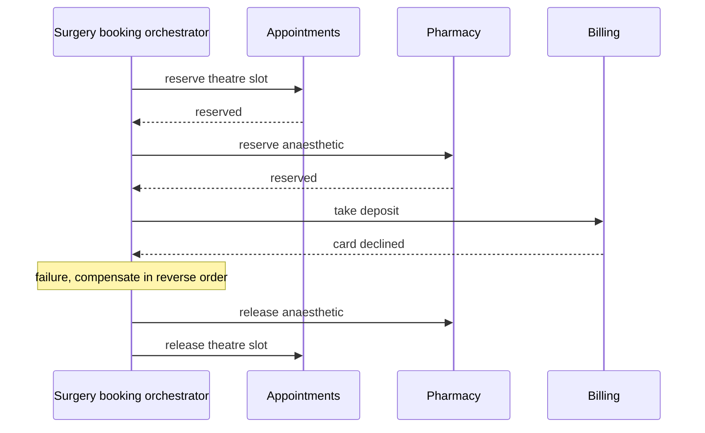
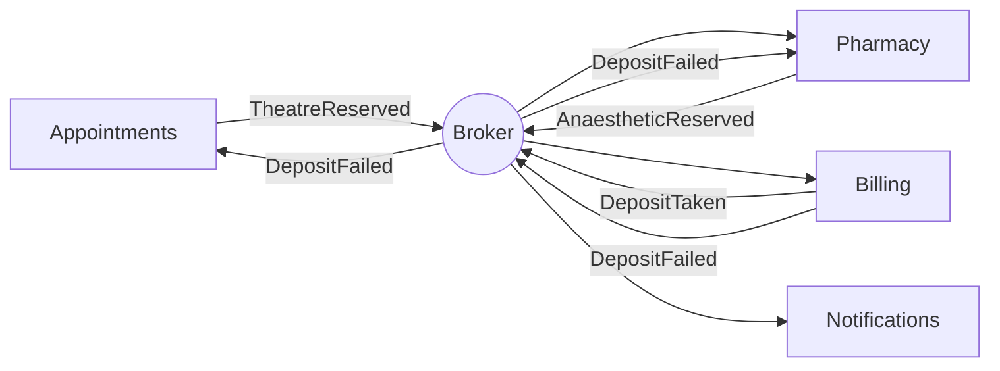

# Sagas: orchestration, choreography and compensation

## Before this lesson

> **Before this lesson:** read [Transactions, ACID and why distributed transactions hurt](#/lesson/microservices/transactions-2pc). You should know what a local transaction is, why one transaction cannot span two services, and what eventual consistency means. Events, the outbox and idempotent consumers come from [Request-response, event-driven and common data](#/lesson/microservices/request-response-events).

## In plain words

Imagine organising a weekend away. You book a train, then a guesthouse, then a table at a restaurant. These are three separate bookings with three separate companies. Nobody can freeze all three until you have decided. If the restaurant turns out to be full and the weekend is pointless without it, you do not travel back in time: you cancel the guesthouse and ask for a train refund. The bookings did happen. You then take new actions that undo their effect.

A **saga** is that way of working, written down properly. It is a business process split into a sequence of steps, where each step is an ordinary local transaction in one service, and where every step that can be undone has a matching "undo" action prepared in advance.

There are two ways to run a saga. In **orchestration**, one conductor tells each player when to come in. In **choreography**, there is no conductor: each dancer knows which move of a neighbour is their cue. This lesson teaches both, with working simulations, and how to choose.

Why this matters for a job: "saga versus two-phase commit" and "orchestration versus choreography" are standard interview questions for backend roles, and sagas are how real systems handle orders, bookings and payments.

## 1. What a saga is

The idea comes from a 1987 paper by Hector Garcia-Molina and Kenneth Salem about **long-lived transactions**: operations that run for minutes or days and would hold database locks for far too long if treated as one transaction. Their proposal was to break the long transaction into short ones that each commit separately.

Applied to services:

- A **saga** is a sequence of steps that together complete one business process.
- Each step is a **local transaction** in a single service, with full ACID guarantees inside that service.
- There is **no atomicity across the whole saga**. Between steps the system is in an intermediate state that other requests can see.
- The saga describes what to do when a step fails, so that the system always ends in a sensible state.

Our example for this lesson is booking surgery at Pawprint Clinics:

| Step | Service | Local transaction |
|---|---|---|
| 1 | Appointments | Reserve an operating-theatre slot |
| 2 | Pharmacy | Reserve the anaesthetic for the pet's weight |
| 3 | Billing | Take a deposit from the owner's card |
| 4 | Notifications | Send the confirmation with fasting instructions |

## 2. When a step fails: two kinds of recovery

A saga has two ways to respond to a failed step.

**Backward recovery** undoes what was already done. Each completed step is reversed by a **compensating transaction**: a new transaction whose effect cancels the earlier one. Releasing the theatre slot compensates for reserving it; a refund compensates for a charge.

**Forward recovery** keeps going. The failed step is retried until it succeeds, perhaps with help. If sending the confirmation fails because the text-message provider is down, cancelling the surgery would be absurd; the system retries, or falls back to email.

Most real sagas mix the two: backward recovery for early steps, forward recovery once a point of no return has passed.

### Compensation is not time travel

A database rollback makes it as if the work never happened. A compensating transaction cannot do that, because the original step was committed and others may have seen it. So compensation is a **semantic rollback**: it reverses the meaning, and leaves a trace.

| Completed step | Compensating action | What remains visible |
|---|---|---|
| Theatre slot reserved | Release the slot | An audit record of reserve and release |
| Anaesthetic reserved | Return it to available stock | A stock movement in and out |
| Card charged | Refund | Two lines on the owner's statement |
| Confirmation text sent | Send a second text: "Sorry, this booking was cancelled" | Both messages on the owner's phone |

The last row shows that some steps cannot be reversed at all. You cannot un-send a message. You can only send a correction.

### Order the steps to make failure cheap

Because compensation costs effort and can be seen by customers, the order of steps matters. Two rules:

- Put the steps **most likely to fail early**, while there is little to undo. A card decline is the commonest failure in our example, so there is a case for taking the deposit before reserving stock.
- Put steps that are **hard or impossible to undo last**. The confirmation message goes at the end, after everything that might fail has succeeded.

## 3. Orchestrated sagas

In an **orchestrated saga**, one component, the **orchestrator**, holds the plan. It asks each service to perform its step, waits for the answer, and decides what comes next. When a step fails, it calls the compensations for the completed steps in reverse order.



Here is a working orchestrator. Read the data structure first, then the function.

```python-run
state = {"theatre": "free", "anaesthetic_units": 5, "charged": 0, "texts": []}
CARD_WORKS = True

def reserve_theatre():    state["theatre"] = "reserved"
def release_theatre():    state["theatre"] = "free"
def reserve_drug():       state["anaesthetic_units"] -= 1
def return_drug():        state["anaesthetic_units"] += 1
def take_deposit():
    if not CARD_WORKS:
        raise RuntimeError("card declined")
    state["charged"] += 150
def refund_deposit():     state["charged"] -= 150
def send_confirmation():  state["texts"].append("Surgery booked. No food after 10 pm.")

# Each step: (name, action, compensation). None means "cannot be undone".
SURGERY_SAGA = [
    ("reserve theatre",     reserve_theatre,   release_theatre),
    ("reserve anaesthetic", reserve_drug,      return_drug),
    ("take deposit",        take_deposit,      refund_deposit),
    ("send confirmation",   send_confirmation, None),
]

def run_saga(steps):
    done = []
    for name, action, compensation in steps:
        try:
            action()
            print(f"  ok      {name}")
            done.append((name, compensation))
        except Exception as error:
            print(f"  FAILED  {name}: {error}")
            for earlier, undo in reversed(done):          # newest first
                if undo is not None:
                    undo()
                    print(f"  undone  {earlier}")
            return "ROLLED BACK"
    return "COMPLETED"

print("Run 1, card works:")
print(" ", run_saga(SURGERY_SAGA), state)

state = {"theatre": "free", "anaesthetic_units": 5, "charged": 0, "texts": []}
CARD_WORKS = False
print("Run 2, card declined:")
print(" ", run_saga(SURGERY_SAGA), state)
```

`state` stands in for four separate databases. Each small function is one service's local transaction, and each has a partner that reverses it. `SURGERY_SAGA` is the plan: a list of steps, each with its action and its compensation. `run_saga` performs the actions in order and remembers the completed ones in `done`. When an action raises an error, it walks `done` backwards and calls each compensation.

In run 1 all four steps succeed and the state shows a reserved theatre, four units of anaesthetic, a charge of 150 and one text. In run 2 the deposit fails. The orchestrator returns the drug and then releases the theatre, newest first, and the final state matches the starting state. No confirmation was sent, because that step sits after the risky one. The practice problem *Saga Orchestrator with Compensation* asks you to build this with a full log.

**Advantages of orchestration**

- The whole process is written in one place. A new team member can read it.
- The orchestrator knows the state of every running saga, so "where is booking 8841 stuck?" has an answer.

**Disadvantages**

- **Coupling.** The orchestrator must know every service involved and what each can do. This is domain coupling (lesson 5): acceptable, and worth watching.
- **Logic drifting to the centre.** It is tempting to keep adding rules to the orchestrator until the services are reduced to thin wrappers around database tables. Services that hold data and no behaviour are called **anaemic**. Guard against it: the orchestrator decides *what happens next*; each service decides *how to do its own step and whether it is allowed*.

One way to limit the risk is to have a separate orchestrator per business process, owned by the service where the process naturally starts, instead of one giant workflow engine for the company. Visual workflow tools exist that let non-developers draw such flows. Treat them with care: the drawings tend to end up maintained by developers anyway, in a tool that is harder to test and version than code.

## 4. Choreographed sagas

In a **choreographed saga** there is no conductor. Each service listens for events and reacts by doing its step and publishing an event of its own. The process emerges from these reactions.



Every event carries a **correlation id**: one identifier shared by all events of the same saga, so that anyone can tell which booking an event belongs to.

```python-run
from collections import deque

CARD_WORKS = False
queue = deque()                      # the broker
handlers = {}                        # event type -> list of handler functions
trace = {}                           # correlation id -> events seen

def on(event_type):
    def register(fn):
        handlers.setdefault(event_type, []).append(fn)
        return fn
    return register

def publish(event_type, saga_id):
    queue.append((event_type, saga_id))

# --- each service knows only its own cues ---
@on("SurgeryRequested")
def appointments_reserve(saga_id):   publish("TheatreReserved", saga_id)

@on("TheatreReserved")
def pharmacy_reserve(saga_id):       publish("AnaestheticReserved", saga_id)

@on("AnaestheticReserved")
def billing_charge(saga_id):
    publish("DepositTaken" if CARD_WORKS else "DepositFailed", saga_id)

@on("DepositTaken")
def notify_owner(saga_id):           publish("ConfirmationSent", saga_id)

# --- compensations are also reactions to events ---
@on("DepositFailed")
def pharmacy_release(saga_id):       publish("AnaestheticReleased", saga_id)

@on("DepositFailed")
def appointments_release(saga_id):   publish("TheatreReleased", saga_id)

publish("SurgeryRequested", "saga-8841")
while queue:
    event_type, saga_id = queue.popleft()
    trace.setdefault(saga_id, []).append(event_type)      # a tracking consumer
    for handler in handlers.get(event_type, []):
        handler(saga_id)

print(" -> ".join(trace["saga-8841"]))
```

`queue` plays the broker and `handlers` records who listens to what. The `on` function is a decorator: writing `@on("TheatreReserved")` above a function registers that function as a listener for that event. Each handler does its (imaginary) local work and publishes the next event. Nothing in the code lists the steps in order; the order arises from who listens to whom. The loop at the bottom delivers events until none are left, and `trace` records every event per correlation id.

With the card failing, the printed trace ends with `DepositFailed`, then `AnaestheticReleased` and `TheatreReleased`. Two services reacted to the same failure event independently, and Billing did not need to know they exist.

**Advantages of choreography**

- Services are loosely coupled. Billing announces what happened and knows nobody.
- No central component accumulates logic, and no team owns "the workflow" that others must queue to change.

**Disadvantages**

- **The process is written nowhere.** To learn what happens on a surgery booking you must read every service.
- **The state of a saga is hard to see.** No one component knows that booking 8841 is waiting for Billing.

The remedy for the second problem is the `trace` dictionary in the demo: a small **tracking consumer** that subscribes to all the saga's events and builds a view of each saga's progress from the correlation id. It observes; it does not command. It can also raise an alarm when a saga has been silent for too long. The practice problem *Choreographed Saga Event Trace* builds this.

## 5. Choosing between them

| | Orchestration | Choreography |
|---|---|---|
| Where the process is defined | In one orchestrator | Spread across the services |
| Coupling | Orchestrator knows all participants | Participants know only event types |
| Seeing a saga's state | Built in | Needs a tracking consumer and correlation ids |
| Risk | Logic collects in the centre | Nobody understands the whole |
| Communication style | Mostly request-response | Events |

A practical rule based on ownership:

- If **one team** owns every service in the saga, orchestration is comfortable. The coupling stays inside the team and the readability is valuable.
- If the saga **crosses several teams**, prefer choreography, so that no team's deployments depend on another team's orchestrator.

You can mix them. A choreographed saga across teams can contain a step that one team implements internally as a small orchestrated flow.

## 6. Living without isolation

A saga gives up the I in ACID. While surgery booking 8841 is between steps 1 and 3, another request can see the theatre as reserved for a booking that may be cancelled seconds later. Techniques that keep this under control:

- **Pending states** (also called semantic locks). Mark the record as `PENDING` so other processes and the user interface know it is not final.
- **Idempotent steps.** Messages can arrive twice, and an orchestrator that crashed may repeat a request. Each step must give the same result when repeated, using the saga id as an idempotency key.
- **Reliable publishing.** Use the transactional outbox so that a committed step always produces its event.
- **Timeouts.** A saga that hears nothing for too long must be resolved, usually by compensating.
- **Compensations that cannot fail for business reasons.** A refund must not be refused because of a rule. If it fails technically, it is retried until it succeeds, and a person is alerted if it keeps failing.

### Saga or two-phase commit?

| | Two-phase commit | Saga |
|---|---|---|
| Atomicity | Aims for all-or-nothing at one moment | All-or-compensated over time |
| Isolation | Mostly, using locks | None; intermediate states are visible |
| Locks across services | Yes | No |
| Works for processes lasting days | No | Yes |
| When a participant is down | Everything blocks | Other steps proceed; the saga waits or compensates |
| Effort for the developer | Hidden in a protocol | Explicit: you design each compensation |

> [!INTERVIEW]
> A complete answer to "how do you keep data consistent across microservices?": *each service uses local ACID transactions. A multi-service process is a saga: a sequence of local transactions with compensating actions for failures. I order steps so that likely failures come first and irreversible actions last. I would orchestrate when one team owns the flow and choreograph across teams, with correlation ids and a tracking consumer for visibility. Steps are idempotent, events go through an outbox, and intermediate states are explicit.*

## 7. Pitfalls

- **Treating compensation as rollback.** Customers can see the original action and its reversal. Design the wording and the refund experience.
- **Irreversible steps too early.** Sending the confirmation before taking the deposit means apologising often.
- **Non-idempotent steps.** A repeated "take deposit" charges twice.
- **A god orchestrator.** One workflow service that contains every rule leaves the other services anaemic.
- **Choreography with no tracking.** When a booking stalls, nobody can find where.
- **No timeout on a saga.** A lost event leaves a theatre slot reserved for ever.
- **Compensations that can be rejected.** If "release slot" can fail a validation, the saga cannot finish in either direction.
- **Using a saga where one service would do.** If the steps always change together and belong to one team, consider merging the data and using a local transaction.

## Summary

- A saga is a sequence of local transactions that together complete a business process, with no atomicity across the whole.
- Failures are handled by backward recovery (compensating transactions in reverse order) or forward recovery (retrying until done), often both.
- Compensation is a semantic rollback: it reverses the meaning and leaves a visible history.
- Order steps so that the most failure-prone come early and the irreversible come last.
- Orchestration puts the plan in one component: readable and observable, with a risk of central coupling.
- Choreography spreads the plan across event reactions: loosely coupled, and harder to see, so add correlation ids and a tracking consumer.
- Sagas lack isolation; use pending states, idempotent steps, an outbox and timeouts.

## Glossary

| Term | Meaning |
|---|---|
| Saga | A business process run as a sequence of local transactions with planned failure handling |
| Long-lived transaction | An operation too long to hold database locks for its whole duration |
| Local transaction | An ACID transaction inside one service's database |
| Compensating transaction | A new transaction that reverses the effect of an earlier, committed one |
| Backward recovery | Undoing completed steps after a failure |
| Forward recovery | Retrying or continuing after a failure until the saga completes |
| Semantic rollback | Reversing the meaning of an action while leaving a record of it |
| Orchestration | A central component directs the steps of a saga |
| Choreography | Services react to each other's events with no central director |
| Orchestrator | The component that holds the plan in an orchestrated saga |
| Anaemic service | A service reduced to storing data, with its behaviour moved elsewhere |
| Correlation id | An identifier shared by all messages of one saga |
| Tracking consumer | A subscriber that builds a view of saga progress from events |
| Pending state | A status marking a record as not yet final |

```quiz
[
  {"q": "What is a saga?", "options": ["A single transaction spanning several databases with locks", "A sequence of local transactions, each in one service, with planned handling for failures", "A database backup procedure", "A kind of message broker"], "answer": 1,
   "explain": "Each step commits locally. The saga as a whole has no atomicity, so it defines compensations or retries for failures."},
  {"q": "The deposit step fails after the theatre and the anaesthetic were reserved. In backward recovery, what happens?", "options": ["Nothing; the reservations stay", "The database rolls back all three services automatically", "Compensations run in reverse order: return the anaesthetic, then release the theatre", "The confirmation is sent anyway"], "answer": 2,
   "explain": "Completed steps are undone by compensating transactions, newest first."},
  {"q": "Why is compensation called a semantic rollback?", "options": ["It deletes all traces of the original action", "It reverses the meaning with a new action, and the original remains part of the history", "It only works on text fields", "It is performed by the database engine"], "answer": 1,
   "explain": "A refund follows a charge; both appear on the statement. A database rollback would leave no trace."},
  {"q": "Where should a step that cannot be undone, such as sending a confirmation message, be placed?", "options": ["First", "In the middle", "Last, after the steps that might fail", "It does not matter"], "answer": 2,
   "explain": "Placing irreversible steps at the end avoids needing a correction when a later step fails."},
  {"q": "What is the main risk of an orchestrated saga?", "options": ["Nobody can see the process", "Business logic drifts into the orchestrator, leaving anaemic services and central coupling", "Events are lost", "It cannot compensate"], "answer": 1,
   "explain": "The orchestrator should decide what happens next, while each service keeps the rules about its own work."},
  {"q": "In a choreographed saga, how do you find out where a particular booking is stuck?", "options": ["Ask the orchestrator", "Use the correlation id and a tracking consumer that records the saga's events", "Restart every service", "Read the broker's source code"], "answer": 1,
   "explain": "There is no central coordinator, so a consumer that subscribes to the events and groups them by correlation id provides the view."},
  {"q": "A saga crosses services owned by four different teams. Which style is usually the better default?", "options": ["Orchestration, so one team controls all the others", "Choreography, so teams stay loosely coupled", "Two-phase commit", "A shared database"], "answer": 1,
   "explain": "Across teams, an orchestrator creates a dependency on one team's component. Events keep the participants independent."},
  {"q": "Which property of ACID does a saga give up, and what helps?", "options": ["Durability; more disks", "Isolation; pending states and idempotent steps", "Consistency; removing constraints", "Atomicity inside each service; bigger transactions"], "answer": 1,
   "explain": "Intermediate states are visible to others. Marking records as pending and making steps safe to repeat keeps this manageable."}
]
```

> **Source:** Newman, *Building Microservices*, 2nd ed., ch. 6 (topic coverage only; wording and the Pawprint example are original). Garcia-Molina and Salem, "Sagas", ACM SIGMOD 1987. Chris Richardson, "Pattern: Saga", https://microservices.io/patterns/data/saga.html
