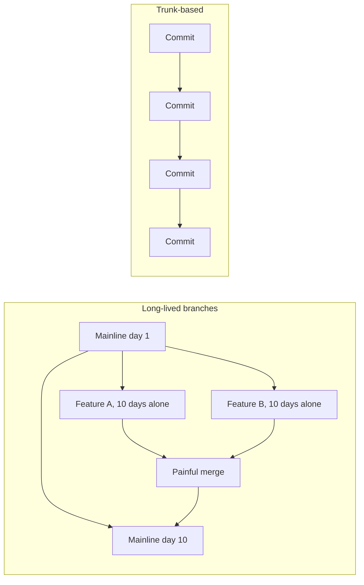
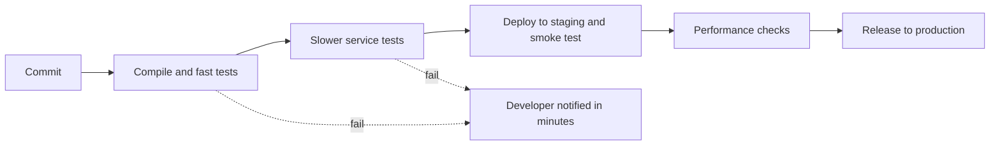

# Continuous integration and build pipelines

## Before this lesson

> **Before this lesson:** read [The key concepts](#/lesson/microservices/key-concepts), where independent deployability was introduced, and [Migration patterns and splitting the data](#/lesson/microservices/migration-patterns-data), where feature toggles first appeared. No experience with build tools is assumed; every term is defined here.

## In plain words

Picture a group of people writing one long report. In the first way of working, each person takes a private copy, writes for three weeks, and then everyone tries to combine their copies the night before the deadline. Paragraphs contradict each other, two people rewrote the same chapter, and nobody knows whether the combined report makes sense.

In the second way, everyone adds their paragraph to the shared copy several times a day, and each time a proofreader immediately reads the whole thing and shouts if it no longer makes sense. Problems are found within minutes, while the author still remembers what they changed.

The second way is **continuous integration**: every developer merges their work into the shared code at least daily, and a machine builds and tests it every time. A **build pipeline** is the automated assembly line that takes each change through a series of checks and, if all pass, produces something ready to release.

Why this matters for a job: you will use a pipeline from your first week at any software company. With microservices the stakes rise, because there may be dozens of services each needing its own path to production. Interviewers often ask how you would get a change safely from a laptop to live users.

## 1. The vocabulary

| Term | Plain meaning |
|---|---|
| Version control | A tool (most often Git) that records every change to the code, who made it and when |
| Repository | The store of the code and its full history, often shortened to "repo" |
| Commit | One recorded change; also the act of recording it ("check in") |
| Branch | A separate line of work that can later be merged back |
| Mainline | The shared branch everyone's work ends up in; also called trunk or main |
| Build | Turning source code into something runnable and checking it |
| Artifact | The packaged output of a build that can be deployed: for example a container image |
| Environment | A place the software runs: a test environment, a staging environment, production |

## 2. Continuous integration

**Continuous integration (CI)** is a practice with three parts:

1. Developers integrate their changes into the mainline frequently, at least once a day.
2. Every integration triggers an automatic build with tests.
3. A failing build is fixed before anything else is done.

Many teams install a CI tool and assume they are doing CI. The tool is the easy part. A well-known three-question check, credited to Jez Humble, reveals the truth:

- **Do you check in to mainline at least once a day?** If code sits on a private branch for a week, it is not being integrated.
- **Do you have tests that validate your changes?** A build that only checks that the code compiles tells you very little.
- **When the build breaks, is fixing it the team's top priority?** If people keep piling changes on a broken build, nobody can tell whose change broke what.

Three "yes" answers mean you are practising CI. Anything less means you have a build server.

### Why frequent integration helps: the cost of waiting

The longer two people work apart, the more likely they change the same part of the code and the harder the merge. Here is a small model.

```python-run
# A codebase of 400 files. Each developer touches 6 files per day, chosen at random.
# What is the chance that two developers have touched at least one file in common
# after working apart for d days?

FILES, PER_DAY = 400, 6

def chance_of_overlap(days):
    touched = PER_DAY * days                      # files each person has changed
    if touched > FILES:
        return 1.0
    p_no_overlap = 1.0
    for i in range(touched):                      # the second person's files avoid the first's
        p_no_overlap *= (FILES - touched - i) / (FILES - i)
    return 1 - max(p_no_overlap, 0.0)

for days in [1, 2, 5, 10, 20]:
    p = chance_of_overlap(days)
    print(f"{days:2d} day(s) apart: {p:5.1%} chance of touching the same file  " + "#" * round(p * 40))
```

`chance_of_overlap` works out the probability that the second developer's files all miss the first developer's files, and subtracts it from one. The loop multiplies one fraction per file: for each file the second person picks, the fraction of remaining files not touched by the first. After one day apart the chance of overlap is under 10%. After five days it is about 90%. After ten it is practically certain. The numbers are invented, and the shape is what matters: the risk does not grow in a straight line, it compounds. And these are only overlaps in the same file; two changes in different files can still contradict each other.

### Branching models

A **feature branch** is a branch created for one piece of work and merged when the work is finished. If "finished" takes two weeks, integration is delayed for two weeks.

**Trunk-based development** is the alternative: everyone commits to the mainline, or to branches that live for less than a day. Research on software delivery performance (the DORA programme, published in the book *Accelerate*) found that teams with short-lived branches and frequent merges to trunk deliver faster and with fewer failures.

How do you commit half-finished work to the mainline without users seeing it? With a **feature toggle** (lesson 8): the new code is merged and deployed, and a switch keeps it turned off until it is ready. Integration and release become two separate decisions.



## 3. Build pipelines

One big build that runs everything has a problem: the fast unit tests finish in one minute, the slow tests take forty, and you learn about a typo only after the whole forty-one. A **build pipeline** splits the work into **stages** that run in order, quickest and cheapest first.



Each stage is a gate. A failure stops the line, and the developer hears about it quickly. Passing a stage increases confidence that the change is safe. The pipeline also gives everyone a shared picture: at any moment you can see which stage each change has reached.

Does ordering matter that much? This simulation compares two orderings of the same three stages.

```python-run
import random

# (name, minutes, probability that a broken change is caught here)
FAST  = ("fast tests",    2, 0.70)
SLOW  = ("service tests", 15, 0.25)
PERF  = ("performance",   30, 0.05)

def average_minutes_to_bad_news(order, trials=20000, seed=1):
    rng = random.Random(seed)
    total = 0
    for _ in range(trials):
        roll, elapsed, cumulative = rng.random(), 0, 0.0
        for name, minutes, catch in order:
            elapsed += minutes
            cumulative += catch
            if roll < cumulative:            # this stage is the one that catches the fault
                break
        total += elapsed
    return total / trials

good = average_minutes_to_bad_news([FAST, SLOW, PERF])
bad  = average_minutes_to_bad_news([PERF, SLOW, FAST])
print(f"fast stage first: a broken change is reported after {good:5.1f} minutes on average")
print(f"slow stage first: a broken change is reported after {bad:5.1f} minutes on average")
```

Each stage has a duration and a share of the faults it is the one to catch (the shares add up to 1, so every broken change is caught somewhere). For each of 20,000 imaginary broken changes, `roll` decides which stage catches it, and `elapsed` adds up the minutes until that stage finishes. With fast tests first, most faults are reported after two minutes and the average is about eight. With the slow stage first, every fault waits at least thirty minutes and the average is about forty-five. Same checks, same coverage, five times slower feedback. A developer who waits forty-five minutes has started something else and must switch back.

## 4. Continuous delivery and continuous deployment

Two terms sound alike and differ in one step.

**Continuous delivery (CD)** means every commit is treated as a **release candidate**: a version that could go to production. The pipeline proves whether it is fit, all the way through to a production-like environment. Releasing is then a business decision, taken by pressing a button.

**Continuous deployment** goes one step further: every commit that passes all the automated stages is released to production automatically, with no button.

| | Continuous integration | Continuous delivery | Continuous deployment |
|---|---|---|---|
| Merges to mainline daily, with automated build and tests | Yes | Yes | Yes |
| Every change proven releasable by a pipeline | No | Yes | Yes |
| Release to production | Manual and occasional | One click, any time | Automatic |

Continuous deployment is not required to benefit from microservices. Continuous delivery, in practice, is: without a reliable automated path to production for each service, having thirty services means thirty slow, manual releases.

## 5. Artifacts: build once, deploy many times

When a build passes, its output is packaged as an **artifact** and stored in an **artifact repository** with a version label. An artifact might be a Java archive, a zip file, or, most often now, a **container image** (a package holding the program and everything it needs to run; lesson 18 explains containers).

Two rules keep artifacts trustworthy.

**Build the artifact once.** The very same artifact moves through every stage of the pipeline and is the one deployed to production. If you rebuild for each environment, you are testing one thing and releasing another: a dependency may have been updated between the two builds, or a compiler setting may differ.

**Keep configuration outside the artifact.** Things that differ per environment (database addresses, feature switches, credentials) are supplied when the artifact is deployed. Baking them in would force a different artifact per environment and break the first rule.

```python-run
import hashlib

def build(source, dependency_versions):
    """An artifact's identity is a fingerprint of everything that went into it."""
    recipe = source + "|" + ",".join(f"{k}={v}" for k, v in sorted(dependency_versions.items()))
    return hashlib.sha256(recipe.encode()).hexdigest()[:12]

source = "def remind(pet): send_text(pet.owner)"
deps_monday  = {"http-client": "2.4.1", "json": "1.9.0"}
deps_tuesday = {"http-client": "2.4.2", "json": "1.9.0"}    # a library published a patch overnight

# Wrong: rebuild for each environment.
tested   = build(source, deps_monday)       # built for the test environment on Monday
released = build(source, deps_tuesday)      # rebuilt for production on Tuesday
print("rebuild per environment :", tested, "vs", released, "-> same?", tested == released)

# Right: build once, promote the same artifact.
artifact = build(source, deps_monday)
print("build once and promote  :", artifact, "vs", artifact, "-> same?", True)
```

`build` returns a fingerprint (a hash: a short value computed from the inputs, which changes if any input changes) of the source and its dependencies. In the first case the source is identical on both days, and the fingerprints still differ, because a library released a new patch version overnight. The thing that reached production was never tested. In the second case one artifact is built and promoted, so what was tested is exactly what is released. Pinning dependency versions helps too, and building once makes the question go away.

## 6. Pipelines for microservices

The goal is independent deployability, so the usual arrangement is:

- **one pipeline per microservice**, triggered by changes to that service's code;
- **one artifact per microservice**, versioned separately;
- the ability to release service A without building or releasing service B.

A few practices make this workable at scale:

- **Pipeline as code.** The pipeline's definition lives in a file in the repository, so it is versioned and reviewed like everything else. Most current CI tools support this.
- **A shared template.** If every service's pipeline is written from scratch, thirty services mean thirty slightly different pipelines. A common template gives consistency; teams adjust where they have a reason.
- **Keep the build fast.** A commonly quoted target for the first stage is under ten minutes. If it is slower, people integrate less often, and the practice decays.
- **A visible build status.** The whole team should see when the mainline is broken.

How source code is arranged across repositories, and how builds map to services, is a large enough subject for its own lesson: [Monorepo or multirepo](#/lesson/microservices/monorepo-multirepo).

### Worked example: the Reminders pipeline at Pawprint

A developer changes the wording of the vaccination reminder and commits at 10:02.

| Time | Stage | What happens |
|---|---|---|
| 10:02 | Commit to mainline | The CI tool notices the change in the Reminders folder |
| 10:04 | Compile and unit tests | 310 tests pass |
| 10:11 | Service tests | Reminders is started with stubbed neighbours; 40 tests pass |
| 10:12 | Package | Container image `reminders:1.14.0-a3f9c2` is stored in the artifact repository |
| 10:15 | Deploy to staging | The same image is deployed with staging configuration; a smoke test sends a reminder to a test phone |
| 10:16 | Waiting | The release candidate is ready. The product owner clicks "release" after lunch |
| 13:30 | Production | The same image is deployed with production configuration |

Nothing in this table involved Billing, Appointments or any other service. That is the test of a healthy microservice build.

> [!INTERVIEW]
> If asked "what is the difference between CI, continuous delivery and continuous deployment?": *CI means integrating to mainline at least daily with an automated build and tests, and fixing a broken build first. Continuous delivery adds a pipeline that proves every commit is releasable, so release is a one-click decision. Continuous deployment removes the click. For microservices I want one pipeline and one artifact per service, built once and promoted unchanged through the environments.*

## 7. Pitfalls

- **Having a CI server without practising CI.** Week-long branches and ignored red builds give none of the benefit.
- **Slow first stage.** Feedback that takes an hour arrives after the developer has moved on.
- **Flaky tests.** A test that fails at random teaches people to ignore failures. Fix or remove it.
- **Rebuilding per environment.** What you tested is not what you shipped.
- **Environment settings inside the artifact.** One artifact per environment, and no certainty they match.
- **One pipeline that builds all services together.** Every release becomes a release of everything.
- **Hand-made pipelines for each service.** Small differences accumulate and nobody can move between teams comfortably.
- **Treating the toggle as permanent.** Remove feature toggles once the feature is live, or the code fills with dead branches.

## Summary

- Continuous integration is a practice: merge to mainline daily, build and test automatically, fix a broken build first.
- The risk and cost of merging rise steeply with the time people work apart; short-lived branches and trunk-based development keep them low.
- A build pipeline orders checks into stages, fastest first, so that bad news arrives quickly.
- Continuous delivery makes every commit a release candidate; continuous deployment releases each passing commit automatically.
- Build an artifact once, store it with a version, promote the same artifact through every environment, and supply configuration from outside.
- For microservices: one pipeline and one artifact per service, defined as code, built from a shared template.

## Glossary

| Term | Meaning |
|---|---|
| Continuous integration | Merging work into the mainline at least daily, with an automated build and tests |
| Mainline / trunk | The shared branch that all work is merged into |
| Feature branch | A branch for one piece of work, merged when complete |
| Trunk-based development | Committing to the mainline directly or through very short-lived branches |
| Build pipeline | An ordered series of automated stages a change passes through |
| Stage | One step of a pipeline, acting as a quality gate |
| Continuous delivery | Keeping every commit provably releasable; release is a manual decision |
| Continuous deployment | Automatically releasing every commit that passes the pipeline |
| Release candidate | A build that may be released if it passes all checks |
| Artifact | The packaged, versioned output of a build |
| Artifact repository | The store where artifacts are kept |
| Pipeline as code | Defining the pipeline in a versioned file in the repository |
| Flaky test | A test that sometimes passes and sometimes fails without a code change |

```quiz
[
  {"q": "Which of these is required for a team to be practising continuous integration?", "options": ["Owning an expensive CI tool", "Merging to mainline at least daily, with automated tests, and fixing a broken build first", "Deploying to production every hour", "Using feature branches that last a sprint"], "answer": 1,
   "explain": "CI is a practice. The tool only automates the build; the daily merge, the tests and the discipline about red builds are what count."},
  {"q": "Why do long-lived feature branches work against continuous integration?", "options": ["They use more disk space", "They delay integration, so conflicts and contradictions are found late and are harder to resolve", "They cannot be tested", "They prevent the use of Git"], "answer": 1,
   "explain": "The longer work stays apart, the more it diverges. The chance of clashing changes compounds with time."},
  {"q": "How can unfinished work be merged to mainline daily without users seeing it?", "options": ["It cannot", "Hide it behind a feature toggle that stays off until the feature is ready", "Comment out all the tests", "Deploy only on Fridays"], "answer": 1,
   "explain": "A toggle separates deploying code from releasing a feature, so integration can be frequent."},
  {"q": "Why should fast tests run in the first pipeline stage?", "options": ["They are more important than slow tests", "Most faults are then reported within minutes, while the developer still has the change in mind", "Slow tests cannot be automated", "It reduces the number of tests"], "answer": 1,
   "explain": "Ordering stages by speed gives quick feedback for the commonest faults, without removing any checks."},
  {"q": "What distinguishes continuous delivery from continuous deployment?", "options": ["Continuous delivery has no tests", "In continuous delivery the release to production is a manual decision; in continuous deployment it is automatic", "Continuous deployment does not use pipelines", "They are the same thing"], "answer": 1,
   "explain": "Both prove every commit releasable. They differ only in whether a person presses the release button."},
  {"q": "Why should an artifact be built once and promoted through environments?", "options": ["Builds are expensive in electricity", "Rebuilding can produce something different from what was tested, for example with a newer dependency", "Artifacts cannot be copied", "Production servers cannot compile code"], "answer": 1,
   "explain": "Promoting one artifact guarantees that the thing released is the thing that passed the tests."},
  {"q": "Where should environment-specific settings such as database addresses live?", "options": ["Inside the artifact", "Outside the artifact, supplied at deployment time", "In the source code as constants", "In the developer's memory"], "answer": 1,
   "explain": "Keeping configuration outside lets one artifact serve every environment."},
  {"q": "What is the usual mapping between pipelines and microservices?", "options": ["One pipeline builds every service together", "One pipeline and one artifact per service, so each can be released alone", "No pipelines; services are deployed by hand", "One pipeline per developer"], "answer": 1,
   "explain": "Independent deployability requires that a change to one service can be built and released without the others."}
]
```

> **Source:** Newman, *Building Microservices*, 2nd ed., ch. 7 (topic coverage only; wording and the Pawprint example are original). Forsgren, Humble and Kim, *Accelerate* (2018), for the research on trunk-based development. Martin Fowler, "Continuous Integration", https://martinfowler.com/articles/continuousIntegration.html
