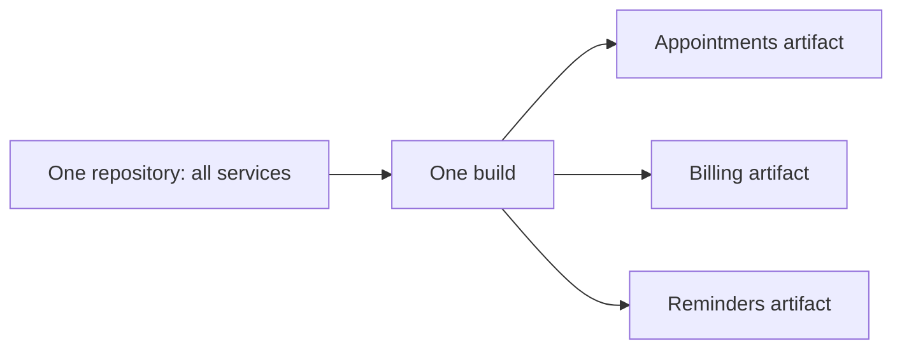
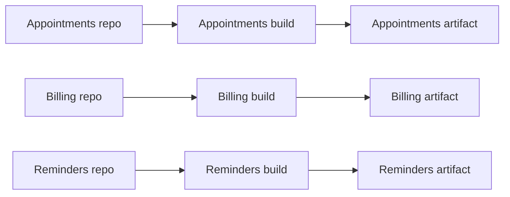
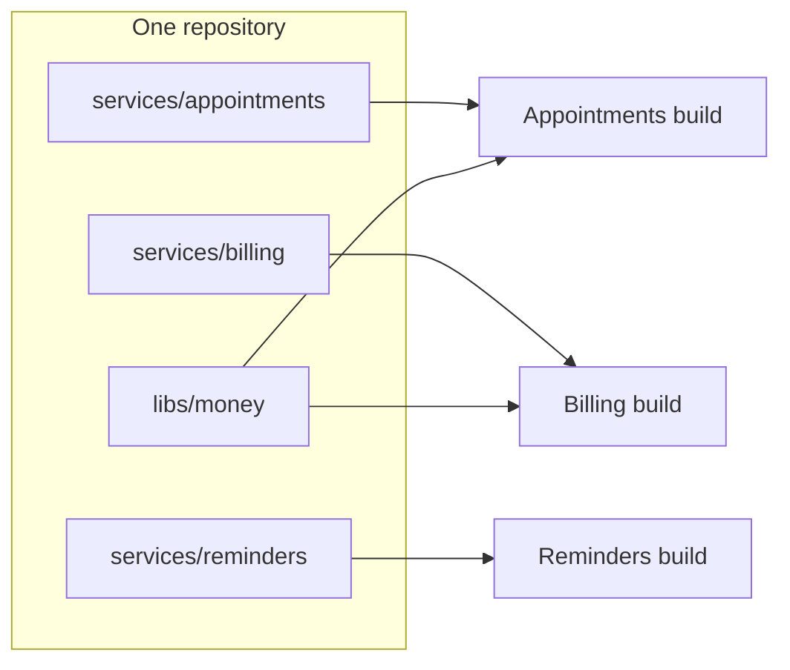

# Monorepo or multirepo: mapping source code and builds to services

## Before this lesson

> **Before this lesson:** read [Continuous integration and build pipelines](#/lesson/microservices/ci-pipelines). You should know what a repository, a commit, a build, a pipeline and an artifact are. The idea of expand and contract comes from [Handling change](#/lesson/microservices/handling-change).

## In plain words

A company has many departments, and each produces paperwork. Where should the paperwork be kept?

One answer is a single enormous filing room where everything is thrown together, and where, every time anyone files one sheet, the whole room is audited from the first drawer to the last. Nobody would choose that on purpose, though many companies drift into it.

A second answer gives every department its own locked cabinet in its own office. Ownership is clear, and each department can reorganise its drawers without asking anyone. Sharing a form between departments means making copies, and the copies slowly go out of date.

A third answer is one shared filing room with a labelled section per department and a rule that filing a sheet triggers an audit of the affected sections only. Everything is visible to everyone, and a change spanning two departments can be filed in one go. In exchange, the room needs a good index and clear signs saying who may change what.

For code, the filing room is a **repository**, the audit is a **build**, and the three answers are: one giant repository with one giant build, one repository per service (**multirepo**), and one repository containing many separately built services (**monorepo**).

Why this matters for a job: you will work inside one of these arrangements, and each one changes how you make a cross-service change, how you share code and how long your builds take. Interviewers at larger companies like to ask which you would choose and why.

## 1. One giant repository, one giant build

All the services' code sits in one repository, and any commit triggers one build that compiles, tests and packages everything.



It is the easiest thing to set up, which is why it appears early in a project. Its problems grow with the system:

- **A one-line change builds everything.** Changing a reminder text rebuilds and retests Billing. Builds get slower every month.
- **You cannot tell what needs deploying.** The build produced new artifacts for every service. Did Billing change? To be safe, teams deploy everything together, which is a lockstep release.
- **One failure blocks everyone.** A broken test in Pharmacy stops Reminders from releasing.
- **Ownership is blurred.** The build belongs to everybody and therefore to nobody.

This arrangement produces a distributed monolith (lesson 4): services that are separate in name and released as one. It is tolerable for a single small team in the first weeks of a project. Plan to leave it.

## 2. Multirepo: one repository per service

Each microservice has its own repository and its own pipeline.



**What you gain**

- **Independent deployability is the default.** A commit to the Reminders repository can only affect Reminders.
- **Clear ownership.** The team that owns the service owns the repository, and can restrict who may change it.
- **Small, fast builds.** Each pipeline handles one service.

**What gets harder**

- **Changes across services are not atomic.** A change that touches Appointments and Billing needs two commits in two repositories, reviewed and merged separately. For a while one is merged and the other is not.
- **Sharing code means publishing libraries.** Common code is packaged as a library with a version. Each service chooses when to upgrade, so different services run different versions.
- **The whole is harder to see.** Searching all code, or making the same small fix in forty repositories, needs extra tooling.

The first point deserves a second look. If you often need to change several services at once, the repository layout is not the real problem; the service boundaries are probably in the wrong place (lesson 5). Frequent cross-service commits are a measurement of coupling. In that sense the friction of multirepo is useful: it makes coupling hurt, where a single repository would hide it.

### How shared libraries drift

```python-run
# Nine services, each in its own repository, all depend on a shared "http-helper" library.
# Day 0: a security fix is published as version 2.3.1. Each team upgrades when it next
# finds time. The numbers are the day on which each team gets round to it.
upgrade_day = {
    "appointments": 1, "billing": 2, "reminders": 3, "patients": 5, "pharmacy": 9,
    "lab-integration": 14, "loyalty": 30, "reporting": 45, "kiosk-api": None,   # None: never
}

def still_vulnerable(day):
    return sorted(s for s, d in upgrade_day.items() if d is None or d > day)

for day in [0, 3, 10, 31, 60]:
    left = still_vulnerable(day)
    print(f"day {day:2d}: {len(left)} of {len(upgrade_day)} still on the old version  {left if len(left) <= 4 else ''}")
```

`upgrade_day` records when each team upgrades. `still_vulnerable` lists the services that have not upgraded by a given day. On day 0 all nine are on the old version. After ten days four remain. After two months one service, the forgotten kiosk API, still runs the vulnerable code. Nothing is broken in a way anyone can see, which is why it persists. This is not an argument against multirepo; it shows that with separately versioned libraries you need a way to see which service uses which version, and someone who chases the stragglers.

## 3. Monorepo: one repository, many builds

In a **monorepo**, the code for many services (sometimes all of them) lives in one repository, and each service still has its own build and artifact. The folder a change touches decides which builds run.



**What you gain**

- **Atomic commits across services.** One commit can change the shared `money` library and every service that uses it. Reviewers see the whole change together.
- **Easy reuse without versions.** A service uses a shared library by referring to its source folder. There is one version of everything: the one in the repository now.
- **Visibility.** Anyone can search and read all the code.

**What gets harder**

- **Mapping changes to builds.** The CI system must work out which services a commit affects. A simple mapping (folder to pipeline) works for a small monorepo. Shared libraries complicate it: a change to `libs/money` must rebuild every service that depends on it, directly or through another library.
- **Ownership needs to be declared.** In one repository, anyone can technically change anything. Most hosting tools support an owners file that says which people or teams must approve changes to which folders.
- **Scale needs tooling.** With hundreds of developers, a plain repository becomes slow to download and the builds too many. Very large companies run monorepos successfully with purpose-built tools: build systems that understand the dependency graph and cache results (Bazel is a well-known example), and ways to check out only part of the repository. Those tools need people to run them.

### Working out what a commit affects

This is the core calculation in any monorepo build. The practice problem *Monorepo: Which Services Does This Change Affect?* asks you to implement it fully; here is the idea.

```python-run
# What each buildable thing depends on (folder names).
DEPENDS_ON = {
    "services/appointments": ["libs/money", "libs/calendar"],
    "services/billing":      ["libs/money"],
    "services/reminders":    ["libs/templates"],
    "services/pharmacy":     ["libs/stock"],
    "libs/stock":            ["libs/money"],      # a library that uses another library
    "libs/money": [], "libs/calendar": [], "libs/templates": [],
}

def owner_folder(path):
    """Which buildable folder does a changed file belong to?"""
    return next((f for f in DEPENDS_ON if path.startswith(f + "/")), None)

def affected_services(changed_files):
    dirty = {owner_folder(p) for p in changed_files} - {None}
    grew = True
    while grew:                                   # keep spreading until nothing new is added
        grew = False
        for thing, deps in DEPENDS_ON.items():
            if thing not in dirty and any(d in dirty for d in deps):
                dirty.add(thing)
                grew = True
    return sorted(t for t in dirty if t.startswith("services/"))

print(affected_services(["services/reminders/text.py"]))
print(affected_services(["libs/calendar/slots.py"]))
print(affected_services(["libs/money/rounding.py"]))
print(affected_services(["README.md"]))
```

`DEPENDS_ON` lists, for each service and library, the libraries it uses. `owner_folder` finds which buildable folder a file sits in. `affected_services` starts with the folders that were changed directly and then repeats one rule until nothing more is added: anything that depends on a changed thing is itself changed.

The four results show the range. A change inside Reminders rebuilds only Reminders. A change to the calendar library rebuilds Appointments. A change to the money library rebuilds Appointments and Billing directly, and Pharmacy too, because Pharmacy uses the stock library, which uses money. A change to the top-level README rebuilds nothing. Notice how wide the money change spreads. A much-used shared library in a monorepo is convenient to change and expensive to change at the same moment.

### An atomic commit is not an atomic deployment

This is the most common misunderstanding about monorepos. You can change Appointments and Billing in one commit. You cannot deploy them at the same instant. For some seconds or minutes, new Billing runs beside old Appointments, or the reverse. If the commit changed the contract between them in a breaking way, calls fail during that window, and a rollback of one service leaves them mismatched again.

So the rules from lesson 12 still apply inside a monorepo: make contract changes backward compatible, or use expand and contract. The monorepo makes the *code* change convenient. It does nothing for the *runtime*.

### Ownership in a shared repository

Three ownership models are possible, in any repository layout, and a monorepo forces you to choose one:

| Model | Who may change a service's code | Fits |
|---|---|---|
| Strong ownership | Only the owning team; others send a request | Many teams, clear boundaries |
| Weak ownership | Anyone may change it, with the owning team's review | Teams that collaborate closely |
| Collective ownership | Anyone may change anything | One small team |

An owners file in the repository records the choice per folder and the hosting tool enforces the reviews. Lesson 31 returns to ownership from the organisational side.

### The per-team monorepo

A middle path: each team keeps one repository containing all of the services that team owns. Cross-service changes within the team are atomic and convenient; boundaries between teams remain repository boundaries with explicit contracts. This suits organisations where the monorepo-for-everything tooling would be too heavy and one-repository-per-service too scattered.

## 4. Choosing

| | Giant repo, giant build | Multirepo | Monorepo |
|---|---|---|---|
| Independent deployment | No | Yes, by default | Yes, with build mapping |
| Change across services | One commit, one giant build | Several commits | One commit |
| Code reuse | Trivial | Versioned libraries | Shared source folders |
| Build time as the system grows | Grows without limit | Stays small per service | Small with good tooling |
| Ownership boundaries | Blurred | Enforced by repository access | Declared with an owners file |
| Tooling effort | Lowest | Low per repository, some for the overview | Low when small, high at scale |
| Hides coupling | Yes | No, coupling is felt | Somewhat |

Some guidance by size:

- **A handful of developers.** A monorepo with a folder-to-pipeline mapping is cheap and convenient. Multirepo works too.
- **Many teams with stable boundaries.** Multirepo keeps teams independent with almost no special tooling. Invest in a way to see library versions across repositories.
- **Many teams wanting a single repository.** Possible, and it needs investment in graph-aware build tooling and declared ownership. The awkward zone is the middle: too big for the plain approach, too small to fund a tooling team. The per-team monorepo is often the way through.

Whatever you choose, test it with one question: *can I change, build and release one service without building or releasing any other?* If the answer is no, the layout is working against you.

### Worked example: Pawprint's choice

Pawprint has twelve developers in three teams and nine services. They started with one giant build, which now takes 38 minutes. They consider two options.

*Multirepo* would give nine repositories and nine pipelines. The teams worry about the shared `money` library, used by five services, and remember the kiosk API that nobody upgraded.

*Monorepo* would keep one repository with `services/` and `libs/` folders and nine pipelines triggered by folder. They would add an owners file mapping each service folder to its team, and a small script like the one above to decide which pipelines a commit triggers.

They choose the monorepo, with two rules written into the repository's contributing guide: contract changes between services must be backward compatible even when made in one commit, and a change to anything under `libs/` needs approval from every team that uses it. The second rule puts some friction back where the coupling is, on purpose.

> [!INTERVIEW]
> For "monorepo or one repo per service?", avoid picking a side on principle: *both support independent deployment if builds map to services. Multirepo gives hard ownership boundaries and makes coupling visible, at the cost of non-atomic cross-service changes and library version drift. A monorepo gives atomic commits and easy reuse, and needs change-detection in CI, declared ownership, and serious build tooling at scale. An atomic commit is still not an atomic deployment, so contract changes must stay backward compatible. For a small organisation I would pick a monorepo; for many autonomous teams, multirepo or a monorepo per team.*

## 5. Pitfalls

- **Staying on one giant build.** It turns microservices into a distributed monolith by making separate release impossible.
- **Believing an atomic commit deploys atomically.** Old and new versions always overlap at runtime.
- **A fat shared library.** In a monorepo it triggers every build; in multirepo it drifts. Keep shared code small and free of business rules.
- **No owners file in a monorepo.** Well-meant edits to another team's service arrive without review.
- **No overview in multirepo.** A security fix reaches eight of nine services and nobody notices the ninth.
- **Using the repository layout to paper over bad boundaries.** If most changes touch several services, redraw the boundaries.
- **Adopting large-scale monorepo tooling for a small team.** The tooling becomes a project of its own.

## Summary

- Three arrangements exist: one giant repository with one build, one repository per service, and a monorepo with a build per service.
- The giant build removes independent deployability and should be temporary.
- Multirepo makes independence and ownership the default; cross-service changes take several commits and shared libraries drift in version.
- A monorepo allows atomic commits and easy reuse; it needs change-to-build mapping, declared ownership and, at scale, specialised tooling.
- Affected builds are found by spreading "changed" along the dependency graph.
- An atomic commit never gives an atomic deployment; keep contract changes backward compatible.
- A per-team monorepo is a practical middle path.

## Glossary

| Term | Meaning |
|---|---|
| Multirepo | One source repository per microservice |
| Monorepo | One repository holding many separately built services |
| Atomic commit | A single commit that changes several parts of the code together |
| Shared library | Common code used by several services |
| Version drift | Different services running different versions of the same library |
| Dependency graph | The record of which buildable things depend on which others |
| Affected build | A build that must run because something it depends on changed |
| Owners file | A file mapping folders to the people who must approve changes |
| Strong / weak / collective ownership | Only owners change the code / anyone may with owner review / anyone may change anything |
| Per-team monorepo | One repository per team, holding all of that team's services |

```quiz
[
  {"q": "What is the main problem with one giant repository that has one giant build?", "options": ["Git cannot store that much code", "Every change rebuilds and tends to redeploy everything, removing independent deployability", "Developers cannot search the code", "It prevents code reuse"], "answer": 1,
   "explain": "One build producing all artifacts makes it hard to release a single service, so teams release everything together."},
  {"q": "In a multirepo setup, what does a change spanning two services require?", "options": ["One atomic commit", "A separate commit in each repository, merged separately", "Deleting one of the services", "A two-phase commit protocol"], "answer": 1,
   "explain": "Repositories are independent, so the change is split. If this is frequent, the service boundaries deserve a second look."},
  {"q": "Why can frequent cross-service commits be seen as useful information?", "options": ["They prove the build is fast", "They measure coupling: services that keep changing together may have the wrong boundaries", "They show the tests are flaky", "They reduce the number of repositories"], "answer": 1,
   "explain": "Services that must change together are coupled. Multirepo makes that painful and therefore visible."},
  {"q": "A commit in a monorepo changes a library used by Billing and by a library that Pharmacy uses. Which services must be rebuilt?", "options": ["None", "Only Billing", "Billing and Pharmacy, because the change spreads along the dependency graph", "Every service in the repository"], "answer": 2,
   "explain": "Anything that depends on a changed thing, directly or through another library, is affected."},
  {"q": "A single monorepo commit changes the contract between two services in a breaking way. What happens at deployment?", "options": ["Both deploy at the same instant, so nothing breaks", "For a period old and new versions run side by side and calls between them can fail", "The commit is rejected by Git", "The services merge into one"], "answer": 1,
   "explain": "An atomic commit is not an atomic deployment. Contract changes must stay backward compatible or use expand and contract."},
  {"q": "How is ownership usually enforced inside a monorepo?", "options": ["It cannot be", "With an owners file that maps folders to required reviewers", "By encrypting each folder", "By giving each developer a separate copy"], "answer": 1,
   "explain": "The hosting tool reads the file and requires approval from the listed owners for changes in their folders."},
  {"q": "What is a typical weakness of shared libraries in a multirepo setup?", "options": ["They cannot be versioned", "Services upgrade at different times, so versions drift and fixes spread slowly", "They make builds atomic", "They force a single programming language on the company"], "answer": 1,
   "explain": "Each repository chooses when to upgrade. Without an overview, some services stay on old versions for a long time."},
  {"q": "Which single question best tests whether a repository and build layout suits microservices?", "options": ["Is there only one repository?", "Can one service be changed, built and released without building or releasing any other?", "Are all services written in the same language?", "Is the build longer than ten minutes?"], "answer": 1,
   "explain": "The purpose of the layout is to support independent deployability. Any arrangement that achieves it can work."}
]
```

> **Source:** Newman, *Building Microservices*, 2nd ed., ch. 7 (topic coverage only; wording and the Pawprint example are original). Potvin and Levenberg, "Why Google Stores Billions of Lines of Code in a Single Repository", Communications of the ACM, 2016.
