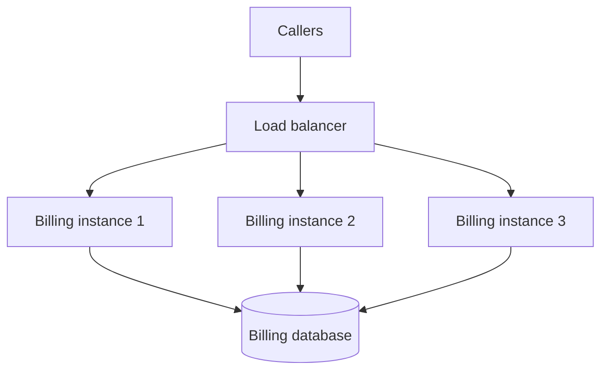
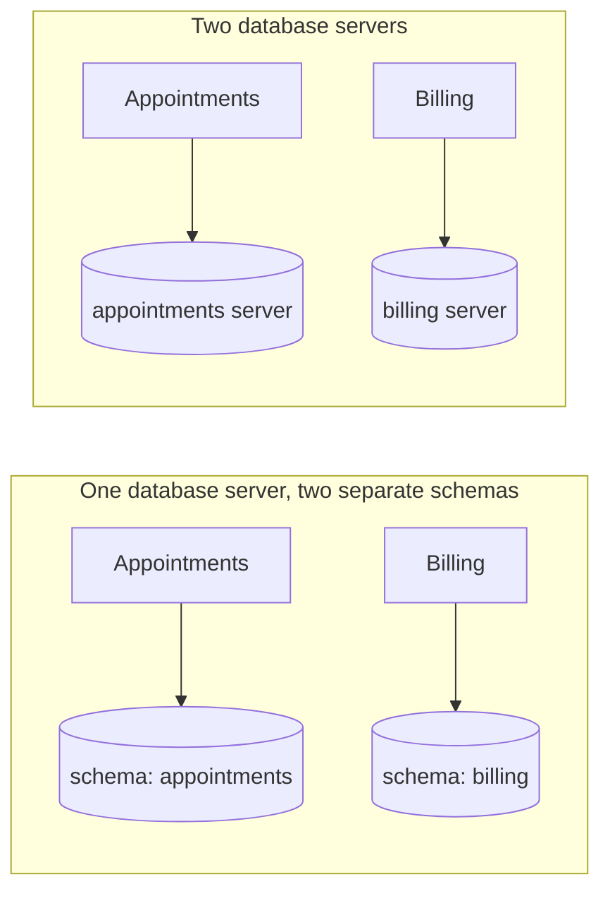

# From logical to physical and the principles of deployment

## Before this lesson

> **Before this lesson:** read [Continuous integration and build pipelines](#/lesson/microservices/ci-pipelines) so that you know what an artifact, an environment and a pipeline are, and [What a network call costs](#/lesson/microservices/network-cost-why-split) for the way availabilities combine. No knowledge of servers or cloud platforms is assumed.

## In plain words

On the map of a city's bus network, route 14 is one neat coloured line. In the street, route 14 is thirty buses, three depots, spare vehicles for breakdowns, and a timetable office deciding how many buses run at rush hour. The line on the map is the **logical** view: what exists and what connects to what. The buses are the **physical** view: what is really running, how many of each, and where.

Every architecture diagram so far in this track has been a bus map. The box labelled "Billing" stands for several running copies of the Billing program, on several machines, in more than one building, each talking to a database that is itself copied, and all of this repeated in a test environment and again in production.

**Deployment** is the work of turning the map into buses: getting the right number of copies of each service running in the right places, and replacing them with new versions without passengers noticing. This lesson covers what the physical picture looks like and five principles that keep deployment manageable when there are many services. The next lesson covers the concrete options: machines, containers, platforms and functions.

Why this matters for a job: a design that looks fine as boxes and arrows can fail on questions such as "what happens when a data centre loses power?" Interviewers ask those questions to see whether you think about the buses.

## 1. One box, many instances

An **instance** is one running copy of a service. A service in production nearly always has more than one, for two reasons:

- **Load.** One copy can handle a certain number of requests per second. More copies handle more.
- **Robustness.** If the only copy crashes, the service is down. With three copies, two keep working.

Something must share the incoming requests among the instances. That is a **load balancer**: a component that receives each request and forwards it to one of the healthy instances. It checks health regularly and stops sending traffic to an instance that does not respond.



### Spread across failure domains

Three instances on one physical machine all die when that machine dies. A **failure domain** is a set of things that fail together: a machine, a rack, a building. Cloud providers divide each geographic **region** into several **availability zones**, each of which is one or more separate data centres with independent power and networking. The rule of thumb: run instances in at least two zones, so that losing one zone does not take the service down.

```python-run
def at_least_one_up(p_single_up, copies):
    """Chance that not every copy is down, assuming independent failures."""
    return 1 - (1 - p_single_up) ** copies

INSTANCE_UP = 0.99        # one instance is healthy 99% of the time
ZONE_UP     = 0.999       # one zone is reachable 99.9% of the time

print("instances   availability")
for n in [1, 2, 3]:
    print(f"    {n}       {at_least_one_up(INSTANCE_UP, n):.6f}")

three = at_least_one_up(INSTANCE_UP, 3)
one_zone  = ZONE_UP * three                           # everything in a single zone
two_zones = at_least_one_up(ZONE_UP * three, 2)       # the same again in a second zone
print(f"\n3 instances in one zone      : {one_zone:.6f}")
print(f"3 instances in each of 2 zones: {two_zones:.8f}")
```

`at_least_one_up` computes the chance that at least one of several independent copies is working: one minus the chance that all are down. One instance gives 0.99. Two give 0.9999; three give 0.999999. Then the zone enters. With every instance in one zone, the service cannot be more available than the zone: 0.999, which wastes the three instances. Duplicating the group into a second zone lifts the figure to about 0.999999. The lesson: extra copies only help if they do not share a failure domain. The assumption of independence matters too. A bad release deployed to all instances at once takes them all down together, whatever the arithmetic says.

## 2. The database in the physical picture

The logical rule from lesson 3 is that each service owns its data and others reach it only through the service's API. Physically there is more to say.

**Scaling reads.** A database can be run as one **primary** node, which accepts writes, and one or more **read replicas**, which receive copies of the primary's changes and answer read-only queries. All instances of the service write to the primary and may read from replicas. Replicas lag slightly behind, so a read from a replica may return data a moment out of date.

**Logical isolation versus physical isolation.** Two services must never share tables. That is logical isolation, and it is not negotiable. Whether their separate databases run on the same database server is a different, physical question:



A **schema** here means a named, separately permissioned collection of tables inside one database server. Sharing a server saves money and administration, which matters when you run your own hardware. Its cost is a shared failure domain: if that server goes down, both services go down. In a public cloud, a separate managed database per service is cheap to create, so teams usually take full physical separation as well.

## 3. Environments

An **environment** is a complete place where the system runs. A change usually passes through several on its way to users:

| Environment | Purpose | Typical shape |
|---|---|---|
| Developer laptop | Write and try code | One instance of one service, neighbours faked |
| CI | Fast automated tests | Short-lived, created per build |
| Pre-production (staging) | Rehearse the release | Smaller copy of production, realistic neighbours |
| Production | Serve real users | Many instances, several zones |

Two forces pull against each other. Early environments should be **fast and cheap**, so that feedback comes quickly. Later environments should be **like production**, so that feedback is trustworthy. Nobody can afford a full copy of production on every laptop. So the physical layout differs per environment: one instance on the laptop, six in production.

What must *not* differ is the artifact. As lesson 15 said, you build once and deploy that same artifact everywhere. Whatever varies (number of instances, addresses, credentials) is configuration supplied at deployment time. Keep that configuration small: the more the environments differ in behaviour, the less a pass in staging tells you about production.

## 4. Five principles of microservice deployment

With one application you can deploy by hand and survive. With thirty services, each with several instances in several environments, the number of moving parts is in the hundreds. Five principles keep it under control.

### Principle 1: isolated execution

Run each service instance in its own isolated space, with its own share of processor time and memory, so that one instance cannot damage another.

The opposite, several services installed on one operating system, causes familiar trouble. One service uses all the memory and its neighbours slow to a crawl (the **noisy neighbour** problem). Two services need different versions of the same system library. Deploying one disturbs the others. And when the machine misbehaves, nobody can tell which service is responsible.

Isolation can be provided by a whole physical machine, a virtual machine, or a container. They differ in strength and cost, and the next lesson compares them. The principle is independent of the technology: one instance, one isolated space.

### Principle 2: focus on automation

Every manual step in deploying one service is multiplied by the number of services and by the number of deployments per week. Work done by hand also varies from person to person, and the differences cause failures that are hard to trace.

So automate, and prefer tools designed for it: tools you can drive from scripts and pipelines, not only by clicking in a console. A useful test for any operational task is: *could a new team member do this by running one command?* When a task is hard to automate, that is a signal about the tool or the design, not a reason to keep doing it by hand.

### Principle 3: infrastructure as code

**Infrastructure as code (IaC)** means describing your machines, networks, databases and their settings in text files that a tool reads to create or change the real infrastructure. The files live in version control beside the application code.

The benefits follow from that:

- **Reproducible.** The staging environment is created from the same files as production, with different parameters.
- **Reviewable.** A change to a firewall rule is a diff someone approves, not a click nobody saw.
- **Recoverable.** If an environment is lost, it can be rebuilt from the files.
- **Traceable.** History shows who changed what and when.

Terraform, Pulumi and the cloud providers' own template tools are common examples. The usual failure is a person "quickly" changing something by hand in the console; the files then no longer describe reality. This gap between the described and the actual state is called **configuration drift**.

### Principle 4: zero-downtime deployment

Independent deployability is worth little if each deployment takes the service offline and other teams must be warned. A **zero-downtime deployment** replaces a service with a new version while callers keep being served.

The basic technique is a **rolling upgrade**: replace instances one at a time, waiting for each new one to be healthy before removing the next old one.

```python-run
def rolling_upgrade(instances, new_version, minimum_serving):
    fleet = [{"id": i, "version": "v1", "serving": True} for i in range(instances)]
    def show(step):
        picture = " ".join(f"{m['version']}{'' if m['serving'] else '(down)'}" for m in fleet)
        serving = sum(m["serving"] for m in fleet)
        ok = "ok" if serving >= minimum_serving else "BELOW MINIMUM"
        print(f"{step:22s} {picture:32s} serving={serving} {ok}")
    show("start")
    for m in fleet:
        m["serving"] = False                 # take one instance out of the load balancer
        show(f"drain instance {m['id']}")
        m["version"] = new_version           # replace it
        m["serving"] = True                  # health check passes, back into rotation
        show(f"instance {m['id']} upgraded")

rolling_upgrade(instances=4, new_version="v2", minimum_serving=3)
```

`fleet` is a list of four instances, all on version 1. For each instance in turn, the function marks it as not serving (the load balancer stops sending it requests), changes its version, and marks it as serving again. `show` prints the fleet after every action and checks that at least three instances are serving. At no step does the count fall below three, so callers are served throughout.

Look closely at the middle of the output: for part of the upgrade, version 1 and version 2 are both serving. This always happens in a zero-downtime deployment, and it is the reason lesson 12 insisted on backward-compatible contracts. Asynchronous communication helps as well: if requests arrive through a queue, a consumer can be replaced while messages wait briefly. Fancier techniques (blue-green, canary) come in the next lesson.

### Principle 5: desired state management

The old way to operate systems is **imperative**: a person or script issues commands in sequence ("start an instance; now start another"). If an instance later dies, nothing happens until someone notices.

**Desired state management** is **declarative**: you state what should be true ("three instances of Billing version 2.3, each with 512 MB of memory") and a platform continuously compares that with reality and acts to close any gap. The comparing-and-fixing cycle is called a **reconciliation loop**.

```python-run
desired = {"billing": 3, "reminders": 2}
running = {"billing": ["b-1", "b-2", "b-3"], "reminders": ["r-1", "r-2"]}
counter = 100

def reconcile():
    """Compare desired with actual, and act on the difference."""
    global counter
    actions = []
    for service, want in desired.items():
        have = running[service]
        while len(have) < want:
            counter += 1
            have.append(f"{service[0]}-{counter}")
            actions.append(f"start {have[-1]}")
        while len(have) > want:
            actions.append(f"stop {have.pop()}")
    return actions or ["nothing to do"]

print("tick 1:", reconcile())
running["billing"].remove("b-2")                 # an instance crashes at 3 a.m.
print("tick 2:", reconcile())
desired["reminders"] = 4                         # vaccination season: someone edits the file
print("tick 3:", reconcile())
desired["reminders"] = 2
print("tick 4:", reconcile())
print("now running:", running)
```

`desired` is the declaration and `running` is reality. `reconcile` starts instances where there are too few and stops them where there are too many. On tick 1 nothing is needed. Before tick 2 an instance crashes, and the loop starts a replacement with no person involved. Before tick 3 someone raises the desired number of Reminders instances to four, and the loop starts two. Lowering it again on tick 4 stops two. The operator never issued a "start" or "stop" command; they edited a declaration.

Kubernetes, the subject of the next lesson, is built around this idea. **GitOps** combines it with infrastructure as code: the desired state lives in a Git repository, and a tool inside the platform watches the repository and applies any change. Git then holds both the history and the current truth of what should be running.

A caution: when a platform manages desired state, do not also change things by hand. Manual changes are either undone by the loop or cause it to fight you.

## 5. Worked example: Billing, logical and physical

Logically, Pawprint's Billing is one box with one database, called by Appointments.

Physically, in production:

| Element | Arrangement |
|---|---|
| Instances | 4, two in each of two availability zones |
| Load balancer | One managed load balancer spanning both zones, with a health check every 5 seconds |
| Database | Managed primary in zone A, a standby copy in zone B, one read replica for reports |
| Isolation | Each instance is a container with 0.5 CPU and 512 MB reserved |
| Definition | Infrastructure files and a deployment description in the Billing folder of the repository |
| Deployment | Rolling, one instance at a time, minimum 3 serving |
| Desired state | The platform restarts crashed instances and keeps the count at 4 |

In staging the same artifact runs as one instance with a small database. On a laptop it runs alone with a fake card provider.

> [!INTERVIEW]
> When a design question reaches "how is this deployed?", walk from logical to physical: *each service runs several instances behind a load balancer, spread over at least two availability zones so that no single failure domain takes it down. Each instance is isolated, defined by infrastructure as code, and managed by a platform that keeps the desired state. Releases are rolling, so two versions overlap and contracts must be backward compatible. The same artifact goes through every environment with different configuration.*

## 6. Pitfalls

- **All instances in one failure domain.** Three copies on one machine or in one zone give far less protection than the count suggests.
- **Assuming independent failures.** A faulty release or a shared dependency takes every instance down at once.
- **Sharing tables because the server is shared.** A shared database server is a physical economy; shared tables are a design error.
- **Environments that differ in behaviour.** A pass in staging then means little.
- **Changes made by hand in the console.** The infrastructure files stop describing reality.
- **Deployments that need a maintenance window.** They discourage frequent release and couple teams' calendars.
- **Fighting the reconciliation loop.** Manual stops and starts are reversed, or mask the true state.
- **Ignoring replica lag.** Reading your own write from a replica can return the old value.

## Summary

- The logical view shows services and connections; the physical view shows instances, zones, databases and environments.
- Run several instances behind a load balancer, spread over independent failure domains.
- Each service owns its data logically; physical sharing of database servers is a cost-versus-risk choice.
- Environments trade speed for realism; the artifact stays the same and configuration varies.
- Five principles: isolated execution, automation, infrastructure as code, zero-downtime deployment, and desired state management.
- Rolling upgrades keep capacity while versions overlap; a reconciliation loop keeps reality matching the declaration.

## Glossary

| Term | Meaning |
|---|---|
| Logical view | Which services exist and how they connect |
| Physical view | What is running where, and how many copies |
| Instance | One running copy of a service |
| Load balancer | A component that spreads requests over healthy instances |
| Failure domain | A set of things that fail together |
| Region / availability zone | A geographic area / an independent data-centre group within it |
| Primary / read replica | The database node that accepts writes / a copy that serves reads |
| Environment | A complete place where the system runs, such as staging or production |
| Isolated execution | Each instance runs in its own space with its own resources |
| Noisy neighbour | A workload that degrades others sharing the same machine |
| Infrastructure as code | Infrastructure described in version-controlled files that tools apply |
| Configuration drift | A gap between the described infrastructure and the real one |
| Zero-downtime deployment | Releasing a new version while requests keep being served |
| Rolling upgrade | Replacing instances a few at a time |
| Desired state management | Declaring what should run and letting a platform maintain it |
| Reconciliation loop | The repeated compare-and-fix cycle that maintains desired state |
| GitOps | Keeping the desired state in Git and applying it automatically |

```quiz
[
  {"q": "What is the difference between the logical and the physical view of a system?", "options": ["Logical is for managers, physical for developers", "Logical shows services and their connections; physical shows the running instances, where they are and how many", "They are two names for the same diagram", "Physical view only covers hardware purchases"], "answer": 1,
   "explain": "One box on a logical diagram usually corresponds to several instances across zones and environments in the physical world."},
  {"q": "Three instances of a service all run in a single availability zone. What limits the service's availability?", "options": ["Nothing; three copies are always enough", "The zone: if it fails, all three instances fail together", "The number of developers", "The programming language"], "answer": 1,
   "explain": "Copies inside one failure domain fail together. Spreading them over zones removes that shared cause."},
  {"q": "Two services use separate schemas on the same database server. Which statement is correct?", "options": ["This violates data ownership", "Their data is logically isolated, and they share a physical failure domain", "They can now join each other's tables freely", "It is impossible in practice"], "answer": 1,
   "explain": "Separate schemas keep ownership intact. The shared server saves cost and means one outage affects both."},
  {"q": "What should stay identical across test, staging and production?", "options": ["The number of instances", "The database addresses", "The artifact being deployed", "The credentials"], "answer": 2,
   "explain": "The same artifact is promoted through every environment. Counts, addresses and credentials are configuration."},
  {"q": "What is configuration drift?", "options": ["Instances moving between zones", "The real infrastructure no longer matching its description in code, often after manual changes", "A slow network", "A kind of rolling upgrade"], "answer": 1,
   "explain": "Manual changes outside the infrastructure files make the files untrustworthy and environments unreproducible."},
  {"q": "During a rolling upgrade of four instances, what is true part-way through?", "options": ["The service is offline", "Old and new versions are serving requests at the same time", "Only the database is running", "All instances restart together"], "answer": 1,
   "explain": "Instances are replaced a few at a time, so versions overlap. Contracts must therefore be backward compatible."},
  {"q": "With desired state management, an instance crashes at night. What happens?", "options": ["Nothing until an operator notices", "The platform's reconciliation loop sees fewer instances than declared and starts a replacement", "The declaration is deleted", "All other instances are stopped"], "answer": 1,
   "explain": "The platform continuously compares the declared state with reality and acts to close the gap."},
  {"q": "Why does deployment automation matter more with microservices than with one application?", "options": ["Microservices cannot be deployed by hand at all", "Manual steps are multiplied by the number of services, instances, environments and releases", "Automation is required by law", "It removes the need for testing"], "answer": 1,
   "explain": "Hundreds of moving parts make hand work slow and inconsistent. Automation keeps the cost per deployment low."}
]
```

> **Source:** Newman, *Building Microservices*, 2nd ed., ch. 8 (topic coverage only; wording and the Pawprint example are original). Kief Morris, *Infrastructure as Code*, 2nd ed. (2020), for the infrastructure-as-code principles.
