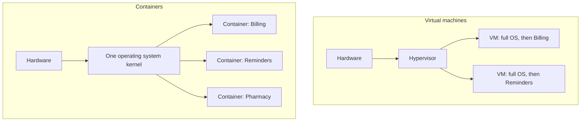
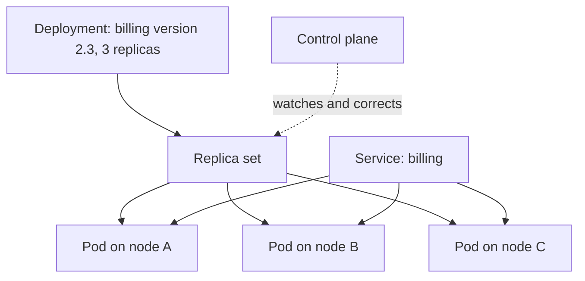
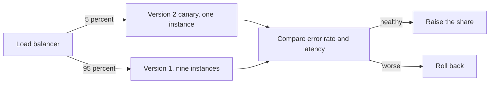

# Deployment options, Kubernetes and progressive delivery

## Before this lesson

> **Before this lesson:** read [From logical to physical and the principles of deployment](#/lesson/microservices/logical-to-physical). You should know what an instance, a load balancer, isolated execution, a rolling upgrade and desired state management are. Feature toggles were introduced in [Migration patterns and splitting the data](#/lesson/microservices/migration-patterns-data).

## In plain words

There are many ways to have somewhere to live. You can own a detached house: total privacy, total responsibility, slow to acquire. You can rent a flat in a block: your own front door and kitchen, with the building shared. You can take a room in a shared house: cheap and quick to move into, with thinner walls. You can stay in a hotel, where somebody else makes the bed as long as you follow the house rules. Or you can pay for a meeting room by the hour and have nowhere of your own at all.

A service needs somewhere to run, and the choices line up the same way:

| Home | Where a service runs |
|---|---|
| Detached house | A physical machine |
| Flat in a block | A virtual machine |
| Room in a shared house | A container |
| Hotel | A platform as a service |
| Room rented by the hour | A function as a service |

As you go down the table you control less and somebody else does more of the work. This lesson walks through each option, then explains **Kubernetes**, the most widely used system for running containers, and ends with **progressive delivery**: ways of releasing a new version to users a little at a time.

Why this matters for a job: nearly every backend job advert mentions containers and Kubernetes, and "how would you roll this out safely?" is a routine interview question.

## 1. Physical machines

A **physical machine** (also called bare metal) is a real computer with no layer between your software and the hardware.

One service instance per physical machine gives the strongest isolation possible. It is also wasteful: most services use a small part of a modern machine, and buying, installing and configuring hardware takes days or weeks. Putting several services on one machine to use it fully breaks the isolation principle from the last lesson. For these reasons physical machines are now rare for microservices, outside special cases that need every bit of hardware performance.

## 2. Virtual machines

A **virtual machine (VM)** is a pretend computer created by software. A program called a **hypervisor** divides one physical machine into several VMs, each with its own slice of processor and memory and each running its own complete operating system.

VMs made cloud computing possible: you can request one with an API call and have it in a minute or two. Isolation is strong, because each VM has its own operating system **kernel** (the core of an operating system, which controls the hardware and separates programs from each other).

The cost is overhead. Every VM carries a full operating system, which uses memory and disk and takes time to start. The hypervisor itself consumes resources. The more, smaller VMs you cut a machine into, the larger the share lost to this overhead.

## 3. Containers

A **container** is an isolated space for a process, created by features of the operating system kernel instead of by a hypervisor. All containers on a machine share that machine's kernel. Each sees its own file system, its own network address and its own list of processes, and can be given limits on processor and memory.



Because there is no second operating system to boot, a container starts in seconds or less and adds little overhead, so one machine can run many more containers than VMs.

Docker made containers practical by adding the **container image**: a single package containing the program, its libraries and its settings. The image is the artifact from lesson 15. You build it once, store it in a **registry** (an artifact repository for images), and run the same image on a laptop, in staging and in production. "It works on my machine" stops being an excuse, because the machine's contents travel with the image.

The weakness is that isolation is thinner than a VM's. All containers rely on one shared kernel, so a flaw in the kernel could let one container affect another. That is acceptable when all the containers run your own code. Running code from people you do not trust needs something stronger, and a common arrangement is containers inside VMs: the VM gives the strong wall, the containers give the convenience.

Containers are the default choice for microservices today.

### Application containers: an older idea to avoid

Do not confuse the above with an **application container**: a single large runtime (the classic examples are Java application servers) into which several applications are installed side by side. They share one runtime process, which means weak isolation, one technology for all, and slow start-up. It conflicts with almost everything microservices aim for.

## 4. Platform as a service

A **platform as a service (PaaS)** works at a higher level: you hand over your code or your image and the platform builds it, runs it, scales it and often supplies databases too. Heroku is the best-known example.

When your service fits what the platform expects, this is the most productive option there is: almost no operational work. The limits appear when you need something unusual. The platform decides how scaling, networking and configuration work, and the smarter it tries to be on your behalf, the harder it is to step outside its assumptions.

## 5. Functions as a service and serverless

**Serverless** is an umbrella term for cloud products where you do not manage or even see servers. The provider runs everything, scales it automatically (including down to nothing), charges for what you use, and builds in redundancy. Managed message queues, storage services and databases can all be serverless in this sense.

**Function as a service (FaaS)** is the part of serverless that runs your code. You deploy a **function**: a small piece of code with a trigger. A trigger might be an HTTP request, a message on a queue or a file arriving in storage. When the trigger fires, the platform starts your function, runs it and stops it. With no triggers, nothing runs and you pay nothing. AWS Lambda, Azure Functions and Google Cloud Functions are the main products.

Limits to know:

- **Cold starts.** If no copy of the function is warm, the platform must start one, which adds a delay to that request.
- **Time limits.** An invocation may run only for a bounded time, typically minutes.
- **Statelessness.** Nothing kept in memory survives between invocations; state belongs in a database.
- **Limited tuning.** You usually choose a memory size and little else.
- **Scaling can overwhelm neighbours.** The platform may start a thousand copies in a burst. If each opens a connection to a database that allows a hundred, the database falls over. The function scaled; the rest of the system did not.

How do functions relate to microservices? The straightforward mapping is one function, or a small group of functions sharing one database, per microservice. The group is still deployed and owned as one unit; the service boundary has not gone away.

Is pay-per-use cheaper? It depends on load, as this model shows.

```python-run
# Always-on: two small instances, running all month.
INSTANCE_PER_HOUR = 0.04
always_on = 2 * INSTANCE_PER_HOUR * 24 * 30

# Function: pay per invocation and per unit of compute time.
PER_MILLION_CALLS = 0.20
PER_GB_SECOND     = 0.0000167
MEMORY_GB, SECONDS_PER_CALL = 0.5, 0.2

def function_cost(calls_per_month):
    compute = calls_per_month * SECONDS_PER_CALL * MEMORY_GB * PER_GB_SECOND
    return calls_per_month / 1_000_000 * PER_MILLION_CALLS + compute

print(f"always-on, any load: ${always_on:8.2f} per month")
for calls in [10_000, 1_000_000, 10_000_000, 30_000_000, 100_000_000]:
    cost = function_cost(calls)
    cheaper = "function" if cost < always_on else "always-on"
    print(f"{calls:>11,} calls/month: function ${cost:8.2f}  -> cheaper: {cheaper}")
```

The prices are illustrative, of the same order as public list prices. `always_on` is a fixed monthly cost whatever the traffic. `function_cost` grows in proportion to the number of calls. At ten thousand calls a month the function costs a few cents, against about 58 dollars. Somewhere around thirty million calls a month the lines cross, and at a hundred million the function is several times dearer. So functions suit spiky or low traffic (a nightly report, an occasional file upload) and steady heavy traffic is usually cheaper on always-on instances.

## 6. Which option?

| Option | Isolation | Start-up | You manage | Good fit |
|---|---|---|---|---|
| Physical machine | Strongest | Days | Everything | Rare special cases |
| Virtual machine | Strong | Minutes | Operating system upwards | Strict isolation, older software |
| Container | Good | Seconds | Image and its runtime settings | Most microservices |
| PaaS | Depends on the platform | Seconds to minutes | Your code | Standard web services, small teams |
| FaaS | Good | Milliseconds to seconds | A function | Event-triggered, spiky or low load |

Two rules of thumb help more than any table:

1. **If what you have works, do not change it for fashion.** A system running happily on VMs does not need containers to be respectable.
2. **Hand over as much control as you are comfortable with.** Try the highest-level option first. If a PaaS or functions fit your needs, you avoid a great deal of work. Move down a level only when you hit a real limit. For many teams the landing point is containers on a managed Kubernetes service.

## 7. Kubernetes and container orchestration

One machine running containers is easy. A hundred machines running a thousand containers raises questions. Which machine should each container go on? What happens when a machine dies? How do containers find each other? A **container orchestrator** answers these, and **Kubernetes** (often written K8s) is the one that became the standard.

Kubernetes is desired state management (lesson 17) for containers. You declare what you want, and it works continuously to make it so.

The main terms:

| Term | Meaning |
|---|---|
| Cluster | A set of machines managed together by Kubernetes |
| Node | One machine in the cluster that runs containers |
| Control plane | The part of the cluster that makes decisions and runs the reconciliation loops |
| Pod | The smallest unit Kubernetes runs: one or more containers deployed together, usually one service instance |
| Replica set | A declaration of how many identical pods should exist |
| Deployment | A declaration of which version should run and how to roll from one version to the next |
| Service | A stable name and address in front of a changing set of pods, with load balancing |
| Namespace | A named partition of a cluster, used to separate teams or environments |



Note the unlucky naming: a Kubernetes *service* is a network address for a group of pods, not a microservice, and a Kubernetes *deployment* is an object describing a rollout.

One of the control plane's jobs is **scheduling**: choosing a node for each new pod, given what each pod asks for and what each node has free.

```python-run
nodes = {"node-a": {"cpu": 4.0, "mem": 8}, "node-b": {"cpu": 4.0, "mem": 8}, "node-c": {"cpu": 2.0, "mem": 4}}
pods = [("billing-1", 1.0, 2), ("billing-2", 1.0, 2), ("reports-1", 3.0, 6),
        ("reminders-1", 0.5, 1), ("pharmacy-1", 2.0, 4), ("search-1", 3.0, 6)]

placement = {}
for name, cpu, mem in pods:
    # Candidates: nodes with enough free CPU and memory. Choose the one with most CPU left.
    fits = [n for n, free in nodes.items() if free["cpu"] >= cpu and free["mem"] >= mem]
    if not fits:
        placement[name] = "PENDING (no node has room)"
        continue
    chosen = max(fits, key=lambda n: nodes[n]["cpu"])
    nodes[chosen]["cpu"] -= cpu
    nodes[chosen]["mem"] -= mem
    placement[name] = chosen

for name, where in placement.items():
    print(f"{name:12s} -> {where}")
print("free capacity:", nodes)
```

Each pod states how much CPU and memory it needs. For each pod, the loop lists the nodes with enough of both, picks the one with the most CPU remaining, and subtracts what the pod uses. Five pods find a home. The last, `search-1`, needs three CPUs and no node has that much left, so it stays **pending**. In a real cluster it would wait until capacity appears, and an autoscaler might add a node. Real schedulers weigh many more factors (spreading replicas over zones, for example), and the principle is the one shown here.

Should you use Kubernetes? It is powerful and it is a large system to learn and operate. Guidance that holds up well:

- Use a **managed** Kubernetes service from a cloud provider instead of running the control plane yourself, unless you have a team for it.
- With a handful of services, a PaaS or functions may serve you better.
- Kubernetes gives you building blocks, not a finished developer experience. Many organisations add a layer on top so that developers do not write raw Kubernetes definitions all day.

Three further terms you will meet. **Multi-tenancy** is sharing one cluster between several teams. Kubernetes separates them with namespaces and access rules, and that separation is limited, since all containers on a node share its kernel; some organisations therefore give each team its own cluster. **Federation** means managing several clusters as one group, for example one per region; it is an advanced topic and the tooling for it is uneven. The **Cloud Native Computing Foundation (CNCF)** is the body that looks after Kubernetes and many related open-source projects. One of them, Knative, adds a function-style way of running workloads on a cluster, including scaling to zero when idle.

## 8. Progressive delivery

So far, deploying a version and letting users use it have been the same event. Separating them is one of the most valuable ideas in this track:

- **Deployment** is installing a version in production.
- **Release** is making it available to users.

**Progressive delivery** is the family of techniques that use this separation to expose a new version gradually and reverse it quickly.

**Rolling upgrade** (lesson 17). Replace instances a few at a time. No downtime, and limited control: as soon as a new instance is up it takes real traffic.

**Blue-green deployment.** Keep two complete sets of instances. "Blue" runs the current version and takes all traffic. Deploy the new version to "green" and test it there while users are unaffected. Then switch the load balancer to green. If something is wrong, switch back. Rollback is immediate; the price is running double capacity during the switch.

**Feature toggles.** Deploy the code with the feature off, then turn it on for staff, then for 5% of users, then for everyone. Release becomes a configuration change.

**Canary release.** Send a small share of real traffic to the new version, compare its behaviour with the old version, and increase the share step by step if it looks healthy. The name comes from the canaries that miners once carried to detect poisonous gas early.

**Parallel run.** Run old and new side by side on the same requests, serve the old result, and compare the two (lesson 8).



A canary needs a rule for deciding. Here is one.

```python-run
def canary_decision(baseline, canary, min_requests=500, max_error_ratio=1.5, max_latency_ratio=1.2):
    """Each argument is (requests, errors, p95_latency_ms)."""
    b_req, b_err, b_lat = baseline
    c_req, c_err, c_lat = canary
    if c_req < min_requests:
        return "WAIT: not enough canary traffic to judge"
    b_rate, c_rate = b_err / b_req, c_err / c_req
    if c_rate > max(b_rate * max_error_ratio, 0.001):
        return f"ROLL BACK: error rate {c_rate:.2%} against baseline {b_rate:.2%}"
    if c_lat > b_lat * max_latency_ratio:
        return f"ROLL BACK: p95 latency {c_lat} ms against baseline {b_lat} ms"
    return "PROMOTE: canary is as healthy as the baseline"

print(canary_decision((19000, 38, 180), (120, 0, 150)))
print(canary_decision((19000, 38, 180), (1000, 2, 185)))
print(canary_decision((19000, 38, 180), (1000, 9, 185)))
print(canary_decision((19000, 38, 180), (1000, 2, 260)))
```

The function receives request counts, error counts and the 95th-percentile latency (the time within which 95% of requests finished) for both versions. First it refuses to judge on too little data: zero errors in 120 requests proves nothing. Then it compares error rates, allowing the canary up to one and a half times the baseline rate. Then it compares latency. The four calls print wait, promote, roll back for errors (0.9% against 0.2%) and roll back for latency. The practice problems *Canary Analysis Decision*, *Blue-green Switch and Rollback* and *Feature Toggle Evaluation with Targeting Rules* turn each technique into code, and *Safe Deployment Order with Cycle Detection* covers ordering deployments by dependency.

> [!INTERVIEW]
> For "how would you release a risky change?": *I separate deployment from release. I deploy the new version beside the old one, send a small percentage of traffic to it as a canary, and compare error rate and latency with the baseline, with a minimum sample before deciding. I increase the share in steps and roll back automatically on a regression. For user-visible features I use a toggle so the business controls release. Blue-green is my choice when I want an instant switch back and can afford double capacity. In all cases two versions run together, so contracts and database changes must be backward compatible.*

## 9. Pitfalls

- **Choosing Kubernetes because everyone does.** For five services it can cost more effort than it saves.
- **Running your own control plane without the people for it.** Use a managed service.
- **Treating containers as a security boundary for untrusted code.** They share a kernel.
- **Functions in front of a fixed-size database.** The functions scale; the connection limit does not.
- **Ignoring cold starts on a latency-sensitive path.** The first request after a quiet period is slow.
- **Canary decisions on tiny samples.** A few dozen requests cannot show a 0.5% error rate.
- **Blue-green with an incompatible database change.** Switching back fails if green has already altered the data shape.
- **Toggles that are never removed.** Old switches make the code hard to reason about.

## Summary

- Options run from physical machines through VMs and containers to PaaS and FaaS; each step down hands more work to the platform and takes away some control.
- Containers share the host kernel, start fast and package everything in an image; they are the default for microservices.
- Serverless means no server management, automatic scaling and pay-per-use; FaaS runs event-triggered functions, with cold starts, time limits and statelessness.
- Prefer the highest-level option that meets your needs, and do not replace something that works.
- Kubernetes orchestrates containers through desired state: pods, replica sets, deployments and services, placed on nodes by a scheduler.
- Progressive delivery separates deployment from release: rolling upgrades, blue-green, feature toggles, canaries and parallel runs.

## Glossary

| Term | Meaning |
|---|---|
| Virtual machine | A software-defined computer with its own operating system |
| Hypervisor | Software that divides a physical machine into virtual machines |
| Kernel | The core of an operating system that controls hardware and separates programs |
| Container | An isolated process space sharing the host's kernel |
| Container image | A package with a program and everything it needs to run |
| Registry | A store for container images |
| PaaS | A platform that builds, runs and scales the code you give it |
| Serverless | Cloud products with no visible servers, automatic scaling and pay-per-use |
| FaaS | Running small event-triggered functions on demand |
| Cold start | The delay when a function must be started before it can handle a request |
| Container orchestrator | A system that places and manages containers across many machines |
| Pod | The smallest deployable unit in Kubernetes |
| Scheduling | Choosing which node runs each pod |
| Progressive delivery | Exposing a new version gradually with quick reversal |
| Blue-green deployment | Two full environments with traffic switched from one to the other |
| Canary release | Sending a small share of traffic to a new version and comparing |

```quiz
[
  {"q": "What is the key technical difference between a virtual machine and a container?", "options": ["Containers are always slower", "A VM runs its own full operating system on a hypervisor; containers share the host's kernel", "VMs cannot run in the cloud", "Containers need a physical machine each"], "answer": 1,
   "explain": "Sharing the kernel makes containers light and fast to start, and makes their isolation thinner than a VM's."},
  {"q": "Why is a container image a good build artifact?", "options": ["It is encrypted by default", "It packages the program with its libraries and settings, so the same image runs in every environment", "It can only run in production", "It removes the need for tests"], "answer": 1,
   "explain": "The image carries its dependencies, so what was tested is exactly what runs in production."},
  {"q": "Which workload suits a function as a service best?", "options": ["A service with steady heavy traffic all day", "A job triggered a few hundred times a day by file uploads", "A program that must keep data in memory between requests", "A task that runs for six hours"], "answer": 1,
   "explain": "Functions are stateless, time-limited and billed per use, which favours occasional or spiky event-triggered work."},
  {"q": "A burst of traffic starts 800 copies of a function, each opening a database connection. The database allows 100. What is this an example of?", "options": ["A cold start", "Automatic scaling of one part overwhelming a part that did not scale", "A canary release", "A hypervisor fault"], "answer": 1,
   "explain": "The platform scales the functions freely. Downstream resources with fixed limits become the point of failure."},
  {"q": "In Kubernetes, what is a pod?", "options": ["A physical machine", "The smallest deployable unit: one or more containers run together, usually one service instance", "A load balancer", "A build pipeline"], "answer": 1,
   "explain": "Pods are what the scheduler places on nodes. A replica set declares how many identical pods should exist."},
  {"q": "What distinguishes deployment from release?", "options": ["Nothing", "Deployment installs a version in production; release makes it available to users", "Release happens before deployment", "Deployment is manual and release is automatic"], "answer": 1,
   "explain": "Separating the two lets a version sit in production unused, be tested there, and be exposed gradually."},
  {"q": "What is the main advantage of blue-green deployment, and its cost?", "options": ["Cheaper servers; slower rollback", "Instant switch back to the old version; double capacity during the changeover", "No testing needed; more bugs", "Fewer instances; more downtime"], "answer": 1,
   "explain": "Both full environments exist at once, so reverting is a routing change. Running two sets of instances costs more."},
  {"q": "A canary has served 120 requests with zero errors. The baseline error rate is 0.2%. What should the decision be?", "options": ["Promote immediately", "Wait for more traffic, because the sample is too small to show a difference", "Roll back", "Delete the baseline"], "answer": 1,
   "explain": "At 0.2%, about one error per 500 requests is expected. Zero in 120 says almost nothing."}
]
```

> **Source:** Newman, *Building Microservices*, 2nd ed., ch. 8 (topic coverage only; wording and the Pawprint example are original). Kubernetes documentation, https://kubernetes.io/docs/concepts/ ; James Governor, "Towards Progressive Delivery" (RedMonk, 2018).
