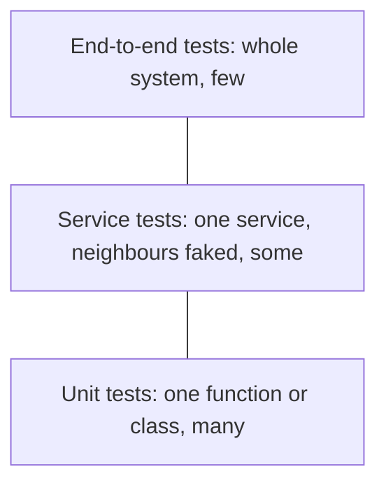
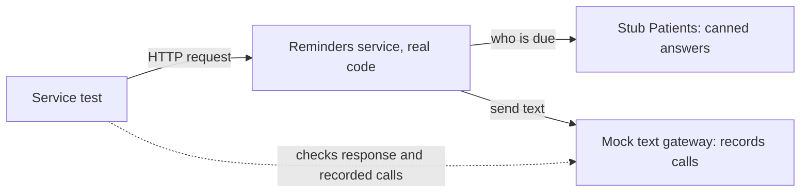

# Test types, the pyramid, service tests and the cost of end-to-end tests

## Before this lesson

> **Before this lesson:** read [Continuous integration and build pipelines](#/lesson/microservices/ci-pipelines), where tests run as pipeline stages. You should be comfortable reading Python functions and `assert` statements; both are explained again below.

## In plain words

A factory that builds cars checks its work at three sizes. It measures individual parts as they come off the machines: is this bolt the right length? It runs each finished engine on a bench, connected to fake fuel lines and sensors, to see whether the engine behaves. And it drives some finished cars around a track.

Measuring a bolt takes a second and, if it fails, you know exactly what is wrong. A track drive takes an hour, needs a whole car, and when something rattles you still have to find out which of ten thousand parts is loose. No sensible factory would check bolts only by driving finished cars. No sensible factory would skip the drive entirely either.

Software tests come in the same three sizes: tests of one small piece of code, tests of one whole service with its neighbours faked, and tests of the entire system working together. With microservices the third kind becomes far more expensive than it was with a monolith, because "the entire system" is now many separately deployed programs owned by different teams. This lesson explains the sizes, how many of each to write, and why the largest kind needs to be rationed.

Why this matters for a job: writing tests is a daily task for every engineer, and "how would you test this in a microservice architecture?" is a standard interview question whose expected answer is the pyramid plus contracts.

## 1. Kinds of test: what question is each answering?

A helpful way to sort tests, proposed by Brian Marick and widely used in agile testing, uses two questions. Is the test written in business terms or technical terms? And does it help the team while building, or does it examine the finished product for weaknesses?

| | Helps the team build | Examines the product |
|---|---|---|
| **Business-facing** | **Acceptance tests**: did we build the right thing? "An owner can book a vaccination" | **Exploratory testing**: a person uses the system with curiosity, looking for what nobody thought to specify |
| **Technology-facing** | **Unit tests**: did we build it right? "The fee function rounds correctly" | **Cross-functional tests**: is it fast enough, secure enough, robust enough? |

Most tests in the left column, and many in the bottom right, can and should be automated. Exploratory testing stays human: its value comes from a person noticing something odd. The aim of automation is to free people from repetitive checking so that they have time for that.

**Cross-functional requirements** (often called non-functional requirements) are qualities of the system as a whole, such as response time or the number of simultaneous users supported. The next lesson returns to testing them.

## 2. Test scope and the pyramid

The second way to sort tests is by **scope**: how much of the system one test exercises. Mike Cohn's **test pyramid** names three levels.



Moving up the pyramid, three things change together:

| | Unit | Service | End-to-end |
|---|---|---|---|
| What is exercised | One function or class | One service through its API | Many services, through the user interface or public API |
| Speed of one test | Milliseconds | Tens to hundreds of milliseconds | Seconds to minutes |
| When it fails, the cause is | Within a few lines | Within one service | Anywhere |
| Confidence that the system works for users | Low | Medium | High |
| Cost to write and maintain | Low | Medium | High |

The pyramid shape is the advice: many tests at the bottom, fewer in the middle, very few at the top. You want the confidence that large-scope tests give, bought as cheaply as possible, with fast small tests catching most problems first.

## 3. Unit tests

A **unit test** checks one small piece of code, typically a function, in isolation. It starts no service, opens no network connection and touches no database, so thousands can run in seconds.

```python-run
def consultation_fee(minutes, is_emergency, loyalty_years):
    """Fee in cents: 4500 per started 15 minutes, +50% for emergencies, 10% off after 3 years."""
    blocks = max(1, -(-minutes // 15))            # round up to whole 15-minute blocks
    fee = blocks * 4500
    if is_emergency:
        fee = fee * 3 // 2
    if loyalty_years >= 3:
        fee = fee * 9 // 10
    return fee

def test_one_block():            assert consultation_fee(10, False, 0) == 4500
def test_rounds_up():            assert consultation_fee(16, False, 0) == 9000
def test_zero_minutes_is_one():  assert consultation_fee(0, False, 0) == 4500
def test_emergency():            assert consultation_fee(15, True, 0) == 6750
def test_loyalty_boundary():     assert consultation_fee(15, False, 2) == 4500 and consultation_fee(15, False, 3) == 4050
def test_both():                 assert consultation_fee(30, True, 5) == 12150

tests = [v for k, v in list(globals().items()) if k.startswith("test_")]
for t in tests:
    try:
        t(); print("pass ", t.__name__)
    except AssertionError:
        print("FAIL ", t.__name__)
print(f"{len(tests)} tests")
```

`consultation_fee` is the code under test. Each `test_` function calls it with chosen inputs and uses `assert`, which does nothing when the condition is true and raises an error when it is false. The last lines are a tiny test runner: they collect every function whose name starts with `test_`, call each one, and report. Real projects use a tool such as pytest for this. Notice what the tests target: the boundaries (exactly 15 minutes, 16 minutes, 2 years against 3) where mistakes hide.

Unit tests are also what makes **refactoring** safe. Refactoring means improving the structure of code without changing its behaviour; a fast suite of unit tests tells you within seconds whether the behaviour survived.

## 4. Service tests

A **service test** exercises one whole microservice through its API, while every other service it would call is replaced by a stand-in. It answers: *does this service, on its own, do its job?*

The stand-ins are **test doubles**, and two kinds are worth telling apart:

- A **stub** returns prepared answers. It does not care how often it is called. ("When asked about pet 7, say it is due a vaccination.")
- A **mock** additionally records and checks the calls made to it. ("Fail the test unless the text gateway was called exactly once.")

Stubs are less brittle and should be the default. Use a mock when the call itself is the behaviour you need to verify, as with sending a message.



```python-run
# ---- the service under test ----
class RemindersService:
    def __init__(self, patients_client, text_gateway):
        self.patients, self.gateway = patients_client, text_gateway

    def send_due_reminders(self, clinic):
        sent = 0
        for pet in self.patients.pets_due_for_vaccination(clinic):
            if pet.get("owner_phone"):                       # skip owners with no phone
                self.gateway.send(pet["owner_phone"], f"{pet['name']} is due for a vaccination.")
                sent += 1
        return {"sent": sent}

# ---- test doubles ----
class StubPatients:                                           # stub: canned answers
    def pets_due_for_vaccination(self, clinic):
        return [{"name": "Miso", "owner_phone": "9123 4567"},
                {"name": "Biscuit", "owner_phone": None},
                {"name": "Pepper", "owner_phone": "9000 1111"}]

class MockGateway:                                            # mock: records what was sent
    def __init__(self): self.calls = []
    def send(self, phone, text): self.calls.append((phone, text))

# ---- the service test ----
gateway = MockGateway()
service = RemindersService(StubPatients(), gateway)
result = service.send_due_reminders("east")

assert result == {"sent": 2}
assert [phone for phone, _ in gateway.calls] == ["9123 4567", "9000 1111"]
assert "Miso" in gateway.calls[0][1]
print("service test passed:", result, "| texts recorded:", len(gateway.calls))
```

`RemindersService` receives its two collaborators when it is created, which is what lets a test hand it fakes. `StubPatients` always returns the same three pets, one of them with no phone number. `MockGateway` stores every message it is asked to send. The test runs the real service logic and then checks two things: the response says two reminders were sent, and the gateway was called for the right two numbers. The Patients service and the text provider never ran. In a real service test the doubles would be small stub servers answering over HTTP, so that the service's network code is exercised too.

Service tests run fast because nothing else needs to be deployed, and when one fails the fault is inside one service. Their blind spot is plain from the code: the test assumes `StubPatients` behaves like the real Patients service. If the real one renames `owner_phone`, this test still passes. Closing that gap is the job of contract tests in the next lesson.

## 5. End-to-end tests and what they cost

An **end-to-end test** drives the whole deployed system the way a user would: open the site, book an appointment, see the confirmation. Passing one gives real confidence. With a monolith it is manageable. With microservices four problems grow.

### Flaky and brittle tests

A **flaky test** sometimes fails although nothing is wrong with the functionality: a service was restarting, a network call timed out, test data from another run got in the way. The more services and network hops a test crosses, the more chances for that.

```python-run
def chance_suite_passes(tests, flake_rate):
    """Probability that every test passes when nothing is truly broken."""
    return (1 - flake_rate) ** tests

print("tests  flake rate per test  chance the whole suite is green")
for tests, flake in [(10, 0.01), (50, 0.01), (200, 0.01), (200, 0.001), (200, 0.03)]:
    print(f"{tests:5d}  {flake:18.1%}  {chance_suite_passes(tests, flake):10.1%}")

p = chance_suite_passes(200, 0.01)
print(f"\nWith 200 tests at 1% flakiness, a green run needs {1 / p:.0f} attempts on average.")
```

`chance_suite_passes` multiplies the chance that each test passes. With ten tests that each fail spuriously 1% of the time, the suite is green about 90% of the time. With 200 such tests it is green 13% of the time: a perfectly good change needs seven or eight runs to get through. At that point people stop believing red builds. They re-run until green, and a real failure hides among the false ones. Sociologist Diane Vaughan named this habit the **normalisation of deviance**: getting so used to something being wrong that it stops being alarming.

The rule: when a test is found to be flaky, fix it at once, or remove it from the suite until it is fixed.

### Who owns them?

A test that crosses five services belongs to no single team. If everyone may add tests and nobody owns the suite's health, it grows and rots. If a separate test team owns it, developers become distant from the tests of their own code and slow to learn of failures. The workable answer is shared ownership of a deliberately small suite by the teams whose services it crosses.

### How long do they take?

Large suites take hours. Slow suites mean that many changes are queued up behind each run, so a failure might belong to any of them. Slow feedback also encourages batching changes into larger releases, which raises the risk of each release.

### They push you towards releasing everything together

If confidence only comes from testing the whole set of services together, it is tempting to stamp that tested combination with one version number and release it as a unit. At that moment independent deployability is lost, and the system is a distributed monolith again. The need to test everything together before any release is a sign that the services are not independently testable.

## 6. Getting the balance right

**How many of each?** A common guide is roughly ten times as many tests at each lower level: thousands of unit tests, hundreds of service tests, tens of end-to-end tests at most. The inverted shape, with few unit tests and a huge end-to-end suite, is known as the test ice-cream cone, and it gives slow, unreliable feedback.

**Pushing tests down.** When an end-to-end or service test catches a bug, ask whether a smaller, faster test could have caught it, add that test, and consider deleting the larger one.

**Journeys, not stories.** Keep end-to-end tests for a handful of core **user journeys**: the few paths the business cannot live without. For a clinic: book and pay, record a visit, dispense a prescription. Do not add an end-to-end test for every feature.

**Should you have end-to-end tests at all?** With one or two teams they are manageable and useful. As the number of teams grows, their costs rise faster than their benefits. Many organisations then replace most of them with two things: contract tests between services, and close watching of production with the progressive delivery techniques of lesson 18. Both are covered in the next lesson.

### Developer experience

There is a related, everyday problem. To work on Reminders, must a developer run all nine services on a laptop? That soon becomes impossible. The same stubs used in service tests solve it: run the one service you are changing, with stubbed neighbours. For the occasional need to try against real neighbours, teams use a shared development environment in the cloud, or tools that connect a locally running service into a remote cluster.

### Worked example: a test plan for Reminders

| Level | Count | Examples | Runs in |
|---|---|---|---|
| Unit | 310 | Message wording, due-date rules, time-zone handling | 20 seconds |
| Service | 40 | "Sends two texts when two of three owners have phones", "returns 503 when the gateway is down" | 2 minutes, with stub Patients and a mock gateway |
| Contract | 6 | What Reminders expects from Patients (next lesson) | 30 seconds |
| End-to-end | 1 journey shared with other teams | Book a vaccination, receive a reminder | 6 minutes, in staging |

The pipeline from lesson 15 runs these in this order, so a wording mistake is reported in 20 seconds and only changes that survive everything else reach the slow journey test.

> [!INTERVIEW]
> For "how do you test microservices?": *many fast unit tests; service tests that run one service through its API with stubbed collaborators; and very few end-to-end tests, limited to core user journeys, because across many services they are slow, flaky, ownerless and push towards lockstep releases. The gap that stubs leave, whether the stub matches the real neighbour, I close with consumer-driven contract tests. Then I rely on canary releases and good monitoring to catch what pre-production testing cannot.*

## 7. Pitfalls

- **The ice-cream cone.** Most testing done end to end, little at unit level: slow, flaky, hard to diagnose.
- **Tolerating flaky tests.** Re-running until green trains everyone to ignore failures.
- **Mocking everything.** Tests that check every internal call break on harmless refactoring. Prefer stubs; check outcomes.
- **Stubs that drift from reality.** Service tests pass against a fake that no longer resembles the real neighbour.
- **An end-to-end test per feature.** The suite grows without limit; keep it to journeys.
- **A separate team owning all the tests.** Developers lose fast feedback and responsibility.
- **Versioning the tested set as one release.** That is lockstep deployment by another name.
- **Needing every service on the laptop.** Use stubs for neighbours.

## Summary

- Tests can be sorted by purpose: unit and acceptance tests support building; exploratory and cross-functional tests examine the product.
- Tests can be sorted by scope: unit, service and end-to-end. Wider scope gives more confidence and costs speed, precision and money.
- The pyramid advises many unit tests, fewer service tests and very few end-to-end tests.
- Service tests run one service with test doubles: stubs return canned answers, mocks also verify calls.
- End-to-end tests across many services suffer from flakiness, unclear ownership, long run times and pressure towards releasing everything together.
- Keep end-to-end tests to core user journeys, push tests down the pyramid, and remove flaky tests promptly.
- Stubs also give developers a workable local environment.

## Glossary

| Term | Meaning |
|---|---|
| Unit test | A fast test of one small piece of code in isolation |
| Acceptance test | A test, in business terms, that a feature does what was asked |
| Exploratory testing | Manual, curious investigation of the running system |
| Cross-functional requirement | A quality of the whole system, such as speed or security |
| Test scope | How much of the system a single test exercises |
| Test pyramid | Guidance to have many small-scope tests and few large-scope ones |
| Service test | A test of one service through its API with collaborators replaced |
| Test double | A stand-in for a real collaborator during a test |
| Stub | A double that returns prepared answers |
| Mock | A double that also verifies how it was called |
| End-to-end test | A test that exercises the whole deployed system |
| Flaky test | A test that fails intermittently without a real fault |
| Normalisation of deviance | Becoming used to a problem until it no longer prompts action |
| User journey | A core path through the system that a user follows to reach a goal |
| Refactoring | Improving code structure without changing behaviour |

```quiz
[
  {"q": "According to the test pyramid, which kind of test should be most numerous?", "options": ["End-to-end tests", "Service tests", "Unit tests", "Manual tests"], "answer": 2,
   "explain": "Unit tests are fast, cheap and precise, so most checking should happen there, with fewer tests at each wider scope."},
  {"q": "As test scope widens from unit to end-to-end, what happens?", "options": ["Tests get faster and failures easier to locate", "Confidence rises, while speed and ease of locating the fault fall", "Nothing changes", "Tests need no maintenance"], "answer": 1,
   "explain": "Larger scope exercises more of the real system, which is more convincing, slower, and harder to diagnose."},
  {"q": "What is the difference between a stub and a mock?", "options": ["A stub is slower", "A stub returns prepared answers; a mock also checks how it was called", "A mock is a real service", "There is no difference"], "answer": 1,
   "explain": "Use stubs by default. Use a mock when the call itself, such as sending a message, is the behaviour to verify."},
  {"q": "A service test for Reminders passes with a stubbed Patients service. What does it NOT prove?", "options": ["That the Reminders logic is right", "That the real Patients service behaves the way the stub does", "That texts are sent to owners with phones", "That owners without phones are skipped"], "answer": 1,
   "explain": "The stub encodes an assumption about the neighbour. Contract tests are needed to check that assumption against the real service."},
  {"q": "A suite has 200 end-to-end tests, each with a 1% chance of failing spuriously. Roughly how often is the whole suite green when nothing is wrong?", "options": ["99% of runs", "About half of runs", "About 13% of runs", "Never"], "answer": 2,
   "explain": "0.99 to the power 200 is about 0.13. Small per-test flakiness compounds across a large suite."},
  {"q": "What is the right response to discovering a flaky test?", "options": ["Re-run the build until it passes", "Fix it promptly, or remove it from the suite until it is fixed", "Add more tests like it", "Ignore red builds on Fridays"], "answer": 1,
   "explain": "Leaving flaky tests in place teaches the team to disregard failures, which hides real ones."},
  {"q": "Why can heavy reliance on end-to-end tests undermine independent deployability?", "options": ["They cannot be automated", "Confidence comes only from testing a combination of versions together, which tempts teams to release that combination as one unit", "They require GraphQL", "They make unit tests fail"], "answer": 1,
   "explain": "Stamping a tested set with one version is a lockstep release. Services need to be testable on their own."},
  {"q": "Which end-to-end tests are worth keeping in a system with many services?", "options": ["One per user story", "A small number covering the core user journeys", "None, ever", "Only tests of the login page"], "answer": 1,
   "explain": "A handful of critical journeys gives broad confidence without the suite growing beyond what teams can keep healthy."}
]
```

> **Source:** Newman, *Building Microservices*, 2nd ed., ch. 9 (topic coverage only; wording and the Pawprint example are original). Mike Cohn, *Succeeding with Agile* (2009), for the test pyramid; Lisa Crispin and Janet Gregory, *Agile Testing* (2008), for the testing quadrants.
