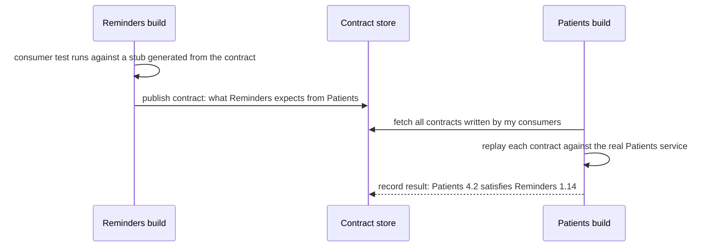
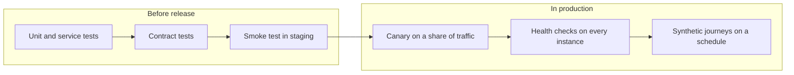

# Contract tests, testing in production and cross-functional testing

## Before this lesson

> **Before this lesson:** read [Test types, the pyramid, service tests and the cost of end-to-end tests](#/lesson/microservices/test-pyramid). You should know what a service test and a stub are, and why end-to-end tests across many services become slow and flaky. Schemas and breaking changes come from [Handling change](#/lesson/microservices/handling-change), and canary releases from [Deployment options, Kubernetes and progressive delivery](#/lesson/microservices/deployment-options).

## In plain words

Suppose you rent a room. You depend on a few things from the landlord: hot water, a working lock, internet. The landlord has ten tenants and each depends on slightly different things. One day the landlord decides to renovate. How does the landlord know what must not be broken?

One way is to renovate, then wait for complaints. A better way: each tenant hands the landlord a short written list, "these are the things I rely on". Before any renovation, the landlord goes through every list. If the plan would break an item, the landlord knows *which* tenant is affected and can talk to them first.

Those lists are **contracts**, and because the tenants (the consumers) write them, the approach is called **consumer-driven contracts**. It gives most of the confidence of an end-to-end test without running the whole system together.

The second half of the lesson deals with what no test before release can tell you. Some problems only appear with real traffic and real data. So teams also test **in production**, carefully, and they test qualities such as speed and robustness, which are called **cross-functional requirements**.

Why this matters for a job: contract testing is the standard answer to "how do you stop one team's change from breaking another team's service?", and interviewers at companies with many teams expect you to know it.

## 1. The gap that stubs leave

In the last lesson, the Reminders service test ran against a stub of the Patients service. The stub returned pets with a field called `owner_phone`. The test proves that Reminders works *if* Patients behaves like the stub.

Two things can go wrong without any test failing:

- The Patients team renames `owner_phone` to `contact_phone`. Their own tests pass, because they updated them. The Reminders tests pass, because the stub still says `owner_phone`. Production breaks.
- The Reminders team's stub was wrong from the start, based on a misreading of the documentation.

The stub is an unverified assumption sitting between two teams. A **contract test** verifies it.

## 2. Contract tests

A **contract test** states what one service (the **consumer**) expects from another (the **provider**), and is run against the real provider. It does not test the provider's business logic in depth, and it does not test the consumer. It tests the join between them: *given this request, the response has the shape and meaning I rely on*.

Important details:

- The contract contains only what the consumer **uses**. If Reminders reads three fields out of thirty, the contract names three. The provider stays free to change the other twenty-seven. This is the tolerant reader (lesson 12) written down as a test.
- The provider is run in isolation for the check, with its own neighbours stubbed. No full environment is needed, so contract tests are fast and stable.
- A failure names the consumer whose expectation was broken, which tells the provider team whom to talk to.

## 3. Consumer-driven contracts

With **consumer-driven contracts (CDCs)**, the flow of information runs from consumer to provider:



1. The consumer team writes its expectations as executable examples.
2. Those examples serve two purposes at once. On the consumer side they drive a stub, so that the consumer's service tests use exactly the behaviour the contract describes. On the provider side they are replayed against the real service.
3. The contracts are stored somewhere both builds can reach.
4. The provider's pipeline runs every consumer's contract on every change. A change that breaks a consumer fails the provider's build, before release.

Pact is the best-known tool for this: the consumer's tests produce a contract file, a store called a broker holds the files and the results, and the provider's build verifies against them. Spring Cloud Contract is a similar tool in the Java world. The idea does not depend on any particular tool, and here it is from scratch.

```python-run
# ---- contracts: each consumer lists only what it uses ----
CONTRACTS = {
    "reminders": {"request": ("GET", "/pets/7"),
                  "expects": {"name": str, "owner_phone": str, "vaccination_due": str}},
    "billing":   {"request": ("GET", "/pets/7"),
                  "expects": {"name": str, "owner_id": int}},
}

# ---- two versions of the provider ----
def patients_v1(method, path):
    return {"id": 7, "name": "Miso", "species": "cat", "owner_id": 31,
            "owner_phone": "9123 4567", "vaccination_due": "2026-12-01"}

def patients_v2(method, path):                      # someone tidied a field name
    doc = patients_v1(method, path)
    doc["contact_phone"] = doc.pop("owner_phone")
    doc["microchip"] = "985-112"                    # and added a field
    return doc

def verify(provider, contracts):
    """Run by the PROVIDER's pipeline. Returns the list of broken consumers."""
    broken = {}
    for consumer, contract in contracts.items():
        response = provider(*contract["request"])
        problems = [f"{field} missing" if field not in response else f"{field} has wrong type"
                    for field, kind in contract["expects"].items()
                    if field not in response or not isinstance(response[field], kind)]
        if problems:
            broken[consumer] = problems
    return broken

print("Patients v1:", verify(patients_v1, CONTRACTS) or "all consumer contracts satisfied")
print("Patients v2:", verify(patients_v2, CONTRACTS) or "all consumer contracts satisfied")

# ---- the same contract gives the consumer its stub ----
def stub_from_contract(contract):
    sample = {str: "text", int: 1}
    return {field: sample[kind] for field, kind in contract["expects"].items()}

print("stub used in Reminders' own tests:", stub_from_contract(CONTRACTS["reminders"]))
```

`CONTRACTS` holds one entry per consumer: the request it makes and the fields and types it relies on. Notice that Reminders and Billing ask for the same resource and care about different fields. `patients_v1` returns a pet document with more fields than either needs. `patients_v2` renames one field and adds another. `verify` is what the provider's build runs: for each consumer it makes the request and checks each expected field.

Version 1 satisfies everyone. Version 2 reports that `reminders` is broken because `owner_phone` is missing, and reports nothing for Billing. The added `microchip` field breaks nobody, because no contract forbids extra fields. So the Patients team learns three things before release: the change is breaking, it breaks exactly one consumer, and which one. `stub_from_contract` shows the other half: the consumer's stub is produced from the same contract, so the stub and the verified expectations cannot drift apart.

The practice problem *Consumer-driven Contract Verification* extends this to nested fields and several interactions.

### What a broken contract means

A failing consumer contract in the provider's build is not a nuisance to be silenced. It is the system doing its job. The provider team now has options: make the change in a compatible way (keep `owner_phone` as well, following expand and contract), or agree a migration with the consumer team. Either way, the conversation happens before production, between the right people. Contract testing works best where teams talk to each other; it is hard to apply to a provider you have no relationship with, such as a public third-party API.

### Which versions may be deployed together?

Because every verification is recorded against version numbers, the store can answer a practical question before each release: *is the version I am about to deploy compatible with what is currently in production?*

```python-run
# Verified pairs: (consumer version, provider version) known to work together.
verified = {("reminders 1.13", "patients 4.1"), ("reminders 1.14", "patients 4.1"),
            ("reminders 1.14", "patients 4.2"), ("billing 2.0", "patients 4.1"),
            ("billing 2.0", "patients 4.2")}
production = {"reminders": "reminders 1.13", "billing": "billing 2.0", "patients": "patients 4.1"}

def can_deploy(candidate):
    name = candidate.split()[0]
    if name == "patients":                            # a provider: check every consumer in production
        missing = [c for c in (production["reminders"], production["billing"])
                   if (c, candidate) not in verified]
    else:                                             # a consumer: check against the provider in production
        missing = [] if (candidate, production["patients"]) in verified else [production["patients"]]
    return "yes" if not missing else f"no, unverified with {missing}"

print("deploy patients 4.2 ?", can_deploy("patients 4.2"))
print("deploy reminders 1.14?", can_deploy("reminders 1.14"))
production["reminders"] = "reminders 1.14"
print("deploy patients 4.2 ?", can_deploy("patients 4.2"))
```

`verified` lists the combinations that have passed contract verification. `can_deploy` looks at what is live now. Patients 4.2 was never verified against Reminders 1.13, which is still in production, so the answer is no. Reminders 1.14 works with the live Patients 4.1, so it may go first. Once it has, Patients 4.2 becomes safe. The tool has told the two teams the order in which to release, and neither had to deploy the two services together.

With contract tests in place, many teams remove most of their cross-team end-to-end tests. Each service is verified against its neighbours' real expectations, in its own pipeline, in minutes.

## 4. From pre-production to in-production testing

However good the tests before release, some things cannot be known until the software meets real users, real data volumes and real infrastructure. Test environments are smaller, cleaner and quieter than production.

This leads to a change of emphasis. Two measures describe reliability:

- **Mean time between failures (MTBF)**: how long, on average, the system runs before something goes wrong.
- **Mean time to repair (MTTR)**: how long, on average, it takes to notice and fix a problem.

Testing before release improves the first. Past a certain point, more pre-release testing costs a lot and prevents little. Effort spent on the second, on noticing problems in minutes and reversing them in seconds, often buys more. A fault that reaches 2% of users for three minutes is far better than a release delayed for a week by a test suite that would not have caught it anyway.

**Testing in production** means deliberately checking the system while it serves real users. You have already met several forms:

| Technique | What it checks |
|---|---|
| Health check (ping) | Is each instance up and able to respond? |
| Smoke test | Right after deployment, do a few basic operations work? |
| Canary release | Does the new version behave as well as the old one on real traffic? |
| Synthetic transaction | Does a complete user journey work right now? A robot user performs it on a schedule |
| Parallel run | Does new code give the same answers as old code on live requests? |

Put together with the earlier lessons, checking does not stop at the moment of release. It continues for as long as the version runs:



A **synthetic transaction** is a fake user action injected into the live system. Because it follows a whole journey, it tells you something that instance-level checks cannot: every service may report "healthy" while bookings are impossible.

```python-run
# Parts of the live system; each reports its own health.
system = {"website": "up", "appointments": "up", "billing": "up", "slots_configured_for_next_week": False}

def health_checks():
    return all(v == "up" for k, v in system.items() if isinstance(v, str))

def synthetic_booking():
    """A robot user tries to book for the TEST clinic, using a TEST pet and a TEST card."""
    if system["website"] != "up" or system["appointments"] != "up":
        return "FAILED: cannot reach booking"
    if not system["slots_configured_for_next_week"]:
        return "FAILED: no free slots offered"
    if system["billing"] != "up":
        return "FAILED: deposit not taken"
    return "ok"

print("all health checks green:", health_checks())
print("synthetic booking      :", synthetic_booking())
```

Every service says it is up, so `health_checks` returns `True`. The synthetic booking walks the journey and fails at "no free slots offered", because next week's diary was never loaded. No service is broken; the business is. Only a check that behaves like a user finds this.

### Doing it safely

Testing in production must not hurt real users or pollute real data. The precautions are concrete:

- Use clearly marked test accounts and test entities: a "test clinic" that does not exist, a test pet, a payment provider's test card.
- Make sure side effects are contained. A synthetic booking must not send a text to a real phone or reserve a real vet's time.
- Mark synthetic requests so that reports and analytics can exclude them.
- Keep the volume low enough not to affect capacity.

Lesson 22 builds on this under the name semantic monitoring.

## 5. Cross-functional testing

**Cross-functional requirements (CFRs)** are the qualities a system must have that are not single features: how fast it responds, how many users it supports, how available it is, how secure, how accessible to people using assistive technology. (They are often called non-functional requirements, an unhelpful name for things that matter so much.)

Some points apply to all of them:

- **State them as numbers.** "The site should be fast" cannot be tested. "95% of slot searches complete within 300 ms at 200 requests per second" can.
- **Set them per service or per journey.** The payment path may need much higher availability than the monthly report.
- **Think about them early.** Leaving performance to the week before launch means finding problems when they are most expensive to fix.

### Performance tests

Splitting a system into services adds network hops, so one user action may now involve ten calls. Performance needs watching more closely than in a monolith.

Performance is reported in **percentiles**. The 95th percentile (p95) latency is the time within which 95% of requests finished. Averages hide the slow requests that users remember.

```python-run
import random
rng = random.Random(7)

def simulated_request_ms(build):
    base = rng.gauss(120, 25)                         # typical time for a slot search
    if build == "new" and rng.random() < 0.08:        # the new build has a slow path 8% of the time
        base += rng.uniform(250, 400)
    return max(base, 5)

def p95(samples):
    ordered = sorted(samples)
    return ordered[int(0.95 * len(ordered)) - 1]

TARGET_P95_MS = 300
for build in ["old", "new"]:
    samples = [simulated_request_ms(build) for _ in range(2000)]
    mean, tail = sum(samples) / len(samples), p95(samples)
    verdict = "PASS" if tail <= TARGET_P95_MS else "FAIL"
    print(f"{build}: mean {mean:5.0f} ms   p95 {tail:5.0f} ms   target {TARGET_P95_MS} ms   {verdict}")
```

`simulated_request_ms` draws a response time around 120 ms. For the new build, 8% of requests take an extra 250 to 400 ms, as a missing database index might cause. `p95` sorts the samples and takes the value 95% of the way up. The old build passes comfortably. The new build's mean rises only modestly, to about 145 ms, which looks harmless. Its p95 jumps past 400 ms and fails the target. Had the test checked only the average, a change that makes one request in twelve painfully slow would have shipped.

Practical advice for performance tests:

- Run them in an environment as close to production as you can afford, with realistic data volumes; otherwise the numbers mean little.
- They are slow, so they usually run nightly or on a subset of changes, not on every commit. Do run them regularly: a regression found the next morning points to yesterday's handful of changes.
- Compare against targets and watch the trend, and make a failed target break the build like any other test.

### Robustness tests

A microservice system should keep working, perhaps in a reduced way, when a neighbour is slow or absent. That can be tested deliberately: in a service test, make the stubbed neighbour time out or return errors, and assert that the service responds sensibly within its time limit. Lesson 26 covers the mechanisms being tested (timeouts, circuit breakers), and lesson 25 covers doing this in production under the name chaos engineering.

> [!INTERVIEW]
> For "how do you prevent one team's change breaking another's service without a giant end-to-end suite?": *consumer-driven contract tests. Each consumer writes executable expectations covering only what it uses. They generate the consumer's stub and are replayed against the real provider in the provider's pipeline, so a breaking change fails the provider's build and names the affected consumer. Verification results per version tell us which versions can be deployed together. Beyond that I accept that some issues only appear in production, so I invest in fast detection: canaries, synthetic transactions on test data, and performance targets expressed as percentiles.*

## 6. Pitfalls

- **Contracts that describe the whole response.** They forbid harmless change. List only what the consumer uses.
- **Provider-written "contracts".** If the provider guesses what consumers need, the test verifies the guess.
- **Silencing a failed contract.** The failure is a prompt to talk to the consumer team.
- **Contract tests used for business logic.** They check the join between services; keep deep behaviour in unit and service tests.
- **Synthetic transactions with real side effects.** A robot user that books real slots or texts real owners is an incident.
- **Health checks mistaken for working software.** Every instance can be up while a journey is broken.
- **Performance judged by averages.** The tail is where users suffer.
- **Performance tests only before big launches.** A regression is then weeks old and buried under many changes.

## Summary

- A stub is an assumption about a neighbour; a contract test checks that assumption against the real provider.
- In consumer-driven contracts, each consumer writes executable expectations for only what it uses; they generate the consumer's stub and are verified in the provider's pipeline.
- A broken contract identifies the affected consumer before release and starts a conversation.
- Recorded verification results show which versions can safely be deployed together.
- No pre-release testing finds everything; reducing time to detect and repair is often worth more than further testing.
- Testing in production includes health checks, smoke tests, canaries, parallel runs and synthetic transactions, done with test data and contained side effects.
- Cross-functional requirements should be numeric, set per service or journey, and tested regularly; performance is judged by percentiles.

## Glossary

| Term | Meaning |
|---|---|
| Consumer / provider | The service that calls / the service that is called |
| Contract test | A test of what a consumer expects from a provider, run against the real provider |
| Consumer-driven contract | A contract written by the consumer and verified in the provider's build |
| Contract store (broker) | A shared place holding contracts and verification results |
| MTBF | Mean time between failures |
| MTTR | Mean time to repair, including the time to notice |
| Testing in production | Deliberately checking the live system while it serves users |
| Smoke test | A quick check, right after deployment, that basic operations work |
| Synthetic transaction | A scripted fake user action run against the live system |
| Cross-functional requirement | A quality of the system such as latency, availability or security |
| Percentile | The value below which a given share of measurements fall, for example p95 |
| Performance test | A test that measures speed or capacity against a target |
| Robustness test | A test that injects failure and checks the system copes |

```quiz
[
  {"q": "What gap in service tests do contract tests close?", "options": ["They make unit tests faster", "They check that the stub a consumer tests against matches the real provider's behaviour", "They replace the build pipeline", "They test the user interface"], "answer": 1,
   "explain": "A stub is an assumption. Running the consumer's expectations against the real provider verifies it."},
  {"q": "In consumer-driven contracts, who writes the contract and where is it verified?", "options": ["The provider writes it and the consumer verifies it", "The consumer writes it and it is verified in the provider's build", "A separate test team writes and runs it", "It is generated from production logs"], "answer": 1,
   "explain": "Consumers know what they rely on. The provider's pipeline replays those expectations on every change."},
  {"q": "Reminders uses 3 of the 30 fields in a response. What should its contract contain?", "options": ["All 30 fields", "Only the 3 fields it uses", "No fields", "The provider's database schema"], "answer": 1,
   "explain": "Listing only what is used leaves the provider free to change everything else without breaking the contract."},
  {"q": "The Patients build fails because a change breaks the Reminders contract. What is the best next step?", "options": ["Delete the contract", "Disable the test and release", "Make the change compatible or agree a migration with the Reminders team", "Rewrite Reminders without telling them"], "answer": 2,
   "explain": "The failure shows who would be affected. Use expand and contract, or coordinate, before releasing."},
  {"q": "Why might investing in mean time to repair beat adding more pre-release tests?", "options": ["Tests are useless", "Some problems only appear in production, so detecting and reversing them quickly limits harm more than further testing would", "Repairing is free", "MTTR cannot be measured"], "answer": 1,
   "explain": "Pre-release testing has diminishing returns. Fast detection and rollback shrink the impact of what gets through."},
  {"q": "All health checks are green, yet a synthetic booking fails. What does this show?", "options": ["The synthetic test is wrong", "Instances can each be up while a complete user journey is broken", "Health checks should be removed", "The database is offline"], "answer": 1,
   "explain": "Health checks look at individual parts. A synthetic transaction exercises the whole journey as a user would."},
  {"q": "Which precaution is essential for synthetic transactions in production?", "options": ["Use real customers' accounts", "Use marked test data and make sure no real-world side effects occur", "Run thousands per second", "Hide them from the operations team"], "answer": 1,
   "explain": "Test entities and contained side effects prevent harm to real users and keep reports clean."},
  {"q": "A new build raises mean latency from 120 ms to 145 ms and p95 from 162 ms to 420 ms. What is the right conclusion?", "options": ["The change is fine because the mean rose only slightly", "A noticeable share of requests became much slower; judge by the percentile and investigate", "Percentiles are unreliable", "Latency does not matter in microservices"], "answer": 1,
   "explain": "Averages hide the slow tail. The p95 shows that roughly one request in twenty or more is now far slower."}
]
```

> **Source:** Newman, *Building Microservices*, 2nd ed., ch. 9 (topic coverage only; wording and the Pawprint example are original). Ian Robinson, "Consumer-Driven Contracts: A Service Evolution Pattern", https://martinfowler.com/articles/consumerDrivenContracts.html ; Pact documentation, https://docs.pact.io/
