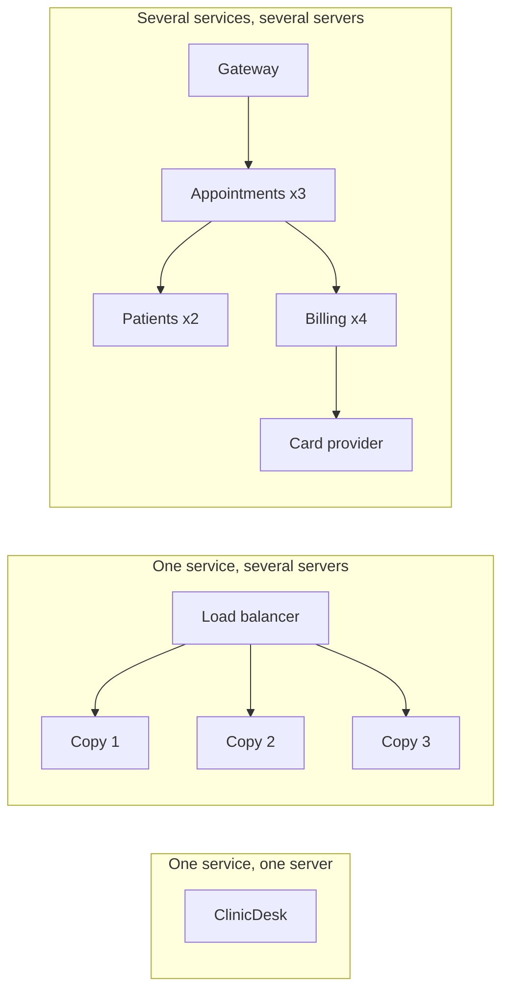
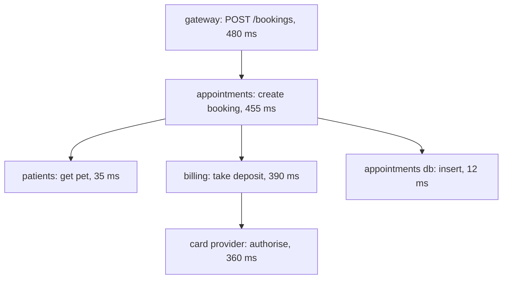

# Logs, metrics and traces

## Before this lesson

> **Before this lesson:** read [From logical to physical and the principles of deployment](#/lesson/microservices/logical-to-physical), so that "many instances of many services" is a concrete picture, and [Sagas](#/lesson/microservices/sagas), where correlation ids first appeared. You should be able to read Python dictionaries and lists.

## In plain words

A doctor looking after one patient in one bed can walk over and look. A hospital with forty wards cannot work that way. It keeps three kinds of record. **Notes** written by staff as things happen: "14:05, patient reports pain". **Charts** of numbers measured regularly: temperature, pulse, blood pressure. And the **route card** that follows one patient from admission through X-ray to surgery, showing how long each stop took.

Each record answers a different question. The notes say *what happened*. The charts say *how things are trending*. The route card says *where this particular patient's time went*.

Software has the same three, called **logs**, **metrics** and **traces**. With a monolith on one server you can get by with logging in to the machine and looking around. With thirty services, each running several instances that come and go, there is no machine to log in to, and one user's click passes through six different programs. You need the three kinds of record collected in one place.

Why this matters for a job: the first thing you do when something breaks in production is look at logs, dashboards and traces. Being able to say how you would find a fault across services is a common interview topic, and being able to do it is a large part of being useful on call.

## 1. Why this gets hard

Follow the same question, "why are bookings slow?", through three stages of growth.



- **One service, one server.** Log in, read the log file, check the processor and memory. One place to look.
- **One service, several servers.** Is the problem on all copies or one? You need each server's numbers side by side and also added together, and you need to search logs from all of them at once.
- **Several services, several servers.** A slow booking might be caused by Appointments, by Patients, by Billing, by the card provider, or by the network between any two. The symptom appears in one place and the cause is somewhere else. Without tooling you are guessing.

## 2. Monitoring and observability

Two words are often used as if they meant the same thing.

**Monitoring** is an activity: watching the system for conditions you thought of in advance. "Alert me when disk usage passes 90%." It handles the problems you predicted.

**Observability** is a property of the system: the extent to which you can work out what is happening inside it from what it emits. A highly observable system lets you ask questions you did not plan for. "Are the slow bookings all for one clinic? All from the mobile app? All on instances started after 2 pm?" Distributed systems fail in ways nobody predicted, so this ability to explore is what you are really after.

Logs, metrics and traces are often called the three pillars of observability. Treat that as a convenient list, not a law. They are three views of the same underlying events, and good tools let you move between them: from a spike on a chart, to a trace of one slow request, to the log lines written during it.

## 3. Log aggregation

A **log** is a time-stamped record of something that happened, written by the program. **Log aggregation** means collecting the logs of every instance of every service into one searchable store.

A small program on each machine, a **log shipper** or agent, reads what the service writes and forwards it to a central store that people can query. Fluentd is a common shipper; Elasticsearch with Kibana, Grafana Loki and commercial services are common stores.

Log aggregation is the first thing to put in place, before you split anything. If a team cannot manage central logs for a few services, it is not ready to run many.

Three practices make aggregated logs useful.

**A common, structured format.** If one service writes `2026-11-21 10:02 ERROR x` and another writes `[err] Nov 21 10:02 - x`, searching across them is painful. Agree on **structured logging**: each entry is a set of named fields (commonly a line of JSON) with at least a timestamp, the service name, a severity level and a message.

**Correlation ids.** When a request first enters the system, generate a unique identifier and pass it along with every call that request causes. Every service writes it in every log entry. One search for that id then shows the whole story of one request across all services.

**Care with time.** Each machine has its own clock, and clocks disagree by milliseconds or more. This is **clock skew**. You cannot rely on timestamps from different machines to tell you the true order of events.

```python-run
import json

# What arrives at the central store, in arrival order. Each line is one structured log entry.
raw = [
 '{"ts":"10:02:01.120","svc":"appointments","level":"INFO","cid":"req-81","msg":"booking requested for pet 7"}',
 '{"ts":"10:02:01.095","svc":"billing","level":"INFO","cid":"req-81","msg":"deposit request received"}',
 '{"ts":"10:02:01.130","svc":"appointments","level":"INFO","cid":"req-82","msg":"booking requested for pet 9"}',
 '{"ts":"10:02:01.410","svc":"billing","level":"ERROR","cid":"req-81","msg":"card provider timeout after 300 ms"}',
 '{"ts":"10:02:01.150","svc":"patients","level":"INFO","cid":"req-82","msg":"pet 9 found"}',
 '{"ts":"10:02:01.415","svc":"appointments","level":"WARN","cid":"req-81","msg":"deposit failed, booking left pending"}',
 '{"ts":"10:02:01.200","svc":"appointments","level":"INFO","cid":"req-82","msg":"booking confirmed"}',
]
entries = [json.loads(line) for line in raw]

print("Everything at ERROR level, any service:")
for e in entries:
    if e["level"] == "ERROR":
        print("  ", e["svc"], e["cid"], e["msg"])

print("\nThe full story of req-81, sorted by timestamp:")
for e in sorted((e for e in entries if e["cid"] == "req-81"), key=lambda e: e["ts"]):
    print(f"   {e['ts']}  {e['svc']:13s} {e['level']:5s} {e['msg']}")
```

`raw` holds seven log lines from three services, interleaved as they would be in a central store, for two different requests. `json.loads` turns each line into a dictionary, which is the benefit of structured logging: no fragile text parsing. The first query finds the one error. Its correlation id, `req-81`, feeds the second query, which pulls every entry for that request from all services.

Now look at the order of the second result. Billing's "deposit request received" is stamped 10:02:01.095, *before* Appointments' "booking requested" at 10:02:01.120. Billing cannot have received a request before it was made. Billing's clock is about 30 ms behind. This is clock skew in action, and it is why tracing, below, records cause and effect explicitly instead of relying on timestamps.

Logs have limits. Their volume is enormous, storing and indexing them is costly, and during an overload some may be dropped. They can also leak personal data: log an identifier, not a full card number or a medical note.

## 4. Metrics aggregation

A **metric** is a number measured over time: requests per second, error count, memory in use. A sequence of such measurements is a **time series**. Metrics are small and cheap compared with logs, so you can keep them for a long time and see trends: is this normal for a Monday morning?

Three basic types cover most needs:

| Type | Behaviour | Example |
|---|---|---|
| Counter | Only goes up | Total requests handled since start |
| Gauge | Goes up and down | Requests in progress, memory used |
| Histogram | Counts measurements falling into ranges | How many requests took 0 to 100 ms, 100 to 300 ms, and so on |

Each measurement carries **labels** (also called tags): small pieces of context such as `service=billing`, `instance=b-2`, `status=500`. Labels are what let you slice and combine: errors for one service, for one instance, or for all of them together.

**Cardinality** is the number of distinct values a label can take. `status` has a handful of values: low cardinality. `customer_id` has millions: high cardinality. Many metrics systems, Prometheus being the well-known open-source example, store one time series per combination of label values, so a high-cardinality label multiplies storage beyond what they can handle. Yet high-cardinality questions ("is it slow for this one clinic?") are exactly what debugging needs. Some newer tools are built to support them; in others you answer such questions from traces and logs.

```python-run
# One minute of measurements. Labels: service, instance. Values: request count and latencies.
samples = [
    {"service": "billing", "instance": "b-1", "requests": 600, "errors": 3,  "latencies": [80] * 588 + [900] * 12},
    {"service": "billing", "instance": "b-2", "requests": 590, "errors": 2,  "latencies": [82] * 578 + [950] * 12},
    {"service": "billing", "instance": "b-3", "requests": 20,  "errors": 14, "latencies": [3000] * 20},
    {"service": "patients", "instance": "p-1", "requests": 900, "errors": 1, "latencies": [40] * 900},
]

def p99(values):
    ordered = sorted(values)
    return ordered[int(0.99 * len(ordered)) - 1]

billing = [s for s in samples if s["service"] == "billing"]
total_req = sum(s["requests"] for s in billing)
total_err = sum(s["errors"] for s in billing)
print(f"billing, all instances: {total_req} requests, error rate {total_err / total_req:.1%}")
for s in billing:
    print(f"   {s['instance']}: {s['requests']:4d} requests, error rate {s['errors'] / s['requests']:6.1%}, p99 {p99(s['latencies'])} ms")

average_of_p99s = sum(p99(s["latencies"]) for s in billing) / len(billing)
true_p99 = p99([x for s in billing for x in s["latencies"]])
print(f"\naverage of the three p99 values: {average_of_p99s:.0f} ms   true p99 over all requests: {true_p99} ms")
```

`samples` is a minute of data for three Billing instances and one Patients instance. Summed across Billing, the error rate is about 1.6%: somewhat raised. Broken down by the `instance` label, the cause is plain: `b-3` is failing 70% of its requests and takes three seconds for each, while the other two are healthy. Aggregate numbers show that something is wrong; labels show where.

The last two lines carry a warning. A **percentile** (p99 is the time within which 99% of requests finished) cannot be averaged. The average of the three instances' p99 values is about 1,600 ms. The real p99 over all requests together is 3,000 ms. To combine percentiles correctly you need the underlying distribution, which is what a histogram keeps.

Metrics serve capacity planning (when do we need more instances?), alerting (next lesson) and the first glance during an incident.

## 5. Distributed tracing

Logs with a correlation id tell you what each service said about a request. They do not show, at a glance, which call caused which and where the time went. **Distributed tracing** does.

- A **trace** is the record of one request's whole path through the system.
- A **span** is one piece of work within it: one service handling one call. A span has a name, a start time, a duration, and the id of its **parent span**, the one that caused it.
- The **trace id** is created at the entry point and sent with every onward call, usually in a request header. This passing-along is called **context propagation**. It works for messages through a broker too: the id travels in the message's metadata.

Because each span names its parent, the tree of cause and effect is recorded directly and does not depend on clocks agreeing.



```python-run
# Spans as they arrive at the tracing backend: unordered, from different services.
spans = [
    {"id": "s4", "parent": "s2", "name": "billing: take deposit",        "ms": 390},
    {"id": "s1", "parent": None, "name": "gateway: POST /bookings",      "ms": 480},
    {"id": "s5", "parent": "s4", "name": "card provider: authorise",     "ms": 360},
    {"id": "s3", "parent": "s2", "name": "patients: get pet",            "ms": 35},
    {"id": "s2", "parent": "s1", "name": "appointments: create booking", "ms": 455},
    {"id": "s6", "parent": "s2", "name": "appointments db: insert",      "ms": 12},
]

children = {}
for s in spans:
    children.setdefault(s["parent"], []).append(s)

def self_time(span):
    """Time spent in this span itself, not waiting for its children."""
    return span["ms"] - sum(c["ms"] for c in children.get(span["id"], []))

def show(span, depth=0):
    bar = "#" * max(1, span["ms"] // 20)
    print(f"{'  ' * depth}{span['name']:32s} {span['ms']:4d} ms  self {self_time(span):3d} ms  {bar}")
    for child in sorted(children.get(span["id"], []), key=lambda c: -c["ms"]):
        show(child, depth + 1)

root = children[None][0]
show(root)
slowest = max(spans, key=self_time)
print(f"\nmost time was spent inside: {slowest['name']} ({self_time(slowest)} ms)")
```

`spans` is a list of six spans in no particular order. The first loop groups them by parent, which rebuilds the tree. `self_time` subtracts the children's durations from a span's own, giving the time spent in that span's own code (this assumes the children ran one after another). `show` prints the tree with indentation and a bar for each span.

The output reads like a waterfall. The gateway took 480 ms, nearly all of it waiting for Appointments, which waited mostly for Billing, which waited almost entirely for the card provider. The final line names the card provider's 360 ms as the largest block of self time. Without a trace, the team that owns Appointments would have been paged for a slow booking endpoint and spent an hour looking in the wrong service. The practice problem *Rebuild a Distributed Trace and Find the Slowest Path* asks you to implement this reconstruction.

**Sampling.** Recording every span of every request costs storage and some processing. Most systems keep a sample. *Head-based* sampling decides at the start of a request (keep one in a hundred). *Tail-based* sampling decides after the request finishes, so it can keep all the slow and failed ones, at the price of buffering spans until the end.

**Standards.** **OpenTelemetry** is an open standard and set of libraries for producing traces, metrics and logs in a vendor-neutral way. Instrumenting with it means you can change the backend (Jaeger and Zipkin are open-source tracing backends; many commercial ones exist) without rewriting your services.

## 6. Standardising and choosing tools

Each team can choose much for itself in a microservice system. Observability is an area where consistency pays, because its whole purpose is to look *across* services:

- one log format and a required set of fields;
- one way of naming metrics and labels;
- trace context propagated by every service, with no exceptions (a single service that drops the header cuts every trace in two).

Service templates and service meshes (lessons 12 and 34) help by providing much of this without each team writing it.

When choosing tools, some criteria matter more than feature lists:

| Criterion | Why |
|---|---|
| Usable by everyone | If only two specialists can query the tool, everyone else is blind during an incident |
| Easy to integrate | Support for open standards such as OpenTelemetry keeps you free to change |
| Gives context | Links from a chart to related traces and logs save minutes when minutes matter |
| Close to real time | Data that is ten minutes old makes an outage ten minutes longer |
| Fits your scale and budget | Volumes and costs grow quickly; sampling and retention need choosing |

Be wary of promises that software will find and diagnose every problem on its own. Automated anomaly detection can help point at oddities. Understanding why a system misbehaves still needs people who know the system.

### Where to start

1. Central log aggregation, with a common structured format and correlation ids. Before anything else.
2. Basic metrics for every service: request rate, error rate, latency, plus processor and memory per instance.
3. Distributed tracing, starting with the most important user journeys.

> [!INTERVIEW]
> For "a request is slow somewhere across ten services; how do you find where?": *I would open a trace for a slow request. The trace id is created at the edge and propagated on every call, so the spans form a tree showing each hop's duration, and the span with the largest self time is the place to look. I would confirm with that service's metrics, broken down by instance, and read its logs filtered by the same correlation id. If we had no tracing, aggregated structured logs with correlation ids are the minimum I would insist on.*

## 7. Pitfalls

- **Splitting services before central logging exists.** You lose the ability to see what happened.
- **Free-text logs in different formats.** Cross-service search becomes guesswork.
- **No correlation id, or one that some services drop.** The story of a request breaks at that service.
- **Trusting timestamps across machines.** Clock skew reorders events.
- **Logging secrets or personal data.** Central logs are widely readable and kept for a long time.
- **Averaging percentiles.** The result is not a percentile of anything.
- **High-cardinality labels in a system not built for them.** Storage and cost explode.
- **Only aggregate dashboards.** One sick instance hides inside a healthy-looking average.
- **Tooling only experts can use.** Observability must be available to every engineer on call.

## Summary

- As instances and services multiply, you can no longer inspect one machine; records must be collected centrally.
- Monitoring watches for conditions you predicted; observability is the system's capacity to answer questions you did not predict.
- Log aggregation comes first: structured entries, a common format and a correlation id on every line. Clock skew makes cross-machine ordering unreliable.
- Metrics are cheap time series (counters, gauges, histograms) with labels for slicing; watch cardinality, and never average percentiles.
- A trace is a tree of spans linked by parent ids, built by propagating a trace id; it shows where a request's time went.
- Standardise formats and context propagation across all services, and choose tools everyone can use.

## Glossary

| Term | Meaning |
|---|---|
| Monitoring | Watching for known conditions |
| Observability | How well a system's internal state can be understood from its outputs |
| Log | A time-stamped record of an event written by a program |
| Log aggregation | Collecting all logs in one searchable store |
| Structured logging | Writing log entries as named fields instead of free text |
| Correlation id | An identifier passed along with a request and written in every related log entry |
| Clock skew | Disagreement between the clocks of different machines |
| Metric / time series | A measured number / its values over time |
| Counter, gauge, histogram | A value that only rises / rises and falls / counts of measurements by range |
| Label | A piece of context attached to a metric, such as service or instance |
| Cardinality | The number of distinct values a label can take |
| Percentile | The value below which a given share of measurements fall |
| Trace | The record of one request's path through the system |
| Span | One unit of work within a trace, with a duration and a parent |
| Context propagation | Passing the trace id along with each onward call or message |
| Sampling | Keeping only a share of traces to limit cost |
| OpenTelemetry | An open standard and libraries for emitting traces, metrics and logs |

```quiz
[
  {"q": "What is the difference between monitoring and observability?", "options": ["They are the same", "Monitoring watches for conditions thought of in advance; observability is how well the system lets you investigate questions you did not anticipate", "Observability only concerns hardware", "Monitoring requires tracing"], "answer": 1,
   "explain": "Monitoring is an activity based on predicted problems. Observability is a property that supports exploring unexpected ones."},
  {"q": "Which capability should be in place before splitting a system into many services?", "options": ["A service mesh", "Central log aggregation with a common format", "GraphQL", "Tail-based sampling"], "answer": 1,
   "explain": "Without central, searchable logs you cannot see what happened across instances and services. It is the basic prerequisite."},
  {"q": "What does a correlation id allow you to do?", "options": ["Encrypt log files", "Find every log entry, from every service, that belongs to one request", "Measure memory usage", "Synchronise clocks"], "answer": 1,
   "explain": "The id is generated once and passed along every call, so one search reconstructs the request's story."},
  {"q": "A log entry from Billing has an earlier timestamp than the Appointments entry that caused it. What is the likely explanation?", "options": ["Billing predicted the request", "Clock skew: the two machines' clocks disagree", "The log store is corrupt", "Billing runs faster than light"], "answer": 1,
   "explain": "Clocks on different machines differ slightly, so timestamps cannot be trusted to order events across services."},
  {"q": "Three instances report p99 latencies of 900, 950 and 3000 ms. What is the p99 for the service as a whole?", "options": ["Exactly their average, 1617 ms", "It cannot be found by averaging; it must be computed from the combined distribution", "Always the smallest value", "Always zero"], "answer": 1,
   "explain": "Percentiles do not average. Histograms keep the distribution so that percentiles can be combined correctly."},
  {"q": "Why is a label such as customer_id a problem in many metrics systems?", "options": ["It contains letters", "It has very high cardinality, creating one time series per value and overwhelming storage", "It is always empty", "It cannot be attached to counters"], "answer": 1,
   "explain": "Each distinct label value creates a separate series. Millions of values make the number of series unmanageable in systems designed for low cardinality."},
  {"q": "In a trace, how is the relationship between a call and the calls it caused recorded?", "options": ["By sorting on timestamps", "Each span stores the id of its parent span", "By the order in which logs arrive", "It is not recorded"], "answer": 1,
   "explain": "Parent ids record cause and effect directly, so the tree does not depend on machines' clocks agreeing."},
  {"q": "One service in a chain of six does not forward the trace header. What is the effect?", "options": ["Nothing", "Every trace through that service is cut in two, hiding what happened downstream", "Traces become faster", "Logs are deleted"], "answer": 1,
   "explain": "Context propagation must be done by every service. A single gap breaks the tree at that point."}
]
```

> **Source:** Newman, *Building Microservices*, 2nd ed., ch. 10 (topic coverage only; wording and the Pawprint example are original). OpenTelemetry documentation, https://opentelemetry.io/docs/concepts/ ; Majors, Fong-Jones and Miranda, *Observability Engineering* (2022).
