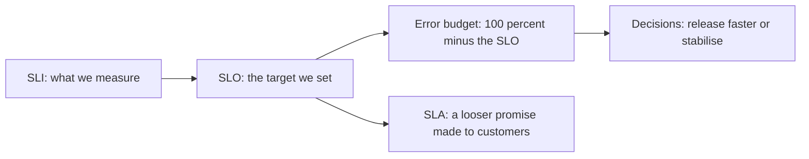
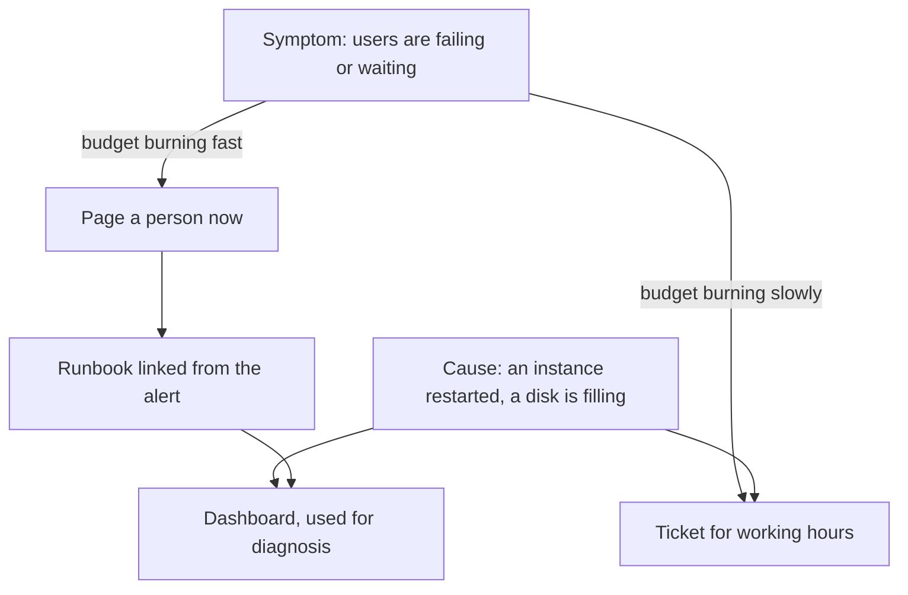

# Are we doing OK? SLOs, error budgets, alerting and semantic monitoring

## Before this lesson

> **Before this lesson:** read [Logs, metrics and traces](#/lesson/microservices/logs-metrics-traces). You should know what a metric, an error rate and a percentile are. Synthetic transactions and canary releases were introduced in [Contract tests, testing in production and cross-functional testing](#/lesson/microservices/contract-tests).

## In plain words

A courier company does not promise that every parcel arrives on time. It promises something like "95 parcels in 100 arrive within two days". That number is chosen on purpose. Reaching 100 in 100 would need a spare van behind every van; customers would not pay for it.

The promise does three useful jobs. It tells customers what to expect. It tells the company whether today is a good day or a bad one. And it defines an allowance: up to 5 parcels in 100 may be late before the promise is broken. While plenty of allowance is left, the company can try a new route or new software. When the allowance is nearly used up, it should stop experimenting and concentrate on reliability.

In software the promise is a **service level objective**, the allowance is an **error budget**, and both rest on measurements taken from the metrics of the last lesson.

The second topic is alarms. A smoke alarm that sounds every time someone makes toast soon has its battery removed, and then it is silent on the day of a real fire. Alerts that wake engineers for things that do not matter have the same effect. This lesson shows how to alert on what users experience.

Why this matters for a job: SLOs and error budgets are the common language between engineers and product managers at most large technology companies, and "how would you alert on this service?" is a routine design-interview follow-up.

## 1. With thirty services, what does "working" mean?

With one application, "is it up?" has a yes or no answer. In a system of many services something is always slightly wrong: one instance restarting, one dependency slow. If any fault anywhere counted as "down", you would always be down. If you looked only at individual machines, you could miss that customers cannot book.

So the question changes from "is everything healthy?" to "**are users getting what we promised them?**" Four terms make that precise.

| Term | Stands for | Plain meaning | Example |
|---|---|---|---|
| SLI | Service level indicator | A measurement of something users care about | Share of booking requests that succeed |
| SLO | Service level objective | The target you set for an SLI over a period | 99.9% of booking requests succeed over 30 days |
| SLA | Service level agreement | A formal promise to a customer, with consequences if broken | "99.5% monthly availability or we refund 10%" |
| Error budget | | The amount of failure the SLO permits | 0.1% of booking requests may fail |

The SLA is a contract between a company and its customers, often written by lawyers. The SLO is an internal target, set by the team, and normally stricter than the SLA so that there is a margin. The SLI is the measurement that tells you whether you are meeting the SLO.



### What do the nines mean in minutes?

Availability targets are quoted as percentages with many nines. It helps to turn them into time.

```python-run
MINUTES_IN_30_DAYS = 30 * 24 * 60

print("SLO        allowed bad minutes in 30 days")
for slo in [0.99, 0.995, 0.999, 0.9995, 0.9999]:
    budget = (1 - slo) * MINUTES_IN_30_DAYS
    hours, minutes = divmod(budget, 60)
    print(f"{slo:7.2%}    {budget:7.1f} minutes  (about {int(hours)} h {minutes:.0f} min)")
```

The loop multiplies the allowed failure share, `1 - slo`, by the number of minutes in 30 days. At 99% you may be unavailable for over seven hours a month. At 99.9% the allowance is about 43 minutes. At 99.99% it is a little over four minutes, which is less time than it takes a person to wake up, open a laptop and work out what is wrong. Each extra nine cuts the allowance by ten and costs far more than the previous one. This is why the target should be chosen from what users need, not set to the highest number that sounds good.

## 2. Choosing indicators

A good SLI has the form *good events divided by all events*, measured as close to the user as possible.

| Kind | Indicator | Good event |
|---|---|---|
| Availability | Share of requests that succeed | Response is not a server error |
| Latency | Share of requests that are fast enough | Response within 300 ms |
| Freshness | Share of data recent enough | Diary shown is less than 60 seconds old |
| Correctness | Share of results that are right | Invoice total matches the items |

Two points of judgement:

- **Measure where the user is.** A measurement taken at the load balancer or by a synthetic probe from outside reflects what users see. A service's own count of its successes misses requests that never reached it.
- **Pick few.** One or two indicators per user journey are enough. Twenty SLOs for one service means none is taken seriously.

## 3. Error budgets

If the SLO is 99.9%, then 0.1% of requests may fail. That 0.1% is the **error budget**. It turns reliability into something you can spend.

Every release carries some risk of failures. So do experiments, migrations and infrastructure changes. All of them draw on the same budget as accidents do. This gives a simple rule that both product managers and engineers can accept in advance:

- **Budget remaining:** keep releasing; take reasonable risks.
- **Budget nearly spent or overspent:** pause risky changes and work on reliability until the period rolls over or the service recovers.

The argument "ship features" against "keep it stable" becomes a number to look at.

```python-run
SLO = 0.999
requests_per_day = 400_000
budget_total = (1 - SLO) * requests_per_day * 30            # failed requests allowed in 30 days

# Failed requests per day for a month; most days are quiet.
failed = [40] * 30
failed[5]  = 3_100        # day 6: a bad release, rolled back after 20 minutes
failed[17] = 5_600        # day 18: the card provider had an outage

spent = 0
print(f"budget for 30 days: {budget_total:,.0f} failed requests")
for day, f in enumerate(failed, start=1):
    spent += f
    if day in (5, 6, 17, 18, 24, 30):
        left = budget_total - spent
        state = "ok" if left > 0.25 * budget_total else ("LOW: slow down" if left > 0 else "EXHAUSTED: freeze risky changes")
        print(f"day {day:2d}: spent {spent:6,d}  remaining {left:7,.0f} ({left / budget_total:6.1%})  {state}")
```

`budget_total` is 0.1% of a month's twelve million requests: 12,000 failures. `failed` holds the failures for each day: a background of 40, and two bad days. The loop keeps a running total and prints the position on selected days. After day 5 almost nothing is spent. The bad release on day 6 consumes a quarter of the month's budget in twenty minutes. The provider outage on day 18 takes the remainder below a quarter, and the label changes to "slow down". By day 30 about 18% is left.

Notice that the background failures cost 1,200 of the 12,000 across the month. A service can spend its budget slowly through a steady trickle of errors as well as quickly through incidents; both deserve attention.

## 4. Alerting

An **alert** is a notification that asks a person to pay attention. A **page** is an alert urgent enough to interrupt someone immediately, including at night.

**Alert fatigue** is what happens when alerts are frequent and mostly unimportant: people stop reacting. In serious industrial accidents, investigators have repeatedly found operators facing hundreds of alarms at once, unable to tell which mattered. Engineering bodies that studied this produced criteria for a good alarm, and they transfer well to software:

| A good alert is | Meaning |
|---|---|
| Relevant | It indicates something worth knowing |
| Unique | It does not duplicate another alert for the same problem |
| Timely | It arrives early enough to act on |
| Prioritised | The recipient can tell how urgent it is |
| Understandable | It says clearly what is wrong |
| Diagnostic | It helps identify the cause |
| Advisory | It suggests what to do, for example with a link to a runbook |
| Focusing | It draws attention to the most important issue |

A **runbook** is a short written guide for handling a particular alert.

### Symptoms before causes

A **cause-based** alert fires on an internal condition: "processor above 90% on instance b-3". A **symptom-based** alert fires on what users experience: "booking success rate below target".

Cause-based alerts are tempting, since they are easy to write, and they mislead in both directions. High processor use may harm nobody. And users may be failing for a reason no cause-based alert anticipated. In a microservice system, with instances failing and being replaced automatically all day, paging a person for each one is pointless.

The sound arrangement: **page on symptoms**, defined by the SLO. Use cause-level signals as lower-priority tickets and as information on dashboards to help diagnosis once a symptom alert has fired.



### Burn-rate alerts

How do you alert on an SLO? Alerting whenever any error occurs is far too noisy. Waiting until the monthly budget is gone is far too late. The widely used answer, described in Google's site reliability engineering books, is the **burn rate**: how fast the budget is being spent compared with the pace that would use exactly all of it by the end of the period.

$$\text{burn rate} = \frac{\text{observed error rate}}{1 - \text{SLO}}$$

A burn rate of 1 uses the whole budget in exactly 30 days. A burn rate of 14.4 uses 2% of a 30-day budget in one hour and would exhaust it in about two days. That is worth waking someone for.

To avoid paging on a brief blip, alerts check two windows: a long one to show the problem is significant, and a short one to show it is still happening.

```python-run
SLO = 0.999
BUDGET = 1 - SLO

def burn_rate(errors, requests):
    return (errors / requests) / BUDGET if requests else 0.0

def evaluate(name, last_5min, last_1h, last_6h):
    """Each argument is (errors, requests) in that window."""
    b5, b1h, b6h = burn_rate(*last_5min), burn_rate(*last_1h), burn_rate(*last_6h)
    if b1h >= 14.4 and b5 >= 14.4:
        action = "PAGE: fast burn, still happening"
    elif b6h >= 6:
        action = "PAGE: sustained burn"
    elif b6h >= 1:
        action = "ticket: slow burn, look during working hours"
    else:
        action = "no alert"
    print(f"{name:26s} burn 5m={b5:5.1f} 1h={b1h:5.1f} 6h={b6h:4.1f}  -> {action}")

evaluate("quiet day",                (1, 1400),   (15, 16800),   (95, 100000))
evaluate("blip that already ended",  (1, 1400),   (260, 16800),  (300, 100000))
evaluate("bad release, ongoing",     (45, 1400),  (300, 16800),  (340, 100000))
evaluate("slow leak",                (4, 1400),   (40, 16800),   (290, 100000))
evaluate("provider degraded all afternoon", (10, 1400), (120, 16800), (700, 100000))
```

`burn_rate` divides the error rate in a window by the budget. `evaluate` computes it for three windows and applies rules in order of urgency. Read the five lines:

- **Quiet day.** All burn rates are below 1. Nothing fires.
- **Blip that already ended.** The last hour looks bad (15 times budget pace), and the last five minutes are back to normal. No page: the problem fixed itself, and a single-window alert would have woken someone for nothing. The blip did spend budget at three times the sustainable pace over six hours, so it leaves a ticket to look at in working hours.
- **Bad release, ongoing.** Both the hour and the last five minutes are far above 14.4. Page now.
- **Slow leak.** Nearly three times the sustainable pace over six hours. Not an emergency, and it will consume the budget in about ten days, so it becomes a ticket.
- **Provider degraded all afternoon.** Seven times the pace for six hours: page.

The practice problem *SLO Burn-rate Alert Evaluation* asks you to implement this evaluation.

## 5. Semantic monitoring

All of the above still relies on low-level signals such as error codes. **Semantic monitoring** asks a higher-level question: *is the system behaving the way a working system should, in business terms?* You define a model of acceptable behaviour and compare reality with it.

Examples of such statements for a clinic chain:

- New owners can register.
- At least 30 bookings an hour are made during weekday opening hours.
- Reminders for tomorrow's appointments have all been sent by 6 pm.

Two sources of evidence feed semantic monitoring:

**Real user monitoring** looks at what actual users did. It is truthful, and it only tells you about a problem after users have met it.

**Synthetic transactions** (lesson 20) perform the journey with a robot user on a schedule. They detect a broken journey even at 4 am when no real user is active.

```python-run
# Expected bookings per hour on a weekday, learned from history: (low, high) by hour of day.
EXPECTED = {8: (20, 60), 9: (45, 110), 10: (60, 140), 11: (55, 130), 12: (35, 90), 13: (40, 100)}

observed = {8: 41, 9: 78, 10: 96, 11: 7, 12: 5, 13: 62}
error_rate = {8: 0.001, 9: 0.001, 10: 0.002, 11: 0.001, 12: 0.001, 13: 0.001}

for hour in sorted(EXPECTED):
    low, high = EXPECTED[hour]
    count = observed[hour]
    business = "ok" if low <= count <= high else f"ANOMALY: expected {low} to {high}"
    technical = "ok" if error_rate[hour] < 0.01 else "ERRORS"
    print(f"{hour:02d}:00  bookings {count:3d}  error-rate check: {technical:6s}  business check: {business}")
```

`EXPECTED` gives a normal range of bookings for each hour. `observed` is today. `error_rate` is what the technical dashboards show. At 11:00 and 12:00 bookings collapse to single figures while the error rate stays tiny. Nothing is returning errors. Perhaps a change to the website moved the "Book" button off the screen on mobile phones. Every technical check says "ok"; only the comparison with expected business behaviour notices that the clinics are losing a morning of bookings.

## 6. Testing in production, as part of monitoring

Monitoring and testing in production blend into each other. The techniques from earlier lessons all double as ways of answering "are we doing OK?" on the live system:

| Technique | What it adds to the picture |
|---|---|
| Synthetic transactions | A journey works right now, even with no real traffic |
| Smoke tests after deployment | The new version passes basic checks in its real environment |
| Canary release | The new version is no worse than the old on real traffic |
| A/B tests | Which of two variants gives the better business outcome |
| Parallel run | New logic gives the same answers as old |
| Chaos engineering (lesson 25) | The system copes when parts are deliberately broken |

### Worked example: an SLO for booking at Pawprint

| Element | Choice |
|---|---|
| Journey | An owner books an appointment on the website or app |
| SLI 1 (availability) | Booking requests answered without a server error, measured at the gateway |
| SLO 1 | 99.9% over 30 days |
| SLI 2 (latency) | Booking requests answered within 800 ms |
| SLO 2 | 95% over 30 days |
| Page | Burn rate at or above 14.4 over 1 hour and 5 minutes, or at or above 6 over 6 hours |
| Ticket | Burn rate at or above 1 over 6 hours; any instance restarting repeatedly |
| Semantic check | A synthetic booking for the test clinic every 5 minutes; bookings per hour within the expected range |
| Budget policy | Below 25% remaining: releases need a second approval. At zero: reliability work only |

Nothing in the paging rules mentions a processor, a disk or an individual instance.

> [!INTERVIEW]
> For "how would you monitor and alert on this service?": *I start from the user journey and define one or two SLIs as good events over total events, measured at the edge: availability and latency. I set an SLO, which gives an error budget. I page on fast or sustained burn of that budget using two windows, so a short blip does not wake anyone, and I send slow burns and cause-level signals to tickets and dashboards. I add a synthetic transaction and a business-level check, because a system can return no errors and still not be doing its job.*

## 7. Pitfalls

- **Aiming for 100%.** It cannot be reached, and chasing it stops all change.
- **An SLO nobody acts on.** If overspending the budget changes nothing, it is decoration.
- **Too many SLOs.** Pick the few that reflect what users value.
- **Measuring inside the service only.** Requests that never arrived are not counted.
- **Paging on causes.** High processor use is not an incident; failing users are.
- **Alerts with no advice.** A page that says only "error" costs minutes at the worst moment.
- **Single-window thresholds.** They fire on blips or miss slow leaks.
- **Trusting green technical dashboards.** Business behaviour can be broken while every status code is 200.
- **Leaving noisy alerts in place.** Each false page makes the next real one less likely to be answered.

## Summary

- In a system of many services, "working" is defined by what users experience.
- An SLI measures it, an SLO sets the target, an SLA is the external promise, and the error budget is the failure the SLO permits.
- Each extra nine divides the allowed downtime by ten: 99.9% over 30 days is about 43 minutes.
- Error budgets turn the tension between releasing and stabilising into an agreed rule.
- Good alerts are relevant, unique, timely, prioritised, understandable, diagnostic, advisory and focusing. Page on symptoms; keep causes for diagnosis.
- Burn rate compares the observed error rate with the budget pace; two windows separate real problems from blips.
- Semantic monitoring checks business behaviour against a model, using real user data and synthetic transactions.

## Glossary

| Term | Meaning |
|---|---|
| SLI | Service level indicator: a measurement of user-visible quality |
| SLO | Service level objective: the target for an SLI over a period |
| SLA | Service level agreement: a formal promise to customers with consequences |
| Error budget | The share of failures an SLO allows |
| Alert / page | A notification asking for attention / one urgent enough to interrupt someone |
| Alert fatigue | Ignoring alerts because there are too many unimportant ones |
| Runbook | Written guidance for responding to a particular alert |
| Symptom-based alert | An alert on what users experience |
| Cause-based alert | An alert on an internal condition |
| Burn rate | How fast the error budget is being used, relative to the sustainable pace |
| Semantic monitoring | Checking that the system behaves acceptably in business terms |
| Real user monitoring | Measuring the experience of actual users |
| Synthetic transaction | A scripted fake user action run on a schedule |

```quiz
[
  {"q": "Which statement correctly relates SLI, SLO and SLA?", "options": ["They are three names for the same thing", "An SLI is a measurement, an SLO is the target for it, and an SLA is a formal promise to customers", "An SLA is stricter than an SLO", "An SLI is a legal contract"], "answer": 1,
   "explain": "The indicator is measured, the objective is the internal target, and the agreement is the external commitment, usually looser than the SLO."},
  {"q": "Roughly how much unavailability does a 99.9% SLO allow in 30 days?", "options": ["About 7 hours", "About 43 minutes", "About 4 minutes", "None"], "answer": 1,
   "explain": "0.1% of 43,200 minutes is 43.2 minutes."},
  {"q": "A team has used 95% of its error budget with ten days left in the period. What does the error budget idea suggest?", "options": ["Release faster to use the rest", "Pause risky changes and focus on reliability", "Raise the SLO to 100%", "Turn off alerting"], "answer": 1,
   "explain": "The budget is the agreed limit on failure. When it is nearly spent, risk should be reduced until it recovers."},
  {"q": "Why is paging on high processor usage usually a poor idea?", "options": ["Processors cannot be measured", "It is a cause-level signal that may not affect users at all, and it misses user-facing failures with other causes", "It is too expensive to collect", "It only works on Mondays"], "answer": 1,
   "explain": "Pages should reflect symptoms that users feel. Cause-level signals help diagnosis and belong on dashboards or tickets."},
  {"q": "With a 99.9% SLO, the error rate over the last hour is 1.5%. What is the burn rate?", "options": ["1.5", "15", "0.15", "150"], "answer": 1,
   "explain": "Burn rate is the error rate divided by the budget: 0.015 / 0.001 = 15. At that pace the monthly budget lasts about two days."},
  {"q": "Why do burn-rate alerts check both a long and a short window?", "options": ["To double the number of pages", "The long window shows the problem is significant; the short window shows it is still happening, avoiding pages for blips that have ended", "Because metrics are stored twice", "To satisfy auditors"], "answer": 1,
   "explain": "A high hourly rate with a normal last five minutes means the issue has passed. Requiring both reduces false pages."},
  {"q": "Bookings drop to almost zero while the error rate stays normal. Which kind of monitoring detects this?", "options": ["Processor monitoring", "Semantic monitoring that compares business activity with its expected range", "Disk monitoring", "None can"], "answer": 1,
   "explain": "No request is failing technically. Only a model of acceptable business behaviour reveals that the system is not doing its job."},
  {"q": "What is the advantage of a synthetic transaction over real user monitoring?", "options": ["It is more truthful about real users", "It can detect a broken journey even when no real users are active, before they meet the problem", "It needs no test data", "It replaces SLOs"], "answer": 1,
   "explain": "A scheduled robot user exercises the journey continuously, so faults are found during quiet periods."}
]
```

> **Source:** Newman, *Building Microservices*, 2nd ed., ch. 10 (topic coverage only; wording and the Pawprint example are original). Beyer et al., *Site Reliability Engineering* (2016) and *The Site Reliability Workbook* (2018), ch. 5 "Alerting on SLOs", https://sre.google/workbook/alerting-on-slos/
