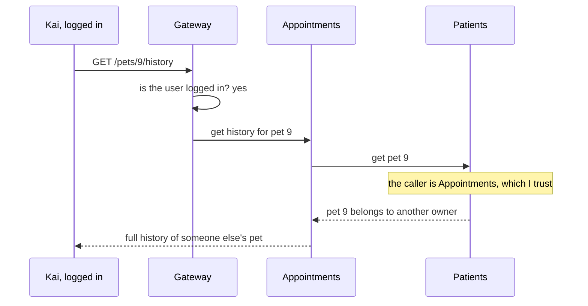

# Trust, encryption and identity: zero trust, JWTs and the confused deputy

## Before this lesson

> **Before this lesson:** read [Security foundations](#/lesson/microservices/security-foundations). You should know least privilege, defence in depth, blast radius and what a secret is. API gateways and service meshes were introduced in [Handling change](#/lesson/microservices/handling-change).

## In plain words

An old castle is protected by a wall and a moat. Anyone inside the wall is assumed to be a friend and may walk into any room. It is cheap to run, and it fails completely the day one enemy gets across the moat.

A modern office building works differently. The front door needs a badge. So does the lift, each floor, the server room and the finance office. Being inside the building proves nothing: every door checks your badge again. This is slower to set up, and one intruder in the lobby gets no further than the lobby.

For services, the castle is called **implicit trust** and the office building is called **zero trust**.

The badge deserves a closer look. Reception issues it after checking your identity once. It states who you are, which areas you may enter and when it expires, and it carries a hologram that is hard to forge. Each door can read the badge and decide without telephoning reception. A **JSON Web Token (JWT)** is such a badge for software, and this lesson builds one from scratch.

Last, a trick as old as offices. You have no right to see a certain file, so you ask a helpful clerk who does have access to fetch it for you. The clerk never asks whether *you* are allowed. The clerk has been made into a **confused deputy**. Services fall for this easily, and JWTs are one way to stop it.

Why this matters for a job: authentication, authorisation, TLS and JWTs come up in nearly every backend interview, and mistakes here cause real data leaks.

## 1. Implicit trust and zero trust

**Implicit trust** (also called perimeter security) assumes that any call coming from inside the network is safe. Services do not check who is calling. All protection sits at the edge.

**Zero trust** assumes the network is already compromised. Every call is treated as possibly hostile, wherever it comes from. Every service checks who is calling and whether that caller may do what it asks, and all traffic is encrypted, including traffic between your own services.

```mermaid
flowchart LR
  subgraph Castle[Implicit trust]
    E1[Edge check] --> A1[Appointments]
    A1 -->|no checks| P1[Patients]
    A1 -->|no checks| B1[Billing]
    X1[Attacker inside] -->|no checks| P1
  end
  subgraph Office[Zero trust]
    E2[Edge check] --> A2[Appointments]
    A2 -->|identity checked, encrypted| P2[Patients]
    A2 -->|identity checked, encrypted| B2[Billing]
    X2[Attacker inside] -. rejected .-> P2
  end
```



Zero trust is not a product you install. It is a way of thinking that leads to concrete measures, and it costs effort. Many organisations sit between the two extremes, and a sensible way to do so is by **zones**: classify data by sensitivity, and apply stricter rules where the data is more sensitive.

| Zone | Example at Pawprint | Rules |
|---|---|---|
| Public | Clinic opening hours | Could be published; basic controls |
| Private | Appointment times, pet names | Authenticated callers, encrypted in transit |
| Secret | Medical records, card tokens | Zero trust: mutual authentication, fine-grained authorisation, full audit log |

A service in a less sensitive zone may not read from a more sensitive one without an explicit, checked path.

## 2. Protecting data in transit

**Data in transit** is data moving over a network. Four separate things can go wrong, and it helps to keep them apart:

| Concern | Question | Without protection |
|---|---|---|
| Server identity | Am I really talking to Billing? | An impostor receives the card data |
| Client identity | Is this caller really Appointments? | Anyone on the network can call Billing |
| Visibility | Can someone read the data on the way? | Medical notes are readable by eavesdroppers |
| Manipulation | Can someone change the data on the way? | An amount of 20 becomes 2000 |

**TLS** (transport layer security) is the standard answer. It is what puts the "S" in HTTPS. With ordinary TLS, the server presents a **certificate**, a document signed by a trusted authority stating "this is billing.pawprint.internal". The client checks it, which settles server identity, and the connection is then encrypted and protected against tampering, which settles visibility and manipulation.

**Mutual TLS (mTLS)** adds the remaining item: the client presents a certificate too, so each side has proof of the other's identity. Issuing, distributing and renewing certificates for every service instance is a lot of work by hand. A service mesh (lesson 12) does it automatically, which is one of the main reasons teams adopt one.

How does a receiver know data was not changed? By a **signature**: a short value computed from the message and a secret key. Anyone who alters the message cannot produce the matching signature without the key.

```python-run
import hmac, hashlib

SHARED_KEY = b"key-known-only-to-appointments-and-billing"

def sign(message):
    return hmac.new(SHARED_KEY, message.encode(), hashlib.sha256).hexdigest()

def verify(message, signature):
    return hmac.compare_digest(sign(message), signature)

original = "charge visit=551 amount=2000"
tag = sign(original)
print("signature:", tag[:24], "...")
print("original message accepted:", verify(original, tag))

tampered = "charge visit=551 amount=9000"
print("tampered message accepted:", verify(tampered, tag))
```

`sign` uses HMAC, a standard way of combining a message with a secret key through a **hash function** (a function that turns any input into a fixed-size fingerprint). `verify` recomputes the signature and compares. The original message is accepted. Change a single digit and the check fails, because the attacker cannot compute the right signature without `SHARED_KEY`. TLS does this for you on every packet. The same idea reappears below inside the JWT.

## 3. Protecting data at rest

**Data at rest** is data stored on disk: databases, files, backups. If an attacker gets past everything else and copies the database, encryption at rest is the last layer of defence in depth.

Five rules cover most of what matters.

**Use well-known implementations.** Never design your own encryption. Use a mature, widely reviewed library and algorithm, and keep it up to date.

**Hash passwords; do not encrypt them.** A password should never be stored in a form that can be turned back into the password. Store a **salted hash**: combine the password with a random value unique to that user (the **salt**), then run a deliberately slow hash function designed for passwords. Slowness is a feature: it makes guessing billions of passwords impractical.

```python-run
import hashlib, os

def fast_unsalted(password):
    return hashlib.sha256(password.encode()).hexdigest()[:16]

def slow_salted(password, salt=None):
    salt = salt or os.urandom(8)
    digest = hashlib.pbkdf2_hmac("sha256", password.encode(), salt, 20_000)
    return salt.hex(), digest.hex()[:16]

users = {"kai": "miso2019", "priya": "miso2019", "dr-lim": "correct horse battery"}

print("Unsalted fast hash: equal passwords are visible at a glance")
for user, pw in users.items():
    print(f"   {user:7s} {fast_unsalted(pw)}")

print("Salted slow hash: equal passwords look unrelated")
stored = {user: slow_salted(pw) for user, pw in users.items()}
for user, (salt, digest) in stored.items():
    print(f"   {user:7s} salt={salt} hash={digest}")

salt_hex, expected = stored["kai"]
attempt = slow_salted("miso2019", bytes.fromhex(salt_hex))[1]
print("login check for kai with the right password:", attempt == expected)
```

`fast_unsalted` is what not to do. Kai and Priya chose the same password and get the same hash, so an attacker who cracks one has both, and can look the hash up in precomputed tables. `slow_salted` generates a random salt per user and runs PBKDF2, a password-hashing function, for 20,000 rounds. Now the two identical passwords produce unrelated values. To check a login, the service repeats the calculation with the stored salt and compares. (Your salts and hashes will differ on each run, because the salt is random.) In production use a library implementing a current password-hashing algorithm such as Argon2 or bcrypt.

**Encrypt selectively and know why.** Decide which data is sensitive and encrypt that. Encrypting everything sounds safe, and it costs performance and complicates operations.

**Collect less.** Data you never stored cannot leak. Keep only what the business needs, and delete it when it is no longer needed. Privacy laws such as the EU's GDPR and Singapore's PDPA turn this into an obligation.

**Guard the keys, and encrypt the backups.** Encryption moves the problem to the **key**: the secret value needed to decrypt. If the key is stored beside the data, an attacker takes both. Keep keys in a separate key management service with its own access controls. And remember that a backup is a full copy of the data; it needs the same protection.

## 4. Protecting stored credentials

Section 3 gave the rule in one line: hash passwords, do not encrypt them. This section explains why in more depth, because a leaked credential store is one of the most common real breaches, and the choice of algorithm decides whether it is an inconvenience or a disaster.

A **credential** is anything that proves identity: a password, an API key, a token. Services store them in two situations. They store *users' passwords* so people can log in, and they hold *their own secrets* (database passwords, keys for other services) so they can call things.

### Why encryption and fast hashes both fail

Imagine an attacker has copied the user table. What does each storage choice leave them?

| Stored as | What the attacker can do |
|---|---|
| Plain text | Read every password. Game over. |
| Encrypted | Needs the key. But the service must hold that key to check logins, so a breach that reaches the database often reaches the key too. Then every password is readable at once. |
| Fast hash (such as SHA-256), no salt | Cannot reverse it, but can *guess*. A modern graphics card can try billions of guesses a second, and equal passwords show equal hashes. |
| Salted, slow password hash | Must guess each user separately and slowly. Weak passwords still fall; strong ones hold. |

A **hash** is a one-way function: easy to compute, practically impossible to reverse. A login check works by hashing what the user typed and comparing the result with the stored value; the service never needs the original password back. That is why a reversible method (encryption) is the wrong tool: it keeps a capability you never wanted.

The attacker's method is **guessing**: take a list of common passwords and leaked ones, hash each, and compare. Everything about good storage is about making each guess expensive.

- **Salt.** A random value, different for every user, stored beside the hash and mixed into it. It means equal passwords give different hashes, and it makes precomputed lookup tables of hashes useless, because the attacker would need a separate table for each salt. A salt is not secret.
- **Slowness (work factor).** A password hash is deliberately costly. A login takes perhaps a tenth of a second, which no user notices. An attacker trying a billion guesses feels it enormously.

### Use a purpose-built algorithm

Do not assemble this yourself from SHA-256 and a loop. Use a library implementing an algorithm designed for passwords:

- **bcrypt**: long established; has a tunable cost setting that doubles the work with each increment. It ignores input beyond 72 bytes, so very long passwords need care.
- **scrypt**: also deliberately demands a lot of *memory*, which hurts attackers who run guesses on graphics cards or custom chips with little memory each.
- **Argon2** (the Argon2id variant is the usual recommendation): winner of an open Password Hashing Competition held in 2013 to 2015, with settings for time, memory and parallelism. Current guidance from OWASP, the open web security project, prefers it where available. PBKDF2, used in the section 3 demo, is acceptable where standards require it but is weaker against specialised hardware.

The libraries store the algorithm name, the settings and the salt together in one string, so the hash can be checked later and the settings raised over time. Choose the settings from current published guidance (the OWASP *Password Storage Cheat Sheet* is maintained) and test them on your own hardware, aiming for a delay users will accept.

To see why the work factor matters, here is arithmetic on an attacker's budget:

```python-run
guesses_per_second = {
    "fast hash, no salt, one graphics card": 10_000_000_000,
    "slow salted hash, same card":                    20_000,
}

# 8 lowercase letters is a weak password space: 26 ** 8 possibilities.
space = 26 ** 8
print(f"search space: {space:,} passwords")
for name, rate in guesses_per_second.items():
    seconds = space / rate
    print(f"{name:42s} -> {seconds:>14,.0f} s  ({seconds / 3600:,.1f} hours)")
```

The two rates are illustrative, not measurements; real figures depend on hardware and settings. The point is the ratio. Against a fast hash the whole space of eight-letter passwords falls in minutes. Making each guess cost half a million times more turns seconds into months for one card, and the attacker pays that for *every user separately*, because of the salts. The attacker will go after the weakest passwords first, which is why long, unique passwords and breach-checked password lists (rejecting passwords known from earlier leaks) still matter.

Two optional extras. A **pepper** is a secret value added to every hash and kept outside the database, for example in the key management service from section 3; a stolen user table alone then cannot be attacked at all. And you can raise the cost over time: when a user logs in successfully and the stored hash used older settings, quietly re-hash the password with the newer ones.

### The service's own secrets

Passwords users choose are hashed. Secrets your *services* need, such as a database password or an API key for a payment provider, cannot be hashed because the service must present the real value. Protect them differently:

- Keep them out of source code and container images; a secret committed to a repository must be treated as leaked, even if removed later, because history keeps it.
- Store them in a **secrets manager** or the platform's secret store, which encrypts them, controls who may read each one and logs access.
- Give each service its own credentials with the narrowest rights, so that a leak from one is small.
- Make rotation (replacing a secret on a schedule, or at once after a suspected leak) routine, so that doing it in an emergency is not the first time.
- Prefer short-lived credentials issued on demand over long-lived ones that sit around.

## 5. Authentication and authorisation

Two words that look alike and mean different things:

- **Authentication** answers *who are you?* It is the process of confirming identity.
- **Authorisation** answers *what are you allowed to do?* It maps an identity to permitted actions.

The thing being authenticated, a person or a program, is called the **principal**.

### Service-to-service

One service proves its identity to another most commonly with mutual TLS, or with an API key (a secret string sent with each request, weaker because it can be copied). Authorisation then asks: may Appointments call *this operation* on Billing?

### People

Users should not log in separately to each of thirty services. **Single sign-on (SSO)** lets a person authenticate once with an **identity provider**, a system that holds user accounts and checks credentials. The common protocol today is **OpenID Connect**, built on OAuth 2.0.

Individual services should not each implement the login redirect. A gateway at the edge usually does it: it sends unauthenticated users to the identity provider, establishes a session, and passes the request inward with information about who the user is.

Two cautions about that gateway:

- If the gateway is the *only* place where anything is checked, you are back in the castle. Defence in depth says services check too.
- Keep its authorisation **coarse-grained**: "is this a logged-in owner or a staff member?" Fine-grained decisions, such as "may this vet change this prescription?", depend on business rules that belong to the owning service. Putting every service's rules in the gateway or in the identity provider creates a central component that every team must change.

## 6. The confused deputy

Kai is a pet owner and is properly logged in. Kai's pet is number 7. Kai edits the address in the browser and asks for the appointment history of pet 9, which belongs to someone else.



Every individual check passed. The gateway confirmed Kai is logged in. Patients confirmed the call came from Appointments, a trusted service. Yet Kai received another owner's data. Appointments has authority that Kai lacks, and it used that authority on Kai's behalf without asking whether Kai was entitled. That is the **confused deputy** problem: a more privileged intermediary is tricked into misusing its privileges for a less privileged requester.

There are two ways to deal with it.

**Centralised upstream authorisation.** The gateway checks everything before forwarding: "does pet 9 belong to Kai?" This requires the gateway to understand the rules of every service behind it. It becomes large, and every team's changes pass through it.

**Decentralised authorisation.** Each service decides for itself whether the *original user* may perform the action. For that, the service must reliably know who the original user is, even when the call arrives through two other services. The identity must travel with the request in a form that cannot be forged. That is what a JWT is for.

## 7. JSON Web Tokens

A **JSON Web Token (JWT)**, defined in RFC 7519, is a compact, signed piece of data that carries statements about a principal. Each statement is called a **claim**.

A JWT has three parts separated by dots: `header.payload.signature`.

- The **header** says which signing algorithm was used.
- The **payload** holds the claims: for example `sub` (the subject: who this is about), `exp` (the expiry time) and application claims such as a role or a list of scopes.
- The **signature** is computed over the header and payload with a key held by the issuer.

Two properties are worth stating firmly. A JWT is **signed, not encrypted**: anyone holding it can read the payload, so never put secrets in it. And it is **self-contained**: a service can validate it by checking the signature and the expiry, without calling the identity provider. This suits microservices well, because validation adds no network hop.

```python-run
import base64, hashlib, hmac, json

SIGNING_KEY = b"held-by-the-token-issuer"

def b64(data):                       # URL-safe base64 without padding, as JWTs use
    return base64.urlsafe_b64encode(data).rstrip(b"=").decode()

def unb64(text):
    return base64.urlsafe_b64decode(text + "=" * (-len(text) % 4))

def issue(claims):
    header = b64(json.dumps({"alg": "HS256", "typ": "JWT"}).encode())
    payload = b64(json.dumps(claims).encode())
    signature = b64(hmac.new(SIGNING_KEY, f"{header}.{payload}".encode(), hashlib.sha256).digest())
    return f"{header}.{payload}.{signature}"

def validate(token, now):
    header, payload, signature = token.split(".")
    expected = b64(hmac.new(SIGNING_KEY, f"{header}.{payload}".encode(), hashlib.sha256).digest())
    if not hmac.compare_digest(signature, expected):
        return None, "rejected: bad signature"
    claims = json.loads(unb64(payload))
    if now >= claims["exp"]:
        return None, "rejected: expired"
    return claims, "valid"

token = issue({"sub": "owner-31", "role": "owner", "pets": [7], "exp": 1000})
print("token:", token[:40], "...")
print("payload is readable by anyone:", json.loads(unb64(token.split(".")[1])))
print("at time 900 :", validate(token, now=900)[1])
print("at time 1001:", validate(token, now=1001)[1])

# The holder edits the payload to claim pet 9 as well, keeping the old signature.
h, p, s = token.split(".")
forged_payload = b64(json.dumps({"sub": "owner-31", "role": "owner", "pets": [7, 9], "exp": 1000}).encode())
print("forged token:", validate(f"{h}.{forged_payload}.{s}", now=900)[1])

# The Patients service makes its own decision from the validated claims.
def patients_get_history(token, pet_id, now):
    claims, status = validate(token, now)
    if claims is None:
        return f"401 {status}"
    if claims["role"] == "owner" and pet_id not in claims["pets"]:
        return f"403 {claims['sub']} may not see pet {pet_id}"
    return f"200 history of pet {pet_id}"

print(patients_get_history(token, 7, now=900))
print(patients_get_history(token, 9, now=900))
```

`b64` and `unb64` convert bytes to and from the text encoding JWTs use. `issue` builds the three parts: an encoded header, an encoded payload of claims, and an HMAC signature over the first two. `validate` recomputes the signature, compares, and then checks the expiry.

The output shows each property in turn. The payload can be decoded by anyone, with no key. The token is valid before its expiry and rejected after. When the holder rewrites the payload to add pet 9, the old signature no longer matches and the token is rejected. Finally, `patients_get_history` shows the cure for the confused deputy: the Patients service validates the token it was handed and decides from the claims. Kai may see pet 7 and is refused pet 9, no matter which trusted service forwarded the request.

### How it fits together

1. The user logs in through the gateway and has an ordinary session.
2. For each incoming request, the gateway obtains a JWT for that user, valid for a short time (a minute or so), and attaches it to the request.
3. Each service passes the same token along when it calls another service.
4. Each service validates the token and applies its own authorisation rules.

In practice tokens are signed with a **private key** and checked with the matching **public key**. The issuer keeps the private key; every service may have the public key, which can verify signatures and cannot create them. Then no service is able to forge a token.

### Limits to know

- **Expiry against long processes.** A token valid for one minute is safe if stolen, and a saga that takes an hour will be holding an expired token. Options are longer lifetimes for specific flows, or re-issuing a token for the later steps.
- **Size.** Many claims make a large token that travels with every call.
- **Revocation is hard.** A self-contained token stays valid until it expires, which is the reason to keep lifetimes short.
- **Key distribution.** Services need the current public keys and must cope when keys are rotated.

The practice problem *Token Scopes Across a Call Chain and the Confused Deputy* has you trace which calls a token permits along a chain of services.

> [!INTERVIEW]
> For "how do services know who the end user is, and how do you prevent one user reading another's data?": *the gateway authenticates the user through an identity provider with OpenID Connect and does coarse authorisation. It then attaches a short-lived signed JWT carrying the user's identity and claims. Each service passes the token on, validates the signature and expiry locally with the issuer's public key, and makes its own fine-grained decision. That avoids the confused deputy, where a trusted service fetches data its caller should not see. Between services I use mutual TLS, so the channel is encrypted and both ends are authenticated.*

## 8. Denial of service and DDoS

Everything above is about stopping the wrong people getting *in*. A different attack does not try to get in at all. It tries to stop the right people from using the service.

A **denial of service (DoS)** attack overwhelms a service with so much useless work that real users cannot be served, like hundreds of people phoning a clinic and hanging up, so that real clients only hear an engaged tone. A **distributed denial of service (DDoS)** does the same from many machines at once, typically thousands of hijacked computers called a **botnet**. Distribution matters because blocking one address no longer helps, and because the combined traffic can exceed what any single organisation can absorb.

### Three kinds, by what they exhaust

- **Volumetric attacks** flood the network link itself with sheer quantity of traffic. Some use **amplification**: the attacker sends small requests to open servers elsewhere with the sender address forged to be the victim's, and those servers send large replies to the victim. Your servers can be perfectly healthy while the pipe in front of them is full.
- **Protocol attacks** abuse the way connections are set up. A SYN flood sends many connection openings and never finishes them, filling the server's table of half-open connections.
- **Application-layer attacks** send requests that look legitimate and are expensive to serve: a search with a costly query, a report that touches every table, a login endpoint that runs a slow password hash (section 4!). Few requests per attacker are needed, which makes them hard to tell from real users.

### What a service estate can do

Be realistic about the limits: a small organisation cannot out-buy a large flood of traffic on its own link, so the first defence is *upstream*, before the traffic reaches you.

- **Upstream mitigation.** Put the estate behind a content delivery network, a cloud provider's protection service or a specialist scrubbing service. These operate at enormous scale across many locations, absorb or filter floods and pass on only clean traffic. Hiding the real origin addresses, so that traffic can only arrive through them, is part of the arrangement. Your internet provider can also drop traffic to a targeted address, though that finishes the attacker's job for them.
- **Rate limiting at the edge.** The gateway or edge proxy counts requests per client (per address, per API key or per user) and refuses the excess with a `429 Too Many Requests` reply. This protects against one noisy client, a buggy retry loop and simple application-layer floods. Limits can differ by cost: far lower for a login or a report than for a cheap lookup.
- **Cheap rejection before expensive work.** Authenticate, validate and cache as early as possible, and make the cost of a request visible before doing it. Cap request sizes, time out slow clients, bound query complexity.
- **Load shedding and graceful degradation.** When overloaded, deliberately refuse low-priority work to keep the important paths alive (booking works; the recommendation widget is switched off). This links to the stability patterns of lesson 26.
- **Autoscaling with a ceiling.** Adding capacity absorbs part of a surge, but with no maximum the attack turns into a bill (lesson 28). Set limits and alerts.
- **A plan before the day.** Know who to call at the provider, how to switch on stricter filtering, and which services to protect first.

### A token bucket, the usual rate limiter

The common algorithm gives each client a **bucket** of tokens. Each request spends one. Tokens refill at a steady rate up to a maximum. A client may burst up to the bucket size, then is held to the refill rate.

```python-run
class Bucket:
    def __init__(self, capacity, refill_per_second):
        self.capacity, self.rate = capacity, refill_per_second
        self.tokens, self.last = capacity, 0.0

    def allow(self, now):
        # add the tokens earned since the last call, up to the capacity
        self.tokens = min(self.capacity, self.tokens + (now - self.last) * self.rate)
        self.last = now
        if self.tokens >= 1:
            self.tokens -= 1
            return True
        return False

bucket = Bucket(capacity=5, refill_per_second=1)   # burst of 5, then 1 per second

# A client sends 10 requests within one second, then one more every second.
times = [0.1 * i for i in range(10)] + [3.0, 4.0, 5.0]
for t in times:
    print(f"t={t:4.1f}s  {'allowed' if bucket.allow(t) else '429 too many requests'}")
```

`Bucket` starts full with 5 tokens. Each `allow` call first credits tokens earned since the previous call (elapsed time multiplied by the rate, capped at the capacity), then spends one if it can. The first five rapid requests pass; the next ones arrive faster than tokens refill and are refused. By t=3 the bucket has refilled a little, so the later well-spaced requests pass again. In a real edge, one bucket is kept per client key, often in a shared fast store so that several gateway instances agree.

### The limits of rate limiting

A DDoS is, by definition, many clients. Ten thousand botnet machines each sending a polite two requests a second pass every per-client limit and still total twenty thousand requests a second. So rate limits handle abuse by individuals and mistakes, while upstream filtering, caching and capacity handle the distributed flood. Neither replaces the other, and neither is a reason to skip the other layers of this lesson.

> [!NOTE]
> Be careful with the sense of "client". Many real users can share one address, such as an office behind one internet connection. A limit per address can lock out an entire clinic. Prefer limiting by authenticated identity where you have one.

## 9. Pitfalls

- **Trusting anything inside the network.** One compromised service or stolen laptop then reaches everything.
- **Checking only at the gateway.** Services that skip checks are open to the confused deputy.
- **Authorising the calling service and not the user.** "It came from Appointments" says nothing about what Kai may see.
- **Secrets in a JWT payload.** The payload is readable by anyone who holds the token.
- **Not checking the signature or the expiry.** An unvalidated token is a note the user wrote to themselves.
- **Very long-lived tokens.** They cannot easily be revoked.
- **Inventing encryption or storing passwords reversibly.** Use reviewed libraries and salted, slow password hashes.
- **Keys stored next to the data.** Whoever copies one copies both.
- **Fast or unsalted hashes for passwords.** SHA-256 alone lets an attacker guess billions of passwords a second; use bcrypt, scrypt or Argon2.
- **Secrets in source code.** A committed secret is a leaked secret, even after deletion.
- **One rate limit per address only.** A botnet stays under it, and a shared office address gets locked out.
- **Unlimited autoscaling during a flood.** The attack becomes a very large bill.
- **All authorisation rules in a central gateway.** It turns into a bottleneck every team must edit.

## Summary

- Implicit trust protects only the perimeter; zero trust checks and encrypts every call. Zoning by data sensitivity is a practical middle path.
- Data in transit raises four concerns: server identity, client identity, visibility and manipulation. TLS covers three, and mutual TLS covers all four.
- For data at rest: use reviewed libraries, store passwords as salted slow hashes, encrypt what is sensitive, collect less, keep keys apart from data, and encrypt backups.
- Authentication establishes identity; authorisation decides what that identity may do.
- Users sign on once through an identity provider; the gateway handles login and coarse checks, and services make fine-grained decisions.
- The confused deputy is a privileged intermediary acting for a requester without checking the requester's rights.
- A JWT is a signed, readable, self-contained set of claims that carries the user's identity through a chain of calls so that each service can decide for itself.
- Store passwords with a salted, slow, purpose-built hash (Argon2id, scrypt or bcrypt), never encrypted or fast-hashed; keep service secrets in a secrets manager and rotate them.
- A DDoS floods a service from many machines. Defend upstream first (CDN or scrubbing), then rate-limit at the edge, shed load and cap autoscaling.

## Glossary

| Term | Meaning |
|---|---|
| Implicit trust | Treating all calls from inside the network as safe |
| Zero trust | Treating every call as possibly hostile and verifying each one |
| Data in transit / at rest | Data moving over a network / data stored on disk |
| TLS | The standard protocol for encrypted, tamper-evident connections |
| Certificate | A signed document binding an identity to a key |
| Mutual TLS | TLS in which both client and server present certificates |
| Signature | A value proving a message came from a key holder and was not altered |
| Hash function | A function producing a fixed-size fingerprint of its input |
| Salt | A random per-user value mixed into a password hash |
| Authentication | Confirming who a principal is |
| Authorisation | Deciding what a principal may do |
| Principal | The person or program being authenticated |
| Single sign-on | Logging in once to use many services |
| Identity provider | The system that holds accounts and verifies credentials |
| Confused deputy | A privileged intermediary tricked into acting beyond the requester's rights |
| JWT | A signed token carrying claims about a principal |
| Claim | One statement inside a token, such as the subject or expiry |
| Credential | Anything that proves identity, such as a password or API key |
| Work factor | How costly a password hash is to compute, tuned to slow guessing |
| bcrypt / scrypt / Argon2 | Purpose-built password-hashing algorithms |
| Pepper | A secret added to every password hash and kept outside the database |
| Secrets manager | A store that encrypts service secrets, controls access and logs reads |
| DoS / DDoS | Overwhelming a service so real users cannot use it, from one source or many |
| Botnet | A network of hijacked machines used to send attack traffic |
| Amplification | A flood in which small requests trigger large replies sent to the victim |
| Rate limiting | Refusing requests beyond an allowed rate per client |
| Token bucket | A rate limiter allowing bursts up to a bucket size, then a steady refill rate |

```quiz
[
  {"q": "Why is encrypting stored passwords the wrong approach?", "options": ["Encryption is too slow", "It is reversible, and the service must hold the key, so a breach that reaches the key exposes every password", "Encrypted data cannot be stored", "Users cannot log in"], "answer": 1,
   "explain": "A login check needs only a one-way comparison. Keeping a way back to the password gives attackers something to steal."},
  {"q": "What is the purpose of the work factor in bcrypt or Argon2?", "options": ["To make logins impossible", "To make each guess costly, so mass guessing is impractical while one login stays quick", "To shorten the hash", "To replace the salt"], "answer": 1,
   "explain": "A tenth of a second is invisible to a user and ruinous to an attacker trying billions of guesses."},
  {"q": "Which three algorithms are purpose-built for password storage?", "options": ["MD5, SHA-1, CRC32", "bcrypt, scrypt, Argon2", "AES, RSA, ECDSA", "Base64, gzip, JSON"], "answer": 1,
   "explain": "These are deliberately slow (and for scrypt and Argon2 memory-hungry). The others are fast hashes, encryption or encodings."},
  {"q": "A database password is found committed in a repository and then deleted in a later commit. What should you do?", "options": ["Nothing; it is deleted", "Treat it as leaked and rotate it", "Hash it", "Move the repository"], "answer": 1,
   "explain": "Version history keeps it. Replace the secret and keep secrets in a secrets manager instead."},
  {"q": "What distinguishes a DDoS from a DoS?", "options": ["It uses encryption", "It comes from many machines at once, so blocking one address does not help", "It only targets databases", "It needs a password"], "answer": 1,
   "explain": "Distribution also lets the combined traffic exceed what one organisation can absorb on its own."},
  {"q": "Why is rate limiting per client address alone not enough against a DDoS?", "options": ["Addresses cannot be counted", "Thousands of machines each stay under the limit while their total still overwhelms the service", "Rate limiting is illegal", "It only works for passwords"], "answer": 1,
   "explain": "Per-client limits stop individuals and bugs. A distributed flood needs upstream filtering, caching and capacity too."},
  {"q": "A token bucket has capacity 5 and refills 1 token a second. A client sends 8 requests at once. Roughly how many pass immediately?", "options": ["8", "5", "1", "0"], "answer": 1,
   "explain": "The full bucket allows a burst of 5; the rest must wait for refills."},
  {"q": "What is the core assumption of zero trust?", "options": ["Calls from inside the network are safe", "The network may already be compromised, so every call must be verified and encrypted", "Only the gateway needs security", "Users never make mistakes"], "answer": 1,
   "explain": "Zero trust removes the idea of a safe inside. Each service authenticates and authorises every caller."},
  {"q": "What does mutual TLS add to ordinary TLS?", "options": ["Faster connections", "The client also proves its identity with a certificate, so both sides are authenticated", "Compression", "Password hashing"], "answer": 1,
   "explain": "Ordinary TLS authenticates the server and protects the channel. Mutual TLS also authenticates the client."},
  {"q": "Why should passwords be stored as salted, slow hashes?", "options": ["So administrators can read them", "A unique salt hides equal passwords and defeats precomputed tables, and slowness makes mass guessing impractical", "Hashes can be decrypted when needed", "It saves disk space"], "answer": 1,
   "explain": "The stored value cannot be reversed, differs between users with the same password, and is expensive to brute-force."},
  {"q": "What is the difference between authentication and authorisation?", "options": ["They are the same", "Authentication confirms who you are; authorisation decides what you may do", "Authorisation happens first", "Authentication is only for services"], "answer": 1,
   "explain": "Identity is established first, and permissions are then decided for that identity."},
  {"q": "A logged-in owner requests another owner's pet history, and a trusted internal service fetches it without checking. What is this problem called?", "options": ["A cold start", "The confused deputy", "Clock skew", "A semantic break"], "answer": 1,
   "explain": "An intermediary with more privilege acted for a requester without verifying the requester's own rights."},
  {"q": "Which statement about a JWT is correct?", "options": ["Its payload is encrypted and unreadable", "Its payload is readable by anyone holding it; the signature stops it being altered undetected", "It never expires", "It must be checked with the identity provider on every call"], "answer": 1,
   "explain": "A standard JWT is signed, not encrypted. Validation checks the signature and expiry locally."},
  {"q": "A user edits the payload of their JWT to add a permission and keeps the original signature. What happens when a service validates it?", "options": ["It is accepted", "It is rejected, because the signature no longer matches the altered content", "The service crashes", "The token is automatically re-signed"], "answer": 1,
   "explain": "The signature is computed over the header and payload with a key the user does not have. Any change invalidates it."},
  {"q": "Why are JWTs usually given short lifetimes?", "options": ["To save bandwidth", "A self-contained token is hard to revoke, so a short expiry limits how long a stolen one is useful", "Long tokens cannot be signed", "Browsers reject long lifetimes"], "answer": 1,
   "explain": "Services validate tokens without contacting the issuer, so the main control over a leaked token is that it soon expires."}
]
```

> **Source:** Newman, *Building Microservices*, 2nd ed., ch. 11 (topic coverage only; wording and the Pawprint example are original). RFC 7519, "JSON Web Token (JWT)", https://www.rfc-editor.org/rfc/rfc7519 ; NIST Special Publication 800-207, "Zero Trust Architecture".
