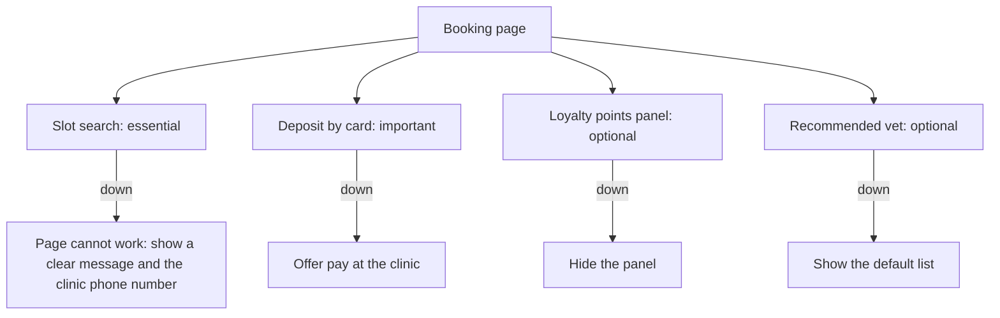
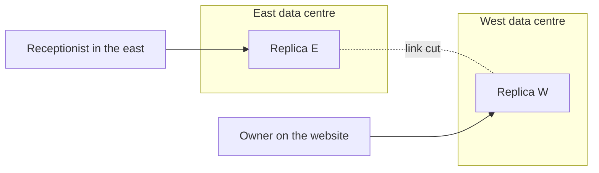

# What resiliency is: failure, degradation, CAP, chaos and blame

## Before this lesson

> **Before this lesson:** read [What a network call costs](#/lesson/microservices/network-cost-why-split), where partial failure and multiplied availability were introduced, and [From logical to physical](#/lesson/microservices/logical-to-physical), for instances, zones and failure domains. SLOs come from [Are we doing OK?](#/lesson/microservices/slo-alerting).

## In plain words

A big city is never fully working. On any day a water main has burst somewhere, a traffic light is out, a train line is suspended. The city carries on. Buses divert around the closed road, hospitals switch to generators during a power cut, and afterwards the city repairs the damage and often changes something so that the same fault hurts less next time.

Nobody runs a city by trying to guarantee that nothing ever breaks. They run it so that breakages stay local, essential services continue in reduced form, repair is quick and lessons are kept.

A system of microservices is a small city. With dozens of services on hundreds of machines, something is always failing. **Resiliency** is the ability of the whole to keep delivering what users need in spite of that, and to recover and improve afterwards. The danger particular to microservices is that a fault in one unimportant service spreads along the network calls and takes the important ones down with it. That spreading is a **cascading failure**, and stopping it is the main business of this lesson and the next.

This lesson covers the ideas: what resiliency means, why failure is certain at scale, how to reduce function instead of failing completely, a famous trade-off called the CAP theorem, and two human practices, chaos engineering and blameless reviews. The next lesson covers the code-level patterns.

Why this matters for a job: "what happens when this dependency is down?" is asked in every system design interview. Engineers who think about failure before it happens are the ones trusted with important systems.

## 1. Four parts of resiliency

The safety researcher David Woods describes resilience as four distinct capabilities. The list is useful because most teams think only of the first.

| Capability | Meaning | Example at Pawprint |
|---|---|---|
| Robustness | Absorbing disturbances you expected | A Billing instance dies; the other three carry the load |
| Rebound | Recovering after a damaging event | A bad release corrupted invoices; they are restored from backup within an hour |
| Graceful extensibility | Coping with a situation nobody planned for | An undersea cable fault slows every card payment; staff on call decide to accept bookings without deposits for the afternoon |
| Sustained adaptability | Continuing to change as conditions change | After each incident, the team reviews and improves, and does not assume last year's precautions are enough |

Robustness can be built into software: redundancy, timeouts, retries. The other three depend on people: on having backups and practising restores, on staff with the knowledge and the authority to improvise, and on an organisation that keeps learning. A system that automates everything and removes human judgement tends to be robust and brittle at once: fine with expected faults, helpless with the unexpected.

So resiliency is a property of the software *and* the organisation that runs it.

## 2. Failure is everywhere

A single disk is reliable. It might have a 2% chance of failing in a year. What happens when you have many?

```python-run
def chance_of_any_failure_today(machines, yearly_failure_rate):
    daily = yearly_failure_rate / 365
    return 1 - (1 - daily) ** machines

print("machines   chance that at least one fails today")
for n in [1, 10, 100, 1_000, 10_000]:
    p = chance_of_any_failure_today(n, yearly_failure_rate=0.02)
    print(f"{n:8,d}   {p:7.2%}")
```

`chance_of_any_failure_today` converts the yearly failure chance into a daily one, computes the chance that *no* machine fails, and subtracts it from one. For one machine the result is about one in eighteen thousand. For a thousand machines it is about 5% every day, which means a failure most months. For ten thousand it is over 40% every day. At scale, hardware failure stops being an event and becomes a rate.

And hardware is the smaller part. Networks drop packets, releases contain bugs, configuration is mistyped, certificates expire, a dependency you do not own slows down.

Accepting this changes how you design. You stop spending heavily to make each individual machine as reliable as possible, and spend instead on a system that expects parts to fail: several cheap instances with automatic replacement, in place of one precious server. You plan upgrades and failures the same way, since both involve an instance going away.

## 3. How much resilience do you need?

More resilience costs more money and more complexity. A service that can survive the loss of a whole region is far more expensive than one that tolerates the loss of one instance. So decide what each part needs, with numbers. Three questions cover most of it:

- **Response time.** How quickly must it answer? State it as a percentile at a given load: "95% of slot searches within 300 ms at 200 requests per second".
- **Availability.** May it be down at all? During which hours? Online booking at 3 am matters; the monthly report does not.
- **Durability of data.** How much data may be lost, and how long must it be kept? Losing a medical record is unacceptable; losing five minutes of page-view statistics is fine.

These become the SLOs of lesson 22. Different services get different answers, and that is the point: the ability to give each part the resilience it needs, and no more, is one of the advantages of having separate services.

## 4. Degrading functionality

A monolith is roughly up or down. A system of services has many in-between states, and you should choose in advance what each one looks like.

For every call from one service to another, ask: **if this dependency is unavailable, what should we do?** The answers fall into a few types:

| Option | Example |
|---|---|
| Leave a part out | Show the booking page without the loyalty-points panel |
| Use an older value | Show the price list cached ten minutes ago |
| Use a safe default | If the fraud check is down, allow small deposits and hold large ones |
| Do it later | Accept the booking now and send the confirmation when Notifications returns |
| Refuse clearly | "Card payment is unavailable at the moment; you can pay at the clinic" |

These are business decisions as much as technical ones. Whether to accept a booking without a deposit during a payment outage is a question about money and risk. Engineers should bring the question to the people who own that risk, before the outage.



```python-run
def booking_page(up):
    """up: a dict saying which dependencies are currently reachable."""
    if not up["slots"]:
        return {"status": "UNAVAILABLE", "show": ["Sorry, online booking is down. Call 6123 4567."]}
    page, degraded = ["free slots"], []
    if up["billing"]:
        page.append("pay deposit by card")
    else:
        page.append("pay at the clinic"); degraded.append("billing")
    if up["loyalty"]:
        page.append("your 120 points")
    else:
        degraded.append("loyalty")
    if up["recommendations"]:
        page.append("recommended: Dr Lim")
    else:
        page.append("all vets, alphabetical"); degraded.append("recommendations")
    return {"status": "DEGRADED" if degraded else "FULL", "show": page}

everything = {"slots": True, "billing": True, "loyalty": True, "recommendations": True}
for label, outage in [("all healthy", {}), ("loyalty down", {"loyalty": False}),
                      ("billing and recommendations down", {"billing": False, "recommendations": False}),
                      ("slots down", {"slots": False})]:
    result = booking_page({**everything, **outage})
    print(f"{label:33s} {result['status']:11s} {result['show']}")
```

`booking_page` receives a dictionary saying which dependencies are reachable and builds the page from what it can get. Only the slot search is essential; without it the function returns a clear message. For each other dependency there is a planned substitute. The four runs show a full page, a page missing one optional panel, a page with two substitutes, and the one true outage. Three of the four situations leave owners able to book. Without this design, the loss of the loyalty service, which nobody would call critical, would have brought down booking. The practice problem *Availability of a Call Chain, with and without Fallbacks* puts numbers on this.

## 5. Spreading your risk

Redundancy helps only when the copies do not fail together (lesson 17). Check each level:

- several instances, on different physical machines;
- across more than one availability zone;
- for the most critical systems, across more than one region.

Read what your cloud provider promises. A typical compute guarantee applies to a *region* with instances in more than one zone, and it says nothing about a single machine. If you run everything in one zone, you are outside the conditions of the promise. Also read what happens if the promise is broken: usually a partial refund of fees, which does not compensate for your lost business. The provider's guarantee is an input to your design, not a replacement for it.

## 6. The CAP theorem

When data is copied to several machines, three properties are desirable:

- **Consistency (C).** Every read returns the most recent write, whichever machine you ask.
- **Availability (A).** Every request receives an answer.
- **Partition tolerance (P).** The system keeps working when the network between machines is cut.

A **network partition** is a break in communication that splits machines into groups that cannot reach each other while each group is still running.

The **CAP theorem**, proposed by Eric Brewer and later proved by Seth Gilbert and Nancy Lynch, says that during a partition you cannot have both consistency and availability. Partitions do happen in any real network, so you cannot choose to do without P. The real choice is what to do *when a partition occurs*:

- **AP: stay available, give up consistency.** Both sides keep answering and accepting writes. They drift apart and must be reconciled when the link returns. In the meantime some reads are stale. This is eventual consistency.
- **CP: stay consistent, give up availability.** A side that cannot confirm it has the latest data refuses requests. Nothing wrong is ever returned; some users get errors.



```python-run
def run(mode):
    east, west = {"slot": "free"}, {"slot": "free"}
    log = []
    # --- the link between the replicas is cut ---
    if mode == "AP":                                   # both sides accept writes
        east["slot"] = "booked for Miso"
        west["slot"] = "booked for Biscuit"
        log.append("east accepted Miso, west accepted Biscuit")
        # --- the link is restored: the replicas disagree and must reconcile ---
        winner = west["slot"]                          # 'last write wins' picks one
        east["slot"] = west["slot"] = winner
        log.append(f"after healing both say '{winner}': one booking was silently lost")
    else:                                              # CP: only the side holding a majority accepts writes
        majority = "east"                              # east can still reach the third, tie-breaking node
        east["slot"] = "booked for Miso"
        log.append("east accepted Miso; west refused: 'booking unavailable, try again'")
        west["slot"] = east["slot"]                    # after healing, west catches up
        log.append(f"after healing both say '{east['slot']}': nothing lost, one user saw an error")
    return log

for mode in ["AP", "CP"]:
    print(mode)
    for line in run(mode):
        print("   ", line)
```

Two replicas hold the state of one appointment slot, and the link between them breaks. In AP mode each side accepts a booking for a different pet. When the link returns they disagree; a common simple rule, "last write wins", keeps one and discards the other, so an owner who was told "booked" is not. In CP mode only the side that can still reach a majority of nodes accepts the write; the other refuses. After healing there is one correct answer, and the cost was an error message for one user.

Neither is right in general. Choose **per capability**:

| Capability | Sensible choice | Reason |
|---|---|---|
| Booking a specific slot | CP | Double-booking a vet is worse than asking someone to retry |
| Showing loyalty points | AP | A slightly stale number harms nobody |
| Recording a dispensed controlled drug | CP | The count must be right |
| Browsing clinic opening hours | AP | Availability matters more than the last minute's edit |

Two closing notes. First, building a correct CP data store yourself is very hard; use an existing, proven product. Second, even perfect consistency only describes your records. The diary may say the slot is free while the vet has gone home ill. The real world is always eventually consistent with your database, so systems need ways to handle the difference anyway.

## 7. Chaos engineering

You have added redundancy, fallbacks and timeouts. Do they work? Many teams find out during a real outage that the fallback was never tested and fails too.

**Chaos engineering** is the practice of running deliberate experiments on a system to build confidence that it can withstand trouble. It is not random vandalism. A good experiment has four parts:

1. **A measure of normal.** An SLI, such as booking success rate.
2. **A hypothesis.** "If one Billing instance is killed, booking success stays above 99.5%."
3. **A small, controlled fault.** Kill one instance; add 300 ms of delay to one dependency; block one network path. Keep the blast radius small and have a way to stop.
4. **A comparison.** Did the measure hold? If it did not, you have found a weakness on your own schedule instead of at 3 am.

Netflix made the approach famous with a tool called Chaos Monkey, which switches off randomly chosen production instances during working hours, so that every team must build services that survive it.

A gentler starting point is a **game day**: a planned exercise in which a team simulates a failure ("the east zone is gone", or "the person who knows the payment system is unreachable") and practises the response. Game days test the people and procedures as much as the software, which makes them a way of building rebound and graceful extensibility.

```python-run
import random

def booking_success_rate(instances_up, requests=5000, capacity_per_instance=1700, seed=3):
    """Requests beyond what the surviving instances can carry are rejected."""
    rng = random.Random(seed)
    capacity = instances_up * capacity_per_instance
    ok = sum(1 for i in range(requests) if i < capacity and rng.random() > 0.001)
    return ok / requests

HYPOTHESIS = 0.995
for killed in [0, 1, 2]:
    rate = booking_success_rate(instances_up=4 - killed)
    verdict = "holds" if rate >= HYPOTHESIS else "REFUTED: we found a weakness"
    print(f"kill {killed} of 4 Billing instances: success {rate:.2%}  hypothesis (>= {HYPOTHESIS:.1%}) {verdict}")
```

The function models four instances that can each carry 1,700 requests in the test period, against a load of 5,000. With all four, or with one killed, capacity is enough and success stays near 99.9%. With two killed, capacity is 3,400 and about a third of requests are rejected. The experiment has told the team something concrete: the service survives the loss of one instance and not two. Whether that is acceptable is now a decision, not a surprise.

## 8. Blame

After an incident, the natural reaction is to ask who did it. A person typed the wrong command; discipline them and the problem is solved. It is not. The next person in the same position, with the same tools and the same pressures, will make the same mistake. And everyone learns that the safe course is to hide errors, which removes the information the organisation most needs.

A **blameless post-mortem** (also called a post-incident review) is a written review of an incident that starts from the assumption that people acted reasonably given what they knew. It asks *how* it happened, not *who* caused it:

- What happened, in order?
- What did people see, and what did they believe at each point?
- Why did the system allow one action to cause this much harm?
- What will we change so that it is harder to repeat and quicker to detect?

The results are shared widely. "The engineer deleted the production database" becomes "the tool made production and test look identical, there was no confirmation step, and the last restore test was eight months ago." Each of those is something that can be fixed.

This is the fourth capability, sustained adaptability, in practice. Blameless does not mean without accountability: people are accountable for taking part honestly and for carrying out the improvements.

> [!INTERVIEW]
> For "how do you make a microservice system resilient?", show the layers: *I assume failure is constant at scale. For each dependency I decide in advance how to degrade: leave a part out, serve a cached value, defer the work or refuse clearly. I prevent cascades with timeouts, bulkheads and circuit breakers. I spread instances across failure domains. Where data is replicated I choose per capability between staying available with eventual consistency and staying consistent by refusing during a partition. I verify all of it with chaos experiments, and I run blameless reviews so the organisation keeps learning.*

## 9. Pitfalls

- **Aiming for zero failures.** At scale, failure is a rate. Design for it.
- **Robustness only.** Automation handles expected faults; unexpected ones need people who can act.
- **No decision about dependency loss.** The default behaviour is that the caller fails too.
- **Optional features on the critical path.** A recommendations outage should never stop a booking.
- **Redundancy inside one failure domain.** Copies that fail together are one copy.
- **Declaring a whole system AP or CP.** Choose for each capability.
- **Building your own consistent data store.** Use a proven one.
- **Untested fallbacks.** A fallback that has never run is likely to fail when needed.
- **Chaos without a hypothesis or a stop button.** That is an outage you caused.
- **Blaming individuals.** It hides information and repeats incidents.

## Summary

- Resiliency is the ability of software and organisation together to keep delivering through failure: robustness, rebound, graceful extensibility and sustained adaptability.
- With enough machines and services, something is always failing; build systems that expect it.
- Decide how much resilience each service needs in terms of response time, availability and data durability.
- For each dependency, plan a degraded behaviour, and involve the business in the choice.
- Spread instances over independent failure domains and read provider guarantees carefully.
- During a network partition a replicated system must give up consistency or availability; choose per capability.
- Chaos engineering tests resilience with controlled, hypothesis-driven experiments; game days rehearse the human response.
- Blameless post-mortems turn incidents into improvements.

## Glossary

| Term | Meaning |
|---|---|
| Resiliency | The ability to keep delivering despite failure, and to recover and adapt |
| Cascading failure | A failure that spreads from one service to those that depend on it |
| Robustness | Absorbing expected disturbances |
| Rebound | Recovering after a damaging event |
| Graceful extensibility | Coping with situations nobody anticipated |
| Sustained adaptability | Continuing to adapt as conditions change |
| Degraded functionality | Offering reduced service when a dependency is unavailable |
| Durability | The assurance that stored data will not be lost |
| Network partition | A communication break splitting machines into groups that cannot reach each other |
| CAP theorem | During a partition, a replicated system cannot be both consistent and available |
| AP / CP | Choosing availability / consistency when a partition occurs |
| Chaos engineering | Running controlled experiments that inject failure to test resilience |
| Game day | A planned exercise simulating a failure to practise the response |
| Blameless post-mortem | An incident review focused on how the system allowed the failure, not on who erred |

```quiz
[
  {"q": "Which of the four parts of resiliency is mostly about software design, and which need people and organisation?", "options": ["All four are purely software", "Robustness can be built into software; rebound, graceful extensibility and sustained adaptability depend heavily on people and organisation", "None involve software", "Only blame involves people"], "answer": 1,
   "explain": "Redundancy and timeouts give robustness. Recovering, improvising and continuing to learn require prepared people and a learning organisation."},
  {"q": "A disk has a 2% yearly failure chance. With 10,000 disks, how should failure be thought of?", "options": ["As a rare event", "As an expected daily occurrence to be designed for", "As impossible", "As the cloud provider's problem only"], "answer": 1,
   "explain": "With enough components, the chance that at least one fails on a given day is high. Systems must tolerate it routinely."},
  {"q": "The loyalty service is down. What should a well-designed booking page do?", "options": ["Fail completely", "Hide the loyalty panel and let the owner book", "Retry for ever", "Redirect to the loyalty team's phone number"], "answer": 1,
   "explain": "An optional dependency should degrade the page, not break the essential journey."},
  {"q": "Who should decide whether bookings are accepted without a deposit during a payment outage?", "options": ["Whichever engineer is on call, at the time", "It is a business decision that should be agreed in advance with those who own the risk", "The cloud provider", "The load balancer"], "answer": 1,
   "explain": "How to degrade often involves money and risk. Engineers should raise the question before the outage."},
  {"q": "According to the CAP theorem, what must a replicated system choose between during a network partition?", "options": ["Speed and cost", "Consistency and availability", "Logs and metrics", "Containers and virtual machines"], "answer": 1,
   "explain": "Partitions cannot be ruled out, so when one happens the system either keeps answering with possibly stale data or refuses requests to stay consistent."},
  {"q": "For booking a specific appointment slot, why might CP be chosen?", "options": ["Because errors are impossible in CP", "Refusing a request during a partition is better than double-booking the slot", "Because AP systems cannot store data", "Because it is faster"], "answer": 1,
   "explain": "Where conflicting writes cause real harm, it is better to be unavailable briefly than inconsistent."},
  {"q": "What separates a chaos experiment from breaking things at random?", "options": ["Nothing", "A measured steady state, a hypothesis, a small controlled fault with a way to stop, and a comparison of results", "It is always done at night", "It never touches production"], "answer": 1,
   "explain": "Chaos engineering is experimental method applied to resilience, with a limited blast radius."},
  {"q": "What question does a blameless post-mortem focus on?", "options": ["Who should be punished", "How the system and its conditions allowed the incident, and what to change", "How to hide the incident from customers", "Which team is the weakest"], "answer": 1,
   "explain": "Assuming people acted reasonably reveals fixable causes in tools and processes, and keeps people willing to report problems."}
]
```

> **Source:** Newman, *Building Microservices*, 2nd ed., ch. 12 (topic coverage only; wording and the Pawprint example are original). David Woods, "Four concepts for resilience and the implications for the future of resilience engineering", Reliability Engineering and System Safety, 2015. Principles of Chaos Engineering, https://principlesofchaos.org/
