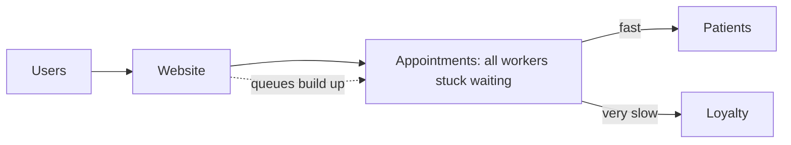
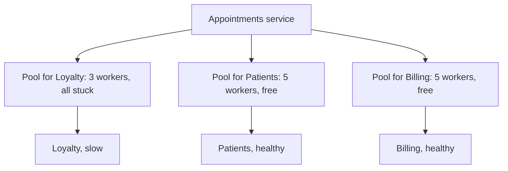
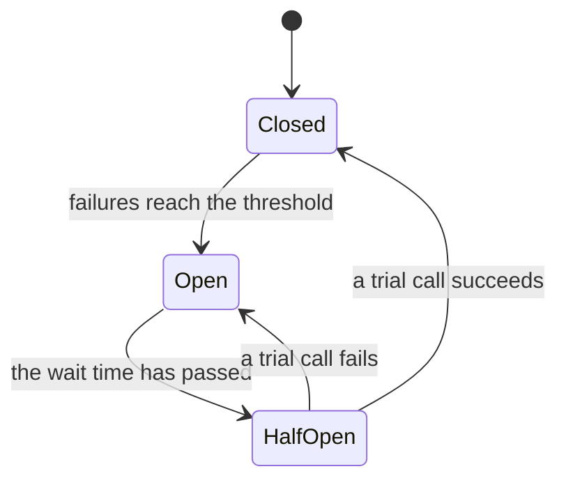

# Stability patterns: timeouts, retries, bulkheads, circuit breakers and idempotency

## Before this lesson

> **Before this lesson:** read [What resiliency is](#/lesson/microservices/resiliency-concepts), for cascading failure and degraded functionality, and [What a network call costs](#/lesson/microservices/network-cost-why-split), where timeouts and idempotency were first mentioned. You should be able to read Python classes.

## In plain words

Houses and ships already contain the ideas in this lesson.

When a kettle develops a fault, a **circuit breaker** in the fuse box cuts the power to that circuit. The kettle stops; the house does not burn down. A ship's hull is divided by walls called **bulkheads** into watertight compartments, so that a hole floods one compartment and the ship stays afloat. When you ring a company and wait on hold, at some point you hang up: that is a **timeout**. You may ring back later, and a sensible person waits a little longer before each new attempt instead of redialling every second: a **retry with backoff**. And pressing the lift button five times does not summon five lifts; pressing it again is harmless. That property is called **idempotency**.

Each of these is a small mechanism placed around a call from one service to another. Together they stop a problem in one service from spreading to its callers, and then to *their* callers. This lesson builds each one as a short simulation you can run and alter.

Why this matters for a job: timeouts, retries with backoff and jitter, circuit breakers and idempotency keys are among the most frequently asked topics in backend and system-design interviews, and missing or badly set versions of them are behind a large share of real outages.

## 1. The real enemy is slowness

A dependency that is completely dead is easy to deal with: calls fail at once and the caller moves on. A dependency that is *slow* is far more dangerous.

A service can handle only a limited number of requests at the same time. Each request in progress occupies a **worker** (a thread or a connection from a pool). If a downstream service starts taking 30 seconds to answer, every request that touches it holds a worker for 30 seconds. Soon all the workers are waiting on the slow dependency, and there are none left for requests that have nothing to do with it. The caller is now slow as well, so its own callers start to queue. This is how a cascade forms.



The simulation below shows it, and also previews the cure.

```python-run
def simulate(ticks, workers, loyalty_limit=None, loyalty_takes=50):
    """Each tick, 2 requests need the (now slow) loyalty service and 4 need only fast slot search."""
    busy = []                                          # (tick when the worker is free again, kind)
    served = {"slots": 0, "loyalty": 0}
    for t in range(ticks):
        busy = [(free_at, kind) for free_at, kind in busy if free_at > t]
        for kind, takes in [("loyalty", loyalty_takes)] * 2 + [("slots", 1)] * 4:
            same_kind = sum(1 for _, k in busy if k == kind)
            pool_full = len(busy) >= workers
            over_limit = kind == "loyalty" and loyalty_limit is not None and same_kind >= loyalty_limit
            if not pool_full and not over_limit:
                busy.append((t + takes, kind))
                served[kind] += 1
    return served

TICKS = 20
print("slot searches wanted:", 4 * TICKS)
print("shared pool of 10 workers       :", simulate(TICKS, workers=10))
print("same pool, max 3 for loyalty    :", simulate(TICKS, workers=10, loyalty_limit=3))
```

The service has ten workers. In every tick, two requests arrive that call the loyalty service, which has become slow and holds a worker for 50 ticks, and four requests arrive that only search slots and finish in one tick. `busy` lists the occupied workers. A request is served only if a worker is free.

In the first run nothing limits the loyalty calls. They take two more workers every tick, and by the fifth tick all ten are stuck. Only 14 of 80 slot searches are served, although slot search has nothing wrong with it. In the second run, loyalty calls may use at most three workers; further ones are turned away immediately. All 80 slot searches are served. That limit is a bulkhead, covered in section 4. First, the simpler tools.

## 2. Timeouts

A **timeout** is a limit on how long a caller waits for a response before giving up. Every call that leaves the process needs one: calls to other services, to databases, to caches, to third parties. Many libraries default to waiting for ever, so "we did not set one" usually means "no limit".

Choosing the value is a balance:

- **Too long**, and workers are held while the dependency struggles, which is the problem above.
- **Too short**, and calls that would have succeeded are abandoned, creating failures (and possibly duplicate work, if the downstream did finish).

A reasonable method: look at the downstream's normal latency, take a high percentile such as the 99th, add a margin, and review it when traffic patterns change. If the 99th percentile is 150 ms, a 250 ms timeout abandons almost no healthy calls and frees workers quickly from unhealthy ones.

### A budget for the whole request

Timeouts on individual calls are not enough. Suppose the website gives up after one second. Appointments calls Billing with a one-second timeout, and Billing calls the card provider with another one-second timeout. The chain can spend three seconds on a request that the user abandoned after one.

The fix is a **deadline** (or timeout budget) for the whole operation. The first service sets it, and each hop passes on the time that remains.

```python-run
def call_chain(total_budget_ms, hops):
    """hops: list of (service, time it needs in ms). Each hop receives only the remaining budget."""
    remaining = total_budget_ms
    for service, needs in hops:
        if remaining <= 0:
            return f"stopped before {service}: no budget left, so the call is not even attempted"
        if needs > remaining:
            return f"{service} timed out after {remaining} ms (it needed {needs} ms)"
        remaining -= needs
        print(f"   {service:13s} used {needs:4d} ms, passes on a budget of {remaining:4d} ms")
    return f"completed with {remaining} ms to spare"

print(call_chain(1000, [("appointments", 80), ("billing", 120), ("card provider", 300)]))
print(call_chain(1000, [("appointments", 80), ("billing", 120), ("card provider", 900)]))
print(call_chain(1000, [("appointments", 700), ("billing", 350), ("card provider", 300)]))
```

`call_chain` starts with a total budget and subtracts what each hop uses. In the first call everything fits. In the second, the card provider needs 900 ms and only 800 remain, so the call is cut off when the budget ends, not a full second later. In the third, Billing overruns the budget and the card provider is never called at all, because there is no point starting work whose result nobody is waiting for. The practice problem *Timeout Budget Propagation* asks you to compute these budgets.

## 3. Retries

Many failures are **transient**: they go away if you try again. A packet was lost, an instance was restarting, the service was briefly overloaded. A **retry** repeats the call.

Three rules keep retries from doing harm.

**Retry only what might succeed.** A timeout or a "503 service unavailable" may succeed next time. A "404 not found" or a "400 bad request" will fail the same way for ever.

**Wait between attempts, longer each time, with randomness.** If the service is overloaded, retrying at once adds load at the worst moment. **Exponential backoff** doubles the wait after each failure: 100 ms, 200 ms, 400 ms. **Jitter** adds a random element. Without it, a thousand clients that failed at the same moment all retry at the same later moments, hitting the recovering service in synchronised waves (a **thundering herd**).

**Limit the number of attempts, and retry at one layer.** If three layers each retry three times, one user action becomes 27 calls to the bottom service. This multiplication is a **retry storm**.

```python-run
import random
from collections import Counter

BASE_MS, CAP_MS, ATTEMPTS = 100, 2000, 5

def backoff(attempt, rng=None):
    ceiling = min(CAP_MS, BASE_MS * 2 ** attempt)
    return ceiling if rng is None else rng.uniform(0, ceiling)      # "full jitter"

print("attempt   no jitter   with jitter (one client)")
rng = random.Random(42)
for n in range(ATTEMPTS):
    print(f"{n + 1:5d}     {backoff(n):6.0f} ms   {backoff(n, rng):6.0f} ms")

def busiest_moment(clients, jitter):
    """1,000 clients all fail at time 0. How many retries land in the same 10 ms slot?"""
    rng, slots = random.Random(7), Counter()
    for _ in range(clients):
        t = 0.0
        for n in range(ATTEMPTS):
            t += backoff(n, rng if jitter else None)
            slots[int(t // 10)] += 1
    return max(slots.values())

print("\nlargest burst hitting the server in any 10 ms:")
print("   without jitter:", busiest_moment(1000, jitter=False), "requests")
print("   with jitter   :", busiest_moment(1000, jitter=True), "requests")
```

`backoff` computes the wait before retry number `attempt`: the base delay doubled each time, up to a cap. With a random generator supplied it returns a random value between zero and that ceiling, a scheme known as full jitter. The table shows the fixed schedule beside one client's jittered schedule.

`busiest_moment` then imagines a thousand clients that all failed together. Without jitter, every client retries at exactly 100 ms, then 300 ms, then 700 ms: a thousand simultaneous requests each time. With jitter the retries are smeared out, and the largest burst in any 10 ms window is a small fraction of that. The work is the same; the recovering server can now cope with it. The practice problem *Retry Schedule with Exponential Backoff and Jitter* asks for the schedule itself.

One more condition: only retry operations that are safe to repeat. Section 6 makes that possible.

## 4. Bulkheads

A **bulkhead** isolates a part of the system so that its failure cannot use up resources needed by other parts. Section 1 showed the commonest form: a separate, limited pool of workers or connections for each downstream dependency. When Loyalty is slow, the Loyalty pool fills and further Loyalty calls are rejected at once, and the pools for Patients and Billing are untouched.



Rejecting calls when a pool is full is **load shedding**: refusing work you cannot do in time, so that the work you accept is done properly. A fast refusal is far kinder to callers than a slow failure.

Bulkheads exist at larger scales too: separate instances for different customer groups, separate databases per service, separate clusters for critical and non-critical workloads. The practice problem *Bulkhead Concurrency Limiter* implements the pool form.

## 5. Circuit breakers

Timeouts limit how long *each* call waits. If a dependency is down for five minutes, every one of thousands of calls still waits for its full timeout before failing. A **circuit breaker** notices that a dependency is failing and stops calling it for a while, so callers **fail fast**: they get an immediate error or a fallback.

It is a small state machine with three states:



- **Closed.** Normal. Calls go through and failures are counted.
- **Open.** Too many failures. Calls are refused immediately without contacting the dependency.
- **Half-open.** After a waiting period, one trial call is let through. Success closes the breaker; failure opens it again for another wait.

(The names come from electricity: a closed circuit lets current flow.)

```python-run
class CircuitBreaker:
    def __init__(self, failure_threshold=3, reset_after=30):
        self.threshold, self.reset_after = failure_threshold, reset_after
        self.state, self.failures, self.opened_at = "closed", 0, None

    def call(self, operation, now):
        if self.state == "open":
            if now - self.opened_at < self.reset_after:
                return "REJECTED fast (breaker open)"
            self.state = "half-open"                       # time to probe
        try:
            result = operation()
        except Exception as error:
            self.failures += 1
            if self.state == "half-open" or self.failures >= self.threshold:
                self.state, self.opened_at = "open", now
            return f"failed ({error})"
        self.state, self.failures = "closed", 0            # any success resets the breaker
        return f"ok: {result}"

loyalty_is_up = False
def get_points():
    if not loyalty_is_up:
        raise TimeoutError("loyalty timed out")
    return "120 points"

breaker = CircuitBreaker(failure_threshold=3, reset_after=30)
for now in [0, 1, 2, 3, 4, 20, 33, 40, 64]:
    if now == 64:
        loyalty_is_up = True                               # the loyalty team has fixed it
    outcome = breaker.call(get_points, now)
    print(f"t={now:2d}s  {outcome:32s} state afterwards: {breaker.state}")
```

The class keeps a state, a count of consecutive failures and the time it opened. `call` first checks whether the breaker is open: if the waiting period has not passed, it refuses at once; otherwise it moves to half-open and lets the call through. A failure increments the count and opens the breaker if the threshold is reached, or immediately if this was the half-open trial. A success closes it and resets the count.

Follow the output. At 0, 1 and 2 seconds the calls fail slowly, and the third failure opens the breaker. At 3, 4 and 20 seconds calls are rejected at once: no waiting, and no load on the struggling service. At 33 seconds the wait is over; a trial call is made, fails, and the breaker opens again. At 40 it rejects. At 64 the next trial succeeds, because the service has recovered, and the breaker closes.

What should the caller do when the breaker is open? This is the degradation decision from the last lesson: hide the panel, use a cached value, queue the work or return a clear error. A breaker also gives operators a control: opening one by hand is a clean way to cut off a dependency during maintenance. The practice problem *Circuit Breaker State Machine* extends this class.

## 6. Idempotency

An operation is **idempotent** if performing it several times has the same effect as performing it once. Retries, and brokers that deliver a message twice, are safe only for idempotent operations.

Some operations are naturally so: "set the appointment status to cancelled". Others are not: "add 10 loyalty points" applied twice gives 20.

The standard technique is an **idempotency key**: the caller attaches a unique identifier to the request, and the receiver remembers which identifiers it has already handled.

```python-run
points = {"owner-31": 100}
handled = {}                                   # idempotency key -> the result we returned

def add_points_naive(owner, amount):
    points[owner] += amount
    return points[owner]

def add_points(owner, amount, key):
    if key in handled:                         # seen before: return the same answer, do nothing
        return handled[key]
    points[owner] += amount
    handled[key] = points[owner]
    return handled[key]

# The response to the first call was lost, so the caller retries.
add_points_naive("owner-31", 10); add_points_naive("owner-31", 10)
print("naive, sent twice        :", points["owner-31"], "(10 points too many)")

points["owner-31"] = 100
add_points("owner-31", 10, key="visit-551-reward"); add_points("owner-31", 10, key="visit-551-reward")
print("with key, sent twice     :", points["owner-31"])
add_points("owner-31", 10, key="visit-560-reward")
print("a different visit's key  :", points["owner-31"])
```

`add_points_naive` adds every time it is called, so a retry gives the owner 20 points. `add_points` looks up the key first. The second call with the same key finds the stored result and returns it without adding again. A different key is a different operation and is applied. The key must describe the business action (this reward for this visit), and it must be the *same* on every retry: generating a fresh random key for each attempt defeats the purpose. In a real service the check and the update are made in one local transaction, and old keys are removed after a retention period.

A note on HTTP: the specification says GET, PUT and DELETE *should* be idempotent, and tools such as proxies assume it. That is a promise your implementation must keep; nothing enforces it for you.

## 7. Isolation, redundancy and middleware

Three broader measures support the patterns above.

- **Isolation.** The less two services share, the less one can harm the other: separate databases, separate machines or containers with resource limits, and asynchronous communication where the caller does not wait at all.
- **Redundancy.** More than one instance, in more than one zone (lesson 17), so that losing one leaves capacity.
- **Middleware.** A message broker with guaranteed delivery acts as a buffer: if the receiving service is down for ten minutes, messages wait in the queue and are processed when it returns. The sender needs no retry logic for that case.

## 8. Putting the patterns together

| Pattern | Protects against | Without it |
|---|---|---|
| Timeout | Waiting indefinitely on a slow dependency | Workers pile up; the caller becomes slow too |
| Deadline budget | Work continuing after the user has given up | Wasted effort deep in the chain |
| Retry with backoff and jitter | Transient faults | Users see errors that one more attempt would have avoided |
| Bulkhead | One dependency exhausting shared resources | Unrelated features fail together |
| Circuit breaker | Repeatedly calling something that is down | Every call pays the full timeout; the failing service gets no rest |
| Idempotency key | Duplicate effects from retries and redelivery | Double charges, double bookings |

They are layered around one outgoing call. A common order, from outside in: the bulkhead decides whether there is capacity; the circuit breaker decides whether to try; the retry policy wraps attempts; each attempt has a timeout; and the request carries an idempotency key.

You rarely write these from scratch. Libraries provide them for most languages, and a service mesh (lesson 12) can apply timeouts, retries and circuit breaking in its proxies without code changes. The settings are still yours to choose, and the business decision about what to do on failure can never be delegated to a library.

### Worked example: the booking page calls Loyalty

Pawprint's incident last quarter: Loyalty slowed to 20 seconds per call; the booking page, which shows a points panel, stopped responding; bookings fell to zero for 25 minutes. The changes afterwards:

| Change | Setting |
|---|---|
| Timeout on the Loyalty call | 200 ms (normal 99th percentile is 90 ms) |
| Retries | None for this call; the panel is optional |
| Bulkhead | At most 5 concurrent Loyalty calls out of 40 workers |
| Circuit breaker | Opens after 5 consecutive failures, trial call after 30 seconds |
| Fallback | Hide the points panel |
| Check | A chaos experiment each month adds 5 seconds of delay to Loyalty in staging and confirms bookings continue |

> [!INTERVIEW]
> For "a downstream service becomes slow; how do you stop it taking your service down?": *every remote call gets a timeout based on the dependency's normal high-percentile latency, within an overall deadline passed down the chain. I isolate each dependency with a bulkhead so it cannot use all my workers, and put a circuit breaker around it so that after repeated failures I fail fast and serve a fallback. I retry only transient errors, a limited number of times, with exponential backoff and jitter, at one layer only, and only for idempotent operations, using idempotency keys for writes.*

## 9. Pitfalls

- **No timeout.** The library default is often to wait for ever.
- **The same generous timeout at every layer.** Inner calls outlive the outer request.
- **Retrying without backoff or jitter.** A struggling service is hit by synchronised waves.
- **Retries at every layer.** Attempts multiply into a storm.
- **Retrying non-idempotent writes.** Customers are charged twice.
- **A fresh idempotency key on each retry.** The receiver cannot recognise the repeat.
- **One shared pool for all dependencies.** The slowest dependency owns your service.
- **A circuit breaker with no fallback.** Failing fast still fails; decide what the user sees.
- **Thresholds never reviewed.** Traffic changes, and yesterday's settings cause today's false alarms.
- **Assuming the mesh has handled it.** Verify with a failure test.

## Summary

- Slow dependencies are more dangerous than dead ones, because waiting calls consume the caller's limited workers and the problem cascades.
- Put a timeout on every out-of-process call, and pass a deadline budget down the chain.
- Retry only transient failures, a limited number of times, with exponential backoff and jitter, at a single layer.
- Bulkheads give each dependency its own limited resources and shed excess load.
- A circuit breaker moves between closed, open and half-open to fail fast while a dependency is unhealthy and to probe for recovery.
- Idempotency keys make repeats harmless, which is what makes retries and at-least-once delivery safe.
- Isolation, redundancy and buffering middleware reduce how far any failure can reach.

## Glossary

| Term | Meaning |
|---|---|
| Worker | A thread or pooled connection occupied by one request in progress |
| Timeout | The longest a caller waits for a response |
| Deadline (timeout budget) | A time limit for a whole operation, passed along the call chain |
| Transient failure | A failure likely to disappear on a later attempt |
| Retry | Repeating a failed call |
| Exponential backoff | Doubling the wait between successive retries |
| Jitter | Randomness added to retry waits to avoid synchronised retries |
| Thundering herd | Many clients acting at the same moment and overloading a service |
| Retry storm | Multiplication of calls when several layers each retry |
| Bulkhead | A limit that isolates one part's resource use from the rest |
| Load shedding | Rejecting work that cannot be done in time |
| Circuit breaker | A component that stops calls to a failing dependency for a period |
| Closed / open / half-open | Calls pass / calls are refused / one trial call is allowed |
| Fail fast | Returning an error immediately instead of waiting |
| Idempotent | Having the same effect whether performed once or several times |
| Idempotency key | A unique identifier that lets a receiver recognise a repeated request |

```quiz
[
  {"q": "Why is a slow dependency often more dangerous than one that is completely down?", "options": ["Slow services use more disk", "Calls to it hold the caller's limited workers for a long time, starving unrelated requests and spreading the slowdown", "Dead services cannot be detected", "Slow services break TLS"], "answer": 1,
   "explain": "A dead dependency fails quickly. A slow one ties up threads and connections until the caller cannot serve anything."},
  {"q": "A downstream service normally answers within 150 ms at the 99th percentile. Which timeout is the most reasonable starting point?", "options": ["No timeout", "30 seconds", "About 250 ms", "1 ms"], "answer": 2,
   "explain": "A little above the normal high percentile abandons very few healthy calls and frees workers quickly from unhealthy ones."},
  {"q": "What is the purpose of passing a deadline budget down a call chain?", "options": ["To encrypt the request", "So that inner services stop working on a request once the time the original caller will wait has run out", "To count the number of services", "To make retries faster"], "answer": 1,
   "explain": "Each hop receives only the remaining time, which prevents work whose result nobody is waiting for."},
  {"q": "Why add jitter to exponential backoff?", "options": ["To make waits shorter on average", "To spread retries from many clients over time instead of having them arrive in synchronised bursts", "To guarantee success", "To avoid needing a timeout"], "answer": 1,
   "explain": "Clients that failed together would otherwise retry together. Randomness smooths the load on a recovering service."},
  {"q": "Three layers each retry a failed call three times. How many attempts can reach the bottom service for one user action?", "options": ["3", "9", "27", "81"], "answer": 2,
   "explain": "Retries multiply across layers: 3 x 3 x 3. Retry at one layer only."},
  {"q": "What does a bulkhead do when the pool for one dependency is full?", "options": ["Borrows workers from other pools", "Rejects further calls to that dependency immediately, leaving other pools untouched", "Restarts the service", "Doubles the timeout"], "answer": 1,
   "explain": "The limit confines the damage. Refusing quickly is load shedding, and it keeps unrelated features working."},
  {"q": "A circuit breaker is open and its waiting period has passed. What happens on the next call?", "options": ["It stays open for ever", "It moves to half-open and allows one trial call; success closes it and failure opens it again", "It closes without testing", "It deletes its counters and rejects"], "answer": 1,
   "explain": "Half-open is the probe state that tests whether the dependency has recovered without sending it full traffic."},
  {"q": "Which operation needs an idempotency key to be safely retried?", "options": ["Set appointment status to cancelled", "Read a pet's details", "Add 10 loyalty points", "Delete a draft that may already be deleted"], "answer": 2,
   "explain": "Adding is not naturally idempotent: applied twice it gives a different result. A key lets the receiver recognise and skip the repeat."}
]
```

> **Source:** Newman, *Building Microservices*, 2nd ed., ch. 12 (topic coverage only; wording and the Pawprint example are original). Michael Nygard, *Release It!*, 2nd ed. (2018), for the stability patterns. Martin Fowler, "CircuitBreaker", https://martinfowler.com/bliki/CircuitBreaker.html ; Marc Brooker, "Exponential Backoff And Jitter", AWS Architecture Blog, 2015.
