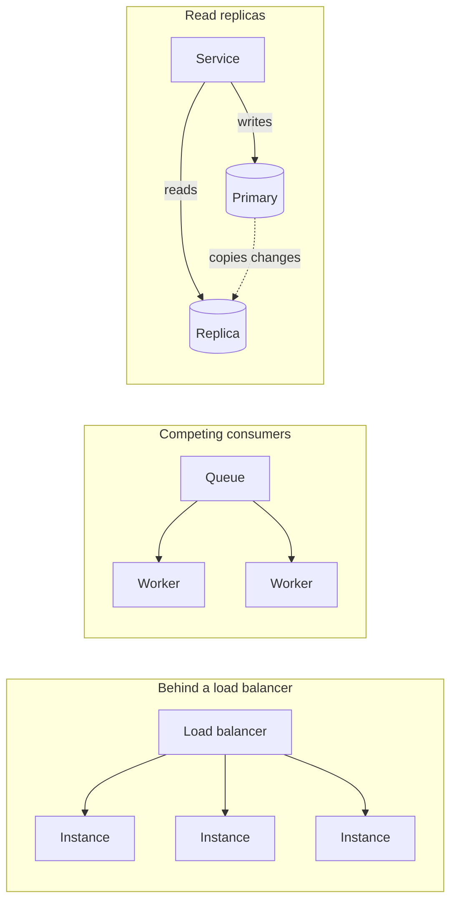
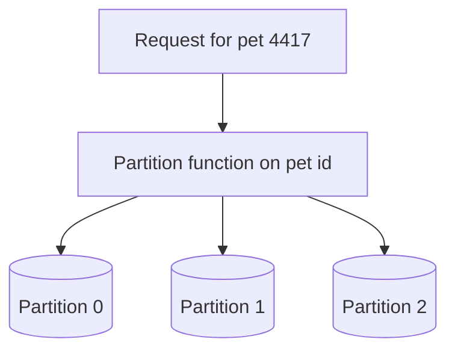
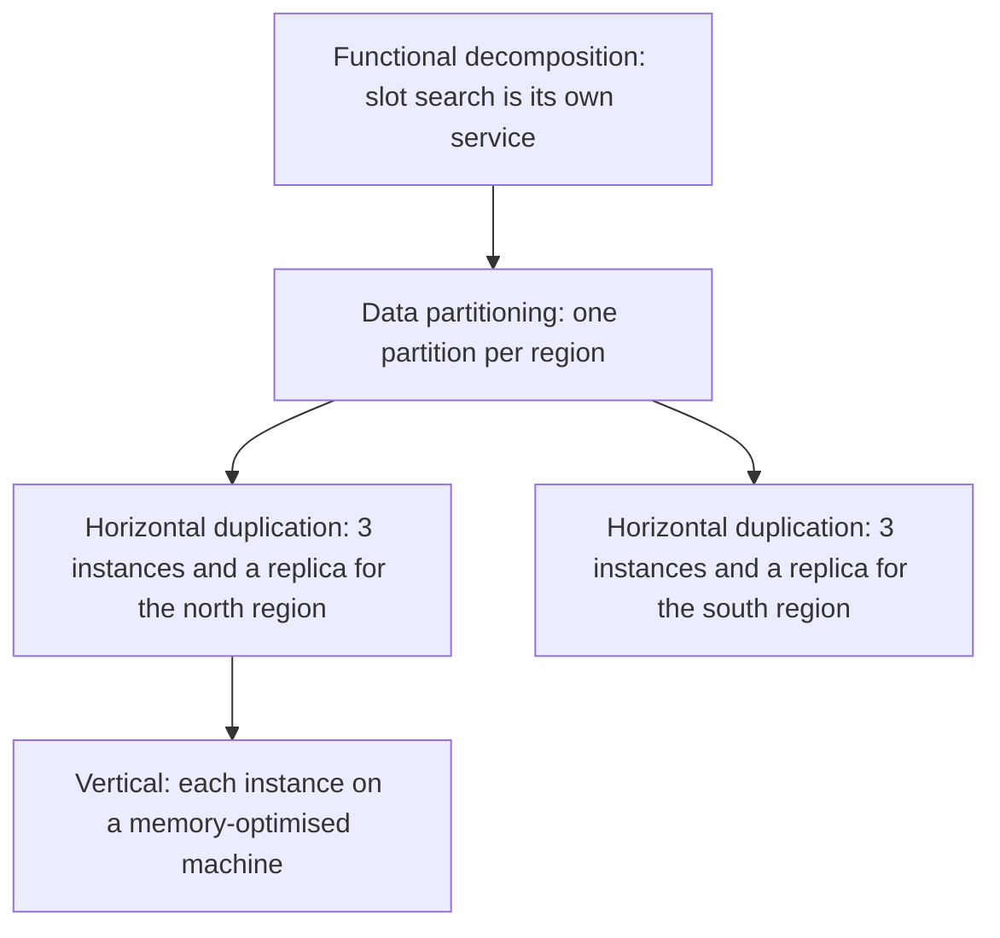

# The four axes of scaling

## Before this lesson

> **Before this lesson:** read [From logical to physical](#/lesson/microservices/logical-to-physical), for instances, load balancers and read replicas, and [What resiliency is](#/lesson/microservices/resiliency-concepts). You should be able to read short Python with dictionaries and loops.

## In plain words

A veterinary clinic has become popular and the waiting room is always full. There are four different things the owner can do.

1. **Get a faster vet and a bigger room.** The same single clinic, with more capacity.
2. **Open more identical consulting rooms**, with a receptionist sending each arriving pet to whichever room is free.
3. **Split the customers.** Pets of owners whose surnames begin with A to M go to the north branch, N to Z to the south branch. Each branch handles half the load and half the records.
4. **Split the work by type.** Move the pharmacy counter and the grooming service into their own units with their own staff, so that a queue for flea treatment no longer delays surgery.

Each choice costs something different and solves a slightly different problem. They can also be combined. Software has the same four options, called the **axes of scaling**: vertical scaling, horizontal duplication, data partitioning and functional decomposition.

**Scaling** means changing a system so that it can handle more: more requests, more data, or the same load with more safety margin. There are two reasons to scale. One is **performance**: handling more load, or responding faster. The other is **robustness**: continuing to work when parts fail. Not every axis helps with both, which is one of the main things to learn here.

Why this matters for a job: "how would you scale this?" is the central question of system design interviews. A strong candidate does not jump to "add more servers and shard the database"; they find the bottleneck and pick the cheapest axis that relieves it.

## 1. Vertical scaling

**Vertical scaling** (scaling up) means giving the existing machine more power: more processor cores, more memory, faster disks.

**Why it is attractive.** It is usually the quickest thing to try. On a cloud platform, moving to a larger machine type is a configuration change and a restart, with no change to the code or the architecture. If it solves the problem, you are done in an afternoon.

**Its limits.**

- **There is a largest machine.** At some point you cannot buy bigger.
- **Cost may not be proportional.** At the top of the range, twice the power can cost much more than twice the price.
- **The software must be able to use it.** A program that does its work on one core gains nothing from 64 cores.
- **It does not improve robustness.** One large machine is still one machine. When it fails, everything on it fails.

Use it early, because it is cheap to try. Do not expect it to carry you for ever.

## 2. Horizontal duplication

**Horizontal duplication** (scaling out) means running several identical copies of something and sharing the work among them.

Three common forms:

- **Instances behind a load balancer.** The balancer forwards each request to one of several identical service instances (lesson 17).
- **Competing consumers.** Several identical workers read from the same queue; each message is handled by whichever worker takes it. Adding workers drains the queue faster.
- **Read replicas.** Copies of a database answer read-only queries, taking that load off the primary.



**Why it is attractive.** It is simple in principle, it improves robustness as well as capacity (losing one of four instances leaves three), and it is how most services first scale.

**What it asks of you.**

- **Instances should be stateless.** A service is **stateless** if it keeps nothing in its own memory between requests that a later request would need. Then any instance can serve any request. If instead a user's session lives in the memory of one instance, the balancer must keep sending that user to the same instance (**sticky sessions**), which makes balancing uneven and loses the session when that instance dies. Keep such state in a shared store.
- **Replicas lag.** A read replica may be slightly behind the primary, so a user might not immediately see what they wrote.
- **It moves the bottleneck.** More instances of the service put more load on whatever they all share.

That last point is worth a simulation.

```python-run
def capacity(instances, per_instance=120, database_limit=500):
    """Requests per second the whole system can serve."""
    return min(instances * per_instance, database_limit)

print("instances   capacity (req/s)   limited by")
for n in [1, 2, 3, 4, 5, 6, 8, 12]:
    cap = capacity(n)
    limiter = "service instances" if n * 120 < 500 else "the single database"
    print(f"{n:6d}      {cap:6d}             {limiter}   " + "#" * (cap // 25))

print("\nWith a read replica taking 60% of the queries, the primary's limit moves:")
for n in [4, 8, 12]:
    print(f"{n:6d}      {capacity(n, database_limit=int(500 / 0.4)):6d}")
```

Each service instance can handle 120 requests per second, and every request also uses the one database, which can handle 500 per second. `capacity` is the smaller of the two totals. From one to four instances, capacity rises in step. From five onwards it is flat at 500: the extra instances are paid for and idle, because the database is now the **bottleneck**, the narrowest point that limits the whole. The second table shows the effect of sending read queries to a replica: the primary now sees only 40% of the load, so the limit rises to 1,250 and twelve instances become useful.

The general lesson: scaling one part reveals the next constraint. Measure to find it before spending.

## 3. Data partitioning

Duplication helps with reads. It does not help when the problem is the volume of **writes** or the sheer size of the data, because every write still goes to the single primary. **Data partitioning** divides the data itself, so that each machine holds and handles only a part.

Each record is assigned to a **partition** (also called a **shard**) by a function of some attribute of the record, the **partition key**. Two common schemes:

- **Range.** Surnames A to M in partition 1, N to Z in partition 2. Simple, and good for range queries, though ranges can be uneven.
- **Hash.** Compute a hash of the key and take the remainder after dividing by the number of partitions. This spreads keys evenly whatever their values.



**What it gives.** Each partition has a fraction of the data and a fraction of the writes. Maintenance can be done one partition at a time.

**What it costs.**

- **Choosing the key is hard and hard to change.** A poor key gives uneven load.
- **Queries across partitions are expensive.** "All appointments tomorrow" must ask every partition and merge the answers, if the data is partitioned by pet.
- **It does not improve robustness by itself.** If partition 2 is down, a third of customers are affected. Combine it with duplication: each partition replicated.
- **Changing the number of partitions moves data.** Called **rebalancing**.

```python-run
import hashlib
from collections import Counter

def stable_hash(text):
    return int(hashlib.md5(text.encode()).hexdigest(), 16)

# 6,000 bookings. Clinic "central" is far busier than the other 11 clinics.
bookings = [(f"pet-{i}", "central" if i % 2 == 0 else f"clinic-{i % 11}") for i in range(6000)]

def spread(key_index, partitions=4):
    counts = Counter(stable_hash(b[key_index]) % partitions for b in bookings)
    return [counts[p] for p in range(partitions)]

print("partitioned by pet id   :", spread(0))
print("partitioned by clinic id:", spread(1), " <- one partition is 'hot'")

# What happens to existing keys when a fifth partition is added?
pets = [b[0] for b in bookings]
moved = sum(1 for p in pets if stable_hash(p) % 4 != stable_hash(p) % 5)
print(f"\ngrowing from 4 to 5 partitions with hash-modulo moves {moved / len(pets):.0%} of the records")
```

`stable_hash` turns a string into a large number in a repeatable way. `bookings` is a list of 6,000 pairs of pet id and clinic id, where half of all bookings belong to one busy clinic. `spread` counts how many bookings land in each of four partitions for a chosen key.

Partitioning by pet id gives four nearly equal partitions of about 1,500. Partitioning by clinic id puts every booking of the busy clinic in the same partition, which ends up with well over half the data and the load: a **hot partition**. The key decides everything.

The last lines show the rebalancing problem. With the plain "hash modulo number of partitions" rule, going from four partitions to five changes the answer for about 80% of the keys, so most of the data must be moved. Techniques such as **consistent hashing** are designed so that adding a partition moves only a small share. Many databases (Cassandra, MongoDB, and others) handle partitioning and rebalancing for you; prefer that to building your own.

## 4. Functional decomposition

**Functional decomposition** means splitting a system by what its parts *do*, so that each part can be scaled, and built, separately. Extracting a microservice is functional decomposition.

At Pawprint, the search for free slots receives fifty times more requests than any other part of Appointments. Inside one service, scaling slot search means scaling everything. Extracted as its own service, slot search can run on twelve small instances with an in-memory index, while the rest of Appointments stays on two.

**What it gives.**

- **Scale each function to its own demand**, which uses infrastructure efficiently.
- **Choose technology to suit the function**: a search engine for search, a queue-driven worker for reminders.
- **Organisational scaling.** Separate teams can own separate functions.

**What it costs.** Everything this track has discussed since lesson 2: network calls, split data, distributed failure modes. It is the most powerful axis and the most expensive, so it should not be the first one reached for.

## 5. Comparing and combining the axes

| Axis | In one line | Effort | Helps capacity | Helps robustness | Main limit |
|---|---|---|---|---|---|
| Vertical | A bigger machine | Low | Yes | No | Largest machine; cost |
| Horizontal duplication | More identical copies | Low to medium | Yes, especially reads | Yes | Shared resources become the bottleneck; needs stateless services |
| Data partitioning | Split the data by key | High | Yes, including writes | Only with replication added | Key choice, cross-partition queries, rebalancing |
| Functional decomposition | Split by capability | High | Yes, per function | Can, by isolating failures | Distributed-system complexity |

A well-known picture of this is the "scale cube" from the book *The Art of Scalability*, which arranges duplication, data partitioning and functional decomposition as three directions of a cube; vertical scaling is the option of growing the single block before moving along any of them.

Real systems combine axes. A plausible end state for slot search at a large clinic chain:



Each addition brought capacity and also complexity. None should be made without a measured reason.

## 6. Start small

A famous warning in programming, due to Donald Knuth, is that optimising before you know where the problem lies wastes effort and damages the design. It applies fully to scaling. Building for a million users when you have a thousand means paying, today and every day, for complexity that addresses a problem you may never have, and probably getting the details wrong because you had no real load to learn from.

A practical sequence:

1. **Measure.** Find the bottleneck with real numbers: which resource is exhausted, under which requests?
2. **Try the cheapest fix.** Often a missing database index or an avoidable repeated query, which is no scaling at all.
3. **Scale vertically** if a larger machine will do.
4. **Duplicate horizontally**: more instances, read replicas, a cache (next lesson).
5. **Only then** consider partitioning the data or decomposing the function.
6. **Test each change with an experiment.** State what you expect ("p95 below 300 ms at 400 requests per second"), apply the change, run a load test, and compare.

### Worked example: vaccination season at Pawprint

Every March, reminder letters go out and bookings triple. Last year the booking site slowed to a crawl.

| Step | Finding or action | Result |
|---|---|---|
| Measure | The Appointments database is at 95% processor use; 80% of its queries are slot searches | The bottleneck is reads on the database |
| Cheap fix | Add an index on clinic and date | Slot search query time falls from 40 ms to 6 ms |
| Vertical | Move the database to the next machine size for March | Headroom doubles; cost 90 dollars extra |
| Horizontal | Add a read replica for slot search; raise Appointments from 3 to 6 instances | Capacity now three times the March peak |
| Considered and rejected | Partitioning appointments by clinic | Writes are nowhere near a limit; the busy central clinic would make a hot partition |
| Later, for other reasons | Extract slot search as its own service | Done the following year when a second team took over search |

The team stopped as soon as the measured goal was met, and the two expensive axes were not needed to survive the season.

> [!INTERVIEW]
> When asked to scale a design, narrate the method: *first I would find the bottleneck by measurement. I would try the cheap options in order: fix inefficient queries, scale vertically, then duplicate horizontally with stateless instances behind a load balancer and read replicas, plus caching. If writes or data size are the limit, I would partition the data, choosing a key that spreads load evenly and matches the main queries. If one function has very different demand, I would extract it so it can scale alone. Duplication also gives robustness; partitioning does not unless each partition is replicated.*

## 7. Pitfalls

- **Scaling without measuring.** You add instances while the database is the limit.
- **Skipping the cheap options.** A larger machine or an index is often enough.
- **State held in instance memory.** It forces sticky sessions and loses data when an instance dies.
- **Expecting duplication to help writes.** All writes still go to one primary.
- **A partition key with skew.** One hot partition carries most of the load.
- **Partitioning and expecting robustness.** Without replicas, each partition is a single point of failure for its share of users.
- **Hash-modulo partitioning with a changing partition count.** Most data moves at every resize.
- **Decomposing to scale something that is not under load.** You pay the distributed-system cost for nothing.
- **Designing for imagined scale.** Complexity arrives now; the users may never.

## Summary

- Scaling serves two purposes, performance and robustness, and not every axis serves both.
- Vertical scaling is quick and limited, and adds no robustness.
- Horizontal duplication (instances behind a load balancer, competing consumers, read replicas) adds capacity and robustness, needs stateless services, and shifts the bottleneck to shared resources.
- Data partitioning spreads data and writes by a partition key; it brings hard key choices, costly cross-partition queries and rebalancing, and needs replication for robustness.
- Functional decomposition lets each capability scale separately at the price of distributed complexity.
- Axes are combined in real systems, one measured step at a time.
- Start small: measure, try the cheapest fix, and stop when the goal is met.

## Glossary

| Term | Meaning |
|---|---|
| Scaling | Changing a system to handle more load or to tolerate more failure |
| Vertical scaling | Moving to a more powerful machine |
| Horizontal duplication | Running several identical copies and sharing work among them |
| Competing consumers | Several identical workers taking messages from one queue |
| Read replica | A copy of a database that serves read-only queries |
| Stateless | Keeping no per-request state in an instance's own memory between requests |
| Sticky session | Routing a user always to the same instance because it holds their state |
| Bottleneck | The component whose limit caps the capacity of the whole system |
| Data partitioning (sharding) | Dividing data among machines by a function of a key |
| Partition key | The attribute used to decide which partition a record belongs to |
| Hot partition | A partition receiving a disproportionate share of data or load |
| Rebalancing | Moving data when the number of partitions changes |
| Consistent hashing | A partitioning scheme in which resizing moves only a small share of keys |
| Functional decomposition | Splitting a system by capability so parts scale independently |

```quiz
[
  {"q": "Which axis of scaling does NOT improve robustness?", "options": ["Horizontal duplication", "Vertical scaling", "Functional decomposition with isolation", "Replicated partitions"], "answer": 1,
   "explain": "A bigger machine is still a single machine. If it fails, everything on it fails."},
  {"q": "A service has 4 instances and one database. Adding 4 more instances does not increase throughput. What is the most likely reason?", "options": ["The load balancer is too fast", "The shared database has become the bottleneck", "The instances are stateless", "Vertical scaling was used"], "answer": 1,
   "explain": "Duplicating one layer shifts the limit to whatever those copies share. Measure to find the new bottleneck."},
  {"q": "Why should horizontally duplicated service instances be stateless?", "options": ["Stateless code runs on fewer cores", "So that any instance can serve any request and losing an instance loses nothing a user needs", "Because load balancers reject stateful services", "To make data partitioning unnecessary"], "answer": 1,
   "explain": "State held in one instance's memory forces sticky sessions and disappears when that instance fails."},
  {"q": "Read replicas help mainly with which kind of load?", "options": ["Write-heavy load", "Read-heavy load", "Network latency between regions", "Large binary uploads"], "answer": 1,
   "explain": "Replicas answer read-only queries. Every write still goes to the single primary."},
  {"q": "Bookings are partitioned by clinic id, and one clinic has half of all bookings. What problem results?", "options": ["Cross-partition queries become impossible", "A hot partition: one partition carries far more data and load than the others", "The hash function stops working", "Replicas are deleted"], "answer": 1,
   "explain": "A skewed partition key concentrates load. A key such as pet id spreads it more evenly."},
  {"q": "With hash-modulo partitioning, what happens when the number of partitions changes from 4 to 5?", "options": ["Nothing moves", "Most keys map to a different partition, so most data must be moved", "Only one key moves", "The data is deleted"], "answer": 1,
   "explain": "The remainder changes for most hash values. Consistent hashing is designed to move only a small share."},
  {"q": "What does functional decomposition offer that the other axes do not?", "options": ["It is the cheapest option", "Each capability can be scaled, and built with suitable technology, independently", "It removes the need for a database", "It guarantees consistency"], "answer": 1,
   "explain": "Splitting by function lets a heavily used capability scale alone, at the cost of distributed-system complexity."},
  {"q": "What is the right first step when a system is too slow under load?", "options": ["Partition the database", "Rewrite it as microservices", "Measure to find the bottleneck, then try the cheapest fix", "Double the number of instances"], "answer": 2,
   "explain": "Scaling the wrong part wastes money and adds complexity. Measurement shows where the limit is."}
]
```

> **Source:** Newman, *Building Microservices*, 2nd ed., ch. 13 (topic coverage only; wording and the Pawprint example are original). Abbott and Fisher, *The Art of Scalability*, 2nd ed. (2015), for the scale cube. Kleppmann, *Designing Data-Intensive Applications* (2017), ch. 6, for partitioning.
