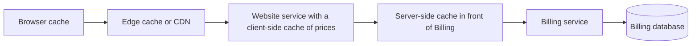
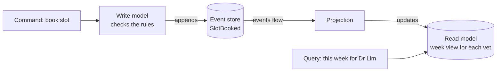
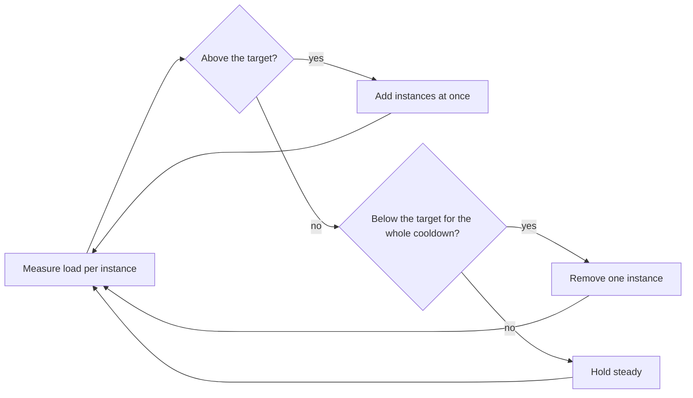

# Caching and autoscaling

## Before this lesson

> **Before this lesson:** read [The four axes of scaling](#/lesson/microservices/scaling-axes). You should know what a bottleneck, horizontal duplication and a read replica are. Events come from [Request-response, event-driven and common data](#/lesson/microservices/request-response-events), and desired state management from [From logical to physical](#/lesson/microservices/logical-to-physical).

## In plain words

A clinic receptionist is asked for the pharmacy's phone number thirty times a day. The first time, they look it up in the directory, which takes a minute. Then they write it on a sticky note by the phone. For the rest of the day the answer takes one second.

That sticky note is a **cache**: a copy of an answer kept close at hand so that the slow lookup need not be repeated. It has one weakness. If the pharmacy changes its number, the note is wrong, and the receptionist will confidently give out a wrong number until somebody corrects the note. Deciding when a note should be thrown away is called **invalidation**, and it is the hard part of caching.

The second idea in this lesson is about staffing. A supermarket opens more tills when queues form and closes them when the shop is quiet. Paying for twenty cashiers at 3 am would be wasteful; having two at 6 pm on a Friday would be a disaster. **Autoscaling** does this for services: it adds instances when load rises and removes them when it falls.

Both are among the cheapest and most effective scaling tools. Both can also cause subtle faults when used carelessly.

Why this matters for a job: "where would you add a cache, and how would you keep it fresh?" is asked in almost every system design interview. Stale-cache bugs and autoscaling misconfigurations are everyday production problems.

## 1. What a cache is

A **cache** stores the result of an earlier operation so that a later request for the same thing can be answered without repeating the operation. The place the real answer comes from is the **origin**.

- A **cache hit** is a request answered from the cache.
- A **cache miss** is a request the cache cannot answer, so the origin is asked and (usually) the result is stored.
- The **hit ratio** is hits divided by all requests.

```python-run
ORIGIN_MS, CACHE_MS = 80, 1
cache, hits, misses, total_ms = {}, 0, 0, 0

def price_list(clinic):
    """Ask for a clinic's price list, using the cache when possible."""
    global hits, misses, total_ms
    if clinic in cache:
        hits += 1; total_ms += CACHE_MS
        return cache[clinic]
    misses += 1; total_ms += ORIGIN_MS             # slow call to the Billing service
    cache[clinic] = f"prices for {clinic}"
    return cache[clinic]

requests = ["east", "east", "west", "east", "central", "west", "east", "east", "central", "east"] * 50
for clinic in requests:
    price_list(clinic)

n = len(requests)
print(f"{n} requests: {hits} hits, {misses} misses, hit ratio {hits / n:.1%}")
print(f"time with cache   : {total_ms} ms")
print(f"time without cache: {n * ORIGIN_MS} ms")
print(f"calls reaching the Billing service: {misses} instead of {n}")
```

`cache` is a dictionary from clinic name to price list. `price_list` checks the dictionary first. On a hit it returns the stored value at a cost of 1 ms. On a miss it pays 80 ms for the origin and stores the result. The 500 requests cover only three distinct clinics, so there are three misses and 497 hits. Total time falls from 40 seconds to under a second, and the Billing service receives 3 calls instead of 500.

Those two effects, less waiting and less load on the origin, are the first two of three reasons to cache.

## 2. Three reasons to cache

**For performance.** A network call, a database query or an expensive calculation is skipped. Microservices add network hops, and caching is a way to take some back.

**For scale.** Every hit is a request the origin did not have to serve. If reads are the bottleneck, caching them lets the origin cope with far more users. A database read replica is a kind of cache for this purpose.

**For robustness.** If the origin is down, a cache can go on answering with the last values it has. For this to work the cache must be willing to serve entries that are past their normal lifetime when the origin cannot be reached. A slightly old price list is usually much better than an error page.

Before adding any cache, name the reason. A cache added "to be safe" costs complexity for no defined benefit.

## 3. Where to cache



**Client-side caching.** The *consumer* of a service keeps the cache: the website service remembers price lists it fetched from Billing. A hit avoids the network call entirely, which gives the best performance, and the consumer can keep working if Billing is down. The difficulty is invalidation: Billing must have some way to tell every consumer that a price changed. And if each consumer instance has its own private cache, two instances can hold different values and give a user different answers on consecutive clicks. A **shared cache** such as Redis or Memcached, used by all instances, avoids that at the price of a (fast) network hop.

**Server-side caching.** The *provider* keeps the cache, inside or in front of itself: a reverse proxy, a cache in the Billing service's own code, or database replicas. The provider controls invalidation, which is much easier since it knows when its data changes, and every consumer benefits without doing anything. The consumer still makes a network call, so it gains less speed and no protection when the provider is unreachable.

**Request caching.** The whole response to a particular request is stored and returned as is. It is very efficient and very specific: it helps only for exactly repeated requests.

| | Client-side | Server-side | Request cache |
|---|---|---|---|
| Avoids the network call | Yes | No | Depends where it sits |
| Helps when the origin is down | Yes | No | Depends |
| Invalidation | Hard: the origin must inform consumers | Easier: the origin knows | Hard for anything but simple cases |
| Who benefits | That consumer | All consumers | Requests that repeat exactly |

Beyond your own services there are caches you do not control but can instruct: the user's browser, and a **content delivery network (CDN)**, a set of servers around the world that keep copies of your content close to users.

## 4. Invalidation

**Invalidation** is removing or replacing a cached entry because it is, or may be, out of date. A cached entry that no longer matches the origin is **stale**. There are five common mechanisms.

**Time to live (TTL).** Each entry is valid for a fixed period, after which it is fetched afresh. It is simple and needs no cooperation from the origin. Its cost is bluntness: with a five-minute TTL, a change at the origin is invisible for up to five minutes, and an entry that never changes is still refetched every five minutes.

**Conditional requests.** HTTP supports asking "send it only if it changed". The origin attaches an **ETag** to each response: a short value identifying that version of the resource. Later the client sends the tag back in an `If-None-Match` header. If the resource is unchanged, the origin replies `304 Not Modified` with no body, which is cheap. If it changed, the client gets the new version and a new tag. A request is still made, but little data moves and the origin may avoid expensive work.

**Notification-based invalidation.** The origin publishes an event when data changes ("prices changed for the east clinic"), and caches subscribe and drop or update the entry. The window of staleness shrinks to the time the event takes to arrive. The cost is more machinery. There is also a subtle risk: if events stop arriving, a cache cannot tell "nothing has changed" from "the notifications are broken". A periodic heartbeat event, or a long backstop TTL, covers that case.

**Write-through.** The cache is updated at the same moment as the origin, as part of the write. It suits server-side caches, where the same code owns both.

**Write-behind.** The cache is updated first and the origin later. Writes are fast, and if the cache is lost before the origin is updated, data is lost. Treat it with caution.

```python-run
import hashlib

# ---- part 1: how stale can a value be? ----
def worst_staleness(ttl_s=None, notification_delay_s=None):
    candidates = [x for x in (ttl_s, notification_delay_s) if x is not None]
    return min(candidates)

print("worst-case staleness after a price change")
print("   TTL of 5 minutes only            :", worst_staleness(ttl_s=300), "s")
print("   change events, 2 s delivery      :", worst_staleness(notification_delay_s=2), "s")
print("   events plus a 1 hour backstop TTL:", worst_staleness(ttl_s=3600, notification_delay_s=2),
      "s normally,", 3600, "s if events stop")

# ---- part 2: a conditional GET with an ETag ----
resource = {"body": "consultation: 45.00"}

def etag(body):
    return hashlib.sha1(body.encode()).hexdigest()[:8]

def origin_get(if_none_match=None):
    tag = etag(resource["body"])
    if if_none_match == tag:
        return 304, None, tag                      # nothing sent but the status
    return 200, resource["body"], tag

status, body, tag = origin_get()
print(f"\nfirst request : {status}, body sent ({len(body)} bytes), ETag {tag}")
status, body, tag2 = origin_get(if_none_match=tag)
print(f"revalidation  : {status}, body sent: {body}")
resource["body"] = "consultation: 48.00"
status, body, tag3 = origin_get(if_none_match=tag)
print(f"after a change: {status}, new body '{body}', new ETag {tag3}")
```

Part 1 states the worst case for each scheme. With a TTL alone, a change can go unseen for the full TTL. With notifications it is the delivery delay. Combining them gives fast updates normally and a known upper limit if the event stream fails.

Part 2 shows the conditional request. `etag` computes a fingerprint of the content. The first request receives the body and the tag. The second sends the tag back and receives `304` with no body, because nothing changed. After the price is edited, the same tag no longer matches, and the origin returns the new body with a new tag. The practice problem *Cache with TTL and Invalidation Events* combines TTLs and event invalidation in one class.

## 5. Cache in as few places as possible

Each cache between the user and the origin adds its own possible staleness. The effects add up, and they are hard to reason about.

```python-run
layers = [("Billing server-side cache", 60), ("website's client-side cache", 300),
          ("CDN", 600), ("browser", 900)]

total = 0
print("layer                          TTL    worst-case age of what the user sees")
for name, ttl in layers:
    total += ttl
    print(f"{name:28s} {ttl:5d} s   {total:5d} s  ({total / 60:.0f} min)")
```

The loop adds each layer's TTL to a running total. A single server-side cache with a one-minute TTL means a user sees a price at most one minute old. Add a client-side cache, a CDN and the browser, each fetching from the layer beneath at the last moment before its own entry expires, and the user can see a price that is over half an hour old, although no single layer holds anything longer than fifteen minutes. And to fix a wrong value quickly, you would have to clear four caches, one of which (the browser) you cannot reach.

So the working rule is: **cache in as few places as you can, ideally one**, and add another only for a measured reason.

Two related warnings:

- **Freshness against cost is a business choice.** Some data may be minutes old without harm (a clinic's opening hours). Other data may not (whether a slot is still free at the moment of booking). Ask the people who own the consequences, and cache each kind of data accordingly.
- **Cache poisoning.** If a response is published with a header telling browsers and CDNs to keep it for a very long time, and the response is wrong, copies sit in places you cannot clear. The usual escape is to change the address of the resource, so that clients request something they have not cached. Be careful with long lifetimes, and put a version in the address of content that is meant to be cached for a long time.

Caching is also a reason for honesty about design: a cache can hide a slow origin for years, until the day the cache is empty and the origin receives the full load at once.

## 6. CQRS and event sourcing inside a service

Everything so far has been about copies of data kept for speed. This section is about a bigger design choice: giving one service two different shapes of data, one for changing things and one for looking at them. It is also where Newman is at his most cautious, and the caution is worth hearing.

### Two models of the same data

Think of a restaurant. Waiters write orders on a ticket and hand it to the kitchen: that record is shaped for *doing the work*. The manager, at the end of the night, wants a sheet of "dishes sold, by hour": a record shaped for *answering questions*. Nobody would try to make one piece of paper serve both purposes.

Most services use a single model for both jobs: one set of tables, one set of classes. **CQRS**, short for **Command Query Responsibility Segregation**, splits them. A **command** is a request to change something ("book slot 10:00 for Miso"). A **query** is a request to read something ("show me this week's bookings for Dr Lim"). Under CQRS:

- The **write model** receives commands, checks the business rules and records the change. It is shaped for correctness.
- The **read model** answers queries. It is shaped for the screens and reports that need it, often already joined and sorted, so a query is a cheap lookup.
- Something has to carry changes from the write side to the read side. Usually that is a stream of events.



The word **projection** needs defining. A projection is a program that reads events and keeps a read model up to date, like the manager's night-time tally that turns a pile of order tickets into "dishes sold, by hour". One service may keep several projections: a week view for vets, a search index, a monthly report.

### Event sourcing: the history is the truth

CQRS says nothing about *how* the write side stores its data. It can use an ordinary table. **Event sourcing** is a different idea that often goes with it. Instead of storing the current state ("slot 10:00 is booked by Miso"), the service stores every event that happened (SlotOpened, SlotBooked, BookingMoved, BookingCancelled) in an append-only **event store**, and works out the current state by reading them in order. A bank statement is the standard comparison: the list of deposits and withdrawals is the record, and the balance is something you calculate.

The databases track explains this idea from the storage side, including the log, snapshots and replay. Read [Databases and streams: CDC and event sourcing](#/lesson/databases/cdc-event-sourcing) for how an event store is kept and queried. Here we care about what it means for service design.

What event sourcing gives a service:

- **A complete audit trail**, for free. Who moved this booking, and when, is simply in the history.
- **Rebuilding state.** A bug in a projection is repaired by fixing the code and replaying the events from the start into a fresh read model. The truth was never damaged.
- **New questions about the past.** A new report ("how often are bookings moved?") can be built later by replaying history that was always kept.
- **Temporal queries.** "What did the diary look like last Tuesday?" is answered by replaying up to that moment.

### A runnable miniature

```python-run
event_store = []                     # append-only: the single source of truth

def handle_book(slot, pet):          # the write model: a command handler
    booked = {e["slot"] for e in event_store if e["type"] == "SlotBooked"}
    cancelled = {e["slot"] for e in event_store if e["type"] == "SlotCancelled"}
    if slot in booked - cancelled:
        return f"rejected: {slot} is taken"          # the business rule lives here
    event_store.append({"type": "SlotBooked", "slot": slot, "pet": pet})
    return f"accepted: {pet} at {slot}"

def handle_cancel(slot):
    event_store.append({"type": "SlotCancelled", "slot": slot})

def apply(view, e):                  # how ONE event changes a read model
    if e["type"] == "SlotBooked":
        view[e["slot"]] = e["pet"]
    elif e["type"] == "SlotCancelled":
        view.pop(e["slot"], None)

def project(events):                 # a projection from scratch: events in, view out
    view = {}
    for e in events:
        apply(view, e)
    return view

read_model = {}
applied = 0                          # how many events the projection has seen

def catch_up():                      # the projection running incrementally
    global applied
    for e in event_store[applied:]:
        apply(read_model, e)
    applied = len(event_store)

print(handle_book("Tue 10:00", "Miso"))
print(handle_book("Tue 10:00", "Pip"))
print("query before the projection runs:", read_model)     # stale for a moment
catch_up()
print("query after catching up:        ", read_model)

handle_cancel("Tue 10:00")
print(handle_book("Tue 10:00", "Pip"))
catch_up()
print("current read model:             ", read_model)

# Rebuild from scratch: throw the read model away and replay all events.
print("rebuilt from history:           ", project(event_store))
print("events kept forever:", len(event_store))
```

`event_store` is a plain list we only ever append to. `handle_book` is the write side: it looks at the history to see whether the slot is free, and either rejects the command or appends a `SlotBooked` event. `apply` says how one event changes a read model. `project` runs `apply` over a whole history, and `catch_up` runs it only over events not yet seen, remembering in `applied` how far it has read. Notice the first query: right after the command was accepted, the read model is still empty, because the projection had not run yet. That small gap is **eventual consistency** in miniature. The last lines show the rebuild: ignore the read model, replay everything, and the same answer returns.

### Eventual consistency changes the user experience

In a real system the projection runs in another process, and the gap can be milliseconds or minutes. Users notice: they book a slot, the page reloads, and the booking is not on the list. Common remedies, none of them free:

- Return the new state in the response to the command, and let the screen show that instead of re-querying.
- Remember the position of the last event the user caused, and have queries wait until the read model has reached it.
- Design the screen to say "your booking is being confirmed".

One subtle point: the write model must check rules against *its own* reliable data, as `handle_book` does, not against a possibly stale read model. Otherwise two people could book the same slot in the same millisecond.

### When it is worth it, and when it is not

Newman's view, in short: CQRS and event sourcing are among the harder techniques in the book. Capable teams have struggled with them, and both demand a different way of thinking from developers used to "one table, update the row". Before choosing them for scaling, try the cheaper tools. If the pain is read load, a database read replica or a cache is far less risky.

| Reach for CQRS or event sourcing when | Do not, when |
|---|---|
| Reads and writes have very different shapes or loads, and no single model suits both | A normal CRUD service (create, read, update, delete) with an index would do |
| An audit trail or "what did it look like then" is a real business need | You want it because it sounds modern |
| You must serve several different read views from the same facts | The team has never operated it and the deadline is near |
| Replaying history to fix or add views is valuable | Users cannot tolerate even a short delay on reads after writes, and you cannot design around it |

Further costs: events become a permanent contract, since old events must stay readable for ever (the databases track covers schema evolution). Replaying a long history takes time unless you keep snapshots. And debugging a flow means following events rather than reading a table.

One more point from Newman matters for microservices specifically. Using CQRS or event sourcing is an **internal implementation detail** of a service. Consumers should see an ordinary interface. If commands go to one process and queries to another, the service itself routes them. Keeping this hidden means you can adopt it, or abandon it, without a coordinated change across other teams. Do not confuse the events *inside* a service's event store with the events *published* to other services in [lesson 10](#/lesson/microservices/request-response-events). The first are private records; the second are a deliberate public contract.

> [!INTERVIEW]
> For "what is CQRS and when would you use it?": *it separates the model that handles commands from the model that answers queries, so each can be shaped and scaled for its own job, usually joined by events and projections. Event sourcing stores the history of events as the source of truth and derives state from it. Both bring eventual consistency, versioned events and operational complexity, so I would first try read replicas or caching, and use them only for a clear need such as audit, very different read and write shapes, or several views. And I would keep it internal to the service.*

## 7. Autoscaling

**Autoscaling** is changing the number of running instances automatically. It needs the things earlier lessons put in place: automated deployment, stateless instances, and a platform that can add and remove them.

There are two triggers.

**Predictive (scheduled) scaling** uses known patterns. Pawprint's bookings peak on weekday mornings and fall to almost nothing at night. Scale up at 7:30, down at 19:00.

**Reactive scaling** responds to measurements. When average processor use, queue length or requests per instance crosses a threshold, add instances; when it falls, remove them.



Each has a weakness. Schedules are wrong on unusual days. Reactions are always a little late, because a new instance takes time to start, and a spike can be over, or the service overwhelmed, before help arrives. Most teams combine them: a schedule for the expected shape, reaction for surprises.

Practical rules:

- **Scale up quickly and down slowly.** Too few instances hurts users; a few too many for ten minutes costs little. A waiting period before scaling down (a **cooldown**) also prevents the fleet from flapping up and down.
- **Keep a minimum for robustness**, in more than one zone, whatever the load.
- **Set a maximum.** A bug or an attack that generates load should not generate an unlimited bill.
- **Load test the configuration.** Until you have watched it react to a realistic spike, you do not know that it works.
- **Check what the new instances depend on.** Twenty new service instances opening connections to a database that allows fifty have moved the failure (lesson 18).

A sensible way to begin is to use autoscaling for **failure** first: tell the platform to keep at least four healthy instances, and let it replace any that die. That is low-risk and immediately useful. Add load-based rules once you understand your traffic.

```python-run
# Requests per second through one day, one value per half hour.
load = [20]*14 + [60, 150, 320, 420, 450, 430, 380, 300, 260, 240, 250, 280, 300, 260, 200, 140, 90, 60] + [30]*16

PER_INSTANCE, TARGET, MIN_N, MAX_N = 100, 0.6, 2, 10

def autoscale(load, startup_delay=1, cooldown=3):
    n, pending, quiet, overloaded, instance_periods = MIN_N, [], 0, 0, 0
    for t, rps in enumerate(load):
        n += sum(1 for ready in pending if ready == t)             # instances that finished starting
        pending = [r for r in pending if r > t]
        if rps > n * PER_INSTANCE:
            overloaded += 1
        wanted = min(MAX_N, max(MIN_N, -(-rps // int(PER_INSTANCE * TARGET))))   # round up
        if wanted > n + len(pending):                              # scale up at once
            pending += [t + startup_delay] * (wanted - n - len(pending))
            quiet = 0
        elif wanted < n:                                           # scale down only after a quiet spell
            quiet += 1
            if quiet >= cooldown:
                n, quiet = n - 1, 0
        instance_periods += n
    return instance_periods, overloaded

fixed = 8 * len(load)
auto, overloaded = autoscale(load)
print(f"fixed fleet of 8 : {fixed} instance-periods, never overloaded")
print(f"autoscaled 2..10 : {auto} instance-periods ({auto / fixed:.0%} of the cost), overloaded in {overloaded} of {len(load)} periods")
slow, slow_over = autoscale(load, startup_delay=3)
print(f"same, but instances take 3 periods to start: overloaded in {slow_over} periods")
```

`load` describes a day in 48 half-hour periods: quiet overnight, a sharp rise in the morning, a long busy middle, and a quiet evening. Each instance can serve 100 requests per second, and the scaler aims to keep instances at 60% of that so there is headroom. In each period, `autoscale` first adds any instances that have finished starting, records whether the current fleet was overloaded, computes how many instances the load calls for, and then either requests more immediately or, after three quiet periods in a row, removes one.

Compared with a fixed fleet of eight, the autoscaled fleet uses roughly half the instance time. The price shows in the overloaded count: during the steep morning rise, load outruns the fleet for a period or two, because new instances take one period to start. The last line repeats the run with a slower start-up of three periods, and the overloaded count rises. This is the central trade of reactive scaling: it saves money on the quiet hours and is always slightly behind on a steep rise. Faster start-up, more headroom or a scheduled scale-up at 7:00 would each close the gap.

## 8. Starting again

An architecture that serves a thousand users well may be the wrong one for a million, and designing for the million on day one would have been wasteful and probably mistaken. A widely repeated rule of thumb from large-scale engineering is to design for about ten times your current load and to expect to redesign before you reach a hundred times.

Needing to redesign as you grow is a sign of success. The skill lies in noticing when the current design is nearing its limit, and in having kept the system modular enough that parts can be replaced.

> [!INTERVIEW]
> For "where would you cache and how do you keep it correct?": *I first name the goal: speed, origin load or robustness. I prefer a single cache, close to the provider if I want simple invalidation, or on the consumer side if I need to avoid the network call or survive the provider being down. For invalidation I use a TTL sized to how stale the business can tolerate, and change events when it must be fresher, with a backstop TTL in case events stop. I avoid stacking caches, because staleness adds up. For autoscaling I combine a schedule for known peaks with reactive rules, scale up fast and down slowly, keep a minimum across zones, cap the maximum and load test it.*

## 9. Pitfalls

- **Caching without a stated reason.** You gain staleness and complexity for no measured benefit.
- **Caches at every layer.** Staleness accumulates and nobody can say how old the data may be.
- **A TTL chosen by guesswork.** Ask how out of date the data may safely be.
- **Per-instance caches that disagree.** Users see values flip between requests.
- **Notifications with no backstop.** A broken event stream leaves caches stale without limit.
- **Long cache lifetimes on public responses.** A mistake is stored in browsers you cannot clear.
- **A cache hiding a slow origin.** When the cache is emptied, the origin collapses under the full load.
- **Autoscaling that has never been load tested.** It may react too slowly or not at all.
- **No maximum.** A traffic flood becomes a cost flood.
- **Scaling down eagerly.** The fleet flaps and users meet cold instances.
- **CQRS or event sourcing for a plain CRUD service.** Large cost, no matching need; try a read replica or a cache first.
- **Checking rules against a stale read model.** Command handlers must validate against the write side's own data.

## Summary

- A cache keeps earlier results so later requests are served faster and the origin is spared; hits, misses and the hit ratio describe how well it works.
- Cache for performance, for scale or for robustness, and know which.
- Client-side caches avoid the network call and survive origin outages, with harder invalidation; server-side caches are easier to keep correct and help every consumer.
- Invalidation options: TTL, conditional requests with ETags, change notifications, write-through and write-behind.
- Staleness adds up across nested caches, so cache in as few places as possible, and treat freshness as a business decision.
- Autoscaling adds and removes instances by schedule or by measurement; scale up fast, down slowly, with a minimum, a maximum and a load test.
- Expect to redesign as load grows by orders of magnitude.
- CQRS separates a write model from read models joined by projections; event sourcing stores the event history as the truth. Both bring eventual consistency and complexity, so try replicas and caches first, and keep them internal to the service.

## Glossary

| Term | Meaning |
|---|---|
| Cache | A store of earlier results used to answer later requests quickly |
| Origin | The authoritative source a cache copies from |
| Cache hit / miss | A request answered from the cache / one that must go to the origin |
| Hit ratio | The share of requests answered from the cache |
| Client-side cache | A cache kept by the consumer of a service |
| Server-side cache | A cache kept by the provider of a service |
| CDN | A content delivery network: servers near users that hold copies of content |
| Stale | No longer matching the origin |
| Invalidation | Removing or replacing a cached entry that is or may be stale |
| TTL | Time to live: how long an entry may be used before refetching |
| ETag / conditional request | A version tag for a resource / a request that returns the body only if the tag changed |
| Write-through / write-behind | Updating cache and origin together / updating the origin later |
| Cache poisoning | Wrong data stuck in caches, often ones you cannot clear |
| Autoscaling | Automatically changing the number of running instances |
| Predictive / reactive scaling | Scaling by schedule / scaling in response to measurements |
| Cooldown | A waiting period before scaling down, to avoid flapping |
| CQRS | Command Query Responsibility Segregation: separate models for changing and for reading data |
| Command / query | A request to change something / a request to read something |
| Projection | A program that turns events into a read model |
| Event sourcing | Storing the history of events as the source of truth and deriving state from it |
| Event store | The append-only record of events |
| Eventual consistency | The read side catches up with the write side after a delay |

```quiz
[
  {"q": "In CQRS, what does the read model do?", "options": ["Validates business rules for commands", "Answers queries from a structure shaped for reading, kept up to date by projections", "Stores passwords", "Replaces the event store"], "answer": 1,
   "explain": "The write model protects the rules; the read model exists to make queries cheap and convenient."},
  {"q": "A projection has a bug that produced wrong weekly totals. With event sourcing, how is it fixed?", "options": ["Edit the stored events by hand", "Fix the code and replay the events into a fresh read model", "Delete the event store", "Nothing can be done"], "answer": 1,
   "explain": "The events are the truth and are never altered, so any view derived from them can be rebuilt."},
  {"q": "A user books a slot and the list page does not show it for a second. What explains this?", "options": ["The booking failed", "Eventual consistency: the projection had not yet applied the event", "A TLS error", "A cache poisoning attack"], "answer": 1,
   "explain": "The read side trails the write side. Return the new state in the response, or wait for the projection, to hide the gap."},
  {"q": "Your service is slow only because reads are heavy. According to Newman, what should you usually try before CQRS?", "options": ["Event sourcing as well", "A read replica or a cache", "A rewrite in another language", "More microservices"], "answer": 1,
   "explain": "CQRS is one of the harder scaling techniques; cheaper options carry less risk."},
  {"q": "Should consumers of the Appointments service know it uses CQRS internally?", "options": ["Yes, they must call two endpoints in a fixed order", "No: it is an internal implementation detail the service should hide", "Yes, because events are public", "Only the gateway"], "answer": 1,
   "explain": "Hiding it lets the team adopt or drop the pattern without coordinating with consumers."},
  {"q": "What are the three main reasons to add a cache?", "options": ["Security, logging and tracing", "Performance, scale and robustness", "Cost, compliance and fashion", "Consistency, isolation and durability"], "answer": 1,
   "explain": "A cache can make responses faster, reduce load on the origin, and keep answering when the origin is down."},
  {"q": "Which statement about client-side caching is correct?", "options": ["It cannot avoid network calls", "It avoids the call entirely on a hit and can serve when the provider is down, and invalidation is harder", "The provider always controls it", "It benefits all consumers automatically"], "answer": 1,
   "explain": "The consumer holds the copy, which gives speed and robustness. The provider must find a way to tell consumers about changes."},
  {"q": "A cache uses only a 5 minute TTL. A price changes at the origin. How long might users see the old price?", "options": ["Never", "Up to 5 minutes", "Exactly 5 seconds", "Until the cache is restarted"], "answer": 1,
   "explain": "An entry fetched moments before the change stays valid for its full TTL."},
  {"q": "A client sends If-None-Match with an ETag and the resource has not changed. What does the origin return?", "options": ["200 with the full body", "304 Not Modified with no body", "404 Not Found", "500 Server Error"], "answer": 1,
   "explain": "The conditional request confirms the cached copy is still current without resending the content."},
  {"q": "Why add a backstop TTL to notification-based invalidation?", "options": ["Events are too fast", "If the notifications silently stop, the cache would otherwise stay stale with no limit", "TTL makes events cheaper", "It prevents cache hits"], "answer": 1,
   "explain": "A cache cannot tell silence from failure. A long TTL bounds the staleness when events are lost."},
  {"q": "Four nested caches have TTLs of 1, 5, 10 and 15 minutes. What is the worst-case age of the data a user sees?", "options": ["15 minutes", "About 31 minutes", "1 minute", "5 minutes"], "answer": 1,
   "explain": "Each layer may refetch from the layer below at the last moment before its own expiry, so the ages add up."},
  {"q": "What is the main weakness of purely reactive autoscaling?", "options": ["It cannot remove instances", "It always lags: new instances take time to start, so a steep rise can outrun it", "It needs no metrics", "It only works at night"], "answer": 1,
   "explain": "Reaction follows the load. Faster start-up, headroom or scheduled scaling for known peaks reduce the gap."},
  {"q": "Which autoscaling policy is the safest default?", "options": ["Scale down fast and up slowly", "Scale up quickly, scale down slowly, with a minimum and a maximum", "No limits in either direction", "One instance at all times"], "answer": 1,
   "explain": "Under-provisioning hurts users immediately; slight over-provisioning is cheap. Limits protect robustness and cost."}
]
```

> **Source:** Newman, *Building Microservices*, 2nd ed., ch. 13 (topic coverage only; wording and the Pawprint example are original). RFC 9111, "HTTP Caching", https://www.rfc-editor.org/rfc/rfc9111 ; MDN Web Docs, "HTTP conditional requests".
