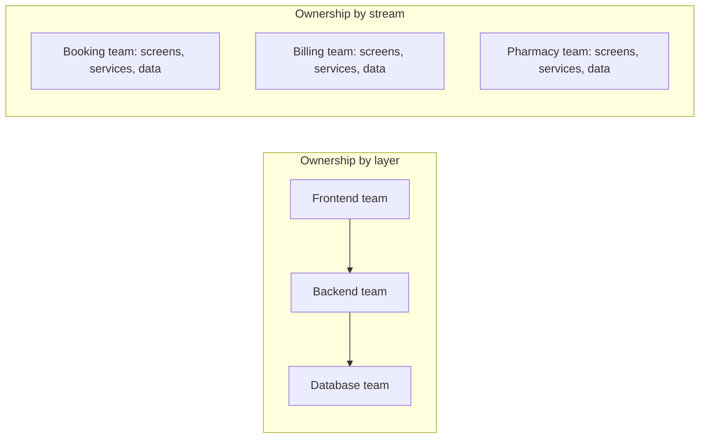
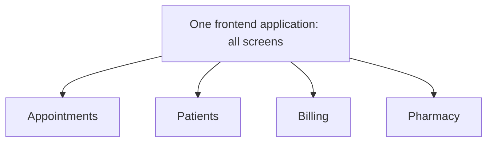
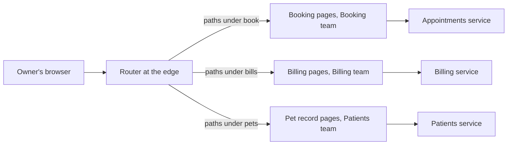

# Who owns the user interface? Monolithic frontends and micro frontends

## Before this lesson

> **Before this lesson:** read [The key concepts](#/lesson/microservices/key-concepts), for independent deployability, and [Planning a migration](#/lesson/microservices/migration-planning), where splitting a system by technical layer was compared with splitting by business capability. Basic familiarity with what a web page and a mobile app are is enough; no frontend programming is assumed.

## In plain words

A daily newspaper has a sports desk, a business desk and a weather desk. Each desk writes and lays out its own pages. The reader still receives one newspaper with one masthead and one typeface, because the desks share a style guide.

Now imagine a different arrangement: every desk writes its stories and then hands them to a single layout department, which is the only group allowed to touch a page. The sports desk has a big story at 9 pm. The layout department is busy with the business section. The story waits.

Software teams often organise themselves the second way without meaning to. They split the backend into neat services owned by separate teams, and leave one "frontend team" owning the entire user interface. Every feature, from every team, now queues at that one team's door. The services are independent; the delivery of anything a user can see is not.

The **user interface (UI)** is the part of the system people look at and touch: web pages, mobile apps, kiosk screens. This lesson asks who should own it and how to split it so that teams can ship independently. The next lesson looks at how the UI should fetch its data.

Why this matters for a job: most engineers work on a product with a UI, in an organisation that has had to answer these questions. Interviewers for full-stack and frontend-leaning roles ask about micro frontends, and backend candidates are expected to understand why a single shared frontend becomes a bottleneck.

## 1. One system, many screens

Years ago "the user interface" meant a website viewed on a desk computer. Now the same business is reached through a website, a phone app for each major platform, perhaps a tablet app for staff, a self-service kiosk in reception, text messages, and an API that partners call. Each has different strengths: a phone has a camera and location, a small screen and an unreliable connection; a kiosk has a large touch screen and no keyboard.

So the question is no longer "how does the website talk to the services?" It is "how do many kinds of interface, changing at different speeds, sit on top of a set of services?"

## 2. Ownership: layers or streams

There are two basic ways to assign ownership.

**By technical layer.** A frontend team owns the screens, a backend team owns the services, perhaps a database team owns the data. Each team is full of specialists in one technology.

**By stream of work.** A **stream-aligned team** (the term comes from the book *Team Topologies*) owns a slice of the product from end to end: the screens, the services and the data for one area of the business, such as booking or billing. Such a team is sometimes called full-stack or cross-functional.



Nearly every feature a user can see needs a change in more than one layer. With layered teams, that means a **handoff**: one team finishes its part and passes the work to another team's queue. Handoffs are where time goes.

```python-run
def layered(work_days, queue_days):
    """Three teams in sequence. Work waits in each team's queue before that team starts."""
    return sum(q + w for w, q in zip(work_days, queue_days))

def stream_aligned(work_days, own_queue_days):
    """One team does all three parts. The work waits once, in that team's own queue."""
    return own_queue_days + sum(work_days)

work = [2, 3, 1]                  # days of real effort: screen, service, database change
print("real effort in every case:", sum(work), "days\n")
print("layered teams, each with a 5 day backlog  :", layered(work, [5, 5, 5]), "days until released")
print("layered teams, each with a 10 day backlog :", layered(work, [10, 10, 10]), "days until released")
print("one stream-aligned team, 5 day backlog    :", stream_aligned(work, 5), "days until released")
```

`work` is the effort the feature needs in each layer: six days in total. In `layered`, the feature sits in each team's backlog before that team begins, so three queueing delays are added. In `stream_aligned`, one team does all the parts and the feature queues once. With five-day backlogs the layered organisation takes 21 days to deliver six days of work; the stream-aligned team takes 11. Double the backlogs and the layered figure rises to 36. The effort never changed. The waiting did, and it is multiplied by the number of handoffs. Real projects are worse than this model, because a question passed back across a handoff waits in a queue again.

## 3. Why frontend teams exist, and what to do about it

If handoffs are so costly, why do dedicated frontend teams exist? There are three honest reasons.

- **Scarce specialists.** Good interaction designers and mobile developers are hard to hire. Putting the few you have in one team looks efficient.
- **Consistency.** One team owning all the screens seems the natural way to keep the look and behaviour uniform.
- **Technical difficulty.** Some frontend technology is hard to split, a single-page application being the usual example.

Each has a better answer than a central team that does all the UI work.

For scarce specialists, use an **enabling team**: a small group of experts who do not build every screen themselves. They help the stream-aligned teams build their own, by pairing with them, reviewing, teaching and providing tools. Their output is other teams' ability. Lesson 31 returns to this.

For consistency, publish a **design system**: a documented set of visual rules together with a library of ready-made, shared interface components (buttons, forms, date pickers). Teams assemble their screens from these, so that things look and behave alike without one team making everything.

For technical difficulty, choose a way of composing the UI that allows independent pieces. The rest of this lesson describes the options.

## 4. The monolithic frontend

In a **monolithic frontend**, all the UI is one deployable unit, which calls the backend services for data.



The commonest form today is the **single-page application (SPA)**: one program, written with a framework such as React, Angular or Vue, that loads once in the browser and then redraws the screen itself as the user moves around.

This is a perfectly good choice when one team owns all of the UI and its services. It is simple and gives a smooth experience.

It becomes a problem when several teams must contribute. They all change the same codebase and share one release. A half-finished billing screen blocks the release of a finished booking screen. The frontend becomes the place where independently deployable services are tied back together.

## 5. Micro frontends

A **micro frontend** architecture splits the UI into pieces that can be developed, tested and deployed independently, each owned by the team that owns the matching backend. It applies the microservice idea to the screen. There are two main ways to cut it.

### Page-based decomposition

Each page, or group of pages, belongs to one team and is served by that team's own frontend. Moving between areas is an ordinary link.



This is how the web has always worked, and it is underrated. Each team can deploy its pages whenever it likes, and can even use different technology behind them. A shared design system keeps the look consistent. A shared piece of page furniture, such as the top navigation bar, can be included in every page.

The limitation is that a page belongs to exactly one team. When a single screen needs content from several teams at once, you need the second approach.

### Widget-based decomposition

A **widget** is a self-contained piece of a page: a "next appointment" box, a "balance due" box, a basket. In widget-based decomposition, a page is assembled from widgets owned by different teams, inside a thin **container** (or shell) that provides the page frame.

The assembly can happen in two places:

- **On the server (or at the edge).** The page is built from fragments before it reaches the browser. The browser receives one complete page.
- **In the browser.** The container loads each team's widget code and places it in the page. Techniques include iframes (simple, strongly isolated, awkward for layout and for communication) and web components (a browser standard for packaging a reusable interface element).

Two requirements make this work.

**A widget's failure must stay inside the widget.** If the loyalty widget cannot load, the page should show everything else.

**Widgets need a loose way to talk.** Choosing a pet in one widget should update the appointment widget. They should not call each other's code directly, which would couple the teams. The usual answer is events: one widget announces "pet selected" in the page, and any widget that cares listens. It is the event-driven style of lesson 10, inside a browser.

```python-run
# ---- server-side composition: each team supplies a fragment renderer ----
def pet_summary(ctx):      return f"<section>{ctx['pet']}, cat, 6 years</section>"
def next_visit(ctx):       return f"<section>Next visit for {ctx['pet']}: Tue 10:00</section>"
def balance_due(ctx):      raise TimeoutError("billing fragment timed out")
def loyalty(ctx):          return "<section>120 points</section>"

PAGE = [("pet summary", pet_summary, "<section>Pet details unavailable</section>"),
        ("next visit",  next_visit,  "<section>Appointments unavailable</section>"),
        ("balance",     balance_due, "<section>Balance unavailable right now</section>"),
        ("loyalty",     loyalty,     "")]                    # optional: omit when it fails

def compose(ctx):
    parts = []
    for name, render, fallback in PAGE:
        try:
            parts.append(render(ctx))
        except Exception:
            parts.append(fallback)                           # one widget fails; the page survives
    return "<main>\n  " + "\n  ".join(p for p in parts if p) + "\n</main>"

print(compose({"pet": "Miso"}))

# ---- in-page communication: widgets talk through events, not direct calls ----
listeners = {}
def listen(event, handler): listeners.setdefault(event, []).append(handler)
def announce(event, data):
    for handler in listeners.get(event, []):
        handler(data)

listen("pet-selected", lambda pet: print(f"[visits widget]  now showing visits for {pet}"))
listen("pet-selected", lambda pet: print(f"[balance widget] now showing balance for {pet}'s owner"))
print()
announce("pet-selected", "Biscuit")          # the pet-picker widget knows nothing about its listeners
```

The first half models composition on the server. Each team supplies one function that returns a fragment of the page. `PAGE` lists the fragments in order with a fallback for each. `compose` calls every renderer inside a `try` block, so when the Billing fragment times out, its fallback text is used and the other three fragments appear normally. The page is degraded, not broken, exactly as lesson 25 recommended for services.

The second half models communication in the browser. `listen` registers interest in a named event and `announce` delivers one to whoever registered. The pet-picker announces `pet-selected`; the visits widget and the balance widget each react. The picker has no reference to either, so a new widget can be added by a team without the picker's team changing anything.

Widgets do share one thing they cannot avoid: the page itself. Agree on what is common (the design system, the event names, which versions of shared libraries are loaded) and keep that list short. If every widget brings its own copy of a large framework, the page becomes heavy and slow.

## 6. Constraints from the device

The neat picture gets complicated by devices.

**A native mobile app is a monolith by nature.** It is built into one package, submitted to an app store, reviewed, and installed by users when they choose to update. You cannot deploy one screen of it independently, and old versions stay in use for months. Teams can still own separate modules inside the app's codebase; the release is shared. This is a strong reason to keep contracts between the app and the services backward compatible for a long time (lesson 12).

**Mobile networks are slow and unreliable.** A page that makes fifteen calls to fifteen services works on office broadband and drags on a train. Mobile screens need fewer, larger, purpose-shaped responses.

**Different devices need different amounts of data.** The staff tablet shows a full medical history. The owner's phone shows the next appointment and a button.

Those last two points mean that somewhere, calls must be combined and shaped for each kind of interface. Where to do that is the subject of the next lesson.

## 7. Choosing

| | Monolithic frontend | Page-based micro frontends | Widget-based micro frontends |
|---|---|---|---|
| Deployable units | One | One per page group | One per widget plus a container |
| Team independence | Low once there are several teams | High | High |
| User experience | Smooth | Page loads between areas | Smooth if done well |
| Complexity | Low | Low | Higher: composition, shared dependencies, in-page events |
| Best fit | One team owns the whole UI | Areas of the site map cleanly to teams | Single screens combine several teams' content |

A sensible path: start with one frontend while one team owns it. When several teams need to ship UI independently, try page-based decomposition first, since it uses the web as it was designed. Add widgets only for the screens that truly need content from several teams.

### Worked example: Pawprint's owner portal

Pawprint's portal began as one SPA, written by a frontend team of three. With four backend teams now feeding it requests, features wait an average of two weeks for frontend time.

The change they make:

| Area | Decomposition | Owner |
|---|---|---|
| `/book` (search and book a slot) | Page-based | Booking team |
| `/bills` (invoices and payment) | Page-based | Billing team |
| `/pets` (pet record) | Page-based | Patients team |
| Home dashboard | Widget-based: pet summary, next visit, balance due, loyalty | A thin container owned by the Booking team; each widget by its own team |
| Shared navigation bar and components | Design system library | The former frontend team, now an enabling team of two |
| Mobile app | One codebase with a module per team; release every two weeks | Shared release, coordinated by the enabling team |

The frontend specialists did not disappear. Their job changed from building every screen to making it easy for others to build good ones.

> [!INTERVIEW]
> For "how do you stop the frontend becoming a bottleneck in a microservice organisation?": *I would align UI ownership with service ownership, so each stream-aligned team delivers its features end to end without handoffs. A design system and a small enabling team keep the experience consistent. Technically I would split the UI by page first, since pages map cleanly to teams and deploy independently, and use widget composition only where one screen needs several teams' content, with isolated failures and event-based communication between widgets. Native mobile apps stay one release, so their API contracts must remain backward compatible for longer.*

## 8. Pitfalls

- **Microservices behind a single shared frontend team.** Every feature queues in one place.
- **Splitting by layer and calling it microservices.** Handoffs dominate delivery time.
- **Micro frontends for one small team.** The composition machinery outweighs the benefit.
- **Widgets that call each other directly.** Teams become coupled inside the page.
- **A widget whose failure blanks the page.** Isolate each one and give it a fallback.
- **Every widget loading its own framework.** The page becomes slow and heavy.
- **No design system.** The product looks like several different products.
- **Forgetting old mobile app versions.** Breaking an API strands users who have not updated.

## Summary

- A system now has many interfaces: web, mobile, kiosk, partner APIs.
- Ownership by technical layer creates handoffs, and handoffs multiply waiting time; stream-aligned teams own a slice end to end, UI included.
- The reasons for a central frontend team (scarce skills, consistency, technical difficulty) are better met by enabling teams, a design system and a decomposable UI.
- A monolithic frontend is fine for one team and becomes a bottleneck with several.
- Micro frontends split the UI into independently deployable parts: by page, which is the simple default, or by widget, when one screen combines several teams' content.
- Widgets need isolated failure and event-based communication, and should share little.
- Native mobile apps release as one unit and live long, and mobile networks favour fewer, shaped calls.

## Glossary

| Term | Meaning |
|---|---|
| User interface | The part of a system that people see and interact with |
| Handoff | Passing unfinished work from one team's queue to another's |
| Stream-aligned team | A team owning one slice of the product from end to end |
| Enabling team | Specialists who help other teams gain a capability instead of doing the work for them |
| Design system | Shared visual rules and a library of reusable interface components |
| Monolithic frontend | A user interface built and deployed as one unit |
| Single-page application | A browser application that loads once and redraws the screen itself |
| Micro frontend | A user interface split into independently deliverable parts |
| Page-based decomposition | Different pages owned and served by different teams |
| Widget | A self-contained piece of a page |
| Widget-based decomposition | Assembling one page from widgets owned by different teams |
| Container (shell) | The thin frame that hosts and arranges widgets |
| Web component | A browser standard for packaging a reusable interface element |

```quiz
[
  {"q": "Why does a single shared frontend team become a problem in a microservice organisation?", "options": ["Frontend code is slower than backend code", "Every user-visible feature from every team must queue for that one team, removing independent delivery", "Frontend teams cannot use version control", "It prevents the use of a design system"], "answer": 1,
   "explain": "Services may deploy independently, but if all screens go through one team and one release, features wait there."},
  {"q": "A feature needs 6 days of work across three layered teams, each with a 5 day backlog. Roughly how long until release?", "options": ["6 days", "11 days", "21 days", "5 days"], "answer": 2,
   "explain": "The work waits in three queues: 5+2, 5+3 and 5+1 days. Handoffs multiply the waiting, not the effort."},
  {"q": "What is an enabling team?", "options": ["A team that builds every screen for the others", "Specialists who help stream-aligned teams gain skills and tools so they can do the work themselves", "A team that approves all releases", "A team of managers"], "answer": 1,
   "explain": "Its output is other teams' capability, which spreads scarce expertise without creating a bottleneck."},
  {"q": "How can several teams keep a consistent look without one team building all the UI?", "options": ["By using the same database", "With a shared design system: visual rules and a library of reusable components", "By avoiding CSS", "By releasing only once a year"], "answer": 1,
   "explain": "Teams assemble their own screens from common components, so consistency does not require central ownership."},
  {"q": "What is page-based decomposition?", "options": ["Each page is rendered twice", "Different pages or groups of pages are owned and served by different teams, linked together", "One team owns all pages", "Pages are stored in separate databases"], "answer": 1,
   "explain": "It uses ordinary links between independently deployed sets of pages, and is the simplest form of micro frontend."},
  {"q": "A dashboard is built from four widgets, and the billing widget fails to load. What should happen?", "options": ["The whole page shows an error", "The other three widgets display, with a fallback in place of billing", "The browser restarts", "All widgets reload for ever"], "answer": 1,
   "explain": "A widget's failure should be contained, as with degraded functionality between services."},
  {"q": "How should widgets from different teams communicate within a page?", "options": ["By calling each other's internal functions", "Through events announced in the page that interested widgets listen for", "Through a shared database table", "They should never communicate"], "answer": 1,
   "explain": "Events keep the widgets loosely coupled: the announcer does not know who listens."},
  {"q": "Why must APIs used by a native mobile app stay backward compatible for a long time?", "options": ["App stores forbid new APIs", "The app is released as one unit and users update when they choose, so old versions keep calling for months", "Mobile apps cannot parse JSON", "Phones have no caches"], "answer": 1,
   "explain": "You cannot force every user onto the latest version, so a breaking change strands those who have not updated."}
]
```

> **Source:** Newman, *Building Microservices*, 2nd ed., ch. 14 (topic coverage only; wording and the Pawprint example are original). Skelton and Pais, *Team Topologies* (2019), for stream-aligned and enabling teams. Cam Jackson, "Micro Frontends", https://martinfowler.com/articles/micro-frontends.html
