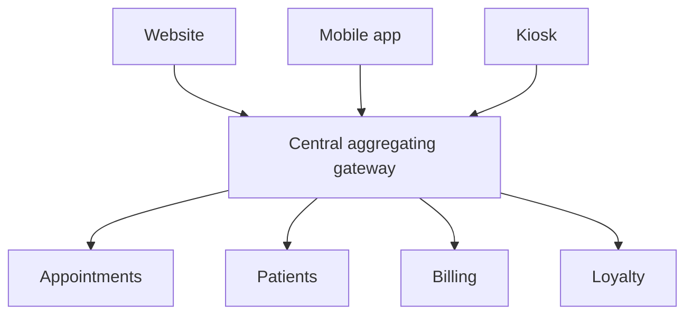
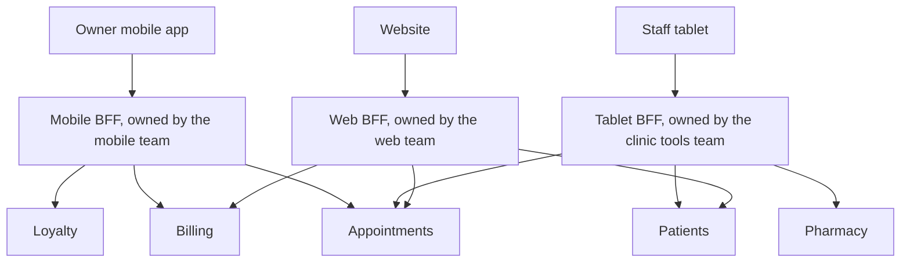
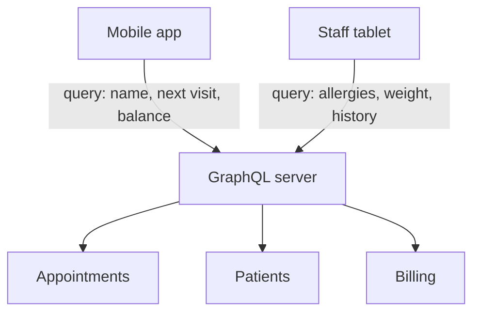
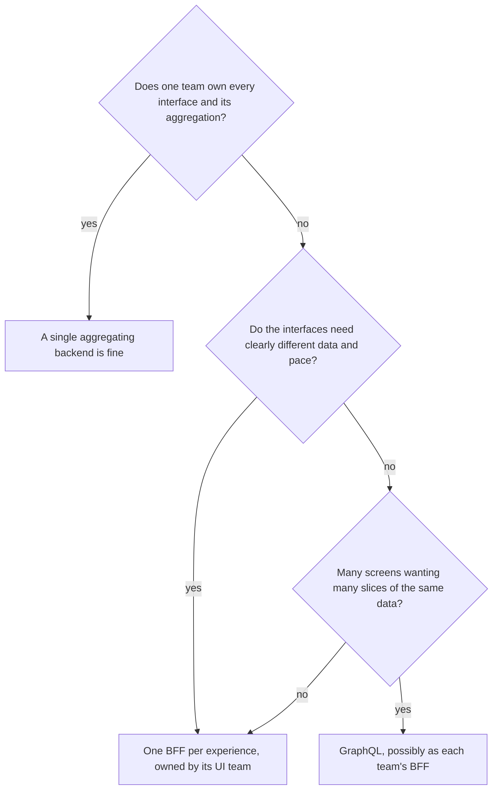

# Aggregating gateways, backends for frontends and GraphQL

## Before this lesson

> **Before this lesson:** read [Who owns the user interface?](#/lesson/microservices/ui-decomposition), for stream-aligned teams and the constraints of mobile devices, and [Technology choices](#/lesson/microservices/technology-choices), for REST and GraphQL. API gateways were introduced in [Handling change](#/lesson/microservices/handling-change).

## In plain words

In a restaurant you do not walk to the grill for your steak, then to the salad counter, then to the bar. A waiter takes your order, visits all three, and brings everything to your table on one tray. The waiter also adapts: a child gets a smaller portion and no wine list.

Now picture a restaurant with one waiter for the whole building: the dining room, the terrace, the takeaway hatch and room service. Every request goes through that one person, who must know the habits of every kind of customer. They become the slowest part of the restaurant, and any change to how the terrace is served means retraining the person who also serves everyone else.

The sensible arrangement is a waiter for each section, who knows that section's customers.

In software, the tray-carrying role is **call aggregation**: a component on the server side that collects data from several services and hands the user interface one tidy response. The single waiter for the whole building is a **central aggregating gateway**. The waiter per section is a **backend for frontend (BFF)**. And there is a third way, in which the customer fills in a detailed order form and the kitchen assembles exactly that: **GraphQL**.

Why this matters for a job: the BFF pattern is used at most companies with mobile apps, and "how does the mobile app get its data from twenty services?" is a standard design-interview question.

## 1. The problem: chatty screens on slow networks

Pawprint's mobile home screen shows the pet's name, the next appointment, the balance due and the loyalty points. Those live in four services. The simplest approach is for the app to call all four directly.

Three things are wrong with that:

- **Round trips are expensive on mobile.** Each call from a phone crosses a mobile network, with a delay of perhaps 150 ms or more per trip and a real chance of failure. Calls between services inside a data centre take a few milliseconds.
- **The app receives far more than it shows.** Each service returns its full document, and the phone downloads and discards most of it.
- **The app is coupled to the internal structure.** If Patients is split in two next year, every installed copy of the app must change, and old copies stay in use for months.

```python-run
MOBILE_ROUND_TRIP_MS = 150          # phone to data centre and back, per call
SERVICE_MS = {"patients": 20, "appointments": 35, "billing": 60, "loyalty": 25}

# Option A: the phone calls each service itself, one after another.
direct_sequential = sum(MOBILE_ROUND_TRIP_MS + ms for ms in SERVICE_MS.values())

# Option B: the phone calls them all at once (possible, but four radio connections).
direct_parallel = MOBILE_ROUND_TRIP_MS + max(SERVICE_MS.values())

# Option C: one call to an aggregator in the data centre, which fans out in parallel.
INTERNAL_HOP_MS = 2
aggregated = MOBILE_ROUND_TRIP_MS + INTERNAL_HOP_MS + max(SERVICE_MS.values())

print(f"A. four calls from the phone, in sequence : {direct_sequential} ms, 4 mobile round trips")
print(f"B. four calls from the phone, in parallel : {direct_parallel} ms, 4 mobile round trips")
print(f"C. one call to a server-side aggregator   : {aggregated} ms, 1 mobile round trip")

for loss in [0.02, 0.10]:
    print(f"   with {loss:.0%} of mobile round trips failing: "
          f"4 trips all succeed {(1 - loss) ** 4:.1%} of the time, 1 trip {(1 - loss):.1%}")
```

`SERVICE_MS` gives each service's own processing time. Option A adds a mobile round trip to every call and sums them: 740 ms. Option B starts all four together, so the time is one round trip plus the slowest service; it is fast when it works, and it opens four connections over the radio, which costs battery and still depends on all four arriving. Option C makes one mobile round trip to a component inside the data centre, which calls the four services in parallel over the fast internal network: about 212 ms.

The last lines look at reliability. On a poor connection where one round trip in ten fails, four independent trips all succeed only about two times in three, while one trip succeeds nine times in ten. Aggregating on the server side is faster and also sturdier. It also gives one place to trim the response to what the screen shows.

So something on the server side should aggregate. The question is what, and who owns it.

## 2. The central aggregating gateway

A **central aggregating gateway** is a single component at the edge of the system that does call aggregation for every user interface.



It solves the chattiness. Its problems are about ownership and growth:

- **Who owns it?** If a central team does, every UI team must ask that team for each new screen: the layout-department bottleneck from the last lesson, moved one layer down. If every team may change it, nobody is responsible for its health.
- **Different interfaces need different things.** The kiosk wants large images and little text. The phone wants the reverse. One aggregated response either carries everything for everyone, or grows a branch for each client.
- **It attracts logic.** Combining data from services is a short step from making decisions about that data. Business rules that belong in services start to gather in the gateway.

Two cautions about products. First, do not confuse this with the *API gateway* of lesson 12, whose job is cross-cutting concerns such as routing, API keys and rate limiting. Aggregation logic is specific to your product and changes with your screens; put into a general-purpose gateway product, it ends up written as configuration in a vendor's own language, hard to test and version. Second, a central aggregator is acceptable when one team owns it *and* all the interfaces it serves, which is common in small organisations. The trouble starts when several teams share it.

## 3. The backend for frontend

A **backend for frontend (BFF)** is a server-side component dedicated to **one** user interface. It aggregates and shapes data for exactly that interface, and it is owned by the same team that builds the interface.



The important word is *ownership*. Because the mobile team owns the mobile BFF, it can change the app and its backend together, in one piece of work, without asking anyone. The BFF is in effect the server-side half of the user interface. The handoff has gone.

What a BFF does:

- **Aggregates.** One call from the UI becomes several parallel calls to services.
- **Shapes.** It returns only the fields that this UI displays, in the structure this UI wants.
- **Handles partial failure.** If Loyalty is down, it returns the rest with that part marked as missing, so the UI can degrade (lesson 25).
- **Shields the UI from internal change.** If Patients is split in two, the BFF is updated and old app versions continue to work.
- **Handles interface-specific concerns.** For example, holding the user's session and passing a token downstream (lesson 24).

What it must *not* do is hold business rules. "A deposit is required for surgery" belongs in a service, where every interface gets the same answer.

```python-run
# ---- downstream services (each returns far more than any one screen needs) ----
def patients(pet):     return {"name": "Miso", "species": "cat", "born": "2019-03-02", "weight_kg": 4.1,
                               "allergies": ["penicillin"], "microchip": "985-112", "notes": "nervous at the clinic"}
def appointments(pet): return {"next": "Tue 10:00", "vet": "Dr Lim", "room": 3, "reason": "vaccination", "history": 14}
def billing(pet):      return {"balance_cents": 4500, "currency": "SGD", "last_invoice": "INV-2207"}
def loyalty(pet):      raise TimeoutError("loyalty is not responding")

def fetch(calls, pet):
    """Call several services (in parallel in real life). A failure becomes None, not an exception."""
    results = {}
    for name, fn in calls.items():
        try:
            results[name] = fn(pet)
        except Exception:
            results[name] = None
    return results

# ---- BFF 1: the owner's phone. Small screen, slow network: a few friendly fields. ----
def mobile_home(pet):
    r = fetch({"patients": patients, "appointments": appointments, "billing": billing, "loyalty": loyalty}, pet)
    return {
        "title": f"{r['patients']['name']}'s next visit" if r["patients"] else "Your next visit",
        "when": r["appointments"]["next"] if r["appointments"] else None,
        "amount_due": f"${r['billing']['balance_cents'] / 100:.2f}" if r["billing"] else None,
        "points": r["loyalty"]["points"] if r["loyalty"] else None,       # None tells the app to hide the panel
    }

# ---- BFF 2: the vet's tablet. Different services, clinical detail, no billing. ----
def tablet_consultation(pet):
    r = fetch({"patients": patients, "appointments": appointments}, pet)
    p, a = r["patients"], r["appointments"]
    return {"patient": f"{p['name']} ({p['species']}, {p['weight_kg']} kg)", "ALLERGIES": p["allergies"],
            "reason": a["reason"], "room": a["room"], "previous_visits": a["history"], "notes": p["notes"]}

print("mobile BFF :", mobile_home(7))
print("tablet BFF :", tablet_consultation(7))
```

The four functions at the top stand in for services; Loyalty is failing. `fetch` calls a set of services and turns any failure into `None`. `mobile_home` is the phone's BFF endpoint: it asks four services and returns four short, display-ready values, including a formatted amount. Loyalty failed, so `points` is `None`, and the app hides that panel; the screen still works. `tablet_consultation` is the vet tablet's BFF endpoint: it asks only two services and returns clinical detail the owner's phone never needs, with allergies made prominent.

Both BFFs sit on the same services and return completely different shapes. Neither forced a compromise on the other, and each can change when its own screen changes. The practice problem *Backend for Frontend: Aggregate with Fallbacks* asks you to write such an aggregator.

### How many BFFs?

The guiding rule is **one BFF per user experience**, and in practice per team:

- If the iPhone app and the Android app offer the same experience and are built by one team, one mobile BFF serves both.
- If they are built by different teams, or differ in behaviour, give each its own.
- A third-party partner integration can have its own BFF too: an external party is another kind of consumer with its own needs and its own pace of change.

### What about duplicated code?

Two BFFs will contain similar aggregation code, and the urge to merge them into one shared component is strong. Resist it at first. A shared BFF is a central aggregating gateway by another name, with the ownership problem back. Some duplication is the price of independence (lesson 12 made the same point about libraries).

When the same logic appears in several BFFs and is plainly about the *domain* (for example, "combine an appointment with its pet and owner"), the better move is to push it down into a service, where it belongs, not sideways into a shared library.

### BFFs for the web

A website that builds pages on the server is already playing the BFF role: the server-side web application aggregates and renders. A single-page application running in the browser benefits from a BFF for the same reasons a mobile app does.

## 4. GraphQL

**GraphQL** (lesson 11) lets the client send a query describing exactly the data it wants, and get back that shape in one response. That addresses the same two problems, aggregation and shaping, from the client's side.



The appeal is that a new screen needing a new combination of fields often requires no server change: the client writes a different query. For some organisations this removes the need for a BFF per interface.

Keep these points in mind:

- **There is still a server-side component**, the GraphQL server, with resolvers that call the services. Someone owns it. If it is shared by all teams, watch for the same central-ownership problem.
- **The costs from lesson 11 apply**: expensive queries written by clients, harder HTTP caching, awkward writes, and the temptation to expose storage structures directly.
- **GraphQL and BFFs combine well.** A team can implement its BFF *as* a GraphQL endpoint for its own interface. The ownership stays with the UI team; the query language gives flexibility.

## 5. Choosing

| | Central aggregating gateway | Backend for frontend | GraphQL |
|---|---|---|---|
| Aggregation happens in | One shared component | One component per interface | A query server, driven by client queries |
| Owned by | A central team, or everyone | The team that owns that interface | Varies; shared or per team |
| Tailoring per interface | Poor, or by accumulating branches | Excellent | Good: each client asks for what it needs |
| Risk | Bottleneck; a home for stray logic | Duplication between BFFs | Costly queries; caching; central ownership if shared |
| Good fit | One team owning all interfaces | Several interfaces or teams with differing needs | Many varied screens over the same data; external developers |



### Worked example: Pawprint

| Interface | Team | Server-side component | Notes |
|---|---|---|---|
| Owner mobile app, both platforms | Mobile team | One mobile BFF | Same experience on both phones; returns small, display-ready responses; tolerates Loyalty being down |
| Staff tablet | Clinic tools team | Tablet BFF | Clinical detail; calls Patients, Appointments and Pharmacy |
| Owner website | Web teams (page-based micro frontends) | Each page group's own server side | Already plays the BFF role |
| Laboratory partner | Integrations team | Partner BFF | A stable, versioned API for an outside party |
| Everything | Platform team | API gateway in front of all of the above | Routing, rate limits, TLS; no aggregation |

The shared "appointment with pet and owner" combination, which appeared in three BFFs, was later moved into an endpoint of the Appointments service.

> [!INTERVIEW]
> For "how should a mobile app get data from many microservices?": *not by calling them all directly: that is slow and fragile on mobile networks and couples the app to internal structure. I would put a backend for frontend between them: a server-side component owned by the mobile team that fans out to services in parallel, tolerates partial failure, and returns exactly what each screen needs. One BFF per user experience. I would keep business rules out of it and keep the general API gateway for cross-cutting concerns only. GraphQL is an alternative, or a way to implement the BFF, when screens need many varied slices of data.*

## 6. Pitfalls

- **The app calls every service directly.** Slow, fragile, and tied to your internal design for as long as old app versions exist.
- **One aggregator shared by all teams.** A queue forms in front of it, or it decays.
- **Aggregation written as gateway-product configuration.** Product-specific logic ends up untestable.
- **Business rules in the BFF.** Different interfaces start giving different answers.
- **One BFF per screen or per developer.** Aim for one per user experience.
- **Merging BFFs to remove duplication.** You rebuild the central gateway.
- **A BFF with no partial-failure handling.** One slow optional service blanks the whole screen.
- **Sequential downstream calls in the BFF.** Call independent services in parallel.
- **GraphQL mapped straight onto database tables.** Clients become coupled to storage.

## Summary

- Screens often need data from several services; direct calls from a device are slow, unreliable and couple the interface to internals.
- Server-side call aggregation gives one round trip and a place to shape the response.
- A central aggregating gateway does this for all interfaces and tends to become a bottleneck and a home for stray logic once several teams depend on it.
- A backend for frontend is a dedicated aggregator per user experience, owned by the team that owns that interface; it aggregates, shapes, handles partial failure and shields the UI from internal change.
- Accept some duplication between BFFs; move truly shared domain logic down into services.
- GraphQL lets clients ask for exact shapes and can replace or implement a BFF, with its own costs.
- Keep the general API gateway for cross-cutting concerns, separate from aggregation.

## Glossary

| Term | Meaning |
|---|---|
| Call aggregation | Combining several service calls into one response for a user interface |
| Round trip | One request and its response between a client and a server |
| Central aggregating gateway | A single shared component that aggregates calls for all interfaces |
| Backend for frontend | A server-side component dedicated to one user interface and owned by its team |
| Fan-out | One incoming request causing several outgoing calls |
| Shaping | Trimming and restructuring data to suit one interface |
| Partial failure | Some of the needed calls failing while others succeed |
| User experience | A distinct way of using the product, such as the owner's phone app |
| GraphQL server | The server-side component that resolves client queries against services |
| Resolver | The function that fetches the data for one field of a GraphQL query |

```quiz
[
  {"q": "Why is it a poor idea for a mobile app to call ten microservices directly?", "options": ["Phones cannot make HTTP calls", "Each mobile round trip is slow and may fail, the app downloads data it does not show, and it becomes coupled to internal service structure", "Microservices refuse mobile traffic", "It uses too little battery"], "answer": 1,
   "explain": "Server-side aggregation reduces round trips over the slow network, trims responses and hides internal change."},
  {"q": "What is the main weakness of a central aggregating gateway shared by many teams?", "options": ["It cannot aggregate", "Ownership: it becomes a bottleneck every UI team waits on, and it accumulates logic for every client", "It only works with GraphQL", "It is always slower than direct calls"], "answer": 1,
   "explain": "One shared component for all interfaces recreates central coupling and a delivery queue."},
  {"q": "What defines a backend for frontend?", "options": ["A database for the UI", "A server-side component dedicated to one user interface and owned by the team that builds that interface", "A gateway product bought from a vendor", "A shared library of UI components"], "answer": 1,
   "explain": "Shared ownership of the UI and its backend removes the handoff, and the BFF can be tailored to exactly one experience."},
  {"q": "The iPhone and Android apps offer the same experience and are built by one team. How many BFFs are appropriate?", "options": ["One per screen", "One shared mobile BFF", "One per developer", "None"], "answer": 1,
   "explain": "The rule of thumb is one BFF per user experience, and per team. The same experience from one team needs one."},
  {"q": "The Loyalty service is down. What should the mobile BFF return for the home screen?", "options": ["An error for the whole screen", "The other data, with the loyalty part marked missing so the app can hide that panel", "Stale data from another user", "Nothing until Loyalty recovers"], "answer": 1,
   "explain": "Handling partial failure in the BFF lets the screen degrade instead of failing."},
  {"q": "Where should a rule such as 'surgery requires a deposit' live?", "options": ["In each BFF", "In the API gateway configuration", "In the service that owns that part of the domain", "In the mobile app"], "answer": 2,
   "explain": "Business rules belong in services so every interface gets the same behaviour. BFFs aggregate and shape."},
  {"q": "Two BFFs contain similar aggregation code. What is the recommended response?", "options": ["Merge them into one shared BFF immediately", "Accept some duplication; if the logic is clearly domain logic, move it into a service", "Delete one BFF", "Put the code in the API gateway"], "answer": 1,
   "explain": "Merging recreates a central aggregator. Shared domain logic belongs in a service, not in a shared BFF."},
  {"q": "How does GraphQL relate to the BFF pattern?", "options": ["They cannot be used together", "GraphQL can replace a BFF for some needs, or be the way a team implements its BFF", "GraphQL removes the need for any server-side component", "GraphQL is only for databases"], "answer": 1,
   "explain": "A GraphQL server still aggregates on the server side. It can be shared, or owned per interface as that team's BFF."}
]
```

> **Source:** Newman, *Building Microservices*, 2nd ed., ch. 14 (topic coverage only; wording and the Pawprint example are original). Sam Newman, "Pattern: Backends For Frontends", https://samnewman.io/patterns/architectural/bff/ ; GraphQL documentation, https://graphql.org/learn/
