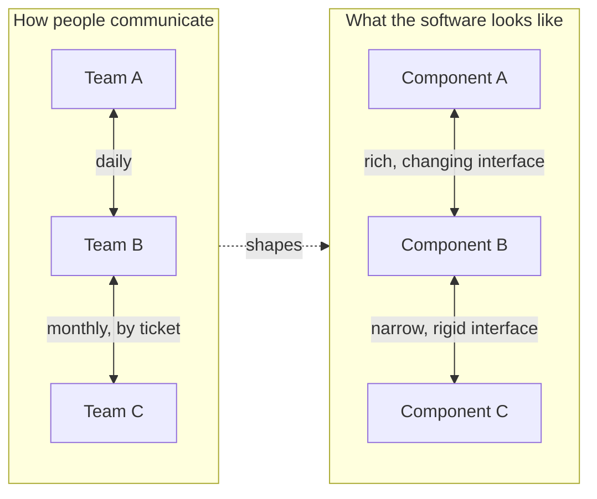
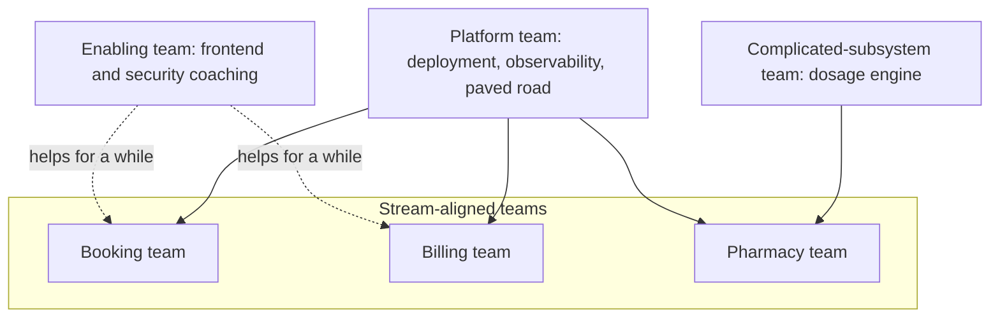

# Conway's law and team structure

## Before this lesson

> **Before this lesson:** read [Information hiding, coupling and cohesion](#/lesson/microservices/coupling-cohesion) and [Who owns the user interface?](#/lesson/microservices/ui-decomposition), where stream-aligned and enabling teams were introduced. No management experience is assumed.

## In plain words

Three firms are hired to build a house together: one for the plumbing, one for the electrics, one for the walls. They meet once a month. When the house is finished, you can see the meetings in it. Pipes and cables run in separate channels that never share a wall cavity, because sharing would have needed the plumbers and electricians to talk every day. Where the firms did talk, the parts fit together well. Where they did not, there is a visible seam.

The house has the shape of the conversations between the people who built it.

Software is the same, and the observation has a name: **Conway's law**. A system's structure ends up copying the communication structure of the organisation that produced it. If two teams rarely speak, the software between them will have a hard boundary. If six people sit together and talk all day, the code they write will be closely intertwined.

This matters a great deal for microservices. The whole point of the architecture is that small teams can change and release their part without waiting for others. That only works when the team boundaries and the service boundaries are the same lines. Drawing service boxes without changing who owns what, and who must talk to whom, produces the costs of microservices without the benefit.

Why this matters for a job: you will join a team, and the way teams are arranged will shape your daily work more than any framework. Senior interviews often include "how would you organise teams around this architecture?", and Conway's law is the expected starting point.

## 1. Conway's law

In 1968 the programmer Melvin Conway wrote a paper observing that organisations which design systems are bound to produce designs that copy their own communication structures. The idea was later nicknamed Conway's law.

The mechanism is ordinary. To make two pieces of software fit together, the people writing them must agree on the join: what is passed across, in what form, in what order. Agreement needs communication. Where communication is easy and frequent, the join can be detailed and can change often. Where communication is slow and formal, people protect themselves with a narrow, fixed interface, or avoid the join altogether.

Two studies are often cited in support:

- Researchers at Harvard Business School compared products built by tightly organised commercial teams with similar open-source products built by loosely connected volunteers. The loosely connected groups produced noticeably more modular code.
- A study at Microsoft of one release of Windows found that measurements of the *organisation* (how many engineers and how many separate groups touched a component) predicted which components would be failure-prone better than measurements of the code itself.

The conclusion for an architect is uncomfortable and useful: **you cannot choose an architecture independently of the organisation**. If you want a certain structure in the software, arrange the teams so that it is the natural result.



## 2. Loosely coupled organisations

Lesson 5 defined loose coupling for services: a change in one seldom forces a change in another. The same idea applies to teams. Research on software delivery (reported in the book *Accelerate*) found that the teams which deliver fastest and most reliably can do the following *without* needing permission or coordination from outside the team:

- make significant changes to the design of their system;
- complete their work without fine-grained communication with other teams;
- deploy their product or service on demand, regardless of the services it depends on;
- do most of their testing on demand, without a shared integrated environment;
- deploy during normal working hours with negligible downtime.

Read that list again as a description of software. It is independent deployability, contract tests and zero-downtime releases, seen from the people's side. The architecture and the organisation are two views of one thing.

| | Tightly coupled organisation | Loosely coupled organisation |
|---|---|---|
| Decisions | Made centrally, handed down | Made by the team doing the work, within agreed limits |
| A typical feature | Needs several teams in sequence | Completed inside one team |
| Releases | Coordinated across teams | Each team releases its own |
| Ownership | Shared by many, or unclear | Clear, per team |
| Communication between teams | Constant and detailed | Occasional, through stable interfaces |

## 3. Team size

Why small teams? Because the number of possible conversations grows much faster than the number of people.

```python-run
def communication_paths(people):
    return people * (people - 1) // 2

print("people   pairs who may need to talk")
for n in [3, 5, 8, 12, 20, 50, 150]:
    print(f"{n:5d}   {communication_paths(n):6,d}  " + "#" * min(60, communication_paths(n) // 4))

big = communication_paths(48)
small = 6 * communication_paths(8) + communication_paths(6)       # six teams of 8, plus links between the six teams
print(f"\n48 people as one group     : {big:,} possible pairs")
print(f"48 people as 6 teams of 8  : {small:,} (inside the teams, plus team-to-team links)")
```

`communication_paths` counts the distinct pairs in a group: each of `n` people can pair with `n - 1` others, and dividing by two avoids counting each pair twice. Eight people have 28 pairs, which one person can keep in their head. Twenty have 190. Fifty have more than 1,200. The second calculation takes 48 people. As one group there are 1,128 possible pairs. As six teams of eight, where people talk freely inside a team and the teams deal with each other as six units, the total is 183. Small teams with clear interfaces between them are a way of cutting the communication a large organisation needs.

This arithmetic lies behind a familiar rule from Amazon: a team should be small enough to be fed by two pizzas, which works out at roughly eight people or fewer. It also explains an old observation by Fred Brooks, that adding people to a late project tends to make it later: the new people add more communication than output.

So an organisation scales by having many small teams. The difficulty moves from communication inside a team to **coordination between teams**, and the goal of everything else in this lesson is to keep that small.

## 4. Autonomy, with alignment

**Autonomy** means a team has the freedom to decide how to do its work. It is what makes small teams fast. It is not the freedom to do anything at all.

Useful autonomy comes with clear limits: the team knows the goal it is responsible for, the standards every service must meet (lesson 33), and the boundaries of what it owns. Within those, it decides for itself. A common phrase is that teams should be *aligned* on goals and *autonomous* in how they reach them. Autonomy without alignment gives twenty teams pulling in twenty directions. Alignment without autonomy gives central planning and queues.

Giving a team autonomy also means giving it responsibility for the result, including in production. The slogan "you build it, you run it", associated with Amazon, expresses this: the team that writes a service also deploys it, watches it and is called when it breaks. Feeling the consequences of your own design is a powerful reason to design well.

## 5. Ownership

**Ownership** answers the question: who may change this service, and who is responsible for it?

| Model | How it works | Suits |
|---|---|---|
| Strong ownership | One team owns each service. Others ask that team for changes, or submit a proposed change for its approval | Many teams; clear accountability |
| Collective ownership | Any developer may change any service | One team, or very few teams working closely |

With strong ownership, each service has exactly one team to call, the team can keep the service's design coherent, and it controls its own releases. This is the model that pairs naturally with microservices at any real size.

Collective ownership avoids waiting for another team, since you make the change yourself. It needs everyone to know everything well enough to change it safely, and needs consistent practices everywhere. That holds for ten developers and fails for a hundred. With collective ownership there is also a risk that nobody feels responsible for a service's long-term health.

A workable blend at scale: strong ownership between teams, collective ownership inside each team.

## 6. Kinds of team

The book *Team Topologies* by Matthew Skelton and Manuel Pais gives a small vocabulary that has become standard.

| Team type | Purpose | Example at Pawprint |
|---|---|---|
| Stream-aligned | Delivers a slice of the product end to end, for one area of the business. Most teams should be this kind | Booking team; Billing team |
| Enabling | Specialists who help stream-aligned teams acquire a capability, then step back | Two frontend experts; a security champion group |
| Platform | Provides internal tools and services that make the other teams' work easier | The team running the deployment platform and observability stack |
| Complicated-subsystem | Owns a part needing rare, deep expertise | The team maintaining the dosage-calculation engine |

The stream-aligned team is the main unit. The other three exist to reduce its load, so that it can deliver without waiting.



Two further structures cut across teams:

- A **community of practice** (some companies say guild or chapter) is a voluntary group of people from different teams who share a skill or interest, such as testing or the Go language. It spreads knowledge sideways and gives specialists a professional home without pulling them out of their teams.
- **The platform** deserves special care, and the next lesson covers it. The essential point here: a platform team's customers are the other developers, and its success is measured by whether they *choose* to use what it offers.

## 7. Conway's law in reverse

If structure follows communication, you can change the structure by changing the communication first. Reorganising teams to obtain the architecture you want is sometimes called the **inverse Conway manoeuvre**.

It works in practice. A company with separate frontend, backend and database teams gets a layered system. If it wants services organised around business capabilities, the first step is to form teams around those capabilities and give each one ownership of everything in its slice. The code follows the people.

### Geography

Distance is a strong influence on communication. People in the same room talk dozens of times a day at no cost. People in different cities, and especially different time zones, communicate less often and more formally.

So match boundaries to places. Give each location clear ownership of whole services. Do not split ownership of one service across two sites: the people on each side will find the fine-grained coordination painful, and over time the service will either split along the geographic line or decay. If two sites must collaborate, do it across a stable, well-defined interface between services.

### Checking the fit

You can test whether an organisation and its architecture agree with data that most companies already have: who owns each service, and which services call which.

```python-run
owner = {"appointments": ["booking"], "slot-search": ["booking"], "billing": ["billing"],
         "invoicing": ["billing"], "pharmacy": ["pharmacy"], "patients": ["booking", "pharmacy", "billing"],
         "notifications": []}
calls = [("appointments", "slot-search"), ("appointments", "patients"), ("appointments", "billing"),
         ("billing", "invoicing"), ("billing", "patients"), ("pharmacy", "patients"),
         ("pharmacy", "billing"), ("appointments", "notifications"), ("billing", "notifications")]
site = {"booking": "Singapore", "billing": "Singapore", "pharmacy": "Penang"}

print("Ownership problems:")
for service, teams in owner.items():
    if len(teams) == 0:
        print(f"   {service:14s} has NO owner (orphaned)")
    elif len(teams) > 1:
        sites = sorted({site[t] for t in teams})
        print(f"   {service:14s} is shared by {len(teams)} teams across {len(sites)} site(s): {teams}")

inside = across = 0
for a, b in calls:
    ta, tb = set(owner[a]), set(owner[b])
    if len(ta) == 1 and ta == tb:
        inside += 1
    else:
        across += 1
print(f"\ncalls that stay inside one team : {inside}")
print(f"calls that cross a team boundary: {across}  ({across / len(calls):.0%})")
```

`owner` maps each service to the teams that own it, `calls` lists which service calls which, and `site` says where each team sits. The first loop reports services with no owner and services with more than one. `notifications` is **orphaned**: when it breaks, nobody is responsible. `patients` is shared by three teams in two countries, which predicts slow, contested changes. The second loop classifies each call as staying inside a single team or crossing a team boundary. Seven of nine calls cross, so most changes to how services interact need two teams to coordinate.

The numbers suggest actions: give `patients` and `notifications` one owner each, and ask whether the boundaries could be redrawn so that more of the frequent interactions fall inside a team. The practice problem *Conway's Law: Team and Architecture Mismatch* turns this check into a scoring function.

## 8. People

Every change in this lesson changes somebody's job. A database administrator in a central group becomes a member of a product team. Developers who never thought about production start carrying a pager. A manager who coordinated releases finds that releases no longer need coordinating.

Some people welcome more responsibility. Others chose their job because it did not include being woken at night. Both reactions are reasonable. A reorganisation announced by email, to take effect on Monday, fails in a predictable way: the boxes move and the behaviour does not.

What works is the same approach recommended for the software in lesson 7: go step by step. Move one team to the new model, support it properly, learn from what happens, and let others see the result. Ask people what they want from their work. Provide training before responsibility, not after. Architecture diagrams change in an afternoon; people need longer, and without them the diagram is fiction.

### Worked example: Pawprint reorganises

Before: a frontend team (3), a backend team (7), a database administrator and an operations person. Every feature crosses at least three groups. The backend team's service calls are heavily intertwined, as Conway would predict.

After, introduced over nine months, one team at a time:

| Team | Type | Owns | Site |
|---|---|---|---|
| Booking | Stream-aligned | Appointments, slot search, booking pages, Patients | Singapore |
| Billing | Stream-aligned | Billing, invoicing, payment pages, Notifications | Singapore |
| Pharmacy | Stream-aligned | Pharmacy, stock, the dosage engine | Penang |
| Platform | Platform | Pipeline templates, Kubernetes, logging and tracing | Singapore |
| Frontend guild | Community of practice plus two enabling specialists | The design system | Both |

`patients` went to Booking, which changes it most; the other teams read it through its API. `notifications` went to Billing. The Penang office owns complete services and collaborates with Singapore across service APIs only.

> [!INTERVIEW]
> For "how should teams be organised for microservices?": *Conway's law says the system will mirror the communication structure, so I would align team boundaries with service boundaries. Small stream-aligned teams, around eight people, each own a business slice end to end with strong ownership, including running it in production. Enabling teams spread scarce expertise, and a platform team makes the common tasks easy. I would avoid layered teams, shared ownership of a service, and splitting one service across sites. And I would introduce the change incrementally, because it changes people's jobs.*

## 9. Pitfalls

- **Adopting microservices without changing team ownership.** You get distributed complexity and the same coordination as before.
- **Teams organised by technical layer.** Every feature needs handoffs.
- **A service owned by several teams.** Every change is a negotiation, and nobody feels responsible.
- **Orphaned services.** Nobody answers when it fails or needs an upgrade.
- **Teams that are too large.** Internal communication swallows the time.
- **Autonomy without alignment.** Teams optimise locally and the whole suffers.
- **One service split across distant sites.** Fine-grained coordination across time zones does not hold.
- **A platform nobody asked for.** If teams are forced to use it, its quality is never tested.
- **Reorganising overnight.** Structure changes on paper; habits do not.

## Summary

- Conway's law: a system's structure mirrors the communication structure of the organisation that builds it. Architecture and organisation cannot be chosen separately.
- High-performing teams can change, test and deploy their services without coordinating with others, which is the organisational side of independent deployability.
- Communication paths grow roughly with the square of group size, so organisations scale through small teams with clear interfaces.
- Autonomy needs alignment on goals and standards, and comes with responsibility for running what you build.
- Strong ownership by one team per service suits organisations of any size; collective ownership suits a single team.
- Team types: stream-aligned (the default), enabling, platform and complicated-subsystem, with communities of practice across them.
- To change the architecture, change the teams; match service ownership to locations; and bring people along step by step.

## Glossary

| Term | Meaning |
|---|---|
| Conway's law | Systems copy the communication structure of the organisations that design them |
| Loosely coupled organisation | One whose teams can work and release without coordinating with other teams |
| Two-pizza team | A team small enough to be fed by two pizzas, about eight people |
| Autonomy | A team's freedom to decide how to do its work |
| Alignment | Shared understanding of goals and standards across teams |
| Strong ownership | One team owns a service and controls changes to it |
| Collective ownership | Anyone may change any service |
| Stream-aligned team | A team delivering one slice of the product end to end |
| Enabling team | Specialists who help other teams build a capability |
| Platform team | A team providing internal tools and services to other teams |
| Complicated-subsystem team | A team owning a part that needs rare expertise |
| Community of practice | A voluntary cross-team group sharing a skill or interest |
| Inverse Conway manoeuvre | Reorganising teams to bring about a desired architecture |
| Orphaned service | A service with no owning team |

```quiz
[
  {"q": "What does Conway's law state?", "options": ["Software doubles in size every two years", "A system's structure mirrors the communication structure of the organisation that builds it", "Small teams always write better code", "Every service needs its own database"], "answer": 1,
   "explain": "People must communicate to agree on how parts fit, so the shape of communication becomes the shape of the system."},
  {"q": "A company has separate frontend, backend and database teams. What architecture is it likely to produce?", "options": ["Services organised around business capabilities", "A system layered along the same lines, with features needing changes in every layer", "A serverless system", "No architecture at all"], "answer": 1,
   "explain": "The system follows the team boundaries. Layered teams give layered software and handoffs for every feature."},
  {"q": "How many distinct pairs of people are there in a team of 8, and in a group of 50?", "options": ["8 and 50", "28 and 1,225", "16 and 100", "64 and 2,500"], "answer": 1,
   "explain": "Pairs are n(n-1)/2: 28 for 8 people and 1,225 for 50. Communication load grows much faster than headcount."},
  {"q": "What does 'you build it, you run it' mean?", "options": ["Developers buy their own servers", "The team that writes a service also deploys it, monitors it and is called when it fails", "Operations staff write all the code", "Each developer works alone"], "answer": 1,
   "explain": "Owning the whole life of a service gives the team direct feedback from production and a reason to build it well."},
  {"q": "Which ownership model fits an organisation with twenty teams?", "options": ["Collective ownership of everything", "Strong ownership: one team per service", "No ownership", "Ownership by the newest employee"], "answer": 1,
   "explain": "Clear single-team ownership gives accountability and coherent design. Collective ownership only holds at small scale."},
  {"q": "What is the role of an enabling team?", "options": ["To build features for other teams", "To help stream-aligned teams gain a capability and then step back", "To approve every deployment", "To own all the databases"], "answer": 1,
   "explain": "Enabling teams spread scarce expertise by coaching and tooling, without becoming a queue that work must pass through."},
  {"q": "One service is owned jointly by people in two offices eight time zones apart. What does this lesson advise?", "options": ["Add more meetings", "Give each location ownership of whole services and collaborate across service interfaces", "Move everyone to one building immediately", "Share all services between both offices"], "answer": 1,
   "explain": "Distance makes fine-grained coordination costly. Align service boundaries with locations."},
  {"q": "What is the inverse Conway manoeuvre?", "options": ["Writing code before forming teams", "Changing the team structure in order to bring about the architecture you want", "Reversing a deployment", "Merging all teams into one"], "answer": 1,
   "explain": "Since structure follows communication, reorganising who talks to whom is a way to steer the design."}
]
```

> **Source:** Newman, *Building Microservices*, 2nd ed., ch. 15 (topic coverage only; wording and the Pawprint example are original). Melvin Conway, "How Do Committees Invent?", Datamation, 1968. Skelton and Pais, *Team Topologies* (2019). Forsgren, Humble and Kim, *Accelerate* (2018).
