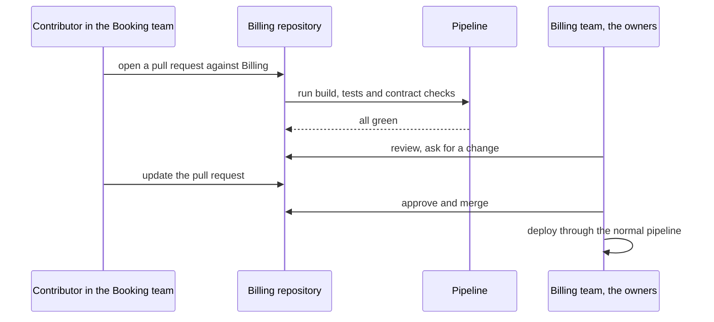

# Shared microservices, internal open source and the paved road

## Before this lesson

> **Before this lesson:** read [Conway's law and team structure](#/lesson/microservices/conway-teams). You should know strong and collective ownership, the four team types and what an orphaned service is. Pull requests and pipelines come from [Continuous integration and build pipelines](#/lesson/microservices/ci-pipelines).

## In plain words

A block of flats has one shared laundry room. When the washing machine breaks, who fixes it? If the answer is "whoever notices", nobody does. If the answer is "the caretaker", the machine waits for the caretaker, who also has the lift and the roof to deal with. Residents queue.

There are several ways out. The residents could wait their turn. The building could hire a second caretaker. Each flat could get its own machine. Or the caretaker could say: "Any resident who knows how may repair it, as long as I check the work before the machine is switched back on."

Services have the same problem when several teams need changes to one service that a single team owns. The last answer, letting others contribute under the owner's review, is called **internal open source**, and it is one of the main subjects of this lesson.

The second subject is a different picture. A city wants more people to cycle. It could pass a law saying exactly which route every cyclist must take. Or it could build one excellent cycle path: smooth, lit, well signed. Nobody is forced onto it, and most people choose it because it is the easiest way. Engineers call this a **paved road**: a well-supported standard way of building and running services that teams follow because it saves them work.

Why this matters for a job: in a company of any size you will regularly need a change in a service you do not own, and you will work with (or on) an internal platform. Knowing the options, and their costs, is part of working well across teams.

## 1. When several teams need the same service

Lesson 31 recommended strong ownership: one team per service. Reality bends this. A service ends up needing changes from several teams, for a few recurring reasons:

- **The boundary is wrong.** The service bundles capabilities that belong to different teams, and splitting it looks expensive.
- **Feature-shaped work.** A new feature for one team needs a small addition in a service another team owns.
- **A delivery bottleneck.** The owning team has a long backlog, so other teams are tempted to make the change themselves.

The first instinct is often to declare the service jointly owned. That gives the worst outcome: shared ownership means every change is a negotiation and nobody is accountable for the whole (lesson 31).

Better options, roughly from least to most effort:

| Option | How it works | Cost |
|---|---|---|
| Wait | The requesting team waits for the owner to do the work | Delay; acceptable when the change is not urgent |
| Lend people | Someone from the requesting team joins the owning team for a while | Disruption for that person; spreads knowledge |
| Internal open source | The requesting team makes the change and the owner reviews and merges it | Review effort for the owner; needs good tooling |
| Split the service | Divide it so each team owns the part it changes most | A real migration; the right answer when the boundary is wrong |
| Pluggable modules | The owner provides a framework and other teams supply modules that plug into it | Teams share one deployment and its release schedule; use with care |

The effect of the bottleneck, and of the third option, can be seen in a small model.

```python-run
def weeks_to_clear(requests, owner_capacity_per_week, contributor_does_the_work=False,
                   review_cost=0.2):
    """requests: list of sizes in person-weeks, all arriving in week 0. Returns the average wait."""
    waits, clock = [], 0.0
    for size in requests:
        owner_effort = size * review_cost if contributor_does_the_work else size
        # Contributors build in parallel (their own time); the owner's queue only holds the reviews.
        build_time = size if contributor_does_the_work else 0
        clock += owner_effort / owner_capacity_per_week
        waits.append(max(clock, build_time))
    return sum(waits) / len(waits), max(waits)

requests = [1, 2, 1, 3, 1, 2, 2, 1]        # eight changes wanted by other teams, in person-weeks
for label, kwargs in [("owner does everything", {}),
                      ("internal open source (owner reviews)", {"contributor_does_the_work": True})]:
    avg, worst = weeks_to_clear(requests, owner_capacity_per_week=1.0, **kwargs)
    print(f"{label:38s} average wait {avg:4.1f} weeks, longest {worst:4.1f} weeks")
```

Eight changes totalling thirteen person-weeks arrive at a team that can give one person-week per week to outside requests. In the first run the owning team does all the work, one change after another, so the last requester waits thirteen weeks and the average is about seven. In the second run each requesting team writes its own change, at the same time as the others, and the owning team spends a fifth of the effort reviewing each. The average wait falls to about two weeks and the longest to three. The total effort is slightly higher, since reviews are extra. What changed is that the work no longer queues behind one team.

## 2. Internal open source

In an open-source project, a small group of trusted people, the **core committers**, may change the code directly. Everyone else is an untrusted contributor: they can read the code and propose a change, and a core committer decides whether to accept it. **Internal open source** (also called inner source) applies that model inside a company. The owning team are the core committers for their service. People in other teams contribute through **pull requests**: proposed changes submitted for review.



The owners remain fully responsible for the service. Their duties change shape:

- **Guard the quality and direction.** They may refuse a change that is poorly made or that pulls the service the wrong way, and should explain why.
- **Review promptly.** A pull request that waits two weeks for a look has recreated the queue. Agree a response time.
- **Help contributors succeed.** Clear contribution notes, a fast automated build, and a willingness to discuss an idea before the code is written.

Things that make it work:

- **Good automated tests and a pipeline that runs on every pull request**, so reviewers spend their attention on design, not on checking that it compiles.
- **Maturity of the service.** A service whose shape is still changing weekly is hard to contribute to, because the owners cannot yet say what a "good" change looks like. Open it up once the core is stable.
- **Consistency between services.** If every service uses a different language and layout, outsiders cannot contribute easily. This is one argument for a limited set of technologies (lesson 33).

### A note on reviewing changes

Review by a second person catches mistakes and spreads knowledge. It can be done at the same time as the work, by two people programming together, or afterwards through a pull request. Either works; what matters is that it happens *quickly* and by someone who understands the code.

What does not help, according to the delivery research mentioned in lesson 31, is approval by a body outside the team, such as a weekly change-approval board. Such boards slow delivery and were not found to improve stability. Peer review inside the pipeline is the better control.

## 3. Orphaned services

A service that works and rarely changes can be left alone for a long time. Then the team that built it is reorganised, and one day nobody remembers it. It still runs, still holds data, still has libraries that need security patches.

Every service needs a named owner, including the quiet ones. Two habits keep orphans from appearing:

- **A service catalogue** (lesson 12) that records the owner of every service, checked when teams are reorganised. Ownership is handed over explicitly, never left behind.
- **Limiting variety.** An old service written in a language nobody on the current teams knows is far more likely to be abandoned. This is a real cost of letting every team pick any technology.

## 4. The platform and the paved road

With many stream-aligned teams, each would otherwise solve the same problems separately: how to build, deploy, log, trace, store secrets. A **platform team** exists to solve those once. Its **platform** is the set of internal tools, services and documentation that other teams use to deliver.

The **paved road** is the supported, standard way of doing things on that platform. A team that follows it gets a great deal for free:


Four principles separate a good platform from a hated one.

**It is a product, and developers are its customers.** The platform team should talk to its users, find out what slows them down, and measure whether teams are faster because of it. A platform built from what the platform team finds interesting, with no user research, solves the wrong problems.

**It is optional.** This is the heart of the paved road idea. Teams may leave the road when they have a good reason; they then carry the extra work themselves. Because it is optional, the platform has to be *better* than the alternatives to be used, and falling adoption is honest feedback. A platform that teams are compelled to use loses that signal, and when it fits badly, teams have no way out.

**Make the right thing the easy thing.** If the secure, observable, well-tested way of building a service is also the least effort, most teams will take it without being told. Rules that make the right thing harder get worked around.

**Keep it as small as possible.** Build the thinnest platform that removes real pain. Often that starts as good documentation and a template, not a grand system. Everything the platform team builds, it must maintain.

```python-run
# Steps to get a new service safely into production, in person-days.
TASKS = {
    "repository and project skeleton": (2.0, 0.1),      # (do it yourself, on the paved road)
    "build pipeline":                  (3.0, 0.1),
    "container image and deployment":  (4.0, 0.3),
    "logging, metrics and tracing":    (4.0, 0.0),
    "secrets and TLS certificates":    (3.0, 0.2),
    "alerts and dashboard":            (2.0, 0.3),
    "security review of the setup":    (2.0, 0.0),
}
diy = sum(a for a, b in TASKS.values())
paved = sum(b for a, b in TASKS.values())
print(f"off the road : {diy:4.1f} person-days before writing any business code")
print(f"paved road   : {paved:4.1f} person-days")

services_per_year, platform_team_cost_days = 25, 3 * 220          # three people, 220 working days
saved = services_per_year * (diy - paved)
print(f"\n{services_per_year} new services a year saves {saved:.0f} person-days;"
      f" the platform team costs {platform_team_cost_days}")
print("worth it on setup time alone?", saved > platform_team_cost_days)
```

`TASKS` lists the work needed before a new service can carry real traffic, with an estimate for doing each task from scratch and for using the platform's templates. By hand it comes to twenty person-days; on the paved road, one. The second part asks whether a platform team pays for itself. At 25 new services a year the saving on setup alone is about 475 person-days, which is *less* than a three-person platform team costs. So on that measure alone the answer printed is `False`.

That result is deliberate. Setup time is only part of the value: the larger part is ongoing (every service gets patches, upgrades and consistent observability without each team doing the work), and none of that appears in this small sum. Still, the calculation shows why a platform must stay thin and must be justified by measured benefit. A small organisation with a few new services a year may be better served by a good template and a page of instructions.

### Fair sharing of shared things

A platform is shared by many teams, and shared resources bring back the noisy neighbour problem (lesson 17) at the level of the organisation. One team's runaway test suite can occupy every build machine. One service's retry storm can use up a shared gateway's capacity.

The usual answer is a **quota** per team, or tenant, combined with a limit on the total. A **tenant** is one of several independent users sharing a system.

```python-run
class SharedBuildFarm:
    """Each team may use up to `per_team` build slots; the farm has `total` slots overall."""
    def __init__(self, total, per_team):
        self.total, self.per_team, self.in_use = total, per_team, {}

    def request(self, team):
        used_by_team = self.in_use.get(team, 0)
        if used_by_team >= self.per_team:
            return f"{team}: refused (team quota of {self.per_team} reached)"
        if sum(self.in_use.values()) >= self.total:
            return f"{team}: refused (farm is full)"
        self.in_use[team] = used_by_team + 1
        return f"{team}: build started ({self.in_use[team]}/{self.per_team})"

farm = SharedBuildFarm(total=10, per_team=4)
for team in ["pharmacy"] * 6 + ["booking"] * 3 + ["billing"] * 4:
    print(farm.request(team))
print("slots in use:", farm.in_use)
```

The farm has ten build slots and a quota of four per team. Pharmacy pushes a change that starts six builds; the fifth and sixth are refused by its own quota, which leaves room for the others. Booking's three builds start. Billing gets three slots, and its fourth request is refused because the farm as a whole is full. Without the per-team quota, Pharmacy would have taken six slots and left the other two teams short. The practice problem *Per-tenant Rate Limiter with a Global Cap* applies the same idea to requests per second.

## 5. How a platform goes wrong

| Failure | What it looks like | Remedy |
|---|---|---|
| Mandated platform | "All services must use it, no exceptions" | Make it optional and earn adoption |
| Platform as gatekeeper | Teams raise a ticket and wait for the platform team to do things for them | Self-service: teams do it themselves through tools |
| Built in isolation | Features nobody asked for; the real pain points untouched | Treat developers as customers; spend time with teams |
| Too much, too early | A large in-house system before there are ten services | Start with documents and templates; grow from demand |
| Leaky abstraction | Developers must still understand everything underneath to use it | Hide what can be hidden; document what cannot |
| Platform team becomes operations | It ends up running every team's services | Keep "you build it, you run it"; the platform supplies tools |

### Worked example: Pawprint's paved road

Pawprint's platform team has three people. Its paved road, version one, is deliberately small:

| Item | What a team gets |
|---|---|
| Service template | A new repository with a working "hello" service in Python or Go, health endpoint, structured logging and tracing already wired |
| Pipeline template | Build, unit tests, contract tests, image scan, deploy to staging, one-click release with canary |
| Deployment | A short description file; the platform turns it into Kubernetes objects |
| Secrets | Scoped database credentials injected and rotated automatically |
| Catalogue entry | Created by the template, with the owning team recorded |

The Pharmacy team needs a library that only exists for Java. It leaves the road for that one service, writes its own pipeline, and accepts that it must keep that pipeline patched. Nobody stops it. Six months later two more teams want Java, and the platform team adds a Java template, because the demand is now real.

The Billing service, meanwhile, accepts pull requests from other teams under internal open source, with a published promise to give a first review within one working day.

> [!INTERVIEW]
> For "another team owns a service you need changed; what are your options?": *I keep single-team ownership and choose among: wait if it is not urgent; lend a person; contribute the change myself as a pull request that the owners review, which is internal open source and needs good tests and prompt reviews; or, if we keep colliding, split the service along the line between our needs. I avoid joint ownership.* And for platforms: *a platform team should offer a paved road as an optional, self-service product that makes the right way the easiest way, kept as thin as possible, with quotas so one team cannot starve the others.*

## 6. Pitfalls

- **Declaring a service jointly owned.** Accountability disappears and design drifts.
- **Internal open source without fast reviews.** Contributions wait as long as requests did.
- **Opening an immature service to contributions.** Owners cannot judge changes to something still taking shape.
- **No tests on pull requests.** Reviewers become human compilers, or defects slip in.
- **Forgetting quiet services.** They are orphaned at the next reorganisation.
- **A compulsory platform.** Nobody can tell whether it is good, and misfits have no escape.
- **A ticket queue in front of the platform.** The bottleneck has moved, not gone.
- **A platform bigger than the problem.** Maintenance consumes the team that built it.
- **No quotas on shared resources.** One team's bad day becomes everyone's.
- **External change-approval boards.** They add delay without adding safety.

## Summary

- When several teams need changes in one service, keep one owner and choose among waiting, lending people, internal open source, splitting the service or pluggable modules.
- A team that does all outside requests itself becomes a queue; letting others contribute moves the work out of the queue.
- Internal open source keeps the owners as core committers who review pull requests from contributors; it depends on prompt review, good automated tests, a stable service and consistent technology.
- Peer review inside the team's own flow beats approval by an outside board.
- Every service, including dormant ones, needs a named owner in a catalogue.
- A platform team offers a paved road: an optional, self-service, thin product that makes the right way the easy way and treats developers as customers.
- Shared platform resources need per-team quotas and an overall limit.

## Glossary

| Term | Meaning |
|---|---|
| Shared microservice | A service that several teams need to change |
| Internal open source | Letting people outside the owning team contribute changes under the owners' review |
| Core committer | A trusted owner allowed to accept changes into the code |
| Pull request | A proposed change submitted for review before merging |
| Pluggable modules | A design in which other teams supply modules that plug into the owner's framework |
| Change-approval board | A group outside the team that must approve changes before release |
| Orphaned service | A running service that no team owns |
| Platform | Internal tools, services and documentation that teams use to deliver software |
| Paved road | The supported, standard and optional way of building and running services |
| Self-service | Teams doing what they need through tools, without waiting for another team |
| Tenant | One of several independent users sharing a system |
| Quota | A limit on how much of a shared resource one tenant may use |

```quiz
[
  {"q": "Several teams need changes to a service owned by one team. Why is joint ownership a poor fix?", "options": ["It is illegal", "Every change becomes a negotiation and nobody is accountable for the service as a whole", "It makes the service faster", "It requires a monorepo"], "answer": 1,
   "explain": "Shared ownership blurs responsibility and makes coherent design hard. Keep one owner and choose another option."},
  {"q": "In internal open source, who decides whether a contributed change is merged?", "options": ["The contributor", "The owning team, acting as core committers", "A weekly change board", "Whoever reviews it first from any team"], "answer": 1,
   "explain": "The owners remain responsible for the quality and direction of the service and review every contribution."},
  {"q": "What most often makes internal open source fail in practice?", "options": ["Too many tests", "Slow reviews, which recreate the waiting it was meant to remove", "Using pull requests", "Too much documentation"], "answer": 1,
   "explain": "If a pull request waits weeks for a review, contributors are no better off than when they waited for the owners to do the work."},
  {"q": "Why is it harder to accept outside contributions to a service that is still changing shape weekly?", "options": ["Git cannot handle it", "The owners cannot yet say what a good change looks like, so reviewing is hard and rework is likely", "Young services have no code", "Contributors are not allowed to read it"], "answer": 1,
   "explain": "A stable core gives reviewers a standard to judge against. Open a service up once its direction is settled."},
  {"q": "What is the defining property of a paved road?", "options": ["Teams are forbidden to leave it", "It is the supported and easiest way, and teams may choose another route at their own cost", "It is a single programming language", "It is run by a change-approval board"], "answer": 1,
   "explain": "Being optional forces the platform to be good enough to be chosen, and adoption becomes honest feedback."},
  {"q": "Who are the customers of a platform team?", "options": ["End users of the product", "The developers in the other teams", "The finance department", "Cloud providers"], "answer": 1,
   "explain": "The platform is an internal product. Its team should research what slows developers down and measure whether it helps."},
  {"q": "Teams must raise a ticket and wait three days for the platform team to create each new environment. What principle is being missed?", "options": ["Strong ownership", "Self-service", "Collective ownership", "Vertical scaling"], "answer": 1,
   "explain": "A platform should give teams tools to do things themselves. A ticket queue turns the platform team into a bottleneck."},
  {"q": "A shared build farm has 10 slots and a quota of 4 per team. One team starts 6 builds. What happens?", "options": ["All 6 run", "4 run and 2 are refused, leaving capacity for other teams", "None run", "The farm adds slots automatically"], "answer": 1,
   "explain": "Per-tenant quotas stop one tenant from using up a shared resource, which protects the others."}
]
```

> **Source:** Newman, *Building Microservices*, 2nd ed., ch. 15 (topic coverage only; wording and the Pawprint example are original). Skelton and Pais, *Team Topologies* (2019), for platform teams and the thinnest viable platform. Forsgren, Humble and Kim, *Accelerate* (2018), for the findings on change approval.
