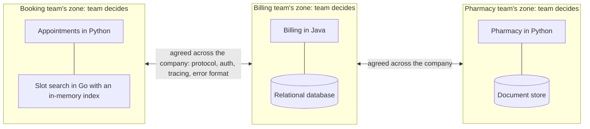
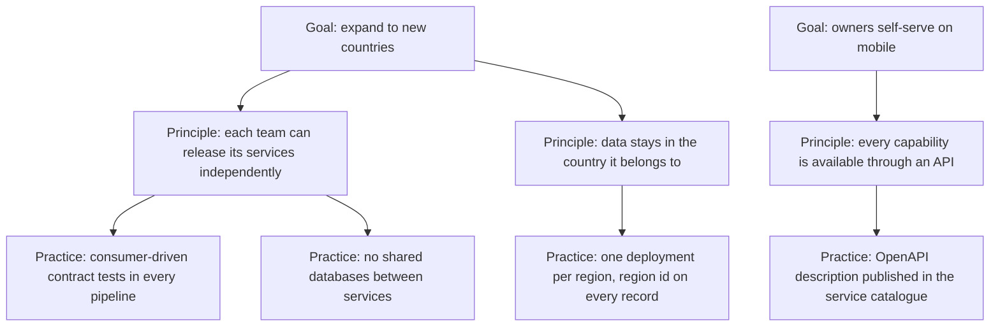

# The architect's role: boundaries, principles and practices

## Before this lesson

> **Before this lesson:** read [Conway's law and team structure](#/lesson/microservices/conway-teams) and [Shared microservices, internal open source and the paved road](#/lesson/microservices/shared-services-paved-road). You should know what autonomy, alignment, stream-aligned teams and the paved road are. The stability patterns come from [Stability patterns](#/lesson/microservices/stability-patterns).

## In plain words

A country's road authority does not tell you which car to buy, what colour it should be, or where to drive this afternoon. Those are your choices. It is very strict about a different set of things: which side of the road everyone drives on, what a red light means, how wide a lane is, what a road sign looks like. In short, it cares little about what happens inside each vehicle and a great deal about what happens *between* vehicles.

That split is what makes millions of independent journeys possible without a central controller planning each one. If every driver negotiated the rules at each junction, nothing would move. If the authority dictated every route, nothing would move either.

In a system of microservices owned by many teams, someone has to play the road authority: decide the few things that must be the same everywhere, leave the rest to the teams, and keep the whole network fit for the journeys the organisation wants to make next year. That is the work of **architecture**, and the people who do it are often called **architects**, whether or not it is their job title.

Why this matters for a job: senior engineers are expected to make and explain decisions of this kind long before anyone gives them the title. Interviewers for senior roles ask "how would you set technical direction across teams?" and "what would you standardise?", and they are listening for judgement about where to be strict and where to let go.

## 1. What software architecture is

A useful working definition: **software architecture is the set of decisions that are hard to change later**. Which services exist and what each is responsible for. How they communicate. Where data lives. Which platform they run on. A choice of variable name is not architecture; reversing it costs a minute. A choice to share one database between six services is; reversing it costs a year.

The word "architect" was borrowed from the building trade, and the comparison misleads in one important way. A building is designed, built and then finished. Changing it afterwards is rare and costly, so the architect tries to get everything right in advance. Software is never finished. Requirements shift, load grows, teams reorganise, better tools appear. A design that cannot change becomes a liability within a couple of years.

So the aim of software architecture is not a perfect final plan. It is a system, and an organisation, in which **change stays possible**: where the cheap decisions are left open, the expensive ones are made carefully, and as few decisions as possible fall into the expensive category. This is what is meant by an **evolutionary architecture**: one designed to be changed in small steps as understanding improves.

## 2. Six things an architect is responsible for

Whoever fills the role, in an organisation of autonomous teams it has six parts.

| Responsibility | Meaning |
|---|---|
| Vision | A clear, shared picture of where the system is going and why, tied to what the business needs |
| Empathy | Understanding how decisions affect the developers who live with them and the customers who use the result |
| Collaboration | Working the vision out with the teams, not handing it down to them |
| Adaptability | Changing the vision when circumstances or evidence change |
| Autonomy | Finding the balance between what is standardised and what teams decide for themselves |
| Governance | Making sure that what is built matches what was agreed |

None of these is "draw the diagram". Most of them are about people. An architect who writes a fine document and never leaves their desk has done the smallest part of the job.

## 3. Defining the boundaries: between and within

Think of the system as a set of **zones**. A zone is a service, or a small group of services owned by one team. The road-authority rule applies:

> Be strict about what happens **between** zones. Be relaxed about what happens **within** them.



**Between zones**, variety is expensive, because every team that calls another must cope with the differences. So standardise how services talk (one or two protocols, a common error format), how identity is passed, how requests are traced, and what "healthy" means.

**Within a zone**, variety is cheap for everyone else, because information hiding (lesson 5) keeps it out of sight. The team can choose its language, its data store and its internal design.

"Cheap for everyone else" is not the same as free. Every additional technology in the organisation has costs that appear later:

- people cannot move easily between teams;
- an unusual service is more likely to be orphaned when its authors leave (lesson 32);
- the platform team must support more runtimes;
- security patches must be tracked for more ecosystems.

```python-run
# Who can maintain which technology? 14 developers, the languages each is productive in.
skills = {
    "python": 11, "go": 6, "java": 3, "elixir": 1,
}
services = {"appointments": "python", "slot-search": "go", "billing": "java", "invoicing": "java",
            "pharmacy": "python", "reminders": "python", "lab-integration": "elixir", "reporting": "python"}

print("technology   services   people who can maintain it   risk")
for tech in sorted(skills, key=lambda t: skills[t]):
    owned = sorted(s for s, t in services.items() if t == tech)
    people = skills[tech]
    risk = "HIGH: one resignation orphans it" if people <= 1 else ("medium" if people <= 3 else "low")
    print(f"{tech:10s}   {len(owned):4d}       {people:4d}                         {risk}  {owned}")
```

`skills` records how many of fourteen developers can work productively in each language, and `services` records what each service is written in. The loop lists, for each technology, the services that depend on it and how many people could maintain them. Python and Go are safe. Java is held by three people. Elixir is known by exactly one person, who wrote `lab-integration`; if that person leaves, the service has no one. Nothing is wrong with the language. The risk comes from how thinly the knowledge is spread.

A common compromise is a short list of supported technologies: free choice within the list, which the platform's paved road covers, and a conversation before stepping outside it.

## 4. A social construct that people live in

The architecture is not the diagram. It is what is really running, which is the sum of thousands of decisions made by developers every week. If those developers do not understand or agree with the intended direction, the real system will drift away from the drawing, and the drawing will be wrong.

Two consequences follow.

**Architects must spend time with the teams.** Reviewing documents from a distance is not enough. An architect who regularly sits with a team, reads the code, and now and then writes some, learns what is hard, sees where the guidance is being ignored and why, and earns the standing to be listened to. Some organisations make this formal: architects are members of delivery teams part of the time.

**The system must be pleasant to work in.** Buildings are judged partly by whether people like living in them. A software system has inhabitants too: the developers. If the standard pipeline is slow, the mandatory framework is awkward and the rules are unexplained, people will work around them. This quality is sometimes called **habitability**, and the architect is responsible for it.

## 5. A principled approach: goals, principles, practices

Hundreds of technical decisions are made every month, and an architect cannot be present for them. What scales is giving people a way to decide well by themselves. A three-level structure does this.

**Strategic goals** say where the organisation is heading. They are business statements, not technical ones: "open clinics in two more countries", "let owners do everything from their phone".

**Principles** are rules the organisation chooses in order to reach those goals. They are few (aim for fewer than ten, so that people can remember them), they will change as the goals change, and each one should explain which goal it serves.

**Practices** are the detailed, technical ways the principles are carried out: coding guidelines, required tools, the service template. They change more often than principles, and may differ between technologies.



Two distinctions keep this honest:

- A **principle** is something you chose and could change. A **constraint** is something you cannot change, such as a law about medical records. Label them separately, so nobody wastes time arguing with a constraint or treats a preference as a law.
- A practice with no principle behind it is a habit. A principle with no goal behind it is an opinion. Either should be questioned.

```python-run
goals = {"G1": "expand to new countries", "G2": "owners self-serve on mobile"}
principles = {
    "P1": ("each team releases independently", "G1"),
    "P2": ("data stays in its country", "G1"),
    "P3": ("every capability has an API", "G2"),
    "P4": ("all services are written in Python", None),             # no goal given
}
practices = {
    "contract tests in every pipeline": "P1",
    "no shared databases": "P1",
    "one deployment per region": "P2",
    "OpenAPI published in the catalogue": "P3",
    "tabs, not spaces": None,                                       # no principle given
    "weekly release train for all teams": "P1",                     # claims P1 but works against it
}

print("Principles with no strategic goal:")
for pid, (text, goal) in principles.items():
    if goal not in goals:
        print(f"   {pid}: {text}")
print("Practices with no principle:")
for practice, pid in practices.items():
    if pid not in principles:
        print(f"   {practice}")
print("Goals with no principle supporting them:",
      [g for g in goals if not any(goal == g for _, goal in principles.values())] or "none")
```

The three dictionaries hold a draft set of goals, principles and practices, each pointing to what it supports. The checks look for breaks in the chain. "All services are written in Python" names no goal: it may be a reasonable preference, but nobody has said what it is *for*, so nobody can judge when an exception is fair. "Tabs, not spaces" hangs from no principle. The script cannot catch the last entry: "weekly release train for all teams" claims to support independent release and does the opposite. Tracing gives the right questions; people still have to answer them.

## 6. The required standard: what every service must do

Teams have freedom inside their zone. What must every service do, whatever it is written in, so that the whole remains operable? It helps to describe the well-behaved service explicitly. Three areas cover it.

**Monitoring.** Problems must be visible across the whole system, so every service reports in the same way: a health endpoint, the standard metrics (request rate, errors, latency), structured logs with a correlation id shipped to the central store, and trace context passed on (lesson 21).

**Interfaces.** Keep the number of ways services talk small: one or two protocols, with agreed conventions for things such as naming, pagination, versioning and error bodies. Every extra style is another client library and another thing for each consumer to learn.

**Architectural safety.** One badly behaved service can damage its neighbours, so every service follows the rules that protect the others: timeouts on all outgoing calls, circuit breakers and bulkheads around dependencies (lesson 26), and honest response codes. That last one matters more than it looks: if a service answers "200 OK" with an error message inside, callers' circuit breakers and retries cannot tell that anything is wrong.

A standard that is only written down decays. One that is checked automatically holds.

```python-run
REQUIRED = ["health_endpoint", "structured_logs", "trace_propagation", "timeouts_on_calls",
            "circuit_breakers", "honest_status_codes", "owner_in_catalogue"]

services = {
    "appointments": set(REQUIRED),
    "billing":      set(REQUIRED) - {"circuit_breakers"},
    "reminders":    set(REQUIRED) - {"trace_propagation", "timeouts_on_calls"},
    "kiosk-api":    {"health_endpoint"},
}

print(f"{'service':13s} score   missing")
for name, has in services.items():
    missing = [r for r in REQUIRED if r not in has]
    print(f"{name:13s} {len(REQUIRED) - len(missing)}/{len(REQUIRED)}     {', '.join(missing) or '-'}")

worst = min(services, key=lambda s: len(services[s]))
print(f"\nstart with: {worst}")
```

`REQUIRED` lists seven items of the standard, and `services` records which ones each service meets (in practice a script would discover this by probing the services and reading their configuration). The report shows each service's score and its gaps. Appointments meets everything. Billing lacks circuit breakers. Reminders does not pass trace context on, which cuts every trace that goes through it, and has no timeouts. The kiosk API meets one item of seven. The output is a to-do list in priority order, and running it weekly shows whether things are improving. The next lesson develops this into the idea of a fitness function.

The cheapest way to meet the standard is not to ask teams to implement it. It is to provide a service template and platform (lesson 32) in which a new service has all seven from its first commit.

## 7. Architecture in an organisation of autonomous teams

Where does an architect sit when teams are stream-aligned and autonomous? Not above them issuing approvals. That would recreate the central bottleneck.

The fit that works is to treat architecture as an **enabling** function (lesson 31). Architects help teams make good decisions, connect teams that are solving the same problem, watch what happens between services, and look further ahead than a team's backlog allows. In larger organisations a few full-time architects are joined by experienced engineers from the delivery teams, who spend part of their time on cross-cutting questions. A regular forum of these people, drawn mostly from the teams, decides the principles and required standards together. Decisions made by the people who must live with them are better informed and far more likely to be followed.

### Worked example: Pawprint's first architecture forum

The forum has five members: one from each stream-aligned team, one from the platform team, and the engineering lead. In its first quarter it agrees:

| Item | Decision |
|---|---|
| Strategic goals (from the business) | Clinics in two more countries within 18 months; owners can do everything on mobile |
| Principles (six) | Independent release per team; no shared databases; data stays in its country; every capability has an API; services meet the required standard; prefer the paved road |
| Constraint | Medical records are retained for the period the law requires in each country |
| Required standard | The seven items above, checked weekly by a script, results published |
| Technology | Python and Go on the paved road; anything else needs a conversation with the forum first |
| Left to teams | Internal design, data store choice within the supported list, testing approach beyond the standard |

Each principle is written with the goal it serves and a paragraph of reasoning, on one page.

> [!INTERVIEW]
> For "what is the role of an architect in a microservice organisation?": *to keep change possible. I would be strict about what happens between services, meaning protocols, identity, observability and safety behaviour, and relaxed about what happens inside each team's boundary. I would derive a handful of principles from the business's strategic goals and turn them into practices, mostly delivered through a paved road and checked automatically. I would work as an enabler alongside the teams, not as an approval gate, and spend enough time in the code to know whether the system is pleasant to work in.*

## 8. Pitfalls

- **The ivory tower.** Decisions made far from the code are ignored or wrong.
- **Standardising everything.** Teams lose the autonomy that made microservices worth having.
- **Standardising nothing.** Every integration is a special case and the system cannot be operated as a whole.
- **Fifty principles.** Nobody remembers them, so nobody follows them.
- **Principles with no stated reason.** People cannot tell when an exception is fair.
- **Confusing preferences with constraints.** Either real limits get argued over, or tastes get treated as law.
- **A standard that is documented and not checked.** It decays quietly.
- **Unlimited technology choice.** Knowledge spreads too thin and services are orphaned.
- **The architect as approver of every change.** A central queue returns.

## Summary

- Architecture is the set of decisions that are hard to change; because software is never finished, the goal is to keep change possible.
- The role has six parts: vision, empathy, collaboration, adaptability, balancing autonomy, and governance.
- Be strict about what happens between zones and relaxed about what happens within them, while remembering that technology variety has long-term costs.
- The real architecture is what teams build, so architects must work with teams and care about how habitable the system is.
- Strategic goals lead to a few principles, which lead to practices; separate chosen principles from fixed constraints.
- Define the required standard for every service in three areas: monitoring, interfaces and architectural safety, and check it automatically.
- In a stream-aligned organisation, architecture is an enabling function, with decisions made by a forum drawn largely from the teams.

## Glossary

| Term | Meaning |
|---|---|
| Software architecture | The decisions about a system that are hard to change later |
| Evolutionary architecture | An architecture designed to be changed incrementally |
| Zone | A service or group of services within one team's boundary |
| Habitability | How pleasant and workable a system is for the developers who maintain it |
| Strategic goal | A statement of where the organisation is heading, in business terms |
| Principle | A rule chosen to help reach a strategic goal |
| Practice | A detailed, technical way of carrying out a principle |
| Constraint | A rule that cannot be changed, such as a legal requirement |
| Required standard | What every service must do so that the whole system can be operated |
| Architectural safety | Behaviours that stop one service harming others, such as timeouts and honest status codes |
| Governance | Making sure that what is built matches what was agreed |
| Architecture forum | A group, mostly practitioners from the teams, that decides cross-cutting technical matters |

```quiz
[
  {"q": "Which definition of software architecture does this lesson use?", "options": ["The diagrams drawn at the start of a project", "The decisions that are hard to change later", "The choice of programming language only", "The work done by whoever has the title architect"], "answer": 1,
   "explain": "What makes a decision architectural is the cost of reversing it, such as service boundaries and where data lives."},
  {"q": "Why does the comparison with building architecture mislead?", "options": ["Buildings are cheaper", "A building is finished, while software keeps changing, so the aim is to keep change possible", "Software has no structure", "Building architects do not draw plans"], "answer": 1,
   "explain": "A design fixed up front becomes a liability as requirements, load and teams change."},
  {"q": "What should be standardised most strictly in a microservice organisation?", "options": ["Each service's internal class design", "What happens between services: protocols, identity, observability and safety behaviour", "The editor each developer uses", "The names of local variables"], "answer": 1,
   "explain": "Variety between services costs every team that integrates. Variety inside a boundary is hidden from others."},
  {"q": "A service is written in a language only one developer knows. What is the main risk?", "options": ["It will run slowly", "If that person leaves, nobody can maintain it and it becomes orphaned", "It cannot be deployed in containers", "It cannot use HTTP"], "answer": 1,
   "explain": "Technology freedom within a team is cheap for others now and can be costly later, when knowledge is too thinly spread."},
  {"q": "How do strategic goals, principles and practices relate?", "options": ["They are three words for the same thing", "Goals say where the business is heading; principles are rules chosen to get there; practices are the detailed ways principles are carried out", "Practices come first and goals are derived from them", "Principles are legal requirements"], "answer": 1,
   "explain": "Each level should trace to the one above. A practice with no principle, or a principle with no goal, deserves questioning."},
  {"q": "What is the difference between a principle and a constraint?", "options": ["None", "A principle is chosen and can be changed; a constraint, such as a law, cannot", "A constraint is optional", "Principles apply only to databases"], "answer": 1,
   "explain": "Labelling them separately avoids arguing with fixed limits and avoids treating preferences as law."},
  {"q": "Why does a service that returns 200 OK with an error inside the body harm its neighbours?", "options": ["It uses more memory", "Callers' retries and circuit breakers cannot detect the failure, so protection mechanisms do not work", "It breaks DNS", "It cannot be logged"], "answer": 1,
   "explain": "Architectural safety depends on honest signals. Protective patterns key off status codes and timeouts."},
  {"q": "Where should the architect's role sit in an organisation of autonomous stream-aligned teams?", "options": ["As an approval gate for every change", "As an enabling function that helps teams decide well, with cross-cutting decisions made by a forum drawn from the teams", "In a separate building", "Inside the finance department"], "answer": 1,
   "explain": "Central approval recreates a bottleneck. Enabling and shared decision-making keep autonomy and alignment together."}
]
```

> **Source:** Newman, *Building Microservices*, 2nd ed., ch. 16 (topic coverage only; wording and the Pawprint example are original). Martin Fowler, "Who Needs an Architect?", IEEE Software, 2003. Ford, Parsons and Kua, *Building Evolutionary Architectures* (2017).
