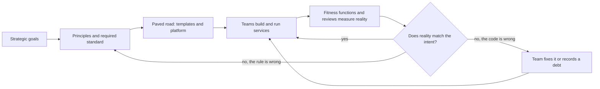
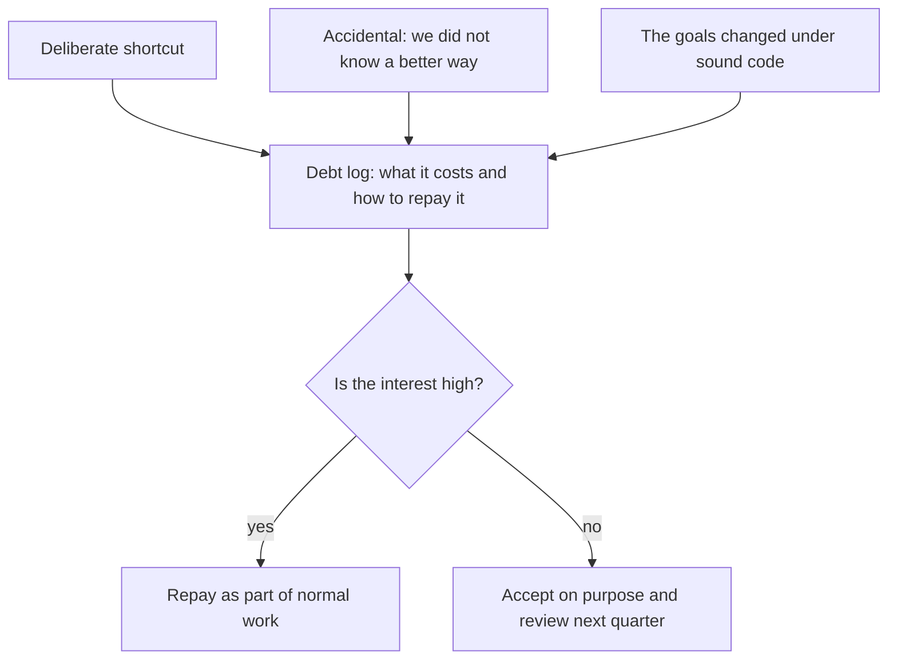

# Guiding an evolutionary architecture: governance, exemplars and technical debt

## Before this lesson

> **Before this lesson:** read [The architect's role](#/lesson/microservices/architect-role). You should know strategic goals, principles, practices, the required standard and the difference between a principle and a constraint. The paved road was introduced in [Shared microservices, internal open source and the paved road](#/lesson/microservices/shared-services-paved-road).

## In plain words

A gardener growing climbing roses does not decide where each leaf will be. The gardener puts up a trellis, and the plant grows along it by itself. From time to time the gardener walks round, checks which stems have wandered, ties some back and cuts some off. And when it turns out, two summers later, that the trellis is in the wrong place for the sun, the gardener moves the trellis.

There are four activities in that picture. Providing a **structure that makes the right growth easy**. **Checking regularly** what has really grown. **Dealing with what has wandered**, either by correcting it or by deciding it may stay. And **changing the structure** when the evidence says it is wrong.

Guiding the architecture of a system built by many teams is the same work. The last lesson described what an architect decides: principles, practices and a required standard. This lesson is about making those decisions hold in a system that never stops changing, without becoming a police force. The tools are automated checks called **fitness functions**, a group process called **governance**, good examples and templates, an honest way of handling shortcuts called **technical debt**, and a way of recording **exceptions**.

Why this matters for a job: every engineer takes shortcuts under deadline pressure and has to explain them; every senior engineer is asked "how do you keep standards up across teams without slowing them down?" These are the practical answers.

## 1. Fitness functions: checking the architecture automatically

Tests tell you whether the code does what it should. What tells you whether the *architecture* is still what you intended? In most organisations, nothing: someone notices a year later that half the services now read each other's databases.

A **fitness function**, a term from the book *Building Evolutionary Architectures*, is an objective, repeatable check that some characteristic of the architecture still holds. It turns a sentence in a principles document into something a machine verifies.

| Principle or standard | Possible fitness function |
|---|---|
| No shared databases | A check that each database account is used by exactly one service |
| Services release independently | An alert if two services are always deployed within minutes of each other |
| No circular dependencies | A scan of the call graph for cycles |
| Booking stays responsive | A nightly performance test: 95th-percentile latency under 300 ms |
| Every service has an owner | A check of the service catalogue |
| Patches are applied promptly | A scan for libraries with known critical flaws older than 14 days |

Some run on every build (a dependency check). Some run on a schedule (a performance test). Some run continuously in production (an SLO). What they share is that nobody has to remember to look.

```python-run
calls = {                                  # service -> services it calls
    "website-bff":  ["appointments", "billing", "patients"],
    "appointments": ["patients", "billing", "slot-search"],
    "billing":      ["patients", "notifications", "appointments"],     # <- calls back into appointments
    "pharmacy":     ["patients", "billing"],
    "patients":     [],
    "slot-search":  [],
    "notifications": [],
}
LAYER = {"website-bff": "edge", "appointments": "core", "billing": "core", "pharmacy": "core",
         "patients": "core", "slot-search": "core", "notifications": "core"}

def find_cycle(graph):
    def visit(node, path):
        if node in path:
            return path[path.index(node):] + [node]
        for nxt in graph[node]:
            found = visit(nxt, path + [node])
            if found:
                return found
        return None
    for start in graph:
        cycle = visit(start, [])
        if cycle:
            return cycle
    return None

def check_no_cycles():
    cycle = find_cycle(calls)
    return (cycle is None, "no cycles" if cycle is None else "cycle: " + " -> ".join(cycle))

def check_fan_out(limit=3):
    worst = {s: len(d) for s, d in calls.items() if len(d) > limit}
    return (not worst, f"all services call at most {limit} others" if not worst else f"too many dependencies: {worst}")

def check_core_never_calls_edge():
    bad = [(a, b) for a, deps in calls.items() for b in deps if LAYER[a] == "core" and LAYER[b] == "edge"]
    return (not bad, "core services do not depend on edge components" if not bad else f"violations: {bad}")

for check in [check_no_cycles, check_fan_out, check_core_never_calls_edge]:
    ok, detail = check()
    print(f"{'PASS' if ok else 'FAIL'}  {check.__name__:28s} {detail}")
```

`calls` is the system's dependency graph: which service calls which. It could be produced automatically from distributed traces. `find_cycle` walks the graph from every service, keeping the path taken; if it reaches a service already on the path, it has found a loop and returns it. Three small fitness functions follow, each returning a pass or fail and an explanation.

The first fails: Appointments calls Billing and Billing calls Appointments. A cycle like that means neither can be deployed or tested without the other, and a failure in one tends to bring down both. The second passes: nothing calls more than three others. The third passes: no core service depends on the edge component. Run in the pipeline, the first check would have stopped the commit that introduced the cycle, on the day it happened, with a clear message. The practice problem *Architecture Fitness Functions on a Dependency Graph* asks you to implement checks like these.

Two cautions. Choose a few functions that protect what matters most; a hundred failing checks will be ignored like any noisy alert. And treat a failing check as the start of a conversation: sometimes the code is wrong, and sometimes the rule is.

## 2. Governance

**Governance** is the activity of making sure that what the organisation builds matches what it needs: agreeing direction, setting priorities, and checking that the direction is being followed. In technical terms: is the system we are building the one we said we wanted, and if not, which of the two should change?

The form it takes matters a great deal.

**Make it a group activity.** A single architect deciding alone will miss things and will not be followed. The architecture forum from the last lesson, made up mainly of practitioners from the delivery teams, is the right body. The people who must live with a decision helped to make it, they carry the reasoning back to their teams, and the workload is shared.

**The chair leads; the group decides.** The architect chairing the forum is responsible for making sure it works and that the outcome serves the strategic goals. In almost every case, when the group reaches a view different from the architect's own, the group's view should stand. A group that is overruled whenever it disagrees stops offering opinions. Overruling should be kept for the rare case where the architect is convinced that a decision would do serious, hard-to-reverse harm, and even then it costs trust.

**Keep it light.** Governance that means a monthly approval meeting for every change is a central queue. Most governance should happen through the tools: the paved road makes the agreed way easy, and fitness functions report whether it is being followed. The forum's time goes to the questions those tools cannot settle.



The loop on the right is what makes the architecture evolutionary: evidence from the running system can change the rules.

## 3. Making the right thing easy: exemplars and templates

People copy what they see working. Two tools use that.

### Exemplars

An **exemplar** is a real, running service that does things the way the organisation wants them done. When a developer asks "how should I handle retries?", pointing at a well-made production service is far more convincing than pointing at a document. They can read real code, see it in the pipeline, and know that it works.

Good exemplars are real services, not demonstration projects. A sample that was written to look tidy has never met production and quietly skips the hard parts. Pick two or three well-run services, say so publicly, and keep them good.

### The tailored service template

A **service template** is a ready-made starting point for a new service that already meets the required standard: health endpoint, structured logging, trace propagation, sensible timeouts, a pipeline definition, a catalogue entry. Lesson 32 showed the effect: weeks of setup become an afternoon, and the standard is met from the first commit because meeting it is the default.

Five points keep a template healthy:

- **One per supported technology.** If the paved road covers Python and Go, there is a template for each. The effort of producing one is itself a gentle limit on technology sprawl.
- **Optional.** A team may do without it and then meets the required standard its own way.
- **Maintained by its users.** If only the platform team may change it, it will fall behind what teams need. Let teams contribute improvements through internal open source.
- **Free of business logic.** It holds plumbing only.
- **A plan for change.** This one deserves a closer look.

```python-run
# Features of the service template, and the template version that introduced each.
INTRODUCED = {"health endpoint": 1, "structured logs": 1, "pipeline": 1, "trace propagation": 2,
              "default timeouts": 3, "secret rotation": 4}
CURRENT = 4
# Each service was generated from the template version current at the time.
created_from = {"appointments": 1, "billing": 1, "reminders": 2, "pharmacy": 3, "slot-search": 4, "loyalty": 4}

print("If the template is only COPIED at creation:")
for service, version in created_from.items():
    missing = [f for f, v in INTRODUCED.items() if v > version]
    print(f"   {service:13s} from v{version}: missing {missing or 'nothing'}")

behind = sum(1 for v in created_from.values() if v < CURRENT)
print(f"\n{behind} of {len(created_from)} services lack something the standard now requires.")
```

`INTRODUCED` records the template version in which each feature first appeared, and `created_from` records which version each service was generated from. If generating a service copies the template's files into the new repository once, then services made early never receive later improvements. The two oldest and most important services, Appointments and Billing, are missing trace propagation, default timeouts and secret rotation. Four of six services are behind.

There are two ways to deliver the plumbing, and each has a cost:

| Approach | Advantage | Cost |
|---|---|---|
| Copy at creation | Each service owns its code; no shared dependency; teams upgrade when they wish | Old services drift behind; improvements must be applied one by one |
| Shared library that the template depends on | One fix reaches every service that upgrades | A coupling point: version conflicts and pressure to upgrade everyone together |

Most organisations mix them: a thin shared library for the things that must stay uniform (such as trace propagation), copied files for the rest, and a fitness function, like the checker in lesson 33, that reports which services are behind. Much of this plumbing can also be moved out of the service altogether, into a service mesh (lesson 12).

## 4. Technical debt

**Technical debt** is a metaphor introduced by Ward Cunningham. Taking a shortcut in the design to deliver sooner is like borrowing money: you get something now, and you pay **interest** for as long as the shortcut remains, in the form of extra effort on everything that touches it. Repaying the **principal** means doing the work properly.

Debt is not always a mistake. Borrowing to catch a market opportunity can be wise. What matters is whether it was a decision, and whether anyone is keeping track.

Debt arises in three ways:

- **Deliberately.** "We will hard-code the two clinics for the launch and build proper configuration next month."
- **Accidentally.** The team did not know a better way at the time.
- **By the world moving.** The design was right for the old goals. Then the strategy changed, and code that was sound last year no longer fits the direction. Nobody did anything wrong, and the gap is still debt.

```python-run
def cumulative_cost(shortcut, features):
    """Days spent after `features` further changes in the affected area."""
    if shortcut:
        return 2 + 1.5 * features          # quick to build, then 1.5 extra days on every later change
    return 10 + 0.0 * features             # proper design: 10 days now, nothing extra later

print("later changes   with shortcut   done properly")
for n in [0, 2, 4, 6, 8, 12, 20]:
    a, b = cumulative_cost(True, n), cumulative_cost(False, n)
    note = "<- shortcut still ahead" if a < b else "<- debt has cost more than it saved"
    print(f"{n:8d}        {a:6.1f} days     {b:6.1f} days   {note}")

break_even = (10 - 2) / 1.5
print(f"\nbreak-even after about {break_even:.1f} later changes")
```

The model compares two ways to build a feature. The shortcut takes 2 days now and adds 1.5 days to every later change in that area. The proper design takes 10 days and adds nothing. For the first five changes the shortcut is ahead. After that, the debt has cost more than it saved, and the gap widens with every change. Two lessons come out of this small model. If the code will rarely be touched again, the shortcut may be the right choice for ever. If it sits in a busy part of the system, the interest mounts quickly, and repaying early is cheap compared with repaying late.



How to manage it:

- **Make it visible.** Keep a **debt log**: a short list of known shortcuts, each with what it costs and what repayment would involve. Hidden debt cannot be weighed against other work.
- **Let teams decide, within the picture.** The owning team is best placed to judge when to repay debt inside its services. The architecture forum should know about debt that crosses teams or affects the principles.
- **Review it regularly.** Look at the log every quarter. Repay what is expensive, and consciously accept what is cheap.
- **Repay as part of normal work.** A separate "clean-up project" tends never to be scheduled. Improving the area you are already changing is steadier.

## 5. Exceptions

Sooner or later a team will have a good reason to break a principle. The Pharmacy team needs a library that exists only for a language off the paved road. What should happen?

Refusing every exception makes the rules brittle; teams will find ways round them unobserved. Granting exceptions casually makes the rules meaningless. The workable answer is to **record** each one: what was deviated from, why, who agreed, and when it will be looked at again.

The record has two uses. It keeps the deviation visible, as a kind of debt. And the pattern of exceptions is evidence about the rule.

```python-run
exceptions = [
    {"principle": "services use Python or Go", "team": "pharmacy", "reason": "dosage library is Java only"},
    {"principle": "services use Python or Go", "team": "billing",  "reason": "payment provider SDK is Java only"},
    {"principle": "services use Python or Go", "team": "lab",      "reason": "lab vendor SDK is Java only"},
    {"principle": "no shared databases",       "team": "reporting","reason": "legacy report reads billing tables"},
    {"principle": "services use Python or Go", "team": "booking",  "reason": "team prefers Java"},
]
REVIEW_THRESHOLD = 3

by_principle = {}
for e in exceptions:
    by_principle.setdefault(e["principle"], []).append(e)

for principle, items in by_principle.items():
    verdict = "REVIEW THE PRINCIPLE" if len(items) >= REVIEW_THRESHOLD else "keep; track each exception"
    print(f"'{principle}': {len(items)} exception(s) -> {verdict}")
    for e in items:
        print(f"     {e['team']:10s} {e['reason']}")
```

The loop groups the recorded exceptions by the principle they deviate from. "No shared databases" has one exception, an old report, which is a debt to be repaid. "Services use Python or Go" has four, and three of them have the same cause: suppliers ship their libraries for Java only. That is no longer a set of special cases. It is evidence that the principle does not match reality, and the forum should consider adding Java to the paved road. The fourth exception, "the team prefers Java", is a different matter and would be judged separately.

A light format for recording decisions of all kinds, exceptions included, is the **architecture decision record (ADR)**: a short text file kept in the repository, stating the context, the decision and its consequences. A year later, when someone asks "why on earth is this service in Java?", the answer is one click away.

## 6. Growing people

One part of guiding an architecture is easy to leave out because it is not technical. The system is built and changed by people, and its future depends on how capable they become.

Microservices offer an unusually good way to help people grow. Because the system is made of small, separately owned pieces, a developer can be given real ownership of one service: its design, its operation and its consequences. That is a much smaller and safer step than being handed responsibility for a whole monolith, and it teaches the same lessons. Invite less experienced engineers into the forum's discussions, and let them lead a decision with support. The aim is that the vision survives any individual, the architect included.

### Worked example: a quarter at Pawprint

| Month | What happened |
|---|---|
| 1 | The forum adopts three fitness functions: no dependency cycles, every service owned, required-standard score. The first run finds the Appointments and Billing cycle |
| 1 | The Booking and Billing teams agree to break the cycle with an event; it goes in the debt log with a six-week target |
| 2 | Reminders is named an exemplar for retries and idempotent consumers; two teams copy its approach |
| 2 | The template gains default timeouts (version 3); the standard-score check shows which older services lack them |
| 3 | The third Java exception is recorded; the forum reviews the principle and adds a Java template to the paved road |
| 3 | Quarterly debt review: the cycle is gone; the legacy report's shared-database access is accepted for one more quarter, with a named owner |

No change in that table was ordered by an architect acting alone.

> [!INTERVIEW]
> For "how do you keep an architecture healthy across many teams without slowing them down?": *I make the right way the easy way and check it automatically. Principles are agreed by a forum of practitioners. A paved road with service templates and real exemplar services means a new service meets the standard by default. Fitness functions in the pipeline and in production report drift, such as dependency cycles or shared databases, as it happens. Shortcuts are recorded as technical debt and reviewed regularly, and exceptions to principles are logged, so that when the same exception keeps appearing we change the principle.*

## 7. Pitfalls

- **Principles nobody checks.** Drift is discovered years late.
- **Too many fitness functions.** Constant red is ignored.
- **Governance as an approval meeting.** It becomes the slowest step in delivery.
- **An architect who overrules the group routinely.** People stop contributing.
- **Showcase samples instead of real exemplars.** They avoid the hard parts.
- **A template only one team may change.** It falls behind real needs.
- **Template features that never reach old services.** The most important services are the most out of date.
- **Invisible technical debt.** It cannot be weighed, so it is never repaid.
- **A clean-up project postponed every quarter.** Repay in the course of normal work.
- **Unrecorded exceptions.** The rule looks intact while reality diverges.
- **Never revising a principle.** Rules outlive the reasons for them.

## Summary

- An evolutionary architecture needs feedback: fitness functions are automated, objective checks that architectural characteristics still hold.
- Governance makes sure what is built matches what is needed; it works best as a group activity of practitioners, chaired by an architect who rarely overrules, and carried mostly by tooling.
- Exemplars, real services done well, teach by example; service templates make the required standard the default starting point.
- Templates need a plan for change, balancing copied code that drifts against shared libraries that couple.
- Technical debt is a shortcut that charges interest on later work; it arises deliberately, accidentally or because goals changed, and should be logged, reviewed and repaid where the interest is high.
- Exceptions to principles should be recorded; repeated exceptions are evidence that the principle needs revising.
- Guiding an architecture includes growing the people who will carry it forward.

## Glossary

| Term | Meaning |
|---|---|
| Fitness function | An automated, objective check that an architectural characteristic still holds |
| Dependency cycle | A loop of services that depend on each other |
| Governance | Ensuring that what is built matches what the organisation needs and agreed |
| Exemplar | A real, running service that shows the preferred way of doing things |
| Service template | A ready-made starting point for a new service that meets the required standard |
| Technical debt | The ongoing cost of a design shortcut, by analogy with a loan |
| Interest / principal | The extra effort a shortcut adds to later work / the work needed to remove it |
| Debt log | A visible list of known shortcuts and their costs |
| Exception | An agreed, recorded deviation from a principle |
| Architecture decision record | A short document capturing a decision, its context and its consequences |

```quiz
[
  {"q": "What is a fitness function in the context of architecture?", "options": ["A unit test for one function", "An automated, objective check that an architectural characteristic still holds", "A meeting to approve changes", "A performance bonus for architects"], "answer": 1,
   "explain": "It turns an architectural intention, such as no dependency cycles, into something verified by a machine on a schedule or in the pipeline."},
  {"q": "Appointments calls Billing and Billing calls Appointments. Why is this cycle a problem?", "options": ["Cycles use more disk", "Neither service can be deployed or tested without the other, and a failure in one tends to take down both", "Cycles are forbidden by HTTP", "It makes logs longer"], "answer": 1,
   "explain": "A dependency cycle couples the two services tightly, undermining independent deployability and resilience."},
  {"q": "How should technical governance be carried out in an organisation of autonomous teams?", "options": ["By one architect approving every change", "As a group activity of practitioners from the teams, supported mainly by tooling", "By an external auditor once a year", "It should not be done"], "answer": 1,
   "explain": "Shared decisions are better informed and more likely to be followed. Templates and automated checks carry most of the load."},
  {"q": "Why is a real production service a better exemplar than a demonstration project?", "options": ["It has more lines of code", "It has faced real conditions, so it shows how the hard parts are handled", "Demonstration projects cannot be compiled", "It is written by more senior people"], "answer": 1,
   "explain": "Samples written to look tidy skip difficulties. Developers trust and copy code that is running in production."},
  {"q": "A service template is copied into each new repository at creation. What problem follows?", "options": ["New services cannot start", "Older services do not receive later improvements and drift behind the standard", "The template cannot be changed", "All services must deploy together"], "answer": 1,
   "explain": "Copying avoids a shared dependency but leaves early services out of date, so a way to detect and apply updates is needed."},
  {"q": "In the technical debt metaphor, what is the interest?", "options": ["The time saved by the shortcut", "The extra effort added to every later change that touches the shortcut", "The salary of the developer", "The cost of the build server"], "answer": 1,
   "explain": "The shortcut gives a saving now and charges an ongoing cost until the work is done properly."},
  {"q": "A shortcut saves 8 days now and costs 1.5 extra days on each later change in that area. When is it clearly a bad trade?", "options": ["If the code is never touched again", "If that area is changed many times, since the interest soon exceeds the saving", "Never", "Always"], "answer": 1,
   "explain": "The break-even is a little over five changes. In a frequently changed area the debt quickly costs more than it saved."},
  {"q": "Three teams have recorded the same exception to a principle for the same reason. What does this suggest?", "options": ["The teams should be disciplined", "The principle may no longer fit reality and should be reviewed", "Exceptions should stop being recorded", "The principle should be enforced more strictly"], "answer": 1,
   "explain": "A pattern of exceptions is evidence about the rule. Recording them makes that pattern visible."}
]
```

> **Source:** Newman, *Building Microservices*, 2nd ed., ch. 16 (topic coverage only; wording and the Pawprint example are original). Ford, Parsons and Kua, *Building Evolutionary Architectures* (2017), for fitness functions. Ward Cunningham, "The WyCash Portfolio Management System", OOPSLA 1992, for the debt metaphor. Michael Nygard, "Documenting Architecture Decisions" (2011).
