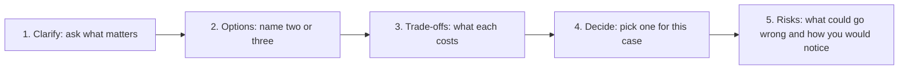
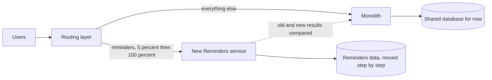

# Interview essentials I: the six questions you will be asked

## Before this lesson

> **Before this lesson:** this is a revision lesson. It assumes you have worked through the track, in particular [What a network call costs](#/lesson/microservices/network-cost-why-split), [Migration patterns and splitting the data](#/lesson/microservices/migration-patterns-data), [Request-response, event-driven and common data](#/lesson/microservices/request-response-events), [Sagas](#/lesson/microservices/sagas) and [Stability patterns](#/lesson/microservices/stability-patterns). Each section points back to the lesson that teaches the idea in full.

## In plain words

A driving examiner does not ask you to recite the highway code. They sit beside you and watch whether you look in the mirror before pulling out. They are checking judgement, and judgement only shows when there is a choice to make.

An architecture interview works the same way. The interviewer already knows what a saga is. They want to see whether you can look at a concrete situation, lay out the options, say what each one costs, choose, and explain what would make you change your mind. A candidate who says "microservices, because they scale" has recited a slogan. A candidate who says "it depends on how many teams there are and how often their releases collide; let me ask about that" is showing the thing being tested.

Six questions, in various disguises, account for most of what is asked about microservices in system design and backend interviews:

1. Monolith or microservices?
2. How would you split this system while it stays live?
3. How do you keep data consistent across services?
4. Should these services talk synchronously or asynchronously?
5. What happens when a dependency is slow or down?
6. How do you make this operation safe to retry?

This lesson gives each one the same treatment: what is really being tested, a shape for the answer, a model answer in the Pawprint setting, the usual mistakes and the likely follow-ups. The next lesson gives 40 shorter prompts for practice.

Why this matters for a job: system design rounds weigh heavily in hiring for mid-level and senior engineering roles at large technology companies, including those hiring in Singapore, and these six questions are the microservice core of them.

## 1. One shape for every answer

Before the questions, a structure that works for all of them.



1. **Clarify.** Ask two or three questions whose answers would change your design: how many teams, how much load, how fresh must the data be, what happens if this fails.
2. **Options.** Name the realistic alternatives. There are nearly always at least two.
3. **Trade-offs.** Say what each option gives and what it costs. Use the mechanism, not an adjective: "locks are held across network calls" beats "it is slow".
4. **Decide.** Choose one for *this* situation and say why. Interviewers dislike a list of options with no decision.
5. **Risks.** Say what could go wrong with your choice, how you would detect it, and what would make you revisit it.

Two habits lift an answer further: quote a rough number when you can, and state your assumptions aloud when the interviewer does not answer a clarifying question.

## 2. Monolith or microservices?

**What is being tested.** Whether you treat architecture as a choice with costs, or as fashion.

**The shape of a good answer.** Start from the problem being solved. Microservices buy independent deployment, independent scaling, fault isolation and team autonomy. They cost network latency, partial failure, split data, harder testing and much more operational work (lessons 2 and 4). The benefits grow with the number of teams; the costs are paid from day one.

| Signal | Leans towards a monolith | Leans towards microservices |
|---|---|---|
| Teams | One or two | Many, blocking each other's releases |
| Domain | New, boundaries still unclear | Well understood, stable boundaries |
| Scaling needs | Uniform | Parts with very different load or availability needs |
| Operations | No automated deployment or central logging yet | Pipelines, observability and on-call already in place |
| Stage | Start-up looking for a product | Established product, growing organisation |

**Model answer.** *"I would not start with microservices for a new product with one team. The domain boundaries are not known yet, and moving a boundary between services is far more expensive than moving it inside one codebase. I would build a modular monolith: one deployable unit with clear internal modules and no shared tables between modules. I would extract a service when there is a concrete reason: two teams keep blocking each other's releases, one part needs to scale or be available on a very different level, or one part needs different technology. Before extracting anything I would want automated deployment, central logs and tracing. And I would extract one service, learn from it, then decide on the next."*

A quick way to practise the reasoning:

```python-run
def recommend(teams, releases_blocked_per_month, boundaries_clear, uneven_scaling, ops_ready):
    """A rough scoring of the signals in the table above. Not a formula for real life."""
    score, reasons = 0, []
    if teams >= 4:
        score += 2; reasons.append(f"{teams} teams share one codebase")
    if releases_blocked_per_month >= 3:
        score += 2; reasons.append("releases are often blocked by other teams")
    if uneven_scaling:
        score += 1; reasons.append("parts have very different load")
    if not boundaries_clear:
        score -= 3; reasons.append("domain boundaries are still unclear")
    if not ops_ready:
        reasons.append("no automated deployment or central observability yet")
    if score >= 3 and ops_ready:
        verdict = "extract services, one at a time"
    elif score >= 3:
        verdict = "put the operational basics in place first, then extract one service"
    elif score >= 1:
        verdict = "modular monolith now; watch the signals"
    else:
        verdict = "stay with a (modular) monolith"
    return verdict, reasons

cases = {
    "new start-up":      (1, 0, False, False, False),
    "growing scale-up":  (5, 4, True,  True,  True),
    "keen but unready":  (5, 4, True,  True,  False),
}
for name, args in cases.items():
    verdict, reasons = recommend(*args)
    print(f"{name:17s} -> {verdict}")
    for r in reasons:
        print(f"                     - {r}")
```

`recommend` adds points for signals that favour splitting and subtracts when the boundaries are unclear. Missing operational basics do not change the score; they act as a gate on the verdict. The start-up scores below zero and stays with a monolith. The scale-up, with five teams blocking each other and the operational basics ready, should extract services gradually. The third case has every reason to split and no automated deployment or observability; the advice is to fix that first. The function is deliberately crude. Its use is to rehearse saying the reasons aloud, which is what the interviewer wants to hear.

**Common mistakes.** Saying microservices are "more scalable" as if a monolith could not be duplicated behind a load balancer. Forgetting the organisational reason. Ignoring the cost side. Describing a split in which all services share one database.

**Follow-ups.** "What is a distributed monolith?" (Services that must be deployed together: the costs of both styles.) "What is a modular monolith?" (One deployable unit with enforced internal boundaries.) "How big should a service be?" (Small enough for one team to own and understand; boundaries follow the business domain, not a line count.)

## 3. How would you split this system while it stays live?

**What is being tested.** Whether you can change a running system in small, reversible steps.

**The shape of a good answer.** No big-bang rewrite. Pick one capability with a clear reason, put a routing layer in front, move it gradually, verify, and treat the data as the hard part (lessons 7 and 8).



**Model answer.** *"First I would be clear about the goal, because it decides what to extract first: for example, the Reminders team needs to release daily. I would use the strangler fig pattern: a proxy in front of the monolith that initially forwards everything. I build Reminders as a new service, and at first run it in parallel with the old code on real traffic, comparing results without acting on the new ones. Then I route a small percentage to it, watch error rate and latency, and increase. The routing rule is my rollback. The data is the hard part. I would first make the monolith reach the reminder tables only through one internal interface, then move those tables to a database the new service owns, keeping the two in step during the transition, and replace joins and foreign keys with API calls or local copies kept up to date by events. Each step is deployable and reversible on its own. I would stop when the goal is met; the aim is not zero lines in the monolith."*

**Common mistakes.** Proposing a rewrite. Splitting code and leaving every service on the shared tables. Starting with the hardest, most entangled part. Having no rollback.

**Follow-ups.** "What do you extract first?" (Something valuable to separate and loosely attached; weigh benefit against difficulty.) "How do you handle a join across the old boundary?" (An API call, a batched lookup, or a local read-only copy updated by events.) "How do you keep two databases in step during the move?" (Write to both through one code path or replicate changes, with a reconciliation check, then switch reads, then stop writing to the old one.)

## 4. How do you keep data consistent across services?

**What is being tested.** Whether you understand what is lost when a transaction can no longer span the data, and what replaces it.

**The shape of a good answer.** State the loss, reject two-phase commit with reasons, and offer the alternatives in order of preference (lessons 13 and 14).

| | Two-phase commit | Saga |
|---|---|---|
| Mechanism | A coordinator asks all participants to prepare, then to commit | A sequence of local transactions, with compensating actions on failure |
| Locks across services | Yes, for the whole protocol | None |
| If a participant is down | Everything blocks | The saga waits, retries or compensates |
| Isolation | Mostly preserved | Lost: intermediate states are visible |
| Long-running processes | Unsuitable | Designed for them |
| Developer effort | Hidden in the protocol | Explicit: every compensation is designed |

**Model answer.** *"Each service keeps ACID transactions inside its own database; what I lose is atomicity across services. My first question is whether the data that must change together should be in one service, because a local transaction is the simplest answer. If it really spans services, I would not use two-phase commit: participants hold locks across network round trips, one slow participant blocks all, a coordinator failure leaves participants in doubt, and it cannot cover a process that lasts minutes. I would model the process as a saga: local transactions in sequence, each with a compensating action. I would put the steps most likely to fail first and irreversible ones, like sending a confirmation, last. If one team owns the whole flow I would orchestrate it for visibility; across teams I would choreograph with events, a correlation id and a tracking consumer. Every step is idempotent, events are published through a transactional outbox, and records carry explicit pending states because other requests can see the saga part-way through."*

**Common mistakes.** Saying "eventual consistency" as if it were a solution with no design work. Treating compensation as a rollback that leaves no trace. Forgetting that steps can be delivered twice. Placing an irreversible step early.

**Follow-ups.** "Orchestration or choreography?" (Orchestration: the flow is readable and observable, with a risk of logic collecting in the centre. Choreography: loose coupling, harder to see as a whole.) "What if a compensation fails?" (Compensations must not fail for business reasons; technical failures are retried and then escalated to a person.) "What is the outbox for?" (To avoid the crash between committing a change and publishing its event.)

## 5. Synchronous or asynchronous?

**What is being tested.** Whether you choose a communication style from the needs of the interaction.

**The shape of a good answer.** Separate two questions: does the caller wait, and is it asking for something or announcing something (lessons 9 and 10)? Then decide per interaction; real systems mix styles.

| Need | Style |
|---|---|
| The caller cannot continue without the answer, and it is quick | Synchronous request-response |
| The work is slow, or bursts must be smoothed | Asynchronous request, with a queue |
| Several parties care that something happened, now or in future | Event on a topic |
| Large batches, or a system you cannot change | Shared file or data store |

Numbers make the argument concrete:

```python-run
def chain_availability(services, each=0.999):
    return each ** services

def chain_latency(latencies_ms):
    return sum(latencies_ms)

print("synchronous chain: every service must be up, and the delays add")
for n in [1, 3, 5, 10]:
    downtime_h = (1 - chain_availability(n)) * 24 * 30
    print(f"   {n:2d} services at 99.9% each -> {chain_availability(n):.3%} "
          f"(about {downtime_h:4.1f} hours unavailable per month)")
print("   latency of a 5-hop chain at 40 ms per hop:", chain_latency([40] * 5), "ms")

print("\nbooking flow: 2 essential synchronous calls, 3 followers moved to events")
essential = chain_availability(2)
print(f"   the user's request now depends on 2 services: {essential:.3%}, latency {chain_latency([40, 40])} ms")
print("   reminders, loyalty and reporting catch up from the event stream if they were down")
```

`chain_availability` multiplies the availability of each service in a chain of blocking calls. Five services at 99.9% give about 99.5%, which is over three and a half hours a month; ten give about 99%. Latencies add: five hops at 40 ms is 200 ms. The second part restructures the booking flow so that only two calls are in the user's path, and the other three services react to an event afterwards. The request depends on two services instead of five, takes 80 ms instead of 200, and an outage in Loyalty no longer touches bookings at all.

**Model answer.** *"I decide per interaction. If the caller needs the answer to proceed and it is fast, like checking that a slot is free, I use a synchronous call with a timeout. I keep synchronous chains short, because availability multiplies down the chain and latency adds up. Where the caller is telling others that something happened, I publish an event: the publisher does not need to know its consumers, new consumers can be added without changing it, and consumers keep working or catch up when the publisher or they themselves were down. For slow work I use a queue, which also levels out bursts. The price of asynchronous communication is a broker to run, at-least-once delivery so consumers must be idempotent, possible reordering, eventual consistency in what the user sees, and a flow that is harder to trace, which I address with correlation ids and distributed tracing."*

**Common mistakes.** "Async is always better." Using an event to give an order to one specific service. Ignoring duplicates and ordering. Forgetting the user: if they need an answer on screen, something must respond now, even if only "we are processing your request".

**Follow-ups.** "Queue or topic?" (A queue delivers each message to one worker; a topic delivers to every subscribed group.) "What goes in an event?" (Enough for consumers to act without calling back, and nothing sensitive that all subscribers should not see.) "How do you handle a message that always fails?" (Limit attempts, then move it to a dead letter queue.)

## 6. What happens when a dependency is slow or down?

**What is being tested.** Whether you design for failure before it happens.

**The shape of a good answer.** Slow is worse than dead. Contain it, fail fast, and decide what the user sees (lessons 25 and 26).

**Model answer.** *"A slow dependency is more dangerous than a dead one, because calls waiting on it hold my threads or connections until none are left for anything else, and then I am slow too and the problem spreads to my callers. So: every outgoing call has a timeout based on the dependency's normal high-percentile latency, inside an overall deadline for the request. Each dependency gets its own limited pool, a bulkhead, so it cannot use all my capacity. A circuit breaker opens after repeated failures, so I fail fast and give the dependency room to recover, then lets a trial call through after a pause. I retry only transient errors, a small number of times, with exponential backoff and jitter, at one layer, and only for idempotent operations. For each dependency I decide in advance how to degrade: hide an optional panel, serve a cached value, queue the work for later, or return a clear error. That decision is partly a business one. I would verify it with a failure test, and alert on user-visible symptoms through an SLO, not on the dependency's processor graph."*

**Common mistakes.** Only saying "add retries" (which can make an overload worse). No timeout. Retries at every layer. A circuit breaker with no fallback. Treating all dependencies as equally critical.

**Follow-ups.** "How do you pick the timeout?" (From measured latency, a little above the 99th percentile; review it as traffic changes.) "Why jitter?" (So clients that failed together do not retry together.) "What is the difference between a circuit breaker and a bulkhead?" (A breaker stops calls to something known to be failing; a bulkhead limits how much of my capacity any one dependency may use, whether or not it is failing.)

## 7. How do you make this operation safe to retry?

**What is being tested.** Whether you know that networks deliver unknown outcomes and duplicates, and how to make that harmless.

**The shape of a good answer.** A timeout means "unknown", so clients retry and brokers redeliver. Make the effect of handling a request twice equal to handling it once (lessons 2, 10 and 26).

```python-run
import random

def run(messages, duplicate_rate, idempotent, seed=5):
    rng = random.Random(seed)
    # At-least-once delivery: some messages are delivered twice, and order may be shuffled.
    delivered = [m for m in messages for _ in range(2 if rng.random() < duplicate_rate else 1)]
    rng.shuffle(delivered)
    balance, seen = 0, set()
    for message_id, amount in delivered:
        if idempotent:
            if message_id in seen:
                continue                     # already handled: skip
            seen.add(message_id)
        balance += amount
    return len(delivered), balance

payments = [(f"pay-{i}", 100) for i in range(200)]             # 200 payments of 100 each
print("correct total:", sum(a for _, a in payments))
for idem in [False, True]:
    n, total = run(payments, duplicate_rate=0.05, idempotent=idem)
    label = "idempotent consumer" if idem else "naive consumer     "
    print(f"{label}: {n} deliveries, total {total}")
```

`run` simulates a broker with at-least-once delivery: about one message in twenty arrives twice, and the order is shuffled. The consumer adds each payment to a balance. The naive consumer counts the duplicates and ends above the correct 20,000. The idempotent consumer remembers the identifiers it has handled and skips repeats, so it reaches exactly 20,000 whatever the broker did. This is the practical meaning of "exactly once": the *delivery* happens at least once; the *effect* happens once, because the consumer makes it so.

**Model answer.** *"I assume any request may arrive more than once: the client retries after a timeout because it cannot know whether the first attempt worked, and brokers deliver at least once. Reads, and writes that set a value, are naturally idempotent. For anything else, such as taking a payment, the caller sends an idempotency key that identifies the business action and is the same on every retry. The server stores the key with the result, in the same local transaction as the change, and returns the stored result for a repeat without acting again. For message consumers I record processed message ids in the same transaction as the business update. I expire stored keys after a retention period. Together with a transactional outbox on the sending side, this gives effectively-once processing over at-least-once delivery."*

**Common mistakes.** Claiming the broker guarantees exactly-once so nothing is needed. Generating a new key on each retry. Storing the key in a separate step from the business change, which reopens the gap. Using a timestamp as the key.

**Follow-ups.** "Where does the key come from?" (The client, or a natural business identifier such as the order number plus the action.) "What if two requests with the same key arrive at the same instant?" (A unique constraint on the key makes one win; the other waits or receives the stored result.) "How long do you keep keys?" (Longer than any realistic retry window, often a day or more.)

## 8. Putting it together under time pressure

In a 45-minute design round you might touch four of the six questions. A checklist to carry in your head:

| When the design shows | Say something about |
|---|---|
| More than one service | Who owns which data; no shared tables |
| A call between services | Sync or async, and why; timeout; what happens if it fails |
| A write that spans services | Saga, compensation, pending state |
| A retry or a queue | Idempotency key or processed-id table |
| A new service | How it is deployed, observed and owned |
| Any choice | What it costs and what would change your mind |

The practice problem *Design Review: Spot the Anti-patterns* turns this checklist into code: given a set of services and calls, it reports shared databases, missing timeouts, unsafe retries, long synchronous chains, cycles and services with no owner.

> [!INTERVIEW]
> If you remember one sentence for each question: *monolith first, split for a reason; migrate in small reversible steps and mind the data; local transactions and sagas, not two-phase commit; choose sync or async per interaction; every remote call can be slow, so contain it and decide how to degrade; and make every write safe to repeat.*

## 9. Pitfalls

- **Reciting definitions.** The interviewer is testing judgement on a concrete case.
- **Options without a decision.** Always choose, and say why.
- **Adjectives instead of mechanisms.** "Slow" and "complex" persuade nobody; say what happens.
- **No clarifying questions.** You design for a problem that was not asked.
- **Only the happy path.** Failure handling is where most of the marks are.
- **Naming a technology as the answer.** "Kafka" is not a design.
- **Forgetting the people.** Team ownership is half of the argument for microservices.
- **Never mentioning cost.** Every benefit you claim has a price; say it before you are asked.

## Summary

- Answer in five moves: clarify, options, trade-offs, decide, risks.
- Monolith or microservices: start with a modular monolith; split when teams, scaling or technology give a concrete reason, with the operational basics in place.
- Splitting live: strangler fig, parallel run, gradual routing with rollback, and careful, staged separation of data.
- Consistency: keep atomic data in one service; otherwise sagas with compensation, idempotent steps, an outbox and visible pending states; not two-phase commit.
- Sync or async: decide per interaction; short synchronous chains, events for announcements, queues for slow work.
- Failing dependencies: timeouts within a deadline, bulkheads, circuit breakers, careful retries and a planned degraded behaviour.
- Safe retries: idempotency keys stored with the result in the same local transaction; effectively-once on top of at-least-once.

## Glossary

| Term | Meaning |
|---|---|
| Trade-off | What you give up to gain something else |
| Modular monolith | One deployable unit with enforced internal module boundaries |
| Distributed monolith | Separate services that still have to be changed and deployed together |
| Strangler fig | Moving functionality gradually behind a routing layer until the old system is no longer needed |
| Parallel run | Running old and new implementations together and comparing results |
| Saga | A sequence of local transactions with compensating actions |
| Compensating action | A new action that reverses the effect of an earlier committed one |
| At-least-once delivery | Every message arrives, possibly more than once |
| Effectively-once | The effect of a message is applied once, through idempotent handling of duplicates |
| Idempotency key | An identifier that lets a receiver recognise a repeated request |
| Degraded behaviour | The planned reduced service when a dependency is unavailable |
| Deadline | A time limit for a whole request, passed down the call chain |

```quiz
[
  {"q": "An interviewer asks whether a new product with one team of five should use microservices. Which answer shows the best judgement?", "options": ["Yes, because microservices scale better", "Start with a modular monolith and extract services later for concrete reasons, once boundaries are clear and operational basics exist", "Yes, with one shared database to keep it simple", "No, microservices are always wrong"], "answer": 1,
   "explain": "The costs of distribution are paid immediately, while the benefits depend on many teams and known boundaries."},
  {"q": "Which step makes a live extraction reversible?", "options": ["Rewriting the whole system first", "Routing a percentage of traffic to the new service through a proxy, so the rule can be switched back", "Deleting the old code on day one", "Sharing all tables for ever"], "answer": 1,
   "explain": "With the strangler fig pattern the routing rule is the rollback. Gradual shifts limit the impact of a fault."},
  {"q": "Why is two-phase commit usually rejected between microservices?", "options": ["It is too new", "Participants hold locks across network calls, a slow or failed party blocks everyone, and it cannot cover long-running processes", "It only works with NoSQL", "It never commits anything"], "answer": 1,
   "explain": "The costs come from locking and blocking across services. Sagas use local transactions and compensation instead."},
  {"q": "In a saga, where should an irreversible step such as sending a confirmation go?", "options": ["First", "Last, after the steps that might fail", "It does not matter", "In a separate saga"], "answer": 1,
   "explain": "Placing it last avoids having to send a correction when a later step fails."},
  {"q": "Five services in a synchronous chain are each 99.9% available. What is the availability of the chain?", "options": ["99.9%", "About 99.5%", "About 95%", "100%"], "answer": 1,
   "explain": "Availabilities multiply: 0.999 to the fifth power is about 0.995, several hours of unavailability a month."},
  {"q": "Why can a slow dependency be worse than one that is down?", "options": ["It costs more money", "Waiting calls hold the caller's threads or connections until none remain, spreading the slowdown", "It cannot be monitored", "It corrupts data"], "answer": 1,
   "explain": "A dead dependency fails fast. A slow one exhausts the caller's resources unless timeouts and bulkheads contain it."},
  {"q": "What does effectively-once processing rely on?", "options": ["A broker that never duplicates", "At-least-once delivery combined with consumers that recognise and skip repeats", "Turning off retries", "Synchronous calls only"], "answer": 1,
   "explain": "Duplicates are a fact of networks. Idempotent handling makes their effect the same as a single delivery."},
  {"q": "What is wrong with generating a fresh random idempotency key on every retry?", "options": ["Nothing", "The receiver cannot recognise the retry as a repeat, so the action is performed again", "Random keys are too long", "Keys must be numeric"], "answer": 1,
   "explain": "The key must identify the business action and stay the same across retries of that action."}
]
```

> **Source:** Newman, *Building Microservices*, 2nd ed., ch. 1, 3, 4, 6 and 12 (topic coverage only; wording and the Pawprint example are original). Martin Fowler, "MonolithFirst", "StranglerFigApplication" and "CircuitBreaker", https://martinfowler.com/ ; Chris Richardson, "Pattern: Saga" and "Pattern: Transactional outbox", https://microservices.io/patterns/
