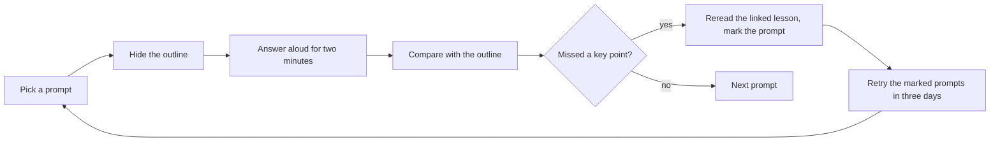
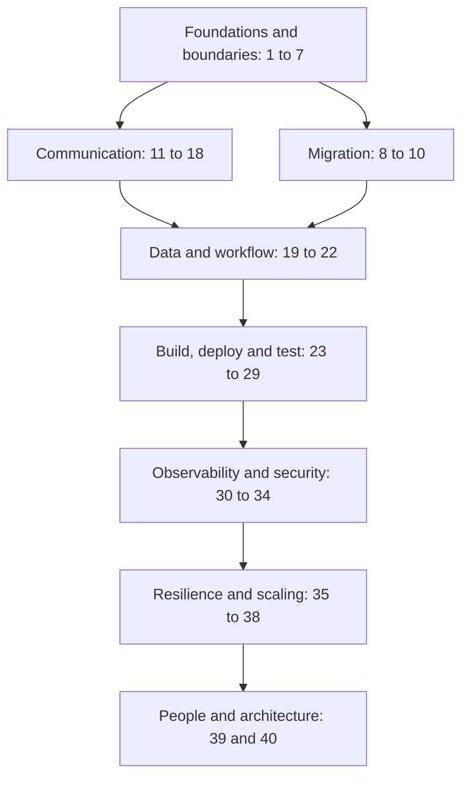

# Interview essentials II: 40 practice prompts with outline answers

## Before this lesson

> **Before this lesson:** read [Interview essentials I: the six questions you will be asked](#/lesson/microservices/interview-core), which gives the five-move answer shape (clarify, options, trade-offs, decide, risks) used throughout. Every prompt below names the lesson that teaches its topic, so you can go back when an answer does not come.

## In plain words

Nobody learns to swim by reading about it, and nobody becomes fluent in interviews by reading model answers. A boxer spars. A musician plays scales. The skill here is *saying* a clear, structured answer aloud, in about two minutes, to a question you did not choose.

This lesson is a sparring partner. It holds 40 prompts of the kind asked in backend and system design interviews, grouped by topic. Under each is an **outline answer**: the handful of points a strong answer contains, not a script to memorise. An interviewer can tell a recited paragraph from understanding within one follow-up question.

Why this matters for a job: the difference between a candidate who knows the material and one who gets the offer is very often delivery. Twenty minutes of spoken practice a day for two weeks changes how you sound.

## How to use this lesson



1. Read one prompt and cover the outline.
2. Answer **aloud**, with a timer set to two minutes. Use the five moves where they fit.
3. Compare with the outline. Did you give the mechanism, a trade-off and a decision?
4. Mark the ones you stumbled on, reread the linked lesson, and try them again in a few days.

The small program below deals you a mixed hand of prompts, so that you do not always practise your favourites.

```python-run
import random

THEMES = {
    "Foundations and boundaries": range(1, 8),
    "Migration":                  range(8, 11),
    "Communication":              range(11, 19),
    "Data and workflow":          range(19, 23),
    "Build, deploy and test":     range(23, 30),
    "Observability and security": range(30, 35),
    "Resilience and scaling":     range(35, 39),
    "People and architecture":    range(39, 41),
}

def todays_session(day, per_session=6):
    """A different, repeatable selection for each day number, at most one prompt per theme."""
    rng = random.Random(day)
    themes = rng.sample(list(THEMES), k=per_session)
    return sorted((rng.choice(list(THEMES[t])), t) for t in themes)

for day in [1, 2]:
    print(f"Day {day}:")
    for number, theme in todays_session(day):
        print(f"   prompt {number:2d}  ({theme})")
print("\nChange the day number each time you practise. Two weeks of sessions deals 84 prompts from a pool of 40.")
```

`THEMES` maps each group to its prompt numbers. `todays_session` seeds a random generator with the day number, so that the same day always gives the same hand, picks six different themes and then one prompt from each. Run it, change the day, and answer what you are dealt.

## Foundations and boundaries

**1. What is a microservice?**
*Outline.* An independently deployable service, modelled around a business capability, that owns its own data and is reached only through its network interface. The test: can it be changed and released without changing or releasing anything else? Mention that it is one option among several and brings the costs of a distributed system. (Lesson 3.)

**2. What does independent deployability require in practice?**
*Outline.* Loosely coupled services with stable, explicit contracts; backward-compatible changes; no shared database; a pipeline and artifact per service; contract tests instead of a shared end-to-end gate; zero-downtime deployment, because old and new versions overlap. If two services always release together, they are one unit. (Lessons 3, 12, 15.)

**3. Why should a service own its data?**
*Outline.* A shared table is a hidden contract: any change to it can break every reader, and nobody knows who they are. Owning data lets a service change its storage freely (information hiding) and release alone. The cost: no joins or transactions across services, so you need APIs, events and sagas. (Lessons 3, 5, 8.)

**4. Explain coupling and cohesion.**
*Outline.* Cohesion: things that change together are kept together. Coupling: how much a change in one place forces changes elsewhere. Aim for high cohesion and loose coupling. From loosest to tightest: domain coupling (calling another service's capability), pass-through, common (shared data), content (reaching into another's internals). (Lesson 5.)

**5. How do you find service boundaries?**
*Outline.* From the business domain, not the technology. Use domain-driven design: listen for the language each part of the business uses, find bounded contexts where a word has one meaning, and keep aggregates (data that must stay consistent together) whole. Event storming with domain experts is a practical workshop for it. Check candidate boundaries against team ownership and against how often they would change together. (Lesson 6.)

**6. What is a distributed monolith, and how would you spot one?**
*Outline.* Services that are separate on paper and must be changed and deployed together. Signs: releases coordinated across teams, a shared database, chatty synchronous chains, one service's failure taking down the rest, a single version number for the whole set. It carries the costs of both styles. (Lessons 4, 16.)

**7. When would you not use microservices?**
*Outline.* A new product with unclear domain boundaries; one small team; no automated deployment or central observability; software installed and operated by customers; a start-up still searching for its market. A modular monolith is the sensible default, with extraction when a concrete need appears. (Lessons 2, 4.)

## Migration

**8. Explain the strangler fig pattern.**
*Outline.* Put a routing layer in front of the old system. Build one capability outside it, route a little traffic to the new implementation, grow the share, and remove the old code when nothing uses it. Repeat. Each step is small and reversible through the routing rule. The hard part is data that the old system still holds. (Lesson 8.)

**9. What is the difference between a parallel run and a canary release?**
*Outline.* Parallel run: old and new both process the same requests; the old result is used and the two are compared. It checks *correctness* with no user impact. Canary: a small share of real users is served by the new version, and its error rate and latency are compared with the baseline. It checks *behaviour under real use*, with limited exposure. (Lessons 8, 18.)

**10. How do you move a table out of a shared database?**
*Outline.* First route all access in the old system through one interface. Create the new service with its own store. Keep both in step for a while (write to both, or replicate), with a reconciliation check. Switch reads to the new owner, then stop writing to the old table and drop it. Joins become API calls, batched lookups or a local copy fed by events; foreign keys become checks in code. (Lesson 8.)

## Communication

**11. REST or gRPC?**
*Outline.* gRPC: binary, fast, generated stubs, an explicit schema; well suited to internal calls where you control both ends. REST over HTTP: universal reach, caching, simple tools; well suited to public APIs and browsers. Either needs timeouts and a versioning approach. Choose per interface, and avoid a zoo of styles. (Lesson 11.)

**12. When would you choose GraphQL?**
*Outline.* At the edge, for user interfaces that need varied slices of data in one round trip, especially on mobile. Costs: clients can write expensive queries, HTTP caching is harder, writes fit less naturally, and it must not expose storage directly. Rarely the right choice between services. (Lessons 11, 30.)

**13. What is the difference between a queue and a topic?**
*Outline.* A queue delivers each message to one consumer: use it for work to be done once, with several workers competing. A topic delivers each message to every subscribed group: use it for events that several services care about. Within a group, one member handles each message. (Lesson 10.)

**14. What should an event contain?**
*Outline.* A fact in the past tense, with an id, a timestamp and enough data for consumers to act without calling back, since call-backs recreate coupling and load. Nothing sensitive that every subscriber should not see. Treat the event's shape as a published contract with a schema. (Lesson 10.)

**15. How do you make a breaking API change without downtime?**
*Outline.* Expand and contract. Add the new version beside the old in the same service, with the old translating to the new logic. Track which callers use the old one, give a deadline, help them move, remove it at zero usage. Never rely on deploying caller and service together. A schema comparison in the pipeline catches accidental breaks. (Lesson 12.)

**16. How do services find each other?**
*Outline.* Service discovery: instances register and send heartbeats; callers look up live instances. DNS is simple and can be stale because of caching, so it usually points at a load balancer. Dynamic registries or the platform's built-in discovery track instances as they come and go. Callers must cope with "no instance available". (Lesson 12.)

**17. API gateway or service mesh?**
*Outline.* A gateway handles traffic entering from outside: routing, API keys, rate limits. A mesh handles traffic between services through sidecar proxies: mutual TLS, retries, timeouts, uniform telemetry. Neither should hold business logic. A mesh has real operational cost and suits larger, multi-language systems. (Lesson 12.)

**18. What is a backend for frontend?**
*Outline.* A server-side component dedicated to one user interface and owned by that interface's team. It fans out to services in parallel, tolerates partial failure and returns exactly what the screen needs, so a phone makes one round trip. One per user experience. Business rules stay in services. It avoids the bottleneck of a shared aggregating gateway. (Lesson 30.)

## Data and workflow

**19. What does ACID give you, and what is lost across services?**
*Outline.* Atomic (all or nothing), consistent (rules hold), isolated (no half-finished work visible), durable (survives a crash). Each service keeps these locally. Across services, atomicity and isolation are lost, so multi-service operations need a saga, and intermediate states become visible. (Lesson 13.)

**20. Explain the transactional outbox.**
*Outline.* Problem: saving to the database and publishing an event are two steps, and a crash between them leaves them out of step. Solution: write the event to an outbox table in the same local transaction as the business change; a relay reads the table and publishes. The relay may publish twice, so consumers must be idempotent. (Lesson 10.)

**21. Orchestration or choreography for a saga?**
*Outline.* Orchestration: one coordinator calls each step and runs compensations; the flow is readable and its state is known; risk of logic collecting in the centre. Choreography: services react to each other's events; loosely coupled; harder to see, so add a correlation id and a tracking consumer. Rule of thumb: orchestrate within one team, choreograph across teams. (Lesson 14.)

**22. A saga has taken payment and the next step fails. What happens?**
*Outline.* Decide between forward recovery (retry the failed step, if it is transient or essential) and backward recovery (compensate completed steps in reverse: refund, release). Compensation is a new, visible action, not an erasure. Steps and compensations are idempotent. Design the order so that payment comes after steps likely to fail, and irreversible steps come last. (Lesson 14.)

## Build, deploy and test

**23. CI, continuous delivery and continuous deployment: what is the difference?**
*Outline.* CI: everyone merges to the mainline at least daily, with an automated build and tests, and a broken build is fixed first. Continuous delivery: every commit is proven releasable by a pipeline; releasing is a one-click decision. Continuous deployment: every passing commit is released automatically. Build one artifact and promote it unchanged. (Lesson 15.)

**24. Monorepo or one repository per service?**
*Outline.* Both work if builds map to services. Multirepo: hard ownership boundaries, small builds; cross-service changes take several commits and shared libraries drift. Monorepo: atomic commits and easy reuse; needs change detection, declared owners and, at scale, special build tooling. An atomic commit is never an atomic deployment. (Lesson 16.)

**25. Containers and virtual machines: what is the difference, and where does Kubernetes fit?**
*Outline.* A virtual machine has its own operating system on a hypervisor: strong isolation, more overhead. Containers share the host kernel: light, fast to start, packaged as an image that runs anywhere. Kubernetes schedules containers across machines and keeps the declared state: so many replicas, replaced when they die, reachable under a stable name. (Lesson 18.)

**26. Compare rolling, blue-green and canary releases.**
*Outline.* Rolling: replace instances a few at a time; cheap; mixed versions; slower to reverse. Blue-green: a full second environment, switch traffic at once; instant rollback; double capacity. Canary: a small share of traffic to the new version, compare metrics, widen gradually; best risk control; needs good monitoring. All need backward-compatible contracts and data. (Lessons 17, 18.)

**27. Why are end-to-end tests a problem with microservices?**
*Outline.* They cross many services, so they are slow, flaky and owned by nobody; small flake rates compound across a large suite. Needing them before any release ties services into one release unit. Keep a few for core user journeys; rely on unit tests, service tests with stubs, contract tests and progressive delivery. (Lesson 19.)

**28. What are consumer-driven contracts?**
*Outline.* Each consumer writes executable expectations covering only what it uses from a provider. They generate the consumer's stub and are replayed against the real provider in the provider's pipeline. A breaking change fails the provider's build and names the affected consumer, before release. They replace much cross-team end-to-end testing. (Lesson 20.)

**29. How do you change a database column with zero downtime?**
*Outline.* The same expand-and-contract idea, applied to data, because old and new code run together during a rollout. Add the new column, allowing empty values. Deploy code that writes both and reads the old. Copy existing rows across in the background. Switch reads to the new column. Stop writing the old one. Remove it in a later release. Each step is backward compatible and can be reversed. (Lessons 12, 17.)

## Observability and security

**30. What are logs, metrics and traces each for?**
*Outline.* Logs: detailed records of events; aggregate them centrally, structured, with a correlation id. Metrics: cheap numbers over time, with labels; for trends, dashboards and alerts. Traces: one request's path as a tree of spans; for finding where time went across services. Use them together. (Lesson 21.)

**31. Explain SLIs, SLOs and error budgets, and how you would alert.**
*Outline.* SLI: a measurement of what users experience, good events over all events. SLO: the target over a period. Error budget: the failure the SLO permits; it settles the argument between shipping and stabilising. Page on symptoms, when the budget is burning fast over two windows; send slow burns and cause-level signals to tickets. (Lesson 22.)

**32. A request is slow somewhere across ten services. How do you find where?**
*Outline.* Open a trace for a slow request: the trace id is propagated on every call, so the spans form a tree with durations; look for the span with the largest self time. Confirm with that service's metrics by instance, then read its logs filtered by the correlation id. Without tracing, aggregated logs with correlation ids are the minimum. (Lesson 21.)

**33. How does a downstream service know who the end user is?**
*Outline.* The gateway authenticates the user with an identity provider and attaches a short-lived signed token (a JWT) carrying identity and claims. Services pass it on, validate signature and expiry locally, and make their own authorisation decision. This prevents the confused deputy, where a trusted service fetches data its caller may not see. Between services, mutual TLS. (Lesson 24.)

**34. How do you manage secrets?**
*Outline.* Never in source code or images; scan for them, and revoke any that leak. Keep them in a secrets manager that issues scoped credentials per service, rotates them automatically and logs access. Prefer short-lived credentials. Apply least privilege so that one compromised service reaches little. (Lesson 23.)

## Resilience and scaling

**35. Define timeout, retry, circuit breaker and bulkhead in a sentence each.**
*Outline.* Timeout: stop waiting after a set time, inside an overall deadline. Retry: repeat transient failures a few times, with exponential backoff and jitter, at one layer, for idempotent operations only. Circuit breaker: after repeated failures stop calling for a while and fail fast, then probe. Bulkhead: give each dependency a limited pool so that it cannot exhaust shared capacity. (Lesson 26.)

**36. Explain the CAP theorem with an example.**
*Outline.* When a network partition splits replicas, a system must choose: keep answering and risk stale or conflicting data (AP), or refuse some requests to stay consistent (CP). Choose per capability: booking a specific slot is CP, since a double booking is worse than a retry; showing loyalty points is AP. Without a partition you can have both. (Lesson 25.)

**37. What are the ways to scale a system?**
*Outline.* Four axes. Vertical: a bigger machine; quick, limited, no robustness. Horizontal duplication: more identical stateless instances and read replicas; adds robustness; shifts the bottleneck. Data partitioning: split by key; helps writes; hard key choice. Functional decomposition: split by capability; most powerful and most costly. Measure first and take the cheapest step that works. (Lesson 27.)

**38. Where would you cache, and how do you keep it fresh?**
*Outline.* Name the goal: speed, origin load or robustness. Client-side caches avoid the network call and survive outages; server-side caches are easier to keep correct. Invalidate with a TTL sized to tolerable staleness, with change events where fresher data is needed, plus a backstop TTL. Cache in as few places as possible, because staleness adds up. (Lesson 28.)

## People and architecture

**39. What is Conway's law, and how does it affect team design?**
*Outline.* Systems mirror the communication structure of the organisation that builds them. So align team boundaries with service boundaries: small stream-aligned teams owning a business slice end to end, with strong ownership and responsibility in production; enabling and platform teams to support them. Layered teams produce layered systems and handoffs. (Lesson 31.)

**40. How do you keep standards across many teams without slowing them down?**
*Outline.* Be strict about what happens between services and relaxed within them. Derive a few principles from business goals, agreed by a forum of practitioners. Make the right way the easy way with a paved road and service templates; show it with real exemplar services; check it with automated fitness functions. Record technical debt and exceptions, and revise a principle when exceptions repeat. (Lessons 32, 33, 34.)

## Numbers worth having in your head

A rough figure makes an answer concrete. These come up again and again.

```python-run
print("Availability targets, per 30 days")
for slo in [0.99, 0.999, 0.9999]:
    print(f"   {slo:.2%} -> {(1 - slo) * 30 * 24 * 60:6.1f} minutes of allowed failure")

print("\nA synchronous chain of services at 99.9% each")
for n in [3, 5, 10, 30]:
    print(f"   {n:2d} services -> {0.999 ** n:.2%}")

print("\nRetries multiplying across layers (3 attempts per layer)")
for layers in [1, 2, 3]:
    print(f"   {layers} layer(s) -> up to {3 ** layers} calls at the bottom")

print("\nPairs of people who may need to talk")
for people in [8, 20, 50]:
    print(f"   team of {people:2d} -> {people * (people - 1) // 2} pairs")

print("\nA suite of flaky tests, each failing 1% of the time for no reason")
for tests in [10, 100, 200]:
    print(f"   {tests:3d} tests -> green {0.99 ** tests:.0%} of the time")

print("\nError-budget burn rate with a 99.9% objective")
for error_rate in [0.001, 0.006, 0.0144]:
    print(f"   {error_rate:.2%} errors -> burn rate {error_rate / 0.001:.1f}")
```

Each block prints one family of figures from earlier lessons: minutes of allowed failure for common objectives, the availability of a chain of blocking calls, how retries multiply, how communication paths grow, how small flake rates sink a test suite, and what a burn rate means. You do not need the exact values. Knowing that 99.9% is about 43 minutes a month, that thirty services at 99.9% give about 97%, and that three layers of three retries make 27 calls, is enough to turn a vague claim into an argument.

## A map of the 40 prompts



> [!INTERVIEW]
> When a prompt catches you unprepared, do not guess at a definition. Say what you do know, reason from the mechanism ("a call that waits holds a worker, so..."), state one trade-off and commit to a choice. Interviewers score the reasoning far more than the vocabulary, and "I have not used that; here is how I would think about it" is a respectable opening.

The arrows follow the order of the track. In an interview they run the other way too: a question about resilience often turns into one about communication style, and a question about boundaries into one about teams.

## Pitfalls

- **Memorising the outlines.** The first follow-up question exposes it. Understand the mechanism and rebuild the answer each time.
- **Practising silently.** Thinking an answer and saying it are different skills.
- **Answering without a decision.** End with what you would do in this case.
- **Talking for five minutes.** Two minutes, then let the interviewer steer.
- **Skipping the cost.** Every pattern here has a price; name it.
- **Only practising favourites.** Let the program choose.
- **Ignoring the linked lessons.** A prompt you cannot answer is pointing at something to reread.
- **Dropping names of tools.** Say what the tool does for the design before naming it.

## Summary

- Fluency comes from answering aloud, on a timer, to prompts you did not choose, and checking against an outline.
- The 40 prompts cover eight themes: foundations, migration, communication, data and workflow, build-deploy-test, observability and security, resilience and scaling, and people and architecture.
- A strong answer states the mechanism, gives the trade-off, decides for the case in hand and mentions the risk.
- A handful of rough numbers (minutes in an error budget, availability of a chain, retry multiplication) make answers concrete.
- Mark what you miss, return to the lesson that teaches it, and retry after a few days.

## Glossary

| Term | Meaning |
|---|---|
| Outline answer | The key points a good answer contains, as opposed to a script |
| Follow-up question | A further question an interviewer asks to test the depth of an answer |
| Mechanism | The concrete way something works or fails, as opposed to a label for it |
| Trade-off | What is gained and what is given up by a choice |
| Spaced practice | Returning to material after increasing gaps of time to strengthen memory |
| Back-of-envelope figure | A rough number good enough to support an argument |
| Expand and contract | Supporting old and new together, migrating, then removing the old |
| Self time | The time a span spends in its own work, excluding the calls it makes |
| Burn rate | How fast an error budget is being used relative to the sustainable pace |
| Stream-aligned team | A team that owns one slice of the product from end to end |

```quiz
[
  {"q": "What is the most effective way to use the outline answers in this lesson?", "options": ["Memorise each word for word", "Hide the outline, answer aloud on a timer, then compare and revisit what was missed", "Read them once the night before", "Copy them into a document"], "answer": 1,
   "explain": "Interview skill is spoken and under time pressure. Comparing afterwards shows the gaps to work on."},
  {"q": "Which statement best distinguishes a parallel run from a canary release?", "options": ["They are the same", "A parallel run compares new results with old without using the new ones; a canary serves a small share of real users with the new version", "A canary never reaches production", "A parallel run needs double the users"], "answer": 1,
   "explain": "A parallel run checks correctness with no user impact. A canary checks real behaviour with limited exposure."},
  {"q": "In the zero-downtime column change, why must the new column be added before any code reads it?", "options": ["Databases require alphabetical order", "Old and new code versions run together during a rollout, so every step must work with both", "To make the table smaller", "Because backups run at night"], "answer": 1,
   "explain": "Expand first, migrate, then contract. Each step stays backward compatible so that either version of the code can run."},
  {"q": "Which rule of thumb is given for choosing between saga orchestration and choreography?", "options": ["Always orchestrate", "Orchestrate within one team; choreograph across teams", "Choreograph only for payments", "Use two-phase commit instead"], "answer": 1,
   "explain": "An orchestrator is comfortable when one team owns the flow. Across teams, events avoid depending on another team's coordinator."},
  {"q": "Roughly how much failure does a 99.9% objective allow in 30 days?", "options": ["About 4 minutes", "About 43 minutes", "About 7 hours", "About 2 days"], "answer": 1,
   "explain": "0.1% of 43,200 minutes is 43.2 minutes."},
  {"q": "Three layers each retry a failing call three times. What is the most calls the bottom service can receive for one request?", "options": ["3", "6", "9", "27"], "answer": 3,
   "explain": "Attempts multiply across layers: 3 x 3 x 3 = 27. Retry at a single layer."},
  {"q": "Which answer to 'how do you keep standards across teams?' reflects the track's advice?", "options": ["A central architect approves every change", "Strict rules between services, freedom within them, a paved road, exemplars and automated fitness functions", "Every team does whatever it likes", "One shared library containing all business logic"], "answer": 1,
   "explain": "Making the right way easy and checking it automatically keeps alignment without a central queue."},
  {"q": "An interviewer asks a follow-up you cannot answer from the outline. What does that most likely show?", "options": ["The interviewer is being unfair", "The outline was memorised without understanding the mechanism behind it", "The topic is not important", "Outlines should be longer"], "answer": 1,
   "explain": "Follow-ups test depth. Rebuilding an answer from how the thing works is what makes it hold up."}
]
```

> **Source:** Newman, *Building Microservices*, 2nd ed., ch. 1-16 (topic coverage only; all prompts, outlines and the Pawprint example are original). See the source lines of the individual lessons for the further reading behind each topic.
