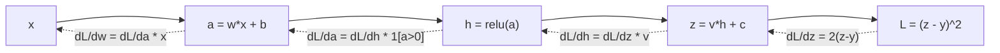

# Calculus, gradients and gradient descent

Training a model means *choosing parameters that make a loss small*. When there is no closed-form answer,
as with logistic regression, neural networks and gradient boosting, we optimise numerically. The workhorse
is **gradient descent**, and the tool that makes it practical for networks with millions of parameters is the
**chain rule** (backpropagation). This lesson builds both from scratch.

## 1. Derivatives: local slope

The derivative $f'(x) = \lim_{h\to 0}\frac{f(x+h)-f(x)}{h}$ is the slope of the tangent line. It tells you
how much the output changes for a tiny change in the input. Rules worth memorising:

| function | derivative |
|---|---|
| $x^n$ | $n x^{n-1}$ |
| $e^x$ | $e^x$ |
| $\ln x$ | $1/x$ |
| $\sigma(x)=\frac{1}{1+e^{-x}}$ | $\sigma(x)(1-\sigma(x))$ |
| $\tanh x$ | $1-\tanh^2 x$ |
| $\text{ReLU}(x)=\max(0,x)$ | $1$ if $x>0$, else $0$ (by convention $0$ at $x=0$) |
| $f(g(x))$ | $f'(g(x))\,g'(x)$ — **chain rule** |

The sigmoid's derivative is the reason logistic regression and old-style neural nets have such tidy
gradients. Its maximum value is $0.25$, at $x=0$. Stacking many sigmoid layers therefore multiplies many
numbers $\le 0.25$, and the gradient *vanishes*. That is why ReLU replaced it in hidden layers.

## 2. Partial derivatives and the gradient

A loss depends on many parameters. The **partial derivative** $\partial L/\partial w_j$ varies $w_j$ while
holding everything else fixed. Stacking all partials gives the **gradient**:

$$\nabla_w L = \left(\frac{\partial L}{\partial w_1},\dots,\frac{\partial L}{\partial w_p}\right).$$

Key fact: the gradient points in the direction of **steepest ascent**, and its length is the slope in that
direction. To *decrease* the loss, step in the opposite direction.

### Worked example: MSE for linear regression

$L(w,b) = \frac1n\sum_i (w^\top x_i + b - y_i)^2$. Let $r_i = w^\top x_i + b - y_i$ be the residual.
By the chain rule, $\frac{\partial}{\partial w_j} r_i^2 = 2 r_i x_{ij}$, so

$$\nabla_w L = \frac{2}{n}X^\top r,\qquad \frac{\partial L}{\partial b} = \frac2n\sum_i r_i .$$

Read it as residuals "projected back" onto the features. A feature that correlates with the errors gets its
weight changed the most. Setting $\nabla_w L = 0$ (with the intercept folded into $X$) recovers the normal
equations $X^\top X w = X^\top y$ from the previous lesson.

## 3. Gradient descent

$$\theta_{t+1} = \theta_t - \eta\,\nabla L(\theta_t)$$

The **learning rate** $\eta$ is the most important hyperparameter of any gradient-based learner:

- too small means painfully slow progress;
- too large means overshooting, oscillating or diverging (the loss goes to `inf`/`nan`);
- feature scaling matters a lot. If one feature ranges over thousands and another over fractions, the loss
  surface is a long, narrow valley, and no single learning rate suits both directions. Standardising makes
  the bowl rounder.

```python-run
import numpy as np
rng = np.random.RandomState(0)
X = rng.randn(100, 2)
y = X @ np.array([3.0, -2.0]) + 1.0 + 0.1 * rng.randn(100)

def gd(lr, steps=50):
    w, b = np.zeros(2), 0.0
    for t in range(steps):
        r = X @ w + b - y
        w -= lr * 2 / len(y) * X.T @ r
        b -= lr * 2 / len(y) * r.sum()
    return np.mean((X @ w + b - y) ** 2), w, b

for lr in [0.001, 0.01, 0.1, 0.5, 1.1]:
    mse, w, b = gd(lr)
    print(f"lr={lr:<6} final MSE={mse:12.4g}  w={w.round(2)}  b={b:.2f}")
```

Notice that $\eta=1.1$ diverges. For a quadratic loss, GD is stable only when $\eta < 2/\lambda_{\max}$,
where $\lambda_{\max}$ is the largest eigenvalue of the Hessian (matrix of second derivatives). That
explains *why* badly scaled features force tiny learning rates.

### Batch, stochastic and mini-batch

| variant | gradient from | pros / cons |
|---|---|---|
| batch GD | all $n$ samples | exact gradient; expensive per step |
| stochastic GD (SGD) | 1 sample | cheap, noisy; noise can help escape poor regions |
| mini-batch | $B$ samples (32–1024) | the standard in deep learning; vectorises well on GPUs |

An **epoch** is one pass over the training set. scikit-learn's `SGDClassifier` and `SGDRegressor`
implement linear models trained this way and scale to datasets that do not fit in memory (via `partial_fit`).

## 4. Convexity

A function is **convex** if the line segment between any two points on its graph lies above the graph.
For a convex loss, every local minimum is a global minimum, so gradient descent with a suitable learning
rate finds *the* answer. Least squares, ridge, lasso, logistic regression and linear SVMs all have convex
losses. That is part of why linear models are so dependable. Neural-network losses are **non-convex**.
They have many local minima and saddle points, yet in practice SGD with good initialisation finds solutions
that generalise well.

## 5. The chain rule and computational graphs

A neural network is a composition: $L = \ell(f_3(f_2(f_1(x))))$. The chain rule says

$$\frac{\partial L}{\partial x} = \frac{\partial \ell}{\partial f_3}\frac{\partial f_3}{\partial f_2}\frac{\partial f_2}{\partial f_1}\frac{\partial f_1}{\partial x}.$$

**Backpropagation** evaluates this product from the left: it starts at the loss and walks backwards,
reusing intermediate values that were stored during the forward pass. The total cost is about 2–3× one
forward pass, whatever the number of parameters. That is what makes training billion-parameter models
possible.



### Worked example by hand and by code

Take $x=2, y=1, w=0.5, b=0, v=-1, c=0.5$.
Forward: $a=1$, $h=1$, $z=-0.5$, $L=2.25$.
Backward: $\partial L/\partial z = 2(z-y) = -3$. Then $\partial L/\partial v = -3\cdot h = -3$,
$\partial L/\partial h = -3\cdot v = 3$, $\partial L/\partial a = 3\cdot 1 = 3$ (since $a>0$), and
$\partial L/\partial w = 3\cdot x = 6$, $\partial L/\partial b = 3$.

```python-run
def forward(w, b, v, c, x=2.0, y=1.0):
    a = w * x + b
    h = max(0.0, a)
    z = v * h + c
    return (z - y) ** 2

w, b, v, c = 0.5, 0.0, -1.0, 0.5
eps = 1e-6
num = {}
for name in "wbvc":
    p = dict(w=w, b=b, v=v, c=c)
    p[name] += eps; up = forward(**p)
    p[name] -= 2 * eps; down = forward(**p)
    num[name] = (up - down) / (2 * eps)
print("loss:", forward(w, b, v, c))
print("numerical gradients:", {k: round(g, 4) for k, g in num.items()})
print("analytic (by hand):   {'w': 6, 'b': 3, 'v': -3, 'c': -3}")
```

That script is a **gradient check**. Comparing central-difference gradients with your analytic ones is
the standard way to debug a hand-written backward pass (see problem *ml-mlp-backprop*).

> [!INTERVIEW]
> **"Explain backpropagation in two minutes."** The forward pass computes and caches activations. The
> backward pass applies the chain rule from the loss back to the inputs: each layer receives
> $\partial L/\partial\text{output}$, computes $\partial L/\partial\text{params}$ (for the update) and
> $\partial L/\partial\text{input}$ (passed further back). It is reverse-mode automatic differentiation.
> One backward pass costs a small constant multiple of the forward pass, independent of the number of
> parameters.

## 6. Vector calculus shortcuts

You will meet these derivatives constantly, written for column vectors:

| expression | gradient w.r.t. $w$ |
|---|---|
| $a^\top w$ | $a$ |
| $w^\top A w$ | $(A + A^\top)w$ → $2Aw$ if $A$ symmetric |
| $\lVert Xw - y\rVert^2$ | $2X^\top(Xw-y)$ |
| $\lambda\lVert w\rVert_2^2$ | $2\lambda w$ (ridge/weight decay) |
| $\lambda\lVert w\rVert_1$ | $\lambda\,\operatorname{sign}(w)$ (subgradient; lasso) |

For logistic regression with $p=\sigma(Xw)$ and the cross-entropy loss, the gradient is
$\frac1n X^\top(p - y)$. It is the same form as least squares, with a different residual. For softmax
regression or a network's last layer, $\partial L/\partial z = p - y_{\text{one-hot}}$.

## 7. Second-order information (briefly)

The **Hessian** $H = \nabla^2 L$ captures curvature. Newton's method $\theta \leftarrow \theta - H^{-1}\nabla L$
converges in very few steps on smooth convex problems. scikit-learn's `LogisticRegression(solver="newton-cg")`
and the `lbfgs` quasi-Newton solver exploit curvature. For networks with millions of parameters the Hessian
is far too large, so deep learning uses first-order methods with adaptive step sizes such as Adam, covered
in module 8.

## 8. Numerical pitfalls

- **Overflow in exp.** `np.exp(1000)` is `inf`. Use the max-subtraction trick for softmax and the
  log-sum-exp identity $\log\sum e^{z_i} = m + \log\sum e^{z_i - m}$.
- **log(0).** Compute cross-entropy from logits, not from probabilities that may underflow to 0.
- **Catastrophic cancellation.** Use `np.log1p(x)` for $\log(1+x)$ with small $x$.

```python-run
import numpy as np
z = np.array([1000.0, 999.0, 0.0])
naive = np.log(np.sum(np.exp(z)))            # overflows
m = z.max()
stable = m + np.log(np.sum(np.exp(z - m)))   # log-sum-exp trick
print("naive:", naive, " stable:", stable)
```

## Summary

- The gradient points uphill. Gradient descent steps against it with learning rate $\eta$.
- Learning-rate choice and feature scaling decide whether GD converges, crawls or diverges.
- Convex losses (linear/logistic regression, SVMs) have a single global minimum. Neural networks do not.
- The chain rule applied backwards is backpropagation, and gradient checks validate it.
- Numerical stability tricks (max-shift, log-sum-exp, log1p) are part of correct ML code.

```quiz
[
  {"q": "What is the derivative of the sigmoid σ(x)?", "options": ["σ(x)(1 − σ(x))", "σ(x)²", "1 − σ(x)²", "e^{-x}"], "answer": 0,
   "explain": "A classic identity; its maximum 0.25 at x=0 explains vanishing gradients in deep sigmoid networks."},
  {"q": "Gradient descent with a learning rate that is too large typically…", "options": ["oscillates or diverges", "converges faster to the same point always", "gets stuck at a saddle point", "becomes stochastic"], "answer": 0,
   "explain": "Steps overshoot the minimum; for a quadratic loss GD diverges once η exceeds 2/λ_max."},
  {"q": "Why does feature scaling speed up gradient descent?", "options": ["It makes the loss surface rounder so one learning rate fits all directions", "It reduces the number of parameters", "It makes the loss convex", "It removes noise from labels"], "answer": 0,
   "explain": "Very different feature scales create long narrow valleys (high condition number), forcing tiny steps."},
  {"q": "For L = ||Xw − y||², the gradient with respect to w is…", "options": ["2Xᵀ(Xw − y)", "2(Xw − y)", "XᵀX", "2X(Xw − y)ᵀ"], "answer": 0,
   "explain": "Chain rule: derivative of the squared norm is 2r, propagated through the linear map gives Xᵀ."},
  {"q": "Which loss is NOT convex in its parameters?", "options": ["A multi-layer neural network's cross-entropy loss", "Logistic regression log-loss", "Ridge regression", "Linear SVM hinge loss"], "answer": 0,
   "explain": "Composition through nonlinear hidden layers breaks convexity; the others are convex."},
  {"q": "A gradient check compares your analytic gradient with…", "options": ["central finite differences (L(θ+ε) − L(θ−ε))/2ε", "the gradient of a different model", "the Hessian", "random noise"], "answer": 0,
   "explain": "Numerical differentiation is slow but simple and reliable, so it is used to validate backprop code."},
  {"q": "The cost of one backward pass relative to the forward pass is roughly…", "options": ["a small constant factor (≈2–3×)", "proportional to the number of parameters squared", "exponential in depth", "the same as computing every partial derivative separately"], "answer": 0,
   "explain": "Reverse-mode autodiff reuses cached intermediates, so all gradients come at a constant-factor cost."}
]
```

> **Source:** Müller & Guido, ch. 2 (linear models, neural networks: "how to learn the model"); Goodfellow, Bengio & Courville, *Deep Learning*, ch. 4 and 6.5 (background); scikit-learn User Guide, "Stochastic Gradient Descent".
