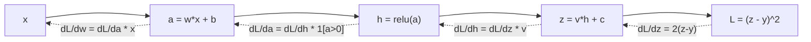

# Calculus, gradients and gradient descent

> **Before this lesson:** basic Python, plus the vocabulary from [Linear algebra for ML](#/lesson/ml/linear-algebra): vector, matrix, dot product, transpose, and the idea that a dataset is a matrix $X$ of samples with a label vector $y$. No calculus is assumed; the lesson starts from "what is a slope".

## In plain words

A machine-learning **model** is a formula with adjustable numbers in it, called **parameters** (or weights). **Training** means searching for the parameter values that make the model's predictions as close as possible to the known answers. To search, we need a score that says how wrong the model currently is. That score is the **loss**: one number, where smaller is better.

Picture standing on a hillside in thick fog, wanting to reach the valley floor. You cannot see the valley, but you can feel which way the ground tilts under your feet. So you take a step downhill, feel again, step again. That is **gradient descent**. The height of the ground is the loss, your position is the current parameter values, and the tilt of the ground is the **gradient**. **Calculus** is the maths that tells us the tilt.

Why it matters for a job: every modern model, from a small spam filter to a large language model, is trained by this loop. Interviewers routinely ask you to derive a gradient, to explain why training "blew up", or to describe backpropagation. All three are answered by this lesson.

## 1. Derivatives: the slope at a point

Start with a function of one number, say $f(x) = x^2$. Its **derivative**, written $f'(x)$ or $\frac{df}{dx}$, answers: "if I nudge $x$ up by a tiny amount, how many times bigger is the change in $f$?" It is the slope of the curve at that point.

Work it out with numbers. At $x = 3$, $f = 9$. Nudge to $x = 3.001$ and $f = 9.006001$. The output moved by 0.006001 for an input move of 0.001, a ratio of about 6. So the slope at $x=3$ is 6. The formal definition says the same, with the nudge $h$ shrinking towards zero (that is what $\lim_{h\to 0}$, "the limit as $h$ goes to 0", means):

$$f'(x) = \lim_{h\to 0}\frac{f(x+h)-f(x)}{h}.$$

For $x^2$ the result is $f'(x) = 2x$, which gives 6 at $x = 3$, matching our experiment. A positive derivative means the function is rising as $x$ increases, a negative one means it is falling, and zero means the curve is flat there, as at the bottom of a valley or the top of a hill.

You rarely compute the limit by hand. A short table of ready-made results covers almost all of ML:

| function | derivative | note |
|---|---|---|
| $x^n$ | $n x^{n-1}$ | so $x^2 \to 2x$, $x^3 \to 3x^2$ |
| $e^x$ | $e^x$ | $e \approx 2.718$; `np.exp` in code |
| $\ln x$ | $1/x$ | natural logarithm, the reverse of $e^x$; `np.log` |
| $\sigma(x)=\frac{1}{1+e^{-x}}$ | $\sigma(x)(1-\sigma(x))$ | the **sigmoid**, an S-shaped curve that squeezes any number into the range 0 to 1 |
| $\tanh x$ | $1-\tanh^2 x$ | another S-curve, range −1 to 1 |
| $\text{ReLU}(x)=\max(0,x)$ | $1$ if $x>0$, else $0$ | "rectified linear unit": keeps positives, turns negatives into 0 |
| $f(g(x))$ | $f'(g(x))\,g'(x)$ | the **chain rule**, section 5 |

The sigmoid's derivative is the reason logistic regression and early neural networks have such tidy maths. Its largest value is $0.25$, at $x=0$ (there $\sigma = 0.5$ and $0.5 \times 0.5 = 0.25$). A network built from many sigmoid layers multiplies many numbers of at most 0.25 together, and the product shrinks towards zero. This is the **vanishing gradient** problem, and it is why ReLU replaced the sigmoid inside modern networks.

## 2. Partial derivatives and the gradient

A loss depends on many parameters, not one. The **partial derivative** $\partial L/\partial w_j$ (the curly $\partial$ is read "partial") is the slope with respect to one parameter $w_j$ while all the others are held still. On the foggy hillside it is the tilt you feel if you face exactly east, or exactly north.

Collect all the partial derivatives into one vector and you have the **gradient**, written with the symbol $\nabla$ ("nabla" or "del"):

$$\nabla_w L = \left(\frac{\partial L}{\partial w_1},\dots,\frac{\partial L}{\partial w_p}\right).$$

Tiny example: $L(w_1, w_2) = w_1^2 + 3w_2$. Treating $w_2$ as a constant, the slope in $w_1$ is $2w_1$. Treating $w_1$ as a constant, the slope in $w_2$ is 3. At the point $(2, 5)$ the gradient is $(4, 3)$.

The key fact: the gradient points in the direction of **steepest ascent** (straight uphill), and its length says how steep the slope is. To make the loss smaller, step in the opposite direction.

### Worked example: the gradient of mean squared error

**Mean squared error** (MSE) is the most common loss for predicting numbers: for each sample take the gap between prediction and truth, square it, and average over all samples. For a linear model that predicts $w^\top x_i + b$:

$$L(w,b) = \frac1n\sum_i (w^\top x_i + b - y_i)^2 .$$

Call the gap $r_i = w^\top x_i + b - y_i$ (the residual, with the sign chosen as prediction minus truth). The table says the derivative of $r^2$ is $2r$, and nudging $w_j$ by a little changes $r_i$ by that little times $x_{ij}$ (the value of feature $j$ for sample $i$). Multiplying the two, by the chain rule, gives $2 r_i x_{ij}$ for one sample. Averaging over samples and writing all features at once:

$$\nabla_w L = \frac{2}{n}X^\top r,\qquad \frac{\partial L}{\partial b} = \frac2n\sum_i r_i .$$

In words: each weight's slope is the dot product of that feature's column with the errors. A feature whose values line up with the errors gets its weight changed the most. Numbers: one sample with $x = (1, 2)$, $y = 3$, and weights starting at zero. The prediction is 0, so $r = -3$, and the gradient is $2 \times (-3) \times (1, 2) = (-6, -12)$. Both slopes are negative, so increasing the weights lowers the loss, which is right: the prediction is too low.

Setting this gradient to zero (the flat spot at the bottom) gives back the normal equations $X^\top X w = X^\top y$ from the previous lesson.

## 3. Gradient descent

The algorithm in one line: repeatedly move every parameter a small step against its slope.

$$\theta_{t+1} = \theta_t - \eta\,\nabla L(\theta_t)$$

Here $\theta$ (theta) stands for all the parameters together, the subscript $t$ counts steps, and $\eta$ (eta) is the **learning rate**: how big a step to take. The learning rate is a **hyperparameter**, meaning a setting you choose before training, as opposed to a parameter that training finds. It is the most important one for any gradient-based method:

- too small and progress is painfully slow;
- too large and each step overshoots the valley floor, so the loss bounces around or grows without limit (in code you see `inf`, infinity, or `nan`, "not a number");
- the scale of the features matters a lot. If one feature ranges over thousands and another over fractions, the loss surface is a long, narrow canyon, and no single step size suits both directions. Rescaling the features so they have similar ranges (**standardising**, lesson 30) makes the valley rounder.

```python-run
import numpy as np
rng = np.random.RandomState(0)
X = rng.randn(100, 2)
y = X @ np.array([3.0, -2.0]) + 1.0 + 0.1 * rng.randn(100)

def gd(lr, steps=50):
    w, b = np.zeros(2), 0.0
    for t in range(steps):
        r = X @ w + b - y
        w -= lr * 2 / len(y) * X.T @ r
        b -= lr * 2 / len(y) * r.sum()
    return np.mean((X @ w + b - y) ** 2), w, b

for lr in [0.001, 0.01, 0.1, 0.5, 1.1]:
    mse, w, b = gd(lr)
    print(f"lr={lr:<6} final MSE={mse:12.4g}  w={w.round(2)}  b={b:.2f}")
```

**Reading this code line by line**

- The first lines make 100 samples with 2 features, and labels built from known weights `[3, -2]`, a constant `1.0` and a little noise. Knowing the true answer lets us judge the result.
- `def gd(lr, steps=50)` defines the training loop for a given learning rate. `np.zeros(2)` starts both weights at 0.
- `r = X @ w + b - y` computes all 100 residuals at once.
- `w -= lr * 2 / len(y) * X.T @ r` is the update rule: subtract the learning rate times the gradient $\frac{2}{n}X^\top r$. `w -= ...` means "subtract from `w` in place". The next line does the same for `b`.
- The function returns the final MSE and the parameters. The last loop tries five learning rates.

The output shows three behaviours. With `0.001` the weights have barely left zero after 50 steps, and with `0.01` they are only about two thirds of the way: too slow. With `0.1` and `0.5` the weights land on `[3, -2]` and `b` on 1, with a tiny MSE. With `1.1` the MSE is astronomically large: every step overshot by more than the last. For a bowl-shaped loss, gradient descent is stable only when $\eta < 2/\lambda_{\max}$, where $\lambda_{\max}$ measures the curvature in the steepest direction. Section 10 shows where that limit comes from.

### Batch, stochastic and mini-batch

The gradient above used all $n$ samples for each step. With millions of samples that is slow, so there are cheaper variants.

| variant | gradient computed from | pros and cons |
|---|---|---|
| batch gradient descent | all $n$ samples | exact gradient; expensive per step |
| stochastic gradient descent (SGD) | 1 randomly chosen sample | cheap and noisy; the noise can shake the search out of poor regions |
| mini-batch | $B$ samples, typically 32 to 1,024 | the standard in deep learning; a good balance, and fast on graphics processors (GPUs) |

"Stochastic" means "involving randomness". An **epoch** is one full pass over the training data. scikit-learn's `SGDClassifier` and `SGDRegressor` train linear models this way, and through their `partial_fit` method they can learn from data too big to load into memory at once.

## 4. Convexity: one valley or many?

A function is **convex** if it is shaped like a single bowl: draw a straight line between any two points on its graph, and the line never dips below the graph. A convex loss has no false bottoms. Any low point that gradient descent finds (a **local minimum**, lower than its immediate surroundings) is also the lowest point overall (the **global minimum**).

The losses of least squares, ridge, lasso, logistic regression and linear support vector machines are all convex. That is part of why linear models are so dependable: train twice and you get the same answer. Neural-network losses are **non-convex**. They have many local minima and many **saddle points** (flat spots that go up in some directions and down in others, like a horse's saddle). In practice, stochastic gradient descent with sensible starting values still finds solutions that work well, but two training runs can end in different places.

## 5. The chain rule and computational graphs

Models are built by feeding the output of one function into the next. The **chain rule** says how slopes combine through such a chain: multiply them. If a nudge to $x$ changes $g$ three times as much, and a nudge to $g$ changes $f$ twice as much, then a nudge to $x$ changes $f$ six times as much.

Example: $f(x) = (3x+1)^2$. The inner function is $g = 3x + 1$ with slope 3. The outer function is $g^2$ with slope $2g$. The chain rule gives $2(3x+1) \times 3$. At $x = 1$ that is $2 \times 4 \times 3 = 24$.

A neural network is a long chain: $L = \ell(f_3(f_2(f_1(x))))$, where each $f$ is one layer and $\ell$ is the loss. The chain rule for it is a product with one factor per link:

$$\frac{\partial L}{\partial x} = \frac{\partial \ell}{\partial f_3}\frac{\partial f_3}{\partial f_2}\frac{\partial f_2}{\partial f_1}\frac{\partial f_1}{\partial x}.$$

**Backpropagation** (often "backprop") is the method of computing this product starting from the loss and walking backwards through the layers. It has two phases. The **forward pass** computes the prediction and the loss, remembering every intermediate value. The **backward pass** then visits the steps in reverse order, multiplying slopes as it goes and reusing those remembered values. The whole thing costs about two to three times one forward pass, no matter how many parameters there are. That efficiency is what makes it possible to train models with billions of parameters.

A drawing of the steps as boxes and arrows is called a **computational graph**. Solid arrows below are the forward pass; dotted arrows are the backward pass.



### Worked example by hand and by code

Take the tiny network in the diagram with $x=2$, $y=1$, $w=0.5$, $b=0$, $v=-1$, $c=0.5$.

**Forward.** $a = 0.5\times2 + 0 = 1$. $h = \max(0, 1) = 1$. $z = -1\times1 + 0.5 = -0.5$. $L = (-0.5 - 1)^2 = 2.25$.

**Backward.** Start at the loss: $\partial L/\partial z = 2(z-y) = 2 \times (-1.5) = -3$. The step $z = v h + c$ has slope $h$ with respect to $v$, slope $v$ with respect to $h$ and slope 1 with respect to $c$, so $\partial L/\partial v = -3 \times 1 = -3$, $\partial L/\partial c = -3$ and $\partial L/\partial h = -3\times(-1) = 3$. ReLU passes the slope through unchanged because $a > 0$: $\partial L/\partial a = 3$. Finally $a = wx + b$ gives $\partial L/\partial w = 3 \times x = 6$ and $\partial L/\partial b = 3$.

```python-run
def forward(w, b, v, c, x=2.0, y=1.0):
    a = w * x + b
    h = max(0.0, a)
    z = v * h + c
    return (z - y) ** 2

w, b, v, c = 0.5, 0.0, -1.0, 0.5
eps = 1e-6
num = {}
for name in "wbvc":
    p = dict(w=w, b=b, v=v, c=c)
    p[name] += eps; up = forward(**p)
    p[name] -= 2 * eps; down = forward(**p)
    num[name] = (up - down) / (2 * eps)
print("loss:", forward(w, b, v, c))
print("numerical gradients:", {k: round(g, 4) for k, g in num.items()})
print("analytic (by hand):   {'w': 6, 'b': 3, 'v': -3, 'c': -3}")
```

`forward` repeats the forward pass and returns the loss. The loop then measures each slope by experiment, exactly as we did for $x^2$ in section 1: nudge one parameter up by a millionth (`eps = 1e-6`), nudge it down by the same amount, and divide the difference in loss by the distance between the two nudges. (`forward(**p)` passes the entries of the dictionary `p` as named arguments.) The printed numbers match the hand calculation.

This is called a **gradient check**. A gradient worked out with rules is an **analytic** gradient; one measured by nudging is a **numerical** gradient. Comparing the two is the standard way to debug a hand-written backward pass (see the problem *ml-mlp-backprop*).

> [!INTERVIEW]
> **"Explain backpropagation in two minutes."** The forward pass computes each layer's output and stores it. The backward pass applies the chain rule from the loss back to the inputs: each layer receives the slope of the loss with respect to its output, computes the slope with respect to its own parameters (used for the update) and the slope with respect to its input (handed to the layer before). It is reverse-mode automatic differentiation. One backward pass costs a small constant multiple of the forward pass, independent of the number of parameters.

## 6. Vector calculus shortcuts

Working parameter by parameter gets tedious, so practitioners memorise a few results written for whole vectors. Each row says: for this expression, here is its gradient with respect to the vector $w$.

| expression | gradient with respect to $w$ | where it shows up |
|---|---|---|
| $a^\top w$ | $a$ | any linear term |
| $w^\top A w$ | $(A + A^\top)w$, which is $2Aw$ if $A$ is symmetric | quadratic losses |
| $\lVert Xw - y\rVert^2$ | $2X^\top(Xw-y)$ | least squares |
| $\lambda\lVert w\rVert_2^2$ | $2\lambda w$ | ridge penalty, "weight decay" |
| $\lambda\lVert w\rVert_1$ | $\lambda\,\operatorname{sign}(w)$ | lasso penalty |

The first row is the vector version of "the slope of $3x$ is 3". The last row uses $\operatorname{sign}(w)$, which is +1 for positive entries and −1 for negative ones; the absolute value has a sharp corner at zero where no single slope exists, so the answer there is called a **subgradient** (any slope between −1 and +1 is acceptable).

For logistic regression (section 9), with predicted probabilities $p=\sigma(Xw)$ and the cross-entropy loss, the gradient is $\frac1n X^\top(p - y)$. It has the same form as least squares, with a different residual. For a network that chooses among several classes, the slope at the last layer is $p - y_{\text{one-hot}}$, where the one-hot vector has a 1 in the position of the correct class and 0 elsewhere.

## 7. Second-order information (briefly)

The derivative of a derivative, the **second derivative**, measures **curvature**: how quickly the slope itself changes, which tells you whether the valley is a tight V or a wide basin. For many parameters, all the second derivatives form a matrix called the **Hessian**, $H = \nabla^2 L$.

**Newton's method** uses it to choose both direction and step size: $\theta \leftarrow \theta - H^{-1}\nabla L$. On smooth convex problems it reaches the bottom in very few steps. scikit-learn's `LogisticRegression(solver="newton-cg")` and its default `lbfgs` solver (which builds an approximation of the Hessian as it goes) use curvature this way. For a network with millions of parameters the Hessian would have millions of rows and columns, far too large to store, so deep learning uses **first-order** methods (gradient only) with step sizes that adapt per parameter, such as Adam (lesson 81).

## 8. Numerical pitfalls

Computers store decimals with limited precision, and three problems come up again and again in ML code.

- **Overflow in exp.** `np.exp(1000)` is too big to store and becomes `inf`. The fix is to subtract the largest value before exponentiating. For the common expression "log of a sum of exponentials" this is the **log-sum-exp** identity $\log\sum e^{z_i} = m + \log\sum e^{z_i - m}$ with $m$ the maximum.
- **log(0).** The logarithm of zero is minus infinity. A probability that rounds down to 0 breaks the loss, so stable code computes the loss from the raw scores before the sigmoid (called **logits**), not from the rounded probabilities.
- **Lost digits.** For very small $x$, computing $1 + x$ first throws away most of $x$'s digits. Use `np.log1p(x)`, which computes $\log(1+x)$ accurately.

```python-run
import numpy as np
z = np.array([1000.0, 999.0, 0.0])
naive = np.log(np.sum(np.exp(z)))            # overflows
m = z.max()
stable = m + np.log(np.sum(np.exp(z - m)))   # log-sum-exp trick
print("naive:", naive, " stable:", stable)
```

The naive line prints `inf` (with a warning), because $e^{1000}$ overflowed. The stable version subtracts 1000 first, so the exponentials are $e^0$, $e^{-1}$ and a number that is practically zero, and prints about `1000.313`. Mathematically the two lines are equal; only one survives on a real computer.

## 9. Worked derivation: logistic regression from loss to update rule

**Logistic regression** (lesson 21) predicts a yes-or-no label by computing a score and squeezing it through the sigmoid to get a probability. Deriving its gradient is asked for in interviews more often than any other derivation. Work through it once with a pencil.

**Set-up.** One example $(x, y)$ where $y$ is 0 or 1. The model computes the score $z = w^\top x + b$ (the logit) and the probability $p = \sigma(z)$. The loss is the **cross-entropy** (also called log loss):

$$\ell = -[\,y\log p + (1-y)\log(1-p)\,].$$

In words: if the true label is 1, the loss is $-\log p$, which is near 0 when $p$ is near 1 and large when $p$ is near 0. If the true label is 0, the loss is $-\log(1-p)$, the mirror image. Confident wrong answers are punished heavily.

**Step 1: loss with respect to the probability.** Using the rule for $\ln$:

$$\frac{\partial \ell}{\partial p} = -\frac{y}{p} + \frac{1-y}{1-p} = \frac{p - y}{p(1-p)}.$$

**Step 2: probability with respect to the logit.** From the table in section 1, $\frac{\partial p}{\partial z} = p(1-p)$.

**Step 3: chain them.** The awkward factor $p(1-p)$ cancels:

$$\frac{\partial \ell}{\partial z} = \frac{p - y}{p(1-p)}\cdot p(1-p) = p - y.$$

**Step 4: logit with respect to the parameters.** $\frac{\partial z}{\partial w} = x$ and $\frac{\partial z}{\partial b} = 1$, so

$$\nabla_w \ell = (p - y)\,x,\qquad \frac{\partial \ell}{\partial b} = p - y.$$

**Step 5: average over the dataset** to get $\nabla_w J = \frac1n X^\top(p - y)$, and update $w \leftarrow w - \eta\,\nabla_w J$.

The result reads naturally. The error $p - y$ is positive when the model leans too far towards class 1 and negative when it does not lean far enough. Each weight moves in proportion to that error times its feature's value. A feature that was zero for this example does not move at all.

**A numeric check.** Take $x = (2, 1)$, $y = 1$, $w = (0.5, -1)$, $b = 0$. Then $z = 0.5\times2 - 1\times1 = 0$, $p = \sigma(0) = 0.5$, and $\ell = -\log 0.5 = 0.693$. The gradient is $(p-y)x = -0.5 \times (2, 1) = (-1, -0.5)$ and $\partial\ell/\partial b = -0.5$. With $\eta = 1$ the new parameters are $w = (1.5, -0.5)$, $b = 0.5$, giving $z = 3$, $p = 0.953$ and $\ell = 0.049$. One step took the loss from 0.693 to 0.049.

```python-run
import numpy as np
sigmoid = lambda z: 1 / (1 + np.exp(-z))
loss = lambda w, b, x, y: -(y * np.log(sigmoid(w @ x + b)) + (1 - y) * np.log(1 - sigmoid(w @ x + b)))

x, y = np.array([2.0, 1.0]), 1.0
w, b = np.array([0.5, -1.0]), 0.0
p = sigmoid(w @ x + b)
grad_w, grad_b = (p - y) * x, p - y
print("p =", p, " loss =", round(float(loss(w, b, x, y)), 3))
print("analytic gradient:", grad_w, grad_b)

eps = 1e-6                                              # verify with finite differences
num = [(loss(w + eps * np.eye(2)[j], b, x, y) - loss(w - eps * np.eye(2)[j], b, x, y)) / (2 * eps) for j in range(2)]
print("numerical gradient:", np.round(num, 6))

w, b = w - 1.0 * grad_w, b - 1.0 * grad_b               # one step with learning rate 1
print("after one step: w =", w, " b =", b, " loss =", round(float(loss(w, b, x, y)), 3))
```

`lambda` is Python's way of writing a small function on one line: `sigmoid` and `loss` are the two formulas above. The middle block computes the analytic gradient from step 4. The `num` line is a gradient check: `np.eye(2)[j]` is a vector with a 1 in position `j`, so `w + eps * np.eye(2)[j]` nudges one weight at a time. Both gradients print as `[-1, -0.5]`, and the last line reproduces the drop in loss to 0.049.

## 10. Why the loss surface's shape decides everything

Section 3 claimed that gradient descent on a bowl is stable only when $\eta < 2/\lambda_{\max}$. Here is the reason, in one dimension. Let $L(w) = \frac{a}{2}w^2$, a bowl whose curvature is $a$ and whose bottom is at $w = 0$. Its slope is $aw$, so one step gives

$$w_{t+1} = w_t - \eta\,a\,w_t = (1 - \eta a)\,w_t.$$

Each step multiplies $w$ by the same factor $(1-\eta a)$. Everything follows from the size of that factor:

- if $0 < \eta a < 1$, the factor is between 0 and 1, and $w$ shrinks steadily towards the bottom;
- if $1 < \eta a < 2$, the factor is negative but smaller than 1 in size: $w$ hops across the bottom to the other side each step, yet still closes in;
- if $\eta a > 2$, the factor is bigger than 1 in size and $w$ grows on every step. This is **divergence**.

With several parameters, each direction has its own curvature, given by an eigenvalue of the Hessian (eigenvalues were introduced in the previous lesson). The learning rate must be safe for the *steepest* direction, $\eta < 2/\lambda_{\max}$. With that learning rate, the *flattest* direction shrinks by only $(1 - \eta\lambda_{\min})$ per step, which may be very close to 1, meaning hardly any progress. The ratio $\kappa = \lambda_{\max}/\lambda_{\min}$ is the **condition number**. A large one means slow training, and it is exactly what features on very different scales produce.

```python-run
import numpy as np
a = 4.0                                         # curvature of L(w) = a/2 * w^2; the limit is 2/a = 0.5
for lr in [0.1, 0.25, 0.4, 0.49, 0.51]:
    w, path = 1.0, []
    for _ in range(6):
        w = (1 - lr * a) * w
        path.append(round(w, 3))
    print(f"lr={lr:<5} factor={1 - lr * a:+.2f}  w: {path}")

rng = np.random.RandomState(0)
X = rng.randn(200, 2) * [1.0, 30.0]             # the second feature has a 30 times larger scale
for name, data in [("raw features", X), ("standardised", (X - X.mean(0)) / X.std(0))]:
    eig = np.linalg.eigvalsh(2 / len(data) * data.T @ data)
    print(f"{name:13s} condition number of the MSE Hessian = {eig.max() / eig.min():8.1f}")
```

The first loop follows $w$ for six steps at five learning rates, with curvature 4 (so the limit is $2/4 = 0.5$). At `0.1` it glides down, at `0.4` and `0.49` it flips sign each step while shrinking, and at `0.51` it grows: past the limit. A learning rate of 0.25 gives a factor of exactly 0, reaching the bottom in one step. That is what Newton's method does in general, by dividing the slope by the curvature, and Adam's per-parameter step sizes (lesson 81) are a cheap imitation of the same idea.

The second half builds data whose second feature is 30 times larger than the first and prints the condition number of the MSE loss: around 900 for the raw features, close to 1 after standardising (subtracting each column's mean and dividing by its spread). A condition number near 1 means a round bowl that gradient descent crosses quickly.

## Summary

- A derivative is a slope; the gradient is the vector of slopes for all parameters and points uphill.
- Gradient descent steps against the gradient with learning rate $\eta$. Its size and the scaling of the features decide whether training converges, crawls or diverges.
- Convex losses (linear and logistic regression, linear SVMs) have a single global minimum. Neural networks do not.
- The chain rule applied backwards through a model is backpropagation, and a gradient check validates it.
- The logistic-regression gradient is $(p - y)x$: error times input.
- Stability tricks (subtracting the maximum, log-sum-exp, `log1p`) are part of correct ML code.

## Glossary

- **Model**: a formula with adjustable numbers that turns inputs into predictions.
- **Parameter (weight)**: an adjustable number inside the model, found by training.
- **Loss**: one number measuring how wrong the model is; training makes it small.
- **Derivative**: the slope of a function at a point.
- **Partial derivative**: the slope with respect to one parameter, the others held fixed.
- **Gradient**: the vector of all partial derivatives; it points uphill.
- **Gradient descent**: repeatedly stepping the parameters against the gradient.
- **Learning rate**: the step size of gradient descent.
- **Hyperparameter**: a setting chosen before training, not learned by it.
- **Epoch**: one pass over all the training data.
- **Mini-batch**: a small random subset of the data used for one step.
- **Convex**: bowl-shaped, with a single lowest point.
- **Chain rule**: slopes of nested functions multiply.
- **Backpropagation**: computing all gradients of a network by applying the chain rule backwards from the loss.
- **Gradient check**: comparing a hand-derived gradient with one measured by tiny nudges.
- **Hessian**: the matrix of second derivatives, describing curvature.
- **Logit**: the raw score fed into a sigmoid or softmax.
- **Cross-entropy (log loss)**: the loss for predicted probabilities; minus the log of the probability given to the true class.
- **Condition number**: ratio of the steepest to the flattest curvature; large values slow gradient descent.

## Check yourself

```quiz
[
  {"q": "What is the derivative of the sigmoid σ(x)?", "options": ["σ(x)(1 − σ(x))", "σ(x)²", "1 − σ(x)²", "e^{-x}"], "answer": 0,
   "explain": "A classic identity; its maximum 0.25 at x=0 explains vanishing gradients in deep sigmoid networks."},
  {"q": "Gradient descent with a learning rate that is too large typically…", "options": ["oscillates or diverges", "converges faster to the same point always", "gets stuck at a saddle point", "becomes stochastic"], "answer": 0,
   "explain": "Steps overshoot the minimum; for a quadratic loss GD diverges once η exceeds 2/λ_max."},
  {"q": "Why does feature scaling speed up gradient descent?", "options": ["It makes the loss surface rounder so one learning rate fits all directions", "It reduces the number of parameters", "It makes the loss convex", "It removes noise from labels"], "answer": 0,
   "explain": "Very different feature scales create long narrow valleys (high condition number), forcing tiny steps."},
  {"q": "For L = ||Xw − y||², the gradient with respect to w is…", "options": ["2Xᵀ(Xw − y)", "2(Xw − y)", "XᵀX", "2X(Xw − y)ᵀ"], "answer": 0,
   "explain": "Chain rule: derivative of the squared norm is 2r, propagated through the linear map gives Xᵀ."},
  {"q": "Which loss is NOT convex in its parameters?", "options": ["A multi-layer neural network's cross-entropy loss", "Logistic regression log-loss", "Ridge regression", "Linear SVM hinge loss"], "answer": 0,
   "explain": "Composition through nonlinear hidden layers breaks convexity; the others are convex."},
  {"q": "A gradient check compares your analytic gradient with…", "options": ["central finite differences (L(θ+ε) − L(θ−ε))/2ε", "the gradient of a different model", "the Hessian", "random noise"], "answer": 0,
   "explain": "Numerical differentiation is slow but simple and reliable, so it is used to validate backprop code."},
  {"q": "The cost of one backward pass relative to the forward pass is roughly…", "options": ["a small constant factor (≈2–3×)", "proportional to the number of parameters squared", "exponential in depth", "the same as computing every partial derivative separately"], "answer": 0,
   "explain": "Reverse-mode autodiff reuses cached intermediates, so all gradients come at a constant-factor cost."}
]
```

> **Source:** Müller & Guido, ch. 2 (linear models, neural networks: "how to learn the model"); Goodfellow, Bengio & Courville, *Deep Learning*, ch. 4 and 6.5 (background); scikit-learn User Guide, "Stochastic Gradient Descent".
