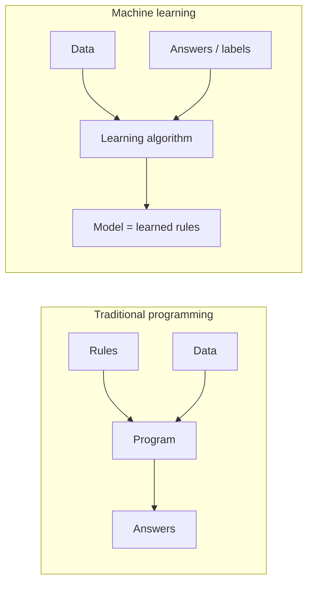
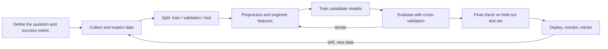

# What machine learning is (and isn't)

> **Before this lesson:** basic Python only. The three maths lessons in module 0 are useful background, and their terms are re-explained here when they appear, so you can start the track at this lesson if you prefer and return to the maths when a later lesson needs it.

## In plain words

Ordinary software is a list of instructions a person wrote: "if the password is wrong three times, lock the account". **Machine learning** (ML) is a different way of producing software. Instead of writing the instructions, you collect examples of the job being done correctly, and a program called a **learning algorithm** works out the instructions from the examples.

Think of how a child learns what a dog is. Nobody hands the child a definition. They are shown dogs, told "dog" each time, and after enough examples they recognise dogs they have never seen. A parent who tried to write the rule down ("four legs, fur, a tail...") would end up including cats and excluding a three-legged dog. Some knowledge is easier to show than to state.

Why this matters for a job: spam filters, product recommendations, fraud alerts, voice assistants and chatbots are all built this way. In interviews you are expected to say what kind of ML problem a task is, when ML is the wrong tool, and what the steps of a project are. This lesson gives you the map; the rest of the track fills in the territory.

## 1. Why machine learning?

Before ML, software that seemed intelligent was built from hand-written **rules**, such as: if the subject line contains "free money", mark the email as spam. Rules still have their place. They are easy to read, cheap to run and predictable. They break down in two situations.

1. **The rules are tied to one narrow task and are fragile.** Change the task a little and much of the rule set has to be rewritten. Spammers notice which words are blocked and switch to others, so the rules are always one step behind.
2. **Writing a rule requires knowing how an expert decides, and for many tasks no expert can say.** You recognise a friend's face instantly, but you could not write down the steps you used. For that reason computers could not reliably find faces in photographs until around 2001, when learning from many example images replaced attempts to describe a face by hand.

ML turns the process around. We **show the computer examples** together with the right answers, and an algorithm finds the mapping from one to the other. The result is called a **model**: the learned rules, stored as numbers.



Read the diagram top to bottom. In traditional programming a person supplies the rules and the computer produces the answers. In machine learning a person supplies data and the answers, and the computer produces the rules.

> [!NOTE]
> ML is not always the answer. If a few clear rules solve the problem, if you have very little data, if every mistake must be explainable step by step, or if the pattern is not in the data at all, a non-ML solution can be cheaper and safer. Before anything else, decide what question you want answered and how you will measure success. Section 10 returns to this.

## 2. Supervised learning

The most common kind of ML is **supervised learning**. You have a collection of examples, and for each one you know both the **input** (what the model will be given) and the correct **output** (what it should answer). The correct output is called the **label**. The goal is a model that gives the right output for *new* inputs it has never seen. The labels play the part of a teacher marking the answers, which is where the word "supervised" comes from.

In symbols, the examples are pairs $(x_i, y_i)$: $x_i$ is the input for example number $i$ and $y_i$ is its label.

Getting labels is often the expensive part of a project. Someone has to do the job by hand first. Three typical cases:

- reading the postcode on a handwritten envelope (input: a picture of the writing; output: the digits). Someone has to type in the digits for thousands of envelopes.
- deciding from a medical scan whether a tumour is harmless (input: the image; output: yes or no). Each label needs a doctor's diagnosis.
- spotting fraudulent card payments (input: the details of a payment; output: fraud or not). Labels arrive when customers report payments they did not make.

Supervised tasks come in two kinds, depending on what the output looks like.

| | **classification** | **regression** |
|---|---|---|
| output | one choice from a fixed list of categories, called **classes** | a number on a continuous scale |
| examples | spam or not spam; species of a flower; which digit from 0 to 9 | price of a house; a person's yearly income; tomorrow's temperature |
| sub-types | **binary** (two classes) or **multiclass** (more than two) | one number, or several at once |
| typical score | accuracy: the share of answers that are right | average size of the error |

The word "regression" is a historical accident; here it means "predicting a number". A test that settles most cases: **is there a meaningful in-between?** If the truth is 40,001 and the model says 40,000, that is nearly right, so it is regression. If the model must say which language a web page is in, there is nothing halfway between French and German; an answer is right or wrong, so it is classification.

## 3. Unsupervised learning

In **unsupervised learning** there are inputs and no labels. Nobody has marked the right answers; the goal is to discover structure that is already in the data. Common forms:

- **Clustering**: sorting items into groups of similar ones, such as customers with similar shopping habits or blog posts on similar subjects (lesson 32).
- **Dimensionality reduction**: squeezing data that has many features into a few numbers while keeping most of the information, so that it can be drawn on a chart or handed to another model (lesson 31).
- **Anomaly detection**: flagging items that look unlike the rest, such as an unusual pattern of visits to a website.
- **Topic modelling**: finding the recurring themes in a large collection of documents (lesson 71).

Judging unsupervised results is harder, because there is no answer key to mark against. Often a person has to look at the groups and decide whether they make sense for the purpose.

## 4. Other kinds of learning you should be able to name

- **Semi-supervised learning**: a small number of labelled examples and a large number of unlabelled ones, used together.
- **Self-supervised learning**: the labels are manufactured from the data itself. Hide the next word of a sentence and ask the model to predict it; the hidden word is the label, and no human had to write it. This is how large language models (LLMs), the technology behind chatbots, get their initial training.
- **Reinforcement learning**: a program (the "agent") takes actions, receives a reward or a penalty, and learns which actions pay off. Used for game playing and robotics.
- **Online learning**: the model keeps updating as new data streams in, instead of being trained once (in scikit-learn, the `partial_fit` method).
- **Ranking and recommendation**: predicting an order ("which ten films should this person see first?") instead of a single label.

## 5. Vocabulary

These words are used in every later lesson. A dataset is pictured as a table.

- **Sample** (also data point, instance, example): one row of the table; one thing we have measurements for.
- **Feature**: one column of the table; one measured property, such as "petal length" or "number of exclamation marks".
- **Label** (also target, response): the output we want to predict. The table of features is named `X` and the column of labels is named `y`.
- **Model** (also estimator): the object that learns from data and then makes predictions.
- **Training** (also fitting): the process of learning from data. **Inference** or **prediction**: using the trained model on new inputs.
- **Parameters**: the numbers inside the model that training sets, for example the weights of a linear model. **Hyperparameters**: the settings *you* choose before training, for example how many neighbours a nearest-neighbour model consults.
- **Generalisation**: how well the model performs on data it has not seen. This is the only performance that matters, because a model is built to be used on new cases.

## 6. Knowing your task and knowing your data

Beginners spend their energy choosing an algorithm. Experienced practitioners spend it understanding the problem and the data, because that is where projects succeed or fail. Before building anything, ask:

- What question am I trying to answer, and can this data answer it?
- What kind of ML problem is it: classification, regression, ranking, something else?
- Do I have enough examples, and do they cover the situations the model will meet?
- Which features do I have, and could a person plausibly predict the label from them?
- How will I measure success, and how does that measurement connect to what the business or the research needs?
- Where does the model sit in the larger product, and what happens with its output?

**How the data is represented matters more than the algorithm.** A model can only use information you give it. A plain model fed well-chosen features regularly matches or beats a sophisticated model fed raw ones (module 4 is about this).

## 7. The standard workflow



A few words in the diagram need explaining. A **metric** is the number you use to score the model. To **split** the data means to set part of it aside: the model learns from the **training set**, you compare alternatives on a **validation set**, and you keep a **test set** untouched for one final, honest check. **Preprocessing** is cleaning and reshaping the data so a model can use it. To **deploy** is to put the model into real use. **Drift** means the world has changed since the model was trained, so its accuracy decays. Each box has its own lesson later.

Three habits matter from the first day:

1. **Look at your data.** Print summaries, count the values in each column, read some rows. This is how you catch measurements in mixed units, impossible values such as an age of 300, mislabelled rows, and columns that secretly contain the answer.
2. **Hold out data you never touch** until the very end. Once a test score has influenced any decision you made, it is no longer an honest estimate of how the model will do on new data.
3. **Start with a baseline**: the crudest method that could possibly work, such as always predicting the most common class. Then try an uncomplicated real model. If a sophisticated model cannot beat the baseline, something is wrong.

```python-run
import numpy as np
from sklearn.datasets import load_breast_cancer
from sklearn.dummy import DummyClassifier
from sklearn.linear_model import LogisticRegression
from sklearn.model_selection import train_test_split
from sklearn.preprocessing import StandardScaler
from sklearn.pipeline import make_pipeline

X, y = load_breast_cancer(return_X_y=True)
print("shape:", X.shape, " class counts:", np.bincount(y), "(0=malignant, 1=benign)")
X_tr, X_te, y_tr, y_te = train_test_split(X, y, stratify=y, random_state=0)

baseline = DummyClassifier(strategy="most_frequent").fit(X_tr, y_tr)
model = make_pipeline(StandardScaler(), LogisticRegression(max_iter=1000)).fit(X_tr, y_tr)
print("majority-class baseline accuracy:", round(baseline.score(X_te, y_te), 3))
print("logistic regression accuracy:    ", round(model.score(X_te, y_te), 3))
```

**Reading this code line by line**

- The `import` lines load NumPy (the library for arrays of numbers) and several pieces of **scikit-learn**, the standard Python library for machine learning. The first run takes a few seconds while it loads. The next lesson explains each piece in detail; here, follow the overall shape.
- `load_breast_cancer(return_X_y=True)` returns a small medical dataset built into scikit-learn: `X` is a table of 569 tumours with 30 measurements each, and `y` holds the label for each, 0 for malignant (cancerous) and 1 for benign (harmless).
- `np.bincount(y)` counts how many times each label occurs: 212 malignant, 357 benign.
- `train_test_split` shuffles the rows and sets a quarter aside as the test set. `X_tr, y_tr` are for training and `X_te, y_te` for testing.
- `DummyClassifier(strategy="most_frequent")` is the baseline. It ignores the measurements and always answers with the most common label. `.fit(...)` trains it.
- The next line builds a real model, logistic regression (lesson 21), preceded by a step that puts all features on the same scale, and trains it.
- `.score(X_te, y_te)` returns the accuracy on the test set: the fraction of test tumours labelled correctly.

The output shows the baseline at about 0.63 and the model at about 0.96. The baseline's 63% comes for free, because 63% of tumours are benign. The model's 96% means something only when placed next to that number. A model reporting "90% accuracy" on a problem where 95% of cases belong to one class is worse than doing nothing clever at all.

## 8. Python's ML toolkit

The libraries used in this track, which are the standard for "classical" machine learning (everything other than large neural networks):

- **NumPy**: arrays of numbers with any number of dimensions, and fast arithmetic on them. scikit-learn takes NumPy arrays as input.
- **SciPy**: scientific routines. The part that matters here is **sparse matrices** (`scipy.sparse`), a memory-saving way to store tables that are almost entirely zeros, used for text data.
- **pandas**: the **DataFrame**, a table with named columns of mixed types, for loading and cleaning data. Think of a spreadsheet you control from code.
- **matplotlib**: drawing charts. (Charts do not display in this site's in-browser examples, so the lessons print text summaries instead.)
- **scikit-learn**: the algorithms, all sharing one consistent way of being called (next lesson).
- For neural networks: **PyTorch** (the most used in research and for language models), TensorFlow/Keras and JAX. For a powerful tree-based method called gradient boosting (lesson 22) on large data: **XGBoost**, **LightGBM** and **CatBoost**.

> [!INTERVIEW]
> **"Supervised vs unsupervised. Give an example of each and how you'd evaluate it."** Supervised: predicting which customers will cancel a subscription, learned from past customers whose outcome is known, and evaluated on a held-out later time period with scores suited to rare events (precision and recall, lesson 52). Unsupervised: grouping customers into segments with k-means, evaluated with a cluster-quality score, a review with the people who know the customers, and in the end by whether the segments lead to better decisions. Bonus: mention that the output of an unsupervised method often becomes a *feature* for a supervised model.

## 9. Learning rules from examples: a miniature demonstration

To make the contrast in section 1 concrete, here is one small task solved both ways. Each message is described by two features: how many times it contains the word "free", and how many exclamation marks it has. First a programmer writes a rule by hand. Then a learning algorithm is given 300 labelled messages and finds its own rule.

```python-run
import numpy as np
from sklearn.tree import DecisionTreeClassifier, export_text

rng = np.random.RandomState(0)
n = 400
is_spam = rng.rand(n) < 0.3
free_count = rng.poisson(np.where(is_spam, 2.0, 0.2))
exclamations = rng.poisson(np.where(is_spam, 3.0, 0.6))
X = np.column_stack([free_count, exclamations])
X_train, y_train, X_test, y_test = X[:300], is_spam[:300], X[300:], is_spam[300:]

# 1) a hand-written rule
hand_rule = lambda X: X[:, 0] >= 1
print("hand-written rule 'contains free':", round(float((hand_rule(X_test) == y_test).mean()), 3))

# 2) a rule learned from 300 labelled examples
tree = DecisionTreeClassifier(max_depth=2, random_state=0).fit(X_train, y_train)
print("learned rule:                     ", round(tree.score(X_test, y_test), 3))
print(export_text(tree, feature_names=["free_count", "exclamations"]))
```

**Reading this code line by line**

- The first block invents 400 messages, since we have no real mailbox here. `rng.rand(n) < 0.3` marks about 30% of them as spam (an array of True/False values). `rng.poisson(...)` draws random counts: spam messages average 2 uses of "free" and 3 exclamation marks, normal ones average 0.2 and 0.6. Individual messages vary, so the two groups overlap.
- `np.column_stack` puts the two count columns side by side to form the feature table `X`. The slices `X[:300]` and `X[300:]` take the first 300 rows for training and the last 100 for testing.
- `hand_rule` is the programmer's rule: call it spam if "free" appears at least once (`X[:, 0]` is column 0 of every row). Comparing its answers with the truth and averaging gives its accuracy.
- `DecisionTreeClassifier` is a model that learns a small set of yes/no questions (lesson 22). `max_depth=2` allows at most two questions in a row. `.fit` learns from the 300 training messages, and `export_text` prints what was learned.

The hand-written rule scores 0.82 and the learned rule 0.85. The printout shows the learned rule: if "free" appears at most once, call it spam only when there are four or more exclamation marks; if "free" appears twice or more, call it spam.

The learned model is also a set of if/else rules. The difference is who wrote them. The algorithm chose the cut-off values from the examples, and it discovered that the two features should be combined. If spammers change their habits, you retrain on fresh examples; nobody rewrites code. That is the practical argument for machine learning in one experiment.

The same experiment shows the limits. The model is only as good as the examples and the features. Had nobody thought to count exclamation marks, no algorithm could have used them. And if the labelled messages came from last year's spam, the learned rule describes last year.

## 10. When machine learning is the wrong tool

Because ML is fashionable, it is worth being explicit about when *not* to use it. Ask these questions before starting a project.

| question | if the answer is "no" |
|---|---|
| Is there a pattern to learn, and does the data contain it? | No model can predict a fair coin toss. |
| Do I have enough examples that represent real use? | Collect data first, or use rules and expert knowledge. |
| Can I say what a correct output is? | Without labels or a clear goal, you can neither train nor evaluate. |
| Is an occasional wrong answer acceptable? | ML models are statistical and will sometimes be wrong. If no error is tolerable, use fixed logic, or have a person check the output. |
| Will the future resemble the data I train on? | If the process changes quickly the model goes stale; plan to retrain it or choose another approach. |
| Is the value worth the cost? | A model must be built, put into service, watched and maintained. A plain rule may capture most of the benefit. |

A useful thought experiment for the last row: imagine you had already built the *perfect* model, one that is never wrong. How much would it be worth? If catching every fraudulent payment would save the company \$100 a month, the project cannot pay for itself however good the model is. If it would save tens of thousands, it deserves a closer look. The estimate takes ten minutes and can save months.

Remember also that building the model is a small part of the whole job. It sits inside a loop: collect data, clean it, build a model, study its mistakes, repeat. Reading through the cases a model gets wrong often reveals what is missing from the data or shows a better way to frame the task. Gathering better data or restating the problem frequently helps more than weeks spent fine-tuning the settings of one algorithm.

> [!TIP]
> A useful first deliverable in any ML project is not a model. It is a table with three rows: the business measure you care about, the baseline's score, and the score a perfect model would get. The gap between the last two tells you how much there is to gain.

## Summary

- ML learns rules from examples instead of having a person write them. It shines when the rules are hard to state and examples are plentiful.
- Supervised learning has labels: classification when the output is a category, regression when it is a number. Unsupervised learning finds structure without labels.
- Hyperparameters are your choices; parameters are learned.
- Know the question, the data and the measure of success before choosing an algorithm. Always compare against a baseline.
- ML is the wrong tool when there is no pattern, no data, no tolerance for error, or no value in the answer.

## Glossary

- **Machine learning (ML)**: producing software by learning from examples instead of writing rules.
- **Model**: the learned rules, stored as numbers, that turn an input into a prediction.
- **Learning algorithm**: the procedure that builds a model from data.
- **Sample / feature / label**: one row of the data / one column / the answer to be predicted.
- **Supervised learning**: learning from examples that come with the right answers.
- **Classification / regression**: predicting a category / predicting a number.
- **Binary / multiclass**: classification with two classes / with more than two.
- **Unsupervised learning**: finding structure in data that has no labels.
- **Clustering**: grouping similar samples together.
- **Dimensionality reduction**: describing each sample with fewer numbers.
- **Self-supervised learning**: learning from labels manufactured out of the data itself.
- **Training / inference**: learning from data / using the trained model on new inputs.
- **Parameter / hyperparameter**: a number the training sets / a setting you choose.
- **Generalisation**: performance on data the model has not seen.
- **Training set / test set**: the data the model learns from / the data held back to judge it.
- **Baseline**: a trivial method used as the point of comparison.
- **Accuracy**: the fraction of predictions that are correct.
- **Drift**: change in the real world that makes a trained model go stale.

## Check yourself

```quiz
[
  {"q": "Predicting tomorrow's maximum temperature in °C is…", "options": ["regression", "binary classification", "multiclass classification", "clustering"], "answer": 0,
   "explain": "The output is continuous: being off by 0.1 °C is nearly right."},
  {"q": "Grouping news articles by topic without any labelled topics is…", "options": ["unsupervised learning (clustering/topic modelling)", "supervised classification", "regression", "reinforcement learning"], "answer": 0,
   "explain": "There are no labels; the algorithm discovers structure on its own."},
  {"q": "Which of these is a hyperparameter rather than a learned parameter?", "options": ["The number of neighbours k in k-NN", "The coefficients of a linear regression", "The split thresholds of a fitted tree", "The weights of a neural network"], "answer": 0,
   "explain": "k is set before training; the others are learned from the data."},
  {"q": "According to Müller & Guido, a key reason to prefer ML over hand-written rules is…", "options": ["Humans often cannot articulate the decision rule (e.g. detecting faces)", "ML models are always more interpretable", "ML needs no data", "Rules cannot use if-statements"], "answer": 0,
   "explain": "Rule-based systems require knowing how an expert decides; for perception tasks nobody can write that down."},
  {"q": "Why compare against a DummyClassifier baseline?", "options": ["To know whether a model's score is actually better than trivial guessing", "Because it is the most accurate model", "To tune hyperparameters", "It is required by scikit-learn"], "answer": 0,
   "explain": "On imbalanced data, majority-class guessing can already achieve high accuracy."},
  {"q": "Pre-training a language model to predict the next token is best described as…", "options": ["self-supervised learning", "unsupervised clustering", "reinforcement learning", "semi-supervised label propagation"], "answer": 0,
   "explain": "The labels (next tokens) are generated from the raw data itself."}
]
```

> **Source:** Müller & Guido, *Introduction to Machine Learning with Python*, ch. 1 ("Why Machine Learning?", "Problems Machine Learning Can Solve", "Knowing Your Task and Knowing Your Data", "Essential Libraries and Tools") and ch. 8 ("Approaching a Machine Learning Problem").
