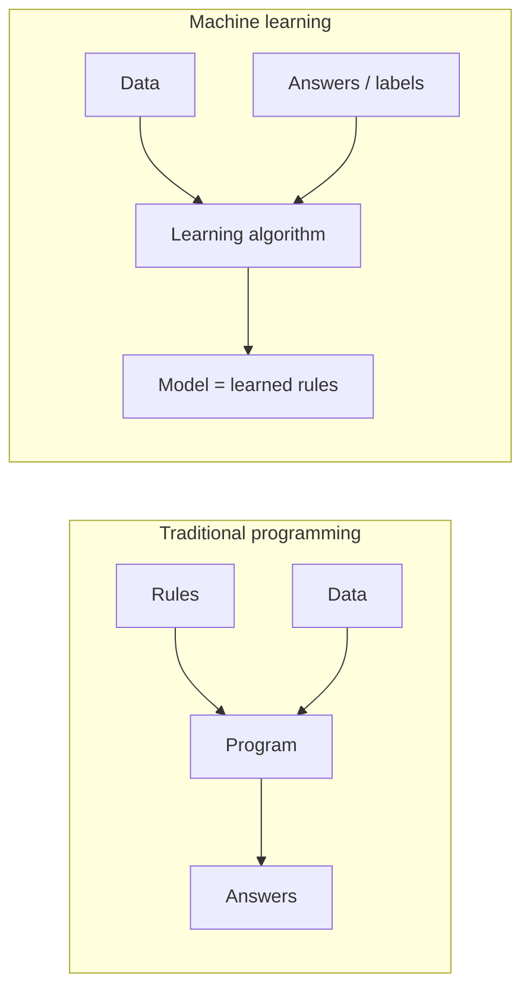
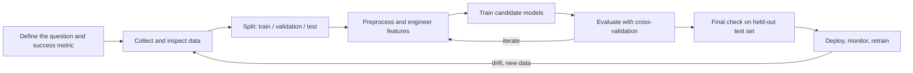

# What machine learning is (and isn't)

Machine learning is about **extracting knowledge from data**. Müller & Guido describe it as a field at the
intersection of statistics, artificial intelligence and computer science, also known as predictive analytics
or statistical learning. This lesson explains when ML is the right tool, how ML problems are classified,
and the workflow every project follows.

## 1. Why machine learning?

Before ML, "intelligent" software was built from hand-written **rules**: `if subject contains "free money"
then spam`. Rules still have their place, but they break down in two ways that Müller & Guido highlight:

1. **The logic is domain-specific and brittle.** Change the task slightly and the whole rule set may have to
   be rewritten. Spammers adapt, and rules go stale.
2. **Writing rules needs a deep understanding of how a human expert decides**, and for many tasks nobody
   can articulate it. Face detection was largely unsolved until about 2001 because no one could write down
   the rule that distinguishes a face from a pattern of pixels.

ML flips this around. Instead of writing the program, we **show it examples** and let an algorithm find the
mapping.



> [!NOTE]
> ML is not always the answer. If a few clear rules solve the problem, if you have very little data, if
> mistakes are catastrophic and must be explainable rule by rule, or if the pattern doesn't exist in the
> data at all, a non-ML solution can be cheaper and safer. Chapter 8 of Müller & Guido says it bluntly:
> first ask what question you want to answer and how you will measure success.

## 2. Supervised learning

In **supervised learning** you have input/output pairs $(x_i, y_i)$ and want a model that predicts $y$ for
*new* $x$. The supervision is the label. Collecting labels is often the expensive part. Someone has to
read the handwritten zip codes, diagnose the tumours, or wait to see whether the loan defaulted.

Examples from the book:

- reading zip codes from handwritten envelopes (input: an image; output: digits);
- deciding whether a tumour is benign from a medical image (labels need expert diagnosis);
- detecting fraudulent credit-card transactions (labels come from customer reports).

Supervised tasks come in two flavours:

| | **classification** | **regression** |
|---|---|---|
| output | a class label from a fixed set | a continuous number |
| examples | spam / not spam; iris species; digit 0–9 | house price; yearly income; temperature tomorrow |
| sub-types | binary (2 classes) or multiclass | single or multi-output |
| typical metric | accuracy, F1, ROC AUC | MSE, MAE, $R^2$ |

A simple test from Müller & Guido: **is there continuity in the output?** If predicting 40,000 when the
truth is 40,001 is "almost right", it is regression. If there is no meaningful in-between, such as a
language somewhere between French and German, it is classification.

## 3. Unsupervised learning

In **unsupervised learning** there are only inputs, with no labels. The goal is to discover structure:

- **clustering**: grouping customers with similar preferences, or blog posts by topic;
- **dimensionality reduction**: compressing many features into a few for visualisation or as a
  preprocessing step (PCA, t-SNE);
- **anomaly detection**: flagging unusual website access patterns;
- **density estimation** and **topic modelling**: finding the themes in a document collection (LDA).

Evaluating unsupervised results is harder because there is no ground truth to compare against. The
assessment is often qualitative: a human inspects the clusters.

## 4. Other paradigms you should be able to name

- **Semi-supervised**: a few labels and lots of unlabelled data (pseudo-labelling, label propagation).
- **Self-supervised**: labels are manufactured from the data itself, such as predicting the next word or a
  masked patch. This is how large language models are pre-trained.
- **Reinforcement learning**: an agent acts in an environment and learns from rewards rather than labels
  (game playing, robotics, RLHF for LLMs).
- **Online learning**: the model updates continuously as data streams in (`partial_fit` in scikit-learn).
- **Ranking and recommendation**: predict an ordering or user–item affinity. The book's final chapter
  points to these as further topics.

## 5. Vocabulary

Following scikit-learn and the book:

- **Sample / data point / instance**: one row of $X$.
- **Feature**: one column, a measured property.
- **Label / target / response**: what we predict, $y$.
- **Model / estimator**: the object that learns from data.
- **Training**: fitting parameters on data. **Inference / prediction**: applying the model.
- **Parameters**: learned from data (weights, split thresholds). **Hyperparameters**: chosen by you before
  training (k in k-NN, `alpha`, tree depth).
- **Generalisation**: performance on data the model has not seen. This is the only thing that matters.

## 6. Knowing your task and knowing your data

Müller & Guido stress that understanding the data matters more than which algorithm you pick. Before
modelling, ask:

- What question am I trying to answer? Do I think the data can answer it?
- What is the best way to phrase it as an ML problem (classification? regression? ranking?)
- Do I have enough data to represent the problem?
- Which features did I extract, and can they actually predict the target?
- How will I measure success, and how does that connect to the business or research goal?
- How will the solution interact with other parts of the system or product?

**Feature representation matters more than the algorithm.** A model can only use the information you give
it. In chapter 4 the authors show that a linear model with well-engineered features can match or beat a
complex model on raw ones.

## 7. The standard workflow



Three habits matter from day one:

1. **Look at your data**, with summary statistics, value counts and plots. You catch unit mismatches,
   impossible values, leakage columns and label errors this way.
2. **Hold out data you never touch** until the very end. A test score that influenced any decision is no
   longer an unbiased estimate.
3. **Start with a simple baseline**: predicting the majority class or mean, then k-NN or logistic
   regression. If a fancy model can't beat it, something is wrong.

```python-run
import numpy as np
from sklearn.datasets import load_breast_cancer
from sklearn.dummy import DummyClassifier
from sklearn.linear_model import LogisticRegression
from sklearn.model_selection import train_test_split
from sklearn.preprocessing import StandardScaler
from sklearn.pipeline import make_pipeline

X, y = load_breast_cancer(return_X_y=True)
print("shape:", X.shape, " class counts:", np.bincount(y), "(0=malignant, 1=benign)")
X_tr, X_te, y_tr, y_te = train_test_split(X, y, stratify=y, random_state=0)

baseline = DummyClassifier(strategy="most_frequent").fit(X_tr, y_tr)
model = make_pipeline(StandardScaler(), LogisticRegression(max_iter=1000)).fit(X_tr, y_tr)
print("majority-class baseline accuracy:", round(baseline.score(X_te, y_te), 3))
print("logistic regression accuracy:    ", round(model.score(X_te, y_te), 3))
```

The baseline already scores about 63%. A model's 95% only means something next to that number.

## 8. Python's ML ecosystem

The book's toolset, which is still the standard for "classical" ML:

- **NumPy**: n-dimensional arrays. scikit-learn takes numpy arrays as input.
- **SciPy**: scientific routines, including **sparse matrices** (`scipy.sparse`) used for text data.
- **pandas**: DataFrames for loading, cleaning and wrangling tabular data, similar to SQL tables or R data
  frames.
- **matplotlib**: plotting.
- **scikit-learn**: the algorithms with a uniform API (next lesson).
- For deep learning: **PyTorch** (dominant in research and LLMs), TensorFlow/Keras and JAX. For gradient
  boosting at scale: **XGBoost**, **LightGBM**, **CatBoost**.

> [!INTERVIEW]
> **"Supervised vs unsupervised. Give an example of each and how you'd evaluate it."** Supervised:
> churn prediction from labelled historical customers, evaluated with precision/recall or ROC AUC on a
> held-out period. Unsupervised: customer segmentation with k-means, evaluated by silhouette score plus
> qualitative review with the business, and ultimately by whether the segments drive better decisions.
> Bonus: mention that unsupervised outputs often become *features* for a supervised model.

## Summary

- ML learns rules from examples instead of hand-coding them. It shines when rules are hard to write down
  and data is plentiful.
- Supervised learning has labels (classification for discrete outputs, regression for continuous ones).
  Unsupervised learning finds structure without labels.
- Hyperparameters are your choices; parameters are learned.
- Know the question, the data and the success metric before choosing an algorithm. Baselines first.

```quiz
[
  {"q": "Predicting tomorrow's maximum temperature in °C is…", "options": ["regression", "binary classification", "multiclass classification", "clustering"], "answer": 0,
   "explain": "The output is continuous: being off by 0.1 °C is nearly right."},
  {"q": "Grouping news articles by topic without any labelled topics is…", "options": ["unsupervised learning (clustering/topic modelling)", "supervised classification", "regression", "reinforcement learning"], "answer": 0,
   "explain": "There are no labels; the algorithm discovers structure on its own."},
  {"q": "Which of these is a hyperparameter rather than a learned parameter?", "options": ["The number of neighbours k in k-NN", "The coefficients of a linear regression", "The split thresholds of a fitted tree", "The weights of a neural network"], "answer": 0,
   "explain": "k is set before training; the others are learned from the data."},
  {"q": "According to Müller & Guido, a key reason to prefer ML over hand-written rules is…", "options": ["Humans often cannot articulate the decision rule (e.g. detecting faces)", "ML models are always more interpretable", "ML needs no data", "Rules cannot use if-statements"], "answer": 0,
   "explain": "Rule-based systems require knowing how an expert decides; for perception tasks nobody can write that down."},
  {"q": "Why compare against a DummyClassifier baseline?", "options": ["To know whether a model's score is actually better than trivial guessing", "Because it is the most accurate model", "To tune hyperparameters", "It is required by scikit-learn"], "answer": 0,
   "explain": "On imbalanced data, majority-class guessing can already achieve high accuracy."},
  {"q": "Pre-training a language model to predict the next token is best described as…", "options": ["self-supervised learning", "unsupervised clustering", "reinforcement learning", "semi-supervised label propagation"], "answer": 0,
   "explain": "The labels (next tokens) are generated from the raw data itself."}
]
```

> **Source:** Müller & Guido, *Introduction to Machine Learning with Python*, ch. 1 ("Why Machine Learning?", "Problems Machine Learning Can Solve", "Knowing Your Task and Knowing Your Data", "Essential Libraries and Tools") and ch. 8 ("Approaching a Machine Learning Problem").
