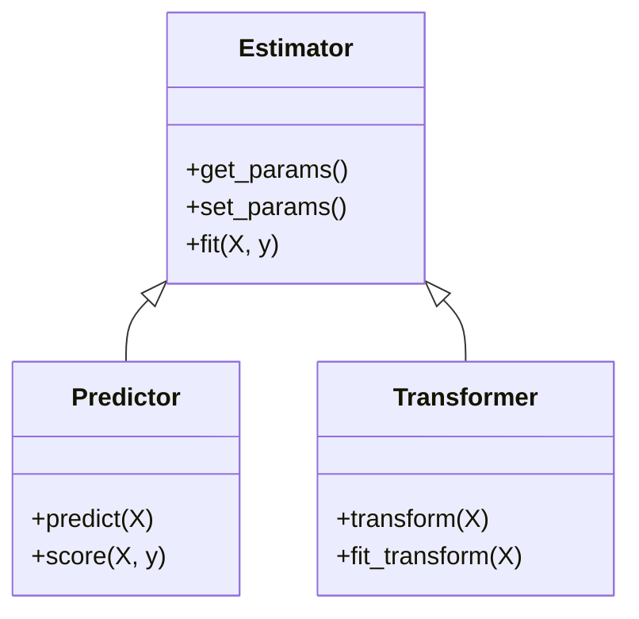

# The scikit-learn API and your first model

> **Before this lesson:** basic Python, and the vocabulary from [What machine learning is](#/lesson/ml/what-is-ml): sample, feature, label, model, training, classification, training set and test set. It helps to know that a dataset is a table of numbers with one row per sample ([Linear algebra for ML](#/lesson/ml/linear-algebra), section 1), but that is repeated here.

## In plain words

**scikit-learn** (imported in code as `sklearn`) is the standard Python library for machine learning. It contains dozens of learning algorithms, and its great convenience is that they all work the same way: you create the model, you call `fit` to make it learn, you call `predict` to get answers. Think of a wall socket. Whether you plug in a lamp or a kettle, the plug is the same shape. Once you have used one scikit-learn model, you know how to use the rest.

The set of functions a library offers, and the way you call them, is its **API** (application programming interface). This lesson teaches the scikit-learn API by building a complete, working model from start to finish: load data, look at it, hold some back, train, predict, and measure how good the result is.

Why this matters for a job: these six steps are the skeleton of every ML project, and "walk me through training and evaluating a classifier" is a standard interview opener. You will also meet the error messages that every newcomer hits in the first week, with what each one means.

## 1. The problem

A hobby botanist has measured four things on each of 150 iris flowers, all in centimetres: the length and width of the **petals** (the coloured parts of the flower) and of the **sepals** (the small green leaves under the petals). For each flower an expert has already identified the species, which is one of three: *setosa*, *versicolor* or *virginica*. The question: can a model learn to name the species of a flower from its four measurements alone?

In the vocabulary of the previous lesson:

- It is **supervised** learning, because we have the right answer for every example.
- It is **classification**, because the answer is a category, and **three-class** classification because there are three possible species.
- The possible outputs are the **classes**. The species of one particular flower is its **label**.

## 2. Meet the data

The iris dataset ships with scikit-learn, so nothing has to be downloaded.

```python-run
from sklearn.datasets import load_iris
iris = load_iris()
print("keys:", list(iris.keys()))
print("target names:", iris.target_names)
print("feature names:", iris.feature_names)
print("data shape:", iris.data.shape, " dtype:", iris.data.dtype)
print("first five rows:\n", iris.data[:5])
print("targets:", iris.target[:5], "...", iris.target[-5:])
```

**Reading this code line by line**

- `from sklearn.datasets import load_iris` fetches one function from the library. The first scikit-learn import in a session takes a few seconds.
- `iris = load_iris()` returns a `Bunch`, a container that behaves like a Python dictionary: named entries you look up by key. `iris.keys()` lists the names.
- `iris.target_names` holds the three species names. `iris.feature_names` holds the names of the four measurements.
- `iris.data` is the table of measurements, stored as a NumPy array (NumPy is Python's library for grids of numbers). Its `.shape` is `(150, 4)`: 150 rows and 4 columns. `dtype` is the type of number stored; `float64` means decimals.
- `iris.data[:5]` shows the first five rows. Each row is one flower: sepal length, sepal width, petal length, petal width.
- `iris.target` is the list of labels. Species are stored as the whole numbers 0, 1 and 2, which are positions in `target_names`: 0 is setosa, 1 is versicolor, 2 is virginica. Models work with numbers, so text labels are always encoded this way.

The layout to remember, used in every lesson from here on: **rows are samples and columns are features**.

## 3. Measuring success: training and test data

We cannot judge a model on the same flowers it learned from. A model could memorise every training flower and look perfect while knowing nothing about flowers in general, in the way a student who has memorised last year's exam answers has not learned the subject. We need flowers the model has never seen.

So before training we set part of the data aside. The function `train_test_split` shuffles the rows and, unless told otherwise, puts **75% in a training set** (to learn from) and **25% in a test set** (to judge with).

```python-run
from sklearn.datasets import load_iris
from sklearn.model_selection import train_test_split
import numpy as np

iris = load_iris()
X_train, X_test, y_train, y_test = train_test_split(iris.data, iris.target, random_state=0)
print("X_train:", X_train.shape, " X_test:", X_test.shape)
print("class counts train:", np.bincount(y_train), " test:", np.bincount(y_test))
print("first 10 labels in file order:", iris.target[:10], "<- sorted by class!")
```

`train_test_split` takes the feature table and the labels and returns four pieces: training features, test features, training labels, test labels, in that order. The output shows 112 training flowers and 38 test flowers. `np.bincount` counts how often each label (0, 1, 2) appears in each piece.

Three details matter:

- **Shuffling is essential.** The last line of output shows the file is sorted by species: all the setosas, then all the versicolors, then all the virginicas. Taking the last 25% without shuffling would produce a test set containing only virginica.
- **`random_state=0` fixes the shuffle.** Computers produce "random" numbers from a starting value called a **seed**. Giving the same seed gives the same shuffle on every run, so your results can be repeated by you and by others. Any whole number works; 0 is a common choice.
- **Naming.** By convention the feature table is a capital `X` (it is a two-dimensional grid, a matrix) and the labels are a lower-case `y` (a one-dimensional list, a vector).

> [!TIP]
> For classification, add `stratify=y`. That makes both pieces keep the same proportion of each class as the full dataset. In the output above the split is uneven (13, 16 and 9 flowers per species in the test set); stratifying would make it as even as possible. It matters most when the dataset is small or one class is rare.

## 4. First things first: look at your data

Before building a model, inspect the data. Does the task look possible at all? Is anything odd, such as some lengths recorded in inches and others in centimetres? The usual tool is a chart of every pair of features. Charts do not display in this page's code boxes, so here is a text version: for each species, the average, smallest and largest value of each measurement.

```python-run
import pandas as pd
from sklearn.datasets import load_iris
iris = load_iris()
df = pd.DataFrame(iris.data, columns=[c.replace(" (cm)", "") for c in iris.feature_names])
df["species"] = iris.target_names[iris.target]
print(df.groupby("species").agg(["mean", "min", "max"]).round(1).T)
```

**Reading this code line by line**

- `import pandas as pd` loads pandas, the library for tables with named columns. Such a table is called a **DataFrame**.
- `pd.DataFrame(iris.data, columns=[...])` wraps the measurements in a DataFrame. The expression in square brackets builds the list of column names with the text " (cm)" removed.
- `df["species"] = iris.target_names[iris.target]` adds a column holding each flower's species name. Indexing the array of names with the array of labels looks up all 150 names at once.
- `df.groupby("species")` gathers the rows of each species together; `.agg(["mean", "min", "max"])` computes those three summaries for every column within each group; `.round(1)` keeps one decimal; `.T` flips the table on its side so it fits the screen.

Read the petal-length rows of the output. The longest setosa petal is 1.9 cm, and the shortest petal of either other species is 3.0 cm. One measurement separates setosa from the rest completely. The other two species overlap a little (versicolor petals reach 5.1 cm and virginica petals start at 4.5 cm). So the task is feasible, and a good model should be right nearly all the time.

## 5. The estimator API

In scikit-learn every model is an **estimator**: a Python object that can learn from data. (An object bundles some data with functions that act on it; those functions are called **methods** and are written after a dot, as in `model.fit(...)`.) All estimators share the same methods.

| method | what it does | who has it |
|---|---|---|
| `Estimator(**hyperparams)` | creates the object with the settings you chose; nothing is learned yet | all |
| `.fit(X, y)` | learns from the training data; returns the object itself | all (`y` is left out for unsupervised models) |
| `.predict(X)` | returns predicted labels or numbers for the rows of `X` | supervised models, some clustering models |
| `.score(X, y)` | a default measure of quality: accuracy for classifiers, a measure called $R^2$ for regressors (lesson 20) | supervised models |
| `.transform(X)` | returns a changed version of the data | preprocessing steps, PCA and similar |
| `.fit_transform(X)` | fit, then transform, in one call | transformers |
| `.predict_proba(X)` / `.decision_function(X)` | how sure the model is about each prediction (lesson 23) | most classifiers |

A convention worth knowing: anything the model *learned* is stored in an attribute whose name ends in an **underscore**, such as `coef_`, `classes_` or `n_features_in_`. The underscore tells you it exists only after `fit` has run. Settings you chose yourself have no underscore.



The diagram says that there are two families built on the same base. **Predictors** (models) answer questions. **Transformers** change the data, for example by rescaling it. Both learn with `fit`.

## 6. Building your first model: k-nearest neighbours

The **k-nearest-neighbours** classifier (k-NN) is the easiest model to understand. To classify a new flower, find the training flowers whose measurements are closest to it and let them vote. The letter $k$ is the number of neighbours consulted. With $k = 1$, the new flower gets the label of the single closest training flower. "Closest" means the smallest straight-line distance between the two rows of four numbers (section 10 gives the formula).

For this model, **fitting stores the training set and nothing more**. All the work happens when a prediction is requested.

```python-run
import numpy as np
from sklearn.datasets import load_iris
from sklearn.model_selection import train_test_split
from sklearn.neighbors import KNeighborsClassifier

iris = load_iris()
X_train, X_test, y_train, y_test = train_test_split(iris.data, iris.target, random_state=0)

knn = KNeighborsClassifier(n_neighbors=1)   # 1. instantiate with hyperparameters
knn.fit(X_train, y_train)                   # 2. learn (here: memorise)

# 3. predict a new flower: sepal 5 x 2.9 cm, petal 1 x 0.2 cm
X_new = np.array([[5, 2.9, 1, 0.2]])        # note: 2-D, one row per sample
pred = knn.predict(X_new)
print("prediction:", pred, "->", iris.target_names[pred])

# 4. evaluate on held-out data
y_pred = knn.predict(X_test)
print("test predictions:", y_pred)
print("accuracy (manual):", round(float(np.mean(y_pred == y_test)), 3))
print("accuracy (.score):", round(knn.score(X_test, y_test), 3))
```

**Reading this code line by line**

- `KNeighborsClassifier(n_neighbors=1)` creates the model. `n_neighbors` is its hyperparameter $k$, a setting we choose. Nothing has been learned yet.
- `knn.fit(X_train, y_train)` trains it on the 112 training flowers and their labels.
- `X_new = np.array([[5, 2.9, 1, 0.2]])` is a flower we invent. Notice the double square brackets: this is a table with one row and four columns, not a flat list of four numbers.
- `knn.predict(X_new)` returns an array with one label per row. It prints `[0]`, and looking that up in `target_names` gives `setosa`. That is sensible: a 1 cm petal is typical of setosa only.
- `knn.predict(X_test)` predicts all 38 test flowers.
- `y_pred == y_test` compares predictions with the true labels, giving True or False for each flower. `np.mean` of True/False values is the fraction that are True: the **accuracy**. `knn.score` computes the same number in one call.

Both lines print 0.974: 37 of the 38 test flowers are named correctly. Because the test flowers were never shown to the model, we can expect about the same success rate on new flowers.

> [!WARNING]
> A frequent error is `knn.predict([5, 2.9, 1, 0.2])`, which fails with "Expected 2D array, got 1D array instead". scikit-learn always expects `X` to have the shape (number of samples, number of features), even for one sample. Wrap a single sample as `[[...]]`, or convert a flat array `x` with `x.reshape(1, -1)`, which means "one row, and work out the number of columns yourself".

## 7. Trying different hyperparameters

How does the choice of $k$ change the result? The loop below tries six values and prints two accuracies for each: on the training set itself, and from **cross-validation**, a method (lesson 50) that repeatedly holds out a slice of the training data to get an honest estimate without touching the test set.

```python-run
from sklearn.datasets import load_iris
from sklearn.model_selection import train_test_split, cross_val_score
from sklearn.neighbors import KNeighborsClassifier

X, y = load_iris(return_X_y=True)
X_train, X_test, y_train, y_test = train_test_split(X, y, random_state=0)
for k in [1, 3, 5, 15, 40, 80]:
    knn = KNeighborsClassifier(n_neighbors=k).fit(X_train, y_train)
    cv = cross_val_score(KNeighborsClassifier(n_neighbors=k), X_train, y_train, cv=5).mean()
    print(f"k={k:3d}  train acc={knn.score(X_train, y_train):.3f}  5-fold CV on train={cv:.3f}")
```

`load_iris(return_X_y=True)` is a shortcut that hands back the feature table and the labels directly. `cross_val_score(..., cv=5)` returns five accuracy values, and `.mean()` averages them.

Look at the two ends of the output. With $k=1$ the training accuracy is a perfect 1.000, because each training flower's nearest neighbour is itself. That number is memorisation and tells us nothing; the honest estimate is 0.947. With $k=80$ both numbers collapse to under 0.8: with 80 voters out of 112 training flowers, the vote is dominated by whichever species is most common, whatever the flower looks like. The best values lie in between. The next lesson names these two failures (overfitting and underfitting) and explains the trade-off. Never choose $k$ by looking at test-set accuracy; lesson 50 explains why.

## 8. Swapping the model is one line

Because every estimator has the same methods, trying a different algorithm changes only the line that creates the model. The four models below are each explained in module 2; for now, notice that the loop treats them identically.

```python-run
from sklearn.datasets import load_iris
from sklearn.model_selection import train_test_split
from sklearn.linear_model import LogisticRegression
from sklearn.tree import DecisionTreeClassifier
from sklearn.ensemble import RandomForestClassifier
from sklearn.svm import SVC

X, y = load_iris(return_X_y=True)
X_train, X_test, y_train, y_test = train_test_split(X, y, random_state=0)
models = {
    "logistic regression": LogisticRegression(max_iter=1000),
    "decision tree": DecisionTreeClassifier(random_state=0),
    "random forest": RandomForestClassifier(n_estimators=50, random_state=0),
    "RBF SVM": SVC(),
}
for name, m in models.items():
    m.fit(X_train, y_train)
    print(f"{name:20s} test accuracy = {m.score(X_test, y_test):.3f}")
```

The dictionary `models` maps a name to an unfitted estimator. The loop fits each one and prints its test accuracy. All four score 0.974 here: iris is an easy dataset, and with 38 test flowers they all miss the same single one. On harder data the models differ, and choosing among them is what the following lessons are about.

## 9. Method chaining and other conveniences

`fit` returns the estimator itself, so calls can be chained on one line: `KNeighborsClassifier().fit(X, y).predict(X_new)`. `model.get_params()` returns every hyperparameter with its current value, which is the quickest way to see the defaults. Printing a model shows the settings you changed from the defaults. The three methods `fit`, `predict` and `score` are the core of supervised learning in scikit-learn; everything else builds on them.

> [!INTERVIEW]
> **"Walk me through training and evaluating a classifier in scikit-learn."** Load `X` (two-dimensional: samples by features) and `y`. Split with `train_test_split(..., stratify=y, random_state=...)`. Put the preprocessing steps and the model in a `Pipeline` (lesson 60). Tune hyperparameters with `GridSearchCV` using cross-validation on the training set only (lesson 51). Evaluate once on the test set with a measure suited to the problem, which is not always accuracy (lesson 52). Mention that learned attributes end in `_` and that `fit` returns the estimator.

## 10. k-NN from scratch, to see what `fit` and `predict` really do

A model stops being a black box once you have written it yourself. Here is the whole k-NN classifier in NumPy, checked against scikit-learn's. The steps are the ones described in section 6.

1. For each test flower, compute the **Euclidean distance** (straight-line distance) to every training flower: subtract the two rows feature by feature, square each difference, add them up, and take the square root. In symbols, with $x_j$ the $j$-th feature of the test flower and $x_{ij}$ the $j$-th feature of training flower $i$: $d(x, x_i) = \sqrt{\sum_j (x_j - x_{ij})^2}$. Example with two features: from $(1, 2)$ to $(4, 6)$ the differences are 3 and 4, so the distance is $\sqrt{9 + 16} = 5$.
2. Sort the distances and keep the $k$ smallest.
3. Count the labels of those $k$ neighbours and return the most common one.

```python-run
import numpy as np
from sklearn.datasets import load_iris
from sklearn.model_selection import train_test_split
from sklearn.neighbors import KNeighborsClassifier

X, y = load_iris(return_X_y=True)
X_train, X_test, y_train, y_test = train_test_split(X, y, random_state=0)

def knn_predict(X_train, y_train, X_test, k):
    # broadcasting: (n_test, 1, p) - (1, n_train, p) -> (n_test, n_train, p)
    diff = X_test[:, None, :] - X_train[None, :, :]
    dist = np.sqrt((diff ** 2).sum(axis=2))                 # (n_test, n_train)
    nearest = np.argsort(dist, axis=1)[:, :k]               # indices of the k closest training points
    votes = y_train[nearest]                                # their labels, shape (n_test, k)
    return np.array([np.bincount(row).argmax() for row in votes])

mine = knn_predict(X_train, y_train, X_test, k=3)
theirs = KNeighborsClassifier(n_neighbors=3).fit(X_train, y_train).predict(X_test)
print("distance matrix shape:", (len(X_test), len(X_train)))
print("identical to scikit-learn:", np.array_equal(mine, theirs))
print("accuracy:", round(float((mine == y_test).mean()), 3))
i = 0
d = np.sqrt(((X_train - X_test[i]) ** 2).sum(axis=1))
order = np.argsort(d)[:3]
print("test flower 0 -> neighbour distances", d[order].round(2), "labels", y_train[order], "=> predict", mine[i])
```

**Reading this code line by line**

- `X_test[:, None, :] - X_train[None, :, :]` is the dense line. Writing `None` inside the brackets inserts an extra axis of size 1, so the test array becomes shape (38, 1, 4) and the training array (1, 112, 4). NumPy then stretches each to match the other (this is called **broadcasting**) and subtracts, giving a (38, 112, 4) block: for every pair of test flower and training flower, the four differences.
- `(diff ** 2).sum(axis=2)` squares the differences and adds up the four features (`axis=2` is the last axis). The square root gives a 38 × 112 table of distances.
- `np.argsort(dist, axis=1)` returns, for each row, the positions that would sort it from smallest to largest. `[:, :k]` keeps the first `k`: the positions of the nearest neighbours.
- `y_train[nearest]` looks up the labels of those neighbours.
- `np.bincount(row).argmax()` counts how often each label occurs among the `k` votes and returns the label with the most.
- The lines after the function run it with `k=3`, run scikit-learn's version, and check with `np.array_equal` that the two give identical predictions. The final lines redo the calculation for test flower 0 alone.

The output confirms the two versions agree, and shows the reasoning for one flower: its three nearest neighbours lie about 0.5 cm away and all carry label 2, so it is predicted to be virginica.

Two things to take from this. First, "training" for k-NN is nothing more than keeping `X_train` and `y_train`. Second, all the cost falls at prediction time: one distance for every pair of test and training flowers, an amount of work proportional to (number of test samples) × (number of training samples) × (number of features), written $O(n_{test}\cdot n_{train}\cdot p)$. That is why k-NN becomes slow to predict when the training set is large. The problem *ml-knn-predict* asks you to write this yourself with exact rules for ties.

## 11. Reproducibility and common first-week errors

A result you cannot reproduce is hard to trust and impossible to debug. Three sources of randomness appear in almost every script:

- the **split**: `train_test_split(..., random_state=0)`;
- the **model**, if it uses random numbers while learning: `RandomForestClassifier(random_state=0)`, and likewise `KMeans` and `MLPClassifier`;
- the **cross-validation shuffle**, if you ask for one: `KFold(shuffle=True, random_state=0)`.

Fix all three while developing. When you report a final number, vary the seed on purpose and report the spread, so that readers can see how much of the result is luck.

```python-run
import numpy as np
from sklearn.datasets import load_iris
from sklearn.model_selection import train_test_split
from sklearn.neighbors import KNeighborsClassifier

X, y = load_iris(return_X_y=True)
def run(seed):
    X_tr, X_te, y_tr, y_te = train_test_split(X, y, random_state=seed)
    return KNeighborsClassifier(n_neighbors=3).fit(X_tr, y_tr).score(X_te, y_te)
print("same seed twice:", run(0), run(0))
scores = [run(s) for s in range(30)]
print(f"30 different seeds: mean={np.mean(scores):.3f}  min={min(scores):.3f}  max={max(scores):.3f}")
```

The function `run` does the whole experiment (split, fit, score) for a given seed. Calling it twice with seed 0 prints the same accuracy twice. Calling it with 30 different seeds gives accuracies from about 0.895 to 1.000, averaging 0.958. Same data, same model, different shuffles.

So the single number "97%" from section 6 is one draw from this range. With only 38 test flowers, one extra mistake moves the accuracy by 2.6 percentage points. The cross-validation lesson (50) turns this observation into a method.

Errors nearly everyone meets in their first week, and how to read them:

| message or symptom | cause | fix |
|---|---|---|
| `Expected 2D array, got 1D array instead` | a single sample passed as a flat list | `x.reshape(1, -1)` or `[[...]]` |
| `Found input variables with inconsistent numbers of samples` | `X` and `y` have different numbers of rows | print both shapes; you probably filtered or split only one of them |
| `NotFittedError` | `predict` or `transform` called before `fit` | fit first, and check you are using the fitted object |
| `could not convert string to float` | a text column in `X` | convert categories to numbers (lesson 40) |
| `Input contains NaN` | missing values (`NaN` means "not a number", the marker for an empty cell) | fill them in (lessons 30 and 61) |
| training accuracy 100%, test accuracy much lower | memorisation | a less flexible model (next lesson) |
| test accuracy suspiciously perfect | the answer has leaked into the features | inspect the columns (lesson 61) |

## Summary

- Iris is a three-class supervised classification problem: 150 samples, 4 features.
- Always evaluate on data the model did not see. Shuffle before splitting, and set `random_state` so the result can be repeated.
- The estimator API: create the object, `fit`, then `predict` or `score` (and `transform` for transformers).
- k-NN stores the training set and lets the closest points vote. $k$ controls how flexible the model is.
- Swapping algorithms is a one-line change, which is why scikit-learn is the standard for classical ML.
- One accuracy number from one small test set is a noisy estimate.

## Glossary

- **scikit-learn**: the standard Python library for classical machine learning.
- **API**: the set of functions a library offers and how they are called.
- **Estimator**: any scikit-learn object that learns from data with `fit`.
- **Method**: a function attached to an object, called with a dot: `model.fit(...)`.
- **Transformer**: an estimator that changes data (`transform`), as opposed to predicting.
- **Class**: one of the possible categories a classifier can output.
- **`fit` / `predict` / `score`**: learn from data / produce answers / measure quality.
- **Training set / test set**: the rows used for learning / the rows held back for judging.
- **Seed (`random_state`)**: the starting value that makes random operations repeatable.
- **Stratify**: split so that each piece keeps the same class proportions.
- **k-nearest neighbours (k-NN)**: a model that labels a new point by a vote among the $k$ closest training points.
- **Euclidean distance**: straight-line distance between two rows of numbers.
- **Accuracy**: the fraction of predictions that are correct.
- **Cross-validation**: estimating performance by repeatedly holding out part of the training data.
- **DataFrame**: a pandas table with named columns.
- **Broadcasting**: NumPy's automatic stretching of arrays so that their shapes match.

## Check yourself

```quiz
[
  {"q": "What does `train_test_split` do by default?", "options": ["Shuffles and puts 25% of samples in the test set", "Takes the last 25% of rows without shuffling", "Splits 50/50", "Stratifies by the label automatically"], "answer": 0,
   "explain": "Default test_size is 0.25 with shuffling; stratification requires stratify=y."},
  {"q": "Why must you shuffle the iris data before splitting?", "options": ["The rows are sorted by class", "scikit-learn requires shuffled data", "To increase the sample size", "To normalise the features"], "answer": 0,
   "explain": "Without shuffling, the test set would contain only one species."},
  {"q": "knn.predict([5, 2.9, 1, 0.2]) fails because…", "options": ["X must be 2-D: shape (n_samples, n_features)", "k-NN cannot predict single samples", "the values must be integers", "predict needs y as well"], "answer": 0,
   "explain": "Pass [[5, 2.9, 1, 0.2]] or reshape(1, -1)."},
  {"q": "Attributes such as coef_ and classes_ end with an underscore to signal that…", "options": ["they are learned during fit", "they are private", "they are hyperparameters", "they are deprecated"], "answer": 0,
   "explain": "scikit-learn convention: trailing underscore = estimated from data, exists only after fitting."},
  {"q": "A 1-NN classifier's accuracy on its own training set is…", "options": ["100% (barring duplicate points with different labels)", "about 50%", "the same as on the test set", "undefined"], "answer": 0,
   "explain": "Every training point's nearest neighbour is itself, so training accuracy says nothing about generalisation."},
  {"q": "What does `.score(X, y)` return for a classifier?", "options": ["Accuracy", "R²", "Log-loss", "F1 score"], "answer": 0,
   "explain": "Classifiers default to mean accuracy; regressors default to R²."},
  {"q": "What does `KNeighborsClassifier.fit` actually compute?", "options": ["It stores the training data (plus an optional search index)", "A weight vector", "A tree of if/else rules", "Cluster centroids"], "answer": 0,
   "explain": "k-NN is a lazy learner: the work happens at prediction time."}
]
```

> **Source:** Müller & Guido, *Introduction to Machine Learning with Python*, ch. 1 ("A First Application: Classifying Iris Species": Meet the Data, Measuring Success, Look at Your Data, Building Your First Model, Making Predictions, Evaluating the Model); ch. 2 ("Method chaining" box); scikit-learn User Guide, "Getting started".
